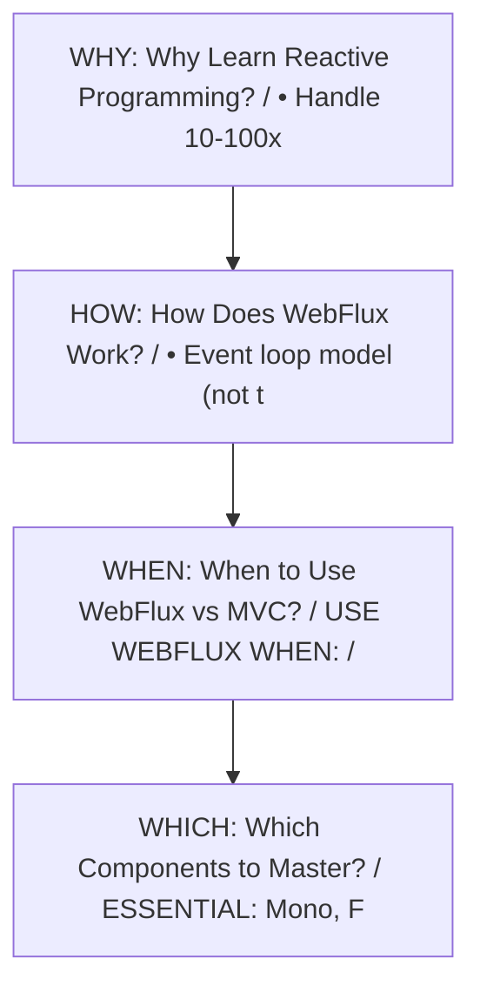
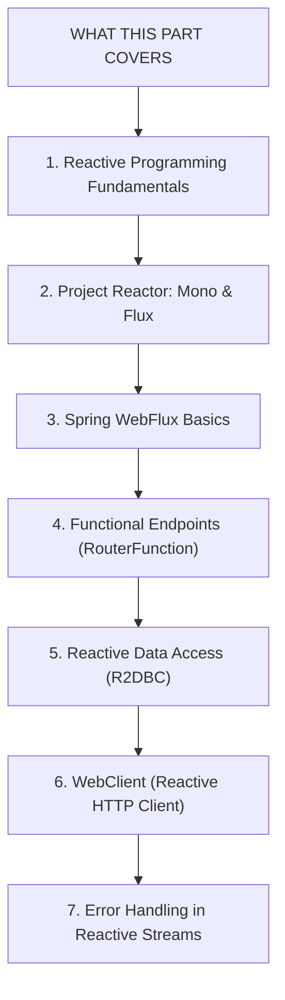
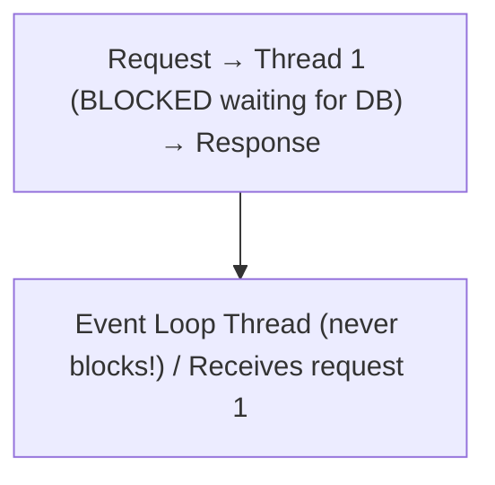
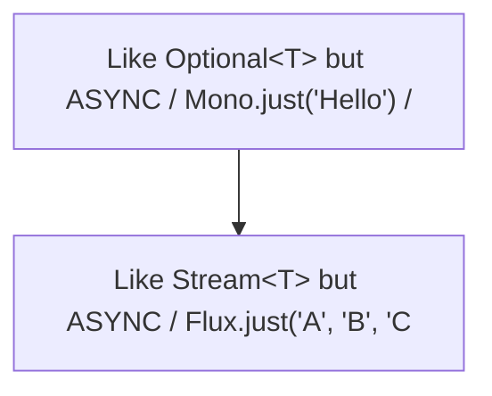
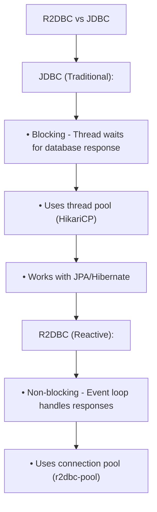

**Navigation**: [Back to Index](../00_MASTER_INDEX.md) | [Next Chapter >](Ch49_SB_WebFlux_Advanced.md)

---

# 🌊 SPRING BOOT MASTERY - Part 15: Spring WebFlux & Reactive Programming

**The Complete Guide to Non-Blocking, Reactive Spring Applications**
_"Handle millions of connections with minimal resources"_

---

# 🎯 WHY-HOW-WHEN-WHICH FRAMEWORK

```
┌─────────────────────────────────────────────────────────────────────────────────┐
│  WHY: Why Learn Reactive Programming?                                           │
├─────────────────────────────────────────────────────────────────────────────────┤
│  • Handle 10-100x more concurrent users with same hardware                      │
│  • Modern systems need: real-time data, streaming, high concurrency             │
│  • Netflix, Twitter, LinkedIn use reactive for millions of connections          │
│  • Required for cloud-native microservices at scale                             │
│  • Non-blocking = better resource utilization = cost savings                    │
└─────────────────────────────────────────────────────────────────────────────────┘

┌─────────────────────────────────────────────────────────────────────────────────┐
│  HOW: How Does WebFlux Work?                                                    │
├─────────────────────────────────────────────────────────────────────────────────┤
│  • Event loop model (not thread-per-request)                                    │
│  • Mono = 0 or 1 element, Flux = 0 to N elements                                │
│  • Backpressure: subscriber controls data flow rate                             │
│  • Non-blocking I/O with Netty server                                           │
│  • Functional or annotation-based programming models                            │
└─────────────────────────────────────────────────────────────────────────────────┘

┌─────────────────────────────────────────────────────────────────────────────────┐
│  WHEN: When to Use WebFlux vs MVC?                                              │
├─────────────────────────────────────────────────────────────────────────────────┤
│  USE WEBFLUX WHEN:                                                              │
│  • High concurrency (10K+ concurrent connections)                               │
│  • Streaming data (SSE, WebSocket, real-time feeds)                             │
│  • Microservices calling many external APIs                                     │
│  • Already using reactive stack (R2DBC, MongoDB Reactive)                       │
│                                                                                 │
│  STICK WITH MVC WHEN:                                                           │
│  • CRUD applications with moderate traffic                                      │
│  • Team unfamiliar with reactive paradigm                                       │
│  • Using blocking libraries (JDBC, JPA)                                         │
│  • Simpler debugging and stack traces needed                                    │
└─────────────────────────────────────────────────────────────────────────────────┘

┌─────────────────────────────────────────────────────────────────────────────────┐
│  WHICH: Which Components to Master?                                             │
├─────────────────────────────────────────────────────────────────────────────────┤
│  ESSENTIAL:     Mono, Flux, WebClient, @RestController reactive                 │
│  IMPORTANT:     R2DBC, RouterFunction, error operators                          │
│  ADVANCED:      Backpressure, Schedulers, testing StepVerifier                  │
└─────────────────────────────────────────────────────────────────────────────────┘
```

**Flow:**
1. WHY: Why Learn Reactive Programming? / • Handle 10-100x
2. HOW: How Does WebFlux Work? / • Event loop model (not t
3. WHEN: When to Use WebFlux vs MVC? / USE WEBFLUX WHEN: /
4. WHICH: Which Components to Master? / ESSENTIAL: Mono, F



---

# 📌 Table of Contents

```
┌─────────────────────────────────────────────────────────────────────────────────┐
│              WHAT THIS PART COVERS                                              │
├─────────────────────────────────────────────────────────────────────────────────┤
│                                                                                 │
│  1. Reactive Programming Fundamentals                                           │
│  2. Project Reactor: Mono & Flux                                                │
│  3. Spring WebFlux Basics                                                       │
│  4. Functional Endpoints (RouterFunction)                                       │
│  5. Reactive Data Access (R2DBC)                                                │
│  6. WebClient (Reactive HTTP Client)                                            │
│  7. Error Handling in Reactive Streams                                          │
│  8. Testing Reactive Code                                                       │
│  9. Backpressure & Performance                                                  │
│  10. When to Use WebFlux vs MVC                                                 │
│                                                                                 │
└─────────────────────────────────────────────────────────────────────────────────┘
```

**Flow:**
1. WHAT THIS PART COVERS
2. 1. Reactive Programming Fundamentals
3. 2. Project Reactor: Mono & Flux
4. 3. Spring WebFlux Basics
5. 4. Functional Endpoints (RouterFunction)
6. 5. Reactive Data Access (R2DBC)
7. 6. WebClient (Reactive HTTP Client)



---

# ⚛️ Section 1: Reactive Programming Fundamentals

---

## Chapter 1: Why Reactive?

```
┌─────────────────────────────────────────────────────────────────────────────────┐
│              TRADITIONAL vs REACTIVE                                            │
├─────────────────────────────────────────────────────────────────────────────────┤
│                                                                                 │
│  TRADITIONAL (Spring MVC) - Thread-per-Request:                                 │
│  ┌─────────────────────────────────────────────────────────────────────┐        │
│  │  Request → Thread 1 (BLOCKED waiting for DB) → Response            │         │
│  │  Request → Thread 2 (BLOCKED waiting for API) → Response           │         │
│  │  Request → Thread 3 (BLOCKED waiting for file) → Response          │         │
│  │  ...                                                                │        │
│  │  Request → Thread 200 (Max threads!) → Queue/Reject                │         │
│  └─────────────────────────────────────────────────────────────────────┘        │
│                                                                                 │
│  Problem: Each thread uses ~1MB memory, wastes time waiting                     │
│                                                                                 │
│  REACTIVE (Spring WebFlux) - Event Loop:                                        │
│  ┌─────────────────────────────────────────────────────────────────────┐        │
│  │  Event Loop Thread (never blocks!)                                  │        │
│  │    ├── Receives request 1 → Starts async DB call → Moves on       │          │
│  │    ├── Receives request 2 → Starts async API call → Moves on      │          │
│  │    ├── DB callback arrives → Sends response 1                      │         │
│  │    ├── Receives request 3 → Starts async work → Moves on          │          │
│  │    └── API callback arrives → Sends response 2                     │         │
│  └─────────────────────────────────────────────────────────────────────┘        │
│                                                                                 │
│  Benefit: 10-100x more concurrent connections with same resources               │
│                                                                                 │
└─────────────────────────────────────────────────────────────────────────────────┘
```

**Flow:**
1. Request
2. Thread 1 (BLOCKED waiting for DB)
3. Response
4. Event Loop Thread (never blocks!) / Receives request 1



### Reactive Manifesto Principles

```java
/**
 * REACTIVE SYSTEMS ARE:
 *
 * 1. RESPONSIVE
 *    - System responds in a timely manner
 *    - Consistent response times under varying load
 *
 * 2. RESILIENT
 *    - System stays responsive in face of failure
 *    - Failures contained and isolated
 *
 * 3. ELASTIC
 *    - System scales up/down based on load
 *    - No bottlenecks, no central contention
 *
 * 4. MESSAGE-DRIVEN
 *    - Asynchronous message passing
 *    - Non-blocking communication
 *    - Backpressure support
 */
```

### The Reactive Streams Specification

```java
/**
 * REACTIVE STREAMS - The Standard API (java.util.concurrent.Flow in Java 9+)
 *
 * Four Core Interfaces:
 */

// 1. Publisher - Data source (produces items)
public interface Publisher<T> {
    void subscribe(Subscriber<? super T> subscriber);
}

// 2. Subscriber - Data consumer (receives items)
public interface Subscriber<T> {
    void onSubscribe(Subscription subscription);  // Called first
    void onNext(T item);                          // For each item
    void onError(Throwable throwable);            // On error
    void onComplete();                            // When done
}

// 3. Subscription - Link between Publisher and Subscriber
public interface Subscription {
    void request(long n);   // Request n items (backpressure!)
    void cancel();          // Cancel subscription
}

// 4. Processor - Both a Publisher and Subscriber
public interface Processor<T, R> extends Subscriber<T>, Publisher<R> {
}

/**
 * KEY CONCEPT: Backpressure
 *
 * The subscriber controls the flow rate!
 *
 * subscription.request(1);   // "I can handle 1 item"
 * subscription.request(10);  // "I can handle 10 items"
 * subscription.request(Long.MAX_VALUE);  // "Send everything!"
 */
```

---

# SECTION 2: PROJECT REACTOR - Mono & Flux

---

## Chapter 2: The Reactor Library

```
┌─────────────────────────────────────────────────────────────────────────────────┐
│              MONO vs FLUX                                                       │
├─────────────────────────────────────────────────────────────────────────────────┤
│                                                                                 │
│  MONO<T> - 0 or 1 element                                                       │
│  ┌─────────────────────────────────────────────────────────────────────┐        │
│  │  Like Optional<T> but ASYNC                                         │        │
│  │                                                                      │       │
│  │  Mono.just("Hello")           // 1 element                          │        │
│  │  Mono.empty()                 // 0 elements                         │        │
│  │  Mono.error(new Ex())         // Error signal                       │        │
│  └─────────────────────────────────────────────────────────────────────┘        │
│                                                                                 │
│  FLUX<T> - 0 to N elements                                                      │
│  ┌─────────────────────────────────────────────────────────────────────┐        │
│  │  Like Stream<T> but ASYNC                                           │        │
│  │                                                                      │       │
│  │  Flux.just("A", "B", "C")     // 3 elements                         │        │
│  │  Flux.range(1, 100)           // 100 elements                       │        │
│  │  Flux.interval(Duration)       // Infinite elements                 │        │
│  └─────────────────────────────────────────────────────────────────────┘        │
│                                                                                 │
│  KEY INSIGHT: Nothing happens until you SUBSCRIBE!                              │
│                                                                                 │
└─────────────────────────────────────────────────────────────────────────────────┘
```

**Flow:**
1. Like Optional<T> but ASYNC / Mono.just('Hello') /
2. Like Stream<T> but ASYNC / Flux.just('A', 'B', 'C



### Maven Dependencies

```xml
<!-- Spring WebFlux (includes Reactor) -->
<dependency>
    <groupId>org.springframework.boot</groupId>
    <artifactId>spring-boot-starter-webflux</artifactId>
</dependency>

<!-- Reactor Test -->
<dependency>
    <groupId>io.projectreactor</groupId>
    <artifactId>reactor-test</artifactId>
    <scope>test</scope>
</dependency>
```

### Creating Mono and Flux

```java
import reactor.core.publisher.Mono;
import reactor.core.publisher.Flux;
import java.time.Duration;
import java.util.Arrays;
import java.util.List;

public class ReactorBasics {

    // ==================== MONO CREATION ====================

    public void monoCreation() {
        // From a value
        Mono<String> mono1 = Mono.just("Hello");

        // Empty Mono (completes without value)
        Mono<String> mono2 = Mono.empty();

        // From nullable (may or may not have value)
        String maybeNull = null;
        Mono<String> mono3 = Mono.justOrEmpty(maybeNull);  // Empty if null

        // Error Mono
        Mono<String> mono4 = Mono.error(new RuntimeException("Oops!"));

        // From Supplier (lazy evaluation)
        Mono<String> mono5 = Mono.fromSupplier(() -> expensiveOperation());

        // From Callable
        Mono<String> mono6 = Mono.fromCallable(() -> blockingCall());

        // From CompletableFuture
        Mono<String> mono7 = Mono.fromFuture(CompletableFuture.supplyAsync(() -> "async"));

        // Deferred - creates new Mono per subscriber
        Mono<Long> mono8 = Mono.defer(() -> Mono.just(System.currentTimeMillis()));

        // With delay
        Mono<String> mono9 = Mono.just("delayed").delayElement(Duration.ofSeconds(2));
    }

    // ==================== FLUX CREATION ====================

    public void fluxCreation() {
        // From values
        Flux<String> flux1 = Flux.just("A", "B", "C");

        // From array
        Flux<String> flux2 = Flux.fromArray(new String[]{"A", "B", "C"});

        // From iterable (List, Set, etc.)
        List<String> list = Arrays.asList("A", "B", "C");
        Flux<String> flux3 = Flux.fromIterable(list);

        // From Stream (careful: streams are single-use!)
        Flux<String> flux4 = Flux.fromStream(list.stream());

        // Range of integers
        Flux<Integer> flux5 = Flux.range(1, 10);  // 1, 2, 3, ..., 10

        // Empty Flux
        Flux<String> flux6 = Flux.empty();

        // Error Flux
        Flux<String> flux7 = Flux.error(new RuntimeException("Error!"));

        // Interval (infinite, emits every duration)
        Flux<Long> flux8 = Flux.interval(Duration.ofSeconds(1));

        // Generate (programmatic sequence)
        Flux<Integer> flux9 = Flux.generate(
            () -> 0,  // Initial state
            (state, sink) -> {
                sink.next(state);
                if (state == 10) sink.complete();
                return state + 1;
            }
        );

        // Create (for bridging async APIs)
        Flux<String> flux10 = Flux.create(sink -> {
            // Called when someone subscribes
            sink.next("First");
            sink.next("Second");
            sink.complete();
        });

        // Concat multiple publishers
        Flux<String> flux11 = Flux.concat(
            Mono.just("First"),
            Flux.just("Second", "Third")
        );

        // Merge multiple publishers (interleaved)
        Flux<String> flux12 = Flux.merge(flux1, flux2);
    }

    private String expensiveOperation() {
        return "result";
    }

    private String blockingCall() throws Exception {
        return "result";
    }
}
```

### Subscribing - Making It Execute

```java
public class SubscribingExamples {

    /**
     * CRITICAL: Nothing happens until you subscribe!
     *
     * Think of Mono/Flux as a recipe - it describes what to do
     * but doesn't cook until someone subscribes.
     */

    public void subscribingBasics() {
        Flux<Integer> flux = Flux.range(1, 5)
            .map(i -> i * 2)
            .filter(i -> i > 5);

        // At this point, NOTHING has executed yet!

        // Basic subscribe
        flux.subscribe();  // Executes but ignores items

        // Subscribe with consumer
        flux.subscribe(
            item -> System.out.println("Received: " + item)  // onNext
        );

        // Subscribe with error handler
        flux.subscribe(
            item -> System.out.println("Item: " + item),     // onNext
            error -> System.err.println("Error: " + error)   // onError
        );

        // Subscribe with completion handler
        flux.subscribe(
            item -> System.out.println("Item: " + item),     // onNext
            error -> System.err.println("Error: " + error),  // onError
            () -> System.out.println("Completed!")           // onComplete
        );

        // Subscribe with subscription handler (for backpressure)
        flux.subscribe(
            item -> System.out.println("Item: " + item),
            error -> System.err.println("Error: " + error),
            () -> System.out.println("Completed!"),
            subscription -> subscription.request(3)  // Request only 3 items
        );
    }

    // Block (ONLY FOR TESTS OR NON-REACTIVE CODE!)
    public void blockingOperations() {
        Mono<String> mono = Mono.just("Hello");

        // Block and get value
        String value = mono.block();  // BLOCKING!

        // Block with timeout
        String value2 = mono.block(Duration.ofSeconds(5));

        Flux<Integer> flux = Flux.range(1, 10);

        // Block and get first
        Integer first = flux.blockFirst();

        // Block and get last
        Integer last = flux.blockLast();

        // Collect all to list (blocking)
        List<Integer> list = flux.collectList().block();
    }
}
```

---

## Chapter 3: Operators - Transforming Reactive Streams

```java
public class ReactorOperators {

    // ==================== TRANSFORMING ====================

    public void transformingOperators() {
        // map - Transform each element
        Flux<Integer> mapped = Flux.just(1, 2, 3)
            .map(i -> i * 10);  // 10, 20, 30

        // flatMap - Transform to Publisher and flatten (async)
        Flux<String> flatMapped = Flux.just(1, 2, 3)
            .flatMap(i -> callAsyncService(i));  // Order NOT guaranteed

        // concatMap - Like flatMap but preserves order
        Flux<String> concatMapped = Flux.just(1, 2, 3)
            .concatMap(i -> callAsyncService(i));  // Order guaranteed

        // flatMapSequential - Parallel execution, ordered results
        Flux<String> seqMapped = Flux.just(1, 2, 3)
            .flatMapSequential(i -> callAsyncService(i));

        // cast - Type cast
        Flux<Number> casted = Flux.just(1, 2, 3)
            .cast(Number.class);

        // index - Add index to each element
        Flux<Tuple2<Long, String>> indexed = Flux.just("A", "B", "C")
            .index();  // (0, A), (1, B), (2, C)
    }

    // ==================== FILTERING ====================

    public void filteringOperators() {
        Flux<Integer> numbers = Flux.range(1, 10);

        // filter - Keep matching elements
        Flux<Integer> evens = numbers.filter(i -> i % 2 == 0);

        // filterWhen - Async filter
        Flux<Integer> asyncFiltered = numbers
            .filterWhen(i -> isValid(i));  // Returns Mono<Boolean>

        // distinct - Remove duplicates
        Flux<Integer> distinct = Flux.just(1, 1, 2, 2, 3).distinct();

        // distinctUntilChanged - Remove consecutive duplicates
        Flux<Integer> distinctConsec = Flux.just(1, 1, 2, 1, 1)
            .distinctUntilChanged();  // 1, 2, 1

        // take - First n elements
        Flux<Integer> firstThree = numbers.take(3);

        // takeLast - Last n elements
        Flux<Integer> lastThree = numbers.takeLast(3);

        // takeUntil - Until condition
        Flux<Integer> untilFive = numbers.takeUntil(i -> i == 5);

        // takeWhile - While condition
        Flux<Integer> whileLessFive = numbers.takeWhile(i -> i < 5);

        // skip - Skip first n
        Flux<Integer> skipThree = numbers.skip(3);

        // skipLast - Skip last n
        Flux<Integer> skipLastThree = numbers.skipLast(3);

        // elementAt - Get specific index
        Mono<Integer> third = numbers.elementAt(2);

        // next - Get first element as Mono
        Mono<Integer> first = numbers.next();

        // last - Get last element as Mono
        Mono<Integer> last = numbers.last();

        // single - Expect exactly one element
        Mono<Integer> single = Flux.just(1).single();  // Error if 0 or >1
    }

    // ==================== COMBINING ====================

    public void combiningOperators() {
        Flux<String> flux1 = Flux.just("A", "B");
        Flux<String> flux2 = Flux.just("C", "D");

        // concat - Sequential concatenation
        Flux<String> concatted = Flux.concat(flux1, flux2);  // A, B, C, D

        // merge - Interleaved merge
        Flux<String> merged = Flux.merge(flux1, flux2);  // Order varies

        // zip - Combine corresponding elements
        Flux<Tuple2<String, String>> zipped = Flux.zip(flux1, flux2);

        // zipWith - Combine with another flux
        Flux<String> zippedWith = flux1.zipWith(flux2, (a, b) -> a + b);

        // combineLatest - Combine latest from each
        Flux<String> combined = Flux.combineLatest(
            flux1, flux2, (a, b) -> a + b
        );

        // startWith - Prepend elements
        Flux<String> withStart = flux1.startWith("START");

        // concatWith - Append another flux
        Flux<String> withEnd = flux1.concatWith(flux2);

        // mergeWith - Merge with another flux
        Flux<String> mergedWith = flux1.mergeWith(flux2);
    }

    // ==================== AGGREGATING ====================

    public void aggregatingOperators() {
        Flux<Integer> numbers = Flux.range(1, 10);

        // count - Number of elements
        Mono<Long> count = numbers.count();

        // reduce - Reduce to single value
        Mono<Integer> sum = numbers.reduce(0, (a, b) -> a + b);

        // reduceWith - Reduce with initial supplier
        Mono<Integer> sumWith = numbers.reduceWith(() -> 0, Integer::sum);

        // scan - Like reduce but emits intermediate results
        Flux<Integer> runningSum = numbers.scan(0, Integer::sum);
        // 0, 1, 3, 6, 10, 15, 21, 28, 36, 45, 55

        // collectList - Collect all to List
        Mono<List<Integer>> list = numbers.collectList();

        // collectMap - Collect to Map
        Mono<Map<Integer, String>> map = numbers
            .collectMap(i -> i, i -> "Value" + i);

        // collectMultimap - Collect to Multimap (List values)
        Mono<Map<String, Collection<Integer>>> multimap = numbers
            .collectMultimap(i -> i % 2 == 0 ? "even" : "odd");

        // all - All match predicate?
        Mono<Boolean> allPositive = numbers.all(i -> i > 0);

        // any - Any match predicate?
        Mono<Boolean> anyTen = numbers.any(i -> i == 10);

        // hasElement - Contains element?
        Mono<Boolean> hasFive = numbers.hasElement(5);

        // hasElements - Has any elements?
        Mono<Boolean> notEmpty = numbers.hasElements();
    }

    // ==================== TIMING ====================

    public void timingOperators() {
        Flux<Integer> numbers = Flux.range(1, 5);

        // delayElements - Delay each element
        Flux<Integer> delayed = numbers
            .delayElements(Duration.ofMillis(100));

        // delaySubscription - Delay subscription
        Flux<Integer> delayedSub = numbers
            .delaySubscription(Duration.ofSeconds(1));

        // timeout - Error if no element within duration
        Mono<String> withTimeout = Mono.delay(Duration.ofSeconds(5))
            .map(l -> "result")
            .timeout(Duration.ofSeconds(2));  // TimeoutException!

        // timeout with fallback
        Mono<String> withFallback = Mono.delay(Duration.ofSeconds(5))
            .map(l -> "result")
            .timeout(Duration.ofSeconds(2), Mono.just("fallback"));

        // elapsed - Include elapsed time
        Flux<Tuple2<Long, Integer>> withElapsed = numbers
            .delayElements(Duration.ofMillis(100))
            .elapsed();

        // timestamp - Include timestamp
        Flux<Tuple2<Long, Integer>> withTimestamp = numbers.timestamp();

        // sample - Emit latest at intervals
        Flux<Long> sampled = Flux.interval(Duration.ofMillis(100))
            .sample(Duration.ofMillis(500));
    }

    // Helper methods
    private Mono<String> callAsyncService(Integer id) {
        return Mono.just("Result-" + id)
            .delayElement(Duration.ofMillis(100));
    }

    private Mono<Boolean> isValid(Integer i) {
        return Mono.just(i > 5);
    }
}
```

---


🔬 **Section Challenge — Chapter 3: Operators - Transforming Reactive Streams**

**Challenge 1 (Reasoning):** `list.stream().filter().map().collect()` — at which point does data actually start flowing through the pipeline?
<details><summary>Answer</summary>

Not until `collect()` (or any terminal operation). `filter()` and `map()` are LAZY — they build a pipeline description but process nothing. When the terminal operation is called, the pipeline pulls elements through lazily: one element passes through the entire pipeline before the next is processed. This means: early termination with `findFirst()` is O(1) if the first element matches, not O(N).
</details>

**Challenge 2 (Bug Hunt):** You call `stream.filter(...).collect(...)` twice on the same stream. What happens?
<details><summary>Answer</summary>

`IllegalStateException: stream has already been operated upon or closed`. Streams are single-use. Once a terminal operation is called, the stream is consumed. Fix: create a new stream from the source each time, or collect to a `List` first and stream the list repeatedly.
</details>


# 🌱 Section 3: Spring Webflux

---

## Chapter 4: WebFlux Controllers

```java
/**
 * Spring WebFlux provides TWO programming models:
 *
 * 1. Annotated Controllers (@RestController) - Same as MVC but return Mono/Flux
 * 2. Functional Endpoints (RouterFunction) - Functional style routing
 */

// ==================== ANNOTATED CONTROLLERS ====================

@RestController
@RequestMapping("/api/users")
@RequiredArgsConstructor
@Slf4j
public class UserController {

    private final UserService userService;

    /**
     * Return Mono for single result
     */
    @GetMapping("/{id}")
    public Mono<ResponseEntity<UserDto>> getUser(@PathVariable Long id) {
        return userService.findById(id)
            .map(ResponseEntity::ok)
            .defaultIfEmpty(ResponseEntity.notFound().build());
    }

    /**
     * Return Flux for multiple results
     */
    @GetMapping
    public Flux<UserDto> getAllUsers() {
        return userService.findAll();
    }

    /**
     * Flux with Server-Sent Events (SSE) - Real-time streaming!
     */
    @GetMapping(value = "/stream", produces = MediaType.TEXT_EVENT_STREAM_VALUE)
    public Flux<UserDto> streamUsers() {
        return userService.findAll()
            .delayElements(Duration.ofSeconds(1));  // Emit one per second
    }

    /**
     * Accept Mono in request body
     */
    @PostMapping
    @ResponseStatus(HttpStatus.CREATED)
    public Mono<UserDto> createUser(@RequestBody Mono<CreateUserRequest> request) {
        return request.flatMap(userService::create);
    }

    /**
     * Accept Flux for batch operations
     */
    @PostMapping("/batch")
    public Flux<UserDto> createUsers(@RequestBody Flux<CreateUserRequest> requests) {
        return requests.flatMap(userService::create);
    }

    @PutMapping("/{id}")
    public Mono<ResponseEntity<UserDto>> updateUser(
            @PathVariable Long id,
            @RequestBody Mono<UpdateUserRequest> request) {
        return request
            .flatMap(req -> userService.update(id, req))
            .map(ResponseEntity::ok)
            .defaultIfEmpty(ResponseEntity.notFound().build());
    }

    @DeleteMapping("/{id}")
    public Mono<ResponseEntity<Void>> deleteUser(@PathVariable Long id) {
        return userService.deleteById(id)
            .then(Mono.just(ResponseEntity.noContent().<Void>build()))
            .defaultIfEmpty(ResponseEntity.notFound().build());
    }
}

// ==================== SERVICE LAYER ====================

@Service
@RequiredArgsConstructor
public class UserService {

    private final UserRepository userRepository;
    private final UserMapper userMapper;

    public Mono<UserDto> findById(Long id) {
        return userRepository.findById(id)
            .map(userMapper::toDto);
    }

    public Flux<UserDto> findAll() {
        return userRepository.findAll()
            .map(userMapper::toDto);
    }

    public Mono<UserDto> create(CreateUserRequest request) {
        return Mono.just(request)
            .map(userMapper::toEntity)
            .flatMap(userRepository::save)
            .map(userMapper::toDto);
    }

    public Mono<UserDto> update(Long id, UpdateUserRequest request) {
        return userRepository.findById(id)
            .map(user -> {
                userMapper.updateEntity(user, request);
                return user;
            })
            .flatMap(userRepository::save)
            .map(userMapper::toDto);
    }

    public Mono<Void> deleteById(Long id) {
        return userRepository.deleteById(id);
    }
}
```

---

## Chapter 5: Functional Endpoints (RouterFunction)

```java
/**
 * FUNCTIONAL ENDPOINTS
 *
 * Alternative to Controller annotations
 * More flexible and functional style
 *
 * Components:
 * - RouterFunction<ServerResponse> - Defines routes
 * - HandlerFunction<ServerResponse> - Handles requests
 * - ServerRequest - Reactive request
 * - ServerResponse - Reactive response
 */

// ==================== ROUTE CONFIGURATION ====================

@Configuration
public class UserRouterConfig {

    @Bean
    public RouterFunction<ServerResponse> userRoutes(UserHandler handler) {
        return RouterFunctions.route()
            // GET /api/users
            .GET("/api/users", handler::getAllUsers)

            // GET /api/users/{id}
            .GET("/api/users/{id}", handler::getUserById)

            // POST /api/users
            .POST("/api/users", handler::createUser)

            // PUT /api/users/{id}
            .PUT("/api/users/{id}", handler::updateUser)

            // DELETE /api/users/{id}
            .DELETE("/api/users/{id}", handler::deleteUser)

            // Nested routes
            .path("/api/admin", builder -> builder
                .GET("/users", handler::getAllUsersAdmin)
                .POST("/users/bulk", handler::bulkCreateUsers)
            )

            // With filters
            .filter(this::loggingFilter)

            .build();
    }

    // Alternative using nest()
    @Bean
    public RouterFunction<ServerResponse> nestedRoutes(UserHandler handler) {
        return RouterFunctions
            .nest(RequestPredicates.path("/api"),
                RouterFunctions.route()
                    .nest(RequestPredicates.path("/users"),
                        RouterFunctions.route()
                            .GET("", handler::getAllUsers)
                            .GET("/{id}", handler::getUserById)
                            .POST("", handler::createUser)
                            .build()
                    )
                    .build()
            );
    }

    // Logging filter
    private Mono<ServerResponse> loggingFilter(
            ServerRequest request,
            HandlerFunction<ServerResponse> next) {
        log.info("Request: {} {}", request.method(), request.path());
        return next.handle(request)
            .doOnSuccess(response ->
                log.info("Response status: {}", response.statusCode())
            );
    }
}

// ==================== HANDLER CLASS ====================

@Component
@RequiredArgsConstructor
@Slf4j
public class UserHandler {

    private final UserService userService;
    private final Validator validator;

    public Mono<ServerResponse> getAllUsers(ServerRequest request) {
        // Query parameters
        Integer page = request.queryParam("page")
            .map(Integer::parseInt)
            .orElse(0);
        Integer size = request.queryParam("size")
            .map(Integer::parseInt)
            .orElse(20);

        return ServerResponse.ok()
            .contentType(MediaType.APPLICATION_JSON)
            .body(userService.findAll(page, size), UserDto.class);
    }

    public Mono<ServerResponse> getUserById(ServerRequest request) {
        Long id = Long.parseLong(request.pathVariable("id"));

        return userService.findById(id)
            .flatMap(user -> ServerResponse.ok()
                .contentType(MediaType.APPLICATION_JSON)
                .bodyValue(user))
            .switchIfEmpty(ServerResponse.notFound().build());
    }

    public Mono<ServerResponse> createUser(ServerRequest request) {
        return request.bodyToMono(CreateUserRequest.class)
            .doOnNext(this::validate)
            .flatMap(userService::create)
            .flatMap(user -> ServerResponse
                .created(URI.create("/api/users/" + user.getId()))
                .contentType(MediaType.APPLICATION_JSON)
                .bodyValue(user))
            .onErrorResume(ValidationException.class, e ->
                ServerResponse.badRequest()
                    .bodyValue(new ErrorResponse(e.getMessage())));
    }

    public Mono<ServerResponse> updateUser(ServerRequest request) {
        Long id = Long.parseLong(request.pathVariable("id"));

        return request.bodyToMono(UpdateUserRequest.class)
            .doOnNext(this::validate)
            .flatMap(req -> userService.update(id, req))
            .flatMap(user -> ServerResponse.ok()
                .contentType(MediaType.APPLICATION_JSON)
                .bodyValue(user))
            .switchIfEmpty(ServerResponse.notFound().build());
    }

    public Mono<ServerResponse> deleteUser(ServerRequest request) {
        Long id = Long.parseLong(request.pathVariable("id"));

        return userService.findById(id)
            .flatMap(user -> userService.deleteById(id)
                .then(ServerResponse.noContent().build()))
            .switchIfEmpty(ServerResponse.notFound().build());
    }

    // Bulk create (accepts Flux)
    public Mono<ServerResponse> bulkCreateUsers(ServerRequest request) {
        return ServerResponse.ok()
            .contentType(MediaType.APPLICATION_JSON)
            .body(
                request.bodyToFlux(CreateUserRequest.class)
                    .flatMap(userService::create),
                UserDto.class
            );
    }

    // Admin endpoint
    public Mono<ServerResponse> getAllUsersAdmin(ServerRequest request) {
        return ServerResponse.ok()
            .contentType(MediaType.APPLICATION_JSON)
            .body(userService.findAllWithDetails(), UserDto.class);
    }

    private void validate(Object request) {
        Set<ConstraintViolation<Object>> violations =
            validator.validate(request);
        if (!violations.isEmpty()) {
            String message = violations.stream()
                .map(ConstraintViolation::getMessage)
                .collect(Collectors.joining(", "));
            throw new ValidationException(message);
        }
    }
}
```

---


🔬 **Section Challenge — Chapter 5: Functional Endpoints (RouterFunction)**

**Challenge 1 (Reasoning):** `ExecutorService.submit(task)` — the task throws a `RuntimeException`. Nobody calls `future.get()`. What happens to the exception?
<details><summary>Answer</summary>

It's silently swallowed. The exception is stored in the `Future` object. Without `future.get()` or `.whenComplete()`, no one ever sees it. The thread pool thread resets and picks up the next task as if nothing happened. This is one of the most dangerous production bugs. Fix: always attach `future.whenComplete((r,ex) -> { if(ex!=null) log.error("Task failed",ex); })` or use `execute()` + `UncaughtExceptionHandler`.
</details>


# ⚛️ Section 4: Reactive Data Access (r2dbc)

---

## Chapter 6: R2DBC - Reactive Relational Database Connectivity

```
┌─────────────────────────────────────────────────────────────────────────────────┐
│              R2DBC vs JDBC                                                      │
├─────────────────────────────────────────────────────────────────────────────────┤
│                                                                                 │
│  JDBC (Traditional):                                                            │
│  • Blocking - Thread waits for database response                                │
│  • Uses thread pool (HikariCP)                                                  │
│  • Works with JPA/Hibernate                                                     │
│                                                                                 │
│  R2DBC (Reactive):                                                              │
│  • Non-blocking - Event loop handles responses                                  │
│  • Uses connection pool (r2dbc-pool)                                            │
│  • Works with Spring Data R2DBC (no JPA!)                                       │
│                                                                                 │
│  ⚠️ IMPORTANT: R2DBC does NOT support JPA features:                             │
│  • No lazy loading                                                              │
│  • No @OneToMany, @ManyToOne                                                    │
│  • No JPQL (uses simple queries or @Query)                                      │
│  • Manual joins required                                                        │
│                                                                                 │
└─────────────────────────────────────────────────────────────────────────────────┘
```

**Flow:**
1. R2DBC vs JDBC
2. JDBC (Traditional):
3. • Blocking - Thread waits for database response
4. • Uses thread pool (HikariCP)
5. • Works with JPA/Hibernate
6. R2DBC (Reactive):
7. • Non-blocking - Event loop handles responses



### Dependencies and Configuration

```xml
<!-- R2DBC for PostgreSQL -->
<dependency>
    <groupId>org.springframework.boot</groupId>
    <artifactId>spring-boot-starter-data-r2dbc</artifactId>
</dependency>
<dependency>
    <groupId>io.r2dbc</groupId>
    <artifactId>r2dbc-postgresql</artifactId>
    <scope>runtime</scope>
</dependency>

<!-- Or for H2 (testing) -->
<dependency>
    <groupId>io.r2dbc</groupId>
    <artifactId>r2dbc-h2</artifactId>
    <scope>runtime</scope>
</dependency>

<!-- Connection pooling -->
<dependency>
    <groupId>io.r2dbc</groupId>
    <artifactId>r2dbc-pool</artifactId>
</dependency>
```

```yaml
# application.yml
spring:
    r2dbc:
        url: r2dbc:postgresql://localhost:5432/mydb
        username: user
        password: password
        pool:
            initial-size: 5
            max-size: 20
            max-idle-time: 30m
```

### Entity and Repository

```java
// ==================== ENTITY ====================

import org.springframework.data.annotation.Id;
import org.springframework.data.annotation.CreatedDate;
import org.springframework.data.annotation.LastModifiedDate;
import org.springframework.data.relational.core.mapping.Table;
import org.springframework.data.relational.core.mapping.Column;

@Table("users")  // Note: Not @Entity! This is Spring Data R2DBC
@Data
@NoArgsConstructor
@AllArgsConstructor
@Builder
public class User {

    @Id
    private Long id;

    @Column("username")
    private String username;

    private String email;

    private String password;

    @Column("created_at")
    @CreatedDate
    private LocalDateTime createdAt;

    @Column("updated_at")
    @LastModifiedDate
    private LocalDateTime updatedAt;

    private boolean active;
}

// ==================== REPOSITORY ====================

import org.springframework.data.repository.reactive.ReactiveCrudRepository;
import org.springframework.data.r2dbc.repository.Query;

public interface UserRepository extends ReactiveCrudRepository<User, Long> {

    // Derived query methods - return Mono/Flux
    Mono<User> findByUsername(String username);

    Mono<User> findByEmail(String email);

    Flux<User> findByActiveTrue();

    Flux<User> findByUsernameContainingIgnoreCase(String username);

    // Custom queries
    @Query("SELECT * FROM users WHERE email = :email AND active = true")
    Mono<User> findActiveByEmail(String email);

    @Query("SELECT * FROM users WHERE created_at > :since ORDER BY created_at DESC")
    Flux<User> findRecentUsers(LocalDateTime since);

    // Update query
    @Modifying
    @Query("UPDATE users SET active = false WHERE id = :id")
    Mono<Integer> deactivateUser(Long id);

    // Exists check
    Mono<Boolean> existsByUsername(String username);

    // Count
    Mono<Long> countByActiveTrue();

    // Delete
    Mono<Void> deleteByUsername(String username);
}

// ==================== REACTIVE CRUD REPOSITORY METHODS ====================

/**
 * ReactiveCrudRepository provides:
 *
 * Mono<S> save(S entity)
 * Mono<T> findById(ID id)
 * Mono<Boolean> existsById(ID id)
 * Flux<T> findAll()
 * Flux<T> findAllById(Iterable<ID> ids)
 * Mono<Long> count()
 * Mono<Void> deleteById(ID id)
 * Mono<Void> delete(T entity)
 * Mono<Void> deleteAll()
 * Mono<Void> deleteAllById(Iterable<ID> ids)
 */
```

### Database Client (Low-Level Access)

```java
@Service
@RequiredArgsConstructor
public class UserDatabaseService {

    private final DatabaseClient databaseClient;

    // Complex queries
    public Flux<User> searchUsers(String search, int limit, int offset) {
        return databaseClient.sql("""
                SELECT * FROM users
                WHERE username ILIKE :search
                   OR email ILIKE :search
                ORDER BY created_at DESC
                LIMIT :limit OFFSET :offset
                """)
            .bind("search", "%" + search + "%")
            .bind("limit", limit)
            .bind("offset", offset)
            .map((row, metadata) -> User.builder()
                .id(row.get("id", Long.class))
                .username(row.get("username", String.class))
                .email(row.get("email", String.class))
                .active(row.get("active", Boolean.class))
                .createdAt(row.get("created_at", LocalDateTime.class))
                .build())
            .all();
    }

    // Insert with returning
    public Mono<User> insertUser(User user) {
        return databaseClient.sql("""
                INSERT INTO users (username, email, password, active, created_at)
                VALUES (:username, :email, :password, :active, :createdAt)
                RETURNING *
                """)
            .bind("username", user.getUsername())
            .bind("email", user.getEmail())
            .bind("password", user.getPassword())
            .bind("active", user.isActive())
            .bind("createdAt", LocalDateTime.now())
            .map((row, metadata) -> User.builder()
                .id(row.get("id", Long.class))
                .username(row.get("username", String.class))
                .email(row.get("email", String.class))
                .active(row.get("active", Boolean.class))
                .createdAt(row.get("created_at", LocalDateTime.class))
                .build())
            .one();
    }

    // Batch insert
    public Mono<Long> batchInsert(List<User> users) {
        return Flux.fromIterable(users)
            .flatMap(this::insertUser)
            .count();
    }
```


---

> **Navigation**: [< Previous](Ch45_SB_Actuator_Metrics.md) | [Back to Index](../00_MASTER_INDEX.md) | [Next >](Ch49_SB_WebFlux_Advanced.md)