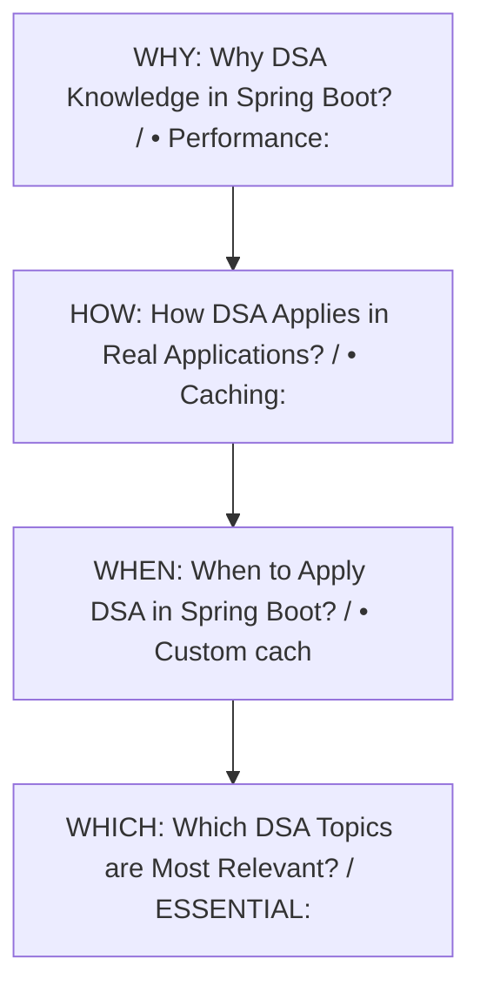
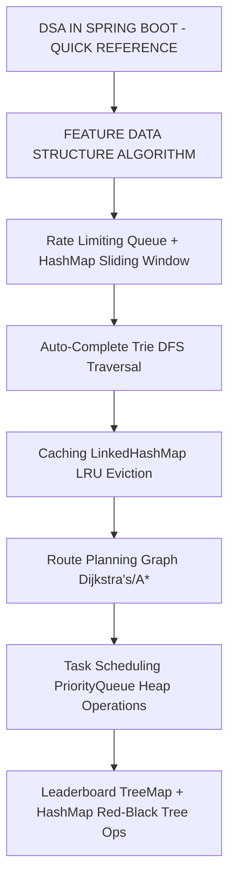

> **Navigation**: [< Previous](Ch43_SB_Auth_Security.md) | [Back to Index](../00_MASTER_INDEX.md) | [Next >](Ch51_SB_Industry_Projects.md)

# 🧮 SPRING BOOT MASTERY - Part 12: DSA in Spring Boot Applications

> **Where Data Structures & Algorithms Meet Real World**
> _"The algorithm you choose determines your application's success"_

---

# 🎯 WHY-HOW-WHEN-WHICH FRAMEWORK

```
┌─────────────────────────────────────────────────────────────────────────────────┐
│  WHY: Why DSA Knowledge in Spring Boot?                                         │
├─────────────────────────────────────────────────────────────────────────────────┤
│  • Performance: Wrong data structure = 100x slower operations                   │
│  • Scalability: LRU cache, rate limiting, scheduling - all DSA                  │
│  • Interviews: DSA + Spring Boot = complete backend developer                   │
│  • Debugging: Understand why certain operations are slow                        │
│  • Design decisions: Choose HashMap vs TreeMap, ArrayList vs LinkedList         │
└─────────────────────────────────────────────────────────────────────────────────┘

┌─────────────────────────────────────────────────────────────────────────────────┐
│  HOW: How DSA Applies in Real Applications?                                     │
├─────────────────────────────────────────────────────────────────────────────────┤
│  • Caching: HashMap for O(1) lookup, LRU with LinkedHashMap                     │
│  • Rate limiting: Token bucket, sliding window algorithms                       │
│  • Search: Binary search for sorted data, tries for autocomplete                │
│  • Task scheduling: Priority queues, DAG for dependencies                       │
│  • Connection pooling: Queue for managing database connections                  │
└─────────────────────────────────────────────────────────────────────────────────┘

┌─────────────────────────────────────────────────────────────────────────────────┐
│  WHEN: When to Apply DSA in Spring Boot?                                        │
├─────────────────────────────────────────────────────────────────────────────────┤
│  • Custom caching: When @Cacheable isn't enough                                 │
│  • In-memory processing: Large data transformations                             │
│  • Real-time features: Leaderboards, live search                                │
│  • Batch operations: Processing millions of records efficiently                 │
│  • API rate limiting: Custom throttling implementations                         │
└─────────────────────────────────────────────────────────────────────────────────┘

┌─────────────────────────────────────────────────────────────────────────────────┐
│  WHICH: Which DSA Topics are Most Relevant?                                     │
├─────────────────────────────────────────────────────────────────────────────────┤
│  ESSENTIAL:     HashMap/HashSet, ArrayList/LinkedList, time complexity          │
│  IMPORTANT:     Trees (for hierarchies), Queues (for async), Sorting            │
│  ADVANCED:      Graphs (service dependencies), Bloom filters, B-Trees           │
└─────────────────────────────────────────────────────────────────────────────────┘
```

**Flow:**
- WHY: Why DSA Knowledge in Spring Boot? / • Performance:
- ↓
- HOW: How DSA Applies in Real Applications? / • Caching:
- ↓
- WHEN: When to Apply DSA in Spring Boot? / • Custom cach
- ↓
- WHICH: Which DSA Topics are Most Relevant? / ESSENTIAL:



---

# 🌱 Section 1: Where DSA Appears in Spring Boot

---

## Chapter 1: DSA in Enterprise Applications


> 🔬 **Section Challenge — Chapter 1: DSA in Enterprise Applications**
>
> **Challenge 1 (Reasoning):** `ExecutorService.submit(task)` — the task throws a `RuntimeException`. Nobody calls `future.get()`. What happens to the exception?
> <details><summary>Answer</summary>
>
> It's silently swallowed. The exception is stored in the `Future` object. Without `future.get()` or `.whenComplete()`, no one ever sees it. The thread pool thread resets and picks up the next task as if nothing happened. This is one of the most dangerous production bugs. Fix: always attach `future.whenComplete((r,ex) -> { if(ex!=null) log.error("Task failed",ex); })` or use `execute()` + `UncaughtExceptionHandler`.
> </details>
>

## Dsa Usage In Spring Boot Applications

┬
DATA STRUCTURE      │ WHERE IT'S USED
┼
│
HashMap             │ • Caching (in-memory cache)
│ • Session management
│ • Request parameter mapping
│ • API response building
│
ArrayList/LinkedList│ • Pagination results
│ • Batch processing queues
│ • Order history
│
TreeMap/TreeSet     │ • Sorted leaderboards
│ • Scheduled tasks (by time)
│ • Range queries
│
PriorityQueue       │ • Task scheduling (priority-based)
│ • Event processing
│ • Rate limiting
│
Graph               │ • Social networks (friends, followers)
│ • Route optimization
│ • Dependency resolution
│ • Recommendation systems
│
Trie                │ • Auto-complete / Search suggestions
│ • Spell checking
│ • IP routing tables
│
Bloom Filter        │ • Duplicate detection
│ • Cache optimization
│ • Spam filtering
│
┴
┬
ALGORITHM           │ WHERE IT'S USED
┼
│
Binary Search       │ • Finding items in sorted data
│ • Rate limit threshold checking
│ • Log file searching
│
Sorting             │ • Search results ranking
│ • Leaderboards
│ • Report generation
│
BFS/DFS             │ • Category tree traversal
│ • Organization hierarchy
│ • Dependency resolution
│
Dijkstra/A*         │ • Route planning
│ • Network path optimization
│ • Game pathfinding
│
Dynamic Programming │ • Price optimization
│ • Resource allocation
│ • String matching
│
Sliding Window      │ • Rate limiting
│ • Analytics (rolling averages)
│ • Stream processing
│
┴

---


> 🔬 **Section Challenge — Dsa Usage In Spring Boot Applications**
>
> **Challenge 1 (Reasoning):** `ExecutorService.submit(task)` — the task throws a `RuntimeException`. Nobody calls `future.get()`. What happens to the exception?
> <details><summary>Answer</summary>
>
> It's silently swallowed. The exception is stored in the `Future` object. Without `future.get()` or `.whenComplete()`, no one ever sees it. The thread pool thread resets and picks up the next task as if nothing happened. This is one of the most dangerous production bugs. Fix: always attach `future.whenComplete((r,ex) -> { if(ex!=null) log.error("Task failed",ex); })` or use `execute()` + `UncaughtExceptionHandler`.
> </details>
>

# 🔧 Section 2: Real Implementations

---

## Chapter 2: Rate Limiting with Sliding Window

```java
// ═══════════════════════════════════════════════════════════════════════════════
// RATE LIMITER - Using Sliding Window Algorithm
// ═══════════════════════════════════════════════════════════════════════════════
//
// Problem: Allow max N requests per user per time window
// DSA Used: Queue (LinkedList) + HashMap
// Time Complexity: O(1) amortized
//

@Component
@Slf4j
public class SlidingWindowRateLimiter {
    
    // Map of userId -> Queue of request timestamps
    private final Map<String, Deque<Long>> requestLog = new ConcurrentHashMap<>();
    
    @Value("${rate-limit.requests-per-minute:60}")
    private int maxRequests;
    
    @Value("${rate-limit.window-ms:60000}")
    private long windowMs;
    
    /**
     * Check if request is allowed for given user
     * 
     * @param userId The user identifier (can be IP, API key, user ID)
     * @return true if request is allowed, false if rate limited
     */
    public boolean allowRequest(String userId) {
        long now = System.currentTimeMillis();
        long windowStart = now - windowMs;
        
        // Get or create request queue for this user
        Deque<Long> timestamps = requestLog.computeIfAbsent(
            userId, 
            k -> new LinkedList<>()
        );
        
        synchronized (timestamps) {
            // Remove old timestamps outside the window (sliding)
            while (!timestamps.isEmpty() && timestamps.peekFirst() < windowStart) {
                timestamps.pollFirst();
            }
            
            // Check if under limit
            if (timestamps.size() < maxRequests) {
                timestamps.addLast(now);
                return true;
            }
            
            log.warn("Rate limit exceeded for user: {}", userId);
            return false;
        }
    }
    
    /**
     * Get remaining requests for user
     */
    public int getRemainingRequests(String userId) {
        Deque<Long> timestamps = requestLog.get(userId);
        if (timestamps == null) {
            return maxRequests;
        }
        
        long windowStart = System.currentTimeMillis() - windowMs;
        synchronized (timestamps) {
            while (!timestamps.isEmpty() && timestamps.peekFirst() < windowStart) {
                timestamps.pollFirst();
            }
            return Math.max(0, maxRequests - timestamps.size());
        }
    }
}


// Rate Limit Filter
@Component
@RequiredArgsConstructor
public class RateLimitFilter extends OncePerRequestFilter {
    
    private final SlidingWindowRateLimiter rateLimiter;
    
    @Override
    protected void doFilterInternal(
            HttpServletRequest request,
            HttpServletResponse response,
            FilterChain filterChain) throws ServletException, IOException {
        
        String clientId = getClientId(request);
        
        if (!rateLimiter.allowRequest(clientId)) {
            response.setStatus(HttpStatus.TOO_MANY_REQUESTS.value());
            response.setContentType("application/json");
            response.getWriter().write(
                "{\"error\": \"Rate limit exceeded\", " +
                "\"message\": \"Too many requests. Please try again later.\"}"
            );
            return;
        }
        
        // Add rate limit headers
        int remaining = rateLimiter.getRemainingRequests(clientId);
        response.setHeader("X-RateLimit-Limit", "60");
        response.setHeader("X-RateLimit-Remaining", String.valueOf(remaining));
        
        filterChain.doFilter(request, response);
    }
    
    private String getClientId(HttpServletRequest request) {
        // Try to get user ID from JWT, fall back to IP
        Authentication auth = SecurityContextHolder.getContext().getAuthentication();
        if (auth != null && auth.getPrincipal() instanceof User user) {
            return "user:" + user.getId();
        }
        return "ip:" + request.getRemoteAddr();
    }
}
```

---


> 🔬 **Section Challenge — Chapter 2: Rate Limiting with Sliding Window**
>
> **Challenge 1 (Reasoning):** Sliding window guarantees O(N). How? Each element is added and removed exactly how many times?
> <details><summary>Answer</summary>
>
> Each element enters the window exactly ONCE (right pointer advances past it) and leaves exactly ONCE (left pointer advances past it). Total operations: 2N regardless of window size changes. Compare to brute force: for each ending position, scan back to find optimal start = O(N²). The window's state (sum, freq map, etc.) is maintained INCREMENTALLY — O(1) per pointer move.
> </details>
>
> **Challenge 2 (Bug Hunt):** Minimum Window Substring: the while loop to shrink the window runs `while(valid) { shrink; }`. What's wrong with this logic?
> <details><summary>Answer</summary>
>
> Should shrink `while(valid)` to find the minimum window — this is correct! But the common bug: not updating `left++` BEFORE rechecking validity, or forgetting to update the answer BEFORE shrinking. The answer should be captured at the moment the window first becomes valid, then kept updated as we shrink to find smaller valid windows.
> </details>
>

## Chapter 3: Auto-Complete with Trie

```java
// ═══════════════════════════════════════════════════════════════════════════════
// AUTO-COMPLETE SERVICE - Using Trie Data Structure
// ═══════════════════════════════════════════════════════════════════════════════
//
// Problem: Suggest words as user types
// DSA Used: Trie (Prefix Tree)
// Time Complexity: O(L) where L = length of word
//

// Trie Node
class TrieNode {
    Map<Character, TrieNode> children = new HashMap<>();
    boolean isEndOfWord = false;
    String word = null;  // Store complete word at end node
    int frequency = 0;   // For ranking suggestions
}

@Service
@Slf4j
public class AutoCompleteService {
    
    private final TrieNode root = new TrieNode();
    
    /**
     * Insert a word into the Trie
     */
    public void insert(String word) {
        if (word == null || word.isEmpty()) return;
        
        TrieNode current = root;
        String lowerWord = word.toLowerCase();
        
        for (char c : lowerWord.toCharArray()) {
            current = current.children.computeIfAbsent(c, k -> new TrieNode());
        }
        
        current.isEndOfWord = true;
        current.word = word;  // Store original case
        current.frequency++;
    }
    
    /**
     * Get suggestions for a prefix
     * 
     * @param prefix The prefix to search for
     * @param limit Maximum number of suggestions
     * @return List of suggestions sorted by frequency
     */
    public List<String> getSuggestions(String prefix, int limit) {
        if (prefix == null || prefix.isEmpty()) {
            return Collections.emptyList();
        }
        
        TrieNode prefixNode = findPrefixNode(prefix.toLowerCase());
        if (prefixNode == null) {
            return Collections.emptyList();
        }
        
        // Use PriorityQueue to get top suggestions by frequency
        PriorityQueue<TrieNode> pq = new PriorityQueue<>(
            (a, b) -> b.frequency - a.frequency  // Max heap by frequency
        );
        
        // DFS to collect all words with this prefix
        collectWords(prefixNode, pq);
        
        // Extract top suggestions
        List<String> suggestions = new ArrayList<>();
        while (!pq.isEmpty() && suggestions.size() < limit) {
            TrieNode node = pq.poll();
            if (node.word != null) {
                suggestions.add(node.word);
            }
        }
        
        return suggestions;
    }
    
    private TrieNode findPrefixNode(String prefix) {
        TrieNode current = root;
        for (char c : prefix.toCharArray()) {
            current = current.children.get(c);
            if (current == null) {
                return null;
            }
        }
        return current;
    }
    
    private void collectWords(TrieNode node, PriorityQueue<TrieNode> pq) {
        if (node.isEndOfWord) {
            pq.offer(node);
        }
        for (TrieNode child : node.children.values()) {
            collectWords(child, pq);
        }
    }
    
    /**
     * Load words from database on startup
     */
    @PostConstruct
    public void loadFromDatabase() {
        // Load popular search terms
        searchTermRepository.findAll().forEach(term -> {
            for (int i = 0; i < term.getSearchCount(); i++) {
                insert(term.getTerm());
            }
        });
        log.info("Loaded auto-complete dictionary");
    }
}


// REST Controller
@RestController
@RequestMapping("/api/search")
@RequiredArgsConstructor
public class SearchController {
    
    private final AutoCompleteService autoCompleteService;
    
    @GetMapping("/suggest")
    public List<String> getSuggestions(
            @RequestParam String q,
            @RequestParam(defaultValue = "10") int limit) {
        
        return autoCompleteService.getSuggestions(q, limit);
    }
}

// Usage in Postman:
// GET http://localhost:8080/api/search/suggest?q=java&limit=5
// Response: ["Java", "JavaScript", "Java Spring", "Java 8", "Jakarta"]
```

---

## Chapter 4: LRU Cache for API Response Caching

```java
// ═══════════════════════════════════════════════════════════════════════════════
// LRU CACHE - Least Recently Used Cache Implementation
// ═══════════════════════════════════════════════════════════════════════════════
//
// Problem: Cache expensive API responses with limited memory
// DSA Used: LinkedHashMap (maintains insertion/access order)
// Time Complexity: O(1) for get and put
//

@Component
@Slf4j
public class LRUCache<K, V> {
    
    private final Map<K, V> cache;
    private final int maxSize;
    
    public LRUCache(@Value("${cache.max-size:1000}") int maxSize) {
        this.maxSize = maxSize;
        
        // LinkedHashMap with access-order + removeEldestEntry = LRU Cache!
        this.cache = Collections.synchronizedMap(
            new LinkedHashMap<K, V>(maxSize, 0.75f, true) {
                @Override
                protected boolean removeEldestEntry(Map.Entry<K, V> eldest) {
                    boolean shouldRemove = size() > maxSize;
                    if (shouldRemove) {
                        log.debug("Evicting cache entry: {}", eldest.getKey());
                    }
                    return shouldRemove;
                }
            }
        );
    }
    
    public V get(K key) {
        return cache.get(key);  // Access moves entry to end (most recently used)
    }
    
    public void put(K key, V value) {
        cache.put(key, value);
    }
    
    public void invalidate(K key) {
        cache.remove(key);
    }
    
    public void clear() {
        cache.clear();
    }
    
    public int size() {
        return cache.size();
    }
}


// Usage in Service
@Service
@RequiredArgsConstructor
@Slf4j
public class ProductService {
    
    private final ProductRepository productRepository;
    private final LRUCache<Long, ProductResponse> productCache;
    
    public ProductResponse getProduct(Long id) {
        // Check cache first
        ProductResponse cached = productCache.get(id);
        if (cached != null) {
            log.debug("Cache hit for product: {}", id);
            return cached;
        }
        
        // Cache miss - fetch from database
        log.debug("Cache miss for product: {}", id);
        Product product = productRepository.findById(id)
            .orElseThrow(() -> new ProductNotFoundException(id));
        
        ProductResponse response = mapToResponse(product);
        
        // Store in cache
        productCache.put(id, response);
        
        return response;
    }
    
    @Transactional
    public ProductResponse updateProduct(Long id, UpdateProductRequest request) {
        // ... update logic
        
        // Invalidate cache
        productCache.invalidate(id);
        
        return getProduct(id);  // Re-fetch and cache
    }
}
```

---


> 🔬 **Section Challenge — Chapter 4: LRU Cache for API Response Caching**
>
> **Challenge 1 (Design):** Cache-aside vs write-through vs write-behind — when does each cause stale data?
> <details><summary>Answer</summary>
>
> Cache-aside (lazy load): on cache miss, load from DB and populate cache. Stale: if DB updated externally (direct DB write bypassing cache). Write-through: write to cache AND DB simultaneously. Stale: never (cache always reflects writes). Write-behind (write-back): write to cache, async write to DB. Stale: if cache crashes before DB write → data loss. Rule: cache-aside for read-heavy. Write-through for write+read. Write-behind for write-heavy (accept loss risk).
> </details>
>

## Chapter 5: Shortest Path for Delivery Routing

```java
// ═══════════════════════════════════════════════════════════════════════════════
// DELIVERY ROUTE OPTIMIZER - Using Dijkstra's Algorithm
// ═══════════════════════════════════════════════════════════════════════════════
//
// Problem: Find shortest/fastest delivery route
// DSA Used: Graph + Priority Queue (Dijkstra's)
// Time Complexity: O((V + E) log V)
//

@Service
@Slf4j
public class DeliveryRouteService {
    
    // Graph representation: location -> (neighbor, distance)
    private final Map<String, Map<String, Double>> graph = new ConcurrentHashMap<>();
    
    /**
     * Add a road between two locations
     */
    public void addRoad(String from, String to, double distance) {
        graph.computeIfAbsent(from, k -> new HashMap<>()).put(to, distance);
        graph.computeIfAbsent(to, k -> new HashMap<>()).put(from, distance);  // Bidirectional
    }
    
    /**
     * Find shortest path using Dijkstra's Algorithm
     * 
     * @param start Starting location
     * @param end Destination
     * @return RouteResult with path and total distance
     */
    public RouteResult findShortestPath(String start, String end) {
        if (!graph.containsKey(start) || !graph.containsKey(end)) {
            throw new LocationNotFoundException("Location not found in graph");
        }
        
        // Distance from start to each node
        Map<String, Double> distances = new HashMap<>();
        // Previous node in shortest path
        Map<String, String> previous = new HashMap<>();
        // Visited nodes
        Set<String> visited = new HashSet<>();
        
        // Priority queue: (distance, node)
        PriorityQueue<double[]> pq = new PriorityQueue<>(
            Comparator.comparingDouble(a -> a[0])
        );
        Map<String, Integer> nodeIndex = new HashMap<>();
        int index = 0;
        for (String node : graph.keySet()) {
            nodeIndex.put(node, index++);
        }
        
        // Initialize
        for (String node : graph.keySet()) {
            distances.put(node, Double.MAX_VALUE);
        }
        distances.put(start, 0.0);
        pq.offer(new double[]{0.0, nodeIndex.get(start)});
        
        // Reverse index lookup
        String[] indexToNode = new String[graph.size()];
        for (Map.Entry<String, Integer> entry : nodeIndex.entrySet()) {
            indexToNode[entry.getValue()] = entry.getKey();
        }
        
        while (!pq.isEmpty()) {
            double[] current = pq.poll();
            String currentNode = indexToNode[(int) current[1]];
            
            if (visited.contains(currentNode)) continue;
            visited.add(currentNode);
            
            if (currentNode.equals(end)) break;
            
            // Check all neighbors
            Map<String, Double> neighbors = graph.get(currentNode);
            if (neighbors != null) {
                for (Map.Entry<String, Double> neighbor : neighbors.entrySet()) {
                    String nextNode = neighbor.getKey();
                    double edgeWeight = neighbor.getValue();
                    
                    if (!visited.contains(nextNode)) {
                        double newDist = distances.get(currentNode) + edgeWeight;
                        
                        if (newDist < distances.get(nextNode)) {
                            distances.put(nextNode, newDist);
                            previous.put(nextNode, currentNode);
                            pq.offer(new double[]{newDist, nodeIndex.get(nextNode)});
                        }
                    }
                }
            }
        }
        
        // Reconstruct path
        List<String> path = new ArrayList<>();
        String current = end;
        while (current != null) {
            path.add(0, current);
            current = previous.get(current);
        }
        
        if (!path.get(0).equals(start)) {
            throw new NoRouteException("No route found between " + start + " and " + end);
        }
        
        return new RouteResult(path, distances.get(end));
    }
    
    /**
     * Find optimal route visiting multiple stops (simplified TSP)
     */
    public RouteResult findOptimalMultiStopRoute(String start, List<String> stops) {
        // For small number of stops, use nearest neighbor heuristic
        List<String> route = new ArrayList<>();
        route.add(start);
        
        Set<String> unvisited = new HashSet<>(stops);
        String current = start;
        double totalDistance = 0;
        
        while (!unvisited.isEmpty()) {
            // Find nearest unvisited stop
            String nearest = null;
            double minDist = Double.MAX_VALUE;
            
            for (String stop : unvisited) {
                RouteResult result = findShortestPath(current, stop);
                if (result.distance() < minDist) {
                    minDist = result.distance();
                    nearest = stop;
                }
            }
            
            route.add(nearest);
            totalDistance += minDist;
            unvisited.remove(nearest);
            current = nearest;
        }
        
        return new RouteResult(route, totalDistance);
    }
}

public record RouteResult(List<String> path, double distance) {}


// REST Controller
@RestController
@RequestMapping("/api/delivery")
@RequiredArgsConstructor
public class DeliveryController {
    
    private final DeliveryRouteService routeService;
    
    @GetMapping("/route")
    public RouteResult getRoute(
            @RequestParam String from,
            @RequestParam String to) {
        return routeService.findShortestPath(from, to);
    }
    
    @PostMapping("/multi-stop-route")
    public RouteResult getMultiStopRoute(@RequestBody MultiStopRequest request) {
        return routeService.findOptimalMultiStopRoute(
            request.start(), 
            request.stops()
        );
    }
}
```

---


> 🔬 **Section Challenge — Chapter 5: Shortest Path for Delivery Routing**
>
> **Challenge 1 (Reasoning):** `ExecutorService.submit(task)` — the task throws a `RuntimeException`. Nobody calls `future.get()`. What happens to the exception?
> <details><summary>Answer</summary>
>
> It's silently swallowed. The exception is stored in the `Future` object. Without `future.get()` or `.whenComplete()`, no one ever sees it. The thread pool thread resets and picks up the next task as if nothing happened. This is one of the most dangerous production bugs. Fix: always attach `future.whenComplete((r,ex) -> { if(ex!=null) log.error("Task failed",ex); })` or use `execute()` + `UncaughtExceptionHandler`.
> </details>
>

## Chapter 6: Task Scheduler with Priority Queue

```java
// ═══════════════════════════════════════════════════════════════════════════════
// TASK SCHEDULER - Using Priority Queue (Heap)
// ═══════════════════════════════════════════════════════════════════════════════
//
// Problem: Execute tasks based on priority and scheduled time
// DSA Used: PriorityQueue (Min-Heap)
// Time Complexity: O(log n) for insert, O(1) for peek, O(log n) for poll
//

@Data
@AllArgsConstructor
public class ScheduledTask implements Comparable<ScheduledTask> {
    private String id;
    private String name;
    private int priority;  // 1 = highest, 10 = lowest
    private LocalDateTime scheduledTime;
    private Runnable task;
    
    @Override
    public int compareTo(ScheduledTask other) {
        // First by scheduled time
        int timeCompare = this.scheduledTime.compareTo(other.scheduledTime);
        if (timeCompare != 0) return timeCompare;
        
        // Then by priority (lower number = higher priority)
        return Integer.compare(this.priority, other.priority);
    }
}


@Service
@Slf4j
public class TaskSchedulerService {
    
    private final PriorityQueue<ScheduledTask> taskQueue = new PriorityQueue<>();
    private final ScheduledExecutorService executor = Executors.newScheduledThreadPool(4);
    private final Map<String, ScheduledTask> taskMap = new ConcurrentHashMap<>();
    
    /**
     * Schedule a new task
     */
    public String scheduleTask(String name, int priority, LocalDateTime when, Runnable task) {
        String taskId = UUID.randomUUID().toString();
        
        ScheduledTask scheduledTask = new ScheduledTask(
            taskId, name, priority, when, task
        );
        
        synchronized (taskQueue) {
            taskQueue.offer(scheduledTask);
            taskMap.put(taskId, scheduledTask);
        }
        
        log.info("Task scheduled: {} at {} with priority {}", name, when, priority);
        return taskId;
    }
    
    /**
     * Cancel a scheduled task
     */
    public boolean cancelTask(String taskId) {
        synchronized (taskQueue) {
            ScheduledTask task = taskMap.remove(taskId);
            if (task != null) {
                taskQueue.remove(task);
                log.info("Task cancelled: {}", task.getName());
                return true;
            }
            return false;
        }
    }
    
    /**
     * Get next task to execute
     */
    public ScheduledTask getNextTask() {
        synchronized (taskQueue) {
            return taskQueue.peek();
        }
    }
    
    /**
     * Execute due tasks
     */
    @Scheduled(fixedRate = 1000)  // Check every second
    public void executeDueTasks() {
        LocalDateTime now = LocalDateTime.now();
        
        while (true) {
            ScheduledTask task;
            synchronized (taskQueue) {
                task = taskQueue.peek();
                if (task == null || task.getScheduledTime().isAfter(now)) {
                    break;
                }
                taskQueue.poll();
                taskMap.remove(task.getId());
            }
            
            // Execute task asynchronously
            executor.submit(() -> {
                try {
                    log.info("Executing task: {}", task.getName());
                    task.getTask().run();
                } catch (Exception e) {
                    log.error("Task failed: {}", task.getName(), e);
                }
            });
        }
    }
    
    /**
     * Get all pending tasks
     */
    public List<TaskInfo> getPendingTasks() {
        synchronized (taskQueue) {
            return taskQueue.stream()
                .map(t -> new TaskInfo(t.getId(), t.getName(), t.getPriority(), t.getScheduledTime()))
                .toList();
        }
    }
}

public record TaskInfo(String id, String name, int priority, LocalDateTime scheduledTime) {}


// REST Controller
@RestController
@RequestMapping("/api/tasks")
@RequiredArgsConstructor
public class TaskController {
    
    private final TaskSchedulerService taskScheduler;
    private final EmailService emailService;
    
    @PostMapping("/schedule-email")
    public Map<String, String> scheduleEmail(@RequestBody ScheduleEmailRequest request) {
        String taskId = taskScheduler.scheduleTask(
            "Send email to " + request.to(),
            request.priority(),
            request.sendAt(),
            () -> emailService.sendEmail(request.to(), request.subject(), request.body())
        );
        
        return Map.of("taskId", taskId, "status", "scheduled");
    }
    
    @GetMapping("/pending")
    public List<TaskInfo> getPendingTasks() {
        return taskScheduler.getPendingTasks();
    }
    
    @DeleteMapping("/{taskId}")
    public Map<String, Object> cancelTask(@PathVariable String taskId) {
        boolean cancelled = taskScheduler.cancelTask(taskId);
        return Map.of("taskId", taskId, "cancelled", cancelled);
    }
}
```

---

## Chapter 7: Leaderboard with TreeMap

```java
// ═══════════════════════════════════════════════════════════════════════════════
// REAL-TIME LEADERBOARD - Using TreeMap for O(log n) operations
// ═══════════════════════════════════════════════════════════════════════════════
//
// Problem: Maintain sorted leaderboard with fast rank lookups
// DSA Used: TreeMap (Red-Black Tree) + HashMap
// Time Complexity: O(log n) for all operations
//

@Service
@Slf4j
public class LeaderboardService {
    
    // Score -> Set of user IDs with that score (handles ties)
    private final TreeMap<Long, Set<String>> scoreToUsers = new TreeMap<>(
        Collections.reverseOrder()  // Highest score first
    );
    
    // User ID -> Current score
    private final Map<String, Long> userScores = new ConcurrentHashMap<>();
    
    private final Object lock = new Object();
    
    /**
     * Update user's score
     */
    public void updateScore(String userId, long newScore) {
        synchronized (lock) {
            // Remove old score entry
            Long oldScore = userScores.get(userId);
            if (oldScore != null) {
                Set<String> users = scoreToUsers.get(oldScore);
                if (users != null) {
                    users.remove(userId);
                    if (users.isEmpty()) {
                        scoreToUsers.remove(oldScore);
                    }
                }
            }
            
            // Add new score entry
            userScores.put(userId, newScore);
            scoreToUsers.computeIfAbsent(newScore, k -> new HashSet<>()).add(userId);
            
            log.debug("Updated score for {}: {} -> {}", userId, oldScore, newScore);
        }
    }
    
    /**
     * Add points to user's score
     */
    public long addPoints(String userId, long points) {
        synchronized (lock) {
            long currentScore = userScores.getOrDefault(userId, 0L);
            long newScore = currentScore + points;
            updateScore(userId, newScore);
            return newScore;
        }
    }
    
    /**
     * Get user's rank (1-based)
     */
    public int getRank(String userId) {
        synchronized (lock) {
            Long userScore = userScores.get(userId);
            if (userScore == null) {
                return -1;  // User not on leaderboard
            }
            
            int rank = 1;
            for (Map.Entry<Long, Set<String>> entry : scoreToUsers.entrySet()) {
                if (entry.getKey().equals(userScore)) {
                    return rank;  // Found user's score level
                }
                rank += entry.getValue().size();  // Skip all users at this score
            }
            return -1;
        }
    }
    
    /**
     * Get top N players
     */
    public List<LeaderboardEntry> getTopN(int n) {
        synchronized (lock) {
            List<LeaderboardEntry> result = new ArrayList<>();
            int rank = 1;
            
            for (Map.Entry<Long, Set<String>> entry : scoreToUsers.entrySet()) {
                if (result.size() >= n) break;
                
                Long score = entry.getKey();
                for (String userId : entry.getValue()) {
                    if (result.size() >= n) break;
                    result.add(new LeaderboardEntry(rank, userId, score));
                }
                rank += entry.getValue().size();
            }
            
            return result;
        }
    }
    
    /**
     * Get players around a specific user (context view)
     */
    public List<LeaderboardEntry> getAroundUser(String userId, int count) {
        synchronized (lock) {
            Long userScore = userScores.get(userId);
            if (userScore == null) {
                return Collections.emptyList();
            }
            
            int userRank = getRank(userId);
            int startRank = Math.max(1, userRank - count);
            int endRank = userRank + count;
            
            List<LeaderboardEntry> result = new ArrayList<>();
            int currentRank = 1;
            
            for (Map.Entry<Long, Set<String>> entry : scoreToUsers.entrySet()) {
                Long score = entry.getKey();
                for (String uid : entry.getValue()) {
                    if (currentRank >= startRank && currentRank <= endRank) {
                        result.add(new LeaderboardEntry(currentRank, uid, score));
                    }
                    currentRank++;
                    if (currentRank > endRank) return result;
                }
            }
            
            return result;
        }
    }
    
    /**
     * Get user's score
     */
    public long getScore(String userId) {
        return userScores.getOrDefault(userId, 0L);
    }
}

public record LeaderboardEntry(int rank, String userId, long score) {}


// REST Controller
@RestController
@RequestMapping("/api/leaderboard")
@RequiredArgsConstructor
public class LeaderboardController {
    
    private final LeaderboardService leaderboardService;
    
    @PostMapping("/score")
    public Map<String, Object> addScore(@RequestBody AddScoreRequest request) {
        long newScore = leaderboardService.addPoints(request.userId(), request.points());
        int rank = leaderboardService.getRank(request.userId());
        
        return Map.of(
            "userId", request.userId(),
            "newScore", newScore,
            "rank", rank
        );
    }
    
    @GetMapping("/top")
    public List<LeaderboardEntry> getTopPlayers(
            @RequestParam(defaultValue = "10") int count) {
        return leaderboardService.getTopN(count);
    }
    
    @GetMapping("/user/{userId}")
    public Map<String, Object> getUserStats(@PathVariable String userId) {
        return Map.of(
            "userId", userId,
            "score", leaderboardService.getScore(userId),
            "rank", leaderboardService.getRank(userId)
        );
    }
    
    @GetMapping("/around/{userId}")
    public List<LeaderboardEntry> getAroundUser(
            @PathVariable String userId,
            @RequestParam(defaultValue = "5") int count) {
        return leaderboardService.getAroundUser(userId, count);
    }
}
```

---


> 🔬 **Section Challenge — Chapter 7: Leaderboard with TreeMap**
>
> **Challenge 1 (Reasoning):** When should you use `TreeMap` over `HashMap`? What's the actual performance cost?
> <details><summary>Answer</summary>
>
> `TreeMap` use cases: range queries (`subMap`, `headMap`, `tailMap`), ordered iteration, `floorKey`/`ceilingKey`. Cost: every operation is O(log N) vs O(1) avg for HashMap. For 1M entries: HashMap ~1μs, TreeMap ~20μs per operation. Use TreeMap ONLY when sorted order is required — not as a default.
> </details>
>

## Chapter 8: Organization Hierarchy with Tree Traversal

```java
// ═══════════════════════════════════════════════════════════════════════════════
// ORGANIZATION HIERARCHY - Using Tree Traversal (DFS/BFS)
// ═══════════════════════════════════════════════════════════════════════════════
//
// Problem: Navigate organization chart, find reporting chains
// DSA Used: Tree (N-ary), DFS, BFS
//

@Entity
@Table(name = "employees")
@Getter
@Setter
public class Employee {
    
    @Id
    @GeneratedValue(strategy = GenerationType.IDENTITY)
    private Long id;
    
    private String name;
    private String title;
    private String department;
    
    @ManyToOne(fetch = FetchType.LAZY)
    @JoinColumn(name = "manager_id")
    private Employee manager;
    
    @OneToMany(mappedBy = "manager", fetch = FetchType.LAZY)
    private List<Employee> directReports = new ArrayList<>();
}


@Service
@RequiredArgsConstructor
@Slf4j
public class OrganizationService {
    
    private final EmployeeRepository employeeRepository;
    
    /**
     * Get all employees under a manager (DFS - recursive)
     */
    public List<EmployeeNode> getSubordinates(Long managerId) {
        Employee manager = employeeRepository.findById(managerId)
            .orElseThrow(() -> new EmployeeNotFoundException(managerId));
        
        return buildSubtree(manager);
    }
    
    private List<EmployeeNode> buildSubtree(Employee employee) {
        List<EmployeeNode> children = new ArrayList<>();
        
        for (Employee report : employee.getDirectReports()) {
            EmployeeNode node = new EmployeeNode(
                report.getId(),
                report.getName(),
                report.getTitle(),
                buildSubtree(report)  // Recursive DFS
            );
            children.add(node);
        }
        
        return children;
    }
    
    /**
     * Get reporting chain (path from employee to CEO)
     */
    public List<EmployeeDto> getReportingChain(Long employeeId) {
        Employee employee = employeeRepository.findById(employeeId)
            .orElseThrow(() -> new EmployeeNotFoundException(employeeId));
        
        List<EmployeeDto> chain = new ArrayList<>();
        Employee current = employee;
        
        while (current != null) {
            chain.add(toDto(current));
            current = current.getManager();
        }
        
        return chain;  // [Employee, Manager, Senior Manager, ..., CEO]
    }
    
    /**
     * Find common manager of two employees (Lowest Common Ancestor)
     */
    public EmployeeDto findCommonManager(Long emp1Id, Long emp2Id) {
        // Get paths to root for both employees
        List<Long> path1 = getPathToRoot(emp1Id);
        List<Long> path2 = getPathToRoot(emp2Id);
        
        // Find first common ancestor
        Set<Long> path1Set = new HashSet<>(path1);
        for (Long ancestorId : path2) {
            if (path1Set.contains(ancestorId)) {
                return toDto(employeeRepository.findById(ancestorId).orElseThrow());
            }
        }
        
        return null;  // No common manager (shouldn't happen in valid org)
    }
    
    private List<Long> getPathToRoot(Long employeeId) {
        List<Long> path = new ArrayList<>();
        Employee current = employeeRepository.findById(employeeId).orElse(null);
        
        while (current != null) {
            path.add(current.getId());
            current = current.getManager();
        }
        
        return path;
    }
    
    /**
     * Get org chart level by level (BFS)
     */
    public List<List<EmployeeDto>> getOrgByLevel(Long rootId) {
        Employee root = employeeRepository.findById(rootId)
            .orElseThrow(() -> new EmployeeNotFoundException(rootId));
        
        List<List<EmployeeDto>> levels = new ArrayList<>();
        Queue<Employee> queue = new LinkedList<>();
        queue.offer(root);
        
        while (!queue.isEmpty()) {
            int levelSize = queue.size();
            List<EmployeeDto> currentLevel = new ArrayList<>();
            
            for (int i = 0; i < levelSize; i++) {
                Employee emp = queue.poll();
                currentLevel.add(toDto(emp));
                
                // Add direct reports to queue
                for (Employee report : emp.getDirectReports()) {
                    queue.offer(report);
                }
            }
            
            levels.add(currentLevel);
        }
        
        return levels;
    }
    
    /**
     * Count total subordinates
     */
    public int countSubordinates(Long managerId) {
        Employee manager = employeeRepository.findById(managerId)
            .orElseThrow(() -> new EmployeeNotFoundException(managerId));
        
        return countSubordinatesRecursive(manager) - 1;  // Exclude self
    }
    
    private int countSubordinatesRecursive(Employee employee) {
        int count = 1;  // Count self
        for (Employee report : employee.getDirectReports()) {
            count += countSubordinatesRecursive(report);
        }
        return count;
    }
    
    private EmployeeDto toDto(Employee e) {
        return new EmployeeDto(e.getId(), e.getName(), e.getTitle(), e.getDepartment());
    }
}

public record EmployeeNode(Long id, String name, String title, List<EmployeeNode> reports) {}
public record EmployeeDto(Long id, String name, String title, String department) {}


// REST Controller
@RestController
@RequestMapping("/api/org")
@RequiredArgsConstructor
public class OrganizationController {
    
    private final OrganizationService orgService;
    
    @GetMapping("/employees/{id}/subordinates")
    public List<EmployeeNode> getSubordinates(@PathVariable Long id) {
        return orgService.getSubordinates(id);
    }
    
    @GetMapping("/employees/{id}/reporting-chain")
    public List<EmployeeDto> getReportingChain(@PathVariable Long id) {
        return orgService.getReportingChain(id);
    }
    
    @GetMapping("/common-manager")
    public EmployeeDto findCommonManager(
            @RequestParam Long emp1,
            @RequestParam Long emp2) {
        return orgService.findCommonManager(emp1, emp2);
    }
    
    @GetMapping("/chart/{rootId}")
    public List<List<EmployeeDto>> getOrgChart(@PathVariable Long rootId) {
        return orgService.getOrgByLevel(rootId);
    }
}
```

---


> 🔬 **Section Challenge — Chapter 8: Organization Hierarchy with Tree Traversal**
>
> **Challenge 1 (Reasoning):** Why does `Error` extend `Throwable` separately from `Exception`? When should you catch `Error`?
> <details><summary>Answer</summary>
>
> `Error` represents JVM-level failures: `OutOfMemoryError`, `StackOverflowError`, `VirtualMachineError`. These indicate unrecoverable states. You should almost NEVER catch `Error` — the JVM state is undefined. Only exception: top-level handlers that log the error before terminating gracefully (`catch(Throwable t)` in shutdown hooks). Never catch `Error` in normal application code.
> </details>
>
> **Challenge 2 (Bug Hunt):** `catch(Exception e) { log(e.getMessage()); }` — name 3 things wrong with this.
> <details><summary>Answer</summary>
>
> 1) `e.getMessage()` returns null for some exceptions (NPE, CCE) → NullPointerException in the logger! Use `log(e)` instead to print full stack. 2) Swallowing `Exception` catches runtime bugs (NPE, illegal arg) that should crash/bubble — silent failure is worse than loud failure. 3) No re-throw or meaningful handling — caller has no idea the operation failed.
> </details>
>

# 📋 DSA + Spring Boot Summary

```
┌─────────────────────────────────────────────────────────────────────────────────┐
│                    DSA IN SPRING BOOT - QUICK REFERENCE                         │
├─────────────────────────────────────────────────────────────────────────────────┤
│                                                                                 │
│  FEATURE                 │ DATA STRUCTURE    │ ALGORITHM                        │
│  ────────────────────────┼───────────────────┼────────────────────────────────  │
│  Rate Limiting           │ Queue + HashMap   │ Sliding Window                   │
│  Auto-Complete           │ Trie              │ DFS Traversal                    │
│  Caching                 │ LinkedHashMap     │ LRU Eviction                     │
│  Route Planning          │ Graph             │ Dijkstra's/A*                    │
│  Task Scheduling         │ PriorityQueue     │ Heap Operations                  │
│  Leaderboard             │ TreeMap + HashMap │ Red-Black Tree Ops               │
│  Org Hierarchy           │ Tree              │ DFS/BFS Traversal                │
│  Search Rankings         │ Array/List        │ Merge Sort / Quick Sort          │
│  Duplicate Detection     │ HashSet/BloomF    │ Hashing                          │
│  Dependency Resolution   │ Graph             │ Topological Sort                 │
│  Session Management      │ HashMap           │ O(1) Lookup                      │
│  Pagination              │ ArrayList         │ Array Slicing                    │
│                                                                                 │
└─────────────────────────────────────────────────────────────────────────────────┘
```

**Flow:**
- DSA IN SPRING BOOT - QUICK REFERENCE
- ↓
- FEATURE DATA STRUCTURE ALGORITHM
- ↓
- Rate Limiting Queue + HashMap Sliding Window
- ↓
- Auto-Complete Trie DFS Traversal
- ↓
- Caching LinkedHashMap LRU Eviction
- ↓
- Route Planning Graph Dijkstra's/A*
- ↓
- Task Scheduling PriorityQueue Heap Operations



---

_Continue to Part 13: Industry-Level Real Projects_


---

> **Navigation**: [< Previous](Ch43_SB_Auth_Security.md) | [Back to Index](../00_MASTER_INDEX.md) | [Next >](Ch51_SB_Industry_Projects.md)