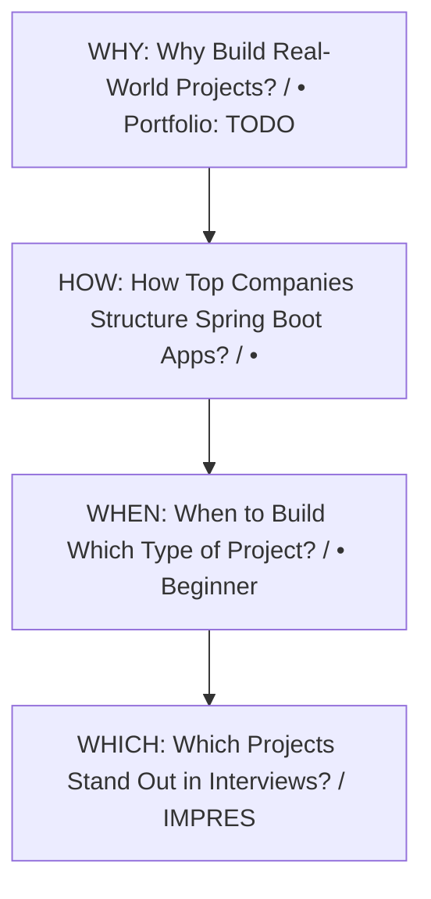
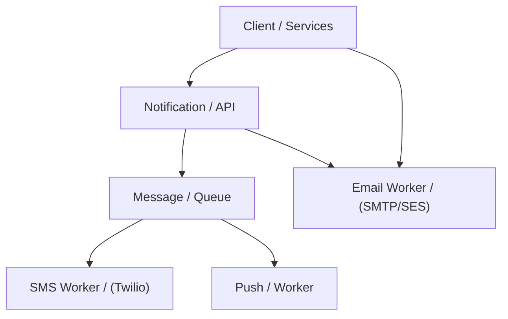
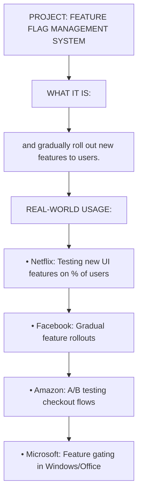
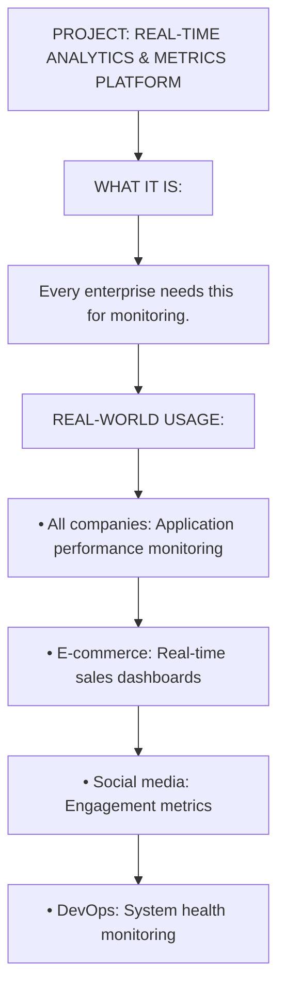
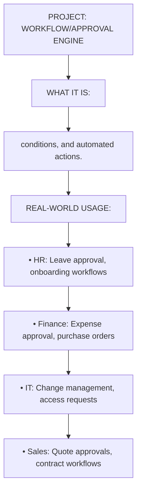
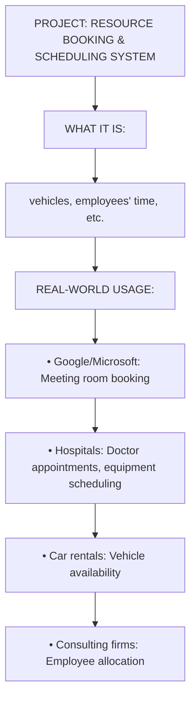
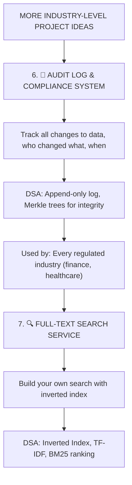
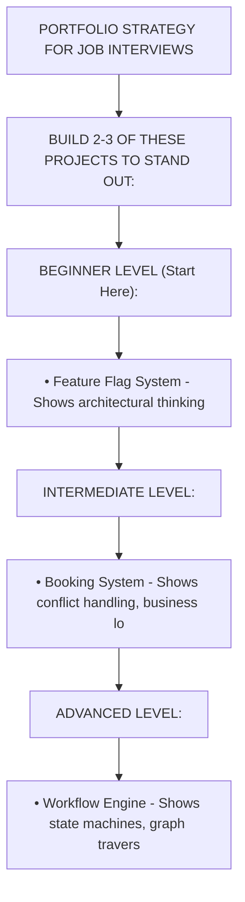

> **Navigation**: [< Previous](Ch50_SB_DSA_Applications.md) | [Back to Index](../00_MASTER_INDEX.md) | [Next >](Ch44_SB_Caching_Scheduling.md)

# 🏭 SPRING BOOT MASTERY - Part 13: Industry-Level Real Projects

> **What Top Companies Actually Build**
> _"Not another TODO app - build what enterprises use"_

---

# 🎯 WHY-HOW-WHEN-WHICH FRAMEWORK

```
┌─────────────────────────────────────────────────────────────────────────────────┐
│  WHY: Why Build Real-World Projects?                                            │
├─────────────────────────────────────────────────────────────────────────────────┤
│  • Portfolio: TODO apps won't impress - E-commerce, Payment systems will        │
│  • Interview: "Show me something non-trivial you've built"                      │
│  • Experience: Real problems teach real solutions                               │
│  • Confidence: "I've built payment integration" > "I know Spring Boot"          │
│  • Job-ready: Gap between tutorials and production is huge                      │
└─────────────────────────────────────────────────────────────────────────────────┘

┌─────────────────────────────────────────────────────────────────────────────────┐
│  HOW: How Top Companies Structure Spring Boot Apps?                             │
├─────────────────────────────────────────────────────────────────────────────────┤
│  • Domain-driven: Package by feature (user/, order/, payment/)                  │
│  • Multi-module: Shared libraries, separate deployables                         │
│  • Event-driven: Kafka/RabbitMQ for async operations                            │
│  • Observability: Metrics, tracing, logging in every service                    │
│  • CI/CD: Automated testing, deployment pipelines                               │
└─────────────────────────────────────────────────────────────────────────────────┘

┌─────────────────────────────────────────────────────────────────────────────────┐
│  WHEN: When to Build Which Type of Project?                                     │
├─────────────────────────────────────────────────────────────────────────────────┤
│  • Beginner: Blog platform, URL shortener, basic CRUD                           │
│  • Intermediate: E-commerce, booking system, notification service               │
│  • Advanced: Payment gateway, real-time chat, distributed system                │
│  • Expert: Event sourcing, multi-tenant SaaS, microservices platform            │
└─────────────────────────────────────────────────────────────────────────────────┘

┌─────────────────────────────────────────────────────────────────────────────────┐
│  WHICH: Which Projects Stand Out in Interviews?                                 │
├─────────────────────────────────────────────────────────────────────────────────┤
│  IMPRESSIVE:    Payment integration, real-time features, microservices          │
│  GOOD:          E-commerce with cart, booking with availability                 │
│  AVOID:         TODO apps, basic CRUD without business logic                    │
└─────────────────────────────────────────────────────────────────────────────────┘
```

**Flow:**
- WHY: Why Build Real-World Projects? / • Portfolio: TODO
- ↓
- HOW: How Top Companies Structure Spring Boot Apps? / •
- ↓
- WHEN: When to Build Which Type of Project? / • Beginner
- ↓
- WHICH: Which Projects Stand Out in Interviews? / IMPRES



---

# 🌱 Section 1: How Big Companies Use Spring Boot

---

## Chapter 1: Spring Boot at Scale

## Spring Boot In Enterprise - Real Examples

🔶 AMAZON (AWS)
- Internal developer portals
- Microservices for order processing
- Inventory management systems
- Configuration management services
- API Gateway implementations
🔷 MICROSOFT
- Azure Spring Cloud (managed Spring Boot)
- LinkedIn backend services
- Internal tooling and automation
- Enterprise integration services
🟠 ORACLE
- Cloud infrastructure services
- Database management portals
- Billing and subscription systems
- Internal employee systems
🟢 NETFLIX
- Contributed Spring Cloud Netflix (Eureka, Zuul)
- Content delivery services
- Recommendation engine APIs
- A/B testing platforms
🔴 VERIZON
- Network monitoring systems
- Customer portal backends
- Billing integration services
- IoT device management
🟣 SALESFORCE
- Integration middleware
- Event processing pipelines
- Analytics services
- Multi-tenant SaaS backends
💼 EUROFINS
- Laboratory Information Management Systems (LIMS)
- Sample tracking and workflow
- Report generation services
- Compliance and audit systems

---

# 🏗️ Section 2: Industry — Level Project Ideas (free to Build)

---

## Project 1: 🔔 Notification & Alert Engine

```
┌─────────────────────────────────────────────────────────────────────────────────┐
│              PROJECT: MULTI-CHANNEL NOTIFICATION ENGINE                         │
├─────────────────────────────────────────────────────────────────────────────────┤
│                                                                                 │
│  WHAT IT IS:                                                                    │
│  A centralized service that sends notifications via Email, SMS, Push,           │
│  Slack, Teams, etc. Used by ALL major companies internally.                     │
│                                                                                 │
│  REAL-WORLD USAGE:                                                              │
│  • Amazon: Order updates, delivery alerts                                       │
│  • Banks: Transaction alerts, fraud warnings                                    │
│  • Healthcare: Appointment reminders, lab results                               │
│  • Enterprise: System alerts, approval workflows                                │
│                                                                                 │
│  ARCHITECTURE:                                                                  │
│                                                                                 │
│  ┌─────────────┐     ┌──────────────────┐     ┌──────────────────┐              │
│  │   Client    │────►│  Notification    │────►│   Message        │              │
│  │   Services  │     │  API             │     │   Queue          │              │
│  └─────────────┘     └──────────────────┘     └────────┬─────────┘              │
│                                                         │                       │
│                      ┌──────────────────────────────────┼────────────┐          │
│                      │                                  │            │          │
│                      ▼                                  ▼            ▼          │
│              ┌───────────────┐              ┌───────────────┐ ┌───────────┐     │
│              │ Email Worker  │              │ SMS Worker    │ │ Push      │     │
│              │ (SMTP/SES)    │              │ (Twilio)      │ │ Worker    │     │
│              └───────────────┘              └───────────────┘ └───────────┘     │
│                                                                                 │
│  DSA USED:                                                                      │
│  • Priority Queue: Urgent notifications first                                   │
│  • Rate Limiting: Prevent notification spam                                     │
│  • Template Engine: Dynamic content generation                                  │
│  • Retry with Exponential Backoff: Failed delivery handling                     │
│                                                                                 │
│  FREE APIs:                                                                     │
│  • Email: JavaMail (SMTP), SendGrid (free tier)                                 │
│  • SMS: Twilio (free trial)                                                     │
│  • Push: Firebase Cloud Messaging (free)                                        │
│  • Slack/Discord: Free webhooks                                                 │
│                                                                                 │
└─────────────────────────────────────────────────────────────────────────────────┘
```

**Flow:**
- Client / Services
- ↓
- Notification / API
- ↓
- Client / Services
- ↓
- Email Worker / (SMTP/SES)
- ↓
- Notification / API
- ↓
- Message / Queue
- ↓
- Notification / API
- ↓
- Email Worker / (SMTP/SES)
- ↓
- Message / Queue
- ↓
- SMS Worker / (Twilio)
- ↓
- Message / Queue
- ↓
- Push / Worker



```java
// ═══════════════════════════════════════════════════════════════════════════════
// NOTIFICATION ENGINE IMPLEMENTATION
// ═══════════════════════════════════════════════════════════════════════════════

// Entity
@Entity
@Table(name = "notifications")
@Getter @Setter
public class Notification {

    @Id
    @GeneratedValue(strategy = GenerationType.IDENTITY)
    private Long id;

    private String recipient;

    @Enumerated(EnumType.STRING)
    private NotificationChannel channel;  // EMAIL, SMS, PUSH, SLACK

    @Enumerated(EnumType.STRING)
    private NotificationPriority priority;  // CRITICAL, HIGH, NORMAL, LOW

    private String subject;

    @Column(columnDefinition = "TEXT")
    private String content;

    @Enumerated(EnumType.STRING)
    private NotificationStatus status;  // PENDING, SENT, FAILED, DELIVERED

    private int retryCount = 0;
    private LocalDateTime scheduledAt;
    private LocalDateTime sentAt;
    private String errorMessage;

    @Column(columnDefinition = "JSON")
    private String metadata;  // Additional data as JSON
}

public enum NotificationChannel { EMAIL, SMS, PUSH, SLACK, TEAMS }
public enum NotificationPriority { CRITICAL, HIGH, NORMAL, LOW }
public enum NotificationStatus { PENDING, PROCESSING, SENT, FAILED, DELIVERED }


// Notification Service
@Service
@RequiredArgsConstructor
@Slf4j
public class NotificationService {

    private final NotificationRepository notificationRepository;
    private final PriorityQueue<NotificationTask> priorityQueue;
    private final Map<NotificationChannel, NotificationSender> senders;

    @Transactional
    public Long queueNotification(NotificationRequest request) {
        Notification notification = new Notification();
        notification.setRecipient(request.recipient());
        notification.setChannel(request.channel());
        notification.setPriority(request.priority());
        notification.setSubject(request.subject());
        notification.setContent(processTemplate(request.templateId(), request.variables()));
        notification.setStatus(NotificationStatus.PENDING);
        notification.setScheduledAt(request.scheduledAt() != null ?
            request.scheduledAt() : LocalDateTime.now());

        Notification saved = notificationRepository.save(notification);

        // Add to priority queue
        priorityQueue.offer(new NotificationTask(saved.getId(), saved.getPriority()));

        log.info("Notification queued: {} via {} to {}",
                 saved.getId(), request.channel(), request.recipient());

        return saved.getId();
    }

    @Scheduled(fixedRate = 1000)
    public void processQueue() {
        while (!priorityQueue.isEmpty()) {
            NotificationTask task = priorityQueue.peek();

            Notification notification = notificationRepository
                .findById(task.notificationId())
                .orElse(null);

            if (notification == null ||
                notification.getScheduledAt().isAfter(LocalDateTime.now())) {
                break;
            }

            priorityQueue.poll();
            processNotification(notification);
        }
    }

    private void processNotification(Notification notification) {
        try {
            notification.setStatus(NotificationStatus.PROCESSING);
            notificationRepository.save(notification);

            NotificationSender sender = senders.get(notification.getChannel());
            sender.send(notification);

            notification.setStatus(NotificationStatus.SENT);
            notification.setSentAt(LocalDateTime.now());

        } catch (Exception e) {
            log.error("Failed to send notification {}: {}",
                      notification.getId(), e.getMessage());
            handleFailure(notification, e);
        }

        notificationRepository.save(notification);
    }

    private void handleFailure(Notification notification, Exception e) {
        notification.setRetryCount(notification.getRetryCount() + 1);
        notification.setErrorMessage(e.getMessage());

        if (notification.getRetryCount() < 3) {
            // Exponential backoff: 1min, 4min, 9min
            long delayMinutes = (long) Math.pow(notification.getRetryCount(), 2);
            notification.setScheduledAt(LocalDateTime.now().plusMinutes(delayMinutes));
            notification.setStatus(NotificationStatus.PENDING);

            priorityQueue.offer(new NotificationTask(
                notification.getId(),
                notification.getPriority()
            ));
        } else {
            notification.setStatus(NotificationStatus.FAILED);
        }
    }
}


// Channel-specific senders
public interface NotificationSender {
    void send(Notification notification);
}

@Component
@RequiredArgsConstructor
public class EmailNotificationSender implements NotificationSender {
    private final JavaMailSender mailSender;

    @Override
    public void send(Notification notification) {
        SimpleMailMessage message = new SimpleMailMessage();
        message.setTo(notification.getRecipient());
        message.setSubject(notification.getSubject());
        message.setText(notification.getContent());
        mailSender.send(message);
    }
}

@Component
@RequiredArgsConstructor
public class SlackNotificationSender implements NotificationSender {
    private final WebClient webClient;

    @Override
    public void send(Notification notification) {
        webClient.post()
            .uri(notification.getRecipient())  // Slack webhook URL
            .bodyValue(Map.of("text", notification.getContent()))
            .retrieve()
            .bodyToMono(String.class)
            .block();
    }
}
```

---

## Project 2: 📊 Feature Flag & A/B Testing System

```
┌─────────────────────────────────────────────────────────────────────────────────┐
│              PROJECT: FEATURE FLAG MANAGEMENT SYSTEM                            │
├─────────────────────────────────────────────────────────────────────────────────┤
│                                                                                 │
│  WHAT IT IS:                                                                    │
│  System to toggle features on/off without deployment, run experiments,          │
│  and gradually roll out new features to users.                                  │
│                                                                                 │
│  REAL-WORLD USAGE:                                                              │
│  • Netflix: Testing new UI features on % of users                               │
│  • Facebook: Gradual feature rollouts                                           │
│  • Amazon: A/B testing checkout flows                                           │
│  • Microsoft: Feature gating in Windows/Office                                  │
│                                                                                 │
│  COMMERCIAL ALTERNATIVES ($$):                                                  │
│  LaunchDarkly, Split.io, Optimizely - ALL expensive!                            │
│                                                                                 │
│  FEATURES TO BUILD:                                                             │
│  ✅ Boolean flags (on/off)                                                       │
│  ✅ Percentage rollout (show to X% of users)                                     │
│  ✅ User targeting (specific users/groups)                                       │
│  ✅ A/B testing with analytics                                                   │
│  ✅ Environment-specific flags (dev/staging/prod)                                │
│  ✅ Real-time toggle (no restart needed)                                         │
│  ✅ Audit log (who changed what, when)                                           │
│                                                                                 │
│  DSA USED:                                                                      │
│  • Hashing: Consistent assignment to variants                                   │
│  • Caching: Fast flag evaluation                                                │
│  • Binary Search: Percentage bucket allocation                                  │
│                                                                                 │
└─────────────────────────────────────────────────────────────────────────────────┘
```

**Flow:**
- PROJECT: FEATURE FLAG MANAGEMENT SYSTEM
- ↓
- WHAT IT IS:
- ↓
- and gradually roll out new features to users.
- ↓
- REAL-WORLD USAGE:
- ↓
- • Netflix: Testing new UI features on % of users
- ↓
- • Facebook: Gradual feature rollouts
- ↓
- • Amazon: A/B testing checkout flows



```java
// ═══════════════════════════════════════════════════════════════════════════════
// FEATURE FLAG SYSTEM IMPLEMENTATION
// ═══════════════════════════════════════════════════════════════════════════════

@Entity
@Table(name = "feature_flags")
@Getter @Setter
public class FeatureFlag {

    @Id
    private String key;  // e.g., "new-checkout-flow"

    private String name;
    private String description;

    @Enumerated(EnumType.STRING)
    private FlagType type;  // BOOLEAN, PERCENTAGE, MULTIVARIATE

    private boolean enabled = false;

    private int percentageRollout = 0;  // 0-100

    @ElementCollection
    @CollectionTable(name = "flag_target_users")
    private Set<String> targetUserIds = new HashSet<>();

    @ElementCollection
    @CollectionTable(name = "flag_target_groups")
    private Set<String> targetGroups = new HashSet<>();  // e.g., "beta-users"

    @Column(columnDefinition = "JSON")
    private String variants;  // For A/B tests: {"A": 50, "B": 50}

    private String environment;  // dev, staging, prod

    private LocalDateTime createdAt;
    private LocalDateTime updatedAt;
    private String updatedBy;
}

public enum FlagType { BOOLEAN, PERCENTAGE, USER_TARGET, MULTIVARIATE }


@Service
@RequiredArgsConstructor
@Slf4j
public class FeatureFlagService {

    private final FeatureFlagRepository flagRepository;
    private final FeatureFlagCache cache;

    /**
     * Check if feature is enabled for user
     *
     * @param flagKey The feature flag key
     * @param userId The user to check (can be null for anonymous)
     * @param attributes Additional user attributes for targeting
     */
    public boolean isEnabled(String flagKey, String userId, Map<String, Object> attributes) {
        FeatureFlag flag = cache.get(flagKey);

        if (flag == null || !flag.isEnabled()) {
            return false;
        }

        return switch (flag.getType()) {
            case BOOLEAN -> true;  // Already checked enabled above
            case USER_TARGET -> isUserTargeted(flag, userId, attributes);
            case PERCENTAGE -> isInPercentage(flag, userId);
            case MULTIVARIATE -> false;  // Use getVariant() instead
        };
    }

    /**
     * Get variant for A/B test
     */
    public String getVariant(String flagKey, String userId) {
        FeatureFlag flag = cache.get(flagKey);

        if (flag == null || !flag.isEnabled()) {
            return "control";  // Default variant
        }

        // Parse variants: {"A": 50, "B": 30, "C": 20}
        Map<String, Integer> variants = parseVariants(flag.getVariants());

        // Consistent hashing to assign user to variant
        int bucket = getUserBucket(flagKey, userId, 100);

        int cumulative = 0;
        for (Map.Entry<String, Integer> entry : variants.entrySet()) {
            cumulative += entry.getValue();
            if (bucket < cumulative) {
                return entry.getKey();
            }
        }

        return "control";
    }

    private boolean isUserTargeted(FeatureFlag flag, String userId,
                                    Map<String, Object> attributes) {
        // Direct user targeting
        if (userId != null && flag.getTargetUserIds().contains(userId)) {
            return true;
        }

        // Group targeting
        if (attributes != null) {
            Object userGroups = attributes.get("groups");
            if (userGroups instanceof Collection<?> groups) {
                for (Object group : groups) {
                    if (flag.getTargetGroups().contains(group.toString())) {
                        return true;
                    }
                }
            }
        }

        return false;
    }

    private boolean isInPercentage(FeatureFlag flag, String userId) {
        if (userId == null) {
            // Anonymous user - use random
            return new Random().nextInt(100) < flag.getPercentageRollout();
        }

        // Consistent hashing for logged-in users
        int bucket = getUserBucket(flag.getKey(), userId, 100);
        return bucket < flag.getPercentageRollout();
    }

    /**
     * Consistent hashing - same user always gets same bucket
     * This ensures user doesn't flip between variants
     */
    private int getUserBucket(String flagKey, String userId, int numBuckets) {
        String combined = flagKey + ":" + userId;
        int hash = combined.hashCode();
        return Math.abs(hash % numBuckets);
    }

    // Admin methods
    @Transactional
    public FeatureFlag updateFlag(String key, UpdateFlagRequest request, String updatedBy) {
        FeatureFlag flag = flagRepository.findById(key)
            .orElseThrow(() -> new FlagNotFoundException(key));

        // Update fields
        if (request.enabled() != null) flag.setEnabled(request.enabled());
        if (request.percentageRollout() != null)
            flag.setPercentageRollout(request.percentageRollout());

        flag.setUpdatedAt(LocalDateTime.now());
        flag.setUpdatedBy(updatedBy);

        FeatureFlag saved = flagRepository.save(flag);

        // Invalidate cache
        cache.invalidate(key);

        // Log change for audit
        auditLogService.log("FEATURE_FLAG_UPDATE", key, updatedBy, request);

        return saved;
    }
}


// Annotation for easy use in code
@Target(ElementType.METHOD)
@Retention(RetentionPolicy.RUNTIME)
public @interface FeatureEnabled {
    String value();  // Flag key
    String fallbackMethod() default "";
}

@Aspect
@Component
@RequiredArgsConstructor
public class FeatureFlagAspect {

    private final FeatureFlagService featureFlagService;

    @Around("@annotation(featureEnabled)")
    public Object checkFeature(ProceedingJoinPoint joinPoint,
                               FeatureEnabled featureEnabled) throws Throwable {

        String userId = getCurrentUserId();

        if (featureFlagService.isEnabled(featureEnabled.value(), userId, null)) {
            return joinPoint.proceed();
        }

        // Feature disabled - call fallback or return null
        if (!featureEnabled.fallbackMethod().isEmpty()) {
            // Call fallback method
            Method fallback = joinPoint.getTarget().getClass()
                .getMethod(featureEnabled.fallbackMethod());
            return fallback.invoke(joinPoint.getTarget());
        }

        throw new FeatureDisabledException(featureEnabled.value());
    }
}


// Usage in Controller
@RestController
public class CheckoutController {

    @FeatureEnabled("new-checkout-flow")
    @PostMapping("/checkout/v2")
    public CheckoutResponse newCheckout(@RequestBody CheckoutRequest request) {
        // New checkout flow
    }

    @PostMapping("/checkout")
    public CheckoutResponse checkout(@RequestBody CheckoutRequest request,
                                     Authentication auth) {
        String variant = featureFlagService.getVariant(
            "checkout-ab-test",
            auth.getName()
        );

        return switch (variant) {
            case "A" -> processCheckoutVariantA(request);
            case "B" -> processCheckoutVariantB(request);
            default -> processCheckoutControl(request);
        };
    }
}
```

---

## Project 3: 📈 Real-Time Analytics Dashboard

```
┌─────────────────────────────────────────────────────────────────────────────────┐
│              PROJECT: REAL-TIME ANALYTICS & METRICS PLATFORM                    │
├─────────────────────────────────────────────────────────────────────────────────┤
│                                                                                 │
│  WHAT IT IS:                                                                    │
│  System to collect, process, and visualize real-time application metrics.       │
│  Every enterprise needs this for monitoring.                                    │
│                                                                                 │
│  REAL-WORLD USAGE:                                                              │
│  • All companies: Application performance monitoring                            │
│  • E-commerce: Real-time sales dashboards                                       │
│  • Social media: Engagement metrics                                             │
│  • DevOps: System health monitoring                                             │
│                                                                                 │
│  COMMERCIAL ALTERNATIVES ($$):                                                  │
│  DataDog ($$$), New Relic ($$), Splunk ($$$)                                    │
│                                                                                 │
│  FEATURES TO BUILD:                                                             │
│  ✅ Event ingestion API (high throughput)                                        │
│  ✅ Real-time aggregations (count, sum, avg)                                     │
│  ✅ Time-series data storage                                                     │
│  ✅ Sliding window analytics                                                     │
│  ✅ WebSocket for live updates                                                   │
│  ✅ Custom metric definitions                                                    │
│  ✅ Alert rules (threshold breaches)                                             │
│                                                                                 │
│  DSA USED:                                                                      │
│  • Sliding Window: Rolling averages, rate calculations                          │
│  • Time-Series: Efficient storage and queries                                   │
│  • Bloom Filter: Unique visitor counting                                        │
│  • Min/Max Heap: Top-K metrics                                                  │
│                                                                                 │
└─────────────────────────────────────────────────────────────────────────────────┘
```

**Flow:**
- PROJECT: REAL-TIME ANALYTICS & METRICS PLATFORM
- ↓
- WHAT IT IS:
- ↓
- Every enterprise needs this for monitoring.
- ↓
- REAL-WORLD USAGE:
- ↓
- • All companies: Application performance monitoring
- ↓
- • E-commerce: Real-time sales dashboards
- ↓
- • Social media: Engagement metrics



```java
// ═══════════════════════════════════════════════════════════════════════════════
// REAL-TIME ANALYTICS IMPLEMENTATION
// ═══════════════════════════════════════════════════════════════════════════════

@Entity
@Table(name = "metric_events")
public class MetricEvent {
    @Id
    @GeneratedValue(strategy = GenerationType.IDENTITY)
    private Long id;

    private String metricName;
    private double value;
    private LocalDateTime timestamp;

    @Column(columnDefinition = "JSON")
    private String dimensions;  // {"page": "/home", "country": "US"}
}


@Service
@RequiredArgsConstructor
@Slf4j
public class AnalyticsService {

    // In-memory aggregations using sliding windows
    private final Map<String, SlidingWindowAggregator> aggregators = new ConcurrentHashMap<>();
    private final MetricEventRepository eventRepository;
    private final SimpMessagingTemplate wsMessaging;

    /**
     * Record a metric event
     */
    public void recordEvent(MetricEventRequest request) {
        // Store in database
        MetricEvent event = new MetricEvent();
        event.setMetricName(request.metricName());
        event.setValue(request.value());
        event.setTimestamp(LocalDateTime.now());
        event.setDimensions(toJson(request.dimensions()));
        eventRepository.save(event);

        // Update real-time aggregations
        SlidingWindowAggregator agg = aggregators.computeIfAbsent(
            request.metricName(),
            k -> new SlidingWindowAggregator(Duration.ofMinutes(5))
        );
        agg.add(request.value());

        // Push to WebSocket clients
        MetricUpdate update = new MetricUpdate(
            request.metricName(),
            agg.getCount(),
            agg.getSum(),
            agg.getAverage(),
            LocalDateTime.now()
        );
        wsMessaging.convertAndSend("/topic/metrics/" + request.metricName(), update);
    }

    /**
     * Get current metric summary
     */
    public MetricSummary getMetricSummary(String metricName) {
        SlidingWindowAggregator agg = aggregators.get(metricName);
        if (agg == null) {
            return MetricSummary.empty(metricName);
        }

        return new MetricSummary(
            metricName,
            agg.getCount(),
            agg.getSum(),
            agg.getAverage(),
            agg.getMin(),
            agg.getMax(),
            agg.getP95(),
            agg.getP99()
        );
    }

    /**
     * Get time-series data for charting
     */
    public List<TimeseriesPoint> getTimeseries(
            String metricName,
            LocalDateTime start,
            LocalDateTime end,
            Duration bucketSize) {

        List<MetricEvent> events = eventRepository
            .findByMetricNameAndTimestampBetween(metricName, start, end);

        // Group by time buckets
        Map<LocalDateTime, DoubleSummaryStatistics> buckets = events.stream()
            .collect(Collectors.groupingBy(
                e -> truncateToBucket(e.getTimestamp(), bucketSize),
                Collectors.summarizingDouble(MetricEvent::getValue)
            ));

        // Convert to timeseries
        return buckets.entrySet().stream()
            .sorted(Map.Entry.comparingByKey())
            .map(e -> new TimeseriesPoint(
                e.getKey(),
                e.getValue().getCount(),
                e.getValue().getSum(),
                e.getValue().getAverage()
            ))
            .toList();
    }
}


// Sliding Window Aggregator with O(1) operations
public class SlidingWindowAggregator {

    private final Duration windowSize;
    private final Deque<TimestampedValue> values = new LinkedList<>();
    private double sum = 0;
    private final TreeMap<Double, Integer> sortedValues = new TreeMap<>();  // For percentiles

    public SlidingWindowAggregator(Duration windowSize) {
        this.windowSize = windowSize;
    }

    public synchronized void add(double value) {
        long now = System.currentTimeMillis();

        // Remove old values outside window
        evictOld(now);

        // Add new value
        values.addLast(new TimestampedValue(now, value));
        sum += value;
        sortedValues.merge(value, 1, Integer::sum);
    }

    private void evictOld(long now) {
        long windowStart = now - windowSize.toMillis();

        while (!values.isEmpty() && values.peekFirst().timestamp() < windowStart) {
            TimestampedValue old = values.pollFirst();
            sum -= old.value();

            int count = sortedValues.get(old.value());
            if (count == 1) {
                sortedValues.remove(old.value());
            } else {
                sortedValues.put(old.value(), count - 1);
            }
        }
    }

    public synchronized long getCount() {
        evictOld(System.currentTimeMillis());
        return values.size();
    }

    public synchronized double getSum() {
        evictOld(System.currentTimeMillis());
        return sum;
    }

    public synchronized double getAverage() {
        long count = getCount();
        return count > 0 ? sum / count : 0;
    }

    public synchronized double getMin() {
        evictOld(System.currentTimeMillis());
        return sortedValues.isEmpty() ? 0 : sortedValues.firstKey();
    }

    public synchronized double getMax() {
        evictOld(System.currentTimeMillis());
        return sortedValues.isEmpty() ? 0 : sortedValues.lastKey();
    }

    public synchronized double getP95() {
        return getPercentile(95);
    }

    public synchronized double getP99() {
        return getPercentile(99);
    }

    private double getPercentile(int percentile) {
        evictOld(System.currentTimeMillis());
        if (sortedValues.isEmpty()) return 0;

        int targetIndex = (int) Math.ceil(values.size() * percentile / 100.0);
        int currentIndex = 0;

        for (Map.Entry<Double, Integer> entry : sortedValues.entrySet()) {
            currentIndex += entry.getValue();
            if (currentIndex >= targetIndex) {
                return entry.getKey();
            }
        }

        return sortedValues.lastKey();
    }
}

record TimestampedValue(long timestamp, double value) {}


// WebSocket Controller
@Controller
public class MetricsWebSocketController {

    @MessageMapping("/subscribe/{metricName}")
    @SendTo("/topic/metrics/{metricName}")
    public MetricSummary subscribeToMetric(@DestinationVariable String metricName) {
        return analyticsService.getMetricSummary(metricName);
    }
}


// REST API
@RestController
@RequestMapping("/api/analytics")
@RequiredArgsConstructor
public class AnalyticsController {

    private final AnalyticsService analyticsService;

    @PostMapping("/events")
    public ResponseEntity<Void> recordEvent(@RequestBody MetricEventRequest request) {
        analyticsService.recordEvent(request);
        return ResponseEntity.accepted().build();
    }

    @PostMapping("/events/batch")
    public ResponseEntity<Void> recordBatch(@RequestBody List<MetricEventRequest> events) {
        events.forEach(analyticsService::recordEvent);
        return ResponseEntity.accepted().build();
    }

    @GetMapping("/metrics/{name}")
    public MetricSummary getMetric(@PathVariable String name) {
        return analyticsService.getMetricSummary(name);
    }

    @GetMapping("/metrics/{name}/timeseries")
    public List<TimeseriesPoint> getTimeseries(
            @PathVariable String name,
            @RequestParam @DateTimeFormat(iso = ISO.DATE_TIME) LocalDateTime start,
            @RequestParam @DateTimeFormat(iso = ISO.DATE_TIME) LocalDateTime end,
            @RequestParam(defaultValue = "PT1M") Duration bucket) {
        return analyticsService.getTimeseries(name, start, end, bucket);
    }
}
```

---

## Project 4: 🔄 Workflow Automation Engine

```
┌─────────────────────────────────────────────────────────────────────────────────┐
│              PROJECT: WORKFLOW/APPROVAL ENGINE                                  │
├─────────────────────────────────────────────────────────────────────────────────┤
│                                                                                 │
│  WHAT IT IS:                                                                    │
│  System to define and execute multi-step business workflows with approvals,     │
│  conditions, and automated actions.                                             │
│                                                                                 │
│  REAL-WORLD USAGE:                                                              │
│  • HR: Leave approval, onboarding workflows                                     │
│  • Finance: Expense approval, purchase orders                                   │
│  • IT: Change management, access requests                                       │
│  • Sales: Quote approvals, contract workflows                                   │
│                                                                                 │
│  COMMERCIAL ALTERNATIVES ($$):                                                  │
│  Camunda ($), ServiceNow ($$$), Jira Workflows                                  │
│                                                                                 │
│  FEATURES TO BUILD:                                                             │
│  ✅ Visual workflow designer (define steps, conditions)                          │
│  ✅ Approval chains (sequential, parallel)                                       │
│  ✅ Conditional branching (if amount > $1000, add VP approval)                   │
│  ✅ Auto-escalation (if not approved in X days)                                  │
│  ✅ Email/Slack notifications at each step                                       │
│  ✅ Audit trail                                                                  │
│  ✅ SLA tracking                                                                 │
│                                                                                 │
│  DSA USED:                                                                      │
│  • Graph/DAG: Workflow definition                                               │
│  • State Machine: Workflow execution                                            │
│  • Queue: Pending tasks                                                         │
│  • Topological Sort: Step ordering                                              │
│                                                                                 │
└─────────────────────────────────────────────────────────────────────────────────┘
```

**Flow:**
- PROJECT: WORKFLOW/APPROVAL ENGINE
- ↓
- WHAT IT IS:
- ↓
- conditions, and automated actions.
- ↓
- REAL-WORLD USAGE:
- ↓
- • HR: Leave approval, onboarding workflows
- ↓
- • Finance: Expense approval, purchase orders
- ↓
- • IT: Change management, access requests



```java
// ═══════════════════════════════════════════════════════════════════════════════
// WORKFLOW ENGINE IMPLEMENTATION
// ═══════════════════════════════════════════════════════════════════════════════

// Workflow Definition
@Entity
@Table(name = "workflow_definitions")
@Getter @Setter
public class WorkflowDefinition {
    @Id
    @GeneratedValue(strategy = GenerationType.IDENTITY)
    private Long id;

    private String name;
    private String description;

    @Column(columnDefinition = "JSON")
    private String steps;  // JSON array of step definitions

    private boolean active = true;
}


// Step Definition (stored as JSON)
public record StepDefinition(
    String id,
    String name,
    StepType type,
    String assigneeType,  // "user", "role", "manager"
    String assignee,
    String condition,     // SpEL expression
    List<String> nextSteps,
    Duration sla
) {}

public enum StepType {
    APPROVAL,     // Requires approval
    TASK,         // Requires completion
    AUTO,         // Automatic (no human)
    NOTIFICATION, // Just notify
    PARALLEL,     // Fork
    JOIN          // Wait for all parallel
}


// Workflow Instance
@Entity
@Table(name = "workflow_instances")
@Getter @Setter
public class WorkflowInstance {
    @Id
    @GeneratedValue(strategy = GenerationType.IDENTITY)
    private Long id;

    @ManyToOne
    private WorkflowDefinition definition;

    private String requesterId;
    private String currentStepId;

    @Enumerated(EnumType.STRING)
    private WorkflowStatus status;

    @Column(columnDefinition = "JSON")
    private String data;  // Request data

    private LocalDateTime startedAt;
    private LocalDateTime completedAt;
}

public enum WorkflowStatus {
    RUNNING, COMPLETED, REJECTED, CANCELLED, WAITING
}


// Step Instance
@Entity
@Table(name = "workflow_step_instances")
@Getter @Setter
public class StepInstance {
    @Id
    @GeneratedValue(strategy = GenerationType.IDENTITY)
    private Long id;

    @ManyToOne
    private WorkflowInstance workflow;

    private String stepId;
    private String assigneeId;

    @Enumerated(EnumType.STRING)
    private StepStatus status;

    private String comment;

    private LocalDateTime assignedAt;
    private LocalDateTime dueAt;
    private LocalDateTime completedAt;
    private String completedBy;
}

public enum StepStatus {
    PENDING, IN_PROGRESS, APPROVED, REJECTED, COMPLETED, SKIPPED
}


@Service
@RequiredArgsConstructor
@Slf4j
public class WorkflowEngine {

    private final WorkflowDefinitionRepository definitionRepo;
    private final WorkflowInstanceRepository instanceRepo;
    private final StepInstanceRepository stepRepo;
    private final NotificationService notificationService;
    private final SpelExpressionParser expressionParser = new SpelExpressionParser();

    /**
     * Start a new workflow
     */
    @Transactional
    public WorkflowInstance startWorkflow(Long definitionId, String requesterId,
                                           Map<String, Object> data) {
        WorkflowDefinition definition = definitionRepo.findById(definitionId)
            .orElseThrow(() -> new WorkflowNotFoundException(definitionId));

        // Create instance
        WorkflowInstance instance = new WorkflowInstance();
        instance.setDefinition(definition);
        instance.setRequesterId(requesterId);
        instance.setStatus(WorkflowStatus.RUNNING);
        instance.setData(toJson(data));
        instance.setStartedAt(LocalDateTime.now());

        List<StepDefinition> steps = parseSteps(definition.getSteps());
        instance.setCurrentStepId(steps.get(0).id());

        instance = instanceRepo.save(instance);

        // Create first step
        activateStep(instance, steps.get(0), data);

        log.info("Workflow started: {} by {}", instance.getId(), requesterId);
        return instance;
    }

    /**
     * Process step action (approve, reject, complete)
     */
    @Transactional
    public void processStepAction(Long stepInstanceId, String action,
                                  String userId, String comment) {
        StepInstance step = stepRepo.findById(stepInstanceId)
            .orElseThrow(() -> new StepNotFoundException(stepInstanceId));

        WorkflowInstance workflow = step.getWorkflow();
        Map<String, Object> data = parseJson(workflow.getData());

        switch (action.toUpperCase()) {
            case "APPROVE" -> approveStep(step, workflow, userId, comment, data);
            case "REJECT" -> rejectStep(step, workflow, userId, comment);
            case "COMPLETE" -> completeStep(step, workflow, userId, comment, data);
            default -> throw new InvalidActionException(action);
        }
    }

    private void approveStep(StepInstance step, WorkflowInstance workflow,
                             String userId, String comment, Map<String, Object> data) {
        step.setStatus(StepStatus.APPROVED);
        step.setCompletedAt(LocalDateTime.now());
        step.setCompletedBy(userId);
        step.setComment(comment);
        stepRepo.save(step);

        // Move to next step
        advanceWorkflow(workflow, step.getStepId(), data);
    }

    private void rejectStep(StepInstance step, WorkflowInstance workflow,
                            String userId, String comment) {
        step.setStatus(StepStatus.REJECTED);
        step.setCompletedAt(LocalDateTime.now());
        step.setCompletedBy(userId);
        step.setComment(comment);
        stepRepo.save(step);

        // End workflow
        workflow.setStatus(WorkflowStatus.REJECTED);
        workflow.setCompletedAt(LocalDateTime.now());
        instanceRepo.save(workflow);

        // Notify requester
        notificationService.send(new NotificationRequest(
            workflow.getRequesterId(),
            NotificationChannel.EMAIL,
            NotificationPriority.HIGH,
            "Workflow Rejected",
            "Your request has been rejected. Reason: " + comment,
            null, null, null
        ));
    }

    private void advanceWorkflow(WorkflowInstance workflow, String currentStepId,
                                 Map<String, Object> data) {
        List<StepDefinition> steps = parseSteps(workflow.getDefinition().getSteps());

        StepDefinition currentStep = steps.stream()
            .filter(s -> s.id().equals(currentStepId))
            .findFirst()
            .orElseThrow();

        List<String> nextStepIds = currentStep.nextSteps();

        if (nextStepIds == null || nextStepIds.isEmpty()) {
            // Workflow complete
            workflow.setStatus(WorkflowStatus.COMPLETED);
            workflow.setCompletedAt(LocalDateTime.now());
            instanceRepo.save(workflow);

            notificationService.send(new NotificationRequest(
                workflow.getRequesterId(),
                NotificationChannel.EMAIL,
                NotificationPriority.NORMAL,
                "Workflow Completed",
                "Your request has been approved and completed.",
                null, null, null
            ));
            return;
        }

        // Activate next steps
        for (String nextStepId : nextStepIds) {
            StepDefinition nextStep = steps.stream()
                .filter(s -> s.id().equals(nextStepId))
                .findFirst()
                .orElseThrow();

            // Check condition
            if (nextStep.condition() != null && !evaluateCondition(nextStep.condition(), data)) {
                continue;  // Skip this step
            }

            activateStep(workflow, nextStep, data);
        }

        workflow.setCurrentStepId(nextStepIds.get(0));
        instanceRepo.save(workflow);
    }

    private void activateStep(WorkflowInstance workflow, StepDefinition stepDef,
                              Map<String, Object> data) {
        String assigneeId = resolveAssignee(stepDef, data, workflow.getRequesterId());

        StepInstance step = new StepInstance();
        step.setWorkflow(workflow);
        step.setStepId(stepDef.id());
        step.setAssigneeId(assigneeId);
        step.setStatus(StepStatus.PENDING);
        step.setAssignedAt(LocalDateTime.now());

        if (stepDef.sla() != null) {
            step.setDueAt(LocalDateTime.now().plus(stepDef.sla()));
        }

        stepRepo.save(step);

        // Notify assignee
        notificationService.send(new NotificationRequest(
            assigneeId,
            NotificationChannel.EMAIL,
            NotificationPriority.NORMAL,
            "Action Required: " + stepDef.name(),
            "You have a pending approval/task. Please review.",
            null, null, null
        ));
    }

    private String resolveAssignee(StepDefinition step, Map<String, Object> data,
                                   String requesterId) {
        return switch (step.assigneeType()) {
            case "user" -> step.assignee();
            case "role" -> userService.findByRole(step.assignee()).get(0).getId();
            case "manager" -> userService.getManager(requesterId).getId();
            case "expression" -> evaluateExpression(step.assignee(), data).toString();
            default -> step.assignee();
        };
    }

    private boolean evaluateCondition(String condition, Map<String, Object> data) {
        StandardEvaluationContext context = new StandardEvaluationContext();
        context.setVariables(data);
        Expression exp = expressionParser.parseExpression(condition);
        return Boolean.TRUE.equals(exp.getValue(context, Boolean.class));
    }

    /**
     * Check for SLA breaches and escalate
     */
    @Scheduled(fixedRate = 60000)  // Every minute
    public void checkEscalations() {
        List<StepInstance> overdueSteps = stepRepo
            .findByStatusAndDueAtBefore(StepStatus.PENDING, LocalDateTime.now());

        for (StepInstance step : overdueSteps) {
            log.warn("SLA breach for step {} in workflow {}",
                     step.getId(), step.getWorkflow().getId());

            // Notify manager
            String managerId = userService.getManager(step.getAssigneeId()).getId();
            notificationService.send(new NotificationRequest(
                managerId,
                NotificationChannel.EMAIL,
                NotificationPriority.HIGH,
                "ESCALATION: Overdue Approval",
                "Step " + step.getStepId() + " is overdue. Please follow up.",
                null, null, null
            ));
        }
    }
}
```

---

## Project 5: 🗓️ Resource Scheduling & Booking System

```
┌─────────────────────────────────────────────────────────────────────────────────┐
│              PROJECT: RESOURCE BOOKING & SCHEDULING SYSTEM                      │
├─────────────────────────────────────────────────────────────────────────────────┤
│                                                                                 │
│  WHAT IT IS:                                                                    │
│  System to manage bookings for any resource - meeting rooms, equipment,         │
│  vehicles, employees' time, etc.                                                │
│                                                                                 │
│  REAL-WORLD USAGE:                                                              │
│  • Google/Microsoft: Meeting room booking                                       │
│  • Hospitals: Doctor appointments, equipment scheduling                         │
│  • Car rentals: Vehicle availability                                            │
│  • Consulting firms: Employee allocation                                        │
│                                                                                 │
│  FEATURES TO BUILD:                                                             │
│  ✅ Resource management (rooms, equipment, people)                               │
│  ✅ Availability checking                                                        │
│  ✅ Booking with conflict detection                                              │
│  ✅ Recurring bookings                                                           │
│  ✅ Waitlist management                                                          │
│  ✅ Calendar view API                                                            │
│  ✅ Reminders and notifications                                                  │
│                                                                                 │
│  DSA USED:                                                                      │
│  • Interval Trees: Conflict detection                                           │
│  • Priority Queue: Waitlist management                                          │
│  • Binary Search: Finding available slots                                       │
│                                                                                 │
└─────────────────────────────────────────────────────────────────────────────────┘
```

**Flow:**
- PROJECT: RESOURCE BOOKING & SCHEDULING SYSTEM
- ↓
- WHAT IT IS:
- ↓
- vehicles, employees' time, etc.
- ↓
- REAL-WORLD USAGE:
- ↓
- • Google/Microsoft: Meeting room booking
- ↓
- • Hospitals: Doctor appointments, equipment scheduling
- ↓
- • Car rentals: Vehicle availability



```java
// ═══════════════════════════════════════════════════════════════════════════════
// RESOURCE BOOKING SYSTEM IMPLEMENTATION
// ═══════════════════════════════════════════════════════════════════════════════

@Entity
@Table(name = "resources")
@Getter @Setter
public class Resource {
    @Id
    @GeneratedValue(strategy = GenerationType.IDENTITY)
    private Long id;

    private String name;

    @Enumerated(EnumType.STRING)
    private ResourceType type;  // ROOM, EQUIPMENT, VEHICLE, PERSON

    private String location;
    private int capacity;

    @Column(columnDefinition = "JSON")
    private String attributes;  // {"hasProjector": true, "hasWhiteboard": true}

    private boolean active = true;
}


@Entity
@Table(name = "bookings")
@Getter @Setter
public class Booking {
    @Id
    @GeneratedValue(strategy = GenerationType.IDENTITY)
    private Long id;

    @ManyToOne
    private Resource resource;

    private String bookerId;
    private String title;

    private LocalDateTime startTime;
    private LocalDateTime endTime;

    @Enumerated(EnumType.STRING)
    private BookingStatus status;  // CONFIRMED, CANCELLED, WAITLISTED

    private String recurrenceRule;  // RRULE format
    private Long parentBookingId;   // For recurring instances

    private LocalDateTime createdAt;
}


@Service
@RequiredArgsConstructor
@Slf4j
public class BookingService {

    private final ResourceRepository resourceRepo;
    private final BookingRepository bookingRepo;
    private final WaitlistRepository waitlistRepo;

    /**
     * Check availability for a time range
     */
    public List<Resource> findAvailableResources(
            ResourceType type,
            LocalDateTime start,
            LocalDateTime end,
            Map<String, Object> requirements) {

        List<Resource> resources = resourceRepo.findByTypeAndActive(type, true);

        return resources.stream()
            .filter(r -> meetRequirements(r, requirements))
            .filter(r -> isAvailable(r.getId(), start, end))
            .toList();
    }

    /**
     * Check if resource is available (no overlapping bookings)
     */
    public boolean isAvailable(Long resourceId, LocalDateTime start, LocalDateTime end) {
        // Query for any overlapping bookings
        // Overlap condition: existingStart < newEnd AND existingEnd > newStart
        List<Booking> conflicts = bookingRepo.findConflictingBookings(
            resourceId, start, end, BookingStatus.CONFIRMED
        );
        return conflicts.isEmpty();
    }

    /**
     * Get available time slots for a resource on a given day
     */
    public List<TimeSlot> getAvailableSlots(
            Long resourceId,
            LocalDate date,
            Duration slotDuration) {

        LocalDateTime dayStart = date.atTime(8, 0);   // Business hours: 8 AM
        LocalDateTime dayEnd = date.atTime(18, 0);    // to 6 PM

        // Get all bookings for this day
        List<Booking> bookings = bookingRepo.findByResourceIdAndDateRange(
            resourceId, dayStart, dayEnd, BookingStatus.CONFIRMED
        );

        // Sort by start time
        bookings.sort(Comparator.comparing(Booking::getStartTime));

        List<TimeSlot> availableSlots = new ArrayList<>();
        LocalDateTime current = dayStart;

        for (Booking booking : bookings) {
            // Add slots before this booking
            while (current.plus(slotDuration).isBefore(booking.getStartTime()) ||
                   current.plus(slotDuration).equals(booking.getStartTime())) {
                availableSlots.add(new TimeSlot(current, current.plus(slotDuration)));
                current = current.plus(slotDuration);
            }
            // Skip past this booking
            if (booking.getEndTime().isAfter(current)) {
                current = booking.getEndTime();
            }
        }

        // Add remaining slots after last booking
        while (current.plus(slotDuration).isBefore(dayEnd) ||
               current.plus(slotDuration).equals(dayEnd)) {
            availableSlots.add(new TimeSlot(current, current.plus(slotDuration)));
            current = current.plus(slotDuration);
        }

        return availableSlots;
    }

    /**
     * Create a booking
     */
    @Transactional
    public BookingResult createBooking(CreateBookingRequest request) {
        // Check availability
        if (!isAvailable(request.resourceId(), request.startTime(), request.endTime())) {
            if (request.addToWaitlist()) {
                return addToWaitlist(request);
            }
            throw new ResourceNotAvailableException(request.resourceId());
        }

        Resource resource = resourceRepo.findById(request.resourceId())
            .orElseThrow(() -> new ResourceNotFoundException(request.resourceId()));

        Booking booking = new Booking();
        booking.setResource(resource);
        booking.setBookerId(request.bookerId());
        booking.setTitle(request.title());
        booking.setStartTime(request.startTime());
        booking.setEndTime(request.endTime());
        booking.setStatus(BookingStatus.CONFIRMED);
        booking.setCreatedAt(LocalDateTime.now());

        // Handle recurring bookings
        if (request.recurrenceRule() != null) {
            booking.setRecurrenceRule(request.recurrenceRule());
            booking = bookingRepo.save(booking);
            createRecurringInstances(booking, request.recurrenceRule());
        } else {
            booking = bookingRepo.save(booking);
        }

        log.info("Booking created: {} for resource {}", booking.getId(), resource.getName());

        return new BookingResult(booking.getId(), BookingStatus.CONFIRMED, null);
    }

    /**
     * Cancel booking and process waitlist
     */
    @Transactional
    public void cancelBooking(Long bookingId, String userId) {
        Booking booking = bookingRepo.findById(bookingId)
            .orElseThrow(() -> new BookingNotFoundException(bookingId));

        if (!booking.getBookerId().equals(userId)) {
            throw new UnauthorizedException("Cannot cancel another user's booking");
        }

        booking.setStatus(BookingStatus.CANCELLED);
        bookingRepo.save(booking);

        // Process waitlist
        processWaitlist(booking.getResource().getId(),
                        booking.getStartTime(),
                        booking.getEndTime());
    }

    private BookingResult addToWaitlist(CreateBookingRequest request) {
        WaitlistEntry entry = new WaitlistEntry();
        entry.setResourceId(request.resourceId());
        entry.setUserId(request.bookerId());
        entry.setStartTime(request.startTime());
        entry.setEndTime(request.endTime());
        entry.setRequestedAt(LocalDateTime.now());
        entry.setPriority(calculatePriority(request.bookerId()));

        waitlistRepo.save(entry);

        return new BookingResult(null, BookingStatus.WAITLISTED, entry.getId());
    }

    private void processWaitlist(Long resourceId, LocalDateTime start, LocalDateTime end) {
        List<WaitlistEntry> waitlist = waitlistRepo
            .findByResourceIdAndTimeOverlap(resourceId, start, end);

        // Sort by priority (implemented as priority queue in memory for efficiency)
        PriorityQueue<WaitlistEntry> pq = new PriorityQueue<>(
            Comparator.comparingInt(WaitlistEntry::getPriority).reversed()
        );
        pq.addAll(waitlist);

        while (!pq.isEmpty()) {
            WaitlistEntry entry = pq.poll();

            if (isAvailable(resourceId, entry.getStartTime(), entry.getEndTime())) {
                // Create booking for this user
                try {
                    createBooking(new CreateBookingRequest(
                        resourceId,
                        entry.getUserId(),
                        "From waitlist",
                        entry.getStartTime(),
                        entry.getEndTime(),
                        false,
                        null
                    ));

                    waitlistRepo.delete(entry);

                    // Notify user
                    notificationService.send(/* ... */);

                    break;  // Only one booking per slot
                } catch (Exception e) {
                    log.warn("Failed to book from waitlist: {}", e.getMessage());
                }
            }
        }
    }
}

public record TimeSlot(LocalDateTime start, LocalDateTime end) {}
public record BookingResult(Long bookingId, BookingStatus status, Long waitlistId) {}
```

---

# 🏗️ More Project Ideas

```
┌─────────────────────────────────────────────────────────────────────────────────┐
│              MORE INDUSTRY-LEVEL PROJECT IDEAS                                  │
├─────────────────────────────────────────────────────────────────────────────────┤
│                                                                                 │
│  6. 📝 AUDIT LOG & COMPLIANCE SYSTEM                                             │
│     Track all changes to data, who changed what, when                           │
│     DSA: Append-only log, Merkle trees for integrity                            │
│     Used by: Every regulated industry (finance, healthcare)                     │
│                                                                                 │
│  7. 🔍 FULL-TEXT SEARCH SERVICE                                                  │
│     Build your own search with inverted index                                   │
│     DSA: Inverted Index, TF-IDF, BM25 ranking                                   │
│     Similar to: Mini Elasticsearch                                              │
│                                                                                 │
│  8. 📦 INVENTORY MANAGEMENT SYSTEM                                               │
│     Track stock, predict shortages, manage warehouses                           │
│     DSA: Queue (FIFO for perishables), Min Heap (low stock alerts)              │
│     Used by: Amazon, Walmart, every retailer                                    │
│                                                                                 │
│  9. 🎫 TICKETING/HELPDESK SYSTEM                                                 │
│     Like JIRA/Zendesk - create, assign, track tickets                           │
│     DSA: State Machine, Priority Queue, SLA Timer                               │
│     Used by: IT support, customer service                                       │
│                                                                                 │
│  10. 📊 REPORT GENERATION ENGINE                                                 │
│      Define templates, schedule reports, export PDF/Excel                       │
│      DSA: Template parsing, Queue for scheduled jobs                            │
│      Used by: All enterprises for business intelligence                         │
│                                                                                 │
│  11. 🔐 SECRETS/CONFIG MANAGEMENT                                                │
│      Like HashiCorp Vault - store and manage secrets                            │
│      DSA: Encryption algorithms, Access control lists                           │
│      Used by: DevOps, Security teams                                            │
│                                                                                 │
│  12. 📡 API GATEWAY                                                              │
│      Route requests, rate limit, authentication                                 │
│      DSA: Trie (URL matching), Token Bucket (rate limit)                        │
│      Similar to: Kong, AWS API Gateway                                          │
│                                                                                 │
│  13. 🗺️ GEOSPATIAL SERVICE                                                      │
│      Store locations, find nearby, geofencing                                   │
│      DSA: QuadTree, R-Tree, Haversine distance                                  │
│      Used by: Uber, DoorDash, any location-based app                            │
│                                                                                 │
│  14. 💬 REAL-TIME CHAT/MESSAGING                                                 │
│      Private/group messages, online status, typing indicators                   │
│      DSA: Queue, Pub/Sub, WebSockets                                            │
│      Similar to: Slack, Teams backend                                           │
│                                                                                 │
│  15. 🎯 RECOMMENDATION ENGINE                                                    │
│      "Users who liked X also liked Y"                                           │
│      DSA: Collaborative filtering, Graph algorithms                             │
│      Used by: Netflix, Amazon, Spotify                                          │
│                                                                                 │
└─────────────────────────────────────────────────────────────────────────────────┘
```

**Flow:**
- MORE INDUSTRY-LEVEL PROJECT IDEAS
- ↓
- 6. 📝 AUDIT LOG & COMPLIANCE SYSTEM
- ↓
- Track all changes to data, who changed what, when
- ↓
- DSA: Append-only log, Merkle trees for integrity
- ↓
- Used by: Every regulated industry (finance, healthcare)
- ↓
- 7. 🔍 FULL-TEXT SEARCH SERVICE
- ↓
- Build your own search with inverted index



---

# 📌 Building a Portfolio

```
┌─────────────────────────────────────────────────────────────────────────────────┐
│              PORTFOLIO STRATEGY FOR JOB INTERVIEWS                              │
├─────────────────────────────────────────────────────────────────────────────────┤
│                                                                                 │
│  BUILD 2-3 OF THESE PROJECTS TO STAND OUT:                                      │
│                                                                                 │
│  BEGINNER LEVEL (Start Here):                                                   │
│  ────────────────────────────                                                   │
│  • Notification Engine - Shows you understand queues, async processing          │
│  • Feature Flag System - Shows architectural thinking                           │
│                                                                                 │
│  INTERMEDIATE LEVEL:                                                            │
│  ──────────────────                                                             │
│  • Analytics Dashboard - Shows DSA knowledge (sliding window, aggregations)     │
│  • Booking System - Shows conflict handling, business logic                     │
│                                                                                 │
│  ADVANCED LEVEL:                                                                │
│  ───────────────                                                                │
│  • Workflow Engine - Shows state machines, graph traversal                      │
│  • Search Service - Shows inverted index, ranking algorithms                    │
│                                                                                 │
│  HOW THESE HELP IN INTERVIEWS:                                                  │
│  ─────────────────────────────                                                  │
│                                                                                 │
│  "Tell me about a challenging project"                                          │
│  → Explain your notification engine's retry logic with exponential backoff      │
│                                                                                 │
│  "How would you design a rate limiter?"                                         │
│  → "I actually built one! Here's how I implemented sliding window..."           │
│                                                                                 │
│  "Have you worked with message queues?"                                         │
│  → "Yes, in my workflow engine I used priority queues for task scheduling..."   │
│                                                                                 │
│  DEPLOYMENT (Free Options):                                                     │
│  ──────────────────────────                                                     │
│  • Railway.app - Free tier for Spring Boot apps                                 │
│  • Render.com - Free tier                                                       │
│  • Fly.io - Free tier                                                           │
│  • Heroku - Free tier (limited)                                                 │
│  • GitHub Actions - Free CI/CD                                                  │
│                                                                                 │
└─────────────────────────────────────────────────────────────────────────────────┘
```

**Flow:**
- PORTFOLIO STRATEGY FOR JOB INTERVIEWS
- ↓
- BUILD 2-3 OF THESE PROJECTS TO STAND OUT:
- ↓
- BEGINNER LEVEL (Start Here):
- ↓
- • Feature Flag System - Shows architectural thinking
- ↓
- INTERMEDIATE LEVEL:
- ↓
- • Booking System - Shows conflict handling, business lo
- ↓
- ADVANCED LEVEL:



---

_End of Spring Boot Mastery Guide - You now have everything needed to build production-quality applications!_


---

> **Navigation**: [< Previous](Ch50_SB_DSA_Applications.md) | [Back to Index](../00_MASTER_INDEX.md) | [Next >](Ch44_SB_Caching_Scheduling.md)