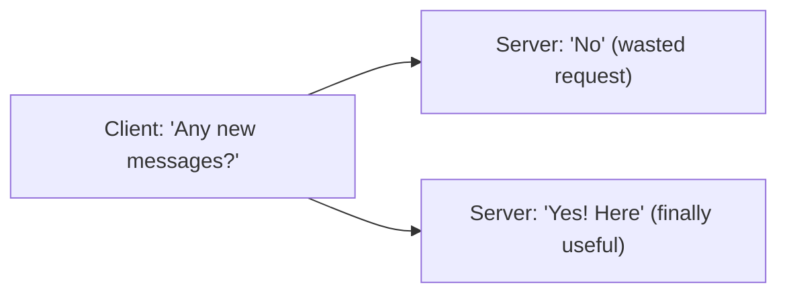
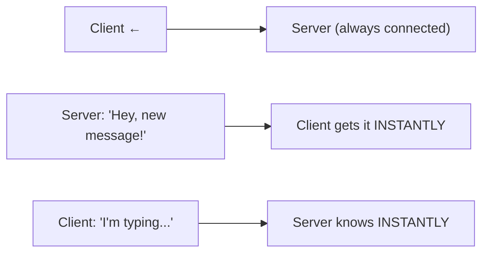
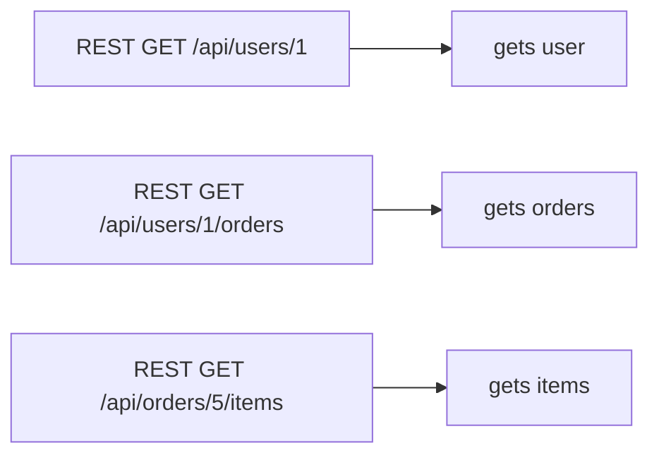
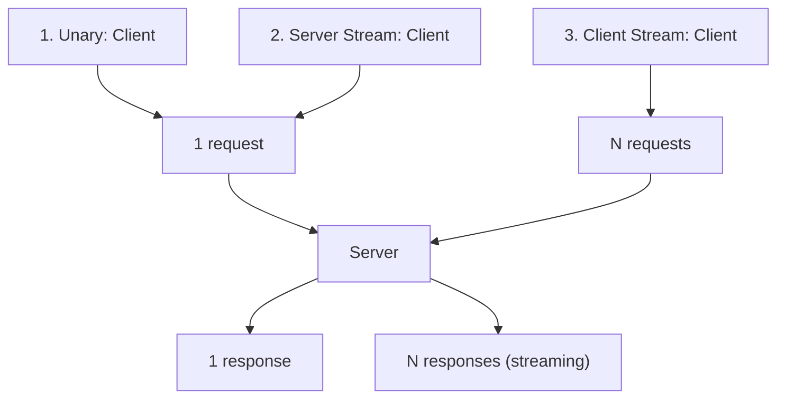
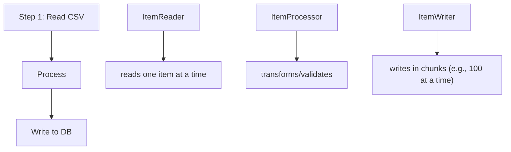
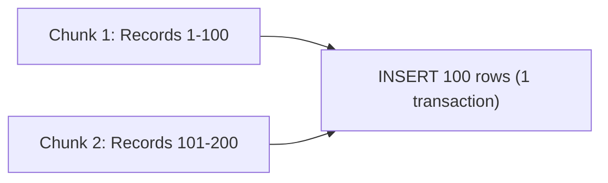
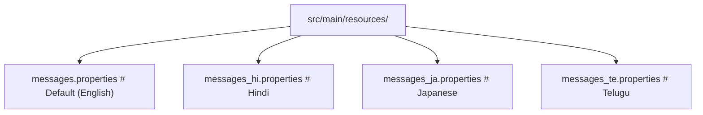
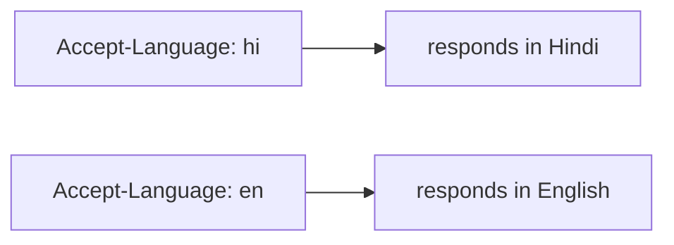
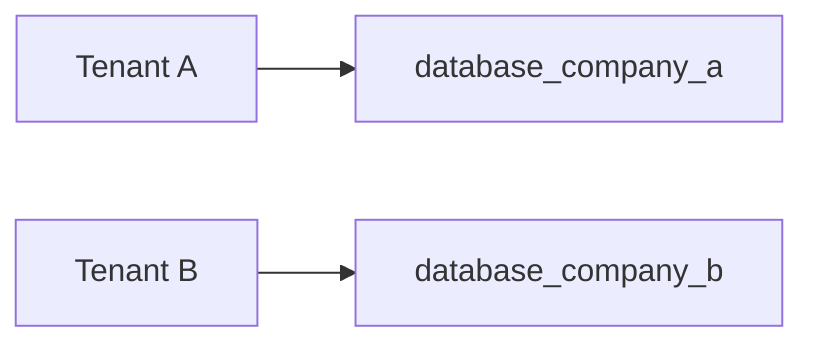
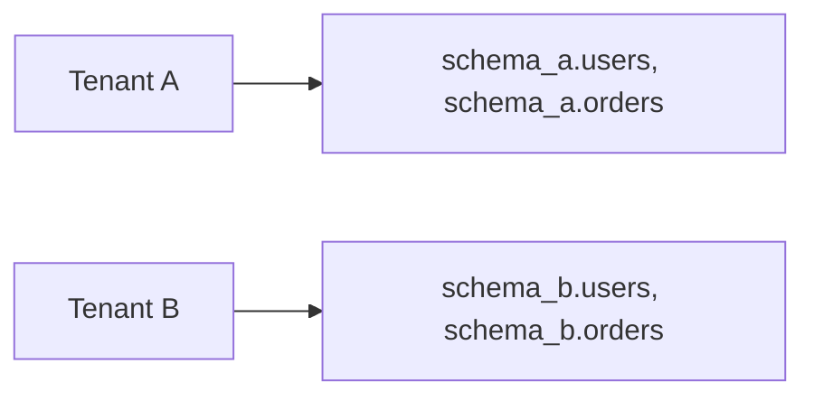

**Navigation**: [< Previous](Ch29_Annotations_Advanced.md) | [Back to Index](../00_MASTER_INDEX.md) | [Next >](Ch25_Spring_Boot_50Day_Plan.md)

# 🔥 Spring Boot Part 23 — Missing Essential Topics

**WHY this file?** Parts 0-22 cover a LOT, but these topics were missing.
Every topic here is asked in interviews or used in production.
**Framework:** WHY → HOW → EXAMPLE → PITFALL → INTERVIEW Q

---

# Table of Contents

1. [WebSockets & Server-Sent Events (SSE)](#1-websockets--server-sent-events-sse)
2. [GraphQL with Spring Boot](#2-graphql-with-spring-boot)
3. [gRPC with Spring Boot](#3-grpc-with-spring-boot)
4. [Spring Batch (Batch Processing)](#4-spring-batch-batch-processing)
5. [Pagination & Sorting Deep Dive](#5-pagination--sorting-deep-dive)
6. [HATEOAS (Hypermedia-Driven REST)](#6-hateoas-hypermedia-driven-rest)
7. [Internationalization (i18n)](#7-internationalization-i18n)
8. [Multi-Tenancy](#8-multi-tenancy)
9. [Spring Boot 3.x & Java 17+ Features](#9-spring-boot-3x--java-17-features)
10. [GraalVM Native Image](#10-graalvm-native-image)
11. [Spring Modulith (Modular Monolith)](#11-spring-modulith-modular-monolith)
12. [API Rate Limiting & Throttling](#12-api-rate-limiting--throttling)
13. [Spring Data REST](#13-spring-data-rest)
14. [Liquibase (DB Migrations Alternative)](#14-liquibase-db-migrations-alternative)

---

# 1. WebSockets & Server-Sent Events (SSE)

## WHY WebSockets?

HTTP is **request-response** → client always initiates.
But what if the SERVER needs to push data to the client?

| Scenario | HTTP Polling | WebSocket | SSE |
|----------|-------------|-----------|-----|
| Chat app | ❌ Wastes bandwidth | ✅ Perfect | ❌ One-way only |
| Live scores | ❌ Delayed | ✅ Real-time | ✅ Good enough |
| Stock prices | ❌ Too slow | ✅ Best | ✅ Acceptable |
| Notifications | ❌ Polling overhead | ✅ Instant | ✅ Perfect |
| File upload progress | ❌ | ✅ | ✅ |

### The Problem with HTTP Polling
```
Client: "Any new messages?" → Server: "No"       (wasted request)
Client: "Any new messages?" → Server: "No"       (wasted request)
Client: "Any new messages?" → Server: "Yes! Here" (finally useful)
```

**Flow:**
1. Client: 'Any new messages?'
2. Server: 'No' (wasted request)
3. Client: 'Any new messages?'
4. Server: 'No' (wasted request)
5. Client: 'Any new messages?'
6. Server: 'Yes! Here' (finally useful)


**1000 users polling every 2 seconds = 500 requests/second doing NOTHING**

### WebSocket = Persistent Two-Way Connection
```
Client ←→ Server (always connected)
Server: "Hey, new message!" → Client gets it INSTANTLY
Client: "I'm typing..."     → Server knows INSTANTLY
```

**Flow:**
1. Client ←
2. Server (always connected)
3. Server: 'Hey, new message!'
4. Client gets it INSTANTLY
5. Client: 'I'm typing...'
6. Server knows INSTANTLY



## HOW — WebSocket in Spring Boot

### Step 1: Add Dependency
```xml
<dependency>
    <groupId>org.springframework.boot</groupId>
    <artifactId>spring-boot-starter-websocket</artifactId>
</dependency>
```

### Step 2: Configure WebSocket with STOMP
```java
@Configuration
@EnableWebSocketMessageBroker
public class WebSocketConfig implements WebSocketMessageBrokerConfigurer {

    // WHY: Define where the WebSocket connection is established
    @Override
    public void registerStompEndpoints(StompEndpointRegistry registry) {
        registry.addEndpoint("/ws")          // Client connects here
                .setAllowedOrigins("*")       // CORS for WebSocket
                .withSockJS();                // Fallback for old browsers
    }

    // WHY: Define message routing rules
    @Override
    public void configureMessageBroker(MessageBrokerRegistry registry) {
        registry.setApplicationDestinationPrefixes("/app");      // Client → Server
        registry.enableSimpleBroker("/topic", "/queue");         // Server → Client
        // /topic = broadcast to all subscribers
        // /queue = private messages to specific user
    }
}
```

### Step 3: Create Message Controller
```java
@Controller
public class ChatController {

    // WHY @MessageMapping: Like @PostMapping but for WebSocket messages
    @MessageMapping("/chat.send")              // Client sends to /app/chat.send
    @SendTo("/topic/public")                   // Broadcast to all subscribers
    public ChatMessage sendMessage(@Payload ChatMessage message) {
        return message;  // This goes to EVERYONE subscribed to /topic/public
    }

    // WHY @SendToUser: Private message to specific user
    @MessageMapping("/chat.private")
    @SendToUser("/queue/private")              // Only sender gets the response
    public ChatMessage privateMessage(@Payload ChatMessage message,
                                       Principal principal) {
        message.setSender(principal.getName());
        return message;
    }
}
```

### Step 4: Send Messages from Backend (SimpMessagingTemplate)
```java
@Service
public class NotificationService {

    private final SimpMessagingTemplate messagingTemplate;

    // WHY: Send messages from ANY service, not just controllers
    public void notifyAll(String message) {
        messagingTemplate.convertAndSend("/topic/notifications", message);
    }

    // WHY: Send to specific user
    public void notifyUser(String userId, String message) {
        messagingTemplate.convertAndSendToUser(
            userId, "/queue/private", message
        );
    }
}
```


🔬 **Section Challenge — HOW — WebSocket in Spring Boot**

**Challenge 1 (Reasoning):** Why is gRPC significantly faster and more efficient than standard REST APIs over HTTP/1.1 for internal microservice communication?
<details><summary>Answer</summary>

Protocol Buffers and HTTP/2. REST typically serializes payloads as massive, human-readable JSON strings over HTTP/1.1 (which suffers from Head-of-Line blocking). gRPC uses Protocol Buffers (protobufs), a tightly packed binary serialization format that is much smaller to parse. Furthermore, gRPC runs strictly on HTTP/2, allowing true bidirectional streaming, multiplexed requests over a single TCP connection, and built-in header compression.
</details>


## HOW — Server-Sent Events (SSE)

**WHY SSE over WebSocket?**
- Simpler — just HTTP, no special protocol
- Auto-reconnect built-in
- Works through proxies/firewalls that block WebSocket
- Perfect when you only need SERVER → CLIENT (one-way)

```java
@RestController
public class SSEController {

    // WHY SseEmitter: Spring's way to hold HTTP connection open
    @GetMapping("/stream/events")
    public SseEmitter streamEvents() {
        SseEmitter emitter = new SseEmitter(30_000L); // 30sec timeout

        // WHY: Run in separate thread so we don't block Tomcat thread
        ExecutorService executor = Executors.newSingleThreadExecutor();
        executor.execute(() -> {
            try {
                for (int i = 0; i < 10; i++) {
                    emitter.send(SseEmitter.event()
                            .name("stock-update")        // Event name
                            .id(String.valueOf(i))        // Event ID (for reconnect)
                            .data("AAPL: $" + (150 + i))  // Your data
                            .reconnectTime(3000));         // Retry after 3s
                    Thread.sleep(1000);
                }
                emitter.complete();
            } catch (Exception e) {
                emitter.completeWithError(e);
            }
        });
        executor.shutdown();
        return emitter;
    }

    // WHY Flux: WebFlux style — cleaner, non-blocking
    @GetMapping(value = "/stream/prices", produces = MediaType.TEXT_EVENT_STREAM_VALUE)
    public Flux<StockPrice> streamPrices() {
        return Flux.interval(Duration.ofSeconds(1))
                   .map(i -> new StockPrice("AAPL", 150.0 + Math.random() * 10));
    }
}
```

### When to Use What?

| Feature | WebSocket | SSE | Long Polling |
|---------|-----------|-----|--------------|
| Direction | Bidirectional | Server → Client | Request-Response |
| Protocol | ws:// | http:// | http:// |
| Reconnect | Manual | Automatic | Manual |
| Binary data | ✅ Yes | ❌ Text only | ✅ Yes |
| Firewall friendly | ❌ May block | ✅ Normal HTTP | ✅ Normal HTTP |
| Use case | Chat, Gaming | Notifications, Feeds | Legacy systems |
| Complexity | High | Low | Medium |

### 📌 Pitfall
```java
// ❌ WRONG: Don't use WebSocket for everything
// If data flows only one way (server → client), use SSE
// WebSocket adds complexity with connection management

// ❌ WRONG: Blocking inside WebSocket handler
@MessageMapping("/chat")
public ChatMessage handle(ChatMessage msg) {
    Thread.sleep(5000); // BLOCKS the WebSocket thread pool!
    return msg;
}

// ✅ RIGHT: Use @Async or queue for heavy processing
@MessageMapping("/chat")
public ChatMessage handle(ChatMessage msg) {
    heavyProcessorService.processAsync(msg); // Non-blocking
    return msg;
}
```

### Interview Questions
1. **Q: WebSocket vs HTTP?** A: HTTP = stateless request-response. WebSocket = persistent bidirectional. Use WS for real-time (chat, gaming).
2. **Q: What is STOMP?** A: Simple Text Oriented Messaging Protocol — adds structure (headers, body) on top of raw WebSocket.
3. **Q: How to scale WebSocket across multiple servers?** A: Use a message broker like Redis/RabbitMQ as the STOMP broker instead of SimpleBroker.

---

# 2. GraphQL with Spring Boot

## WHY GraphQL?

REST problem: **Over-fetching** and **Under-fetching**

```
REST GET /api/users/1
Response: { id, name, email, phone, address, orders, preferences, ... }
→ You only needed name and email (OVER-FETCHING)

REST GET /api/users/1  → gets user
REST GET /api/users/1/orders → gets orders
REST GET /api/orders/5/items → gets items
→ 3 API calls for 1 page (UNDER-FETCHING)
```

**Flow:**
1. REST GET /api/users/1
2. gets user
3. REST GET /api/users/1/orders
4. gets orders
5. REST GET /api/orders/5/items
6. gets items



GraphQL solution: **Client asks for EXACTLY what it needs**
```graphql
query {
    user(id: 1) {
        name
        email
        orders {
            items { name, price }
        }
    }
}
→ ONE request, EXACT data
```


🔬 **Section Challenge — WHY GraphQL?**
>>

## HOW — Spring for GraphQL

### Step 1: Dependencies
```xml
<dependency>
    <groupId>org.springframework.boot</groupId>
    <artifactId>spring-boot-starter-graphql</artifactId>
</dependency>
<dependency>
    <groupId>org.springframework.boot</groupId>
    <artifactId>spring-boot-starter-web</artifactId>
</dependency>
```

### Step 2: Define Schema (src/main/resources/graphql/schema.graphqls)
```graphql


🔬 **Section Challenge — HOW — Spring for GraphQL**
>>

# WHY Schema First: Contract between frontend and backend
type Query {
    userById(id: ID!): User
    allUsers(page: Int, size: Int): [User!]!
    searchUsers(name: String!): [User!]!
}

type Mutation {
    createUser(input: CreateUserInput!): User!
    updateUser(id: ID!, input: UpdateUserInput!): User!
    deleteUser(id: ID!): Boolean!
}

type User {
    id: ID!
    name: String!
    email: String!
    orders: [Order!]!       # Resolved lazily (only if requested)
}

type Order {
    id: ID!
    total: Float!
    items: [OrderItem!]!
}

type OrderItem {
    productName: String!
    quantity: Int!
    price: Float!
}

input CreateUserInput {
    name: String!
    email: String!
}

input UpdateUserInput {
    name: String
    email: String
}
```

### Step 3: Create Controllers (Spring way)
```java
@Controller
public class UserGraphQLController {

    private final UserService userService;
    private final OrderService orderService;

    // WHY @QueryMapping: Maps to Query type in schema
    @QueryMapping
    public User userById(@Argument Long id) {
        return userService.findById(id);
    }

    @QueryMapping
    public List<User> allUsers(@Argument int page, @Argument int size) {
        return userService.findAll(PageRequest.of(page, size)).getContent();
    }

    // WHY @MutationMapping: Maps to Mutation type in schema
    @MutationMapping
    public User createUser(@Argument CreateUserInput input) {
        return userService.create(input);
    }

    // WHY @SchemaMapping: Resolves nested fields (lazy loading!)
    // Only called if client REQUESTS the orders field
    @SchemaMapping(typeName = "User", field = "orders")
    public List<Order> getOrders(User user) {
        return orderService.findByUserId(user.getId());
    }
}
```

### Step 4: N+1 Problem Solution with DataLoader
```java
// WHY: Without DataLoader, fetching 100 users with orders = 101 queries
// With DataLoader, it's 2 queries (1 for users, 1 batch for all orders)

@Controller
public class UserGraphQLController {

    // WHY @BatchMapping: Batch-loads related data
    @BatchMapping(typeName = "User", field = "orders")
    public Map<User, List<Order>> orders(List<User> users) {
        // ONE query for ALL users' orders
        List<Long> userIds = users.stream().map(User::getId).toList();
        Map<Long, List<Order>> orderMap = orderService.findByUserIds(userIds);

        return users.stream().collect(Collectors.toMap(
            user -> user,
            user -> orderMap.getOrDefault(user.getId(), List.of())
        ));
    }
}
```

### Step 5: Error Handling
```java
@ControllerAdvice
public class GraphQLExceptionHandler {

    @GraphQlExceptionHandler
    public GraphQLError handleNotFound(UserNotFoundException ex) {
        return GraphQLError.newError()
                .errorType(ErrorType.NOT_FOUND)
                .message(ex.getMessage())
                .build();
    }
}
```

### Step 6: Configuration
```yaml
spring:
  graphql:
    graphiql:
      enabled: true           # Interactive playground at /graphiql
    schema:
      inspection:
        enabled: true          # Schema introspection
    path: /graphql             # Default endpoint
```

### GraphQL vs REST Decision

| Criteria | REST | GraphQL |
|----------|------|---------|
| Simple CRUD | ✅ Perfect | Overkill |
| Complex nested data | ❌ Multiple calls | ✅ Single query |
| Mobile apps (bandwidth) | ❌ Over-fetching | ✅ Exact data |
| Caching | ✅ HTTP caching | ❌ Complex |
| File uploads | ✅ Native | ❌ Workarounds |
| Real-time | WebSocket | ✅ Subscriptions |
| Learning curve | ✅ Easy | ❌ Steeper |

### 📌 Pitfall
```java
// ❌ WRONG: Allowing unlimited query depth
// A malicious query could crash your server:
// query { user { orders { items { product { reviews { author { orders { ... }}}}}}}

// ✅ RIGHT: Set max depth and complexity limits
spring.graphql.schema.introspection.enabled=false  // Disable in prod
// Use graphql-java-extended-validation for depth/complexity limiting
```

### Interview Questions
1. **Q: GraphQL vs REST?** A: REST = multiple endpoints, fixed structure. GraphQL = single endpoint, client-defined structure. Use GraphQL when frontend needs vary widely.
2. **Q: What is N+1 in GraphQL?** A: Each nested field triggers a separate query. Solution: @BatchMapping / DataLoader.
3. **Q: What are Subscriptions?** A: Real-time GraphQL — server pushes updates over WebSocket when data changes.

---

# 3. gRPC with Spring Boot

## WHY gRPC?

REST uses **JSON over HTTP/1.1** — human-readable but SLOW for service-to-service.

```
REST: Client → JSON text → HTTP/1.1 → Parse JSON → Server
gRPC: Client → Binary protobuf → HTTP/2 → Deserialize → Server
```

| Feature | REST | gRPC |
|---------|------|------|
| Format | JSON (text) | Protobuf (binary) |
| Protocol | HTTP/1.1 | HTTP/2 |
| Speed | Baseline | 7-10x faster |
| Streaming | No (SSE workaround) | Native (4 types) |
| Contract | OpenAPI (optional) | .proto (required) |
| Browser support | ✅ Native | ❌ Needs proxy |
| Use case | Public APIs | Microservice internal |

## HOW — gRPC in Spring Boot

### Step 1: Define .proto File (src/main/proto/user.proto)
```protobuf
syntax = "proto3";

package com.example.grpc;

// WHY: Contract-first — proto file IS the API documentation
service UserService {
    rpc GetUser (UserRequest) returns (UserResponse);           // Unary
    rpc ListUsers (ListRequest) returns (stream UserResponse);  // Server streaming
    rpc CreateUsers (stream UserRequest) returns (BatchResult);  // Client streaming
    rpc Chat (stream Message) returns (stream Message);          // Bidirectional
}

message UserRequest {
    int64 id = 1;
}

message UserResponse {
    int64 id = 1;
    string name = 2;
    string email = 3;
}

message ListRequest {
    int32 page = 1;
    int32 size = 2;
}

message BatchResult {
    int32 created_count = 1;
}

message Message {
    string content = 1;
    string sender = 2;
}
```

### Step 2: Implement Server
```java
@GrpcService
public class UserGrpcService extends UserServiceGrpc.UserServiceImplBase {

    private final UserRepository userRepository;

    @Override
    public void getUser(UserRequest request,
                        StreamObserver<UserResponse> responseObserver) {
        User user = userRepository.findById(request.getId())
                .orElseThrow(() -> new StatusRuntimeException(Status.NOT_FOUND));

        UserResponse response = UserResponse.newBuilder()
                .setId(user.getId())
                .setName(user.getName())
                .setEmail(user.getEmail())
                .build();

        responseObserver.onNext(response);     // Send response
        responseObserver.onCompleted();         // Signal completion
    }

    // WHY Server Streaming: Send multiple responses (e.g., large datasets)
    @Override
    public void listUsers(ListRequest request,
                          StreamObserver<UserResponse> responseObserver) {
        List<User> users = userRepository.findAll();
        for (User user : users) {
            responseObserver.onNext(toResponse(user));   // Send one by one
        }
        responseObserver.onCompleted();
    }
}
```

### Step 3: gRPC Client
```java
@Service
public class UserGrpcClient {

    private final UserServiceGrpc.UserServiceBlockingStub blockingStub;

    public UserGrpcClient(@GrpcClient("user-service") Channel channel) {
        this.blockingStub = UserServiceGrpc.newBlockingStub(channel);
    }

    public UserResponse getUser(long id) {
        UserRequest request = UserRequest.newBuilder().setId(id).build();
        return blockingStub.getUser(request); // Type-safe call!
    }
}
```

### 4 Streaming Modes
```
1. Unary:           Client → 1 request → Server → 1 response
2. Server Stream:   Client → 1 request → Server → N responses (streaming)
3. Client Stream:   Client → N requests → Server → 1 response
4. Bidirectional:   Client ↔ N messages ↔ Server (like WebSocket)
```

**Flow:**
1. 1. Unary: Client
2. 1 request
3. Server
4. 1 response
5. 2. Server Stream: Client
6. 1 request
7. Server
8. N responses (streaming)



### Interview Questions
1. **Q: When gRPC over REST?** A: Internal microservice communication where speed matters. REST for public/browser APIs.
2. **Q: What is Protocol Buffers?** A: Binary serialization format — smaller, faster than JSON. Needs .proto schema file.
3. **Q: 4 types of gRPC calls?** A: Unary, Server streaming, Client streaming, Bidirectional streaming.

---


🔬 **Section Challenge — HOW — gRPC in Spring Boot**

**Challenge 1 (Reasoning):** Why is gRPC significantly faster and more efficient than standard REST APIs over HTTP/1.1 for internal microservice communication?
<details><summary>Answer</summary>

Protocol Buffers and HTTP/2. REST typically serializes payloads as massive, human-readable JSON strings over HTTP/1.1 (which suffers from Head-of-Line blocking). gRPC uses Protocol Buffers (protobufs), a tightly packed binary serialization format that is much smaller to parse. Furthermore, gRPC runs strictly on HTTP/2, allowing true bidirectional streaming, multiplexed requests over a single TCP connection, and built-in header compression.
</details>


# 4. Spring Batch (Batch Processing)

## WHY Spring Batch?

Your app needs to:
- Process 10 million records from CSV → Database
- Generate monthly reports for 50,000 users
- Migrate data between systems
- Send 100,000 emails nightly

You can't do this with REST APIs. You need **batch processing**.


🔬 **Section Challenge — WHY Spring Batch?**

**Challenge 1 (Reasoning):** Why is gRPC significantly faster and more efficient than standard REST APIs over HTTP/1.1 for internal microservice communication?
<details><summary>Answer</summary>

Protocol Buffers and HTTP/2. REST typically serializes payloads as massive, human-readable JSON strings over HTTP/1.1 (which suffers from Head-of-Line blocking). gRPC uses Protocol Buffers (protobufs), a tightly packed binary serialization format that is much smaller to parse. Furthermore, gRPC runs strictly on HTTP/2, allowing true bidirectional streaming, multiplexed requests over a single TCP connection, and built-in header compression.
</details>


## HOW — Core Concepts

```
Job
├── Step 1: Read CSV → Process → Write to DB
├── Step 2: Validate records
└── Step 3: Generate report

Each Step has:
  ItemReader  → reads one item at a time
  ItemProcessor → transforms/validates
  ItemWriter  → writes in chunks (e.g., 100 at a time)
```

**Flow:**
1. Step 1: Read CSV
2. Process
3. Write to DB
4. ItemReader
5. reads one item at a time
6. ItemProcessor
7. transforms/validates
8. ItemWriter
9. writes in chunks (e.g., 100 at a time)



### Step 1: Dependencies
```xml
<dependency>
    <groupId>org.springframework.boot</groupId>
    <artifactId>spring-boot-starter-batch</artifactId>
</dependency>
```

### Step 2: Define a Job
```java
@Configuration
public class UserImportJobConfig {

    @Bean
    public Job importUserJob(JobRepository jobRepository,
                              Step csvToDbStep,
                              Step validationStep) {
        return new JobBuilder("importUserJob", jobRepository)
                .start(csvToDbStep)               // Step 1
                .next(validationStep)              // Step 2
                .build();
    }

    @Bean
    public Step csvToDbStep(JobRepository jobRepository,
                            PlatformTransactionManager transactionManager,
                            ItemReader<UserCsv> reader,
                            ItemProcessor<UserCsv, User> processor,
                            ItemWriter<User> writer) {
        return new StepBuilder("csvToDbStep", jobRepository)
                .<UserCsv, User>chunk(100, transactionManager)  // Process 100 at a time
                .reader(reader)
                .processor(processor)
                .writer(writer)
                .faultTolerant()
                .skipLimit(10)                     // Skip up to 10 bad records
                .skip(ParseException.class)        // Skip parse errors
                .retryLimit(3)                     // Retry up to 3 times
                .retry(DeadlockLoserDataAccessException.class)
                .build();
    }
}
```

### Step 3: ItemReader (Read from CSV)
```java
@Bean
public FlatFileItemReader<UserCsv> reader() {
    return new FlatFileItemReaderBuilder<UserCsv>()
            .name("userReader")
            .resource(new ClassPathResource("users.csv"))
            .delimited()
            .names("name", "email", "phone")     // CSV columns
            .targetType(UserCsv.class)
            .build();
}

// WHY: Also supports JDBC, JPA, JSON, XML readers
@Bean
public JdbcCursorItemReader<User> jdbcReader(DataSource dataSource) {
    return new JdbcCursorItemReaderBuilder<User>()
            .name("jdbcReader")
            .dataSource(dataSource)
            .sql("SELECT id, name, email FROM users WHERE processed = false")
            .rowMapper(new UserRowMapper())
            .build();
}
```

### Step 4: ItemProcessor
```java
@Component
public class UserProcessor implements ItemProcessor<UserCsv, User> {

    @Override
    public User process(UserCsv csv) throws Exception {
        // WHY: Return null to SKIP this record (filtering!)
        if (csv.getEmail() == null || csv.getEmail().isBlank()) {
            return null; // Skipped — not written
        }

        return User.builder()
                .name(csv.getName().trim().toUpperCase())
                .email(csv.getEmail().toLowerCase())
                .build();
    }
}
```

### Step 5: ItemWriter
```java
@Bean
public JdbcBatchItemWriter<User> writer(DataSource dataSource) {
    return new JdbcBatchItemWriterBuilder<User>()
            .sql("INSERT INTO users (name, email) VALUES (:name, :email)")
            .dataSource(dataSource)
            .beanMapped()
            .build();
}
```

### Step 6: Launch Job
```java
@RestController
public class JobController {

    private final JobLauncher jobLauncher;
    private final Job importUserJob;

    @PostMapping("/api/jobs/import")
    public String runJob() throws Exception {
        JobParameters params = new JobParametersBuilder()
                .addString("timestamp", Instant.now().toString()) // Unique run
                .toJobParameters();
        jobLauncher.run(importUserJob, params);
        return "Job started!";
    }
}
```

### Chunk Processing Visualization
```
CSV File (10,000 records)
    │
    ▼ Read 1 by 1 (ItemReader)
    │
    ▼ Process 1 by 1 (ItemProcessor)
    │
    ▼ Write in CHUNKS of 100 (ItemWriter)
    │
    ├── Chunk 1: Records 1-100    → INSERT 100 rows (1 transaction)
    ├── Chunk 2: Records 101-200  → INSERT 100 rows (1 transaction)
    ├── ...
    └── Chunk 100: Records 9901-10000 → INSERT 100 rows (1 transaction)

WHY Chunks?
- Memory efficient (don't load all 10K at once)
- Transaction safety (if chunk 50 fails, only 100 records lost)
- Restartable (resume from last successful chunk)
```

**Flow:**
1. Chunk 1: Records 1-100
2. INSERT 100 rows (1 transaction)
3. Chunk 2: Records 101-200
4. INSERT 100 rows (1 transaction)



### Interview Questions
1. **Q: What is chunk processing?** A: Read items one by one, process one by one, then write in batches (chunks). Efficient + transactional.
2. **Q: Job vs Step?** A: Job = entire batch process. Step = one phase (read-process-write). A Job has 1+ Steps.
3. **Q: How to handle failures?** A: skip(), retry(), and restartability. Spring Batch tracks progress in its metadata tables.

---

# 5. Pagination & Sorting Deep Dive

## WHY Pagination?

```java
// ❌ NEVER do this in production
List<User> users = userRepository.findAll(); // 10 MILLION users in memory = OOM crash

// ✅ Always paginate
Page<User> users = userRepository.findAll(PageRequest.of(0, 20)); // Just 20 users
```


🔬 **Section Challenge — WHY Pagination?**

**Challenge 1 (Reasoning):** Why is gRPC significantly faster and more efficient than standard REST APIs over HTTP/1.1 for internal microservice communication?
<details><summary>Answer</summary>

Protocol Buffers and HTTP/2. REST typically serializes payloads as massive, human-readable JSON strings over HTTP/1.1 (which suffers from Head-of-Line blocking). gRPC uses Protocol Buffers (protobufs), a tightly packed binary serialization format that is much smaller to parse. Furthermore, gRPC runs strictly on HTTP/2, allowing true bidirectional streaming, multiplexed requests over a single TCP connection, and built-in header compression.
</details>


## HOW — Spring Data Pagination

### Basic Pagination
```java
// WHY Page: Contains data + metadata (totalPages, totalElements, hasNext)
@GetMapping("/api/users")
public Page<UserDTO> getUsers(
        @RequestParam(defaultValue = "0") int page,
        @RequestParam(defaultValue = "20") int size,
        @RequestParam(defaultValue = "name") String sortBy,
        @RequestParam(defaultValue = "asc") String direction) {

    Sort sort = direction.equalsIgnoreCase("desc")
            ? Sort.by(sortBy).descending()
            : Sort.by(sortBy).ascending();

    Pageable pageable = PageRequest.of(page, size, sort);
    return userRepository.findAll(pageable).map(userMapper::toDTO);
}

// WHY: Response looks like:
// {
//   "content": [{ user1 }, { user2 }, ...],
//   "totalPages": 500,
//   "totalElements": 10000,
//   "number": 0,          ← current page
//   "size": 20,           ← page size
//   "first": true,
//   "last": false,
//   "hasNext": true
// }
```

### Multi-Column Sorting
```java
// WHY: Sort by multiple fields — e.g., department ASC, then salary DESC
Sort sort = Sort.by(
    Sort.Order.asc("department"),
    Sort.Order.desc("salary"),
    Sort.Order.asc("name")
);
Pageable pageable = PageRequest.of(0, 20, sort);
```

### Slice vs Page
```java
// Page: Runs COUNT query (knows total) — EXPENSIVE for large tables
Page<User> page = userRepository.findAll(pageable);
// SELECT * FROM users LIMIT 20 OFFSET 0
// SELECT COUNT(*) FROM users          ← Extra query!

// Slice: No COUNT query — only knows hasNext — FASTER
Slice<User> slice = userRepository.findAll(pageable);
// SELECT * FROM users LIMIT 21 OFFSET 0   ← Fetches 21, shows 20, knows if more

// WHY Slice? Instagram-style "Load More" doesn't need total count
// WHY Page? Admin dashboards showing "Page 3 of 500"
```

### Cursor-Based Pagination (For Large Datasets)
```java
// WHY: OFFSET-based pagination gets SLOWER as pages increase
// Page 1: OFFSET 0     → Fast
// Page 500: OFFSET 10000 → DB skips 10,000 rows first!

// Cursor-based: Always fast, uses indexed column
@GetMapping("/api/users/cursor")
public List<UserDTO> getUsersCursor(
        @RequestParam(required = false) Long afterId,   // Last seen ID
        @RequestParam(defaultValue = "20") int limit) {

    if (afterId == null) {
        return userRepository.findTopNOrderById(limit);
    }
    // WHERE id > :afterId ORDER BY id LIMIT 20 → Always uses index!
    return userRepository.findByIdGreaterThanOrderByIdAsc(afterId,
            PageRequest.of(0, limit));
}
```

### 📌 Pitfall
```java
// ❌ WRONG: Paginating in Java instead of database
List<User> all = userRepository.findAll();              // Load ALL into memory
List<User> page = all.subList(0, 20);                    // Java pagination

// ✅ RIGHT: Let database do the pagination
Page<User> page = userRepository.findAll(PageRequest.of(0, 20)); // DB does LIMIT/OFFSET
```

### Interview Questions
1. **Q: Page vs Slice?** A: Page runs COUNT query (knows total). Slice doesn't (faster). Use Slice for infinite scroll, Page for numbered pages.
2. **Q: Why is OFFSET slow for large pages?** A: DB must scan and skip N rows. Solution: cursor-based (keyset) pagination.
3. **Q: How to sort by multiple columns?** A: `Sort.by(Order.asc("col1"), Order.desc("col2"))`.

---


🔬 **Section Challenge — HOW — Spring Data Pagination**

**Challenge 1 (Reasoning):** Why is gRPC significantly faster and more efficient than standard REST APIs over HTTP/1.1 for internal microservice communication?
<details><summary>Answer</summary>

Protocol Buffers and HTTP/2. REST typically serializes payloads as massive, human-readable JSON strings over HTTP/1.1 (which suffers from Head-of-Line blocking). gRPC uses Protocol Buffers (protobufs), a tightly packed binary serialization format that is much smaller to parse. Furthermore, gRPC runs strictly on HTTP/2, allowing true bidirectional streaming, multiplexed requests over a single TCP connection, and built-in header compression.
</details>


# 6. HATEOAS (Hypermedia-Driven REST)

## ❓ Why Hateoas?

Normal REST: Client must KNOW all URLs
```json
GET /api/users/1
{ "id": 1, "name": "Harsha" }
// Client must know: /api/users/1/orders, /api/users/1/profile, etc.
```

HATEOAS REST: Response TELLS client what's possible
```json
GET /api/users/1
{
    "id": 1,
    "name": "Harsha",
    "_links": {
        "self": { "href": "/api/users/1" },
        "orders": { "href": "/api/users/1/orders" },
        "update": { "href": "/api/users/1", "method": "PUT" },
        "delete": { "href": "/api/users/1", "method": "DELETE" }
    }
}
```
**The API is self-documenting — clients discover capabilities from responses.**

## HOW — Spring HATEOAS

```xml
<dependency>
    <groupId>org.springframework.boot</groupId>
    <artifactId>spring-boot-starter-hateoas</artifactId>
</dependency>
```

```java
@RestController
public class UserController {

    @GetMapping("/api/users/{id}")
    public EntityModel<User> getUser(@PathVariable Long id) {
        User user = userService.findById(id);

        return EntityModel.of(user,
            linkTo(methodOn(UserController.class).getUser(id)).withSelfRel(),
            linkTo(methodOn(OrderController.class).getOrders(id)).withRel("orders"),
            linkTo(methodOn(UserController.class).getAllUsers()).withRel("all-users")
        );
    }

    @GetMapping("/api/users")
    public CollectionModel<EntityModel<User>> getAllUsers() {
        List<EntityModel<User>> users = userService.findAll().stream()
            .map(user -> EntityModel.of(user,
                linkTo(methodOn(UserController.class).getUser(user.getId())).withSelfRel()))
            .toList();

        return CollectionModel.of(users,
            linkTo(methodOn(UserController.class).getAllUsers()).withSelfRel());
    }
}
```

### Interview Questions
1. **Q: What is HATEOAS?** A: Hypermedia As The Engine Of Application State — REST responses include links to related actions/resources.
2. **Q: Why use it?** A: Decouples client from URL structure. API is self-discoverable. Easier versioning.

---


🔬 **Section Challenge — HOW — Spring HATEOAS**

**Challenge 1 (Reasoning):** Why is gRPC significantly faster and more efficient than standard REST APIs over HTTP/1.1 for internal microservice communication?
<details><summary>Answer</summary>

Protocol Buffers and HTTP/2. REST typically serializes payloads as massive, human-readable JSON strings over HTTP/1.1 (which suffers from Head-of-Line blocking). gRPC uses Protocol Buffers (protobufs), a tightly packed binary serialization format that is much smaller to parse. Furthermore, gRPC runs strictly on HTTP/2, allowing true bidirectional streaming, multiplexed requests over a single TCP connection, and built-in header compression.
</details>


# 7. Internationalization (i18n)

## WHY i18n?

Your app serves users in India (Hindi), USA (English), Japan (Japanese).
Error messages, labels, emails — all need translation.

## HOW

### Step 1: Create Message Files
```
src/main/resources/
├── messages.properties              # Default (English)
├── messages_hi.properties           # Hindi
├── messages_ja.properties           # Japanese
└── messages_te.properties           # Telugu
```

**Flow:**
1. src/main/resources/
2. messages.properties # Default (English)
3. src/main/resources/
4. messages_hi.properties # Hindi
5. src/main/resources/
6. messages_ja.properties # Japanese
7. src/main/resources/
8. messages_te.properties # Telugu



```properties
# messages.properties (English - default)
user.welcome=Welcome, {0}!
user.not.found=User not found with ID: {0}
validation.email.invalid=Email format is invalid
error.server=Internal server error

# messages_hi.properties (Hindi)
user.welcome=स्वागत है, {0}!
user.not.found=इस आईडी वाला उपयोगकर्ता नहीं मिला: {0}
```

### Step 2: Configure Locale Resolver
```java
@Configuration
public class LocaleConfig {

    @Bean
    public LocaleResolver localeResolver() {
        AcceptHeaderLocaleResolver resolver = new AcceptHeaderLocaleResolver();
        resolver.setDefaultLocale(Locale.ENGLISH);
        return resolver;
    }

    @Bean
    public MessageSource messageSource() {
        ReloadableResourceBundleMessageSource source =
            new ReloadableResourceBundleMessageSource();
        source.setBasename("classpath:messages");
        source.setDefaultEncoding("UTF-8");
        return source;
    }
}
```

### Step 3: Use in Controller
```java
@RestController
public class UserController {

    private final MessageSource messageSource;

    @GetMapping("/api/users/{id}")
    public ResponseEntity<?> getUser(@PathVariable Long id, Locale locale) {
        // WHY Locale param: Spring auto-resolves from Accept-Language header
        User user = userService.findById(id)
            .orElseThrow(() -> new NotFoundException(
                messageSource.getMessage("user.not.found", new Object[]{id}, locale)
            ));

        String welcome = messageSource.getMessage(
            "user.welcome", new Object[]{user.getName()}, locale
        );
        return ResponseEntity.ok(Map.of("user", user, "message", welcome));
    }
}
```

### Step 4: Client sends language
```
GET /api/users/1
Accept-Language: hi     → responds in Hindi
Accept-Language: en     → responds in English
```

**Flow:**
1. Accept-Language: hi
2. responds in Hindi
3. Accept-Language: en
4. responds in English



### Interview Questions
1. **Q: How does Spring resolve locale?** A: Accept-Language header → LocaleResolver → MessageSource lookup.
2. **Q: What is {0} in messages.properties?** A: Placeholder for dynamic values, replaced at runtime.

---

# 8. Multi-Tenancy

## WHY Multi-Tenancy?

One application serves MULTIPLE organizations (tenants):
- Tenant A (Company X): sees ONLY their data
- Tenant B (Company Y): sees ONLY their data
- Same codebase, same database (or separate databases)

**Real-world:** Slack, Salesforce, Shopify — one app, thousands of tenants.

## HOW — 3 Strategies

### Strategy 1: Separate Database per Tenant
```
Tenant A → database_company_a
Tenant B → database_company_b

✅ Best isolation, ✅ Easy compliance
❌ Expensive, ❌ Hard to manage 100+ databases
```

**Flow:**
1. Tenant A
2. database_company_a
3. Tenant B
4. database_company_b



### Strategy 2: Shared Database, Separate Schema
```
Same DB, different schemas:
Tenant A → schema_a.users, schema_a.orders
Tenant B → schema_b.users, schema_b.orders

✅ Good isolation, ✅ Moderate cost
❌ Schema migrations must run for each tenant
```

**Flow:**
1. Tenant A
2. schema_a.users, schema_a.orders
3. Tenant B
4. schema_b.users, schema_b.orders



### Strategy 3: Shared Everything + Tenant Column (Most Common)
```java
// WHY: Simplest, cheapest, most scalable
// Every table has a tenant_id column

@Entity
public class User {
    @Id
    private Long id;
    private String name;

    @Column(name = "tenant_id", nullable = false)
    private String tenantId;   // Discriminator
}
```

### Implementation (Strategy 3 — Discriminator Column)
```java
// Step 1: Tenant Context Holder (ThreadLocal)
public class TenantContext {
    private static final ThreadLocal<String> CURRENT_TENANT = new ThreadLocal<>();

    public static String getCurrentTenant() {
        return CURRENT_TENANT.get();
    }

    public static void setCurrentTenant(String tenantId) {
        CURRENT_TENANT.set(tenantId);
    }

    public static void clear() {
        CURRENT_TENANT.remove();
    }
}

// Step 2: Extract tenant from request (Filter)
@Component
public class TenantFilter extends OncePerRequestFilter {
    @Override
    protected void doFilterInternal(HttpServletRequest request,
                                     HttpServletResponse response,
                                     FilterChain filterChain) throws Exception {
        String tenantId = request.getHeader("X-Tenant-ID");
        if (tenantId == null) {
            response.sendError(400, "X-Tenant-ID header is required");
            return;
        }
        TenantContext.setCurrentTenant(tenantId);
        try {
            filterChain.doFilter(request, response);
        } finally {
            TenantContext.clear(); // IMPORTANT: prevent memory leak
        }
    }
}

// Step 3: Hibernate Filter (auto-adds WHERE tenant_id = ?)
@FilterDef(name = "tenantFilter",
           parameters = @ParamDef(name = "tenantId", type = String.class))
@Filter(name = "tenantFilter", condition = "tenant_id = :tenantId")
@Entity
public class User {
    // ... fields
}

// Step 4: Enable filter on every request
@Component
public class TenantHibernateFilter {
    @PersistenceContext
    private EntityManager entityManager;

    @EventListener(RequestHandledEvent.class)
    public void enableFilter() {
        Session session = entityManager.unwrap(Session.class);
        session.enableFilter("tenantFilter")
               .setParameter("tenantId", TenantContext.getCurrentTenant());
    }
}
```

### Interview Questions
1. **Q: 3 multi-tenancy strategies?** A: Separate DB, Shared DB separate schema, Shared everything with tenant_id column.
2. **Q: How to ensure data isolation?** A: Hibernate filters, row-level security, or separate connections per tenant.

---

# 9. Spring Boot 3.x & Java 17+ Features

## WHY Upgrade?

| Feature | Java 8 | Java 17+ / Spring Boot 3 |
|---------|--------|--------------------------|
| Records | ❌ | ✅ Immutable DTOs in 1 line |
| Sealed Classes | ❌ | ✅ Type-safe hierarchies |
| Pattern Matching | ❌ | ✅ Cleaner instanceof |
| Text Blocks | ❌ | ✅ Multi-line strings |
| Virtual Threads | ❌ | ✅ Millions of threads (Java 21) |
| Jakarta namespace | javax.* | jakarta.* |
| GraalVM Native | Limited | ✅ First-class support |

## HOW — Key Features

### Records (Replace DTOs, Lombok for simple cases)
```java
// OLD WAY (Java 8): 50 lines for a simple DTO
public class UserDTO {
    private String name;
    private String email;
    public UserDTO(String name, String email) { ... }
    public String getName() { return name; }
    public String getEmail() { return email; }
    @Override public boolean equals(Object o) { ... }
    @Override public int hashCode() { ... }
    @Override public String toString() { ... }
}

// NEW WAY (Java 17+): 1 line!
public record UserDTO(String name, String email) {}
// Gets: constructor, getters, equals, hashCode, toString — ALL automatic
// WHY: Immutable, clear intent, zero boilerplate

// Use in Spring:
@GetMapping("/api/users/{id}")
public UserDTO getUser(@PathVariable Long id) {
    User user = userService.findById(id);
    return new UserDTO(user.getName(), user.getEmail());
}
```

### Sealed Classes (Type-Safe Hierarchies)
```java
// WHY: Limit WHO can extend a class — compiler verifies exhaustive switches
public sealed interface PaymentResult
    permits PaymentSuccess, PaymentFailed, PaymentPending {
}

public record PaymentSuccess(String transactionId) implements PaymentResult {}
public record PaymentFailed(String reason) implements PaymentResult {}
public record PaymentPending(String checkUrl) implements PaymentResult {}

// WHY: Compiler ERROR if you miss a case!
public String handlePayment(PaymentResult result) {
    return switch (result) {
        case PaymentSuccess s -> "Paid! TX: " + s.transactionId();
        case PaymentFailed f -> "Failed: " + f.reason();
        case PaymentPending p -> "Check: " + p.checkUrl();
        // No default needed — compiler knows all cases
    };
}
```

### Virtual Threads (Java 21 — Game Changer)
```java
// WHY: Traditional threads are expensive (1MB stack each)
// 10,000 requests = 10,000 threads = 10GB RAM
// Virtual threads: 10,000 requests ≈ 10MB RAM

// application.yml — ONE line to enable!
spring:
  threads:
    virtual:
      enabled: true

// That's it! Every HTTP request now uses virtual threads
// Your existing code works WITHOUT changes
// Blocking I/O (JDBC, HTTP calls) no longer wastes threads

// WHY this matters:
// Before: 200 threads max → 200 concurrent requests
// After:  Millions of virtual threads → millions of concurrent requests
```

### Pattern Matching
```java
// OLD WAY:
if (obj instanceof User) {
    User user = (User) obj;    // Explicit cast
    System.out.println(user.getName());
}

// NEW WAY:
if (obj instanceof User user) {    // Cast + assign in one step
    System.out.println(user.getName());
}

// Switch Pattern Matching:
public String describe(Object obj) {
    return switch (obj) {
        case Integer i -> "Integer: " + i;
        case String s when s.length() > 10 -> "Long string";
        case String s -> "String: " + s;
        case User u -> "User: " + u.getName();
        case null -> "null";
        default -> "Unknown";
    };
}
```

### Jakarta Namespace Migration
```java
// Spring Boot 2.x:
import javax.persistence.Entity;
import javax.servlet.http.HttpServletRequest;
import javax.validation.constraints.NotNull;

// Spring Boot 3.x:
import jakarta.persistence.Entity;
import jakarta.servlet.http.HttpServletRequest;
import jakarta.validation.constraints.NotNull;
// WHY: Java EE → Jakarta EE transfer. Just search-replace javax→jakarta
```

### Interview Questions
1. **Q: Records vs Lombok @Data?** A: Records are immutable (no setters), built into Java, no dependency. Use Records for DTOs, Lombok for entities.
2. **Q: What are Virtual Threads?** A: Lightweight threads managed by JVM, not OS. Enable millions of concurrent tasks without thread pool tuning.
3. **Q: javax vs jakarta?** A: Spring Boot 3 uses Jakarta EE namespace. Simple find-replace migration.

---

# 10. GraalVM Native Image

## WHY Native Image?

```
JVM Spring Boot App:
  Startup: 3-5 seconds
  Memory: 200-500 MB
  Size: 100+ MB JAR

GraalVM Native Image:
  Startup: 0.05 seconds (50ms!)
  Memory: 50-100 MB
  Size: 70-80 MB binary
```

**Use case:** Serverless (AWS Lambda), CLI tools, containers where fast startup matters.

## HOW

```xml
<!-- pom.xml -->
<plugin>
    <groupId>org.graalvm.buildtools</groupId>
    <artifactId>native-maven-plugin</artifactId>
</plugin>
```

```bash
# Build native image
./mvnw -Pnative native:compile

# Run — starts in milliseconds!
./target/my-app
```

### Limitations
```
❌ No runtime reflection (must declare in reflect-config.json)
❌ No dynamic class loading
❌ Longer build time (5-15 minutes)
❌ Not all libraries are compatible

✅ Spring Boot 3.x has excellent native support
✅ Most Spring features work out of the box
```

### Interview Questions
1. **Q: What is AOT compilation?** A: Ahead-Of-Time — compiles to native binary at build time instead of JIT at runtime. Faster start, less memory.
2. **Q: Limitations?** A: No reflection, no dynamic proxies, limited library support. Must declare everything at build time.

---

# 11. Spring Modulith (Modular Monolith)

## WHY?

```
Monolith Problems:
- Everything is coupled
- Can't deploy features independently
- Testing is slow

Microservices Problems:
- Network complexity
- Distributed transactions
- DevOps overhead for small teams

Spring Modulith = Best of Both:
- Single deployment (like monolith)
- Clean module boundaries (like microservices)
- Can extract to microservices LATER when needed
```

## HOW

```java
// Project structure:
// com.example.app
// ├── order/          ← Module 1
// │   ├── Order.java
// │   ├── OrderService.java
// │   └── internal/   ← Not accessible by other modules!
// │       └── OrderRepository.java
// ├── inventory/      ← Module 2
// │   └── ...
// └── user/           ← Module 3

// WHY: Spring Modulith ENFORCES module boundaries at test time
@SpringBootTest
class ModularityTests {
    @Test
    void verifyModularity() {
        ApplicationModules.of(Application.class).verify();
        // FAILS if order module accesses inventory.internal package!
    }
}

// Communication between modules: Events (not direct calls)
@Service
public class OrderService {
    private final ApplicationEventPublisher events;

    public void placeOrder(Order order) {
        // ... save order
        events.publishEvent(new OrderPlacedEvent(order.getId()));
        // InventoryModule listens + reacts — no direct dependency!
    }
}
```

### Interview Questions
1. **Q: What is a modular monolith?** A: Single deployment with enforced internal module boundaries. Easier than microservices, cleaner than monolith.
2. **Q: How to communicate between modules?** A: Application events (async decoupling). NOT direct method calls.

---

# 12. API Rate Limiting & Throttling

## WHY?

Without rate limiting:
- One user makes 10,000 requests/second → server crash
- Bot scrapes your entire API → data stolen
- DDoS attack → all users affected

## HOW — Bucket4j Library

```xml
<dependency>
    <groupId>com.bucket4j</groupId>
    <artifactId>bucket4j-core</artifactId>
    <version>8.7.0</version>
</dependency>
```

```java
@Component
public class RateLimitFilter extends OncePerRequestFilter {

    // WHY ConcurrentHashMap: One bucket per user/IP
    private final Map<String, Bucket> buckets = new ConcurrentHashMap<>();

    private Bucket createBucket() {
        // WHY Bandwidth: 20 requests per minute per user
        return Bucket.builder()
                .addLimit(Bandwidth.classic(20, Refill.intervally(20, Duration.ofMinutes(1))))
                .build();
    }

    @Override
    protected void doFilterInternal(HttpServletRequest request,
                                     HttpServletResponse response,
                                     FilterChain chain) throws Exception {
        String key = request.getRemoteAddr(); // Or extract from JWT token
        Bucket bucket = buckets.computeIfAbsent(key, k -> createBucket());

        if (bucket.tryConsume(1)) {
            // WHY: Add rate limit headers (standard practice)
            response.addHeader("X-Rate-Limit-Remaining",
                    String.valueOf(bucket.getAvailableTokens()));
            chain.doFilter(request, response);
        } else {
            response.setStatus(429); // Too Many Requests
            response.getWriter().write("Rate limit exceeded. Try again later.");
        }
    }
}
```

### With Spring Cloud Gateway
```yaml
spring:
  cloud:
    gateway:
      routes:
        - id: user-service
          uri: lb://USER-SERVICE
          filters:
            - name: RequestRateLimiter
              args:
                redis-rate-limiter.replenishRate: 10    # 10 requests/second
                redis-rate-limiter.burstCapacity: 20     # Burst up to 20
                key-resolver: "#{@userKeyResolver}"      # Rate limit per user
```

### Interview Questions
1. **Q: What is Token Bucket algorithm?** A: Bucket holds N tokens, each request consumes 1, tokens refill at fixed rate. If empty → reject.
2. **Q: Where to implement rate limiting?** A: API Gateway (global), Filter (per-service), or @Aspect (per-method).

---

# 13. Spring Data REST

## WHY?

Expose JPA repositories as REST APIs automatically — zero controller code.

## HOW

```xml
<dependency>
    <groupId>org.springframework.boot</groupId>
    <artifactId>spring-boot-starter-data-rest</artifactId>
</dependency>
```

```java
// WHY: This ALONE creates full CRUD REST API!
@RepositoryRestResource(path = "users")
public interface UserRepository extends JpaRepository<User, Long> {

    // Auto-exposed at: GET /users/search/findByEmail?email=...
    List<User> findByEmail(@Param("email") String email);
}

// Auto-generated endpoints:
// GET    /users          → findAll (paginated)
// GET    /users/{id}     → findById
// POST   /users          → create
// PUT    /users/{id}     → update
// DELETE /users/{id}     → delete
// GET    /users/search/findByEmail?email=... → custom query
```

### Interview Questions
1. **Q: When to use Spring Data REST?** A: Quick prototypes, admin panels, internal tools. NOT for complex business logic APIs.
2. **Q: How to customize?** A: @RepositoryRestResource for path, Projections for field selection, Events for hooks.

---

# 14. Liquibase (DB Migrations Alternative)

## WHY Liquibase vs Flyway?

| Feature | Flyway | Liquibase |
|---------|--------|-----------|
| Format | SQL only | XML, YAML, JSON, SQL |
| Rollback | ❌ Pro only | ✅ Free |
| Diff generation | ❌ | ✅ Compare DB schemas |
| Complexity | Simple | More powerful |
| Popularity | Slightly more | Enterprise use |

## HOW

```xml
<dependency>
    <groupId>org.liquibase</groupId>
    <artifactId>liquibase-core</artifactId>
</dependency>
```

```yaml
# src/main/resources/db/changelog/db.changelog-master.yaml
databaseChangeLog:
  - changeSet:
      id: 1
      author: harsha
      changes:
        - createTable:
            tableName: users
            columns:
              - column:
                  name: id
                  type: BIGINT
                  autoIncrement: true
                  constraints:
                    primaryKey: true
              - column:
                  name: name
                  type: VARCHAR(255)
                  constraints:
                    nullable: false
              - column:
                  name: email
                  type: VARCHAR(255)
                  constraints:
                    unique: true

  - changeSet:
      id: 2
      author: harsha
      changes:
        - addColumn:
            tableName: users
            columns:
              - column:
                  name: phone
                  type: VARCHAR(20)
      rollback:
        - dropColumn:
            tableName: users
            columnName: phone
```

### Interview Questions
1. **Q: Flyway vs Liquibase?** A: Flyway = simple SQL migrations. Liquibase = more powerful, supports YAML/XML, free rollbacks, schema diffing.
2. **Q: How do rollbacks work?** A: Define rollback in each changeSet. Run `liquibase rollback <tag>` to undo changes.

---

# Summary: What's Now Covered

| # | Topic | Level | Status |
|---|-------|-------|--------|
| 1 | WebSockets & SSE | Intermediate | ✅ New |
| 2 | GraphQL | Intermediate-Advanced | ✅ New |
| 3 | gRPC | Advanced | ✅ New |
| 4 | Spring Batch | Intermediate | ✅ New |
| 5 | Pagination & Sorting | Beginner-Intermediate | ✅ New |
| 6 | HATEOAS | Intermediate | ✅ New |
| 7 | Internationalization (i18n) | Beginner | ✅ New |
| 8 | Multi-Tenancy | Advanced | ✅ New |
| 9 | Spring Boot 3.x / Java 17+ | All levels | ✅ New |
| 10 | GraalVM Native Image | Advanced | ✅ New |
| 11 | Spring Modulith | Advanced | ✅ New |
| 12 | Rate Limiting & Throttling | Intermediate | ✅ New |
| 13 | Spring Data REST | Beginner | ✅ New |
| 14 | Liquibase | Intermediate | ✅ New |

---

_Now Parts 0-23 cover EVERY important Spring Boot topic from beginner to expert level._


