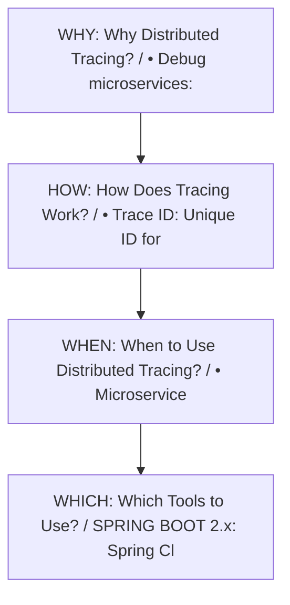
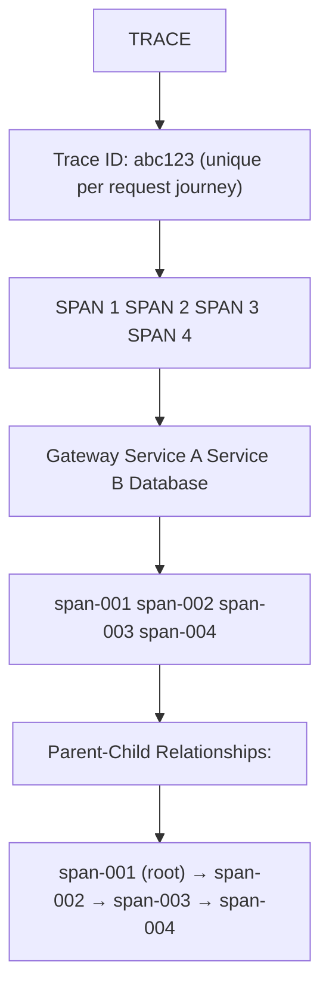
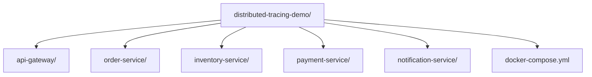
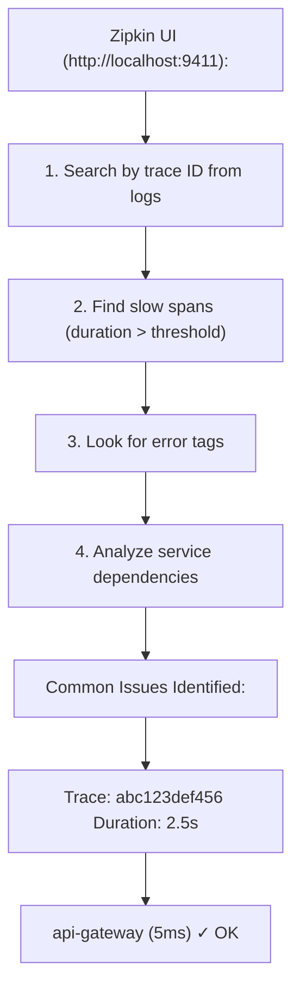

> **Navigation**: [< Previous](Ch47_SB_Security_Deep.md) | [Back to Index](../00_MASTER_INDEX.md) | [Next >](Ch59_SB_Testing_Fundamentals.md)

# Spring Boot Part 18: Distributed Tracing - Sleuth, Zipkin & Micrometer

## Overview
Distributed tracing tracks requests across multiple services, helping debug and understand complex microservice architectures.

---

# 🎯 WHY-HOW-WHEN-WHICH FRAMEWORK

```
┌─────────────────────────────────────────────────────────────────────────────────┐
│  WHY: Why Distributed Tracing?                                                  │
├─────────────────────────────────────────────────────────────────────────────────┤
│  • Debug microservices: "Which service caused the 500 error?"                   │
│  • Performance bottlenecks: Find the slow service in the chain                  │
│  • Dependency mapping: Visualize how services communicate                       │
│  • Production incidents: Trace exact path of failed requests                    │
│  • SLA monitoring: Measure end-to-end latency across services                   │
└─────────────────────────────────────────────────────────────────────────────────┘

┌─────────────────────────────────────────────────────────────────────────────────┐
│  HOW: How Does Tracing Work?                                                    │
├─────────────────────────────────────────────────────────────────────────────────┤
│  • Trace ID: Unique ID for entire request journey across services               │
│  • Span ID: Unique ID for each unit of work (DB call, API call)                 │
│  • Propagation: Headers carry trace context between services                    │
│  • Collection: Spans sent to collector (Zipkin/Jaeger) for visualization        │
│  • Sampling: Not all traces collected (configurable rate)                       │
└─────────────────────────────────────────────────────────────────────────────────┘

┌─────────────────────────────────────────────────────────────────────────────────┐
│  WHEN: When to Use Distributed Tracing?                                         │
├─────────────────────────────────────────────────────────────────────────────────┤
│  • Microservices: 3+ services communicating                                     │
│  • Debugging: Request fails somewhere in the chain                              │
│  • Performance: Need to find bottleneck services                                │
│  • Production: Critical for observability at scale                              │
│  • NOT needed: Single monolith, simple 2-service architecture                   │
└─────────────────────────────────────────────────────────────────────────────────┘

┌─────────────────────────────────────────────────────────────────────────────────┐
│  WHICH: Which Tools to Use?                                                     │
├─────────────────────────────────────────────────────────────────────────────────┤
│  SPRING BOOT 2.x: Spring Cloud Sleuth + Zipkin                                  │
│  SPRING BOOT 3.x: Micrometer Tracing (Sleuth deprecated)                        │
│  COLLECTORS:      Zipkin (simple), Jaeger (advanced), AWS X-Ray (cloud)         │
│  METRICS:         Micrometer + Prometheus/Grafana for full observability        │
└─────────────────────────────────────────────────────────────────────────────────┘
```

**Flow:**
- WHY: Why Distributed Tracing? / • Debug microservices:
- ↓
- HOW: How Does Tracing Work? / • Trace ID: Unique ID for
- ↓
- WHEN: When to Use Distributed Tracing? / • Microservice
- ↓
- WHICH: Which Tools to Use? / SPRING BOOT 2.x: Spring Cl



---

## 1. Tracing Fundamentals

### Core Concepts
```
┌─────────────────────────────────────────────────────────────────┐
│                         TRACE                                   │
│  Trace ID: abc123 (unique per request journey)                  │
│                                                                 │
│  ┌──────────┐    ┌──────────┐    ┌──────────┐    ┌──────────┐   │
│  │  SPAN 1  │───▶│  SPAN 2  │───▶│  SPAN 3  │───▶│  SPAN 4  │   │
│  │ Gateway  │    │ Service A│    │ Service B│    │ Database │   │
│  │ span-001 │    │ span-002 │    │ span-003 │    │ span-004 │   │
│  └──────────┘    └──────────┘    └──────────┘    └──────────┘   │
│                                                                 │
│  Parent-Child Relationships:                                    │
│  span-001 (root) → span-002 → span-003 → span-004               │
└─────────────────────────────────────────────────────────────────┘
```

**Flow:**
- TRACE
- ↓
- Trace ID: abc123 (unique per request journey)
- ↓
- SPAN 1 SPAN 2 SPAN 3 SPAN 4
- ↓
- Gateway Service A Service B Database
- ↓
- span-001 span-002 span-003 span-004
- ↓
- Parent-Child Relationships:
- ↓
- span-001 (root)
- ↓
- span-002
- ↓
- span-003
- ↓
- span-004



### Key Terms
| Term | Description | Example |
|------|-------------|---------|
| **Trace** | End-to-end request journey | Order creation flow |
| **Span** | Single unit of work | Database query |
| **Trace ID** | Unique identifier for entire trace | 64/128-bit hex |
| **Span ID** | Unique identifier for span | 64-bit hex |
| **Parent Span ID** | Links child to parent | Creates hierarchy |
| **Baggage** | Key-value pairs propagated across services | user-id, tenant-id |

---

## 2. Spring Cloud Sleuth (Spring Boot 2.x)

### Dependencies
```xml
<!-- pom.xml for Spring Boot 2.x -->
<dependency>
    <groupId>org.springframework.cloud</groupId>
    <artifactId>spring-cloud-starter-sleuth</artifactId>
</dependency>

<dependency>
    <groupId>org.springframework.cloud</groupId>
    <artifactId>spring-cloud-sleuth-zipkin</artifactId>
</dependency>

<!-- Spring Cloud BOM -->
<dependencyManagement>
    <dependencies>
        <dependency>
            <groupId>org.springframework.cloud</groupId>
            <artifactId>spring-cloud-dependencies</artifactId>
            <version>2021.0.8</version>
            <type>pom</type>
            <scope>import</scope>
        </dependency>
    </dependencies>
</dependencyManagement>
```

### Configuration
```yaml
# application.yml
spring:
  application:
    name: order-service
    
  sleuth:
    enabled: true
    sampler:
      probability: 1.0  # 100% sampling (use lower in production)
    propagation:
      type: B3  # or W3C
    baggage:
      remote-fields:
        - user-id
        - tenant-id
      correlation-fields:
        - user-id
        
  zipkin:
    base-url: http://localhost:9411
    sender:
      type: web  # or rabbit, kafka

logging:
  pattern:
    level: "%5p [${spring.application.name:},%X{traceId:-},%X{spanId:-}]"
```

### Auto-Instrumented Components
Sleuth automatically traces:
- **HTTP Controllers** - Incoming REST requests
- **RestTemplate** - Outgoing HTTP calls
- **WebClient** - Reactive HTTP calls
- **Feign Clients** - Declarative REST clients
- **Message Listeners** - Kafka, RabbitMQ
- **Scheduled Tasks** - @Scheduled methods
- **Async Methods** - @Async execution

---

## 3. Micrometer Tracing (Spring Boot 3.x)

### Dependencies
```xml
<!-- pom.xml for Spring Boot 3.x -->
<dependency>
    <groupId>io.micrometer</groupId>
    <artifactId>micrometer-tracing-bridge-brave</artifactId>
</dependency>

<dependency>
    <groupId>io.zipkin.reporter2</groupId>
    <artifactId>zipkin-reporter-brave</artifactId>
</dependency>

<!-- For OTel instead of Brave -->
<!--
<dependency>
    <groupId>io.micrometer</groupId>
    <artifactId>micrometer-tracing-bridge-otel</artifactId>
</dependency>
<dependency>
    <groupId>io.opentelemetry</groupId>
    <artifactId>opentelemetry-exporter-zipkin</artifactId>
</dependency>
-->
```

### Configuration
```yaml
# application.yml for Spring Boot 3.x
spring:
  application:
    name: order-service

management:
  tracing:
    enabled: true
    sampling:
      probability: 1.0
    propagation:
      type: b3  # or w3c, b3_multi
    baggage:
      remote-fields:
        - user-id
        - tenant-id
      correlation:
        fields:
          - user-id
          
  zipkin:
    tracing:
      endpoint: http://localhost:9411/api/v2/spans

logging:
  pattern:
    level: "%5p [${spring.application.name:},%X{traceId:-},%X{spanId:-}]"
```

### Observation API (Modern Approach)
```java
import io.micrometer.observation.Observation;
import io.micrometer.observation.ObservationRegistry;

@Service
public class OrderService {
    
    private final ObservationRegistry observationRegistry;
    
    public OrderService(ObservationRegistry observationRegistry) {
        this.observationRegistry = observationRegistry;
    }
    
    public Order createOrder(OrderRequest request) {
        // Create observation (creates span automatically)
        return Observation.createNotStarted("order.create", observationRegistry)
            .lowCardinalityKeyValue("order.type", request.getType())
            .highCardinalityKeyValue("user.id", request.getUserId())
            .observe(() -> {
                // Business logic here
                return processOrder(request);
            });
    }
    
    // Observation with more control
    public Order processWithObservation(OrderRequest request) {
        Observation observation = Observation.start("order.process", observationRegistry);
        
        try (Observation.Scope scope = observation.openScope()) {
            observation.event(Observation.Event.of("validation.started"));
            validateOrder(request);
            
            observation.event(Observation.Event.of("processing.started"));
            Order order = doProcess(request);
            
            observation.event(Observation.Event.of("completed"));
            return order;
        } catch (Exception e) {
            observation.error(e);
            throw e;
        } finally {
            observation.stop();
        }
    }
}
```

---

## 4. Manual Span Creation

### Using Tracer (Sleuth/Brave)
```java
import brave.Tracer;
import brave.Span;

@Service
public class PaymentService {
    
    private final Tracer tracer;
    
    public PaymentService(Tracer tracer) {
        this.tracer = tracer;
    }
    
    public PaymentResult processPayment(Payment payment) {
        // Create new span as child of current
        Span newSpan = tracer.nextSpan().name("payment.process");
        
        try (Tracer.SpanInScope ws = tracer.withSpanInScope(newSpan.start())) {
            // Add tags
            newSpan.tag("payment.method", payment.getMethod());
            newSpan.tag("payment.amount", String.valueOf(payment.getAmount()));
            
            // Add event/annotation
            newSpan.annotate("gateway.called");
            
            PaymentResult result = callPaymentGateway(payment);
            
            newSpan.annotate("gateway.responded");
            newSpan.tag("payment.status", result.getStatus());
            
            return result;
        } catch (Exception e) {
            newSpan.error(e);
            throw e;
        } finally {
            newSpan.finish();
        }
    }
    
    public void processAsync(Payment payment) {
        // Get current span for async propagation
        Span currentSpan = tracer.currentSpan();
        
        CompletableFuture.runAsync(() -> {
            // Continue with same span in different thread
            try (Tracer.SpanInScope ws = tracer.withSpanInScope(currentSpan)) {
                // Work happens here with trace context
                doAsyncWork(payment);
            }
        });
    }
}
```

### Using Micrometer Tracing API
```java
import io.micrometer.tracing.Tracer;
import io.micrometer.tracing.Span;
import io.micrometer.tracing.ScopedSpan;

@Service
public class InventoryService {
    
    private final Tracer tracer;
    
    public InventoryService(Tracer tracer) {
        this.tracer = tracer;
    }
    
    // Method 1: Using ScopedSpan (auto-closes)
    public void checkInventory(String productId) {
        ScopedSpan span = tracer.startScopedSpan("inventory.check");
        try {
            span.tag("product.id", productId);
            
            int quantity = fetchQuantity(productId);
            span.tag("quantity.available", String.valueOf(quantity));
            
            span.event("check.completed");
        } catch (Exception e) {
            span.error(e);
            throw e;
        } finally {
            span.end();
        }
    }
    
    // Method 2: Using Span builder
    public void reserveInventory(String productId, int quantity) {
        Span span = tracer.spanBuilder()
            .name("inventory.reserve")
            .tag("product.id", productId)
            .tag("quantity.requested", String.valueOf(quantity))
            .start();
            
        try (Tracer.SpanInScope ws = tracer.withSpan(span)) {
            doReservation(productId, quantity);
            span.event("reservation.completed");
        } catch (Exception e) {
            span.error(e);
            throw e;
        } finally {
            span.end();
        }
    }
    
    // Method 3: Continue existing span in async context
    public CompletableFuture<Void> asyncOperation() {
        Span currentSpan = tracer.currentSpan();
        
        return CompletableFuture.runAsync(() -> {
            try (Tracer.SpanInScope ws = tracer.withSpan(currentSpan)) {
                // Async work with trace context preserved
                performAsyncTask();
            }
        });
    }
}
```

---

## 5. Baggage Propagation

### Configuration
```yaml
# Sleuth (Spring Boot 2.x)
spring:
  sleuth:
    baggage:
      remote-fields:
        - user-id
        - tenant-id
        - correlation-id
      correlation-fields:
        - user-id

# Micrometer (Spring Boot 3.x)
management:
  tracing:
    baggage:
      remote-fields:
        - user-id
        - tenant-id
        - correlation-id
      correlation:
        fields:
          - user-id
```

### Working with Baggage
```java
import brave.baggage.BaggageField;

// Sleuth/Brave approach
@Service
public class ContextAwareService {
    
    // Define baggage fields
    private static final BaggageField USER_ID = BaggageField.create("user-id");
    private static final BaggageField TENANT_ID = BaggageField.create("tenant-id");
    
    public void processRequest(HttpServletRequest request) {
        // Set baggage from header or other source
        USER_ID.updateValue(extractUserId(request));
        TENANT_ID.updateValue(extractTenantId(request));
        
        // Baggage now propagates to downstream services automatically
        callDownstreamService();
    }
    
    public void downstreamHandler() {
        // Read baggage in downstream service
        String userId = USER_ID.getValue();
        String tenantId = TENANT_ID.getValue();
        
        log.info("Processing for user: {} in tenant: {}", userId, tenantId);
    }
}
```

```java
import io.micrometer.tracing.Tracer;
import io.micrometer.tracing.BaggageInScope;

// Micrometer approach (Spring Boot 3.x)
@Service
public class ModernContextService {
    
    private final Tracer tracer;
    
    public void processWithBaggage(String userId, String tenantId) {
        // Create baggage that propagates
        try (BaggageInScope userId = tracer.createBaggageInScope("user-id", userId);
             BaggageInScope tenantId = tracer.createBaggageInScope("tenant-id", tenantId)) {
            
            // Call downstream - baggage included in headers
            callDownstreamService();
        }
    }
    
    public String readBaggage() {
        return tracer.getBaggage("user-id").get();
    }
}
```

### Baggage in Filters
```java
@Component
@Order(Ordered.HIGHEST_PRECEDENCE)
public class BaggageFilter extends OncePerRequestFilter {
    
    private static final BaggageField USER_ID = BaggageField.create("user-id");
    
    @Override
    protected void doFilterInternal(HttpServletRequest request, 
                                     HttpServletResponse response,
                                     FilterChain chain) throws ServletException, IOException {
        
        // Extract from JWT or session
        String userId = extractUserIdFromJwt(request);
        
        if (userId != null) {
            USER_ID.updateValue(userId);
        }
        
        try {
            chain.doFilter(request, response);
        } finally {
            // Clean up
            USER_ID.updateValue(null);
        }
    }
}
```

---

## 6. Zipkin Integration

### Docker Setup
```yaml
# docker-compose.yml
version: '3.8'

services:
  zipkin:
    image: openzipkin/zipkin:latest
    container_name: zipkin
    ports:
      - "9411:9411"
    environment:
      - STORAGE_TYPE=elasticsearch
      - ES_HOSTS=elasticsearch:9200
    depends_on:
      - elasticsearch
      
  elasticsearch:
    image: docker.elastic.co/elasticsearch/elasticsearch:8.11.0
    container_name: zipkin-elasticsearch
    environment:
      - discovery.type=single-node
      - xpack.security.enabled=false
    ports:
      - "9200:9200"
    volumes:
      - zipkin-data:/usr/share/elasticsearch/data

volumes:
  zipkin-data:
```

### Using Different Transports
```yaml
# HTTP (default)
spring:
  zipkin:
    base-url: http://localhost:9411
    sender:
      type: web

# Kafka
spring:
  zipkin:
    sender:
      type: kafka
  kafka:
    bootstrap-servers: localhost:9092

# RabbitMQ
spring:
  zipkin:
    sender:
      type: rabbit
  rabbitmq:
    host: localhost
    port: 5672
```

```xml
<!-- Kafka sender dependency -->
<dependency>
    <groupId>org.springframework.cloud</groupId>
    <artifactId>spring-cloud-sleuth-zipkin</artifactId>
</dependency>
<dependency>
    <groupId>org.springframework.kafka</groupId>
    <artifactId>spring-kafka</artifactId>
</dependency>
```

---

## 7. Log Correlation

### Logging Pattern
```yaml
# application.yml
logging:
  pattern:
    console: "%d{yyyy-MM-dd HH:mm:ss.SSS} %5p [${spring.application.name},%X{traceId:-},%X{spanId:-}] [%t] %c{1} - %msg%n"
    file: "%d{yyyy-MM-dd HH:mm:ss.SSS} %5p [${spring.application.name},%X{traceId:-},%X{spanId:-}] [%t] %c{1} - %msg%n"
```

### Log Output Example
```
2024-01-15 10:30:45.123  INFO [order-service,abc123def456,span001] [http-nio-8080-exec-1] OrderController - Received order request
2024-01-15 10:30:45.150  INFO [order-service,abc123def456,span002] [http-nio-8080-exec-1] OrderService - Processing order
2024-01-15 10:30:45.200  INFO [inventory-service,abc123def456,span003] [http-nio-8081-exec-1] InventoryService - Checking inventory
2024-01-15 10:30:45.250  INFO [payment-service,abc123def456,span004] [http-nio-8082-exec-1] PaymentService - Processing payment
```

### MDC for Custom Context
```java
import org.slf4j.MDC;

@Service
public class EnhancedLoggingService {
    
    public void processWithContext(Order order) {
        // Add custom MDC values alongside trace context
        MDC.put("orderId", order.getId());
        MDC.put("customerId", order.getCustomerId());
        
        try {
            log.info("Processing order");  // Will include traceId, spanId, orderId, customerId
            doProcess(order);
        } finally {
            MDC.remove("orderId");
            MDC.remove("customerId");
        }
    }
}
```

### Logback Configuration for ELK
```xml
<!-- logback-spring.xml -->
<configuration>
    <include resource="org/springframework/boot/logging/logback/defaults.xml"/>
    
    <springProperty scope="context" name="appName" source="spring.application.name"/>
    
    <!-- Console appender with trace info -->
    <appender name="CONSOLE" class="ch.qos.logback.core.ConsoleAppender">
        <encoder>
            <pattern>%d{yyyy-MM-dd HH:mm:ss.SSS} %5p [${appName},%X{traceId:-},%X{spanId:-}] [%t] %c{1} - %msg%n</pattern>
        </encoder>
    </appender>
    
    <!-- JSON appender for ELK -->
    <appender name="JSON" class="ch.qos.logback.core.rolling.RollingFileAppender">
        <file>logs/${appName}.json</file>
        <rollingPolicy class="ch.qos.logback.core.rolling.TimeBasedRollingPolicy">
            <fileNamePattern>logs/${appName}.%d{yyyy-MM-dd}.json</fileNamePattern>
            <maxHistory>30</maxHistory>
        </rollingPolicy>
        <encoder class="net.logstash.logback.encoder.LogstashEncoder">
            <includeMdcKeyName>traceId</includeMdcKeyName>
            <includeMdcKeyName>spanId</includeMdcKeyName>
            <includeMdcKeyName>user-id</includeMdcKeyName>
            <customFields>{"service":"${appName}"}</customFields>
        </encoder>
    </appender>
    
    <root level="INFO">
        <appender-ref ref="CONSOLE"/>
        <appender-ref ref="JSON"/>
    </root>
</configuration>
```

---

## 8. Tracing Across Message Queues

### Kafka Integration
```java
import org.springframework.kafka.support.KafkaHeaders;
import org.springframework.messaging.Message;
import org.springframework.messaging.support.MessageBuilder;

@Service
public class KafkaTracingProducer {
    
    private final KafkaTemplate<String, Order> kafkaTemplate;
    private final Tracer tracer;
    
    public void sendOrder(Order order) {
        // Sleuth automatically adds trace headers to Kafka messages
        kafkaTemplate.send("orders", order.getId(), order);
        log.info("Sent order to Kafka: {}", order.getId());
    }
}

@Service
public class KafkaTracingConsumer {
    
    private final Tracer tracer;
    
    @KafkaListener(topics = "orders")
    public void receiveOrder(Order order, 
                             @Header(KafkaHeaders.RECEIVED_PARTITION_ID) int partition,
                             @Header(value = "b3", required = false) String traceHeader) {
        // Trace context automatically restored from headers
        log.info("Received order {} from partition {}", order.getId(), partition);
        processOrder(order);
    }
}
```

### RabbitMQ Integration
```java
import org.springframework.amqp.rabbit.core.RabbitTemplate;

@Service
public class RabbitTracingService {
    
    private final RabbitTemplate rabbitTemplate;
    
    public void sendMessage(Order order) {
        // Sleuth adds trace headers automatically via MessagePostProcessor
        rabbitTemplate.convertAndSend("orders-exchange", "orders.new", order);
    }
    
    @RabbitListener(queues = "orders-queue")
    public void receiveMessage(Order order) {
        // Trace context automatically restored
        log.info("Processing order: {}", order.getId());
        processOrder(order);
    }
}
```

### Manual Header Propagation
```java
import brave.propagation.TraceContext;
import brave.propagation.B3Propagation;

@Service
public class CustomHeaderPropagation {
    
    private final Tracer tracer;
    
    public Map<String, String> extractCurrentTraceHeaders() {
        Map<String, String> headers = new HashMap<>();
        
        TraceContext context = tracer.currentSpan().context();
        
        // B3 format (single header)
        headers.put("b3", context.traceIdString() + "-" + 
                         context.spanIdString() + "-" +
                         (context.sampled() ? "1" : "0"));
        
        // Or B3 multi-header format
        headers.put("X-B3-TraceId", context.traceIdString());
        headers.put("X-B3-SpanId", context.spanIdString());
        headers.put("X-B3-Sampled", context.sampled() ? "1" : "0");
        
        return headers;
    }
    
    public void injectHeaders(HttpRequest.Builder builder) {
        Map<String, String> headers = extractCurrentTraceHeaders();
        headers.forEach(builder::header);
    }
}
```

---

## 9. Sampling Strategies

### Configuration
```yaml
spring:
  sleuth:
    sampler:
      # Always sample (development)
      probability: 1.0
      
      # Sample 10% (production)
      # probability: 0.1
      
      # Rate limiting sampler
      rate: 100  # Max 100 traces per second
```

### Custom Sampler
```java
import brave.sampler.Sampler;
import brave.sampler.RateLimitingSampler;

@Configuration
public class SamplerConfiguration {
    
    // Always sample specific requests
    @Bean
    public Sampler customSampler() {
        return new Sampler() {
            private final Sampler rateLimiter = RateLimitingSampler.create(100);
            
            @Override
            public boolean isSampled(long traceId) {
                // Get current request info if available
                HttpServletRequest request = getCurrentRequest();
                
                if (request != null) {
                    // Always sample errors
                    if (request.getAttribute("error") != null) {
                        return true;
                    }
                    
                    // Always sample specific endpoints
                    String uri = request.getRequestURI();
                    if (uri.contains("/api/orders") || uri.contains("/api/payments")) {
                        return true;
                    }
                    
                    // Never sample health checks
                    if (uri.contains("/actuator/health")) {
                        return false;
                    }
                }
                
                // Use rate limiting for everything else
                return rateLimiter.isSampled(traceId);
            }
        };
    }
    
    // Priority-based sampling
    @Bean
    public Sampler prioritySampler() {
        return Sampler.create(0.1f);  // 10% default
    }
}
```

### Micrometer Observation Predicate
```java
import io.micrometer.observation.ObservationPredicate;

@Configuration
public class ObservationConfiguration {
    
    @Bean
    public ObservationPredicate noActuatorObservations() {
        // Don't create spans for actuator endpoints
        return (name, context) -> !name.startsWith("http.server.requests") 
            || !context.getLowCardinalityKeyValue("uri").getValue().startsWith("/actuator");
    }
    
    @Bean
    public ObservationPredicate sampleByEndpoint() {
        return (name, context) -> {
            if (name.equals("http.server.requests")) {
                String uri = context.getLowCardinalityKeyValue("uri").getValue();
                
                // Always observe critical paths
                if (uri.startsWith("/api/orders") || uri.startsWith("/api/payments")) {
                    return true;
                }
                
                // Random sample 10% of other requests
                return Math.random() < 0.1;
            }
            return true;
        };
    }
}
```

---

## 10. Complete Microservices Example

### Project Structure
```
distributed-tracing-demo/
├── api-gateway/
├── order-service/
├── inventory-service/
├── payment-service/
├── notification-service/
└── docker-compose.yml
```

**Flow:**
- distributed-tracing-demo/
- ↓
- api-gateway/
- ↓
- distributed-tracing-demo/
- ↓
- order-service/
- ↓
- distributed-tracing-demo/
- ↓
- inventory-service/
- ↓
- distributed-tracing-demo/
- ↓
- payment-service/
- ↓
- distributed-tracing-demo/
- ↓
- notification-service/
- ↓
- distributed-tracing-demo/
- ↓
- docker-compose.yml



### API Gateway
```java
// ApiGatewayApplication.java
@SpringBootApplication
public class ApiGatewayApplication {
    public static void main(String[] args) {
        SpringApplication.run(ApiGatewayApplication.class, args);
    }
}

// GatewayConfig.java
@Configuration
public class GatewayConfig {
    
    @Bean
    public RouteLocator routes(RouteLocatorBuilder builder) {
        return builder.routes()
            .route("orders", r -> r
                .path("/api/orders/**")
                .uri("lb://order-service"))
            .route("inventory", r -> r
                .path("/api/inventory/**")
                .uri("lb://inventory-service"))
            .route("payments", r -> r
                .path("/api/payments/**")
                .uri("lb://payment-service"))
            .build();
    }
}
```

```yaml
# api-gateway application.yml
spring:
  application:
    name: api-gateway
  cloud:
    gateway:
      globalcors:
        corsConfigurations:
          '[/**]':
            allowedOrigins: "*"
            allowedMethods: "*"
            
management:
  tracing:
    sampling:
      probability: 1.0
  zipkin:
    tracing:
      endpoint: http://zipkin:9411/api/v2/spans

eureka:
  client:
    serviceUrl:
      defaultZone: http://eureka:8761/eureka/
```

### Order Service
```java
// OrderController.java
@RestController
@RequestMapping("/api/orders")
public class OrderController {
    
    private final OrderService orderService;
    
    @PostMapping
    public ResponseEntity<Order> createOrder(@RequestBody OrderRequest request) {
        log.info("Received order request for customer: {}", request.getCustomerId());
        Order order = orderService.createOrder(request);
        return ResponseEntity.ok(order);
    }
    
    @GetMapping("/{id}")
    public ResponseEntity<Order> getOrder(@PathVariable String id) {
        log.info("Fetching order: {}", id);
        return ResponseEntity.ok(orderService.findById(id));
    }
}

// OrderService.java
@Service
public class OrderService {
    
    private final InventoryClient inventoryClient;
    private final PaymentClient paymentClient;
    private final NotificationClient notificationClient;
    private final Tracer tracer;
    private final OrderRepository orderRepository;
    
    @Transactional
    public Order createOrder(OrderRequest request) {
        // Create custom span for order creation
        ScopedSpan span = tracer.startScopedSpan("order.create");
        span.tag("customer.id", request.getCustomerId());
        
        try {
            // 1. Check inventory
            log.info("Checking inventory for {} items", request.getItems().size());
            InventoryResponse inventory = inventoryClient.checkInventory(request.getItems());
            
            if (!inventory.isAvailable()) {
                span.tag("order.status", "INVENTORY_UNAVAILABLE");
                throw new InsufficientInventoryException("Items not available");
            }
            
            // 2. Create order
            Order order = new Order();
            order.setId(UUID.randomUUID().toString());
            order.setCustomerId(request.getCustomerId());
            order.setItems(request.getItems());
            order.setTotal(calculateTotal(request.getItems()));
            order.setStatus(OrderStatus.PENDING);
            
            span.tag("order.id", order.getId());
            span.tag("order.total", order.getTotal().toString());
            
            // 3. Reserve inventory
            log.info("Reserving inventory for order: {}", order.getId());
            inventoryClient.reserveInventory(order.getId(), request.getItems());
            
            // 4. Process payment
            log.info("Processing payment for order: {}", order.getId());
            PaymentResponse payment = paymentClient.processPayment(
                order.getId(), 
                request.getPaymentMethod(),
                order.getTotal()
            );
            
            if (payment.isSuccessful()) {
                order.setStatus(OrderStatus.CONFIRMED);
                order.setPaymentId(payment.getPaymentId());
                span.tag("payment.id", payment.getPaymentId());
                
                // 5. Send notification (async)
                log.info("Sending confirmation for order: {}", order.getId());
                notificationClient.sendOrderConfirmation(order);
            } else {
                order.setStatus(OrderStatus.PAYMENT_FAILED);
                span.tag("order.status", "PAYMENT_FAILED");
                
                // Release reserved inventory
                inventoryClient.releaseInventory(order.getId());
            }
            
            Order savedOrder = orderRepository.save(order);
            span.tag("order.status", savedOrder.getStatus().name());
            
            return savedOrder;
            
        } catch (Exception e) {
            span.error(e);
            throw e;
        } finally {
            span.end();
        }
    }
}

// InventoryClient.java (Feign)
@FeignClient(name = "inventory-service")
public interface InventoryClient {
    
    @PostMapping("/api/inventory/check")
    InventoryResponse checkInventory(@RequestBody List<OrderItem> items);
    
    @PostMapping("/api/inventory/reserve")
    void reserveInventory(@RequestParam String orderId, @RequestBody List<OrderItem> items);
    
    @PostMapping("/api/inventory/release")
    void releaseInventory(@RequestParam String orderId);
}
```

```yaml
# order-service application.yml
spring:
  application:
    name: order-service
  datasource:
    url: jdbc:postgresql://postgres:5432/orders
    
management:
  tracing:
    sampling:
      probability: 1.0
    baggage:
      remote-fields:
        - user-id
        - correlation-id
      correlation:
        fields:
          - user-id
  zipkin:
    tracing:
      endpoint: http://zipkin:9411/api/v2/spans

logging:
  pattern:
    level: "%5p [${spring.application.name},%X{traceId:-},%X{spanId:-},%X{user-id:-}]"

eureka:
  client:
    serviceUrl:
      defaultZone: http://eureka:8761/eureka/
```

### Inventory Service
```java
// InventoryController.java
@RestController
@RequestMapping("/api/inventory")
public class InventoryController {
    
    private final InventoryService inventoryService;
    private final Tracer tracer;
    
    @PostMapping("/check")
    public InventoryResponse checkInventory(@RequestBody List<OrderItem> items) {
        log.info("Checking inventory for {} items", items.size());
        return inventoryService.checkAvailability(items);
    }
    
    @PostMapping("/reserve")
    public ResponseEntity<Void> reserve(@RequestParam String orderId, 
                                         @RequestBody List<OrderItem> items) {
        log.info("Reserving inventory for order: {}", orderId);
        inventoryService.reserve(orderId, items);
        return ResponseEntity.ok().build();
    }
}

// InventoryService.java
@Service
public class InventoryService {
    
    private final InventoryRepository inventoryRepository;
    private final Tracer tracer;
    
    @Transactional
    public InventoryResponse checkAvailability(List<OrderItem> items) {
        ScopedSpan span = tracer.startScopedSpan("inventory.check");
        span.tag("items.count", String.valueOf(items.size()));
        
        try {
            boolean allAvailable = true;
            List<ItemAvailability> results = new ArrayList<>();
            
            for (OrderItem item : items) {
                Inventory inventory = inventoryRepository.findByProductId(item.getProductId());
                
                boolean available = inventory != null && 
                                   inventory.getQuantity() >= item.getQuantity();
                
                results.add(new ItemAvailability(
                    item.getProductId(),
                    available,
                    inventory != null ? inventory.getQuantity() : 0
                ));
                
                if (!available) {
                    allAvailable = false;
                }
            }
            
            span.tag("inventory.available", String.valueOf(allAvailable));
            
            return new InventoryResponse(allAvailable, results);
            
        } finally {
            span.end();
        }
    }
    
    @Transactional
    public void reserve(String orderId, List<OrderItem> items) {
        ScopedSpan span = tracer.startScopedSpan("inventory.reserve");
        span.tag("order.id", orderId);
        
        try {
            for (OrderItem item : items) {
                Inventory inventory = inventoryRepository.findByProductIdForUpdate(item.getProductId());
                
                if (inventory.getQuantity() < item.getQuantity()) {
                    span.tag("reservation.failed", item.getProductId());
                    throw new InsufficientInventoryException(
                        "Not enough inventory for product: " + item.getProductId()
                    );
                }
                
                inventory.setQuantity(inventory.getQuantity() - item.getQuantity());
                inventoryRepository.save(inventory);
                
                // Create reservation record
                Reservation reservation = new Reservation();
                reservation.setOrderId(orderId);
                reservation.setProductId(item.getProductId());
                reservation.setQuantity(item.getQuantity());
                reservationRepository.save(reservation);
            }
            
            span.tag("reservation.status", "SUCCESS");
            
        } finally {
            span.end();
        }
    }
}
```

### Payment Service
```java
// PaymentController.java
@RestController
@RequestMapping("/api/payments")
public class PaymentController {
    
    private final PaymentService paymentService;
    
    @PostMapping("/process")
    public PaymentResponse process(@RequestBody PaymentRequest request) {
        log.info("Processing payment for order: {}", request.getOrderId());
        return paymentService.processPayment(request);
    }
}

// PaymentService.java
@Service
public class PaymentService {
    
    private final PaymentGatewayClient gatewayClient;
    private final PaymentRepository paymentRepository;
    private final Tracer tracer;
    
    @Transactional
    public PaymentResponse processPayment(PaymentRequest request) {
        ScopedSpan span = tracer.startScopedSpan("payment.process");
        span.tag("order.id", request.getOrderId());
        span.tag("payment.method", request.getPaymentMethod());
        span.tag("payment.amount", request.getAmount().toString());
        
        try {
            // Create payment record
            Payment payment = new Payment();
            payment.setId(UUID.randomUUID().toString());
            payment.setOrderId(request.getOrderId());
            payment.setAmount(request.getAmount());
            payment.setMethod(request.getPaymentMethod());
            payment.setStatus(PaymentStatus.PENDING);
            
            span.tag("payment.id", payment.getId());
            
            // Call external payment gateway
            span.event("gateway.calling");
            GatewayResponse gatewayResponse = gatewayClient.charge(
                payment.getId(),
                request.getPaymentMethod(),
                request.getAmount()
            );
            span.event("gateway.responded");
            
            if (gatewayResponse.isApproved()) {
                payment.setStatus(PaymentStatus.COMPLETED);
                payment.setTransactionId(gatewayResponse.getTransactionId());
                span.tag("transaction.id", gatewayResponse.getTransactionId());
                span.tag("payment.status", "SUCCESS");
            } else {
                payment.setStatus(PaymentStatus.FAILED);
                payment.setFailureReason(gatewayResponse.getErrorMessage());
                span.tag("payment.status", "FAILED");
                span.tag("failure.reason", gatewayResponse.getErrorMessage());
            }
            
            paymentRepository.save(payment);
            
            return new PaymentResponse(
                payment.getId(),
                payment.getStatus() == PaymentStatus.COMPLETED,
                gatewayResponse.getErrorMessage()
            );
            
        } catch (Exception e) {
            span.error(e);
            span.tag("payment.status", "ERROR");
            throw e;
        } finally {
            span.end();
        }
    }
}
```

### Docker Compose
```yaml
# docker-compose.yml
version: '3.8'

services:
  zipkin:
    image: openzipkin/zipkin:latest
    ports:
      - "9411:9411"
    networks:
      - microservices-net
      
  eureka:
    build: ./eureka-server
    ports:
      - "8761:8761"
    networks:
      - microservices-net
      
  api-gateway:
    build: ./api-gateway
    ports:
      - "8080:8080"
    environment:
      - EUREKA_CLIENT_SERVICEURL_DEFAULTZONE=http://eureka:8761/eureka/
      - MANAGEMENT_ZIPKIN_TRACING_ENDPOINT=http://zipkin:9411/api/v2/spans
    depends_on:
      - eureka
      - zipkin
    networks:
      - microservices-net
      
  order-service:
    build: ./order-service
    ports:
      - "8081:8081"
    environment:
      - EUREKA_CLIENT_SERVICEURL_DEFAULTZONE=http://eureka:8761/eureka/
      - MANAGEMENT_ZIPKIN_TRACING_ENDPOINT=http://zipkin:9411/api/v2/spans
      - SPRING_DATASOURCE_URL=jdbc:postgresql://postgres:5432/orders
    depends_on:
      - eureka
      - zipkin
      - postgres
    networks:
      - microservices-net
      
  inventory-service:
    build: ./inventory-service
    ports:
      - "8082:8082"
    environment:
      - EUREKA_CLIENT_SERVICEURL_DEFAULTZONE=http://eureka:8761/eureka/
      - MANAGEMENT_ZIPKIN_TRACING_ENDPOINT=http://zipkin:9411/api/v2/spans
    depends_on:
      - eureka
      - zipkin
    networks:
      - microservices-net
      
  payment-service:
    build: ./payment-service
    ports:
      - "8083:8083"
    environment:
      - EUREKA_CLIENT_SERVICEURL_DEFAULTZONE=http://eureka:8761/eureka/
      - MANAGEMENT_ZIPKIN_TRACING_ENDPOINT=http://zipkin:9411/api/v2/spans
    depends_on:
      - eureka
      - zipkin
    networks:
      - microservices-net
      
  postgres:
    image: postgres:15
    environment:
      - POSTGRES_USER=admin
      - POSTGRES_PASSWORD=secret
      - POSTGRES_DB=orders
    volumes:
      - postgres-data:/var/lib/postgresql/data
    networks:
      - microservices-net

networks:
  microservices-net:
    driver: bridge

volumes:
  postgres-data:
```

---

## 11. Debugging with Traces

### Finding Issues
```
Zipkin UI (http://localhost:9411):

1. Search by trace ID from logs
2. Find slow spans (duration > threshold)
3. Look for error tags
4. Analyze service dependencies

Common Issues Identified:
┌────────────────────────────────────────────────────────────────┐
│ Trace: abc123def456                      Duration: 2.5s        │
├────────────────────────────────────────────────────────────────┤
│ ├─ api-gateway (5ms)                     ✓ OK                  │
│ ├─ order-service (50ms)                  ✓ OK                  │
│ │  ├─ inventory-service (20ms)           ✓ OK                  │
│ │  ├─ payment-service (2.3s)             ⚠ SLOW                │
│ │  │  └─ external-gateway (2.2s)         🔴 BOTTLENECK          │
│ │  └─ notification-service (100ms)       ✓ OK                  │
└────────────────────────────────────────────────────────────────┘
```

**Flow:**
- Zipkin UI (http://localhost:9411):
- ↓
- 1. Search by trace ID from logs
- ↓
- 2. Find slow spans (duration > threshold)
- ↓
- 3. Look for error tags
- ↓
- 4. Analyze service dependencies
- ↓
- Common Issues Identified:
- ↓
- Trace: abc123def456 Duration: 2.5s



### Querying Zipkin API
```java
@Service
public class TracingAnalysisService {
    
    private final RestTemplate restTemplate;
    
    public List<TraceSpan> findSlowTraces(String serviceName, long minDuration) {
        String url = String.format(
            "http://zipkin:9411/api/v2/traces?serviceName=%s&minDuration=%d",
            serviceName, minDuration
        );
        
        return restTemplate.getForObject(url, new ParameterizedTypeReference<>() {});
    }
    
    public TraceSpan getTrace(String traceId) {
        String url = "http://zipkin:9411/api/v2/trace/" + traceId;
        return restTemplate.getForObject(url, TraceSpan.class);
    }
}
```

---

## 12. Testing Traced Code

### Unit Testing with Mock Tracer
```java
import io.micrometer.tracing.Tracer;
import io.micrometer.tracing.test.simple.SimpleTracer;

@ExtendWith(MockitoExtension.class)
class TracedServiceTest {
    
    private SimpleTracer tracer;
    
    @BeforeEach
    void setUp() {
        tracer = new SimpleTracer();
    }
    
    @Test
    void shouldCreateSpanForOperation() {
        TracedService service = new TracedService(tracer);
        
        service.performOperation("test-data");
        
        // Verify spans were created
        assertThat(tracer.getSpans()).hasSize(1);
        assertThat(tracer.getSpans().get(0).getName()).isEqualTo("operation.perform");
        assertThat(tracer.getSpans().get(0).getTags())
            .containsEntry("data.id", "test-data");
    }
    
    @Test
    void shouldRecordErrorInSpan() {
        TracedService service = new TracedService(tracer);
        
        assertThrows(RuntimeException.class, () -> 
            service.failingOperation()
        );
        
        assertThat(tracer.getSpans().get(0).getError())
            .isInstanceOf(RuntimeException.class);
    }
}
```

### Integration Testing
```java
@SpringBootTest(webEnvironment = WebEnvironment.RANDOM_PORT)
@AutoConfigureObservability
class TracingIntegrationTest {
    
    @Autowired
    private TestRestTemplate restTemplate;
    
    @Autowired
    private Tracer tracer;
    
    @Test
    void shouldPropagateTraceAcrossServices() {
        // Create headers with trace context
        HttpHeaders headers = new HttpHeaders();
        headers.set("X-B3-TraceId", "463ac35c9f6413ad48485a3953bb6124");
        headers.set("X-B3-SpanId", "0020000000000001");
        headers.set("X-B3-Sampled", "1");
        
        HttpEntity<OrderRequest> request = new HttpEntity<>(
            new OrderRequest("customer-1", List.of(new OrderItem("prod-1", 2))),
            headers
        );
        
        ResponseEntity<Order> response = restTemplate.postForEntity(
            "/api/orders", request, Order.class
        );
        
        assertThat(response.getStatusCode()).isEqualTo(HttpStatus.OK);
        
        // Verify trace was used (check via Zipkin API or mock)
    }
    
    @Test
    void shouldIncludeTraceIdInErrorResponse() {
        ResponseEntity<ErrorResponse> response = restTemplate.getForEntity(
            "/api/orders/non-existent",
            ErrorResponse.class
        );
        
        assertThat(response.getStatusCode()).isEqualTo(HttpStatus.NOT_FOUND);
        assertThat(response.getBody().getTraceId()).isNotBlank();
    }
}
```

### WireMock with Trace Verification
```java
@SpringBootTest
@AutoConfigureWireMock(port = 0)
class ExternalServiceTracingTest {
    
    @Autowired
    private PaymentService paymentService;
    
    @Test
    void shouldPropagateTraceToExternalService() {
        // Stub external service
        stubFor(post(urlPathEqualTo("/gateway/charge"))
            .willReturn(aResponse()
                .withStatus(200)
                .withBody("{\"approved\": true}")));
        
        paymentService.processPayment(new PaymentRequest("order-1", BigDecimal.TEN));
        
        // Verify trace headers were sent
        verify(postRequestedFor(urlPathEqualTo("/gateway/charge"))
            .withHeader("X-B3-TraceId", matching(".+")));
    }
}
```

---

## 13. Quick Reference

### Annotation Cheat Sheet
```java
// Spring Boot 2.x (Sleuth)
@NewSpan("custom-span-name")
public void methodWithNewSpan() { }

@ContinueSpan
public void methodWithContinuedSpan(@SpanTag("tag-name") String param) { }

// Spring Boot 3.x (Observation)
@Observed(name = "operation.name", 
          contextualName = "contextual-name",
          lowCardinalityKeyValues = {"key", "value"})
public void observedMethod() { }
```

### Common Patterns
| Pattern | Use Case |
|---------|----------|
| `tracer.startScopedSpan()` | Create child span with auto-close |
| `tracer.currentSpan()` | Access current span for tagging |
| `tracer.withSpan()` | Set span as current in scope |
| `span.tag(key, value)` | Add searchable metadata |
| `span.event(name)` | Add timestamp annotation |
| `span.error(exception)` | Record error details |

### Header Formats
```
B3 Single Header:
b3: {TraceId}-{SpanId}-{Sampled}-{ParentSpanId}
b3: 463ac35c9f6413ad48485a3953bb6124-0020000000000001-1

B3 Multi-Header:
X-B3-TraceId: 463ac35c9f6413ad48485a3953bb6124
X-B3-SpanId: 0020000000000001
X-B3-ParentSpanId: 0020000000000000
X-B3-Sampled: 1

W3C Trace Context:
traceparent: 00-{trace-id}-{parent-id}-{flags}
traceparent: 00-463ac35c9f6413ad48485a3953bb6124-0020000000000001-01
tracestate: key1=value1,key2=value2
```

---

## Summary
- **Traces** = Request journey across services
- **Spans** = Individual units of work
- **Sleuth** = Spring Boot 2.x tracing (deprecated)
- **Micrometer Tracing** = Spring Boot 3.x tracing
- **Zipkin** = Distributed trace storage and visualization
- **Baggage** = Context propagated across services
- **Sampling** = Control trace volume in production
- **Log Correlation** = Include traceId/spanId in logs


---

> **Navigation**: [< Previous](Ch47_SB_Security_Deep.md) | [Back to Index](../00_MASTER_INDEX.md) | [Next >](Ch59_SB_Testing_Fundamentals.md)