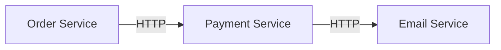
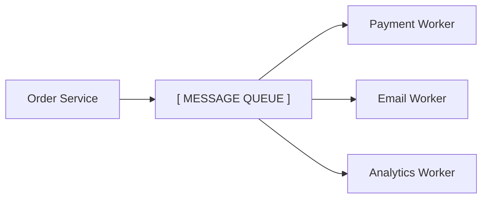
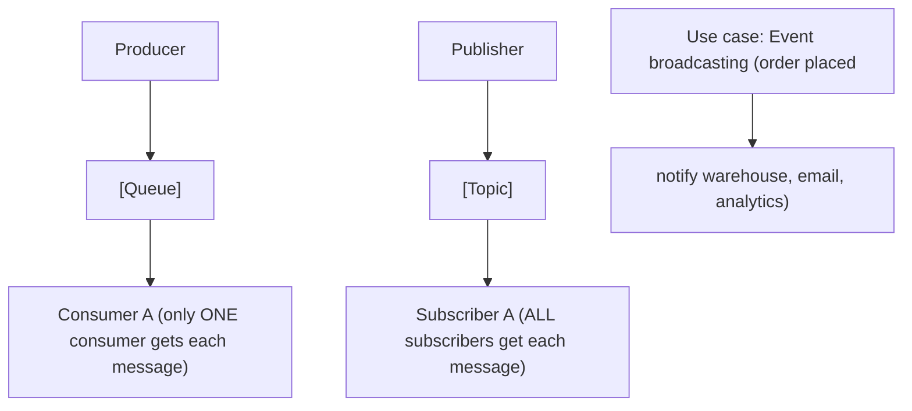
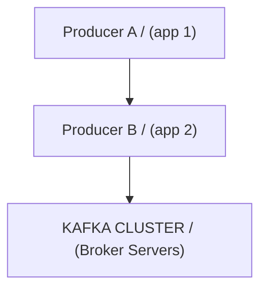
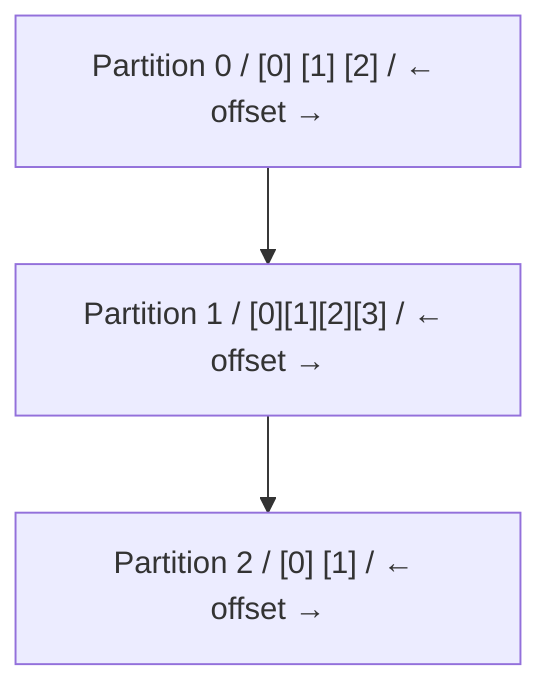
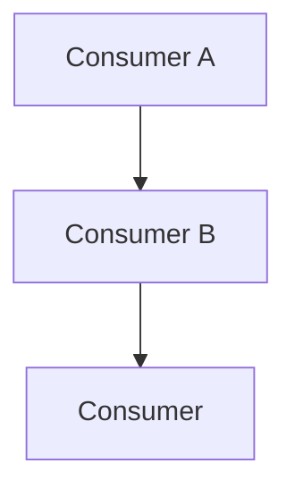
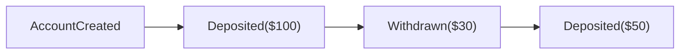
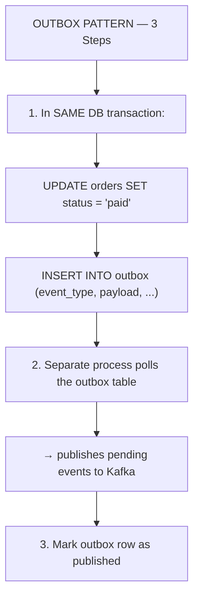

> **Navigation**: [Back to Index](../00_MASTER_INDEX.md) | [Production Practices](../13_Developer_Essentials/11_Production_Code_Practices.md)
> 🧠 **Mental Model**: See [Production Debugging Thinking](../14_Mental_Models/18_Production_Debugging_Thinking.md)

---

# 📨 Message Queues & Kafka — Event-Driven Architecture

> How production systems communicate asynchronously — from simple queues to streaming platforms

---

## Part 1: Why Message Queues?

**Without a Queue (Synchronous — tightly coupled):**

```
  Order Service ──HTTP──→ Payment Service ──HTTP──→ Email Service
                                                    ↑
                                         If slow/down, ENTIRE order fails!
```

**Flow:**
- Order Service --(HTTP)--> Payment Service
- ↓
- Payment Service --(HTTP)--> Email Service



**With a Queue (Asynchronous — decoupled):**

```
  Order Service ──→ [ MESSAGE QUEUE ] ──→ Payment Worker
                    [ MESSAGE QUEUE ] ──→ Email Worker
                    [ MESSAGE QUEUE ] ──→ Analytics Worker
```

**Flow:**
- Order Service
- ↓
- [ MESSAGE QUEUE ]
- ↓
- Payment Worker
- ↓
- [ MESSAGE QUEUE ]
- ↓
- Email Worker
- ↓
- [ MESSAGE QUEUE ]
- ↓
- Analytics Worker



**Why This Matters:**

- ✅ **Decoupling** — Producer doesn't know about consumers
- ✅ **Buffering** — Queue absorbs traffic spikes gracefully
- ✅ **Resilience** — Consumer down? Messages wait safely in queue
- ✅ **Scalability** — Add more consumers to process faster
- ✅ **Ordering** — Messages processed in sequence (within partition)

---

## Part 2: Queue Types — Point-to-Point vs Pub/Sub

```
POINT-TO-POINT (Work Queue):
  Producer ──→ [Queue] ──→ Consumer A   (only ONE consumer gets each message)
                       ──→ Consumer B
  Use case: Task distribution (each email sent once)
  Examples: RabbitMQ default, SQS

PUB/SUB (Publish-Subscribe):
  Publisher ──→ [Topic] ──→ Subscriber A  (ALL subscribers get each message)
                        ──→ Subscriber B
                        ──→ Subscriber C
  Use case: Event broadcasting (order placed → notify warehouse, email, analytics)
  Examples: Kafka topics, SNS, Redis Pub/Sub
```

**Flow:**
- Producer
- ↓
- [Queue]
- ↓
- Consumer A (only ONE consumer gets each message)
- ↓
- Publisher
- ↓
- [Topic]
- ↓
- Subscriber A (ALL subscribers get each message)
- ↓
- Use case: Event broadcasting (order placed
- ↓
- notify warehouse, email, analytics)



---


> 🔬 **Section Challenge — Part 2: Queue Types — Point-to-Point vs Pub/Sub**
>
> **Challenge 1 (Reasoning):** You write `List<String> list = new ArrayList<>();`. At runtime, can you check `list instanceof List<String>`?
> <details><summary>Answer</summary>
>
> No — `instanceof List<String>` is a compile error. After erasure, it's just `List` at runtime. Use `instanceof List<?>` for an unparameterized check. This is why you can't do `new T()`, `new T[]`, or `T.class` — T doesn't exist at runtime.
> </details>
>
> **Challenge 2 (Bug Hunt):** A method returns `(T) jsonDeserialize(json)` where T is a generic type param. When does the `ClassCastException` actually occur?
> <details><summary>Answer</summary>
>
> NOT at the cast — the unchecked cast compiles to nothing at runtime (erasure). The CCE occurs when the calling code tries to USE the returned value as a specific type. This makes debugging hard: the error appears far from the actual source. Use `Class<T> clazz` parameter to do safe `clazz.cast(...)` instead.
> </details>
>

## Part 3: Apache Kafka — Deep Dive

### How Messages Flow Through Kafka

**Step 1 — Producers publish messages to a Topic:**

```
    ┌───────────┐                  ┌───────────┐
    │ Producer A │                  │ Producer B │
    │  (app 1)  │                  │  (app 2)  │
    └─────┬─────┘                  └─────┬─────┘
          │       publish("orders")      │
          └──────────────┬───────────────┘
                         │
                         ▼
               ┌───────────────────┐
               │   KAFKA CLUSTER    │
               │  (Broker Servers)  │
               └────────┬──────────┘
                        │
                  Topic: "orders"
```

**Flow:**
- Producer A / (app 1)
- ↓
- Producer B / (app 2)
- ↓
- KAFKA CLUSTER / (Broker Servers)



> **Topic** = A named feed of messages — think of it like a **database table** you write records into.

**Step 2 — Topic is split into Partitions for parallelism:**

```
    Topic: "orders"
    ┌──────────────┐  ┌──────────────┐  ┌──────────────┐
    │  Partition 0  │  │  Partition 1  │  │  Partition 2  │
    │               │  │               │  │               │
    │  [0] [1] [2]  │  │[0][1][2][3]  │  │   [0] [1]    │
    │   ← offset →  │  │  ← offset →  │  │  ← offset →  │
    └──────────────┘  └──────────────┘  └──────────────┘
```

**Flow:**
- Partition 0 / [0] [1] [2] / ← offset
- ↓
- Partition 1 / [0][1][2][3] / ← offset
- ↓
- Partition 2 / [0] [1] / ← offset



> **Partition** = An ordered, immutable log. Messages append to the end.
> Each message gets an **offset** (like an array index).
> Kafka achieves massive throughput because partitions process **in parallel**.

**Step 3 — Consumer Group reads partitions (1:1 mapping):**

```
    Partition 0           Partition 1           Partition 2
        │                     │                     │
        ▼                     ▼                     ▼
    ┌──────────┐         ┌──────────┐         ┌──────────┐
    │Consumer A │         │Consumer B │         │Consumer C │
    └──────────┘         └──────────┘         └──────────┘

              Consumer Group: "payment"
              Each partition → exactly ONE consumer
```

**Flow:**
- Consumer A
- ↓
- Consumer B
- ↓
- Consumer



> **Consumer Group** = Consumers that share the work. Add more consumers = more parallelism!
>
> **Broker** = A Kafka server. A cluster has multiple brokers for fault tolerance.

### Kafka Guarantees & Config

**Ordering:**

> Messages are guaranteed in order **within a partition**, NOT across partitions.
> To order all messages for `user123`: use `userId` as the **partition key**.
> `hash("user123") % num_partitions` → always the same partition.

**Delivery Semantics:**

| Guarantee | Behavior | Notes |
|-----------|----------|-------|
| **At-most-once** | Fire and forget — may lose messages | Auto-commit fast |
| **At-least-once** | Retry on failure — may get duplicates | **DEFAULT** in Kafka |
| **Exactly-once** | Idempotent producer + transactional consumer | `enable.idempotence=true` (Kafka 0.11+) |

**Replication:**

> Each partition has **1 leader** + N-1 **followers** (ISR = in-sync replicas).
> Writes go to leader, then replicated to followers.

| `acks` Setting | Behavior | Trade-off |
|----------------|----------|-----------|
| `acks=0` | Don't wait for acknowledgment | Fastest, may lose data |
| `acks=1` | Leader acknowledges | Balanced |
| `acks=all` | All ISR acknowledge | Safest, slowest |

**Retention:**

| Strategy | Description |
|----------|-------------|
| **Time-based** | Retain messages for 7 days (default) |
| **Size-based** | Retain up to 1GB per partition |
| **Compacted** | Keep only latest value per key (like a changelog) |

---

## Part 4: Spring Boot + Kafka (Production Code)

```java
// ── application.yml ──
// spring:
//   kafka:
//     bootstrap-servers: localhost:9092
//     producer:
//       key-serializer: org.apache.kafka.common.serialization.StringSerializer
//       value-serializer: org.springframework.kafka.support.serializer.JsonSerializer
//     consumer:
//       group-id: payment-service
//       auto-offset-reset: earliest

// ── Producer ──
@Service
public class OrderEventProducer {
    private final KafkaTemplate<String, OrderEvent> kafkaTemplate;
    
    public CompletableFuture<SendResult<String, OrderEvent>> publishOrderCreated(OrderEvent event) {
        return kafkaTemplate.send("orders", event.getOrderId(), event)
            .whenComplete((result, ex) -> {
                if (ex != null) {
                    log.error("Failed to send event: {}", event.getOrderId(), ex);
                } else {
                    log.info("Sent to partition={}, offset={}", 
                        result.getRecordMetadata().partition(),
                        result.getRecordMetadata().offset());
                }
            });
    }
}

// ── Consumer ──
@Service
public class PaymentEventConsumer {
    
    @KafkaListener(topics = "orders", groupId = "payment-service")
    public void handleOrderCreated(OrderEvent event) {
        log.info("Processing order: {}", event.getOrderId());
        
        // IDEMPOTENCY: Check if already processed
        if (paymentRepository.existsByOrderId(event.getOrderId())) {
            log.warn("Duplicate event, skipping: {}", event.getOrderId());
            return;
        }
        
        paymentService.processPayment(event);
    }
}
```

---


> 🔬 **Section Challenge — Part 4: Spring Boot + Kafka (Production Code)**
>
> **Challenge 1 (Reasoning):** `ExecutorService.submit(task)` — the task throws a `RuntimeException`. Nobody calls `future.get()`. What happens to the exception?
> <details><summary>Answer</summary>
>
> It's silently swallowed. The exception is stored in the `Future` object. Without `future.get()` or `.whenComplete()`, no one ever sees it. The thread pool thread resets and picks up the next task as if nothing happened. This is one of the most dangerous production bugs. Fix: always attach `future.whenComplete((r,ex) -> { if(ex!=null) log.error("Task failed",ex); })` or use `execute()` + `UncaughtExceptionHandler`.
> </details>
>

## Part 5: RabbitMQ vs Kafka vs SQS


| Feature | Kafka | RabbitMQ | AWS SQS |
|---------|-------|----------|---------|
| **Model** | Distributed log | Message broker | Managed queue |
| **Ordering** | Per partition | Per queue | Best-effort / FIFO |
| **Throughput** | Millions msg/sec | Thousands msg/sec | Depends on config |
| **Retention** | Configurable (time/size) | Until consumed | 14 days max |
| **Replay** | ✅ Yes (re-read from offset) | ❌ No (consumed = gone) | ❌ No |
| **Best for** | Event streaming, log aggregation | Task queues, RPC, routing | Simple async, serverless |
| **Complexity** | High (ZK/KRaft) | Medium | Low (fully managed) |
| **When to use** | High throughput, event sourcing | Complex routing, low latency | AWS ecosystem, simple queuing |

> 💡 **Quick Decision**: Need **event replay** + high throughput? → **Kafka**. Complex routing? → **RabbitMQ**. Simple managed queue? → **SQS**.

---

## Part 6: Event-Driven Architecture Patterns


### Pattern 1: Event Notification

> Order Service publishes: `{ type: "ORDER_CREATED", orderId: "123" }`
> Consumers react: send email, update analytics, reserve inventory.
>
> → **Lightweight events** — consumers fetch full details if needed.

### Pattern 2: Event-Carried State Transfer

> Order Service publishes the **full payload**:
> `{ type: "ORDER_CREATED", orderId: "123", customer: "John", items: [...], total: 99.99 }`
>
> → **Fat events** — consumers don't need to call back for details.
> → Trade-off: larger messages, but **fully decoupled**.

### Pattern 3: Event Sourcing

> Don't store current state — **store all events as the source of truth**.

```
  AccountCreated → Deposited($100) → Withdrawn($30) → Deposited($50)

  Current balance = replay events = $100 - $30 + $50 = $120
```

**Flow:**
- AccountCreated
- ↓
- Deposited($100)
- ↓
- Withdrawn($30)
- ↓
- Deposited($50)



> → Complete **audit trail** — rebuild state at any point in time.
> → Complex: need snapshots for performance, eventual consistency.

### Pattern 4: Outbox Pattern (Transactional Messaging)

> **Problem**: How to atomically update the DB AND publish an event?

```
  ┌─────────────────────────────────────────────────────────┐
  │  OUTBOX PATTERN — 3 Steps                                │
  ├─────────────────────────────────────────────────────────┤
  │  1. In SAME DB transaction:                              │
  │     UPDATE orders SET status = 'paid'                    │
  │     INSERT INTO outbox (event_type, payload, ...)        │
  │                                                         │
  │  2. Separate process polls the outbox table              │
  │     → publishes pending events to Kafka                  │
  │                                                         │
  │  3. Mark outbox row as published                         │
  └─────────────────────────────────────────────────────────┘
```

**Flow:**
- OUTBOX PATTERN — 3 Steps
- ↓
- 1. In SAME DB transaction:
- ↓
- UPDATE orders SET status = 'paid'
- ↓
- INSERT INTO outbox (event_type, payload, ...)
- ↓
- 2. Separate process polls the outbox table
- ↓
- publishes pending events to Kafka
- ↓
- 3. Mark outbox row as published



> → **Guarantee**: If the DB is updated, the event **WILL** be published (eventually).

---


---


## 🏋️ Practice & Interview Questions — Stack & Queue

### Predict / Trace
**Q1.** Stack has [1,2,3] (3 is top). After pop(), pop(), push(5) — what's the stack?
<details><summary>Answer</summary>

[1, 5] — popped 3 and 2, pushed 5 on top of 1.
</details>

**Q2.** Evaluate postfix `3 4 + 2 *` using a stack — trace each step.
<details><summary>Answer</summary>

push 3 → [3]; push 4 → [3,4]; + → pop 3,4, push 7 → [7]; push 2 → [7,2]; * → pop 7,2, push 14 → [14]. Result: 14
</details>

### LeetCode / Coding
**Q3.** ⭐ Valid Parentheses — O(N).
<details><summary>Solution</summary>

```java
Deque<Character> stack = new ArrayDeque<>();
for(char c : s.toCharArray()){
    if(c=='('||c=='{'||c=='[') stack.push(c);
    else {
        if(stack.isEmpty()) return false;
        char top = stack.pop();
        if(c==')'&&top!='('||c=='}'&&top!='{'||c==']'&&top!='[') return false;
    }
}
return stack.isEmpty();
```
</details>

**Q4.** ⭐ Min Stack — O(1) getMin().
<details><summary>Solution</summary>

```java
Deque<Integer> stack=new ArrayDeque<>(), minStack=new ArrayDeque<>();
void push(int v){ stack.push(v); if(minStack.isEmpty()||v<=minStack.peek()) minStack.push(v); }
void pop(){ if(stack.pop().equals(minStack.peek())) minStack.pop(); }
int getMin(){ return minStack.peek(); }
```
</details>

**Q5.** ⭐⭐ Daily Temperatures — next warmer day for each day (monotonic stack).
<details><summary>Solution</summary>

```java
int[] res = new int[n]; Deque<Integer> stack = new ArrayDeque<>();
for(int i=0;i<n;i++){
    while(!stack.isEmpty()&&temperatures[i]>temperatures[stack.peek()])
        res[stack.peek()] = i - stack.pop();
    stack.push(i);
}
```
</details>

**Q6.** ⭐⭐ Largest Rectangle in Histogram (monotonic stack).
<details><summary>Solution</summary>

```java
Deque<Integer> stack = new ArrayDeque<>();
int maxArea = 0;
for(int i=0;i<=n;i++){
    int h = (i==n)?0:heights[i];
    while(!stack.isEmpty()&&h<heights[stack.peek()]){
        int height=heights[stack.pop()];
        int width=stack.isEmpty()?i:(i-stack.peek()-1);
        maxArea=Math.max(maxArea,height*width);
    }
    stack.push(i);
}
```
</details>

**Q7.** ⭐⭐ Implement Queue using 2 Stacks.
<details><summary>Solution</summary>

```java
// Two stacks: inbox (for push), outbox (for pop)
// Move inbox→outbox only when outbox is empty
void push(int x){ inbox.push(x); }
int pop(){ if(outbox.isEmpty()) while(!inbox.isEmpty()) outbox.push(inbox.pop()); return outbox.pop(); }
```
</details>

**Q8.** ⭐⭐ Decode String — `3[a2[bc]]` → `abcbcabcbcabcbc`.
<details><summary>Solution</summary>

```java
Deque<Integer> counts=new ArrayDeque<>();
Deque<StringBuilder> builders=new ArrayDeque<>();
StringBuilder curr=new StringBuilder(); int k=0;
for(char c:s.toCharArray()){
    if(Character.isDigit(c)) k=k*10+(c-'0');
    else if(c=='['){ counts.push(k); builders.push(curr); curr=new StringBuilder(); k=0; }
    else if(c==']'){ int times=counts.pop(); StringBuilder prev=builders.pop(); while(times-->0) prev.append(curr); curr=prev; }
    else curr.append(c);
}
return curr.toString();
```
</details>

### MCQ Rapid Fire
| # | Question | Answer |
|---|---|---|
| 1 | Stack LIFO/FIFO? | LIFO |
| 2 | Queue LIFO/FIFO? | FIFO |
| 3 | Java Stack class — recommended alternative? | Deque / ArrayDeque |
| 4 | ArrayDeque vs LinkedList for stack/queue | ArrayDeque (no boxing, cache-friendly) |
| 5 | Monotonic stack usage | Next greater/smaller element problems |
| 6 | BFS uses which data structure? | Queue |
| 7 | DFS (iterative) uses which structure? | Stack |
| 8 | peek() vs poll() on empty queue | peek()=null, poll()=null (no exception) |


---

## 🧠 Deep Conceptual Questions — Stack & Queue

**C1. Why is a monotonic stack called "monotonic" and what property does it maintain?**
<details><summary>Deep Answer</summary>

A monotonic stack maintains elements in **strictly increasing or decreasing order** from bottom to top. When a new element arrives that violates the monotonicity (e.g., a larger element in a decreasing stack), elements are popped until the property is restored, THEN the new element is pushed. The pop events are the answer events: when element X is popped because Y is larger, Y is the "next greater element" of X. This processes each element exactly once (each is pushed and popped at most once) → O(N) total.
</details>

**C2. Why use `ArrayDeque` instead of `Stack` class in Java?**
<details><summary>Deep Answer</summary>

Java's `Stack` extends `Vector` (legacy, synchronized). Every push/pop acquires a mutex lock — unnecessary for single-threaded stack use. `ArrayDeque` has zero synchronization overhead, pure array-backed, cache-friendly. Also: `Stack`'s interface allows index-based access and `insertElementAt` which shouldn't exist on a stack (breaks the abstraction). `ArrayDeque` implements `Deque` — clean stack interface (`push`, `pop`, `peek`). **Never use `Stack` in modern Java.**
</details>

**C3. BFS uses a Queue — what property of queues makes BFS work correctly?**
<details><summary>Deep Answer</summary>

BFS needs to process nodes **level by level** — explore all nodes at distance D before any node at distance D+1. Queue's FIFO property guarantees this: nodes enqueued at distance D are dequeued and processed before nodes at distance D+1 (which are enqueued during processing D). If you used a Stack (DFS): you'd go depth-first — immediately explore children of the first node before its siblings. The FIFO vs LIFO distinction is the entire algorithmic difference between BFS and DFS.
</details>

**C4. Why is the "largest rectangle in histogram" problem solved with a monotonic stack?**
<details><summary>Deep Answer</summary>

For each bar, the rectangle it forms extends left/right until a shorter bar is hit. A monotonic increasing stack maintains bars in increasing height. When a shorter bar arrives (say height 3 comes after [2,5,7]):
- Pop 7: rectangle with height 7, width determined by current index and stack top
- Pop 5: rectangle with height 5, wider width

The stack tells us: bars still in the stack haven't found their "right boundary" yet (no shorter bar has come). When they're finally popped, we know both their left and right boundaries. This is the key geometric insight: the stack holds "potential rectangles still growing."
</details>

**C5. Implement a Queue with O(1) amortized enqueue and dequeue — why is amortized important?**
<details><summary>Deep Answer</summary>

Two-stack queue: transfer from stack1 to stack2 only when stack2 is empty. Individual dequeue can be O(N) (transfer cost). But each element is transferred at most once. Over N operations: total transfer cost = N. Average = O(1). This is amortized O(1). Real-world relevance: Python's `queue.Queue` uses this pattern. Java's `ArrayDeque` achieves true O(1) with a circular array — amortized O(1) when resizing without transfer cost.
</details>

**C6. What is the call stack and how do recursive algorithms relate to it?**
<details><summary>Deep Answer</summary>

The **call stack** is a stack of stack frames. Each function call pushes a frame (local variables, return address, parameters). Return pops the frame. Recursive DFS naturally uses the call stack AS its traversal stack. Iterative DFS explicitly manages a stack in heap memory. Iterative is often preferred for: (1) avoiding stack overflow on deep recursion (JVM default: ~500-1000 frames), (2) more control over traversal order, (3) ability to pause/resume traversal.
</details>


> **Navigation**: [< Previous](Ch07_Modern_Java_9to21.md) | [Back to Index](../00_MASTER_INDEX.md) | [Next >](Ch30_Dependencies_Annotations_Map.md)