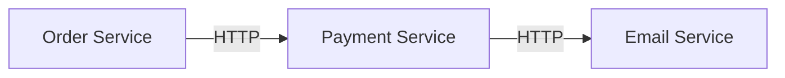
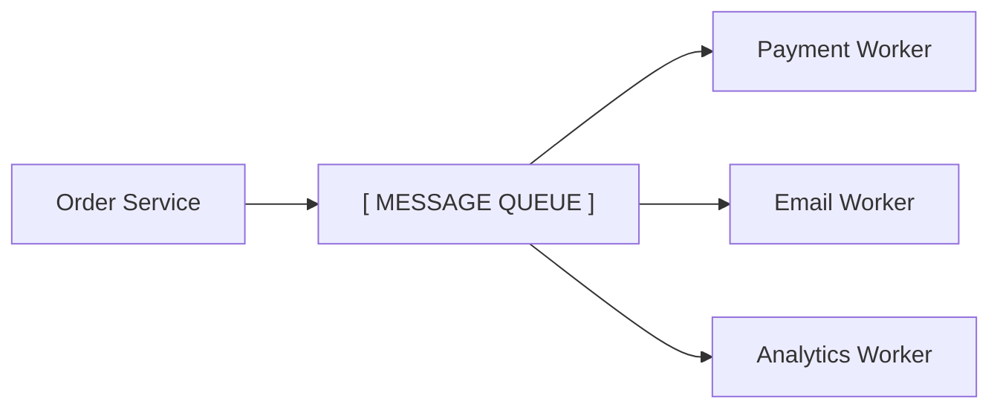
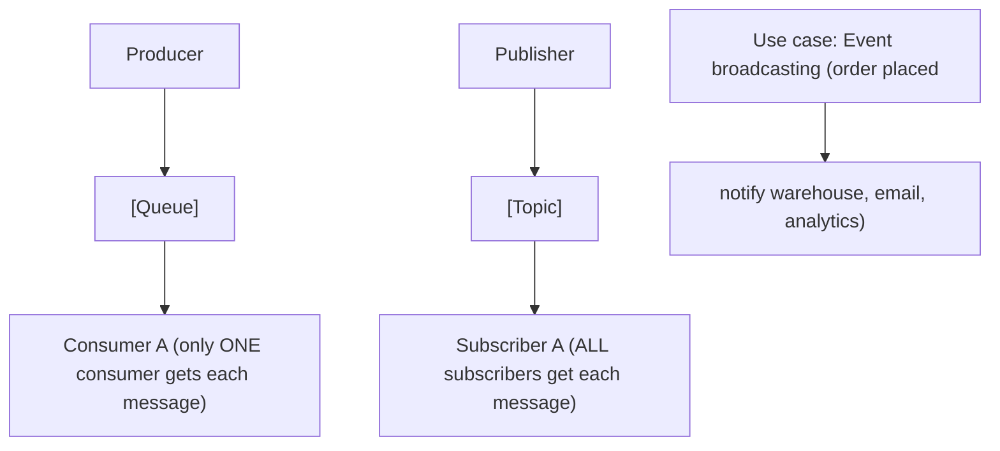
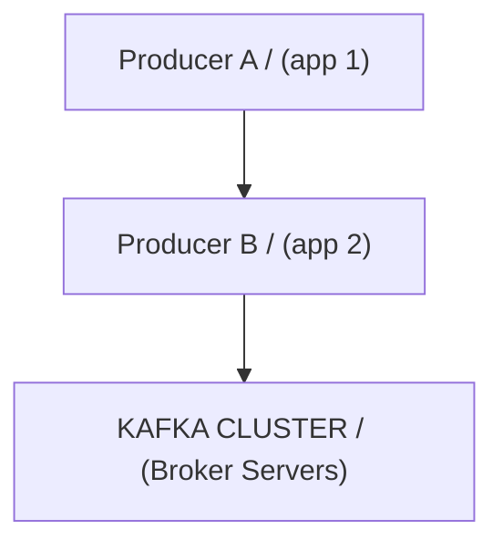
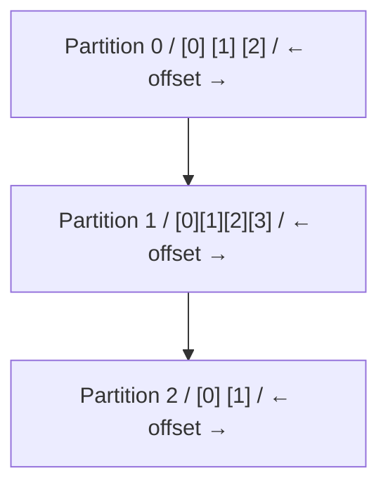
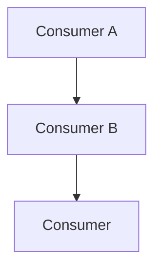
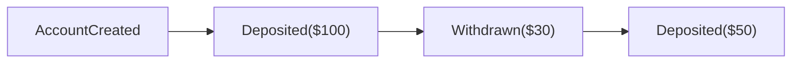
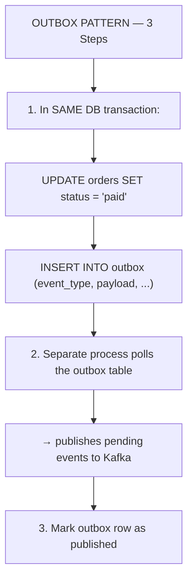

> **Navigation**: [Back to Index](../00_MASTER_INDEX.md) | [Production Practices](../13_Developer_Essentials/11_Production_Code_Practices.md)
> 🧠 **Mental Model**: See [Production Debugging Thinking](../14_Mental_Models/18_Production_Debugging_Thinking.md)

---

# 📨 Message Queues & Kafka — Event-Driven Architecture

> How production systems communicate asynchronously — from simple queues to streaming platforms

---

## Part 1: Why Message Queues?

**Without a Queue (Synchronous — tightly coupled):**

```
  Order Service ──HTTP──→ Payment Service ──HTTP──→ Email Service
                                                    ↑
                                         If slow/down, ENTIRE order fails!
```

**Flow:**
- Order Service --(HTTP)--> Payment Service
- ↓
- Payment Service --(HTTP)--> Email Service



**With a Queue (Asynchronous — decoupled):**

```
  Order Service ──→ [ MESSAGE QUEUE ] ──→ Payment Worker
                    [ MESSAGE QUEUE ] ──→ Email Worker
                    [ MESSAGE QUEUE ] ──→ Analytics Worker
```

**Flow:**
- Order Service
- ↓
- [ MESSAGE QUEUE ]
- ↓
- Payment Worker
- ↓
- [ MESSAGE QUEUE ]
- ↓
- Email Worker
- ↓
- [ MESSAGE QUEUE ]
- ↓
- Analytics Worker



**Why This Matters:**

- ✅ **Decoupling** — Producer doesn't know about consumers
- ✅ **Buffering** — Queue absorbs traffic spikes gracefully
- ✅ **Resilience** — Consumer down? Messages wait safely in queue
- ✅ **Scalability** — Add more consumers to process faster
- ✅ **Ordering** — Messages processed in sequence (within partition)

---

## Part 2: Queue Types — Point-to-Point vs Pub/Sub

```
POINT-TO-POINT (Work Queue):
  Producer ──→ [Queue] ──→ Consumer A   (only ONE consumer gets each message)
                       ──→ Consumer B
  Use case: Task distribution (each email sent once)
  Examples: RabbitMQ default, SQS

PUB/SUB (Publish-Subscribe):
  Publisher ──→ [Topic] ──→ Subscriber A  (ALL subscribers get each message)
                        ──→ Subscriber B
                        ──→ Subscriber C
  Use case: Event broadcasting (order placed → notify warehouse, email, analytics)
  Examples: Kafka topics, SNS, Redis Pub/Sub
```

**Flow:**
- Producer
- ↓
- [Queue]
- ↓
- Consumer A (only ONE consumer gets each message)
- ↓
- Publisher
- ↓
- [Topic]
- ↓
- Subscriber A (ALL subscribers get each message)
- ↓
- Use case: Event broadcasting (order placed
- ↓
- notify warehouse, email, analytics)



---

## Part 3: Apache Kafka — Deep Dive

### How Messages Flow Through Kafka

**Step 1 — Producers publish messages to a Topic:**

```
    ┌───────────┐                  ┌───────────┐
    │ Producer A │                  │ Producer B │
    │  (app 1)  │                  │  (app 2)  │
    └─────┬─────┘                  └─────┬─────┘
          │       publish("orders")      │
          └──────────────┬───────────────┘
                         │
                         ▼
               ┌───────────────────┐
               │   KAFKA CLUSTER    │
               │  (Broker Servers)  │
               └────────┬──────────┘
                        │
                  Topic: "orders"
```

**Flow:**
- Producer A / (app 1)
- ↓
- Producer B / (app 2)
- ↓
- KAFKA CLUSTER / (Broker Servers)



> **Topic** = A named feed of messages — think of it like a **database table** you write records into.

**Step 2 — Topic is split into Partitions for parallelism:**

```
    Topic: "orders"
    ┌──────────────┐  ┌──────────────┐  ┌──────────────┐
    │  Partition 0  │  │  Partition 1  │  │  Partition 2  │
    │               │  │               │  │               │
    │  [0] [1] [2]  │  │[0][1][2][3]  │  │   [0] [1]    │
    │   ← offset →  │  │  ← offset →  │  │  ← offset →  │
    └──────────────┘  └──────────────┘  └──────────────┘
```

**Flow:**
- Partition 0 / [0] [1] [2] / ← offset
- ↓
- Partition 1 / [0][1][2][3] / ← offset
- ↓
- Partition 2 / [0] [1] / ← offset



> **Partition** = An ordered, immutable log. Messages append to the end.
> Each message gets an **offset** (like an array index).
> Kafka achieves massive throughput because partitions process **in parallel**.

**Step 3 — Consumer Group reads partitions (1:1 mapping):**

```
    Partition 0           Partition 1           Partition 2
        │                     │                     │
        ▼                     ▼                     ▼
    ┌──────────┐         ┌──────────┐         ┌──────────┐
    │Consumer A │         │Consumer B │         │Consumer C │
    └──────────┘         └──────────┘         └──────────┘

              Consumer Group: "payment"
              Each partition → exactly ONE consumer
```

**Flow:**
- Consumer A
- ↓
- Consumer B
- ↓
- Consumer



> **Consumer Group** = Consumers that share the work. Add more consumers = more parallelism!
>
> **Broker** = A Kafka server. A cluster has multiple brokers for fault tolerance.

### Kafka Guarantees & Config

**Ordering:**

> Messages are guaranteed in order **within a partition**, NOT across partitions.
> To order all messages for `user123`: use `userId` as the **partition key**.
> `hash("user123") % num_partitions` → always the same partition.

**Delivery Semantics:**

| Guarantee | Behavior | Notes |
|-----------|----------|-------|
| **At-most-once** | Fire and forget — may lose messages | Auto-commit fast |
| **At-least-once** | Retry on failure — may get duplicates | **DEFAULT** in Kafka |
| **Exactly-once** | Idempotent producer + transactional consumer | `enable.idempotence=true` (Kafka 0.11+) |

**Replication:**

> Each partition has **1 leader** + N-1 **followers** (ISR = in-sync replicas).
> Writes go to leader, then replicated to followers.

| `acks` Setting | Behavior | Trade-off |
|----------------|----------|-----------|
| `acks=0` | Don't wait for acknowledgment | Fastest, may lose data |
| `acks=1` | Leader acknowledges | Balanced |
| `acks=all` | All ISR acknowledge | Safest, slowest |

**Retention:**

| Strategy | Description |
|----------|-------------|
| **Time-based** | Retain messages for 7 days (default) |
| **Size-based** | Retain up to 1GB per partition |
| **Compacted** | Keep only latest value per key (like a changelog) |

---

## Part 4: Spring Boot + Kafka (Production Code)

```java
// ── application.yml ──
// spring:
//   kafka:
//     bootstrap-servers: localhost:9092
//     producer:
//       key-serializer: org.apache.kafka.common.serialization.StringSerializer
//       value-serializer: org.springframework.kafka.support.serializer.JsonSerializer
//     consumer:
//       group-id: payment-service
//       auto-offset-reset: earliest

// ── Producer ──
@Service
public class OrderEventProducer {
    private final KafkaTemplate<String, OrderEvent> kafkaTemplate;
    
    public CompletableFuture<SendResult<String, OrderEvent>> publishOrderCreated(OrderEvent event) {
        return kafkaTemplate.send("orders", event.getOrderId(), event)
            .whenComplete((result, ex) -> {
                if (ex != null) {
                    log.error("Failed to send event: {}", event.getOrderId(), ex);
                } else {
                    log.info("Sent to partition={}, offset={}", 
                        result.getRecordMetadata().partition(),
                        result.getRecordMetadata().offset());
                }
            });
    }
}

// ── Consumer ──
@Service
public class PaymentEventConsumer {
    
    @KafkaListener(topics = "orders", groupId = "payment-service")
    public void handleOrderCreated(OrderEvent event) {
        log.info("Processing order: {}", event.getOrderId());
        
        // IDEMPOTENCY: Check if already processed
        if (paymentRepository.existsByOrderId(event.getOrderId())) {
            log.warn("Duplicate event, skipping: {}", event.getOrderId());
            return;
        }
        
        paymentService.processPayment(event);
    }
}
```

---

## Part 5: RabbitMQ vs Kafka vs SQS


| Feature | Kafka | RabbitMQ | AWS SQS |
|---------|-------|----------|---------|
| **Model** | Distributed log | Message broker | Managed queue |
| **Ordering** | Per partition | Per queue | Best-effort / FIFO |
| **Throughput** | Millions msg/sec | Thousands msg/sec | Depends on config |
| **Retention** | Configurable (time/size) | Until consumed | 14 days max |
| **Replay** | ✅ Yes (re-read from offset) | ❌ No (consumed = gone) | ❌ No |
| **Best for** | Event streaming, log aggregation | Task queues, RPC, routing | Simple async, serverless |
| **Complexity** | High (ZK/KRaft) | Medium | Low (fully managed) |
| **When to use** | High throughput, event sourcing | Complex routing, low latency | AWS ecosystem, simple queuing |

> 💡 **Quick Decision**: Need **event replay** + high throughput? → **Kafka**. Complex routing? → **RabbitMQ**. Simple managed queue? → **SQS**.

---

## Part 6: Event-Driven Architecture Patterns


### Pattern 1: Event Notification

> Order Service publishes: `{ type: "ORDER_CREATED", orderId: "123" }`
> Consumers react: send email, update analytics, reserve inventory.
>
> → **Lightweight events** — consumers fetch full details if needed.

### Pattern 2: Event-Carried State Transfer

> Order Service publishes the **full payload**:
> `{ type: "ORDER_CREATED", orderId: "123", customer: "John", items: [...], total: 99.99 }`
>
> → **Fat events** — consumers don't need to call back for details.
> → Trade-off: larger messages, but **fully decoupled**.

### Pattern 3: Event Sourcing

> Don't store current state — **store all events as the source of truth**.

```
  AccountCreated → Deposited($100) → Withdrawn($30) → Deposited($50)

  Current balance = replay events = $100 - $30 + $50 = $120
```

**Flow:**
- AccountCreated
- ↓
- Deposited($100)
- ↓
- Withdrawn($30)
- ↓
- Deposited($50)



> → Complete **audit trail** — rebuild state at any point in time.
> → Complex: need snapshots for performance, eventual consistency.

### Pattern 4: Outbox Pattern (Transactional Messaging)

> **Problem**: How to atomically update the DB AND publish an event?

```
  ┌─────────────────────────────────────────────────────────┐
  │  OUTBOX PATTERN — 3 Steps                                │
  ├─────────────────────────────────────────────────────────┤
  │  1. In SAME DB transaction:                              │
  │     UPDATE orders SET status = 'paid'                    │
  │     INSERT INTO outbox (event_type, payload, ...)        │
  │                                                         │
  │  2. Separate process polls the outbox table              │
  │     → publishes pending events to Kafka                  │
  │                                                         │
  │  3. Mark outbox row as published                         │
  └─────────────────────────────────────────────────────────┘
```

**Flow:**
- OUTBOX PATTERN — 3 Steps
- ↓
- 1. In SAME DB transaction:
- ↓
- UPDATE orders SET status = 'paid'
- ↓
- INSERT INTO outbox (event_type, payload, ...)
- ↓
- 2. Separate process polls the outbox table
- ↓
- publishes pending events to Kafka
- ↓
- 3. Mark outbox row as published



> → **Guarantee**: If the DB is updated, the event **WILL** be published (eventually).

---

> **Navigation**: [< Previous](Ch07_Modern_Java_9to21.md) | [Back to Index](../00_MASTER_INDEX.md) | [Next >](Ch30_Dependencies_Annotations_Map.md)