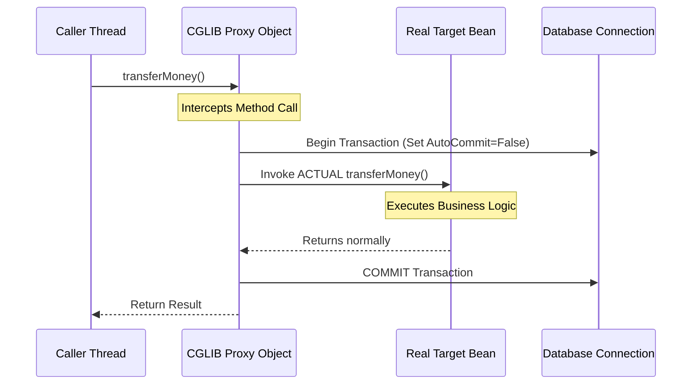

**Navigation**: [< Previous](Ch17_Concurrency_Synchronizers.md) | [Back to Index](../00_MASTER_INDEX.md) | [Next >](Ch56_Hibernate_JPA_Internals.md)

# 🔬 Chapter 36 — Spring Internals: How It ACTUALLY Works Under the Hood

**"Knowing @Autowired injects a bean is JUNIOR level. Knowing that Spring uses BeanPostProcessor with CGLIB proxy generation using ASM bytecode manipulation triggered by spring.factories auto-configuration — THAT is senior level."**

---

## Table of Contents

1. [How Spring Boots Up — The Complete Startup Sequence](#1-how-spring-boots-up--the-complete-startup-sequence)
2. [How Annotations ACTUALLY Work — From @Component to Bean](#2-how-annotations-actually-work--from-component-to-bean)
3. [The Bean Container — ApplicationContext Internals](#3-the-bean-container--applicationcontext-internals)
4. [Bean Creation — The 11-Step Lifecycle You Must Know](#4-bean-creation--the-11-step-lifecycle-you-must-know)
5. [How @Autowired Works — The Full Resolution Chain](#5-how-autowired-works--the-full-resolution-chain)
6. [How Proxies Work — CGLIB vs JDK Dynamic Proxy Internal Mechanics](#6-how-proxies-work--cglib-vs-jdk-dynamic-proxy-internal-mechanics)
7. [How @Transactional ACTUALLY Works — From Annotation to Commit](#7-how-transactional-actually-works--from-annotation-to-commit)
8. [How Auto-Configuration Works — spring.factories to Bean](#8-how-auto-configuration-works--springfactories-to-bean)
9. [How @ComponentScan Works — Classpath Scanning Algorithm](#9-how-componentscan-works--classpath-scanning-algorithm)
10. [How Profiles & @Conditional Work — The Decision Engine](#10-how-profiles--conditional-work--the-decision-engine)
11. [How Spring Resolves Circular Dependencies](#11-how-spring-resolves-circular-dependencies)
12. [How Spring MVC Processes a Request — All 14 Steps](#12-how-spring-mvc-processes-a-request--all-14-steps)
13. [The Entire Spring Ecosystem — How Pieces Fit Together](#13-the-entire-spring-ecosystem--how-pieces-fit-together)

---

## 1. How Spring Boots Up — The Complete Startup Sequence

### What Happens When You Call `SpringApplication.run()`?

Most developers think: "It starts the app." Here's what ACTUALLY happens — 23 steps:

```
  PHASE 1: BOOTSTRAP (Before Spring even exists)
  ──────────────────────────────────────────────

  Step 1:  main() calls SpringApplication.run(MyApp.class, args)
           │
  Step 2:  SpringApplication constructor runs:
           │  → Detects WebApplicationType (SERVLET, REACTIVE, or NONE)
           │  → Loads SpringApplicationRunListeners from META-INF/spring.factories
           │  → Loads ApplicationContextInitializers from spring.factories
           │
  Step 3:  Run listeners notified: "starting" event
           │
  Step 4:  Environment created (StandardServletEnvironment)
           │  → System properties loaded (java.home, os.name, etc.)
           │  → Environment variables loaded  
           │  → application.properties / application.yml parsed
           │  → Command-line args (--server.port=8081) override everything
           │  → Profile-specific files loaded (application-dev.yml)
           │
  Step 5:  Banner printed (the Spring ASCII art logo)
           │
           ▼
  PHASE 2: CONTEXT CREATION (Building the container)
  ──────────────────────────────────────────────────

  Step 6:  ApplicationContext created:
           │  SERVLET  → AnnotationConfigServletWebServerApplicationContext
           │  REACTIVE → AnnotationConfigReactiveWebServerApplicationContext
           │  NONE     → AnnotationConfigApplicationContext
           │
  Step 7:  Context prepared:
           │  → ApplicationContextInitializers called (customize context)
           │  → Main source class (MyApp.class) registered as BeanDefinition
           │  → Run listeners notified: "contextPrepared"
           │
           ▼
  PHASE 3: BEAN DISCOVERY (Finding all your beans)
  ─────────────────────────────────────────────────

  Step 8:  @ComponentScan starts from MyApp.class package
           │  → Scans ALL .class files in that package and sub-packages
           │  → For each class: checks for @Component, @Service, @Repository,
           │    @Controller, @Configuration, @RestController
           │  → Creates BeanDefinition for each discovered component
           │
  Step 9:  @Configuration classes processed:
           │  → @Bean methods discovered
           │  → Each @Bean method becomes a BeanDefinition
           │  → @Import annotations processed recursively
           │
  Step 10: Auto-configuration loaded:
           │  → Reads META-INF/spring/org.springframework.boot.autoconfigure
           │    .AutoConfiguration.imports  (Spring Boot 3.x)
           │  → OR META-INF/spring.factories (Spring Boot 2.x)
           │  → Loads 100+ auto-configuration classes
           │  → Each evaluated against @Conditional annotations
           │  → Only matching ones become BeanDefinitions
           │
           ▼
  PHASE 4: BEAN CREATION (Instantiating everything)
  ─────────────────────────────────────────────────

  Step 11: BeanDefinitions sorted by dependency order
           │  → Dependency graph built
           │  → Circular dependency detection
           │
  Step 12: Singleton beans instantiated (in dependency order):
           │  → Constructor called (dependency injection happens here)
           │  → Properties populated (@Value, @Autowired fields)
           │  → Aware interfaces called (BeanNameAware, ApplicationContextAware)
           │  → BeanPostProcessor.postProcessBeforeInitialization()
           │  → @PostConstruct method called
           │  → InitializingBean.afterPropertiesSet()
           │  → BeanPostProcessor.postProcessAfterInitialization()
           │    ↑ THIS is where proxies get created (@Transactional, @Cacheable)
           │
           ▼
  PHASE 5: WEB SERVER (Starting Tomcat/Netty)
  ────────────────────────────────────────────

  Step 13: Embedded web server created:
           │  → TomcatServletWebServerFactory (or Jetty/Undertow)
           │  → Tomcat instance created with configured port
           │  → DispatcherServlet registered
           │  → All Filter beans registered
           │
  Step 14: DispatcherServlet initialized:
           │  → HandlerMapping beans loaded (maps URL → controller)
           │  → HandlerAdapter beans loaded (calls controller methods)
           │  → ExceptionResolver beans loaded
           │  → ViewResolver beans loaded (if using templates)
           │
  Step 15: Web server started (Tomcat starts listening)
           │
           ▼
  PHASE 6: READY
  ──────────────

  Step 16: ApplicationRunner and CommandLineRunner beans executed
  Step 17: Run listeners notified: "ready"
  Step 18: Application is now serving requests!
```

### Interview Deep Question: "What's the difference between BeanDefinition and Bean?"

```
  BeanDefinition                              Bean (Actual Object)
  ═══════════════                             ═══════════════════
  ┌─────────────────────────┐                 ┌─────────────────────────┐
  │ METADATA about a bean   │                 │ ACTUAL Java object      │
  │                         │    creates      │                         │
  │ • Class name            │ ──────────────► │ • Lives in heap memory  │
  │ • Scope (singleton?)    │                 │ • Has real state        │
  │ • Constructor args      │                 │ • Receives requests     │
  │ • Property values       │                 │ • Does actual work      │
  │ • Init method name      │                 │                         │
  │ • Destroy method name   │                 │ (May be wrapped in      │
  │ • Lazy init?            │                 │  a CGLIB proxy!)        │
  │ • Depends-on            │                 │                         │
  └─────────────────────────┘                 └─────────────────────────┘

  Think of it like:
  BeanDefinition = Blueprint/Recipe
  Bean           = The actual house/dish built from that blueprint
```

### What's in a BeanDefinition?

```java
// You write this:
@Service
public class OrderService {
    private final UserRepository userRepo;
    
    public OrderService(UserRepository userRepo) {
        this.userRepo = userRepo;
    }
}

// Spring internally creates this BeanDefinition (simplified):
// {
//   beanClassName: "com.app.OrderService"
//   scope: "singleton"
//   lazyInit: false
//   constructorArguments: [Reference to "userRepository" bean]
//   autowireMode: CONSTRUCTOR
//   initMethodName: null
//   destroyMethodName: null
//   role: ROLE_APPLICATION
//   primary: false
//   factoryMethodName: null
// }
```

---


🔬 **Section Challenge — 1. How Spring Boots Up — The Complete Startup Sequence**

**Challenge 1 (Reasoning):** What happens if two Spring Beans have a Circular Dependency (A depends on B, and B depends on A) and both use Constructor Injection?
<details><summary>Answer</summary>

The application fails to start with a `BeanCurrentlyInCreationException`. Spring cannot instantiate Bean A without first having a fully constructed Bean B, but it cannot construct Bean B without Bean A. This creates an unresolvable deadlock. If you use Field or Setter injection, Spring can bypass this by instantiating both objects first (using empty constructors) and injecting the references afterward. However, Constructor Injection strictly enforces dependency resolution at creation time, exposing poor architectural design.
</details>


## 2. How Annotations ACTUALLY Work — From @Component to Bean

### Foundational Truth: Annotations Do NOTHING By Themselves

This is the #1 misconception. Annotations are just **metadata markers** — they don't execute any code.

```java
// This annotation literally does NOTHING on its own:
@Target(ElementType.TYPE)
@Retention(RetentionPolicy.RUNTIME)
public @interface Component {
    String value() default "";
}

// It's just a marker. It's equivalent to putting a sticky note
// on a class that says "I'm a component."
//
// THE MAGIC IS IN WHO READS THAT STICKY NOTE.
```

### The Three Players That Make Annotations Work

```
  ┌──────────────────────────────────────────────────────────────────────┐
  │               HOW ANNOTATIONS COME TO LIFE                          │
  ├──────────────────────────────────────────────────────────────────────┤
  │                                                                     │
  │  Player 1: THE ANNOTATION ITSELF                                    │
  │  ───────────────────────────────                                    │
  │  @Component, @Service, @Autowired, @Transactional                   │
  │  → Just metadata. Just a label. Does nothing alone.                 │
  │                                                                     │
  │  Player 2: THE PROCESSOR (reads the annotation)                     │
  │  ──────────────────────────────────────────────                     │
  │  ClassPathBeanDefinitionScanner    → reads @Component               │
  │  AutowiredAnnotationBeanPostProcessor → reads @Autowired            │
  │  CommonAnnotationBeanPostProcessor → reads @PostConstruct           │
  │  PersistenceAnnotationBPP         → reads @PersistenceContext       │
  │  AsyncAnnotationBeanPostProcessor → reads @Async                    │
  │                                                                     │
  │  Player 3: THE MECHANISM (Java Reflection API)                      │
  │  ────────────────────────────────────────────                       │
  │  clazz.isAnnotationPresent(Component.class)  → "Is this marked?"   │
  │  clazz.getAnnotation(Component.class)        → "Read the marker"   │
  │  field.isAnnotationPresent(Autowired.class)  → "Inject this?"      │
  │  method.getAnnotation(Transactional.class)   → "Wrap in proxy?"    │
  │                                                                     │
  └──────────────────────────────────────────────────────────────────────┘
```

### Step-by-Step: What Happens When Spring Sees @Service

```java
@Service
public class PaymentService { ... }
```

```
  Step 1: CLASSPATH SCANNING
  ─────────────────────────
  ClassPathBeanDefinitionScanner scans "com.myapp" package
  │
  ├── Finds PaymentService.class file on disk/JAR
  │
  ├── Loads class using ClassLoader:
  │   Class<?> clazz = classLoader.loadClass("com.myapp.PaymentService");
  │
  ├── Checks: clazz.isAnnotationPresent(Component.class)?  
  │   @Service is meta-annotated with @Component, so YES!
  │   (Spring checks the annotation hierarchy recursively)
  │
  ├── @Service → contains @Component → MATCH!
  │
  └── Creates BeanDefinition:
      ScannedGenericBeanDefinition bd = new ScannedGenericBeanDefinition();
      bd.setBeanClassName("com.myapp.PaymentService");
      bd.setScope("singleton");
      registry.registerBeanDefinition("paymentService", bd);

  Step 2: ANNOTATION HIERARCHY (Why @Service works as @Component)
  ──────────────────────────────────────────────────────────────

  @Service source code:
  ┌────────────────────────────────────────┐
  │  @Target(ElementType.TYPE)             │
  │  @Retention(RetentionPolicy.RUNTIME)   │
  │  @Documented                           │
  │  @Component   ← THIS IS THE KEY!      │
  │  public @interface Service {           │
  │      @AliasFor(annotation =            │
  │        Component.class)                │
  │      String value() default "";        │
  │  }                                     │
  └────────────────────────────────────────┘

  The inheritance chain:
  @Service       → meta-annotated with @Component
  @Repository    → meta-annotated with @Component
  @Controller    → meta-annotated with @Component
  @RestController → meta-annotated with @Controller → @Component
  @Configuration → meta-annotated with @Component (+ CGLIB proxying)

  So ClassPathBeanDefinitionScanner only looks for @Component,
  and automatically catches ALL stereotype annotations.

  Step 3: BEAN INSTANTIATION
  ─────────────────────────
  When ApplicationContext needs PaymentService:
  │
  ├── Reads BeanDefinition
  ├── Resolves constructor dependencies (other beans)
  ├── Calls constructor via reflection:
  │   Constructor<?> ctor = clazz.getDeclaredConstructor(UserRepo.class);
  │   Object bean = ctor.newInstance(userRepoBean);
  │
  ├── BeanPostProcessors run (may wrap in proxy)
  └── Bean stored in singleton cache (ConcurrentHashMap)
```

### The @Retention Mystery — Why Some Annotations Disappear

```java
// THREE retention policies — this is fundamental:

@Retention(RetentionPolicy.SOURCE)
// → Exists ONLY in .java source file
// → Compiler discards it
// → Example: @Override, @SuppressWarnings, Lombok's @Getter
// → Used by: compile-time annotation processors

@Retention(RetentionPolicy.CLASS)
// → Exists in .java AND .class bytecode
// → But NOT available at runtime via reflection
// → JVM discards it when loading class
// → Example: @NonNull (some implementations)
// → Used by: bytecode analysis tools

@Retention(RetentionPolicy.RUNTIME)
// → Exists in .java, .class, AND at runtime
// → Available via reflection: clazz.getAnnotation(...)
// → Example: ALL Spring annotations (@Component, @Autowired, @Transactional)
// → Used by: frameworks that inspect annotations at runtime
//
// WHY Spring annotations use RUNTIME:
// Spring MUST read them at runtime when the app is starting.
// If they were SOURCE or CLASS, Spring couldn't see them.
```

### How @Autowired is Processed — The EXACT Code Path

```java
@Service
public class OrderService {
    @Autowired
    private PaymentService paymentService;  // How does this get set?
}
```

```
  The processor: AutowiredAnnotationBeanPostProcessor

  Step 1: After OrderService is constructed (new OrderService())
          but BEFORE it's "ready"

  Step 2: AutowiredAnnotationBeanPostProcessor.postProcessProperties() called

  Step 3: It reflects over ALL fields:
          for (Field field : clazz.getDeclaredFields()) {
              if (field.isAnnotationPresent(Autowired.class)) {
                  // Found @Autowired on 'paymentService' field!
                  
                  // Resolve the bean from the container:
                  Object dependency = beanFactory.getBean(field.getType());
                  // → Returns the PaymentService singleton
                  
                  // Inject via reflection:
                  field.setAccessible(true);  // bypass private
                  field.set(orderServiceInstance, dependency);
                  // → orderService.paymentService = paymentServiceBean
              }
          }

  Step 4: OrderService now has paymentService injected!

  THIS is why constructor injection is preferred:
  ┌──────────────────────────────────────────────────────────────────┐
  │ Field injection:                                                │
  │   1. Object created with empty fields (null)                    │
  │   2. Reflection hacks private access to set field               │
  │   3. No compile-time guarantee                                  │
  │   4. Can't create immutable objects                             │
  │                                                                 │
  │ Constructor injection:                                          │
  │   1. Dependencies passed at construction time                   │
  │   2. Fields can be final (immutable!)                           │
  │   3. Compiler validates everything                              │
  │   4. Easy to test (just pass mocks to constructor)              │
  │   5. Fails FAST if dependency missing (at startup)              │
  └──────────────────────────────────────────────────────────────────┘
```

---

## 3. The Bean Container — ApplicationContext Internals

### What IS the ApplicationContext?

```
  ┌──────────────────────────────────────────────────────────────────────────┐
  │                                                                         │
  │  ApplicationContext is a FANCY HashMap                                   │
  │                                                                         │
  │  At its core, Spring's container is:                                    │
  │                                                                         │
  │  ┌───────────────────────────────────────────────────────────────────┐  │
  │  │  DefaultSingletonBeanRegistry                                     │  │
  │  │                                                                   │  │
  │  │  /** Cache of singleton objects: bean name → bean instance */     │  │
  │  │  Map<String, Object> singletonObjects =                          │  │
  │  │      new ConcurrentHashMap<>(256);                               │  │
  │  │                                                                   │  │
  │  │  /** Cache of singleton factories: bean name → ObjectFactory */  │  │
  │  │  Map<String, ObjectFactory<?>> singletonFactories =              │  │
  │  │      new HashMap<>(16);                                          │  │
  │  │                                                                   │  │
  │  │  /** Cache of early singleton objects (for circular deps) */     │  │
  │  │  Map<String, Object> earlySingletonObjects =                     │  │
  │  │      new ConcurrentHashMap<>(16);                                │  │
  │  └───────────────────────────────────────────────────────────────────┘  │
  │                                                                         │
  │  These THREE maps = "Three-Level Cache" for resolving circular deps    │
  └──────────────────────────────────────────────────────────────────────────┘
```

### The ApplicationContext Class Hierarchy

```
  BeanFactory (interface)
  │  → Core container: getBean(), containsBean()
  │  → Lazy initialization
  │
  └── ListableBeanFactory (interface)
      │  → Can list all beans: getBeanDefinitionNames()
      │
      └── ApplicationContext (interface)
          │  → Event publishing (ApplicationEvent)
          │  → Message source (i18n)
          │  → Resource loading (classpath:, file:)
          │  → Environment (profiles, properties)
          │
          ├── AnnotationConfigApplicationContext
          │   → For standalone Java apps
          │   → @Configuration class-based
          │
          ├── AnnotationConfigServletWebServerApplicationContext
          │   → For Spring Boot web apps
          │   → Starts embedded Tomcat/Jetty
          │
          └── AnnotationConfigReactiveWebServerApplicationContext
              → For Spring WebFlux apps
              → Starts embedded Netty

  INTERVIEW: "What's the difference between BeanFactory and ApplicationContext?"
  
  BeanFactory = Lazy. Creates beans ONLY when requested.
  ApplicationContext = Eager. Creates ALL singletons at startup.
  ApplicationContext adds: events, i18n, resource loading, AOP.
  
  In practice: Always use ApplicationContext. BeanFactory is too low-level.
```

### How getBean() Works Internally

```java
// When you call: context.getBean(OrderService.class)
// OR when Spring resolves @Autowired

// Simplified version of AbstractBeanFactory.doGetBean():

protected Object doGetBean(String name) {
    
    // 1. Check singleton cache FIRST (fast path)
    Object singleton = singletonObjects.get(name);
    if (singleton != null) {
        return singleton;  // Already created, return cached
    }
    
    // 2. Check if currently being created (circular dependency)
    Object earlySingleton = earlySingletonObjects.get(name);
    if (earlySingleton != null) {
        return earlySingleton;  // Return partially-created bean
    }
    
    // 3. Get BeanDefinition
    BeanDefinition bd = beanDefinitionMap.get(name);
    
    // 4. Check dependencies first (recursive!)
    String[] dependsOn = bd.getDependsOn();
    for (String dep : dependsOn) {
        getBean(dep);  // Create dependency first!
    }
    
    // 5. Create the bean
    if (bd.isSingleton()) {
        singleton = createBean(name, bd);
        singletonObjects.put(name, singleton);  // Cache it
        return singleton;
    } else if (bd.isPrototype()) {
        return createBean(name, bd);  // New instance each time
    }
}
```

---


🔬 **Section Challenge — 3. The Bean Container — ApplicationContext Internals**

**Challenge 1 (Trace — Who/When/What):** You have two `DataSource` beans — `primaryDataSource` and `backupDataSource`. `@Autowired DataSource ds` in a service. Spring throws `NoUniqueBeanDefinitionException`. **Who** is responsible for resolution? **When** does it fail — startup or first use? **What** are the three ways to resolve?

<details><summary>Answer</summary>

**Who?** The `DefaultListableBeanFactory` — specifically its `doResolveDependency()` method. **When?** At context startup during singleton bean initialization — NOT at first use (unless `@Lazy`). **Three resolution strategies:** (1) `@Primary` on `primaryDataSource` — marks it as the default when multiple candidates exist. Applied at bean definition. (2) `@Qualifier("primaryDataSource")` at the injection point — explicitly names which bean. Most precise. (3) Name-matching — if the field name is `primaryDataSource` (matching the bean name), Spring uses it as a tie-breaker. **Precedence:** `@Qualifier` > name-match > `@Primary`. **Best practice:** Use `@Primary` for the "normal" default, `@Qualifier` when you need a specific non-primary bean. For test environments, use `@TestConfiguration` to override the primary without changing production code.

</details>


## 4. Bean Creation — The 11-Step Lifecycle You Must Know

```
  ┌────────────────────────────────────────────────────────────────────────────┐
  │              THE COMPLETE BEAN LIFECYCLE — ALL 11 STEPS                    │
  │                                                                           │
  │  Each step is a REAL method call. This is what Spring executes.           │
  │                                                                           │
  │  BeanDefinition loaded                                                    │
  │         │                                                                 │
  │         ▼                                                                 │
  │  ┌─── STEP 1: INSTANTIATION ──────────────────────────────────────────┐  │
  │  │ Constructor called (new MyService() or constructor injection)       │  │
  │  │ Bean exists in memory but is EMPTY — no dependencies yet           │  │
  │  └────────────────────────────────────────────────────────────────────┘  │
  │         │                                                                 │
  │         ▼                                                                 │
  │  ┌─── STEP 2: POPULATE PROPERTIES ────────────────────────────────────┐  │
  │  │ @Autowired fields injected via reflection                          │  │
  │  │ @Value properties resolved from environment                        │  │
  │  │ Setter injection happens here                                      │  │
  │  └────────────────────────────────────────────────────────────────────┘  │
  │         │                                                                 │
  │         ▼                                                                 │
  │  ┌─── STEP 3: BeanNameAware ──────────────────────────────────────────┐  │
  │  │ If bean implements BeanNameAware:                                   │  │
  │  │   setBeanName("orderService") called                               │  │
  │  │ Bean now knows its own name in the container                       │  │
  │  └────────────────────────────────────────────────────────────────────┘  │
  │         │                                                                 │
  │         ▼                                                                 │
  │  ┌─── STEP 4: BeanFactoryAware ──────────────────────────────────────┐  │
  │  │ If bean implements BeanFactoryAware:                               │  │
  │  │   setBeanFactory(beanFactory) called                               │  │
  │  │ Bean can now look up other beans programmatically                  │  │
  │  └────────────────────────────────────────────────────────────────────┘  │
  │         │                                                                 │
  │         ▼                                                                 │
  │  ┌─── STEP 5: ApplicationContextAware ────────────────────────────────┐  │
  │  │ If bean implements ApplicationContextAware:                        │  │
  │  │   setApplicationContext(ctx) called                                │  │
  │  │ Bean gets access to the full container (events, resources, etc.)   │  │
  │  └────────────────────────────────────────────────────────────────────┘  │
  │         │                                                                 │
  │         ▼                                                                 │
  │  ┌─── STEP 6: BeanPostProcessor — BEFORE Initialization ─────────────┐  │
  │  │ ALL registered BeanPostProcessors' postProcessBeforeInit() called  │  │
  │  │                                                                    │  │
  │  │ Who uses this?                                                     │  │
  │  │ • CommonAnnotationBPP → processes @PostConstruct                   │  │
  │  │ • ApplicationContextAwareProcessor → Aware callbacks               │  │
  │  └────────────────────────────────────────────────────────────────────┘  │
  │         │                                                                 │
  │         ▼                                                                 │
  │  ┌─── STEP 7: @PostConstruct ─────────────────────────────────────────┐  │
  │  │ Your @PostConstruct method called                                  │  │
  │  │ Use for: Validation, loading caches, opening connections           │  │
  │  │ NOTE: This is called BY the CommonAnnotationBeanPostProcessor      │  │
  │  │       during step 6 — it's technically part of "before init"       │  │
  │  └────────────────────────────────────────────────────────────────────┘  │
  │         │                                                                 │
  │         ▼                                                                 │
  │  ┌─── STEP 8: InitializingBean.afterPropertiesSet() ──────────────────┐  │
  │  │ If bean implements InitializingBean:                                │  │
  │  │   afterPropertiesSet() called                                      │  │
  │  │ Alternative to @PostConstruct (less preferred, couples to Spring)   │  │
  │  └─────────────────────────────────────────────────────────────────────┘  │
  │         │                                                                 │
  │         ▼                                                                 │
  │  ┌─── STEP 9: Custom init-method ─────────────────────────────────────┐  │
  │  │ If @Bean(initMethod = "setup") specified:                          │  │
  │  │   bean.setup() called via reflection                               │  │
  │  └────────────────────────────────────────────────────────────────────┘  │
  │         │                                                                 │
  │         ▼                                                                 │
  │  ┌─── STEP 10: BeanPostProcessor — AFTER Initialization ──────────────┐  │
  │  │ ALL registered BeanPostProcessors' postProcessAfterInit() called   │  │
  │  │                                                                     │  │
  │  │ ★★★ THIS IS WHERE THE MAGIC HAPPENS ★★★                           │  │
  │  │                                                                     │  │
  │  │ Who uses this?                                                      │  │
  │  │ • AbstractAutoProxyCreator:                                         │  │
  │  │   → Checks: does this bean have @Transactional? @Cacheable?        │  │
  │  │   → If YES: wraps bean in CGLIB/JDK proxy!                        │  │
  │  │   → Returns PROXY instead of original bean                        │  │
  │  │   → Container stores the PROXY, not your class!                   │  │
  │  │                                                                     │  │
  │  │ • AsyncAnnotationBeanPostProcessor:                                 │  │
  │  │   → Checks: does this bean have @Async methods?                    │  │
  │  │   → If YES: wraps in proxy that submits to thread pool            │  │
  │  └─────────────────────────────────────────────────────────────────────┘  │
  │         │                                                                 │
  │         ▼                                                                 │
  │  ┌─── STEP 11: Bean is READY ─────────────────────────────────────────┐  │
  │  │ Stored in singletonObjects cache                                   │  │
  │  │ Returned when other beans request it via @Autowired                │  │
  │  │ NOTE: If proxied, the PROXY is what gets stored and injected!     │  │
  │  └────────────────────────────────────────────────────────────────────┘  │
  │                                                                           │
  │        ...application runs...                                             │
  │                                                                           │
  │  ┌─── DESTRUCTION (on shutdown) ──────────────────────────────────────┐  │
  │  │ @PreDestroy method called                                          │  │
  │  │ DisposableBean.destroy() called                                    │  │
  │  │ Custom destroyMethod called                                        │  │
  │  │ Use for: closing connections, flushing caches, cleanup             │  │
  │  └────────────────────────────────────────────────────────────────────┘  │
  └────────────────────────────────────────────────────────────────────────────┘
```

### Code Example: Observing All 11 Steps

```java
@Component
public class LifecycleDemo implements BeanNameAware, BeanFactoryAware,
                                      ApplicationContextAware,
                                      InitializingBean, DisposableBean {
    
    @Autowired
    private SomeDependency dep;

    public LifecycleDemo() {
        System.out.println("1. CONSTRUCTOR called (bean instantiated)");
        System.out.println("   dep is null here: " + (dep == null)); // true!
    }

    // Step 2 happens here (dep gets injected via reflection)

    @Override
    public void setBeanName(String name) {
        System.out.println("3. setBeanName: " + name);
    }

    @Override
    public void setBeanFactory(BeanFactory factory) {
        System.out.println("4. setBeanFactory called");
    }

    @Override
    public void setApplicationContext(ApplicationContext ctx) {
        System.out.println("5. setApplicationContext called");
        System.out.println("   dep is now injected: " + (dep != null)); // true!
    }

    @PostConstruct
    public void init() {
        System.out.println("7. @PostConstruct — initialization logic");
    }

    @Override
    public void afterPropertiesSet() {
        System.out.println("8. afterPropertiesSet (InitializingBean)");
    }

    @PreDestroy
    public void cleanup() {
        System.out.println("DESTROY: @PreDestroy — cleanup");
    }

    @Override
    public void destroy() {
        System.out.println("DESTROY: DisposableBean.destroy()");
    }
}

// OUTPUT ORDER:
// 1. CONSTRUCTOR called (bean instantiated)
//    dep is null here: true
// 3. setBeanName: lifecycleDemo
// 4. setBeanFactory called
// 5. setApplicationContext called
//    dep is now injected: true
// 7. @PostConstruct — initialization logic
// 8. afterPropertiesSet (InitializingBean)
// ... app runs ...
// DESTROY: @PreDestroy — cleanup
// DESTROY: DisposableBean.destroy()
```

---

## 5. How @Autowired Works — The Full Resolution Chain

### When Multiple Beans Match the Same Type

```
  RESOLUTION ORDER (Spring tries each step, stops at first match):
  ═══════════════════════════════════════════════════════════════

  Step 1: BY TYPE
  ──────────────
  @Autowired
  private PaymentService paymentService;
  
  Spring: "Find all beans of type PaymentService"
  → If exactly ONE found → inject it ✅
  → If ZERO found → throw NoSuchBeanDefinitionException ❌
  → If MULTIPLE found → go to Step 2

  Step 2: BY QUALIFIER
  ────────────────────
  @Autowired
  @Qualifier("stripePayment")
  private PaymentService paymentService;
  
  Spring: "Find bean named 'stripePayment' of type PaymentService"
  → If found → inject it ✅
  → If not found → go to Step 3

  Step 3: BY PRIMARY
  ──────────────────
  @Primary
  @Service
  public class StripePaymentService implements PaymentService { }
  
  @Service
  public class PayPalPaymentService implements PaymentService { }
  
  Spring: "Multiple PaymentService beans. Is one @Primary?"
  → If one is @Primary → inject it ✅
  → If none is @Primary → go to Step 4

  Step 4: BY FIELD NAME
  ─────────────────────
  @Autowired
  private PaymentService stripePaymentService;  // field name matches bean name!
  
  Spring: "Field name 'stripePaymentService' matches a bean name?"
  → If match → inject it ✅
  → If no match → throw NoUniqueBeanDefinitionException ❌
```

### The @Autowired(required = false) Trap

```java
// DANGER: This silently sets the field to null!
@Autowired(required = false)
private NotificationService notifier;

public void processOrder(Order order) {
    // ... process ...
    notifier.sendNotification(order);  // NullPointerException!
}

// BETTER: Use Optional
@Autowired
private Optional<NotificationService> notifier;

public void processOrder(Order order) {
    // ... process ...
    notifier.ifPresent(n -> n.sendNotification(order));  // Safe!
}
```

---


🔬 **Section Challenge — 5. How @Autowired Works — The Full Resolution Chain**

**Challenge 1 (Ambiguity Resolution):** You have two beans implementing `PaymentService`: `StripePaymentService` and `PaypalPaymentService`. You inject `@Autowired PaymentService service`. **Who** resolves the ambiguity? **When** does it fail vs. succeed? **What** are the three resolution strategies Spring uses in order?

<details><summary>Answer</summary>

**Who resolves:** Spring's `DefaultListableBeanFactory` during dependency injection. **Resolution order:** (1) **Type match** — finds all beans implementing `PaymentService`. If exactly one → inject it. If zero → `NoSuchBeanDefinitionException`. If more than one → ambiguity. (2) **Name match** — Spring checks if any bean's name matches the field/parameter name (`service` → looks for a bean named `service`). (3) **@Primary** — if one bean is annotated `@Primary`, it wins. (4) **@Qualifier** — `@Qualifier("stripePaymentService")` explicitly names the winner. **When it fails:** If 2+ beans match type AND none are `@Primary` AND no `@Qualifier` provided AND field name doesn't match any bean name → `NoUniqueBeanDefinitionException` at startup. **When it succeeds without annotation:** If the field is named exactly `stripePaymentService`, Spring's name-match step finds it — this is fragile and breaks on rename. Always prefer `@Qualifier` or `@Primary` for clarity.

</details>

## 6. How Proxies Work — CGLIB vs JDK Dynamic Proxy Internal Mechanics

### Why Proxies Exist in Spring

```
  THE FUNDAMENTAL PROBLEM:
  ════════════════════════
  
  You write:
  @Transactional
  public void transferMoney(Account from, Account to, BigDecimal amount) {
      from.debit(amount);
      to.credit(amount);
  }
  
  But WHO starts the transaction? WHO commits/rolls back?
  YOUR CODE doesn't have any transaction management!
```



```text
  ANSWER: A PROXY wraps your bean and adds transaction logic:
  
  What you think happens:          What ACTUALLY happens:
  ═══════════════════════          ════════════════════════
  
  caller → transferMoney()         caller → PROXY.transferMoney()
                                            │
                                            ├── Begin transaction
                                            ├── Call REAL transferMoney()
                                            ├── If success → COMMIT
                                            └── If exception → ROLLBACK
```

### CGLIB Proxy — How It Works (Spring Boot Default)

```
  CGLIB = Code Generation Library 
  → Generates a SUBCLASS of your class at runtime
  → The subclass OVERRIDES your methods to add behavior

  YOUR CLASS                          GENERATED PROXY CLASS
  ══════════                          ═════════════════════
  
  class OrderService {                class OrderService$$EnhancerBySpring
    @Transactional                          extends OrderService {
    void placeOrder() {                 
      // your code                      // Spring-generated field:
    }                                   private MethodInterceptor interceptor;
  }                                   
                                        @Override
                                        void placeOrder() {
                                          // BEFORE: start transaction
                                          interceptor.intercept(
                                            this,           // proxy
                                            placeOrder,     // method
                                            args,           // arguments
                                            methodProxy     // call real method
                                          );
                                          // AFTER: commit or rollback
                                        }
                                      }

  AT RUNTIME:
  ┌──────────────────────────────────────────────────────────────────────┐
  │  What you think is injected:    OrderService                        │
  │  What's actually injected:      OrderService$$EnhancerBySpring     │
  │                                                                     │
  │  System.out.println(orderService.getClass().getName());             │
  │  // Prints: com.myapp.OrderService$$EnhancerBySpringCGLIB$$a1b2c3  │
  │                                                                     │
  │  orderService instanceof OrderService  → true (it's a subclass!)   │
  └──────────────────────────────────────────────────────────────────────┘
```

### JDK Dynamic Proxy — How It Works

```
  JDK Proxy = Java's built-in proxy mechanism
  → Only works for INTERFACES
  → Creates a new class that IMPLEMENTS the same interface
  → Does NOT extend your class

  YOUR INTERFACE & CLASS                GENERATED PROXY
  ═════════════════════                 ═════════════════
  
  interface PaymentService {            class $Proxy42
    void process(Order o);                implements PaymentService {
  }                                     
                                          InvocationHandler handler;
  class StripePayment                   
    implements PaymentService {            @Override
    void process(Order o) {               void process(Order o) {
      // your code                          handler.invoke(
    }                                         this,      // proxy
  }                                           process,   // method
                                              new Object[]{o} // args
                                            );
                                          }
                                        }
```

### CGLIB vs JDK Proxy — Decision Table

| Aspect | CGLIB Proxy | JDK Dynamic Proxy |
|--------|-------------|-------------------|
| **Mechanism** | Generates subclass | Implements interface |
| **Requires interface?** | No | Yes, mandatory |
| **Can proxy final class?** | ❌ No (can't subclass final) | N/A (uses interface) |
| **Can proxy final method?** | ❌ No (can't override final) | ✅ Yes (interface method) |
| **Performance** | Slightly faster (direct method call) | Slightly slower (reflection) |
| **Spring Boot default** | ✅ Yes (since Spring Boot 2.0) | Used when explicitly configured |
| **Generated class** | `MyClass$$EnhancerBySpringCGLIB` | `$Proxy42` |
| **Library** | ASM bytecode manipulation | java.lang.reflect.Proxy |

### Why @Transactional Fails — The 5 Cases

```
  CASE 1: SELF-INVOCATION (Most common trap!)
  ─────────────────────────────────────────────
  
  @Service
  public class OrderService {
      @Transactional
      public void placeOrder() { ... }
      
      public void batchProcess() {
          placeOrder();  // ❌ CALLS this.placeOrder() — BYPASSES PROXY!
      }
  }
  
  WHY: When you call this.placeOrder(), you're calling the REAL object's
  method directly. The proxy only intercepts EXTERNAL calls.
```

```mermaid
flowchart TD
    %% Proxy Self-Invocation Failure Physics
    subgraph SUCCESS ["External Call (SUCCESS)"]
        EXT["External Class"]
        PROXY1["CGLIB Proxy<br/>(Starts Transaction)"]
        REAL1["Real Target Bean<br/>placeOrder()"]
        
        EXT -->|proxy.placeOrder()| PROXY1
        PROXY1 -->|super.placeOrder()| REAL1

    subgraph FAILURE ["Self-Invocation (FAILURE)"]
        EXT2["External Class"]
        PROXY2["CGLIB Proxy<br/>(No TX on batchProcess)"]
        REAL2["Real Target Bean<br/>batchProcess()"]
        REAL3["Real Target Bean<br/>placeOrder()"]
        
        EXT2 -->|proxy.batchProcess()| PROXY2
        PROXY2 -->|super.batchProcess()| REAL2
        REAL2 -->|this.placeOrder()<br/>BYPASSES PROXY| REAL3
    
```

```text
  The proxy wraps the outside. Self-calls go through the INSIDE:
  
  ┌─── Proxy ──────────────────────────────────────────────┐
  │                                                         │
  │  External call → proxy.placeOrder() → TX starts ✅      │
  │                                                         │
  │  ┌─── Real Object ──────────────────────────────────┐  │
  │  │                                                    │  │
  │  │  batchProcess() → this.placeOrder()               │  │
  │  │                    ↑ Direct call, no proxy! ❌     │  │
  │  │                                                    │  │
  │  └────────────────────────────────────────────────────┘  │
  └─────────────────────────────────────────────────────────┘
  
  FIX: Inject self, or use AopContext.currentProxy()


  CASE 2: PRIVATE METHODS
  ───────────────────────
  @Transactional
  private void helper() { }  // ❌ CGLIB can't override private methods!
  
  FIX: Make it public or package-private.


  CASE 3: WRONG EXCEPTION TYPE
  ─────────────────────────────
  @Transactional  // Only rolls back on unchecked exceptions by default!
  public void process() throws IOException {
      throw new IOException("file error");  // ❌ NOT rolled back!
  }
  
  FIX: @Transactional(rollbackFor = Exception.class)


  CASE 4: NOT A SPRING BEAN
  ──────────────────────────
  // Forgot @Service or @Component → Spring doesn't manage it → no proxy!
  public class OrderService {
      @Transactional
      public void placeOrder() { }  // ❌ No proxy exists!
  }


  CASE 5: FINAL CLASS OR METHOD
  ──────────────────────────────
  @Service
  public final class OrderService {  // ❌ CGLIB can't subclass final!
      @Transactional
      public void placeOrder() { }
  }
```

---


🔬 **Section Challenge — 6. How Proxies Work — CGLIB vs JDK Dynamic Proxy Internal Mechanics**

**Challenge 1 (CGLIB Final Class):** You annotate `final class OrderService` with `@Transactional`. **Who** fails at startup? **When** does the failure happen? **What** is the exact error and the two correct fixes?

<details><summary>Answer</summary>

**Who fails:** Spring's CGLIB proxy generator (`Enhancer`). CGLIB works by creating a SUBCLASS of your bean class. `final` classes cannot be subclassed in Java → `Cannot subclass final class`. **When:** At Spring `ApplicationContext` startup, during the BeanFactory post-processing phase when proxies are created. NOT at the method call. **Exact error:** `org.springframework.aop.framework.AopConfigException: Could not generate CGLIB subclass of class [final class OrderService]: ... Cannot subclass final class`. **Fix 1 (Remove final):** Remove the `final` keyword from the class. This is the standard fix — Spring beans should not be `final` if they need proxying. **Fix 2 (Introduce interface):** Extract an `OrderService` interface, make the class implement it. Switch `proxyTargetClass=false` to use JDK Dynamic Proxy (which wraps the interface, not subclasses the class). JDK proxies work with `final` classes as long as the interface is not final. **Production note:** IntelliJ/Spring Boot Kotlin apps: Kotlin classes are `final` by default. Use the `kotlin-spring` compiler plugin which auto-opens Spring-annotated classes.

</details>

## 7. How @Transactional ACTUALLY Works — From Annotation to Commit

### The Complete Flow (13 Steps)

```
  Caller calls orderService.placeOrder(order)
  │
  │  (But orderService is actually a CGLIB proxy!)
  │
  ▼
  Step 1:  Proxy intercepts the call
           TransactionInterceptor.invoke() called
           │
  Step 2:  Read @Transactional attributes:
           │  propagation = REQUIRED (default)
           │  isolation = DEFAULT
           │  timeout = -1 (no timeout)
           │  readOnly = false
           │  rollbackFor = {RuntimeException.class}
           │
  Step 3:  PlatformTransactionManager.getTransaction() called
           │  → Usually JpaTransactionManager for Spring Data JPA
           │
  Step 4:  Check propagation behavior:
           │  REQUIRED: Is there an existing transaction?
           │    YES → Join it (participate in existing)
           │    NO  → Create a NEW transaction
           │
  Step 5:  If creating new transaction:
           │  → Get Connection from DataSource (HikariCP pool)
           │  → connection.setAutoCommit(false)
           │  → Bind connection to current thread (ThreadLocal)
           │
  Step 6:  Call the REAL method: target.placeOrder(order)
           │
  Step 7:  Your code executes:
           │  → userRepo.save(user)     // uses the SAME connection
           │  → orderRepo.save(order)   // uses the SAME connection
           │  → Both share the transaction!
           │
  Step 8:  Method completes:
           │
           ├── SUCCESS (no exception):
           │   Step 9a: TransactionManager.commit()
           │   Step 10a: connection.commit()
           │   Step 11a: Connection returned to pool
           │
           └── EXCEPTION thrown:
               Step 9b: Is it rollbackFor type?
               │  YES → TransactionManager.rollback()
               │         connection.rollback()
               │  NO  → TransactionManager.commit() (!)
               Step 10b: Connection returned to pool
               Step 11b: Exception re-thrown to caller


  THREAD-LOCAL BINDING (how repo methods share the transaction):
  ═══════════════════════════════════════════════════════════════
```

```mermaid
flowchart TD
    %% ThreadLocal Transaction Physics
    subgraph T1_GROUP ["OS Thread 1 (Handling Request A)"]
        T1["ThreadLocal Map"]
        CONN_A["Connection-A<br/>(AutoCommit=false)"]
        
        T1 -->|Binds| CONN_A
        
        SERV_A["OrderService.placeOrder()"]
        REPO_A1["UserRepository.save()"]
        REPO_A2["OrderRepository.save()"]
        
        SERV_A -.->|Retrieves| CONN_A
        REPO_A1 -.->|Retrieves| CONN_A
        REPO_A2 -.->|Retrieves| CONN_A

    subgraph T2_GROUP ["OS Thread 2 (Handling Request B)"]
        T2["ThreadLocal Map"]
        CONN_B["Connection-B<br/>(AutoCommit=false)"]
        
        T2 -->|Binds| CONN_B
        
        SERV_B["OrderService.placeOrder()"]
        
        SERV_B -.->|Retrieves| CONN_B
    
```

```text
  TransactionSynchronizationManager uses ThreadLocal:
  
  Thread-1:  [Connection-A] ← bound to this thread
      │
      ├── orderService.placeOrder()     → uses Connection-A
      │   ├── userRepo.save()           → uses Connection-A ← same!
      │   └── orderRepo.save()          → uses Connection-A ← same!
      │
      └── Transaction committed on Connection-A
  
  Thread-2:  [Connection-B] ← different thread, different connection
      │
      └── orderService.placeOrder()     → uses Connection-B

  THIS is why @Transactional works — the Connection is stored in ThreadLocal,
  and all repository calls on the same thread use the SAME connection.
```

### Propagation Behaviors — When You Actually Need Them

| Propagation | Existing TX? | Behavior | Use Case |
|-------------|-------------|----------|----------|
| **REQUIRED** (default) | Yes → Join; No → Create | Most common. Safe default. | 95% of methods |
| **REQUIRES_NEW** | Always create NEW (suspend existing) | Independent commit/rollback | Audit logging that must persist even if parent rolls back |
| **SUPPORTS** | Yes → Join; No → Run without TX | Optional TX | Read-only methods that can work either way |
| **NOT_SUPPORTED** | Suspend existing; Run without TX | Force no TX | Long-running operations that shouldn't hold a transaction |
| **MANDATORY** | Yes → Join; No → THROW exception | Require existing TX | Methods that must be called within a TX |
| **NEVER** | Yes → THROW exception; No → Run without TX | Forbid TX | Methods that must NOT run in a transaction |
| **NESTED** | Yes → Create SAVEPOINT; No → Create new | Partial rollback | Retry individual items in a batch |

---


🔬 **Section Challenge — 7. How @Transactional ACTUALLY Works — From Annotation to Commit**

**Challenge 1 (Reasoning):** Two transactions T1 and T2 both run `SELECT balance WHERE id=1; UPDATE balance=balance-100 WHERE id=1`. What anomaly occurs at READ COMMITTED and how does REPEATABLE READ fix it?
<details><summary>Answer</summary>

READ COMMITTED: both T1 and T2 read balance=1000. Both compute 900. Both write 900. Final balance: 900 (expected: 800). Lost update! REPEATABLE READ (with locking SELECT FOR UPDATE): first SELECT acquires a read lock. T2's SELECT blocks until T1 commits. After T1 commits (balance=900), T2 reads 900, writes 800. Correct! Alternatively: use `UPDATE ... WHERE balance=1000` (optimistic locking with version check).
</details>


## 8. How Auto-Configuration Works — spring.factories to Bean

### The Loading Mechanism

```
  When Spring Boot starts, it needs to know:
  "Which auto-configuration classes should I evaluate?"
  
  SPRING BOOT 2.x:
  ═════════════════
  Location: META-INF/spring.factories (inside each JAR)
  Format:
  ┌───────────────────────────────────────────────────────────────────────┐
  │ org.springframework.boot.autoconfigure.EnableAutoConfiguration=\    │
  │   com.example.DataSourceAutoConfiguration,\                          │
  │   com.example.WebMvcAutoConfiguration,\                              │
  │   com.example.SecurityAutoConfiguration                              │
  └───────────────────────────────────────────────────────────────────────┘
  
  SPRING BOOT 3.x:
  ═════════════════
  Location: META-INF/spring/
            org.springframework.boot.autoconfigure.AutoConfiguration.imports
  Format: One class per line
  ┌───────────────────────────────────────────────────────────────────────┐
  │ com.example.DataSourceAutoConfiguration                              │
  │ com.example.WebMvcAutoConfiguration                                  │
  │ com.example.SecurityAutoConfiguration                                │
  └───────────────────────────────────────────────────────────────────────┘
  
  Why the change? spring.factories loaded ALL types (not just auto-config)
  → performance overhead. The new format is specific to auto-configuration.
```

### Real Example: How DataSource Gets Auto-Configured

```java
// Inside spring-boot-autoconfigure.jar:

@AutoConfiguration
@ConditionalOnClass({ DataSource.class, EmbeddedDatabaseType.class })
// ↑ Only runs if DataSource class exists on classpath
//   (i.e., you have a JDBC dependency)

@ConditionalOnMissingBean(type = "io.r2dbc.spi.ConnectionFactory")
// ↑ Skip if reactive DB (R2DBC) is being used

@EnableConfigurationProperties(DataSourceProperties.class)
// ↑ Binds spring.datasource.* properties to DataSourceProperties class

@Import({ 
    DataSourcePoolMetadataProvidersConfiguration.class,
    DataSourceCheckpointRestoreConfiguration.class
})
public class DataSourceAutoConfiguration {

    @Configuration
    @Conditional(PooledDataSourceCondition.class)
    // ↑ Only if connection pooling is available
    @ConditionalOnMissingBean({ DataSource.class, XADataSource.class })
    // ↑ ONLY IF YOU HAVEN'T DEFINED YOUR OWN DataSource bean!
    @Import({ 
        HikariJdbcConnectionDetailsBeanRegistrar.class 
    })
    static class PooledDataSourceConfiguration {
        // This creates HikariDataSource if HikariCP is on classpath
    }

    @Configuration
    @ConditionalOnMissingBean({ DataSource.class, XADataSource.class })
    @ConditionalOnProperty(name = "spring.datasource.type")
    static class GenericDataSourceConfiguration {
        // Fallback: create whatever DataSource type is specified
    }
}
```

```
  THE DECISION TREE:
  
  Is DataSource.class on classpath?
  ├── NO  → Skip entirely (no JDBC dependency)
  └── YES
      │
      └── Did you define your own DataSource @Bean?
          ├── YES → Skip (your bean takes priority — @ConditionalOnMissingBean)
          └── NO
              │
              └── Is HikariCP on classpath?
                  ├── YES → Create HikariDataSource with spring.datasource.* props
                  └── NO  → Is Tomcat JDBC on classpath?
                      ├── YES → Create Tomcat DataSource
                      └── NO  → Is Commons DBCP2 on classpath?
                          ├── YES → Create DBCP2 DataSource
                          └── NO  → Fail with error
```

### The @Conditional Family — All Members

```java
// CLASSPATH conditions (most common)
@ConditionalOnClass(DataSource.class)         // Class exists on classpath
@ConditionalOnMissingClass("com.oracle.Driver") // Class NOT on classpath

// BEAN conditions
@ConditionalOnBean(DataSource.class)           // Bean of this type exists
@ConditionalOnMissingBean(DataSource.class)    // No bean of this type exists
@ConditionalOnSingleCandidate(DataSource.class) // Exactly one bean (or @Primary)

// PROPERTY conditions
@ConditionalOnProperty(name = "cache.enabled", havingValue = "true")
@ConditionalOnProperty(name = "feature.x", matchIfMissing = true)

// WEB conditions
@ConditionalOnWebApplication                    // Running as web app
@ConditionalOnNotWebApplication                 // NOT a web app

// RESOURCE conditions
@ConditionalOnResource(resources = "classpath:schema.sql")

// EXPRESSION conditions
@ConditionalOnExpression("${cache.enabled:false} && ${cache.type:none} != 'none'")

// JAVA VERSION conditions
@ConditionalOnJava(range = ConditionalOnJava.Range.EQUAL_OR_NEWER, 
                   value = JavaVersion.SEVENTEEN)
```

---


🔬 **Section Challenge — 8. How Auto-Configuration Works — spring.factories to Bean**

**Challenge 1 (Condition Ordering):** Two auto-configurations define a `DataSource` bean. `MyDataSourceAutoConfig` has `@ConditionalOnMissingBean(DataSource.class)`. Your app also defines a `DataSource` bean manually. **Who** decides which bean wins? **When** is the condition evaluated? **What** determines evaluation order?

<details><summary>Answer</summary>

**Who decides:** Spring's `@ConditionalOnMissingBean` evaluation engine during `ConfigurationClassPostProcessor` phase. **When evaluated:** During the `ApplicationContext` refresh, after ALL `@Configuration` classes are parsed but BEFORE beans are instantiated. The condition checks the bean definition registry — if a `DataSource` bean definition already exists (from your `@Configuration` class), the condition is FALSE and `MyDataSourceAutoConfig`'s `DataSource` is skipped. **What determines evaluation order:** `@AutoConfigureOrder`, `@AutoConfigureBefore`, `@AutoConfigureAfter` annotations on the auto-configuration class. Your app's `@Configuration` classes are always processed BEFORE auto-configurations. So: user beans → `@Primary` auto-configs → regular auto-configs → fallback auto-configs. **Practical rule:** `@ConditionalOnMissingBean` on auto-config beans = "only create this if the user hasn't provided their own." This is how `spring-boot-autoconfigure` provides sensible defaults while letting you override them — just define your own bean.

</details>

## 9. How @ComponentScan Works — Classpath Scanning Algorithm

```
  THE ALGORITHM (simplified):
  ═══════════════════════════

  Input: basePackage = "com.myapp" (from @SpringBootApplication location)

  Step 1: CONVERT PACKAGE TO FILE PATH
  ─────────────────────────────────────
  "com.myapp" → "com/myapp"
  
  Step 2: SCAN CLASSPATH FOR ALL .class FILES
  ────────────────────────────────────────────
  ClassLoader scans:
  ├── target/classes/com/myapp/**/*.class    (your compiled classes)
  ├── dependency.jar!/com/myapp/**/*.class   (unlikely, but checked)
  
  Uses Spring's PathMatchingResourcePatternResolver:
  Resource[] resources = resolver.getResources(
      "classpath*:com/myapp/**/*.class"
  );
  // Returns: [OrderService.class, UserRepo.class, AppConfig.class, ...]
  
  Step 3: FOR EACH .class FILE → CHECK ANNOTATIONS
  ─────────────────────────────────────────────────
  Uses ASM bytecode reader (NOT Class.forName — too slow!):
  │
  ├── Read class bytecode WITHOUT loading the class
  │   (ASM reads the .class file directly from disk/JAR)
  │
  ├── Check: does this class have @Component (or meta-annotation)?
  │   ├── @Component? @Service? @Repository? @Controller? @Configuration?
  │   └── Check @interface hierarchy (e.g., @Service has @Component)
  │
  ├── Check exclusion filters:
  │   @ComponentScan(excludeFilters = @Filter(type = FilterType.REGEX,
  │       pattern = ".*Test.*"))
  │
  └── If it passes → Create BeanDefinition and register it

  Step 4: PROCESS @Configuration CLASSES
  ───────────────────────────────────────
  ConfigurationClassPostProcessor handles:
  ├── @Bean methods → BeanDefinition per method
  ├── @Import → recursively process imported classes
  ├── @ImportResource → load XML config
  └── @PropertySource → load additional property files


  WHY ASM AND NOT REFLECTION?
  ═══════════════════════════
  
  Reflection (Class.forName):
  ├── Loads class into JVM memory
  ├── Runs static initializers
  ├── May trigger ClassNotFoundException for optional deps
  ├── SLOW for 1000+ classes
  
  ASM bytecode reading:
  ├── Reads .class file bytes directly
  ├── Does NOT load the class
  ├── No static initializers
  ├── No ClassNotFoundException risk
  ├── FAST even for 10,000+ classes
  
  Spring scans EVERY class file but only LOADS the ones with @Component.
```

---


🔬 **Section Challenge — 9. How @ComponentScan Works — Classpath Scanning Algorithm**

**Challenge 1 (Package Boundary):** Your `@SpringBootApplication` is in `com.example`. You create a service in `com.utils.HelperService` with `@Service`. **Who** misses it? **When** does the scan boundary matter? **What** are two ways to include the out-of-package bean?

<details><summary>Answer</summary>

**Who misses it:** `@ComponentScan` with default settings only scans the package of the class annotated with `@SpringBootApplication` and all its sub-packages. `com.utils` is NOT a sub-package of `com.example` → `HelperService` is never registered as a bean. **When it matters:** At startup — `NoSuchBeanDefinitionException` when something tries to `@Autowired HelperService`. **Fix 1 (Extend scan):** `@ComponentScan(basePackages = {"com.example", "com.utils"})` — explicitly add the extra package. **Fix 2 (Import directly):** `@Import(HelperService.class)` on your main class — registers the specific class as a bean without scanning its entire package. **Production recommendation:** Keep all your application code under one root package (e.g., `com.example.*`). Only use `@Import` or custom scan for third-party library integration. Moving `@SpringBootApplication` to a higher package (`com`) is an anti-pattern — it scans too broadly including Spring's own internal packages.

</details>

## 10. How Profiles & @Conditional Work — The Decision Engine

### Profile Resolution Order

```
  When Spring encounters @Profile("dev"):
  
  Step 1: READ ACTIVE PROFILES
  ─────────────────────────────
  Sources checked (highest to lowest priority):
  
  1. spring.profiles.active=dev           (command-line arg: --spring.profiles.active=dev)
  2. SPRING_PROFILES_ACTIVE=dev           (environment variable)  
  3. spring.profiles.active=dev           (application.properties)
  4. @ActiveProfiles("dev")               (test annotation)
  5. SpringApplication.setAdditionalProfiles("dev")  (programmatic)
  
  Step 2: MATCH PROFILE EXPRESSION
  ─────────────────────────────────
  @Profile("dev")                 → active profiles contain "dev"
  @Profile("!prod")               → active profiles do NOT contain "prod"
  @Profile({"dev", "staging"})    → contains "dev" OR "staging"
  @Profile("dev & feature-x")    → contains "dev" AND "feature-x" (Spring 5.1+)
  @Profile("dev | staging")      → contains "dev" OR "staging" (Spring 5.1+)
  
  Step 3: INCLUDE OR EXCLUDE BEAN
  ────────────────────────────────
  If profile matches → BeanDefinition included
  If not → BeanDefinition SKIPPED (never created)
```

### How @Conditional Evaluation Works Internally

```java
// Every @ConditionalOn* annotation has a Condition class:

@ConditionalOnClass(DataSource.class)
// Maps to: OnClassCondition implements Condition

public interface Condition {
    boolean matches(ConditionContext context, AnnotatedTypeMetadata metadata);
}

// Spring calls matches() for EVERY @Conditional annotation on EVERY
// auto-configuration class. The result determines if the bean is created.

// OnClassCondition.matches() simplified:
public boolean matches(ConditionContext context, AnnotatedTypeMetadata metadata) {
    String className = "javax.sql.DataSource";
    try {
        context.getClassLoader().loadClass(className);
        return true;   // Class found on classpath → condition passes
    } catch (ClassNotFoundException e) {
        return false;  // Class not found → condition fails → skip this bean
    }
}
```

---


🔬 **Section Challenge — 10. How Profiles & @Conditional Work — The Decision Engine**

**Challenge 1 (Profile Misfire):** You have `@Profile("prod") @Service class EmailService`. In test, `spring.profiles.active=test`. A test autowires `EmailService`. **Who** throws? **When**? **What** is the standard fix for test environments needing a stub?

<details><summary>Answer</summary>

**Who throws:** Spring's `ApplicationContext` when the test tries to start. **When:** During context initialization — `EmailService` is not registered (because `prod` profile is inactive), so `@Autowired EmailService` fails with `NoSuchBeanDefinitionException`. **Fix 1 (@Profile on stub):** Create `@Profile("test") @Service class StubEmailService implements EmailService` — active in `test`, not in `prod`. **Fix 2 (@MockBean in Spring test):** `@MockBean EmailService emailService` in the test class — Spring Test auto-creates a Mockito mock and registers it as the bean. The `@Profile` class is bypassed entirely. **Fix 3 (@ConditionalOnMissingBean):** Change `EmailService` to `@ConditionalOnMissingBean(EmailService.class)` — if a test provides a mock, the real service is skipped. **The deeper lesson:** `@Profile` is a hard boundary — the bean does NOT exist in other profiles. If you need a fallback, either define a stub for the other profile or use `@ConditionalOnProperty` with a default, which is more flexible than profile boundaries.

</details>

## 11. How Spring Resolves Circular Dependencies

### The Problem

```java
@Service
class A {
    @Autowired
    private B b;  // A needs B
}

@Service  
class B {
    @Autowired
    private A a;  // B needs A
}

// A needs B → but B needs A → but A needs B → infinite loop?
```

### The Three-Level Cache Solution

```
  Spring's "Three-Level Cache" (only works for FIELD/SETTER injection):

  Level 1: singletonObjects        → Fully initialized beans
  Level 2: earlySingletonObjects   → Partially initialized beans  
  Level 3: singletonFactories      → Bean factories (creates proxies if needed)

  THE RESOLUTION PROCESS:
  
  Step 1: Start creating A
          │  A's BeanDefinition found
          │  Constructor called: new A()
          │  A is now a "raw" object (no dependencies yet)
          │  Register A's ObjectFactory in Level 3 cache:
          │    singletonFactories.put("a", () -> getEarlyBean("a"))
          │
  Step 2: Populate A's properties
          │  Found @Autowired B b → need to get bean "b"
          │
  Step 3: Start creating B
          │  B's BeanDefinition found
          │  Constructor called: new B()
          │  Register B's ObjectFactory in Level 3 cache
          │
  Step 4: Populate B's properties
          │  Found @Autowired A a → need to get bean "a"
          │
  Step 5: Get bean "a"
          │  Level 1: singletonObjects.get("a")     → null (not finished)
          │  Level 2: earlySingletonObjects.get("a") → null
          │  Level 3: singletonFactories.get("a")    → FOUND!
          │    → Call the factory: returns early reference to A
          │    → Move to Level 2: earlySingletonObjects.put("a", earlyA)
          │    → Remove from Level 3
          │    → B gets the EARLY (partially initialized) A
          │
  Step 6: B is now fully initialized
          │  Move B to Level 1: singletonObjects.put("b", b)
          │
  Step 7: Back to Step 2 — A gets fully-initialized B
          │  Move A to Level 1: singletonObjects.put("a", a)
          │
  Step 8: Both A and B are complete  ✅


  WHY THREE LEVELS (why not just two)?
  ═════════════════════════════════════
  Level 3 exists because of PROXIES.
  
  If A is @Transactional, the "early reference" needs to be
  the PROXY, not the raw object. The ObjectFactory in Level 3
  can decide: "Should I return raw A or proxy-wrapped A?"
  
  Without Level 3, we'd have to create the proxy too early
  (before BeanPostProcessors run), which breaks the lifecycle.


  CONSTRUCTOR INJECTION CIRCULAR DEPENDENCY:
  ═══════════════════════════════════════════
  
  @Service
  class A {
      public A(B b) { this.b = b; }  // CONSTRUCTOR needs B
  }
  
  @Service
  class B {
      public B(A a) { this.a = a; }  // CONSTRUCTOR needs A
  }
  
  ❌ FAILS! Spring cannot resolve this because:
  → To create A, you need B in the constructor
  → But to create B, you need A in the constructor
  → Neither can be partially created
  
  The three-level cache only works when the bean can be
  CONSTRUCTED first (empty), then populated with dependencies later.
  Constructor injection doesn't allow that.
  
  FIX: Use @Lazy on one constructor parameter:
  public A(@Lazy B b) { this.b = b; }  // Injects a proxy that resolves later
```

---


🔬 **Section Challenge — 11. How Spring Resolves Circular Dependencies**

**Challenge 1 (Third-Bean Fix):** `ServiceA` (constructor) depends on `ServiceB` (constructor) which depends on `ServiceA`. Spring throws `BeanCurrentlyInCreationException`. **Who** breaks the cycle? **What** is the third-bean refactor pattern? **When** is `@Lazy` appropriate vs. the refactor?

<details><summary>Answer</summary>

**Why constructor injection can't resolve it:** Spring's three-level cache (singletonObjects, earlySingletonObjects, singletonFactories) allows FIELD/SETTER injection to use partially constructed beans (early reference). Constructor injection requires the dependency to be FULLY CONSTRUCTED before `new ServiceA(serviceB)` can be called — impossible if B also needs A fully constructed first. **Third-bean refactor:** Extract the shared logic into a `SharedUtilService`. `ServiceA` depends on `SharedUtilService`. `ServiceB` depends on `SharedUtilService`. Neither A nor B depends on each other. The cycle is broken. This is the architecturally correct fix — cycles indicate a design problem where responsibilities should be separated. **When @Lazy is appropriate:** `@Lazy` on one constructor parameter (`@Autowired ServiceA(@Lazy ServiceB b)`) — Spring injects a proxy for B instead of the real B. The real B is only created on first use. Appropriate for: optional dependencies, heavy initialization beans where you want to defer construction. NOT appropriate for: core business logic where you're hiding a real circular dependency. `@Lazy` hides the problem without fixing the design.

</details>

## 12. How Spring MVC Processes a Request — All 14 Steps

```
  CLIENT sends: GET /api/users/42 HTTP/1.1 Accept: application/json
  │
  ▼
  ┌── TOMCAT (Servlet Container) ──────────────────────────────────────────┐
  │                                                                        │
  │  Step 1: Tomcat receives TCP connection                                │
  │  Step 2: Tomcat parses HTTP request → HttpServletRequest object        │
  │  Step 3: Tomcat dispatches to Filter chain                             │
  │                                                                        │
  │  ┌── FILTER CHAIN ──────────────────────────────────────────────────┐  │
  │  │                                                                   │  │
  │  │  Step 4: CharacterEncodingFilter — sets UTF-8                    │  │
  │  │  Step 5: HiddenHttpMethodFilter — supports PUT/DELETE in forms   │  │
  │  │  Step 6: Spring Security FilterChainProxy:                       │  │
  │  │          → SecurityContextPersistenceFilter                       │  │
  │  │          → UsernamePasswordAuthenticationFilter                   │  │
  │  │          → ExceptionTranslationFilter                             │  │
  │  │          → FilterSecurityInterceptor (authorization)              │  │
  │  │                                                                   │  │
  │  │  If authentication fails → 401/403 returned HERE                 │  │
  │  │  If passes → continue to DispatcherServlet                       │  │
  │  └──────────────────────────────────────────────────────────────────┘  │
  │                                                                        │
  │  ┌── DISPATCHER SERVLET ────────────────────────────────────────────┐  │
  │  │                                                                   │  │
  │  │  Step 7: HandlerMapping resolves the handler:                    │  │
  │  │     RequestMappingHandlerMapping checks all @RequestMapping       │  │
  │  │     → Matches: UserController.getUser(Long id)                   │  │
  │  │     → Returns: HandlerExecutionChain                              │  │
  │  │                (handler + interceptors)                           │  │
  │  │                                                                   │  │
  │  │  Step 8: HandlerInterceptor.preHandle() called                   │  │
  │  │     → Custom interceptors (logging, timing, tenant resolution)   │  │
  │  │     → If returns false → request short-circuited                 │  │
  │  │                                                                   │  │
  │  │  Step 9: HandlerAdapter invokes the handler method:              │  │
  │  │     RequestMappingHandlerAdapter:                                 │  │
  │  │     ├── Resolve method parameters:                                │  │
  │  │     │   @PathVariable("id") Long id → extracted from URL: 42    │  │
  │  │     │   @RequestBody → deserialized from JSON body              │  │
  │  │     │   @RequestParam → extracted from query string              │  │
  │  │     │   HttpServletRequest → passed directly                    │  │
  │  │     │                                                            │  │
  │  │     ├── Call controller method:                                   │  │
  │  │     │   result = userController.getUser(42L)                     │  │
  │  │     │                                                            │  │
  │  │     └── Process return value:                                     │  │
  │  │         @ResponseBody → serialize to JSON via Jackson             │  │
  │  │         (HttpMessageConverter: MappingJackson2HttpMessageConverter)│  │
  │  │                                                                   │  │
  │  │  Step 10: HandlerInterceptor.postHandle() called                 │  │
  │  │                                                                   │  │
  │  │  Step 11: ExceptionResolver handles any exceptions:              │  │
  │  │     @ExceptionHandler methods → custom error response             │  │
  │  │     @ControllerAdvice → global exception handling                 │  │
  │  │                                                                   │  │
  │  │  Step 12: HandlerInterceptor.afterCompletion() called            │  │
  │  │     → Cleanup, logging response time                              │  │
  │  └──────────────────────────────────────────────────────────────────┘  │
  │                                                                        │
  │  Step 13: Filters run post-processing (reverse order)                  │
  │  Step 14: Tomcat writes HttpServletResponse → TCP socket               │
  │                                                                        │
  └────────────────────────────────────────────────────────────────────────┘
  │
  ▼
  CLIENT receives: HTTP/1.1 200 OK  {"id": 42, "name": "Harsha"}
```

---


🔬 **Section Challenge — 12. How Spring MVC Processes a Request — All 14 Steps**

**Challenge 1 (Handler Not Found):** A `GET /api/users/123` request arrives. **Who** returns 404? **When** in the 14-step flow does it happen? **What** is the difference between a 404 from "no handler found" vs. 404 from a `@ResponseStatus(NOT_FOUND)` thrown inside the handler?

<details><summary>Answer</summary>

**Who returns 404 for no handler:** `DispatcherServlet`'s `HandlerMapping` phase (step 2 of 14). If no `HandlerMapping` finds a handler for `GET /api/users/123`, `DispatcherServlet` checks `throwExceptionIfNoHandlerFound` (default false). If false, it tries to find a default handler (static resource handler). If none found, sends 404 response directly via `response.sendError(404)` — bypassing `@ControllerAdvice`. **When in 14 steps:** After step 2 (HandlerMapping), before step 3 (HandlerAdapter). The response is committed directly — `@ExceptionHandler` and `@ControllerAdvice` are NOT invoked. **Difference from handler-thrown 404:** When your `@GetMapping` method throws `ResponseStatusException(HttpStatus.NOT_FOUND)` or a `@ResponseStatus(NOT_FOUND)` exception, the flow COMPLETES through all 14 steps to step 12 (HandlerExceptionResolver). `@ControllerAdvice @ExceptionHandler` IS invoked. You can customize the error body. **Production fix for no-handler 404:** Set `spring.mvc.throw-exception-if-no-handler-found=true` + `spring.web.resources.add-mappings=false` → converts no-handler 404 to `NoHandlerFoundException` which CAN be caught by `@ControllerAdvice`.

</details>

## 13. The Entire Spring Ecosystem — How Pieces Fit Together

```
  ┌─────────────────────────────────────────────────────────────────────────────┐
  │                     SPRING ECOSYSTEM ARCHITECTURE                          │
  │                                                                            │
  │  ┌─── Spring Boot ──────────────────────────────────────────────────────┐  │
  │  │                                                                       │  │
  │  │  Auto-Configuration Engine                                            │  │
  │  │  ├── Classpath scanning                                               │  │
  │  │  ├── @Conditional evaluation                                          │  │
  │  │  ├── Embedded server (Tomcat/Jetty/Undertow/Netty)                   │  │
  │  │  ├── Actuator (health, metrics, info endpoints)                      │  │
  │  │  └── DevTools (hot reload, LiveReload)                               │  │
  │  │                                                                       │  │
  │  │  ┌─── Spring Framework (Core) ────────────────────────────────────┐  │  │
  │  │  │                                                                 │  │  │
  │  │  │  IoC Container (ApplicationContext)                             │  │  │
  │  │  │  ├── Bean lifecycle management                                  │  │  │
  │  │  │  ├── Dependency injection                                       │  │  │
  │  │  │  ├── AOP (proxy-based aspects)                                  │  │  │
  │  │  │  ├── Event system (ApplicationEvent)                            │  │  │
  │  │  │  ├── Resource management (classpath:, file:)                   │  │  │
  │  │  │  └── SpEL (Spring Expression Language)                          │  │  │
  │  │  │                                                                 │  │  │
  │  │  │  ┌── Spring MVC ──────────────────────────────────────────┐    │  │  │
  │  │  │  │ DispatcherServlet, @Controller, @RestController,       │    │  │  │
  │  │  │  │ HandlerMapping, ViewResolver, HttpMessageConverter     │    │  │  │
  │  │  │  └───────────────────────────────────────────────────────┘    │  │  │
  │  │  │                                                                 │  │  │
  │  │  │  ┌── Spring Data ─────────────────────────────────────────┐    │  │  │
  │  │  │  │ JpaRepository, CrudRepository                          │    │  │  │
  │  │  │  │ Query methods, @Query, Specifications                  │    │  │  │
  │  │  │  │ Pagination, Sorting, Auditing                          │    │  │  │
  │  │  │  │                                                        │    │  │  │
  │  │  │  │  ┌── Hibernate (JPA Provider) ──────────────────────┐ │    │  │  │
  │  │  │  │  │ EntityManager, Session, Persistence Context      │ │    │  │  │
  │  │  │  │  │ First-level cache, dirty checking, lazy loading  │ │    │  │  │
  │  │  │  │  │ HQL/JPQL → SQL translation                       │ │    │  │  │
  │  │  │  │  │ Connection pool (HikariCP)                       │ │    │  │  │
  │  │  │  │  └─────────────────────────────────────────────────┘ │    │  │  │
  │  │  │  └───────────────────────────────────────────────────────┘    │  │  │
  │  │  │                                                                 │  │  │
  │  │  │  ┌── Spring Security ─────────────────────────────────────┐    │  │  │
  │  │  │  │ SecurityFilterChain, AuthenticationManager,            │    │  │  │
  │  │  │  │ UserDetailsService, PasswordEncoder,                   │    │  │  │
  │  │  │  │ OAuth2, JWT, CORS, CSRF, Method Security               │    │  │  │
  │  │  │  └───────────────────────────────────────────────────────┘    │  │  │
  │  │  │                                                                 │  │  │
  │  │  │  ┌── Spring Cloud ────────────────────────────────────────┐    │  │  │
  │  │  │  │ Config Server, Service Discovery (Eureka),             │    │  │  │
  │  │  │  │ Circuit Breaker (Resilience4j), API Gateway,           │    │  │  │
  │  │  │  │ Distributed Tracing (Micrometer), Feign Client         │    │  │  │
  │  │  │  └───────────────────────────────────────────────────────┘    │  │  │
  │  │  │                                                                 │  │  │
  │  │  └─────────────────────────────────────────────────────────────┘  │  │
  │  └───────────────────────────────────────────────────────────────────┘  │
  └─────────────────────────────────────────────────────────────────────────┘
  
  HOW THEY CONNECT:
  Spring Boot auto-configures Spring Framework modules.
  Spring Framework provides DI/AOP to ALL modules.  
  Spring MVC uses DI for controllers, AOP for exception handling.
  Spring Data uses DI for repositories, AOP for @Transactional.
  Spring Security uses DI for config, Filters for request security.
  Spring Cloud uses DI for configs, adds distributed features.
```

### Quick Interview Reference: "Explain the Difference Between..."

| Spring vs Spring Boot |
|---|
| **Spring** = The framework (IoC, DI, AOP, MVC, Data, Security). You configure everything manually: XML or @Configuration. |
| **Spring Boot** = An opinionated wrapper around Spring. Auto-configures beans based on classpath. Embedded server. Starter dependencies. No XML needed. |
| **Analogy**: Spring = the engine, transmission, chassis, custom build. Spring Boot = the fully assembled car with defaults. |

| Spring MVC vs Spring WebFlux |
|---|
| **Spring MVC** = Servlet-based (blocking). One thread per request. Thread blocked during DB calls. Easier to understand. |
| **Spring WebFlux** = Reactive (non-blocking). Event loop (like Node.js). Thread NEVER blocks. Returns Mono/Flux instead of actual objects. |
| **When to use WebFlux**: High concurrency (10k+ simultaneous), streaming data, microservices with many I/O calls. **Otherwise use MVC.** |

| Spring Data JPA vs Hibernate vs JDBC |
|---|
| **JDBC** = Raw SQL. You write queries, map results manually. Full control. |
| **Hibernate** = ORM. Maps Java objects to tables. Generates SQL. Caching. Session management. |
| **Spring Data JPA** = Abstraction over Hibernate. Auto-generates repository implementations from method names. Pagination built-in. |
| **Hierarchy**: Spring Data JPA → calls → Hibernate → generates → JDBC → sends → SQL to DB |

---

**Next Chapter**: [Hibernate & JPA Internals →](Ch56_Hibernate_JPA_Internals.md)


🔬 **Section Challenge — 13. The Entire Spring Ecosystem — How Pieces Fit Together**

**Challenge 1 (Startup-to-Shutdown Trace):** Trace the lifecycle of the entire Spring ecosystem from `main()` to graceful shutdown. **Who** starts first? **When** do beans become available for injection? **What** happens to in-flight HTTP requests during shutdown?

<details><summary>Answer</summary>

**Startup sequence:** (1) `SpringApplication.run()` creates `ApplicationContext`. (2) `Environment` + `PropertySources` loaded. (3) `ApplicationContextInitializers` run. (4) `BeanDefinitionReader` scans `@ComponentScan` packages. (5) `BeanFactoryPostProcessors` run (`ConfigurationClassPostProcessor` processes `@Configuration`). (6) `BeanPostProcessors` registered. (7) Singleton beans instantiated (in dependency order). (8) `@Autowired` dependencies injected. (9) `@PostConstruct` methods called. (10) `ApplicationReadyEvent` fired. (11) Embedded Tomcat starts → HTTP traffic accepted. **When beans available for injection:** After step 8 — `@Autowired` completes. But `@PostConstruct` (step 9) runs after injection, so beans may not be "ready" until step 9 completes. **Graceful shutdown:** `SIGTERM` received → Spring Boot 2.3+ triggers `GracefulShutdown`. Tomcat stops accepting NEW connections. In-flight requests: given a configurable grace period (`server.shutdown.timeout`, default 30s) to complete. After timeout, forcibly terminated. `@PreDestroy` beans called in REVERSE creation order. `ApplicationContext` closed. **Key:** HTTP traffic is drained before beans are destroyed — ensuring no `NullPointerException` on half-destroyed services.

</details>

