**Navigation**: [< Previous](Ch17_Concurrency_Synchronizers.md) | [Back to Index](../00_MASTER_INDEX.md) | [Next >](Ch56_Hibernate_JPA_Internals.md)

# 🔬 Chapter 36 — Spring Internals: How It ACTUALLY Works Under the Hood

**"Knowing @Autowired injects a bean is JUNIOR level. Knowing that Spring uses BeanPostProcessor with CGLIB proxy generation using ASM bytecode manipulation triggered by spring.factories auto-configuration — THAT is senior level."**

---

## Table of Contents

1. [How Spring Boots Up — The Complete Startup Sequence](#1-how-spring-boots-up--the-complete-startup-sequence)
2. [How Annotations ACTUALLY Work — From @Component to Bean](#2-how-annotations-actually-work--from-component-to-bean)
3. [The Bean Container — ApplicationContext Internals](#3-the-bean-container--applicationcontext-internals)
4. [Bean Creation — The 11-Step Lifecycle You Must Know](#4-bean-creation--the-11-step-lifecycle-you-must-know)
5. [How @Autowired Works — The Full Resolution Chain](#5-how-autowired-works--the-full-resolution-chain)
6. [How Proxies Work — CGLIB vs JDK Dynamic Proxy Internal Mechanics](#6-how-proxies-work--cglib-vs-jdk-dynamic-proxy-internal-mechanics)
7. [How @Transactional ACTUALLY Works — From Annotation to Commit](#7-how-transactional-actually-works--from-annotation-to-commit)
8. [How Auto-Configuration Works — spring.factories to Bean](#8-how-auto-configuration-works--springfactories-to-bean)
9. [How @ComponentScan Works — Classpath Scanning Algorithm](#9-how-componentscan-works--classpath-scanning-algorithm)
10. [How Profiles & @Conditional Work — The Decision Engine](#10-how-profiles--conditional-work--the-decision-engine)
11. [How Spring Resolves Circular Dependencies](#11-how-spring-resolves-circular-dependencies)
12. [How Spring MVC Processes a Request — All 14 Steps](#12-how-spring-mvc-processes-a-request--all-14-steps)
    - 12A. [Servlet Filters — The Gate Before Spring](#12a-servlet-filters--the-gate-before-spring)
    - 12B. [Spring Security's FilterChainProxy — The Filter That Contains Filters](#12b-spring-securitys-filterchainproxy--the-filter-that-contains-filters)
    - 12C. [DispatcherServlet — The Front Controller Pattern](#12c-dispatcherservlet--the-front-controller-pattern)
    - 12D. [HandlerInterceptor — Spring-Level Request Hooks](#12d-handlerinterceptor--spring-level-request-hooks)
    - 12E. [Filter vs Interceptor — The Complete Comparison](#12e-filter-vs-interceptor--the-complete-comparison)
    - 12F. [Request/Response Wrapping — Why the Body Disappears](#12f-requestresponse-wrapping--why-the-body-disappears)
    - 12G. [CORS — Where It Lives in the Pipeline](#12g-cors--where-it-lives-in-the-pipeline)
    - 12H. [Exception Handling Across Layers — Who Catches What](#12h-exception-handling-across-layers--who-catches-what)
13. [The Entire Spring Ecosystem — How Pieces Fit Together](#13-the-entire-spring-ecosystem--how-pieces-fit-together)

---

## 1. How Spring Boots Up — The Complete Startup Sequence

### What Happens When You Call `SpringApplication.run()`?

Most developers think: "It starts the app." Here's what ACTUALLY happens — 23 steps:

#### Phase 1: bootstrap (before Spring even exists)

1. `main()` calls `SpringApplication.run(MyApp.class, args)`.
2. The `SpringApplication` constructor runs:
   - Detects the `WebApplicationType` (SERVLET, REACTIVE or NONE).
   - Loads `SpringApplicationRunListeners` from `META-INF/spring.factories`.
   - Loads `ApplicationContextInitializer`s from `spring.factories`.
3. Run listeners are notified of the "starting" event.
4. The environment is created (`StandardServletEnvironment`):
   - System properties are loaded (`java.home`, `os.name`, and so on).
   - Environment variables are loaded.
   - `application.properties` / `application.yml` are parsed.
   - Command-line args (`--server.port=8081`) override everything.
   - Profile-specific files are loaded (`application-dev.yml`).
5. The banner is printed (the Spring ASCII art logo).

#### Phase 2: context creation (building the container)

6. The `ApplicationContext` is created:
   - SERVLET → `AnnotationConfigServletWebServerApplicationContext`
   - REACTIVE → `AnnotationConfigReactiveWebServerApplicationContext`
   - NONE → `AnnotationConfigApplicationContext`
7. The context is prepared:
   - `ApplicationContextInitializer`s are called (to customize the context).
   - The main source class (`MyApp.class`) is registered as a `BeanDefinition`.
   - Run listeners are notified: "contextPrepared".

#### Phase 3: bean discovery (finding all your beans)

8. `@ComponentScan` starts from the `MyApp.class` package:
   - Scans ALL `.class` files in that package and its sub-packages.
   - For each class, checks for `@Component`, `@Service`, `@Repository`, `@Controller`, `@Configuration` and `@RestController`.
   - Creates a `BeanDefinition` for each discovered component.
9. `@Configuration` classes are processed:
   - `@Bean` methods are discovered, and each becomes a `BeanDefinition`.
   - `@Import` annotations are processed recursively.
10. Auto-configuration is loaded:
    - Reads `META-INF/spring/org.springframework.boot.autoconfigure.AutoConfiguration.imports` (Spring Boot 3.x), or `META-INF/spring.factories` (Spring Boot 2.x).
    - Loads a large number of auto-configuration classes (well over 100).
    - Each is evaluated against its `@Conditional` annotations.
    - Only the matching ones become `BeanDefinition`s.

#### Phase 4: bean creation (instantiating everything)

11. `BeanDefinition`s are sorted by dependency order: the dependency graph is built, and circular dependencies are detected.
12. Singleton beans are instantiated (in dependency order):
    - The constructor is called (dependency injection happens here).
    - Properties are populated (`@Value`, `@Autowired` fields).
    - Aware interfaces are called (`BeanNameAware`, `ApplicationContextAware`).
    - `BeanPostProcessor.postProcessBeforeInitialization()` runs.
    - The `@PostConstruct` method is called.
    - `InitializingBean.afterPropertiesSet()` is called.
    - `BeanPostProcessor.postProcessAfterInitialization()` runs. **This is where proxies get created** (`@Transactional`, `@Cacheable`).

#### Phase 5: web server (starting Tomcat/Netty)

13. The embedded web server is created:
    - `TomcatServletWebServerFactory` (or Jetty/Undertow).
    - A Tomcat instance is created with the configured port.
    - `DispatcherServlet` is registered.
    - All `Filter` beans are registered.
14. `DispatcherServlet` is initialized:
    - `HandlerMapping` beans are loaded (they map URLs to controllers).
    - `HandlerAdapter` beans are loaded (they call controller methods).
    - `ExceptionResolver` beans are loaded.
    - `ViewResolver` beans are loaded (if you use templates).
15. The web server is started (Tomcat starts listening).

#### Phase 6: ready

16. `ApplicationRunner` and `CommandLineRunner` beans are executed.
17. Run listeners are notified: "ready".
18. The application is now serving requests.

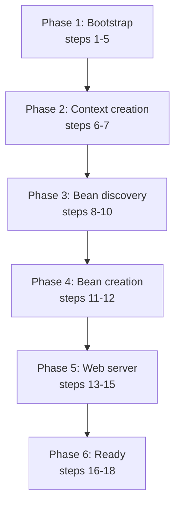

**How to read this diagram.** The six phases always run in this order, from top to bottom.

### Interview Deep Question: "What's the difference between BeanDefinition and Bean?"

| | BeanDefinition | Bean (actual object) |
| --- | --- | --- |
| **What it is** | METADATA about a bean | The ACTUAL Java object |
| **Holds** | Class name, scope (singleton?), constructor args, property values, init method name, destroy method name, lazy init?, depends-on | State; lives in heap memory; receives requests; does the actual work (may be wrapped in a CGLIB proxy) |
| **Analogy** | Blueprint / recipe | The actual house / dish built from that blueprint |

A `BeanDefinition` **creates** a bean.

### What's in a BeanDefinition?

```java
// You write this:
@Service
public class OrderService {
    private final UserRepository userRepo;

    public OrderService(UserRepository userRepo) {
        this.userRepo = userRepo;
    }
}

// Spring internally creates this BeanDefinition (simplified):
// {
//   beanClassName: "com.app.OrderService"
//   scope: "singleton"
//   lazyInit: false
//   constructorArguments: [Reference to "userRepository" bean]
//   autowireMode: CONSTRUCTOR
//   initMethodName: null
//   destroyMethodName: null
//   role: ROLE_APPLICATION
//   primary: false
//   factoryMethodName: null
// }
```

---

🔬 **Section Challenge — 1. How Spring Boots Up — The Complete Startup Sequence**

**Challenge 1 (Reasoning):** What happens if two Spring Beans have a Circular Dependency (A depends on B, and B depends on A) and both use Constructor Injection?

<details><summary>Answer</summary>

The application fails to start with a `BeanCurrentlyInCreationException`. Spring cannot instantiate Bean A without first having a fully constructed Bean B, but it cannot construct Bean B without Bean A. This creates an unresolvable deadlock. If you use Field or Setter injection, Spring can bypass this by instantiating both objects first (using empty constructors) and injecting the references afterward. However, Constructor Injection strictly enforces dependency resolution at creation time, exposing poor architectural design.

</details>

## 2. How Annotations ACTUALLY Work — From @Component to Bean

### Foundational Truth: Annotations Do NOTHING By Themselves

This is the #1 misconception. Annotations are just **metadata markers** — they don't execute any code.

```java
// This annotation literally does NOTHING on its own:
@Target(ElementType.TYPE)
@Retention(RetentionPolicy.RUNTIME)
public @interface Component {
    String value() default "";
}

// It's just a marker. It's equivalent to putting a sticky note
// on a class that says "I'm a component."
//
// THE MAGIC IS IN WHO READS THAT STICKY NOTE.
```

### The Three Players That Make Annotations Work

**HOW ANNOTATIONS COME TO LIFE**

**Player 1: THE ANNOTATION ITSELF**

```text
@Component, @Service, @Autowired, @Transactional
→ Just metadata. Just a label. Does nothing alone.
```

**Player 2: THE PROCESSOR (reads the annotation)**

```text
ClassPathBeanDefinitionScanner    → reads @Component
AutowiredAnnotationBeanPostProcessor → reads @Autowired
CommonAnnotationBeanPostProcessor → reads @PostConstruct
PersistenceAnnotationBPP         → reads @PersistenceContext
AsyncAnnotationBeanPostProcessor → reads @Async
```

**Player 3: THE MECHANISM (Java Reflection API)**

```text
clazz.isAnnotationPresent(Component.class)  → "Is this marked?"
clazz.getAnnotation(Component.class)        → "Read the marker"
field.isAnnotationPresent(Autowired.class)  → "Inject this?"
method.getAnnotation(Transactional.class)   → "Wrap in proxy?"
```

### Step-by-Step: What Happens When Spring Sees @Service

```java
@Service
public class PaymentService { ... }
```

#### Step 1: classpath scanning

`ClassPathBeanDefinitionScanner` scans the `com.myapp` package:

1. It finds the `PaymentService.class` file on disk or in a JAR.
2. It loads the class: `Class<?> clazz = classLoader.loadClass("com.myapp.PaymentService");`
3. It checks `clazz.isAnnotationPresent(Component.class)`. `@Service` is meta-annotated with `@Component`, so the answer is YES (Spring checks the annotation hierarchy recursively).
4. It creates a `BeanDefinition`:

```java
ScannedGenericBeanDefinition bd = new ScannedGenericBeanDefinition();
bd.setBeanClassName("com.myapp.PaymentService");
bd.setScope("singleton");
registry.registerBeanDefinition("paymentService", bd);
```

#### Step 2: annotation hierarchy (why `@Service` works as `@Component`)

`@Service` source code:

```java
@Target(ElementType.TYPE)
@Retention(RetentionPolicy.RUNTIME)
@Documented
@Component   // <- THIS IS THE KEY!
public @interface Service {
    @AliasFor(annotation = Component.class)
    String value() default "";
}
```

The inheritance chain:

| Annotation | Meta-annotated with |
| --- | --- |
| `@Service` | `@Component` |
| `@Repository` | `@Component` |
| `@Controller` | `@Component` |
| `@RestController` | `@Controller` → `@Component` |
| `@Configuration` | `@Component` (plus CGLIB proxying) |

So `ClassPathBeanDefinitionScanner` only looks for `@Component`, and automatically catches ALL stereotype annotations.

#### Step 3: bean instantiation

When the `ApplicationContext` needs `PaymentService`:

1. It reads the `BeanDefinition`.
2. It resolves the constructor dependencies (other beans).
3. It calls the constructor via reflection:

```java
Constructor<?> ctor = clazz.getDeclaredConstructor(UserRepo.class);
Object bean = ctor.newInstance(userRepoBean);
```

4. `BeanPostProcessor`s run (they may wrap the bean in a proxy).
5. The bean is stored in the singleton cache (a `ConcurrentHashMap`).

### The @Retention Mystery — Why Some Annotations Disappear

```java
// THREE retention policies — this is fundamental:

@Retention(RetentionPolicy.SOURCE)
// → Exists ONLY in .java source file
// → Compiler discards it
// → Example: @Override, @SuppressWarnings, Lombok's @Getter
// → Used by: compile-time annotation processors

@Retention(RetentionPolicy.CLASS)
// → Exists in .java AND .class bytecode
// → But NOT available at runtime via reflection
// → JVM discards it when loading class
// → Example: @NonNull (some implementations)
// → Used by: bytecode analysis tools

@Retention(RetentionPolicy.RUNTIME)
// → Exists in .java, .class, AND at runtime
// → Available via reflection: clazz.getAnnotation(...)
// → Example: ALL Spring annotations (@Component, @Autowired, @Transactional)
// → Used by: frameworks that inspect annotations at runtime
//
// WHY Spring annotations use RUNTIME:
// Spring MUST read them at runtime when the app is starting.
// If they were SOURCE or CLASS, Spring couldn't see them.
```

### How @Autowired is Processed — The EXACT Code Path

```java
@Service
public class OrderService {
    @Autowired
    private PaymentService paymentService;  // How does this get set?
}
```

```
  The processor: AutowiredAnnotationBeanPostProcessor

  Step 1: After OrderService is constructed (new OrderService())
          but BEFORE it's "ready"

  Step 2: AutowiredAnnotationBeanPostProcessor.postProcessProperties() called

  Step 3: It reflects over ALL fields:
          for (Field field : clazz.getDeclaredFields()) {
              if (field.isAnnotationPresent(Autowired.class)) {
                  // Found @Autowired on 'paymentService' field!

                  // Resolve the bean from the container:
                  Object dependency = beanFactory.getBean(field.getType());
                  // → Returns the PaymentService singleton

                  // Inject via reflection:
                  field.setAccessible(true);  // bypass private
                  field.set(orderServiceInstance, dependency);
                  // → orderService.paymentService = paymentServiceBean
              }
          }

  Step 4: OrderService now has paymentService injected!

  THIS is why constructor injection is preferred:
  │ Field injection:                                                │
  │   1. Object created with empty fields (null)                    │
  │   2. Reflection hacks private access to set field               │
  │   3. No compile-time guarantee                                  │
  │   4. Can't create immutable objects                             │
  │                                                                 │
  │ Constructor injection:                                          │
  │   1. Dependencies passed at construction time                   │
  │   2. Fields can be final (immutable!)                           │
  │   3. Compiler validates everything                              │
  │   4. Easy to test (just pass mocks to constructor)              │
  │   5. Fails FAST if dependency missing (at startup)              │
```

---

## 3. The Bean Container — ApplicationContext Internals

### What IS the ApplicationContext?

ApplicationContext is a FANCY HashMap

At its core, Spring's container is:

```java
DefaultSingletonBeanRegistry

/** Cache of singleton objects: bean name → bean instance */
Map<String, Object> singletonObjects =
    new ConcurrentHashMap<>(256);

/** Cache of singleton factories: bean name → ObjectFactory */
Map<String, ObjectFactory<?>> singletonFactories =
    new HashMap<>(16);

/** Cache of early singleton objects (for circular deps) */
Map<String, Object> earlySingletonObjects =
    new ConcurrentHashMap<>(16);
```

These THREE maps = "Three-Level Cache" for resolving circular deps

### The ApplicationContext Class Hierarchy

```text
 BeanFactory (interface)
→ Core container: getBean(), containsBean()
→ Lazy initialization

 └── ListableBeanFactory (interface)
→ Can list all beans: getBeanDefinitionNames()

     └── ApplicationContext (interface)
→ Event publishing (ApplicationEvent)
→ Message source (i18n)
→ Resource loading (classpath:, file:)
→ Environment (profiles, properties)

         ├── AnnotationConfigApplicationContext
 → For standalone Java apps
 → @Configuration class-based

         ├── AnnotationConfigServletWebServerApplicationContext
 → For Spring Boot web apps
 → Starts embedded Tomcat/Jetty

         └── AnnotationConfigReactiveWebServerApplicationContext
             → For Spring WebFlux apps
             → Starts embedded Netty

 INTERVIEW: "What's the difference between BeanFactory and ApplicationContext?"

 BeanFactory = Lazy. Creates beans ONLY when requested.
 ApplicationContext = Eager. Creates ALL singletons at startup.
 ApplicationContext adds: events, i18n, resource loading, AOP.

 In practice: Always use ApplicationContext. BeanFactory is too low-level.
```

### How getBean() Works Internally

```java
// When you call: context.getBean(OrderService.class)
// OR when Spring resolves @Autowired

// Simplified version of AbstractBeanFactory.doGetBean():

protected Object doGetBean(String name) {

    // 1. Check singleton cache FIRST (fast path)
    Object singleton = singletonObjects.get(name);
    if (singleton != null) {
        return singleton;  // Already created, return cached
    }

    // 2. Check if currently being created (circular dependency)
    Object earlySingleton = earlySingletonObjects.get(name);
    if (earlySingleton != null) {
        return earlySingleton;  // Return partially-created bean
    }

    // 3. Get BeanDefinition
    BeanDefinition bd = beanDefinitionMap.get(name);

    // 4. Check dependencies first (recursive!)
    String[] dependsOn = bd.getDependsOn();
    for (String dep : dependsOn) {
        getBean(dep);  // Create dependency first!
    }

    // 5. Create the bean
    if (bd.isSingleton()) {
        singleton = createBean(name, bd);
        singletonObjects.put(name, singleton);  // Cache it
        return singleton;
    } else if (bd.isPrototype()) {
        return createBean(name, bd);  // New instance each time
    }
}
```

---

🔬 **Section Challenge — 3. The Bean Container — ApplicationContext Internals**

**Challenge 2 (Trace — Who/When/What):** You have two `DataSource` beans — `primaryDataSource` and `backupDataSource`. `@Autowired DataSource ds` in a service. Spring throws `NoUniqueBeanDefinitionException`. **Who** is responsible for resolution? **When** does it fail — startup or first use? **What** are the three ways to resolve?

<details><summary>Answer</summary>

**Who?** The `DefaultListableBeanFactory` — specifically its `doResolveDependency()` method. **When?** At context startup during singleton bean initialization — NOT at first use (unless `@Lazy`). **Three resolution strategies:** (1) `@Primary` on `primaryDataSource` — marks it as the default when multiple candidates exist. Applied at bean definition. (2) `@Qualifier("primaryDataSource")` at the injection point — explicitly names which bean. Most precise. (3) Name-matching — if the field name is `primaryDataSource` (matching the bean name), Spring uses it as a tie-breaker. **Precedence:** `@Qualifier` > name-match > `@Primary`. **Best practice:** Use `@Primary` for the "normal" default, `@Qualifier` when you need a specific non-primary bean. For test environments, use `@TestConfiguration` to override the primary without changing production code.

</details>

## 4. Bean Creation — The 11-Step Lifecycle You Must Know

**The complete bean lifecycle: all 11 steps**

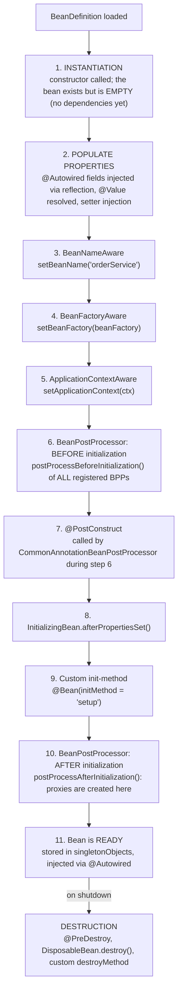

**How to read this diagram.** The container takes each bean through these steps in order. Step 7 is technically part of step 6, because `@PostConstruct` is processed by a `BeanPostProcessor`.

| Step | What happens | Notes |
| --- | --- | --- |
| 1. Instantiation | Constructor called (`new MyService()` or constructor injection) | The bean exists in memory but is EMPTY. |
| 2. Populate properties | `@Autowired` fields, `@Value` properties, setter injection | |
| 3-5. Aware callbacks | `setBeanName`, `setBeanFactory`, `setApplicationContext` | The bean learns its own name, can look up other beans, and gets the full container (events, resources). |
| 6. BPP before init | All `postProcessBeforeInitialization()` methods | `CommonAnnotationBeanPostProcessor` processes `@PostConstruct`. `ApplicationContextAwareProcessor` handles the Aware callbacks. |
| 7. `@PostConstruct` | Your method is called | Use it for validation, loading caches, opening connections. |
| 8. `afterPropertiesSet()` | Called if the bean implements `InitializingBean` | An alternative to `@PostConstruct` (less preferred, couples you to Spring). |
| 9. Custom init-method | `bean.setup()` called via reflection | Only if `@Bean(initMethod = "setup")` is specified. |
| 10. BPP after init | All `postProcessAfterInitialization()` methods | **This is where the magic happens.** `AbstractAutoProxyCreator` checks for `@Transactional` or `@Cacheable` and wraps the bean in a CGLIB/JDK proxy. `AsyncAnnotationBeanPostProcessor` wraps beans with `@Async` methods in a proxy that submits to a thread pool. |
| 11. Ready | Stored in the `singletonObjects` cache and returned for `@Autowired` | If the bean was proxied, the PROXY is what gets stored and injected. |
| Destruction | `@PreDestroy`, `DisposableBean.destroy()`, custom `destroyMethod` | Use it for closing connections, flushing caches and cleanup. |

### Code Example: Observing All 11 Steps

```java
@Component
public class LifecycleDemo implements BeanNameAware, BeanFactoryAware,
                                      ApplicationContextAware,
                                      InitializingBean, DisposableBean {

    @Autowired
    private SomeDependency dep;

    public LifecycleDemo() {
        System.out.println("1. CONSTRUCTOR called (bean instantiated)");
        System.out.println("   dep is null here: " + (dep == null)); // true!
    }

    // Step 2 happens here (dep gets injected via reflection)

    @Override
    public void setBeanName(String name) {
        System.out.println("3. setBeanName: " + name);
    }

    @Override
    public void setBeanFactory(BeanFactory factory) {
        System.out.println("4. setBeanFactory called");
    }

    @Override
    public void setApplicationContext(ApplicationContext ctx) {
        System.out.println("5. setApplicationContext called");
        System.out.println("   dep is now injected: " + (dep != null)); // true!
    }

    @PostConstruct
    public void init() {
        System.out.println("7. @PostConstruct — initialization logic");
    }

    @Override
    public void afterPropertiesSet() {
        System.out.println("8. afterPropertiesSet (InitializingBean)");
    }

    @PreDestroy
    public void cleanup() {
        System.out.println("DESTROY: @PreDestroy — cleanup");
    }

    @Override
    public void destroy() {
        System.out.println("DESTROY: DisposableBean.destroy()");
    }
}

// OUTPUT ORDER:
// 1. CONSTRUCTOR called (bean instantiated)
//    dep is null here: true
// 3. setBeanName: lifecycleDemo
// 4. setBeanFactory called
// 5. setApplicationContext called
//    dep is now injected: true
// 7. @PostConstruct — initialization logic
// 8. afterPropertiesSet (InitializingBean)
// ... app runs ...
// DESTROY: @PreDestroy — cleanup
// DESTROY: DisposableBean.destroy()
```

---

## 5. How @Autowired Works — The Full Resolution Chain

### When Multiple Beans Match the Same Type

**RESOLUTION ORDER (Spring tries each step, stops at first match)**

**Step 1: BY TYPE**

```text
@Autowired
private PaymentService paymentService;

Spring: "Find all beans of type PaymentService"
→ If exactly ONE found → inject it ✅
→ If ZERO found → throw NoSuchBeanDefinitionException ❌
→ If MULTIPLE found → go to Step 2
```

**Step 2: BY QUALIFIER**

```text
@Autowired
@Qualifier("stripePayment")
private PaymentService paymentService;

Spring: "Find bean named 'stripePayment' of type PaymentService"
→ If found → inject it ✅
→ If not found → go to Step 3
```

**Step 3: BY PRIMARY**

```text
@Primary
@Service
public class StripePaymentService implements PaymentService { }

@Service
public class PayPalPaymentService implements PaymentService { }

Spring: "Multiple PaymentService beans. Is one @Primary?"
→ If one is @Primary → inject it ✅
→ If none is @Primary → go to Step 4
```

**Step 4: BY FIELD NAME**

```text
@Autowired
private PaymentService stripePaymentService;  // field name matches bean name!

Spring: "Field name 'stripePaymentService' matches a bean name?"
→ If match → inject it ✅
→ If no match → throw NoUniqueBeanDefinitionException ❌
```

### The @Autowired(required = false) Trap

```java
// DANGER: This silently sets the field to null!
@Autowired(required = false)
private NotificationService notifier;

public void processOrder(Order order) {
    // ... process ...
    notifier.sendNotification(order);  // NullPointerException!
}

// BETTER: Use Optional
@Autowired
private Optional<NotificationService> notifier;

public void processOrder(Order order) {
    // ... process ...
    notifier.ifPresent(n -> n.sendNotification(order));  // Safe!
}
```

---

🔬 **Section Challenge — 5. How @Autowired Works — The Full Resolution Chain**

**Challenge 3 (Ambiguity Resolution):** You have two beans implementing `PaymentService`: `StripePaymentService` and `PaypalPaymentService`. You inject `@Autowired PaymentService service`. **Who** resolves the ambiguity? **When** does it fail vs. succeed? **What** are the three resolution strategies Spring uses in order?

<details><summary>Answer</summary>

**Who resolves:** Spring's `DefaultListableBeanFactory` during dependency injection. **Resolution order:** (1) **Type match** — finds all beans implementing `PaymentService`. If exactly one → inject it. If zero → `NoSuchBeanDefinitionException`. If more than one → ambiguity. (2) **Name match** — Spring checks if any bean's name matches the field/parameter name (`service` → looks for a bean named `service`). (3) **@Primary** — if one bean is annotated `@Primary`, it wins. (4) **@Qualifier** — `@Qualifier("stripePaymentService")` explicitly names the winner. **When it fails:** If 2+ beans match type AND none are `@Primary` AND no `@Qualifier` provided AND field name doesn't match any bean name → `NoUniqueBeanDefinitionException` at startup. **When it succeeds without annotation:** If the field is named exactly `stripePaymentService`, Spring's name-match step finds it — this is fragile and breaks on rename. Always prefer `@Qualifier` or `@Primary` for clarity.

</details>

## 6. How Proxies Work — CGLIB vs JDK Dynamic Proxy Internal Mechanics

### Why Proxies Exist in Spring

**The fundamental problem**

```text
You write:
@Transactional
public void transferMoney(Account from, Account to, BigDecimal amount) {
    from.debit(amount);
    to.credit(amount);
}

But WHO starts the transaction? WHO commits/rolls back?
YOUR CODE doesn't have any transaction management!
```

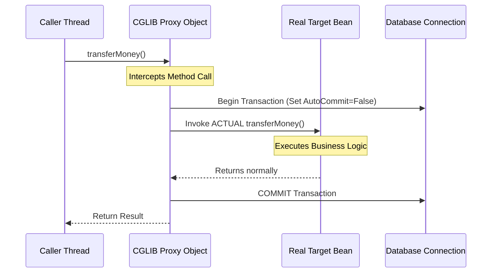

**How to read this diagram.** Read top to bottom: the caller invokes `transferMoney()` on the CGLIB proxy, not the real bean; the proxy begins a transaction on the database connection (autocommit off), calls the real method, and on a normal return commits and passes the result back. Notice that all the transaction logic lives in the proxy - your own code contains none.

**ANSWER: A PROXY wraps your bean and adds transaction logic:**

**What you think happens:          What ACTUALLY happens:**

**caller → transferMoney()         caller → PROXY.transferMoney()**

- Begin transaction
- Call REAL transferMoney()
- If success → COMMIT
- If exception → ROLLBACK

### CGLIB Proxy — How It Works (Spring Boot Default)

```
  CGLIB = Code Generation Library
  → Generates a SUBCLASS of your class at runtime
  → The subclass OVERRIDES your methods to add behavior

  YOUR CLASS                          GENERATED PROXY CLASS

  class OrderService {                class OrderService$$EnhancerBySpring
    @Transactional                          extends OrderService {
    void placeOrder() {
      // your code                      // Spring-generated field:
    }                                   private MethodInterceptor interceptor;
  }
                                        @Override
                                        void placeOrder() {
                                          // BEFORE: start transaction
                                          interceptor.intercept(
                                            this,           // proxy
                                            placeOrder,     // method
                                            args,           // arguments
                                            methodProxy     // call real method
                                          );
                                          // AFTER: commit or rollback
                                        }
                                      }

  AT RUNTIME:
  │  What you think is injected:    OrderService                        │
  │  What's actually injected:      OrderService$$EnhancerBySpring     │
  │                                                                     │
  │  System.out.println(orderService.getClass().getName());             │
  │  // Prints: com.myapp.OrderService$$EnhancerBySpringCGLIB$$a1b2c3  │
  │                                                                     │
  │  orderService instanceof OrderService  → true (it's a subclass!)   │
```

### JDK Dynamic Proxy — How It Works

```
  JDK Proxy = Java's built-in proxy mechanism
  → Only works for INTERFACES
  → Creates a new class that IMPLEMENTS the same interface
  → Does NOT extend your class

  YOUR INTERFACE & CLASS                GENERATED PROXY

  interface PaymentService {            class $Proxy42
    void process(Order o);                implements PaymentService {
  }
                                          InvocationHandler handler;
  class StripePayment
    implements PaymentService {            @Override
    void process(Order o) {               void process(Order o) {
      // your code                          handler.invoke(
    }                                         this,      // proxy
  }                                           process,   // method
                                              new Object[]{o} // args
                                            );
                                          }
                                        }
```

### CGLIB vs JDK Proxy — Decision Table

| Aspect                      | CGLIB Proxy                          | JDK Dynamic Proxy               |
| --------------------------- | ------------------------------------ | ------------------------------- |
| **Mechanism**               | Generates subclass                   | Implements interface            |
| **Requires interface?**     | No                                   | Yes, mandatory                  |
| **Can proxy final class?**  | ❌ No (can't subclass final)         | N/A (uses interface)            |
| **Can proxy final method?** | ❌ No (can't override final)         | ✅ Yes (interface method)       |
| **Performance**             | Slightly faster (direct method call) | Slightly slower (reflection)    |
| **Spring Boot default**     | ✅ Yes (since Spring Boot 2.0)       | Used when explicitly configured |
| **Generated class**         | `MyClass$$EnhancerBySpringCGLIB`     | `$Proxy42`                      |
| **Library**                 | ASM bytecode manipulation            | java.lang.reflect.Proxy         |

### Why @Transactional Fails — The 5 Cases

**CASE 1: SELF-INVOCATION (Most common trap!)**

```text
@Service
public class OrderService {
    @Transactional
    public void placeOrder() { ... }

    public void batchProcess() {
        placeOrder();  // ❌ CALLS this.placeOrder() — BYPASSES PROXY!
    }
}

WHY: When you call this.placeOrder(), you're calling the REAL object's
method directly. The proxy only intercepts EXTERNAL calls.
```

```mermaid
flowchart TD
    %% Proxy Self-Invocation Failure Physics
    subgraph SUCCESS ["External Call (SUCCESS)"]
        EXT["External Class"]
        PROXY1["CGLIB Proxy<br/>(Starts Transaction)"]
        REAL1["Real Target Bean<br/>placeOrder()"]
    end

        EXT -->|"proxy.placeOrder()"| PROXY1
        PROXY1 -->|"super.placeOrder()"| REAL1

    subgraph FAILURE ["Self-Invocation (FAILURE)"]
        EXT2["External Class"]
        PROXY2["CGLIB Proxy<br/>(No TX on batchProcess)"]
        REAL2["Real Target Bean<br/>batchProcess()"]
        REAL3["Real Target Bean<br/>placeOrder()"]
    end

        EXT2 -->|"proxy.batchProcess()"| PROXY2
        PROXY2 -->|"super.batchProcess()"| REAL2
        REAL2 -->|"this.placeOrder()<br/>BYPASSES PROXY"| REAL3

```

**How to read this diagram.** Compare the two groups: in the external call, the caller reaches the proxy, which starts the transaction and then calls the real `placeOrder()`. In the self-invocation group, the proxy handles `batchProcess()`, but the real bean's `this.placeOrder()` goes straight to the real object (arrow marked BYPASSES PROXY). Notice that this second `placeOrder()` never passes through the proxy, so no transaction starts.

The proxy wraps the outside; a self-call (`this.placeOrder()`) happens INSIDE the real object, so it never passes through the proxy and no transaction starts.

**Fix:** inject the bean into itself, or use `AopContext.currentProxy()`.

**Case 2: private methods**

```text
@Transactional
private void helper() { }  // ❌ CGLIB can't override private methods!

FIX: Make it public or package-private.
```

**Case 3: wrong exception type**

```text
@Transactional  // Only rolls back on unchecked exceptions by default!
public void process() throws IOException {
    throw new IOException("file error");  // ❌ NOT rolled back!
}

FIX: @Transactional(rollbackFor = Exception.class)
```

**Case 4: not a spring bean**

```text
// Forgot @Service or @Component → Spring doesn't manage it → no proxy!
public class OrderService {
    @Transactional
    public void placeOrder() { }  // ❌ No proxy exists!
}
```

**Case 5: final class or method**

```text
@Service
public final class OrderService {  // ❌ CGLIB can't subclass final!
    @Transactional
    public void placeOrder() { }
}
```

---

🔬 **Section Challenge — 6. How Proxies Work — CGLIB vs JDK Dynamic Proxy Internal Mechanics**

**Challenge 4 (CGLIB Final Class):** You annotate `final class OrderService` with `@Transactional`. **Who** fails at startup? **When** does the failure happen? **What** is the exact error and the two correct fixes?

<details><summary>Answer</summary>

**Who fails:** Spring's CGLIB proxy generator (`Enhancer`). CGLIB works by creating a SUBCLASS of your bean class. `final` classes cannot be subclassed in Java → `Cannot subclass final class`. **When:** At Spring `ApplicationContext` startup, during the BeanFactory post-processing phase when proxies are created. NOT at the method call. **Exact error:** `org.springframework.aop.framework.AopConfigException: Could not generate CGLIB subclass of class [final class OrderService]: ... Cannot subclass final class`. **Fix 1 (Remove final):** Remove the `final` keyword from the class. This is the standard fix — Spring beans should not be `final` if they need proxying. **Fix 2 (Introduce interface):** Extract an `OrderService` interface, make the class implement it. Switch `proxyTargetClass=false` to use JDK Dynamic Proxy (which wraps the interface, not subclasses the class). JDK proxies work with `final` classes as long as the interface is not final. **Production note:** IntelliJ/Spring Boot Kotlin apps: Kotlin classes are `final` by default. Use the `kotlin-spring` compiler plugin which auto-opens Spring-annotated classes.

</details>

## 7. How @Transactional ACTUALLY Works — From Annotation to Commit

### The Complete Flow (13 Steps)

```text
 Caller calls orderService.placeOrder(order)

(But orderService is actually a CGLIB proxy!)

 ▼
 Step 1:  Proxy intercepts the call
          TransactionInterceptor.invoke() called

 Step 2:  Read @Transactional attributes:
propagation = REQUIRED (default)
isolation = DEFAULT
timeout = -1 (no timeout)
readOnly = false
rollbackFor = {RuntimeException.class}

 Step 3:  PlatformTransactionManager.getTransaction() called
→ Usually JpaTransactionManager for Spring Data JPA

 Step 4:  Check propagation behavior:
REQUIRED: Is there an existing transaction?
  YES → Join it (participate in existing)
  NO  → Create a NEW transaction

 Step 5:  If creating new transaction:
→ Get Connection from DataSource (HikariCP pool)
→ connection.setAutoCommit(false)
→ Bind connection to current thread (ThreadLocal)

 Step 6:  Call the REAL method: target.placeOrder(order)

 Step 7:  Your code executes:
→ userRepo.save(user)     // uses the SAME connection
→ orderRepo.save(order)   // uses the SAME connection
→ Both share the transaction!

 Step 8:  Method completes:

          ├── SUCCESS (no exception):
 Step 9a: TransactionManager.commit()
 Step 10a: connection.commit()
 Step 11a: Connection returned to pool

          └── EXCEPTION thrown:
              Step 9b: Is it rollbackFor type?
YES → TransactionManager.rollback()
       connection.rollback()
NO  → TransactionManager.commit() (!)
              Step 10b: Connection returned to pool
              Step 11b: Exception re-thrown to caller

 THREAD-LOCAL BINDING (how repo methods share the transaction):
```

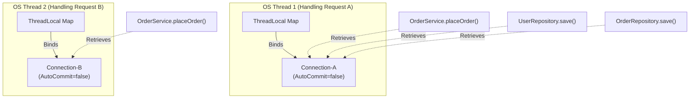

**How to read this diagram.** Each group is one request thread: its ThreadLocal map binds one connection (Connection-A on thread 1, Connection-B on thread 2), and the service and repository calls in that request retrieve (dotted arrows) the same bound connection. Notice that each thread has its own connection - that is how the repository methods share one transaction without the connection being passed around.

```text
TransactionSynchronizationManager uses ThreadLocal:

Thread-1:  [Connection-A] ← bound to this thread

    ├── orderService.placeOrder()     → uses Connection-A
├── userRepo.save()           → uses Connection-A ← same!
└── orderRepo.save()          → uses Connection-A ← same!

    └── Transaction committed on Connection-A

Thread-2:  [Connection-B] ← different thread, different connection

    └── orderService.placeOrder()     → uses Connection-B

THIS is why @Transactional works — the Connection is stored in ThreadLocal,
and all repository calls on the same thread use the SAME connection.
```

### Propagation Behaviors — When You Actually Need Them

| Propagation            | Existing TX?                               | Behavior                    | Use Case                                                  |
| ---------------------- | ------------------------------------------ | --------------------------- | --------------------------------------------------------- |
| **REQUIRED** (default) | Yes → Join; No → Create                    | Most common. Safe default.  | 95% of methods                                            |
| **REQUIRES_NEW**       | Always create NEW (suspend existing)       | Independent commit/rollback | Audit logging that must persist even if parent rolls back |
| **SUPPORTS**           | Yes → Join; No → Run without TX            | Optional TX                 | Read-only methods that can work either way                |
| **NOT_SUPPORTED**      | Suspend existing; Run without TX           | Force no TX                 | Long-running operations that shouldn't hold a transaction |
| **MANDATORY**          | Yes → Join; No → THROW exception           | Require existing TX         | Methods that must be called within a TX                   |
| **NEVER**              | Yes → THROW exception; No → Run without TX | Forbid TX                   | Methods that must NOT run in a transaction                |
| **NESTED**             | Yes → Create SAVEPOINT; No → Create new    | Partial rollback            | Retry individual items in a batch                         |

---

## 8. How Auto-Configuration Works — spring.factories to Bean

### The Loading Mechanism

**When Spring Boot starts, it needs to know**

"Which auto-configuration classes should I evaluate?"

**SPRING BOOT 2.x**

Location: META-INF/spring.factories (inside each JAR)

**Format**

```text
org.springframework.boot.autoconfigure.EnableAutoConfiguration=\
  com.example.DataSourceAutoConfiguration,\
  com.example.WebMvcAutoConfiguration,\
  com.example.SecurityAutoConfiguration
```

**SPRING BOOT 3.x**

Location: META-INF/spring/

org.springframework.boot.autoconfigure.AutoConfiguration.imports

Format: One class per line

```text
com.example.DataSourceAutoConfiguration
com.example.WebMvcAutoConfiguration
com.example.SecurityAutoConfiguration
```

Why the change? spring.factories loaded ALL types (not just auto-config)

→ performance overhead. The new format is specific to auto-configuration.

### Real Example: How DataSource Gets Auto-Configured

```java
// Inside spring-boot-autoconfigure.jar:

@AutoConfiguration
@ConditionalOnClass({ DataSource.class, EmbeddedDatabaseType.class })
// ↑ Only runs if DataSource class exists on classpath
//   (i.e., you have a JDBC dependency)

@ConditionalOnMissingBean(type = "io.r2dbc.spi.ConnectionFactory")
// ↑ Skip if reactive DB (R2DBC) is being used

@EnableConfigurationProperties(DataSourceProperties.class)
// ↑ Binds spring.datasource.* properties to DataSourceProperties class

@Import({
    DataSourcePoolMetadataProvidersConfiguration.class,
    DataSourceCheckpointRestoreConfiguration.class
})
public class DataSourceAutoConfiguration {

    @Configuration
    @Conditional(PooledDataSourceCondition.class)
    // ↑ Only if connection pooling is available
    @ConditionalOnMissingBean({ DataSource.class, XADataSource.class })
    // ↑ ONLY IF YOU HAVEN'T DEFINED YOUR OWN DataSource bean!
    @Import({
        HikariJdbcConnectionDetailsBeanRegistrar.class
    })
    static class PooledDataSourceConfiguration {
        // This creates HikariDataSource if HikariCP is on classpath
    }

    @Configuration
    @ConditionalOnMissingBean({ DataSource.class, XADataSource.class })
    @ConditionalOnProperty(name = "spring.datasource.type")
    static class GenericDataSourceConfiguration {
        // Fallback: create whatever DataSource type is specified
    }
}
```

**THE DECISION TREE:**

**Is DataSource.class on classpath?**

- NO  → Skip entirely (no JDBC dependency)
- YES

  - Did you define your own DataSource @Bean?
    - YES → Skip (your bean takes priority — @ConditionalOnMissingBean)
    - NO

      - Is HikariCP on classpath?
        - YES → Create HikariDataSource with spring.datasource.* props
        - NO  → Is Tomcat JDBC on classpath?
          - YES → Create Tomcat DataSource
          - NO  → Is Commons DBCP2 on classpath?
            - YES → Create DBCP2 DataSource
            - NO  → Fail with error

### The @Conditional Family — All Members

```java
// CLASSPATH conditions (most common)
@ConditionalOnClass(DataSource.class)         // Class exists on classpath
@ConditionalOnMissingClass("com.oracle.Driver") // Class NOT on classpath

// BEAN conditions
@ConditionalOnBean(DataSource.class)           // Bean of this type exists
@ConditionalOnMissingBean(DataSource.class)    // No bean of this type exists
@ConditionalOnSingleCandidate(DataSource.class) // Exactly one bean (or @Primary)

// PROPERTY conditions
@ConditionalOnProperty(name = "cache.enabled", havingValue = "true")
@ConditionalOnProperty(name = "feature.x", matchIfMissing = true)

// WEB conditions
@ConditionalOnWebApplication                    // Running as web app
@ConditionalOnNotWebApplication                 // NOT a web app

// RESOURCE conditions
@ConditionalOnResource(resources = "classpath:schema.sql")

// EXPRESSION conditions
@ConditionalOnExpression("${cache.enabled:false} && ${cache.type:none} != 'none'")

// JAVA VERSION conditions
@ConditionalOnJava(range = ConditionalOnJava.Range.EQUAL_OR_NEWER,
                   value = JavaVersion.SEVENTEEN)
```

---

🔬 **Section Challenge — 8. How Auto-Configuration Works — spring.factories to Bean**

**Challenge 5 (Condition Ordering):** Two auto-configurations define a `DataSource` bean. `MyDataSourceAutoConfig` has `@ConditionalOnMissingBean(DataSource.class)`. Your app also defines a `DataSource` bean manually. **Who** decides which bean wins? **When** is the condition evaluated? **What** determines evaluation order?

<details><summary>Answer</summary>

**Who decides:** Spring's `@ConditionalOnMissingBean` evaluation engine during `ConfigurationClassPostProcessor` phase. **When evaluated:** During the `ApplicationContext` refresh, after ALL `@Configuration` classes are parsed but BEFORE beans are instantiated. The condition checks the bean definition registry — if a `DataSource` bean definition already exists (from your `@Configuration` class), the condition is FALSE and `MyDataSourceAutoConfig`'s `DataSource` is skipped. **What determines evaluation order:** `@AutoConfigureOrder`, `@AutoConfigureBefore`, `@AutoConfigureAfter` annotations on the auto-configuration class. Your app's `@Configuration` classes are always processed BEFORE auto-configurations. So: user beans → `@Primary` auto-configs → regular auto-configs → fallback auto-configs. **Practical rule:** `@ConditionalOnMissingBean` on auto-config beans = "only create this if the user hasn't provided their own." This is how `spring-boot-autoconfigure` provides sensible defaults while letting you override them — just define your own bean.

</details>

## 9. How @ComponentScan Works — Classpath Scanning Algorithm

```text
THE ALGORITHM (simplified):

Input: basePackage = "com.myapp" (from @SpringBootApplication location)

Step 1: CONVERT PACKAGE TO FILE PATH
"com.myapp" → "com/myapp"

Step 2: SCAN CLASSPATH FOR ALL .class FILES
ClassLoader scans:
├── target/classes/com/myapp/**/*.class    (your compiled classes)
├── dependency.jar!/com/myapp/**/*.class   (unlikely, but checked)

Uses Spring's PathMatchingResourcePatternResolver:
Resource[] resources = resolver.getResources(
    "classpath*:com/myapp/**/*.class"
);
// Returns: [OrderService.class, UserRepo.class, AppConfig.class, ...]

Step 3: FOR EACH .class FILE → CHECK ANNOTATIONS
Uses ASM bytecode reader (NOT Class.forName — too slow!):

├── Read class bytecode WITHOUT loading the class
(ASM reads the .class file directly from disk/JAR)

├── Check: does this class have @Component (or meta-annotation)?
├── @Component? @Service? @Repository? @Controller? @Configuration?
└── Check @interface hierarchy (e.g., @Service has @Component)

├── Check exclusion filters:
@ComponentScan(excludeFilters = @Filter(type = FilterType.REGEX,
    pattern = ".*Test.*"))

└── If it passes → Create BeanDefinition and register it

Step 4: PROCESS @Configuration CLASSES
ConfigurationClassPostProcessor handles:
├── @Bean methods → BeanDefinition per method
├── @Import → recursively process imported classes
├── @ImportResource → load XML config
└── @PropertySource → load additional property files

WHY ASM AND NOT REFLECTION?

Reflection (Class.forName):
├── Loads class into JVM memory
├── Runs static initializers
├── May trigger ClassNotFoundException for optional deps
├── SLOW for 1000+ classes

ASM bytecode reading:
├── Reads .class file bytes directly
├── Does NOT load the class
├── No static initializers
├── No ClassNotFoundException risk
├── FAST even for 10,000+ classes

Spring scans EVERY class file but only LOADS the ones with @Component.
```

---

🔬 **Section Challenge — 9. How @ComponentScan Works — Classpath Scanning Algorithm**

**Challenge 6 (Package Boundary):** Your `@SpringBootApplication` is in `com.example`. You create a service in `com.utils.HelperService` with `@Service`. **Who** misses it? **When** does the scan boundary matter? **What** are two ways to include the out-of-package bean?

<details><summary>Answer</summary>

**Who misses it:** `@ComponentScan` with default settings only scans the package of the class annotated with `@SpringBootApplication` and all its sub-packages. `com.utils` is NOT a sub-package of `com.example` → `HelperService` is never registered as a bean. **When it matters:** At startup — `NoSuchBeanDefinitionException` when something tries to `@Autowired HelperService`. **Fix 1 (Extend scan):** `@ComponentScan(basePackages = {"com.example", "com.utils"})` — explicitly add the extra package. **Fix 2 (Import directly):** `@Import(HelperService.class)` on your main class — registers the specific class as a bean without scanning its entire package. **Production recommendation:** Keep all your application code under one root package (e.g., `com.example.*`). Only use `@Import` or custom scan for third-party library integration. Moving `@SpringBootApplication` to a higher package (`com`) is an anti-pattern — it scans too broadly including Spring's own internal packages.

</details>

## 10. How Profiles & @Conditional Work — The Decision Engine

### Profile Resolution Order

```text
When Spring encounters @Profile("dev"):
```

**Step 1: READ ACTIVE PROFILES**

```text
Sources checked (highest to lowest priority):

1. spring.profiles.active=dev           (command-line arg: --spring.profiles.active=dev)
2. SPRING_PROFILES_ACTIVE=dev           (environment variable)
3. spring.profiles.active=dev           (application.properties)
4. @ActiveProfiles("dev")               (test annotation)
5. SpringApplication.setAdditionalProfiles("dev")  (programmatic)
```

**Step 2: MATCH PROFILE EXPRESSION**

```text
@Profile("dev")                 → active profiles contain "dev"
@Profile("!prod")               → active profiles do NOT contain "prod"
@Profile({"dev", "staging"})    → contains "dev" OR "staging"
@Profile("dev & feature-x")    → contains "dev" AND "feature-x" (Spring 5.1+)
@Profile("dev | staging")      → contains "dev" OR "staging" (Spring 5.1+)
```

**Step 3: INCLUDE OR EXCLUDE BEAN**

```text
If profile matches → BeanDefinition included
If not → BeanDefinition SKIPPED (never created)
```

### How @Conditional Evaluation Works Internally

```java
// Every @ConditionalOn* annotation has a Condition class:

@ConditionalOnClass(DataSource.class)
// Maps to: OnClassCondition implements Condition

public interface Condition {
    boolean matches(ConditionContext context, AnnotatedTypeMetadata metadata);
}

// Spring calls matches() for EVERY @Conditional annotation on EVERY
// auto-configuration class. The result determines if the bean is created.

// OnClassCondition.matches() simplified:
public boolean matches(ConditionContext context, AnnotatedTypeMetadata metadata) {
    String className = "javax.sql.DataSource";
    try {
        context.getClassLoader().loadClass(className);
        return true;   // Class found on classpath → condition passes
    } catch (ClassNotFoundException e) {
        return false;  // Class not found → condition fails → skip this bean
    }
}
```

---

🔬 **Section Challenge — 10. How Profiles & @Conditional Work — The Decision Engine**

**Challenge 7 (Profile Misfire):** You have `@Profile("prod") @Service class EmailService`. In test, `spring.profiles.active=test`. A test autowires `EmailService`. **Who** throws? **When**? **What** is the standard fix for test environments needing a stub?

<details><summary>Answer</summary>

**Who throws:** Spring's `ApplicationContext` when the test tries to start. **When:** During context initialization — `EmailService` is not registered (because `prod` profile is inactive), so `@Autowired EmailService` fails with `NoSuchBeanDefinitionException`. **Fix 1 (@Profile on stub):** Create `@Profile("test") @Service class StubEmailService implements EmailService` — active in `test`, not in `prod`. **Fix 2 (@MockBean in Spring test):** `@MockBean EmailService emailService` in the test class — Spring Test auto-creates a Mockito mock and registers it as the bean. The `@Profile` class is bypassed entirely. **Fix 3 (@ConditionalOnMissingBean):** Change `EmailService` to `@ConditionalOnMissingBean(EmailService.class)` — if a test provides a mock, the real service is skipped. **The deeper lesson:** `@Profile` is a hard boundary — the bean does NOT exist in other profiles. If you need a fallback, either define a stub for the other profile or use `@ConditionalOnProperty` with a default, which is more flexible than profile boundaries.

</details>

## 11. How Spring Resolves Circular Dependencies

### The Problem

```java
@Service
class A {
    @Autowired
    private B b;  // A needs B
}

@Service
class B {
    @Autowired
    private A a;  // B needs A
}

// A needs B → but B needs A → but A needs B → infinite loop?
```

### The Three-Level Cache Solution

```text
Spring's "Three-Level Cache" (only works for FIELD/SETTER injection):

Level 1: singletonObjects        → Fully initialized beans
Level 2: earlySingletonObjects   → Partially initialized beans
Level 3: singletonFactories      → Bean factories (creates proxies if needed)

THE RESOLUTION PROCESS:

Step 1: Start creating A
        │  A's BeanDefinition found
        │  Constructor called: new A()
        │  A is now a "raw" object (no dependencies yet)
        │  Register A's ObjectFactory in Level 3 cache:
        │    singletonFactories.put("a", () -> getEarlyBean("a"))
        │
Step 2: Populate A's properties
        │  Found @Autowired B b → need to get bean "b"
        │
Step 3: Start creating B
        │  B's BeanDefinition found
        │  Constructor called: new B()
        │  Register B's ObjectFactory in Level 3 cache
        │
Step 4: Populate B's properties
        │  Found @Autowired A a → need to get bean "a"
        │
Step 5: Get bean "a"
        │  Level 1: singletonObjects.get("a")     → null (not finished)
        │  Level 2: earlySingletonObjects.get("a") → null
        │  Level 3: singletonFactories.get("a")    → FOUND!
        │    → Call the factory: returns early reference to A
        │    → Move to Level 2: earlySingletonObjects.put("a", earlyA)
        │    → Remove from Level 3
        │    → B gets the EARLY (partially initialized) A
        │
Step 6: B is now fully initialized
        │  Move B to Level 1: singletonObjects.put("b", b)
        │
Step 7: Back to Step 2 — A gets fully-initialized B
        │  Move A to Level 1: singletonObjects.put("a", a)
        │
Step 8: Both A and B are complete  ✅
```

**WHY THREE LEVELS (why not just two)?**

```text
Level 3 exists because of PROXIES.

If A is @Transactional, the "early reference" needs to be
the PROXY, not the raw object. The ObjectFactory in Level 3
can decide: "Should I return raw A or proxy-wrapped A?"

Without Level 3, we'd have to create the proxy too early
(before BeanPostProcessors run), which breaks the lifecycle.
```

**Constructor injection circular dependency**

```text
@Service
class A {
    public A(B b) { this.b = b; }  // CONSTRUCTOR needs B
}

@Service
class B {
    public B(A a) { this.a = a; }  // CONSTRUCTOR needs A
}

❌ FAILS! Spring cannot resolve this because:
→ To create A, you need B in the constructor
→ But to create B, you need A in the constructor
→ Neither can be partially created

The three-level cache only works when the bean can be
CONSTRUCTED first (empty), then populated with dependencies later.
Constructor injection doesn't allow that.

FIX: Use @Lazy on one constructor parameter:
public A(@Lazy B b) { this.b = b; }  // Injects a proxy that resolves later
```

---

🔬 **Section Challenge — 11. How Spring Resolves Circular Dependencies**

**Challenge 8 (Third-Bean Fix):** `ServiceA` (constructor) depends on `ServiceB` (constructor) which depends on `ServiceA`. Spring throws `BeanCurrentlyInCreationException`. **Who** breaks the cycle? **What** is the third-bean refactor pattern? **When** is `@Lazy` appropriate vs. the refactor?

<details><summary>Answer</summary>

**Why constructor injection can't resolve it:** Spring's three-level cache (singletonObjects, earlySingletonObjects, singletonFactories) allows FIELD/SETTER injection to use partially constructed beans (early reference). Constructor injection requires the dependency to be FULLY CONSTRUCTED before `new ServiceA(serviceB)` can be called — impossible if B also needs A fully constructed first. **Third-bean refactor:** Extract the shared logic into a `SharedUtilService`. `ServiceA` depends on `SharedUtilService`. `ServiceB` depends on `SharedUtilService`. Neither A nor B depends on each other. The cycle is broken. This is the architecturally correct fix — cycles indicate a design problem where responsibilities should be separated. **When @Lazy is appropriate:** `@Lazy` on one constructor parameter (`@Autowired ServiceA(@Lazy ServiceB b)`) — Spring injects a proxy for B instead of the real B. The real B is only created on first use. Appropriate for: optional dependencies, heavy initialization beans where you want to defer construction. NOT appropriate for: core business logic where you're hiding a real circular dependency. `@Lazy` hides the problem without fixing the design.

</details>

## 12. How Spring MVC Processes a Request — All 14 Steps

**The request journey, step by step.** The client sends `GET /api/users/42 HTTP/1.1` with `Accept: application/json`.

```mermaid
flowchart TD
  CL["CLIENT: GET /api/users/42"] --> T
  subgraph T["TOMCAT (servlet container)"]
    T1["Steps 1-3: receive the TCP connection, parse the HTTP request into an HttpServletRequest, dispatch to the filter chain"]
    subgraph FC["Filter chain"]
      F4["Step 4: CharacterEncodingFilter sets UTF-8"]
      F5["Step 5: HiddenHttpMethodFilter supports PUT/DELETE in forms"]
      F6["Step 6: Spring Security FilterChainProxy<br/>SecurityContextPersistenceFilter, UsernamePasswordAuthenticationFilter,<br/>ExceptionTranslationFilter, FilterSecurityInterceptor (authorization)"]
      F4 --> F5 --> F6
    end
    subgraph DS["DispatcherServlet"]
      D7["Step 7: HandlerMapping resolves the handler<br/>(UserController.getUser(Long id) as a HandlerExecutionChain)"]
      D8["Step 8: HandlerInterceptor.preHandle()"]
      D9["Step 9: HandlerAdapter invokes the handler method<br/>resolve parameters, call the controller, serialize the return value to JSON"]
      D10["Step 10: HandlerInterceptor.postHandle()"]
      D11["Step 11: ExceptionResolver handles any exception"]
      D12["Step 12: HandlerInterceptor.afterCompletion()"]
      D7 --> D8 --> D9 --> D10 --> D11 --> D12
    end
    T1 --> FC
    F6 -->|"passes"| D7
    F6 -.->|"authentication fails: 401/403 returned HERE"| OUT
    D12 --> P["Steps 13-14: filters post-process in reverse order, Tomcat writes the HttpServletResponse to the TCP socket"]
  end
  P --> OUT["CLIENT receives: HTTP/1.1 200 OK<br/>{'id': 42, 'name': 'Harsha'}"]
```

**How to read this diagram.** The request is parsed by Tomcat, passes through the servlet filters (including Spring Security), and reaches `DispatcherServlet`. The response travels back out in the reverse order.

**Details of the two key stages**

| Step | What happens |
| --- | --- |
| 6 | Spring Security's `FilterChainProxy` runs its filters. If authentication fails, a 401/403 is returned here; otherwise the request continues to `DispatcherServlet`. |
| 7 | `RequestMappingHandlerMapping` checks all `@RequestMapping` methods, matches `UserController.getUser(Long id)` and returns a `HandlerExecutionChain` (the handler plus its interceptors). |
| 8 | `HandlerInterceptor.preHandle()` runs your custom interceptors (logging, timing, tenant resolution). If one returns `false`, the request is short-circuited. |
| 9 | `RequestMappingHandlerAdapter` resolves the method parameters (`@PathVariable("id") Long id` from the URL, `@RequestBody` from the JSON body, `@RequestParam` from the query string, `HttpServletRequest` directly), calls `userController.getUser(42L)`, and serializes the `@ResponseBody` result to JSON with `MappingJackson2HttpMessageConverter`. |
| 10 | `HandlerInterceptor.postHandle()` runs. |
| 11 | `@ExceptionHandler` methods and `@ControllerAdvice` turn any exception into an error response. |
| 12 | `HandlerInterceptor.afterCompletion()` runs for cleanup and logging the response time. |

---

🔬 **Section Challenge — 12. How Spring MVC Processes a Request — All 14 Steps**

**Challenge 9 (Handler Not Found):** A `GET /api/users/123` request arrives. **Who** returns 404? **When** in the 14-step flow does it happen? **What** is the difference between a 404 from "no handler found" vs. 404 from a `@ResponseStatus(NOT_FOUND)` thrown inside the handler?

<details><summary>Answer</summary>

**Who returns 404 for no handler:** `DispatcherServlet`'s `HandlerMapping` phase (step 2 of 14). If no `HandlerMapping` finds a handler for `GET /api/users/123`, `DispatcherServlet` checks `throwExceptionIfNoHandlerFound` (default false). If false, it tries to find a default handler (static resource handler). If none found, sends 404 response directly via `response.sendError(404)` — bypassing `@ControllerAdvice`. **When in 14 steps:** After step 2 (HandlerMapping), before step 3 (HandlerAdapter). The response is committed directly — `@ExceptionHandler` and `@ControllerAdvice` are NOT invoked. **Difference from handler-thrown 404:** When your `@GetMapping` method throws `ResponseStatusException(HttpStatus.NOT_FOUND)` or a `@ResponseStatus(NOT_FOUND)` exception, the flow COMPLETES through all 14 steps to step 12 (HandlerExceptionResolver). `@ControllerAdvice @ExceptionHandler` IS invoked. You can customize the error body. **Production fix for no-handler 404:** Set `spring.mvc.throw-exception-if-no-handler-found=true` + `spring.web.resources.add-mappings=false` → converts no-handler 404 to `NoHandlerFoundException` which CAN be caught by `@ControllerAdvice`.

</details>

---

### 12A. Servlet Filters — The Gate Before Spring

**The key insight most developers miss:** Filters are NOT a Spring concept. They belong to the **Servlet specification** (javax.servlet / jakarta.servlet). They existed before Spring. They run OUTSIDE Spring's ApplicationContext. This means a Filter executes even for requests that never reach DispatcherServlet.

#### What a Filter Actually Is — The Interface

```java
// This is a SERVLET API interface, not Spring
public interface Filter {

    // Called once when the filter is first loaded into the servlet container
    // Tomcat calls this during startup, NOT Spring
    default void init(FilterConfig filterConfig) throws ServletException {}

    // Called for EVERY request that matches this filter's URL pattern
    // The chain parameter is how you pass control to the next filter
    void doFilter(ServletRequest request, ServletResponse response,
                  FilterChain chain) throws IOException, ServletException;

    // Called once when the servlet container shuts down
    default void destroy() {}
}
```

**The FilterChain mechanic — this is the part that confuses people:**

```
  Request arrives at Tomcat
  │
  ▼
  Filter A.doFilter() {
      // PRE-processing (runs BEFORE the request goes deeper)
      log("Filter A: before");

      chain.doFilter(request, response);   // ← passes control to next filter
      //                                      If you DON'T call this, the
      //                                      request STOPS HERE. The servlet
      //                                      never sees it. Response goes
      //                                      back to the client.

      // POST-processing (runs AFTER the response comes back UP)
      log("Filter A: after");
  }
      │
      ▼ chain.doFilter() invokes...
  Filter B.doFilter() {
      log("Filter B: before");
      chain.doFilter(request, response);   // passes to next filter or servlet
      log("Filter B: after");
  }
      │
      ▼ chain.doFilter() invokes...
  DispatcherServlet.service() {
      // Spring MVC processing happens here
      // (HandlerMapping → Interceptors → Controller → etc.)
  }
      │
      ▼ returns from service()
  Filter B: "after" runs
      │
      ▼ returns from chain.doFilter()
  Filter A: "after" runs
      │
      ▼
  Response sent to client

  EXECUTION ORDER (stack-based, like Russian dolls):
  A.before → B.before → Servlet → B.after → A.after
```

**Why this matters:** If Filter A doesn't call `chain.doFilter()`, Filter B and the servlet NEVER execute. This is how Spring Security rejects unauthenticated requests — the security filter simply doesn't call `chain.doFilter()`, writes a 401 to the response, and returns.

#### Implementing a Custom Filter — Three Approaches

**Approach 1: Raw @Component Filter (simplest but limited)**

```java
@Component
@Order(1)  // lower number = runs first
public class RequestTimingFilter implements Filter {

    @Override
    public void doFilter(ServletRequest request, ServletResponse response,
                         FilterChain chain) throws IOException, ServletException {

        HttpServletRequest httpReq = (HttpServletRequest) request;
        long start = System.nanoTime();

        chain.doFilter(request, response);  // let the request proceed

        long duration = System.nanoTime() - start;
        // This runs AFTER the controller has returned
        System.out.printf("%s %s took %d ms%n",
            httpReq.getMethod(), httpReq.getRequestURI(),
            TimeUnit.NANOSECONDS.toMillis(duration));
    }
}
```

**Problem with @Component:** Applies to ALL URLs. No way to restrict to `/api/**` only.

**Approach 2: FilterRegistrationBean (full control)**

```java
@Configuration
public class FilterConfig {

    @Bean
    public FilterRegistrationBean<RequestTimingFilter> timingFilter() {
        FilterRegistrationBean<RequestTimingFilter> reg = new FilterRegistrationBean<>();
        reg.setFilter(new RequestTimingFilter());  // NOT a @Component — you manage it
        reg.addUrlPatterns("/api/*");               // only /api paths
        reg.setOrder(1);                           // explicit ordering
        reg.setName("requestTimingFilter");
        return reg;
    }

    @Bean
    public FilterRegistrationBean<TenantFilter> tenantFilter() {
        FilterRegistrationBean<TenantFilter> reg = new FilterRegistrationBean<>();
        reg.setFilter(new TenantFilter());
        reg.addUrlPatterns("/api/*");
        reg.setOrder(2);  // runs AFTER timing filter
        return reg;
    }
}
```

**Why FilterRegistrationBean exists:** The Servlet spec has no annotation for URL patterns on filters. Spring Boot's `FilterRegistrationBean` bridges this gap. Without it, you're stuck with `@WebFilter` (which requires `@ServletComponentScan` and doesn't support `@Order`).

**Approach 3: OncePerRequestFilter (the one you should usually use)**

```java
@Component
@Order(1)
public class RequestIdFilter extends OncePerRequestFilter {

    @Override
    protected void doFilterInternal(HttpServletRequest request,
                                     HttpServletResponse response,
                                     FilterChain filterChain)
            throws ServletException, IOException {

        String requestId = UUID.randomUUID().toString();
        // MDC = Mapped Diagnostic Context (SLF4J) — attaches to all log lines
        MDC.put("requestId", requestId);
        response.setHeader("X-Request-Id", requestId);

        try {
            filterChain.doFilter(request, response);
        } finally {
            MDC.remove("requestId");  // clean up thread-local
        }
    }

    @Override
    protected boolean shouldNotFilter(HttpServletRequest request) {
        // Skip static resources
        return request.getRequestURI().startsWith("/static/");
    }
}
```

**Why OncePerRequestFilter exists — the problem it solves:**

```
  Request: GET /dashboard
  │
  ▼
  YourFilter.doFilter() runs  ← first invocation
  │
  ▼
  Controller calls:
    request.getRequestDispatcher("/error").forward(request, response);
  │
  ▼
  YourFilter.doFilter() runs AGAIN  ← second invocation!
  // Because a forward() is treated as a NEW request by the servlet container
```

A regular `Filter` runs again on internal forwards and includes. `OncePerRequestFilter` tracks whether it already ran (via a request attribute) and skips the second invocation. In production, almost every filter should extend `OncePerRequestFilter`.

#### Spring Boot's Built-in Filters and Their Order

```
  ORDER    FILTER                             PURPOSE
  ──────   ──────────────────────────────     ──────────────────────────────────
  -105     OrderedCharacterEncodingFilter     Sets request/response charset UTF-8
  -100     OrderedFormContentFilter           Parses form data for PUT/PATCH/DELETE
  -100     OrderedHiddenHttpMethodFilter      Converts _method param to HTTP method
  -100     OrderedRequestContextFilter        Exposes request to non-web threads
   0       (your @Component filters)          Default order if no @Order specified
   100     Spring Security FilterChainProxy   The entire security filter chain
                                              (registered via DelegatingFilterProxy)
```

---

### 12B. Spring Security's FilterChainProxy — The Filter That Contains Filters

**The architecture that confuses everyone:** Spring Security doesn't register 15 separate servlet filters with Tomcat. It registers exactly ONE servlet filter — `DelegatingFilterProxy` — which delegates to a Spring bean called `FilterChainProxy`, which internally runs its own chain of Spring-managed security filters.

**Tomcat's filter chain (servlet level)**

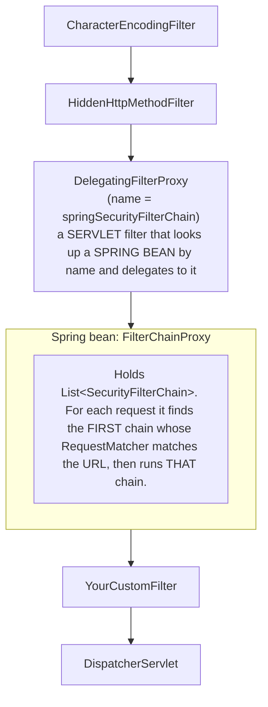

**How to read this diagram.** A servlet filter, `DelegatingFilterProxy`, hands the request to a Spring bean, `FilterChainProxy`. That bean picks the first matching `SecurityFilterChain` and runs it.

**`SecurityFilterChain` for `/api/**` (15 filters)**

| # | Filter |
| --- | --- |
| 1 | `DisableEncodeUrlFilter` |
| 2 | `WebAsyncManagerIntegrationFilter` |
| 3 | `SecurityContextHolderFilter` |
| 4 | `HeaderWriterFilter` |
| 5 | `CorsFilter` |
| 6 | `CsrfFilter` |
| 7 | `LogoutFilter` |
| 8 | `UsernamePasswordAuthenticationFilter` (or `BearerTokenAuthenticationFilter` for JWT) |
| 9 | `DefaultLoginPageGeneratingFilter` |
| 10 | `BasicAuthenticationFilter` |
| 11 | `RequestCacheAwareFilter` |
| 12 | `SecurityContextHolderAwareRequestFilter` |
| 13 | `AnonymousAuthenticationFilter` |
| 14 | `ExceptionTranslationFilter` |
| 15 | `AuthorizationFilter` |

**`SecurityFilterChain` for `/public/**` (3 filters)**

| # | Filter |
| --- | --- |
| 1 | `SecurityContextHolderFilter` |
| 2 | `HeaderWriterFilter` |
| 3 | `AuthorizationFilter` (`permitAll`) |

The exact filters and their order depend on your configuration and Spring Security version.

**Why this three-layer architecture?**

| Layer                  | Why It Exists                                                                                          |
| ---------------------- | ------------------------------------------------------------------------------------------------------ |
| `DelegatingFilterProxy` | Bridges servlet world → Spring world. Tomcat can't inject Spring beans, so this proxy does the lookup. |
| `FilterChainProxy`     | Manages multiple `SecurityFilterChain` beans. Picks the right chain per URL pattern.                   |
| `SecurityFilterChain`  | The actual ordered list of security filters. You configure this in `SecurityFilterChain @Bean`.         |

**How you configure it in code:**

```java
@Configuration
@EnableWebSecurity
public class SecurityConfig {

    @Bean
    @Order(1)
    public SecurityFilterChain apiSecurity(HttpSecurity http) throws Exception {
        return http
            .securityMatcher("/api/**")           // this chain handles /api paths
            .authorizeHttpRequests(auth -> auth
                .requestMatchers("/api/public/**").permitAll()
                .anyRequest().authenticated()
            )
            .oauth2ResourceServer(oauth2 -> oauth2.jwt(Customizer.withDefaults()))
            .sessionManagement(s -> s.sessionCreationPolicy(STATELESS))
            .csrf(csrf -> csrf.disable())         // stateless API, no CSRF needed
            .build();
        // This creates a SecurityFilterChain with ~12 filters (no login page filters)
    }

    @Bean
    @Order(2)
    public SecurityFilterChain webSecurity(HttpSecurity http) throws Exception {
        return http
            .securityMatcher("/**")               // everything else
            .authorizeHttpRequests(auth -> auth
                .requestMatchers("/", "/login", "/css/**").permitAll()
                .anyRequest().authenticated()
            )
            .formLogin(Customizer.withDefaults())  // adds login page filters
            .build();
        // This creates a SecurityFilterChain with ~15 filters (including login page)
    }
}
```

**The critical detail:** `FilterChainProxy` tries each `SecurityFilterChain` in `@Order` and uses the FIRST one whose `securityMatcher` matches. It does NOT run multiple chains — only ONE chain processes each request.

---

### 12C. DispatcherServlet — The Front Controller Pattern

**What DispatcherServlet actually is:** It's a regular `javax.servlet.http.HttpServlet` registered with Tomcat. Every Spring MVC application has exactly one (usually). ALL HTTP requests to your application that pass through the filter chain land here.

**Why the front controller pattern exists**

**Without `DispatcherServlet`** (raw servlets, the way Java web apps worked around 2000), `web.xml` maps each URL to its own servlet:

| URL | Servlet |
| --- | --- |
| `/users` | `UserServlet` |
| `/orders` | `OrderServlet` |
| `/items` | `ItemServlet` |
| `/auth` | `AuthServlet` |

Each URL needs its own servlet class registered in XML. There is no dependency injection, boilerplate is duplicated in every servlet, and there is no central exception handling.

**With `DispatcherServlet`** (front controller pattern, auto-configured by Spring Boot):

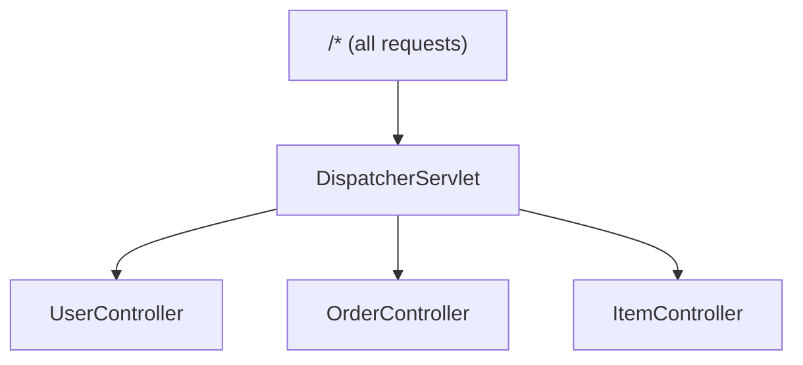

**How to read this diagram.** ONE servlet handles ALL requests and delegates to `@Controller` methods via reflection. That gives central error handling and full DI support.

**How Spring Boot auto-registers DispatcherServlet — the chain you never see:**

```text
 1. DispatcherServletAutoConfiguration (triggered by spring-boot-starter-web on classpath)

 2. Creates DispatcherServlet bean

 3. Creates DispatcherServletRegistrationBean
Sets urlMappings = "/" (catches all paths not handled by other servlets)
Sets loadOnStartup = -1 (loaded when first request arrives, not at boot)
Sets name = "dispatcherServlet"

 4. Registers it with Tomcat's ServletContext

 5. On first request → Tomcat calls DispatcherServlet.init()
→ creates its own WebApplicationContext (child of root context)
→ initializes HandlerMappings, HandlerAdapters, ViewResolvers,
   ExceptionResolvers, and all other MVC infrastructure
```

**DispatcherServlet's internal dispatch loop (what happens inside service()):**

```java
// Simplified from actual Spring source code — DispatcherServlet.doDispatch()
protected void doDispatch(HttpServletRequest request,
                          HttpServletResponse response) throws Exception {

    HandlerExecutionChain mappedHandler = null;
    ModelAndView mv = null;
    Exception dispatchException = null;

    try {
        // STEP 1: Find the handler (controller method) for this request
        mappedHandler = getHandler(request);
        // Iterates all HandlerMappings in order:
        //   RequestMappingHandlerMapping → checks @RequestMapping annotations
        //   BeanNameUrlHandlerMapping   → checks bean names matching URL
        //   RouterFunctionMapping       → checks functional endpoints
        // Returns HandlerExecutionChain = handler + list of interceptors

        if (mappedHandler == null) {
            noHandlerFound(request, response);  // → 404
            return;
        }

        // STEP 2: Find the adapter that knows how to invoke this handler type
        HandlerAdapter ha = getHandlerAdapter(mappedHandler.getHandler());
        // RequestMappingHandlerAdapter → for @Controller methods
        // HttpRequestHandlerAdapter    → for HttpRequestHandler
        // SimpleControllerHandlerAdapter → for old-style Controller interface

        // STEP 3: Run interceptor preHandle methods
        if (!mappedHandler.applyPreHandle(request, response)) {
            return;  // an interceptor said STOP — short circuit
        }

        // STEP 4: Actually invoke the controller method
        mv = ha.handle(request, response, mappedHandler.getHandler());
        // Inside here: argument resolution, method invocation,
        // return value handling (JSON serialization, view resolution)

        // STEP 5: Run interceptor postHandle methods
        mappedHandler.applyPostHandle(request, response, mv);

    } catch (Exception ex) {
        dispatchException = ex;
    }

    // STEP 6: Process result — render view or handle exception
    processDispatchResult(request, response, mappedHandler, mv, dispatchException);
    // If dispatchException != null → HandlerExceptionResolver chain runs
    //   → @ExceptionHandler methods in @ControllerAdvice
    //   → ResponseStatusExceptionResolver
    //   → DefaultHandlerExceptionResolver

    // STEP 7: afterCompletion on interceptors (ALWAYS runs, even on exception)
    // Called inside processDispatchResult → triggerAfterCompletion
}
```

---

### 12D. HandlerInterceptor — Spring-Level Request Hooks

**HandlerInterceptor is NOT a servlet concept.** It's pure Spring. It only runs for requests that reach DispatcherServlet AND match a handler. If a servlet filter rejects the request, or if no handler is found, interceptors never execute.

#### The Interface

```java
public interface HandlerInterceptor {

    // Runs BEFORE the controller method
    // Return true = continue; return false = stop here
    default boolean preHandle(HttpServletRequest request,
                               HttpServletResponse response,
                               Object handler) throws Exception {
        return true;
    }

    // Runs AFTER the controller method, BEFORE the response is committed
    // Only runs if the controller did NOT throw an exception
    // The ModelAndView is available for modification
    default void postHandle(HttpServletRequest request,
                            HttpServletResponse response,
                            Object handler,
                            @Nullable ModelAndView modelAndView) throws Exception {
    }

    // ALWAYS runs — even if the controller threw an exception
    // Use for cleanup: closing resources, logging elapsed time
    default void afterCompletion(HttpServletRequest request,
                                 HttpServletResponse response,
                                 Object handler,
                                 @Nullable Exception ex) throws Exception {
    }
}
```

#### When Each Method Fires — The Exact Timeline

**Interceptor order**

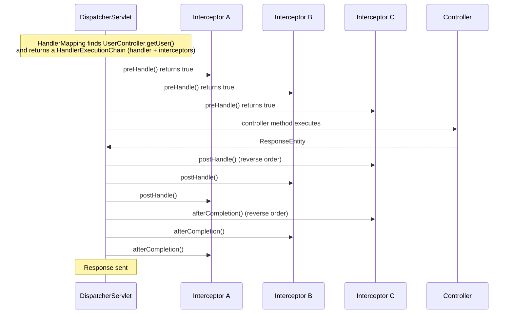

**How to read this diagram.** `preHandle()` runs in declaration order. `postHandle()` and `afterCompletion()` run in REVERSE order.

**If Interceptor B's `preHandle()` returns `false`:**

- Interceptor A: `preHandle()` returns true.
- Interceptor B: `preHandle()` returns `false`, so the chain STOPS HERE.
- The controller NEVER executes, and `postHandle()` NEVER runs for any interceptor.
- Interceptor A: `afterCompletion()` still runs (only for interceptors whose `preHandle()` returned true). Interceptor B's `afterCompletion()` does NOT run.
- The response is sent (whatever B wrote to it).

#### Implementing and Registering a Custom Interceptor

```java
// Step 1: Create the interceptor
@Component
public class RequestTimingInterceptor implements HandlerInterceptor {

    @Override
    public boolean preHandle(HttpServletRequest request,
                              HttpServletResponse response,
                              Object handler) {
        request.setAttribute("startTime", System.nanoTime());
        return true;
    }

    @Override
    public void afterCompletion(HttpServletRequest request,
                                 HttpServletResponse response,
                                 Object handler,
                                 Exception ex) {
        long start = (long) request.getAttribute("startTime");
        long elapsed = TimeUnit.NANOSECONDS.toMillis(System.nanoTime() - start);

        // handler is the actual controller method — you can inspect it
        if (handler instanceof HandlerMethod hm) {
            String controller = hm.getBeanType().getSimpleName();
            String method = hm.getMethod().getName();
            log.info("{}.{} completed in {} ms (status: {})",
                controller, method, elapsed, response.getStatus());
        }
    }
}

// Step 2: Register the interceptor with path patterns
@Configuration
public class WebMvcConfig implements WebMvcConfigurer {

    @Autowired
    private RequestTimingInterceptor timingInterceptor;

    @Autowired
    private TenantInterceptor tenantInterceptor;

    @Override
    public void addInterceptors(InterceptorRegistry registry) {
        registry.addInterceptor(timingInterceptor)
                .addPathPatterns("/api/**")          // only API paths
                .excludePathPatterns("/api/health"); // skip health checks

        registry.addInterceptor(tenantInterceptor)
                .addPathPatterns("/api/**")
                .order(1);  // explicit ordering (lower = first)
    }
}
```

**The `handler` parameter — what it actually is:**

```java
@Override
public boolean preHandle(HttpServletRequest request,
                          HttpServletResponse response,
                          Object handler) {

    // For @Controller methods: handler is HandlerMethod
    if (handler instanceof HandlerMethod hm) {
        Class<?> controllerClass = hm.getBeanType();     // UserController.class
        Method method = hm.getMethod();                   // getUser(Long)
        // You can check for annotations on the method:
        RequiresAdmin ann = hm.getMethodAnnotation(RequiresAdmin.class);
        if (ann != null && !isAdmin(request)) {
            response.sendError(403);
            return false;
        }
    }

    // For static resources: handler is ResourceHttpRequestHandler
    // For functional endpoints: handler is HandlerFunction

    return true;
}
```

#### AsyncHandlerInterceptor — For @Async Controllers

```java
// Regular interceptors have a problem with async controllers:
//   afterCompletion() fires when the async processing STARTS, not when it ends
// AsyncHandlerInterceptor adds one more callback:

public interface AsyncHandlerInterceptor extends HandlerInterceptor {

    // Called when a controller returns Callable, DeferredResult, or CompletableFuture
    // Fires INSTEAD OF postHandle/afterCompletion on the initial thread
    // Then when async completes, a NEW request dispatch happens and
    // preHandle/postHandle/afterCompletion run again on the new thread
    default void afterConcurrentHandlingStarted(HttpServletRequest request,
                                                 HttpServletResponse response,
                                                 Object handler) {
    }
}
```

---

### 12E. Filter vs Interceptor — The Complete Comparison

|  | SERVLET FILTER | HANDLER INTERCEPTOR |
| --- | --- | --- |
| Specification | Servlet API (javax.servlet.Filter) | Spring MVC (HandlerInterceptor) |
| Scope | ALL requests to the servlet container — including static files, error pages, forwards | Only requests that reach<br>DispatcherServlet AND match a handler.<br>Static resources: NO |
| Spring Context<br>Access | NOT available by default (unless you use<br>DelegatingFilterProxy or register as @Bean) | Full access — interceptors are Spring beans. Can<br>@Autowire services. |
| Handler Info | No — filters don't know which controller will handle the request | Yes — receives the actual<br>HandlerMethod object.<br>Can inspect annotations. |
| Request/Response<br>Wrapping | Can wrap/replace the request and response objects entirely | Cannot replace request or response objects. |
| Exception Handling | Must catch exceptions yourself in try-catch.<br>No integration with<br>@ControllerAdvice | afterCompletion() receives the exception parameter.<br>@ControllerAdvice handles controller exceptions. |
| Short-Circuit | Don't call chain.doFilter() | Return false from preHandle() |
| Post-Processing | Code after chain.doFilter() runs regardless of exceptions | postHandle() — only if no exception afterCompletion() — always |
| Use Cases | Security, CORS, encoding, request ID injection, rate limiting, body caching/logging | Logging, timing, auth checks that need handler info, audit trails, tenant resolution |

**Decision Guide:**

```
  Should I use a Filter or an Interceptor?

  Do you need to see/modify the RAW request body?
    → FILTER (wrap request with ContentCachingRequestWrapper)

  Do you need to run even for static resources and error pages?
    → FILTER (interceptors only run for matched handlers)

  Do you need to know WHICH controller method will handle the request?
    → INTERCEPTOR (handler parameter gives you the method + annotations)

  Do you need to wrap/replace the HttpServletRequest object?
    → FILTER (interceptors can't modify the request/response objects)

  Are you implementing cross-cutting security (authentication)?
    → FILTER (Spring Security is entirely filter-based for this reason)

  Are you implementing business-level authorization ("only admins can...")?
    → INTERCEPTOR (you can check handler annotations like @RequiresAdmin)

  Do you need to log the response body?
    → FILTER (wrap response with ContentCachingResponseWrapper)

  Do you need clean integration with @ControllerAdvice error handling?
    → INTERCEPTOR (filter exceptions bypass @ControllerAdvice entirely)
```

---

### 12F. Request/Response Wrapping — Why the Body Disappears

**The problem every developer hits:** You write a filter to log the request body. It works. Then the controller returns 400 — the body is empty. Why?

```
  The Servlet API's InputStream can only be read ONCE:

  Filter reads body:    request.getInputStream().readAllBytes()  → body bytes ✓
  Controller reads body: @RequestBody → request.getInputStream() → EMPTY

  The stream has already been consumed. There's no rewind.
```

**The solution: ContentCachingRequestWrapper**

```java
@Component
@Order(Ordered.HIGHEST_PRECEDENCE)  // run before everything else
public class RequestBodyCachingFilter extends OncePerRequestFilter {

    @Override
    protected void doFilterInternal(HttpServletRequest request,
                                     HttpServletResponse response,
                                     FilterChain chain)
            throws ServletException, IOException {

        // Wrap the request — this caches the body as it's read
        ContentCachingRequestWrapper wrappedRequest =
            new ContentCachingRequestWrapper(request);

        // Wrap the response — this captures the response body
        ContentCachingResponseWrapper wrappedResponse =
            new ContentCachingResponseWrapper(response);

        try {
            chain.doFilter(wrappedRequest, wrappedResponse);
        } finally {
            // Log after the controller has processed
            byte[] requestBody = wrappedRequest.getContentAsByteArray();
            byte[] responseBody = wrappedResponse.getContentAsByteArray();

            log.info("Request: {} {} body={}",
                request.getMethod(), request.getRequestURI(),
                new String(requestBody, request.getCharacterEncoding()));
            log.info("Response: status={} body={}",
                response.getStatus(),
                new String(responseBody, response.getCharacterEncoding()));

            // CRITICAL: copy the cached body to the actual response output
            // Without this line, the client receives an EMPTY response!
            wrappedResponse.copyBodyToResponse();
        }
    }
}
```

**Why ContentCachingRequestWrapper works differently than you expect:**

```
  ContentCachingRequestWrapper does NOT eagerly read the body.
  It wraps the InputStream so that when something ELSE reads it
  (like Jackson in @RequestBody processing), the bytes are ALSO
  copied into an internal ByteArrayOutputStream.

  After chain.doFilter() returns, you call getContentAsByteArray()
  to get the cached copy. The original stream is still consumed —
  you read the COPY.

  Timeline:
  1. Filter wraps request
  2. chain.doFilter() → eventually @RequestBody triggers Jackson
  3. Jackson reads request.getInputStream()
  4. ContentCachingRequestWrapper intercepts each read() call,
     copies bytes to internal buffer AND passes them to Jackson
  5. Jackson finishes — stream consumed
  6. Filter calls getContentAsByteArray() — gets the cached copy
```

---

### 12G. CORS — Where It Lives in the Pipeline

**CORS is a browser-enforced mechanism, not a server mechanism.** The server sets headers; the browser decides whether to allow the request. Understanding where CORS headers get set in the Spring pipeline matters because getting it wrong means preflight requests fail silently.

**Preflight (OPTIONS) request flow**

The browser wants to POST to `https://api.example.com/users` from the origin `https://app.example.com` (a different domain).

**Step 1: the browser sends an OPTIONS preflight automatically**

```http
OPTIONS /users HTTP/1.1
Origin: https://app.example.com
Access-Control-Request-Method: POST
Access-Control-Request-Headers: Content-Type, Authorization
```

**Step 2: this OPTIONS request enters Spring's filter chain**

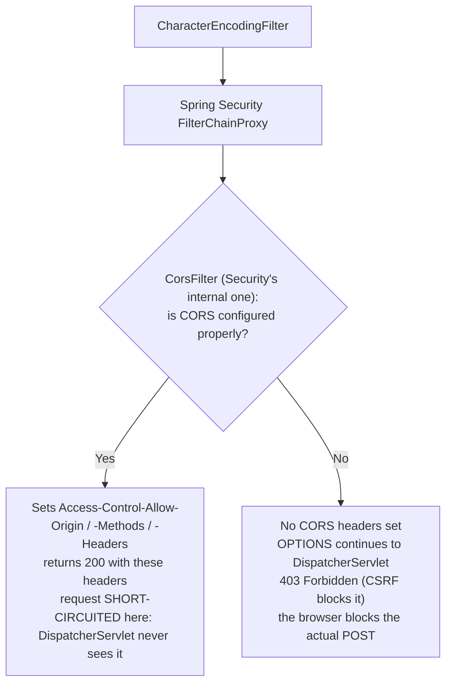

**How to read this diagram.** If CORS is configured at the security filter level, the preflight is answered there. If it isn't, the request falls through, gets rejected, and the browser refuses to send the real POST.

**Three ways to configure CORS (and where each lives in the pipeline):**

```java
// WAY 1: @CrossOrigin on controller (lives in DispatcherServlet layer)
// Handled by HandlerMapping — only applies to matched handlers
// PROBLEM: preflight OPTIONS might be blocked by Security filters BEFORE
//          it reaches DispatcherServlet
@RestController
@CrossOrigin(origins = "https://app.example.com")
public class UserController {
    @GetMapping("/users")
    public List<User> getUsers() { ... }
}

// WAY 2: Global CORS via WebMvcConfigurer (lives in DispatcherServlet layer)
// Same problem as @CrossOrigin — processed too late for preflight
@Configuration
public class WebConfig implements WebMvcConfigurer {
    @Override
    public void addCorsMappings(CorsRegistry registry) {
        registry.addMapping("/api/**")
                .allowedOrigins("https://app.example.com")
                .allowedMethods("GET", "POST", "PUT", "DELETE")
                .allowedHeaders("*")
                .allowCredentials(true)
                .maxAge(3600);
    }
}

// WAY 3: CorsFilter as a servlet filter (lives in filter chain — BEFORE security)
// This is the CORRECT approach when using Spring Security
@Configuration
public class CorsConfig {
    @Bean
    public CorsFilter corsFilter() {
        CorsConfiguration config = new CorsConfiguration();
        config.setAllowedOrigins(List.of("https://app.example.com"));
        config.setAllowedMethods(List.of("GET", "POST", "PUT", "DELETE", "OPTIONS"));
        config.setAllowedHeaders(List.of("*"));
        config.setAllowCredentials(true);

        UrlBasedCorsConfigurationSource source = new UrlBasedCorsConfigurationSource();
        source.registerCorsConfiguration("/api/**", config);
        return new CorsFilter(source);
    }
}

// WAY 4: Spring Security's CORS integration (RECOMMENDED with Security)
// Tells Security to use your CorsConfigurationSource for its internal CorsFilter
@Bean
public SecurityFilterChain securityFilterChain(HttpSecurity http) throws Exception {
    return http
        .cors(cors -> cors.configurationSource(corsConfigurationSource()))
        .csrf(csrf -> csrf.disable())
        .build();
}

@Bean
public CorsConfigurationSource corsConfigurationSource() {
    CorsConfiguration config = new CorsConfiguration();
    config.setAllowedOrigins(List.of("https://app.example.com"));
    config.setAllowedMethods(List.of("*"));
    config.setAllowedHeaders(List.of("*"));
    config.setAllowCredentials(true);

    UrlBasedCorsConfigurationSource source = new UrlBasedCorsConfigurationSource();
    source.registerCorsConfiguration("/**", config);
    return source;
}
```

**Why Way 4 is correct with Spring Security:** Spring Security's `CorsFilter` runs INSIDE `FilterChainProxy`, BEFORE the `CsrfFilter` and `AuthorizationFilter`. This means preflight OPTIONS requests get CORS headers and return 200 before security checks can reject them.

---

### 12H. Exception Handling Across Layers — Who Catches What

**The most confusing aspect of the request pipeline:** Different layers handle exceptions differently, and an exception thrown in one layer may not be catchable by mechanisms in another.

```
  EXCEPTION THROWN IN...              CAUGHT BY...
  ──────────────────────────────────  ──────────────────────────────────────────

  Filter (before DispatcherServlet)   → NOT caught by @ControllerAdvice
                                      → NOT caught by @ExceptionHandler
                                      → Tomcat's default error page (ugly HTML)
                                      → OR: custom ErrorController if configured

  HandlerInterceptor.preHandle()      → afterCompletion() of already-run interceptors
                                      → NOT caught by @ControllerAdvice
                                      → Same as filter-level: goes to ErrorController

  Controller method                   → @ExceptionHandler in the controller
                                      → @ControllerAdvice @ExceptionHandler (global)
                                      → HandlerExceptionResolver chain
                                      → afterCompletion() on interceptors

  HandlerInterceptor.postHandle()     → afterCompletion() of interceptors
                                      → NOT caught by @ControllerAdvice
                                      → Goes to ErrorController

  HandlerInterceptor.afterCompletion()→ Logged and swallowed by DispatcherServlet
                                        (never reaches the client)
```

**The ErrorController — catching what @ControllerAdvice cannot:**

```java
// When a filter throws, Tomcat catches it and forwards to /error
// Spring Boot's BasicErrorController handles /error by default
// You can replace it:

@RestController
public class GlobalErrorController implements ErrorController {

    @RequestMapping("/error")
    public ResponseEntity<Map<String, Object>> handleError(HttpServletRequest request) {
        // Tomcat stores the original exception and status code as request attributes
        Integer status = (Integer) request.getAttribute(
            RequestDispatcher.ERROR_STATUS_CODE);
        Throwable exception = (Throwable) request.getAttribute(
            RequestDispatcher.ERROR_EXCEPTION);

        Map<String, Object> body = new LinkedHashMap<>();
        body.put("status", status != null ? status : 500);
        body.put("error", exception != null ? exception.getMessage() : "Unknown");
        body.put("path", request.getAttribute(RequestDispatcher.ERROR_REQUEST_URI));
        body.put("timestamp", Instant.now());

        return ResponseEntity.status(status != null ? status : 500).body(body);
    }
}
```

**How Tomcat's error forwarding works internally:**

```
  Filter throws RuntimeException
  │
  ▼
  Tomcat catches it (because filters run inside Tomcat's request processing)
  │
  ▼
  Tomcat looks up error-page mapping for the exception type or status code
  │  Spring Boot auto-configures: all errors → /error
  │
  ▼
  Tomcat creates an INTERNAL FORWARD to /error
  │  RequestDispatcher.forward(request, response)
  │  This is a NEW dispatch through the SAME filter chain!
  │  (OncePerRequestFilter prevents double-execution)
  │
  ▼
  DispatcherServlet handles /error → routes to ErrorController
  │
  ▼
  ErrorController reads original exception from request attributes
  Returns JSON/HTML error response
  │
  ▼
  Response sent to client

  KEY INSIGHT: The /error dispatch passes through filters AGAIN.
  If the filter that threw the exception doesn't handle the error
  dispatch differently, you get an infinite loop!
  OncePerRequestFilter prevents this by skipping on the second pass.
```

**Complete exception handling setup for production:**

```java
// 1. Controller-level exceptions → @ControllerAdvice
@RestControllerAdvice
public class GlobalExceptionHandler {

    @ExceptionHandler(ResourceNotFoundException.class)
    public ResponseEntity<ErrorResponse> handleNotFound(ResourceNotFoundException ex) {
        return ResponseEntity.status(404)
            .body(new ErrorResponse(404, ex.getMessage()));
    }

    @ExceptionHandler(MethodArgumentNotValidException.class)
    public ResponseEntity<ErrorResponse> handleValidation(
            MethodArgumentNotValidException ex) {
        String message = ex.getBindingResult().getFieldErrors().stream()
            .map(e -> e.getField() + ": " + e.getDefaultMessage())
            .collect(Collectors.joining(", "));
        return ResponseEntity.badRequest()
            .body(new ErrorResponse(400, message));
    }

    @ExceptionHandler(Exception.class)
    public ResponseEntity<ErrorResponse> handleAll(Exception ex) {
        log.error("Unhandled exception", ex);
        return ResponseEntity.status(500)
            .body(new ErrorResponse(500, "Internal server error"));
    }
}

// 2. Filter-level exceptions → ErrorController
// (See GlobalErrorController above)

// 3. Filter that wants to return JSON errors WITHOUT going through /error:
@Component
@Order(1)
public class ApiKeyFilter extends OncePerRequestFilter {

    @Override
    protected void doFilterInternal(HttpServletRequest request,
                                     HttpServletResponse response,
                                     FilterChain chain)
            throws ServletException, IOException {

        String apiKey = request.getHeader("X-API-Key");
        if (apiKey == null || !isValid(apiKey)) {
            // Write error response directly — don't throw
            response.setStatus(401);
            response.setContentType("application/json");
            response.getWriter().write(
                "{\"status\":401,\"error\":\"Invalid or missing API key\"}");
            // Do NOT call chain.doFilter() — stop here
            return;
        }
        chain.doFilter(request, response);
    }
}
```

🔬 **Section Challenge — 12A-12H Request Pipeline Deep Dive**

**Challenge 10 (Filter Order Debugging):** You have a `LoggingFilter` that logs the request body and a Spring Security `FilterChainProxy`. The logging filter runs AFTER security. An unauthenticated request arrives. **What** does the logging filter see? **Why** is this a problem? **How** do you fix it?

<details><summary>Answer</summary>

**What it sees:** Nothing — the logging filter never executes. Spring Security's `FilterChainProxy` (order 100) runs first. For an unauthenticated request, `AuthorizationFilter` inside the security chain returns 401 without calling `chain.doFilter()`. The `LoggingFilter` (higher order) is never reached. **Why it's a problem:** You can't log failed authentication attempts. **How to fix:** Either (1) set `LoggingFilter` order to something below 100 (e.g., `@Order(-1)`) so it runs before security, or (2) add a custom security filter INSIDE the `SecurityFilterChain` using `http.addFilterBefore(loggingFilter, AuthorizationFilter.class)` — this way logging runs inside the security chain before the auth check.

</details>

**Challenge 11 (Interceptor vs Filter Trap):** You write a `HandlerInterceptor` to check if the user has a "Premium" role before allowing access to `/api/reports/**`. It works in tests. In production, users can still access reports without the Premium role by requesting `/api/reports/../reports/dashboard`. **Why?** **Where** in the pipeline does path normalization happen?

<details><summary>Answer</summary>

**Why:** The `HandlerInterceptor`'s `addPathPatterns("/api/reports/**")` matches against the RAW request URI. The path `/../` traversal is normalized LATER — by `DispatcherServlet`'s `HandlerMapping` when resolving the controller. So `/api/reports/../reports/dashboard` does NOT match the interceptor's pattern `/api/reports/**` (it resolves to `/api/reports/dashboard` only after normalization). **Where normalization happens:** `UrlPathHelper.getPathWithinApplication()` inside `HandlerMapping`, which runs AFTER interceptor registration matching but BEFORE `preHandle()`. **Fix:** Use a servlet `Filter` instead — filters can call `request.getServletPath()` which is already normalized by Tomcat. Or use Spring Security's `requestMatchers()` which normalizes paths before matching.

</details>

**Challenge 12 (The Disappearing Exception):** A `HandlerInterceptor.afterCompletion()` throws `NullPointerException`. The controller returned a valid 200 response. **What** does the client receive? **Where** does the NPE go?

<details><summary>Answer</summary>

**What the client receives:** The original 200 response — unchanged. **Where the NPE goes:** `DispatcherServlet` catches exceptions from `afterCompletion()`, logs them at WARN level, and swallows them. The response is already committed (written to the socket buffer) by the time `afterCompletion` runs, so changing the status code is impossible. The NPE appears in server logs but never reaches the client. This is by design — `afterCompletion` is for cleanup, not for modifying the response. **Source:** `DispatcherServlet.triggerAfterCompletion()` wraps each interceptor's `afterCompletion()` call in a try-catch that logs but does not rethrow.

</details>

---

## 13. The Entire Spring Ecosystem — How Pieces Fit Together

**Spring ecosystem architecture**

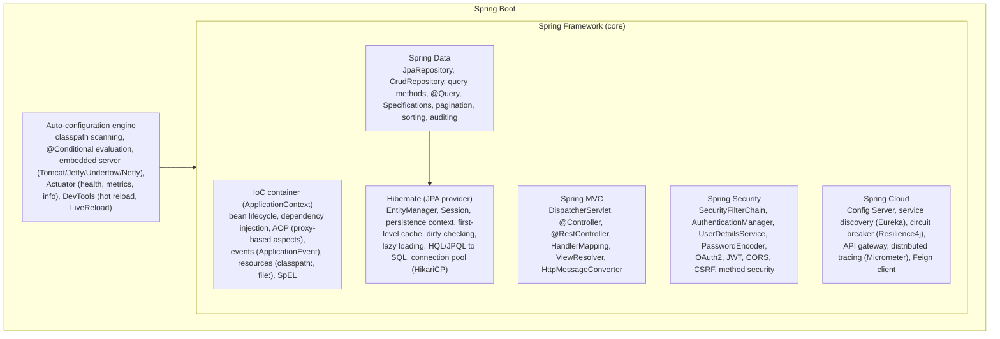

**How to read this diagram.** Spring Boot wraps the Spring Framework core. The modules (MVC, Data, Security, Cloud) all sit on the core's IoC container, and Hibernate sits beneath Spring Data.

**How they connect**

- Spring Boot auto-configures the Spring Framework modules.
- Spring Framework provides DI and AOP to ALL modules.
- Spring MVC uses DI for controllers and AOP for exception handling.
- Spring Data uses DI for repositories and AOP for `@Transactional`.
- Spring Security uses DI for configuration and filters for request security.
- Spring Cloud uses DI for configuration and adds distributed-system features.

### Quick Interview Reference: "Explain the Difference Between..."

| Spring vs Spring Boot                                                                                                                                   |
| ------------------------------------------------------------------------------------------------------------------------------------------------------- |
| **Spring** = The framework (IoC, DI, AOP, MVC, Data, Security). You configure everything manually: XML or @Configuration.                               |
| **Spring Boot** = An opinionated wrapper around Spring. Auto-configures beans based on classpath. Embedded server. Starter dependencies. No XML needed. |
| **Analogy**: Spring = the engine, transmission, chassis, custom build. Spring Boot = the fully assembled car with defaults.                             |

| Spring MVC vs Spring WebFlux                                                                                                               |
| ------------------------------------------------------------------------------------------------------------------------------------------ |
| **Spring MVC** = Servlet-based (blocking). One thread per request. Thread blocked during DB calls. Easier to understand.                   |
| **Spring WebFlux** = Reactive (non-blocking). Event loop (like Node.js). Thread NEVER blocks. Returns Mono/Flux instead of actual objects. |
| **When to use WebFlux**: High concurrency (10k+ simultaneous), streaming data, microservices with many I/O calls. **Otherwise use MVC.**   |

| Spring Data JPA vs Hibernate vs JDBC                                                                                                |
| ----------------------------------------------------------------------------------------------------------------------------------- |
| **JDBC** = Raw SQL. You write queries, map results manually. Full control.                                                          |
| **Hibernate** = ORM. Maps Java objects to tables. Generates SQL. Caching. Session management.                                       |
| **Spring Data JPA** = Abstraction over Hibernate. Auto-generates repository implementations from method names. Pagination built-in. |
| **Hierarchy**: Spring Data JPA → calls → Hibernate → generates → JDBC → sends → SQL to DB                                           |

---

**Next Chapter**: [Hibernate & JPA Internals →](Ch56_Hibernate_JPA_Internals.md)

🔬 **Section Challenge — 13. The Entire Spring Ecosystem — How Pieces Fit Together**

**Challenge 13 (Startup-to-Shutdown Trace):** Trace the lifecycle of the entire Spring ecosystem from `main()` to graceful shutdown. **Who** starts first? **When** do beans become available for injection? **What** happens to in-flight HTTP requests during shutdown?

<details><summary>Answer</summary>

**Startup sequence:** (1) `SpringApplication.run()` creates `ApplicationContext`. (2) `Environment` + `PropertySources` loaded. (3) `ApplicationContextInitializers` run. (4) `BeanDefinitionReader` scans `@ComponentScan` packages. (5) `BeanFactoryPostProcessors` run (`ConfigurationClassPostProcessor` processes `@Configuration`). (6) `BeanPostProcessors` registered. (7) Singleton beans instantiated (in dependency order). (8) `@Autowired` dependencies injected. (9) `@PostConstruct` methods called. (10) `ApplicationReadyEvent` fired. (11) Embedded Tomcat starts → HTTP traffic accepted. **When beans available for injection:** After step 8 — `@Autowired` completes. But `@PostConstruct` (step 9) runs after injection, so beans may not be "ready" until step 9 completes. **Graceful shutdown:** `SIGTERM` received → Spring Boot 2.3+ triggers `GracefulShutdown`. Tomcat stops accepting NEW connections. In-flight requests: given a configurable grace period (`server.shutdown.timeout`, default 30s) to complete. After timeout, forcibly terminated. `@PreDestroy` beans called in REVERSE creation order. `ApplicationContext` closed. **Key:** HTTP traffic is drained before beans are destroyed — ensuring no `NullPointerException` on half-destroyed services.

</details>


---

## Reality Check

**"Spring creates objects with new keyword internally"** — Spring uses reflection (Constructor.newInstance) for standard beans, CGLIB bytecode generation for @Configuration classes and AOP proxies, and JDK dynamic proxies for interface-based proxies. The new keyword is never used for Spring-managed beans. Understanding this explains why: final classes cannot be proxied by CGLIB, private constructors prevent bean creation, and @Bean methods in @Configuration classes return the SAME instance even when called multiple times (CGLIB intercepts the call).

**"ApplicationContext is just a fancy HashMap of beans"** — ApplicationContext manages a complete lifecycle: bean definition loading, BeanFactoryPostProcessor execution, bean instantiation, dependency injection, BeanPostProcessor execution (which creates proxies for @Transactional, @Async, @Cacheable), lifecycle callbacks (@PostConstruct, @PreDestroy), event publishing, and environment property resolution. It is an inversion-of-control container, not a map.

**"@Transactional on a method always creates a transaction"** — @Transactional works through a PROXY. If method A in the same class calls method B which is annotated @Transactional, the proxy is NOT involved — the call goes directly to B, bypassing the transaction interceptor. Self-invocation is the number one @Transactional bug. Fix: inject the service into itself, extract to a separate class, or use TransactionTemplate programmatically.

**"Spring Boot auto-configuration is magic"** — Every auto-configuration class is a regular @Configuration class in a spring-boot-autoconfigure JAR, registered in META-INF/spring/org.springframework.boot.autoconfigure.AutoConfiguration.imports. Each one has @Conditional annotations that check classpath, existing beans, and properties. You can see exactly what was auto-configured and what was excluded in the auto-configuration report (--debug flag or /actuator/conditions endpoint).

**"Circular dependencies are a Spring limitation"** — Circular dependencies are a DESIGN problem that Spring partially works around using three-level cache (singletonObjects, earlySingletonObjects, singletonFactories) for setter/field injection. But this does not work for constructor injection, prototype-scoped beans, or @Async beans. Spring 6.x logs warnings for circular dependencies. The correct fix is to redesign: extract the shared logic into a third bean that both depend on.
