> **Navigation**: [< Previous](Ch22_Java_Deep_Reasoning.md) | [Back to Index](../00_MASTER_INDEX.md) | [Next >](Ch23_Streams_Deep_Reasoning.md)

# Chapter 32 — Spring Boot Deep Reasoning: The Questions That Freeze People

> **"Anyone can say 'Spring Boot auto-configures everything.' The senior engineer explains WHAT DispatcherServlet actually does, WHY @Transactional fails on private methods, and HOW the proxy pattern secretly runs your entire application."**

---

## Table of Contents

1. [DispatcherServlet vs Filter: The Request Gate vs Security Guard](#1-dispatcherservlet-vs-filter-the-request-gate-vs-security-guard)
2. [What @SpringBootApplication Actually Does](#2-what-springbootapplication-actually-does)
3. [Auto-Configuration: How Spring "Magically" Knows What You Need](#3-auto-configuration-how-spring-magically-knows-what-you-need)
4. [The Proxy Pattern: Why @Transactional Fails On Self-Calls](#4-the-proxy-pattern-why-transactional-fails-on-self-calls)
5. [Bean Lifecycle: What Happens Between `new` and "Ready"](#5-bean-lifecycle-what-happens-between-new-and-ready)
6. [IoC & DI: Not Just "Injection" — The Inversion Explained](#6-ioc--di-not-just-injection--the-inversion-explained)
7. [@Autowired vs Constructor Injection: Why Seniors Choose Constructor](#7-autowired-vs-constructor-injection-why-seniors-choose-constructor)
8. [Bean Scopes: Why Injecting Prototype Into Singleton Breaks](#8-bean-scopes-why-injecting-prototype-into-singleton-breaks)
9. [@Controller vs @RestController: Not Just "Adds @ResponseBody"](#9-controller-vs-restcontroller-not-just-adds-responsebody)
10. [Spring Security Filter Chain: How Authentication Actually Works](#10-spring-security-filter-chain-how-authentication-actually-works)
11. [Profiles & Conditional Beans: How Spring Switches Environments](#11-profiles--conditional-beans-how-spring-switches-environments)
12. [Why @Async Doesn't Work Without @EnableAsync](#12-why-async-doesnt-work-without-enableasync)

---

## 1. DispatcherServlet vs Filter: The Request Gate vs Security Guard

### The Freeze Question
> "What's the difference between a DispatcherServlet and a Filter?"

**This is the question the user explicitly said people freeze on.**

### Deep Reasoning

```
THE OFFICE BUILDING ANALOGY

HTTP Request arrives at your Spring Boot application:

┌──────────────── SERVLET CONTAINER (Tomcat) ────────────────────┐
│                                                                │
│  [Request] → FILTER 1 → FILTER 2 → FILTER 3 →                  │
│                                                                │
│              ┌── DISPATCHER SERVLET ──────────────────┐        │
│              │                                        │        │
│              │  HandlerMapping → "Which controller?"  │        │
│              │  HandlerAdapter → "Call the method"     │       │
│              │  ViewResolver → "Render the response"  │        │
│              │                                        │        │
│              │  @Controller methods live HERE          │       │
│              └────────────────────────────────────────┘        │
│                                                                │
│  ← FILTER 3 ← FILTER 2 ← FILTER 1 ← [Response]                 │
└────────────────────────────────────────────────────────────────┘

FILTER = Security guard at the building entrance
→ Runs BEFORE and AFTER the request reaches Spring
→ Part of the Servlet spec (javax.servlet.Filter)
→ NOT part of Spring — works at the web container level
→ Can modify request/response, reject requests, log, compress
→ Spring Security IS a filter chain!

DISPATCHER SERVLET = The receptionist inside the building
→ A special Servlet that routes requests to the right Controller
→ IS the entry point to Spring MVC
→ Only ONE DispatcherServlet (front controller pattern)
→ Handles: URL mapping, argument binding, exception handling
```

> **Flow**: THE OFFICE BUILDING ANALOGY → HTTP Request arrives at your Spring Boot application: | HTTP Request arrives at your Spring Boot application: → SERVLET CONTAINER (Tomcat) | SERVLET CONTAINER (Tomcat) → [Request] → FILTER 1 → FILTER 2 → FILTER 3 → | [Request] → FILTER 1 → FILTER 2 → FILTER 3 → → DISPATCHER SERVLET | DISPATCHER SERVLET → HandlerMapping → 'Which controller?' | HandlerMapping → 'Which controller?' → HandlerAdapter → 'Call the method' | ...+1 more

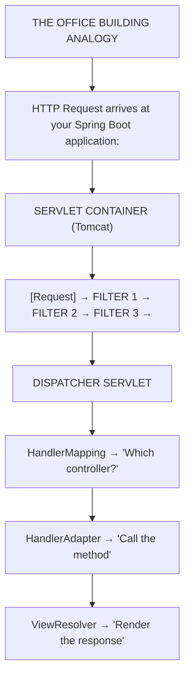

```java
// FILTER: Runs at Servlet container level, wraps the entire request
@Component
public class LoggingFilter implements Filter {
    @Override
    public void doFilter(ServletRequest request, ServletResponse response,
                         FilterChain chain) throws IOException, ServletException {
        long start = System.currentTimeMillis();

        // BEFORE DispatcherServlet
        System.out.println("Request started: " + ((HttpServletRequest) request).getRequestURI());

        chain.doFilter(request, response); // Continue to next filter or DispatcherServlet

        // AFTER DispatcherServlet (response is ready)
        long duration = System.currentTimeMillis() - start;
        System.out.println("Request took: " + duration + "ms");
    }
}

// DISPATCHER SERVLET: Routes to controllers (you don't usually touch this)
// It does this internally:
// 1. HandlerMapping: "/api/users" → UserController.getUsers()
// 2. HandlerAdapter: Converts HTTP params → Java method args
// 3. Calls your @Controller method
// 4. ViewResolver: Converts return value → HTTP response

// BUT WAIT — there's also INTERCEPTOR (between Filter and Controller):
@Component
public class AuthInterceptor implements HandlerInterceptor {
    @Override
    public boolean preHandle(HttpServletRequest request,
                             HttpServletResponse response, Object handler) {
        // Runs AFTER filters, BEFORE controller
        // Has access to Spring context (unlike filters)
        return true; // false = reject request
    }
}
```

### Complete Request Flow:
```
Client → Tomcat → Filter1 → Filter2 → Filter3
  → DispatcherServlet
    → Interceptor.preHandle()
      → @Controller method
    → Interceptor.postHandle()
  → DispatcherServlet (view resolution)
    → Interceptor.afterCompletion()
  → Filter3 → Filter2 → Filter1 → Tomcat → Client
```

> **Flow**: Client → Tomcat | Tomcat → Filter1 | Filter1 → Filter2 | Filter2 → Filter3 | Filter3 → Filter2 | Filter2 → Filter1 | ...+2 more

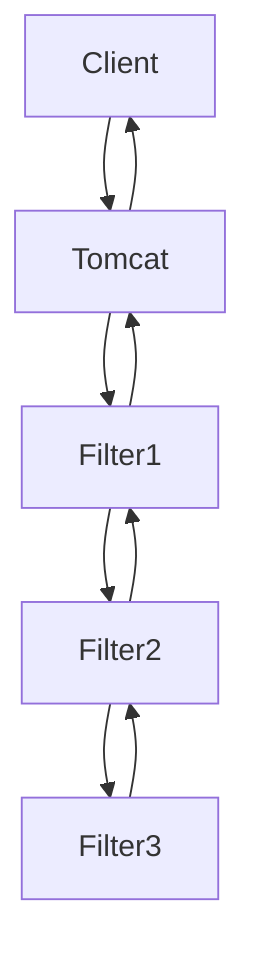

### When To Use What:
| Use Case | Use |
|----------|-----|
| Logging, CORS, compression | Filter |
| Authentication/Authorization | Filter (Spring Security) |
| Rate limiting, request modification | Filter |
| Audit logging with Spring context | Interceptor |
| Controller-specific pre/post logic | Interceptor |
| Business logic, API endpoints | Controller |

---

## 2. What @SpringBootApplication Actually Does

### The Freeze Question
> "What does @SpringBootApplication do? Could you build a Spring Boot app without it?"

```
╔══════════════════════════════════════════════════════════════════╗
║  @SpringBootApplication = THREE annotations in one:              ║
║                                                                  ║
║  @Configuration                                                  ║
║  → "This class itself is a configuration (can define @Beans)"    ║
║  → Makes main class a source of bean definitions                 ║
║                                                                  ║
║  @EnableAutoConfiguration                                        ║
║  → "Scan classpath and auto-configure beans based on what's      ║
║     on the classpath"                                            ║
║  → Found spring-boot-starter-web? → Configure Tomcat,            ║
║    DispatcherServlet, Jackson, error handling...                 ║
║  → Found spring-boot-starter-data-jpa? → Configure DataSource,   ║
║    EntityManagerFactory, TransactionManager...                   ║
║                                                                  ║
║  @ComponentScan                                                  ║
║  → "Scan THIS package and sub-packages for @Component,           ║
║    @Service, @Repository, @Controller"                           ║
║  → THIS is why your main class should be in the ROOT package     ║
║  → If main class is in com.app, it scans com.app.** only         ║
║  → Classes in com.other will NOT be found!                       ║
╚══════════════════════════════════════════════════════════════════╝
```

> **Flow**: @SpringBootApplication = THREE annotations in one: → @Configuration | @Configuration → → Makes main class a source of bean definitions | → Makes main class a source of bean definitions → @EnableAutoConfiguration | @EnableAutoConfiguration → → 'Scan classpath and auto-configure beans based on wha | → 'Scan classpath and auto-configure beans based on wha → on the classpath' | on the classpath' → → Found spring-boot-starter-web? → Configure Tomcat, | ...+1 more

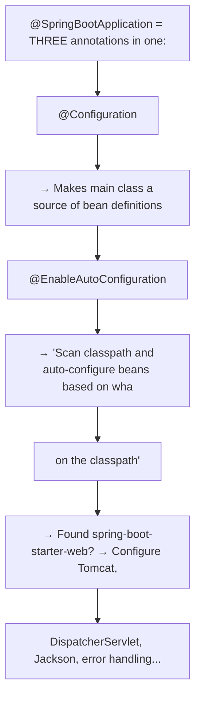

```java
// These two are IDENTICAL:
@SpringBootApplication
public class MyApp { ... }

// Same as:
@Configuration
@EnableAutoConfiguration
@ComponentScan
public class MyApp { ... }

// YES, you can build without @SpringBootApplication:
@Configuration
@EnableAutoConfiguration
@ComponentScan(basePackages = "com.myapp.specific")
public class MyApp { ... }
// Useful when you want to scan specific packages only
```

---

## 3. Auto-Configuration: How Spring "Magically" Knows What You Need

### The Freeze Question
> "How does Spring Boot know to configure a DataSource without you configuring it?"

```
╔══════════════════════════════════════════════════════════════════╗
║  THE SMART HOME ANALOGY                                          ║
║                                                                  ║
║  Spring Boot's auto-configuration is like a smart home system:   ║
║                                                                  ║
║  1. You plug in a smart thermostat (add dependency to pom.xml)   ║
║  2. Smart home detects it (classpath scanning)                   ║
║  3. It auto-configures: connects to HVAC, sets default temp      ║
║  4. You CAN override: set your own temperature (properties)      ║
║                                                                  ║
║  HOW IT ACTUALLY WORKS:                                          ║
║                                                                  ║
║  spring-boot-autoconfigure.jar contains:                         ║
║  META-INF/spring/org.springframework.boot.autoconfigure.         ║
║  AutoConfiguration.imports (list of auto-config classes)         ║
║                                                                  ║
║  Each auto-config class has CONDITIONS:                          ║
║  @ConditionalOnClass(DataSource.class)                           ║
║    → "Only if DataSource is on classpath"                        ║
║  @ConditionalOnMissingBean(DataSource.class)                     ║
║    → "Only if user hasn't defined their own DataSource"          ║
║  @ConditionalOnProperty(name = "spring.datasource.url")          ║
║    → "Only if this property is set"                              ║
║                                                                  ║
║  KEY INSIGHT: Auto-config BACKS OFF when you define your own.    ║
║  It's not magic — it's conditional bean registration.            ║
╚══════════════════════════════════════════════════════════════════╝
```

> **Flow**: THE SMART HOME ANALOGY → 2. Smart home detects it (classpath scanning) | 2. Smart home detects it (classpath scanning) → 3. It auto-configures: connects to HVAC, sets default t | 3. It auto-configures: connects to HVAC, sets default t → 4. You CAN override: set your own temperature (properti | 4. You CAN override: set your own temperature (properti → HOW IT ACTUALLY WORKS: | HOW IT ACTUALLY WORKS: → spring-boot-autoconfigure.jar contains: | spring-boot-autoconfigure.jar contains: → META-INF/spring/org.springframework.boot.autoconfigure. | ...+1 more

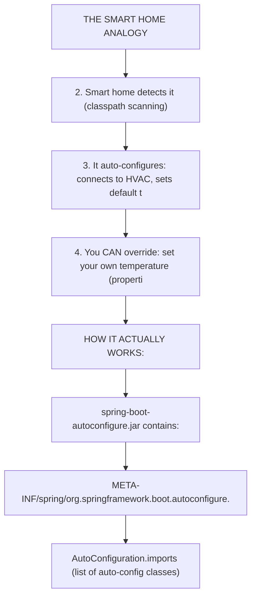

```java
// Simplified auto-config class:
@AutoConfiguration
@ConditionalOnClass(DataSource.class)           // H2/MySQL on classpath?
@ConditionalOnMissingBean(DataSource.class)     // User hasn't defined one?
public class DataSourceAutoConfiguration {

    @Bean
    @ConditionalOnProperty("spring.datasource.url") // URL configured?
    public DataSource dataSource(DataSourceProperties props) {
        return DataSourceBuilder.create()
            .url(props.getUrl())
            .username(props.getUsername())
            .build();
    }
}

// If you define YOUR OWN DataSource bean, auto-config BACKS OFF:
@Configuration
public class MyConfig {
    @Bean
    public DataSource myDataSource() {
        // Your custom config — auto-config won't create another
        return new HikariDataSource(...);
    }
}

// Debug auto-config: add this to application.properties
// debug=true
// Shows: Positive matches (what was auto-configured)
//        Negative matches (what was skipped and WHY)
```

---

## 4. The Proxy Pattern: Why @Transactional Fails On Self-Calls

### The Freeze Question
> "I put @Transactional on a method but it doesn't create a transaction. Why?"

```
╔══════════════════════════════════════════════════════════════════╗
║  THE BODYGUARD ANALOGY                                           ║
║                                                                  ║
║  Spring creates a PROXY (bodyguard) around your bean.            ║
║  All calls from OUTSIDE go through the proxy.                    ║
║  The proxy adds behavior (transaction, security, caching).       ║
║                                                                  ║
║  [Caller] → [Proxy: begin TX] → [Your Bean] → [Proxy: commit]    ║
║                                                                  ║
║  BUT! If your bean calls ITS OWN method:                         ║
║  [Your Bean] → this.internalMethod()                             ║
║  → Bypasses the proxy! No transaction started!                   ║
║                                                                  ║
║  It's like the bodyguard stands at the door.                     ║
║  If you're already inside the room and call yourself,            ║
║  you don't go through the door (proxy) again.                    ║
╚══════════════════════════════════════════════════════════════════╝
```

> **Flow**: THE BODYGUARD ANALOGY → Spring creates a PROXY (bodyguard) around your bean. | Spring creates a PROXY (bodyguard) around your bean. → All calls from OUTSIDE go through the proxy. | All calls from OUTSIDE go through the proxy. → The proxy adds behavior (transaction, security, caching | The proxy adds behavior (transaction, security, caching → BUT! If your bean calls ITS OWN method: | BUT! If your bean calls ITS OWN method: → [Your Bean] → this.internalMethod() | [Your Bean] → this.internalMethod() → → Bypasses the proxy! No transaction started! | ...+1 more

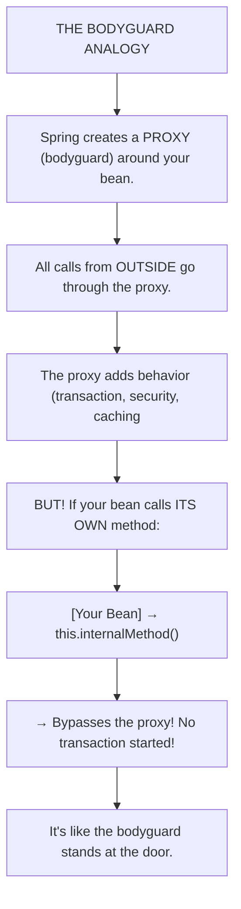

```java
@Service
public class OrderService {

    @Transactional
    public void processOrder(Order order) {
        // ✅ This WORKS — called FROM OUTSIDE through proxy
        saveOrder(order);
        sendNotification(order);
    }

    @Transactional(propagation = Propagation.REQUIRES_NEW)
    public void sendNotification(Order order) {
        // ❌ DOES NOT get its own transaction when called from processOrder!
        // Because processOrder calls this.sendNotification() — bypasses proxy
    }
}

// FIX 1: Inject self (let Spring give you the proxy)
@Service
public class OrderService {
    @Autowired
    private OrderService self; // Spring injects the PROXY, not `this`

    @Transactional
    public void processOrder(Order order) {
        saveOrder(order);
        self.sendNotification(order); // ✅ Goes through proxy!
    }
}

// FIX 2: Extract to separate service
@Service
public class NotificationService {
    @Transactional(propagation = Propagation.REQUIRES_NEW)
    public void sendNotification(Order order) { ... }
    // ✅ Called from OrderService → goes through NotificationService's proxy
}

// OTHER PROXY GOTCHAS:
// - @Transactional on PRIVATE methods → ignored (proxy can't override private)
// - @Cacheable on self-call → ignored
// - @Async on self-call → runs synchronously
```

---

## 5. Bean Lifecycle: What Happens Between `new` and "Ready"

### The Freeze Question
> "What's the Spring Bean lifecycle?"

```
╔══════════════════════════════════════════════════════════════════╗
║  THE EMPLOYEE ONBOARDING ANALOGY                                 ║
║                                                                  ║
║  1. INSTANTIATION: Hire the employee (new MyBean())              ║
║  2. POPULATE PROPERTIES: Give them a desk, laptop (@Autowired)   ║
║  3. AWARE INTERFACES: Tell them company name, their ID           ║
║     (BeanNameAware, ApplicationContextAware)                     ║
║  4. @PostConstruct: Employee orientation (run custom init)       ║
║  5. InitializingBean.afterPropertiesSet(): Second init hook      ║
║  6. Custom init-method: Third init hook                          ║
║  7. BEAN IS READY — now serving requests                         ║
║  ...                                                             ║
║  8. @PreDestroy: Goodbye party (cleanup before shutdown)         ║
║  9. DisposableBean.destroy(): Second cleanup hook                ║
║  10. Custom destroy-method: Third cleanup hook                   ║
║                                                                  ║
║  PRACTICAL: You usually only need @PostConstruct/@PreDestroy     ║
╚══════════════════════════════════════════════════════════════════╝
```

> **Flow**: THE EMPLOYEE ONBOARDING ANALOGY → 1. INSTANTIATION: Hire the employee (new MyBean()) | 1. INSTANTIATION: Hire the employee (new MyBean()) → 3. AWARE INTERFACES: Tell them company name, their ID | 3. AWARE INTERFACES: Tell them company name, their ID → (BeanNameAware, ApplicationContextAware) | (BeanNameAware, ApplicationContextAware) → 4. @PostConstruct: Employee orientation (run custom ini | 4. @PostConstruct: Employee orientation (run custom ini → 5. InitializingBean.afterPropertiesSet(): Second init h | 5. InitializingBean.afterPropertiesSet(): Second init h → 6. Custom init-method: Third init hook | ...+1 more

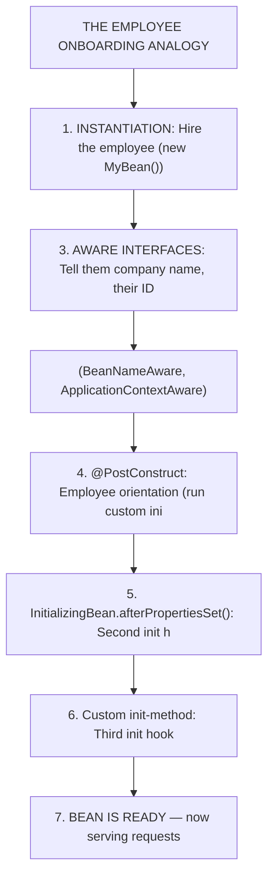

```java
@Service
public class CacheService {
    private final Map<String, Object> cache = new HashMap<>();

    @PostConstruct // Runs AFTER all dependencies are injected
    public void init() {
        // Load initial data, warm up cache
        // Dependencies are available here
        cache.put("config", loadConfig());
    }

    @PreDestroy // Runs BEFORE bean is destroyed (app shutdown)
    public void cleanup() {
        // Close connections, flush cache, release resources
        cache.clear();
    }
}
```

---

## 6. IoC & DI: Not Just "Injection" — The Inversion Explained

### The Freeze Question
> "What is Inversion of Control? What's being inverted?"

```
╔══════════════════════════════════════════════════════════════════╗
║  COOKING AT HOME vs RESTAURANT — The Inversion                   ║
║                                                                  ║
║  WITHOUT IoC (cooking at home):                                  ║
║  YOU control everything:                                         ║
║  → You decide what to buy                                        ║
║  → You buy ingredients (create dependencies)                     ║
║  → You cook (main logic)                                         ║
║  → You clean up                                                  ║
║  YOU have the control.                                           ║
║                                                                  ║
║  WITH IoC (restaurant):                                          ║
║  The FRAMEWORK controls:                                         ║
║  → Restaurant decides kitchen setup (container manages beans)    ║
║  → Waiter brings ingredients (container injects dependencies)    ║
║  → You just cook your dish (write business logic)                ║
║  → Restaurant cleans up (container manages lifecycle)            ║
║  CONTROL IS INVERTED — the framework calls YOU.                  ║
║                                                                  ║
║  WHAT'S INVERTED: Who creates and manages objects.               ║
║  Normal: Your code creates dependencies.                         ║
║  IoC: Framework creates and gives you dependencies.              ║
║  DI: The specific mechanism — injecting through constructor,     ║
║      setter, or field.                                           ║
╚══════════════════════════════════════════════════════════════════╝
```

> **Flow**: COOKING AT HOME vs RESTAURANT — The Inversion → WITHOUT IoC (cooking at home): | WITHOUT IoC (cooking at home): → YOU control everything: | YOU control everything: → → You decide what to buy | → You decide what to buy → → You buy ingredients (create dependencies) | → You buy ingredients (create dependencies) → → You cook (main logic) | → You cook (main logic) → → You clean up | ...+1 more

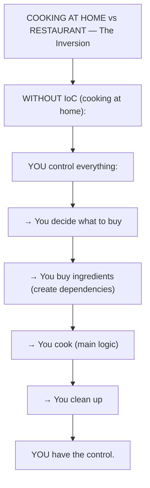

```java
// WITHOUT IoC: You create everything (tightly coupled)
public class OrderService {
    private PaymentProcessor processor = new StripeProcessor(); // Hardcoded!
    private EmailService email = new GmailService();            // Hardcoded!
    // Changing to PayPal? Edit this class. Violates Open/Closed.
    // Testing? Can't mock StripeProcessor easily.
}

// WITH IoC/DI: Framework gives you what you need (loosely coupled)
@Service
public class OrderService {
    private final PaymentProcessor processor; // Interface!
    private final EmailService email;         // Interface!

    public OrderService(PaymentProcessor processor, EmailService email) {
        this.processor = processor; // Spring injects the right implementation
        this.email = email;
    }
    // Testing? Pass in a mock. Switching to PayPal? Change config, not code.
}
```

---

## 7. @Autowired vs Constructor Injection: Why Seniors Choose Constructor

### The Freeze Question
> "What's wrong with @Autowired on fields?"

```
╔══════════════════════════════════════════════════════════════════╗
║  THREE INJECTION STYLES:                                         ║
║                                                                  ║
║  FIELD INJECTION (the lazy way):                                 ║
║  @Autowired private UserRepository repo;                         ║
║  ❌ Can't make fields final (no immutability)                     ║
║  ❌ Hidden dependencies (not visible in constructor)              ║
║  ❌ Can't use without Spring (can't new + inject in tests)        ║
║  ❌ Allows too many dependencies (no visible bloat signal)        ║
║                                                                  ║
║  SETTER INJECTION (for optional deps):                           ║
║  @Autowired public void setRepo(UserRepository repo) {...}       ║
║  ⚠️ Bean can exist in partially initialized state                ║
║  ✅ Good for optional/changeable dependencies                     ║
║                                                                  ║
║  CONSTRUCTOR INJECTION (the right way):                          ║
║  public UserService(UserRepository repo) { this.repo = repo; }   ║
║  ✅ Immutable (final fields)                                      ║
║  ✅ All dependencies visible in constructor                       ║
║  ✅ Works without Spring (easy testing: new UserService(mock))    ║
║  ✅ Fails fast if dependency missing (constructor error)          ║
║  ✅ Too many params? Signal to split the class                    ║
║  ✅ No @Autowired needed if single constructor (Spring auto)      ║
╚══════════════════════════════════════════════════════════════════╝
```

> **Flow**: THREE INJECTION STYLES: → FIELD INJECTION (the lazy way): | FIELD INJECTION (the lazy way): → @Autowired private UserRepository repo; | @Autowired private UserRepository repo; → ❌ Can't make fields final (no immutability) | ❌ Can't make fields final (no immutability) → ❌ Hidden dependencies (not visible in constructor) | ❌ Hidden dependencies (not visible in constructor) → ❌ Can't use without Spring (can't new + inject in tests | ❌ Can't use without Spring (can't new + inject in tests → ❌ Allows too many dependencies (no visible bloat signal | ...+1 more

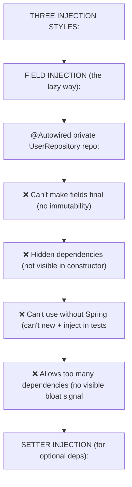

```java
// ❌ Field injection — tests need reflection or Spring context
@Service
public class UserService {
    @Autowired private UserRepository repo;
    @Autowired private EmailService email;
    @Autowired private CacheService cache;
}

// ✅ Constructor injection — clean, testable, immutable
@Service
@RequiredArgsConstructor // Lombok generates constructor for final fields
public class UserService {
    private final UserRepository repo;
    private final EmailService email;
    private final CacheService cache;
    // Spring auto-detects single constructor — no @Autowired needed
}

// Test without Spring:
UserService service = new UserService(mockRepo, mockEmail, mockCache);
```

---

## 8. Bean Scopes: Why Injecting Prototype Into Singleton Breaks

### The Freeze Question
> "I defined a prototype bean but it's acting like a singleton. Why?"

```
╔══════════════════════════════════════════════════════════════════╗
║  THE COFFEE MACHINE ANALOGY                                      ║
║                                                                  ║
║  Singleton scope: One coffee machine in the office. Everyone     ║
║  shares it. Created once at startup.                             ║
║                                                                  ║
║  Prototype scope: Fresh cup for each person. Created each time   ║
║  it's requested.                                                 ║
║                                                                  ║
║  THE PROBLEM:                                                    ║
║  Singleton OrderService is created ONCE at startup.              ║
║  During creation, Spring injects Prototype ShoppingCart.         ║
║  That cart is created ONCE and stored in OrderService forever.   ║
║                                                                  ║
║  Result: ALL users share the SAME cart!                          ║
║  The prototype is "trapped" inside the singleton.                ║
║                                                                  ║
║  It's like installing a fresh coffee cup holder once —           ║
║  the "fresh cup each time" promise is broken because the         ║
║  holder only gets filled once (at singleton creation).           ║
╚══════════════════════════════════════════════════════════════════╝
```

> **Flow**: THE COFFEE MACHINE ANALOGY → Singleton scope: One coffee machine in the office. Ever | Singleton scope: One coffee machine in the office. Ever → shares it. Created once at startup. | shares it. Created once at startup. → it's requested. | it's requested. → THE PROBLEM: | THE PROBLEM: → Singleton OrderService is created ONCE at startup. | Singleton OrderService is created ONCE at startup. → During creation, Spring injects Prototype ShoppingCart. | ...+1 more

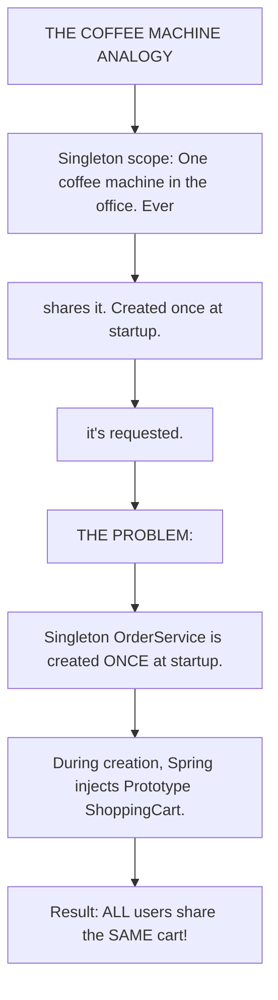

```java
// ❌ BROKEN: Prototype injected into Singleton
@Component @Scope("prototype")
public class ShoppingCart { private List<Item> items = new ArrayList<>(); }

@Service // singleton by default
public class OrderService {
    private final ShoppingCart cart; // Injected ONCE! Everyone shares it!
    public OrderService(ShoppingCart cart) { this.cart = cart; }
}

// FIX 1: ObjectFactory (Spring creates fresh instance each call)
@Service
public class OrderService {
    private final ObjectFactory<ShoppingCart> cartFactory;
    public OrderService(ObjectFactory<ShoppingCart> cartFactory) {
        this.cartFactory = cartFactory;
    }
    public void addItem(Item item) {
        ShoppingCart cart = cartFactory.getObject(); // Fresh cart!
    }
}

// FIX 2: @Scope with proxyMode (Spring creates a proxy that delegates)
@Component
@Scope(value = "prototype", proxyMode = ScopedProxyMode.TARGET_CLASS)
public class ShoppingCart { ... }
// Now Spring injects a proxy that creates a new ShoppingCart each time
```

---

## 9. @Controller vs @RestController: Not Just "Adds @ResponseBody"

### The Freeze Question
> "What's the actual difference?"

```
╔══════════════════════════════════════════════════════════════════╗
║  @Controller = View Returns (traditional MVC web apps)           ║
║  → Return value is a VIEW NAME (JSP, Thymeleaf template)         ║
║  → DispatcherServlet passes to ViewResolver to render HTML       ║
║                                                                  ║
║  @RestController = @Controller + @ResponseBody on every method   ║
║  → Return value is SERIALIZED directly to response body (JSON)   ║
║  → No view resolution — Jackson converts to JSON automatically   ║
║                                                                  ║
║  THE DEEPER UNDERSTANDING:                                       ║
║                                                                  ║
║  @Controller + return "users" → ViewResolver looks for           ║
║    templates/users.html → renders HTML                           ║
║                                                                  ║
║  @RestController + return userList → HttpMessageConverter        ║
║    (Jackson) serializes to JSON → {"users": [...]}               ║
║                                                                  ║
║  You CAN use @Controller for REST APIs:                          ║
║  @Controller                                                     ║
║  public class UserController {                                   ║
║    @ResponseBody  // ← Must add this to EACH method              ║
║    @GetMapping("/users")                                         ║
║    public List<User> getUsers() { ... }                          ║
║  }                                                               ║
║  @RestController just avoids repeating @ResponseBody.            ║
╚══════════════════════════════════════════════════════════════════╝
```

> **Flow**: @Controller = View Returns (traditional MVC web apps) → → Return value is a VIEW NAME (JSP, Thymeleaf template) | → Return value is a VIEW NAME (JSP, Thymeleaf template) → → DispatcherServlet passes to ViewResolver to render HT | → DispatcherServlet passes to ViewResolver to render HT → THE DEEPER UNDERSTANDING: | THE DEEPER UNDERSTANDING: → @Controller + return 'users' → ViewResolver looks for | @Controller + return 'users' → ViewResolver looks for → templates/users.html → renders HTML | templates/users.html → renders HTML → @RestController + return userList → HttpMessageConverte | ...+1 more

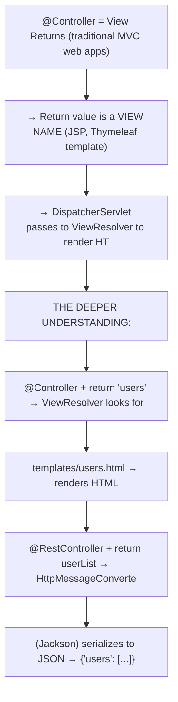

---

## 10. Spring Security Filter Chain: How Authentication Actually Works

### The Freeze Question
> "How does Spring Security authenticate a request?"

```
╔══════════════════════════════════════════════════════════════════╗
║  Spring Security = A CHAIN of Servlet Filters                    ║
║  (This ties back to Section 1 — Filters run BEFORE Dispatcher)   ║
║                                                                  ║
║  Request → SecurityFilterChain:                                  ║
║                                                                  ║
║  1. SecurityContextPersistenceFilter                             ║
║     → Load existing security context (from session/token)        ║
║                                                                  ║
║  2. UsernamePasswordAuthenticationFilter                         ║
║     → If login request: extract credentials, authenticate        ║
║     → Delegates to AuthenticationManager                         ║
║       → Which uses AuthenticationProvider                        ║
║         → Which uses UserDetailsService (your DB lookup)         ║
║         → Which uses PasswordEncoder (BCrypt check)              ║
║                                                                  ║
║  3. BasicAuthenticationFilter (if using HTTP Basic)              ║
║  4. BearerTokenAuthenticationFilter (if using JWT/OAuth2)        ║
║                                                                  ║
║  5. AuthorizationFilter                                          ║
║     → Check: Does this user have the required role/authority?    ║
║     → @PreAuthorize, @Secured, hasRole() evaluated here          ║
║                                                                  ║
║  6. ExceptionTranslationFilter                                   ║
║     → Converts auth exceptions to HTTP 401/403                   ║
║                                                                  ║
║  KEY: Spring Security is NOT inside Spring MVC.                  ║
║  It runs BEFORE DispatcherServlet even sees the request.         ║
╚══════════════════════════════════════════════════════════════════╝
```

> **Flow**: Spring Security = A CHAIN of Servlet Filters → Request → SecurityFilterChain: | Request → SecurityFilterChain: → 1. SecurityContextPersistenceFilter | 1. SecurityContextPersistenceFilter → → Load existing security context (from session/token) | → Load existing security context (from session/token) → 2. UsernamePasswordAuthenticationFilter | 2. UsernamePasswordAuthenticationFilter → → If login request: extract credentials, authenticate | → If login request: extract credentials, authenticate → → Delegates to AuthenticationManager | ...+1 more

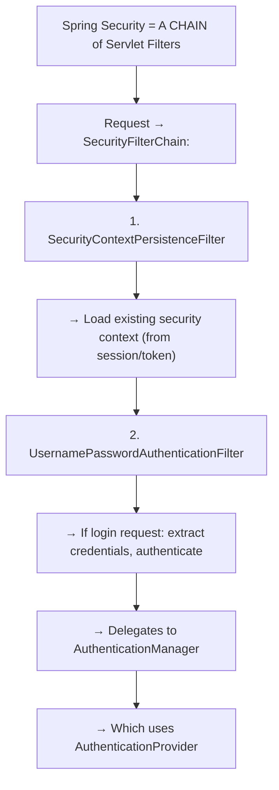

---

## 11. Profiles & Conditional Beans: How Spring Switches Environments

### The Freeze Question
> "How do you configure different settings for dev, staging, and production?"

```java
// application.yml (default):
spring:
  profiles:
    active: dev  # or set via command line: --spring.profiles.active=prod

// application-dev.yml (auto-loaded when profile = dev):
spring:
  datasource:
    url: jdbc:h2:mem:testdb
  jpa:
    show-sql: true

// application-prod.yml (auto-loaded when profile = prod):
spring:
  datasource:
    url: jdbc:postgresql://prod-server:5432/maindb
  jpa:
    show-sql: false

// Profile-specific beans:
@Configuration
public class StorageConfig {

    @Bean
    @Profile("dev")
    public StorageService localStorage() {
        return new LocalFileStorage(); // Use local filesystem in dev
    }

    @Bean
    @Profile("prod")
    public StorageService cloudStorage() {
        return new S3StorageService(); // Use AWS S3 in production
    }
}
```

---

## 12. Why @Async Doesn't Work Without @EnableAsync

### The Freeze Question
> "I added @Async but the method still runs synchronously."

```
╔══════════════════════════════════════════════════════════════════╗
║  Same proxy problem as @Transactional (Section 4):               ║
║                                                                  ║
║  @Async tells Spring: "Run this in a different thread."          ║
║  But Spring needs to create a PROXY to intercept the call        ║
║  and redirect it to a thread pool.                               ║
║                                                                  ║
║  @EnableAsync tells Spring: "Create those proxies."              ║
║  Without it, @Async is just an annotation — no behavior.         ║
║                                                                  ║
║  SAME GOTCHAS:                                                   ║
║  1. Self-call bypasses proxy → runs synchronously                ║
║  2. Private methods can't be proxied → @Async ignored            ║
║  3. Return void or Future<T>, not raw types                      ║
║  4. Default thread pool is SimpleAsyncTaskExecutor (no pool!)    ║
║     → ALWAYS configure a proper ThreadPoolTaskExecutor           ║
╚══════════════════════════════════════════════════════════════════╝
```

> **Flow**: Same proxy problem as @Transactional (Section 4): → @Async tells Spring: 'Run this in a different thread.' | @Async tells Spring: 'Run this in a different thread.' → But Spring needs to create a PROXY to intercept the cal | But Spring needs to create a PROXY to intercept the cal → and redirect it to a thread pool. | and redirect it to a thread pool. → @EnableAsync tells Spring: 'Create those proxies.' | @EnableAsync tells Spring: 'Create those proxies.' → Without it, @Async is just an annotation — no behavior. | Without it, @Async is just an annotation — no behavior. → SAME GOTCHAS: | ...+1 more

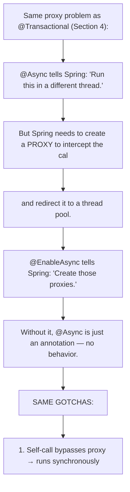

```java
@Configuration
@EnableAsync // MUST have this!
public class AsyncConfig {
    @Bean
    public Executor taskExecutor() {
        ThreadPoolTaskExecutor executor = new ThreadPoolTaskExecutor();
        executor.setCorePoolSize(5);
        executor.setMaxPoolSize(10);
        executor.setQueueCapacity(25);
        executor.setThreadNamePrefix("Async-");
        executor.initialize();
        return executor;
    }
}

@Service
public class EmailService {
    @Async // Now works — proxy intercepts and runs in thread pool
    public CompletableFuture<Void> sendEmail(String to, String body) {
        // This runs in a separate thread
        mailSender.send(createMessage(to, body));
        return CompletableFuture.completedFuture(null);
    }
}
```

---

## Interview Quick-Fire: Spring Boot Freeze Busters

| Freeze Question | Senior-Level Answer |
|----------------|-------------------|
| "What is a Servlet?" | A Java interface for handling HTTP requests. Tomcat is the Servlet Container that manages servlet lifecycle. DispatcherServlet is Spring's single servlet that delegates to controllers. |
| "What's @Component vs @Service vs @Repository?" | Functionally identical — all register as beans. @Service and @Repository are semantic markers. @Repository adds automatic exception translation (SQL exceptions → Spring DataAccessException). |
| "What is Spring Boot Starter?" | A curated set of dependencies. `spring-boot-starter-web` includes Tomcat + Spring MVC + Jackson + Validation. You add ONE dependency instead of configuring 15. |
| "What's the embedded server?" | Spring Boot packages Tomcat/Jetty/Undertow INSIDE your jar. No external server needed. Run `java -jar app.jar` → Tomcat starts on port 8080. Production-ready out of the box. |
| "How does Spring Boot handle errors?" | BasicErrorController catches unhandled exceptions. Returns JSON for REST (Accept: application/json) or HTML error page (browser). Customize with @ControllerAdvice + @ExceptionHandler. |
| "What's Actuator?" | Production monitoring endpoints: /health, /metrics, /info, /env. Shows bean definitions, HTTP traces, thread dumps. Secure them in production! |

---

← Previous: [Chapter 31 — Java Deep Reasoning](Ch22_Java_Deep_Reasoning.md)
| [📚 Index](../00_MASTER_INDEX.md)
| Next: [DSA Deep Reasoning →](../03_Algorithms/16_DSA_Deep_Reasoning.md)


---

> **Navigation**: [< Previous](Ch22_Java_Deep_Reasoning.md) | [Back to Index](../00_MASTER_INDEX.md) | [Next >](Ch23_Streams_Deep_Reasoning.md)