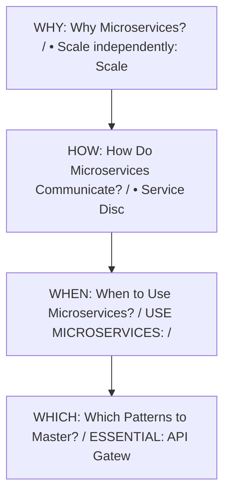
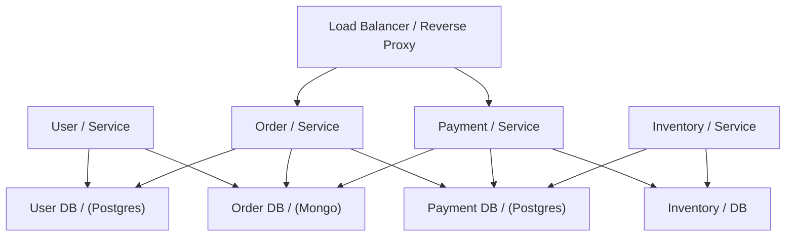
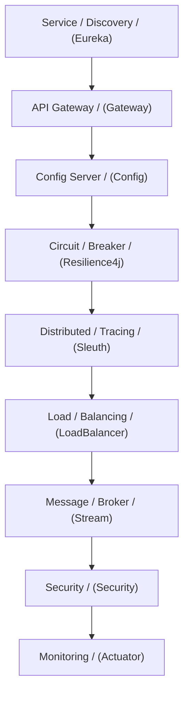
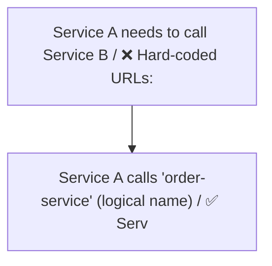
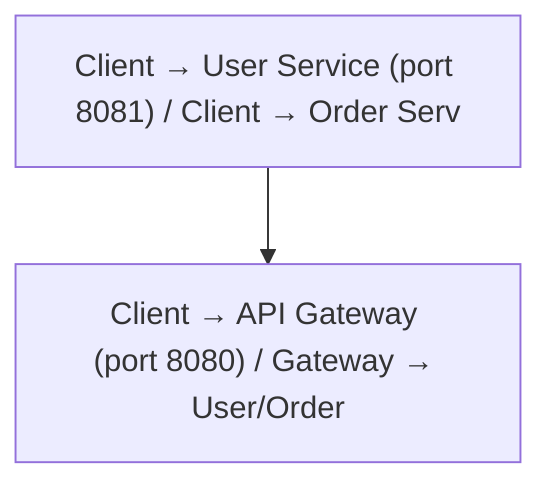
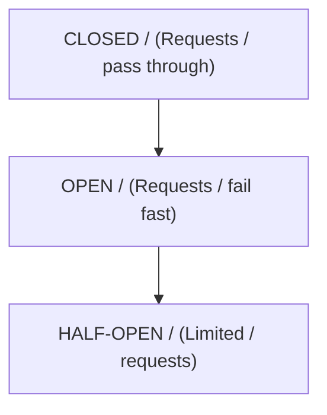

> **Navigation**: [Back to Index](../00_MASTER_INDEX.md) | [Next Chapter >](Ch62_SB_Microservices_Patterns.md)

---

# Spring Boot Part 20: Microservices Patterns
## Service Discovery, API Gateway, Circuit Breakers, and More

> **"Microservices are about doing one thing well, and integrating elegantly"** - Distributed systems done right

---

# 🎯 WHY-HOW-WHEN-WHICH FRAMEWORK

```
┌─────────────────────────────────────────────────────────────────────────────────┐
│  WHY: Why Microservices?                                                        │
├─────────────────────────────────────────────────────────────────────────────────┤
│  • Scale independently: Scale only the service that needs it                    │
│  • Team autonomy: Different teams own different services                        │
│  • Technology freedom: Each service can use best-fit technology                 │
│  • Fault isolation: One service failure doesn't crash everything                │
│  • Faster deployment: Deploy one service without touching others                │
└─────────────────────────────────────────────────────────────────────────────────┘

┌─────────────────────────────────────────────────────────────────────────────────┐
│  HOW: How Do Microservices Communicate?                                         │
├─────────────────────────────────────────────────────────────────────────────────┤
│  • Service Discovery: Eureka/Consul finds service locations dynamically         │
│  • API Gateway: Single entry, routing, auth, rate limiting (Spring Cloud)       │
│  • Circuit Breaker: Resilience4j prevents cascade failures                      │
│  • Event-Driven: Kafka/RabbitMQ for async communication                         │
│  • Config Server: Centralized configuration management                          │
└─────────────────────────────────────────────────────────────────────────────────┘

┌─────────────────────────────────────────────────────────────────────────────────┐
│  WHEN: When to Use Microservices?                                               │
├─────────────────────────────────────────────────────────────────────────────────┤
│  USE MICROSERVICES:                                                             │
│  • Large teams (5+ developers per team)                                         │
│  • Independent scaling needs                                                    │
│  • Complex domain with clear boundaries                                         │
│                                                                                 │
│  STICK WITH MONOLITH:                                                           │
│  • Small team, MVP, unclear domain boundaries                                   │
│  • Simple CRUD apps, limited scaling needs                                      │
└─────────────────────────────────────────────────────────────────────────────────┘

┌─────────────────────────────────────────────────────────────────────────────────┐
│  WHICH: Which Patterns to Master?                                               │
├─────────────────────────────────────────────────────────────────────────────────┤
│  ESSENTIAL:     API Gateway, Service Discovery, Circuit Breaker                 │
│  IMPORTANT:     Config Server, Load Balancing, Saga Pattern                     │
│  ADVANCED:      CQRS, Event Sourcing, Service Mesh                              │
└─────────────────────────────────────────────────────────────────────────────────┘
```

**Flow:**
- WHY: Why Microservices? / • Scale independently: Scale
- ↓
- HOW: How Do Microservices Communicate? / • Service Disc
- ↓
- WHEN: When to Use Microservices? / USE MICROSERVICES: /
- ↓
- WHICH: Which Patterns to Master? / ESSENTIAL: API Gatew



---

## 📚 Table of Contents
1. [Microservices Architecture Overview](#microservices-architecture-overview)
2. [Service Discovery](#service-discovery)
3. [API Gateway Pattern](#api-gateway-pattern)
4. [Circuit Breaker Pattern](#circuit-breaker-pattern)
5. [Load Balancing](#load-balancing)
6. [Configuration Management](#configuration-management)
7. [Saga Pattern](#saga-pattern)
8. [Event-Driven Architecture](#event-driven-architecture)
9. [CQRS Pattern](#cqrs-pattern)
10. [Service Mesh](#service-mesh)
11. [Security Patterns](#security-patterns)
12. [Observability Patterns](#observability-patterns)
13. [Deployment Patterns](#deployment-patterns)
14. [Best Practices](#best-practices)
15. [Interview Questions](#interview-questions)

---

## Microservices Architecture Overview

### Monolith vs Microservices

```
🏢 MONOLITHIC ARCHITECTURE
┌─────────────────────────────────────────────────────────────────┐
│                     Single Application                          │
│  ┌─────────┐  ┌─────────┐  ┌─────────┐  ┌─────────┐             │
│  │  User   │  │  Order  │  │ Payment │  │Inventory│             │
│  │ Service │  │ Service │  │ Service │  │ Service │             │
│  └────┬────┘  └────┬────┘  └────┬────┘  └────┬────┘             │
│       └────────────┴────────────┴────────────┘                  │
│                        │                                        │
│                 ┌──────┴──────┐                                 │
│                 │  Database   │                                 │
│                 └─────────────┘                                 │
└─────────────────────────────────────────────────────────────────┘

🌐 MICROSERVICES ARCHITECTURE
┌─────────────────────────────────────────────────────────────────┐
│                      API Gateway                                │
│  ┌─────────────────────────────────────────────────────────┐    │
│  │        Load Balancer / Reverse Proxy                     │   │
│  └───────────────────┬─────────────────────────────────────┘    │
│            ┌─────────┼─────────┬───────────┐                    │
│            ▼         ▼         ▼           ▼                    │
│     ┌───────────┐ ┌───────────┐ ┌───────────┐ ┌───────────┐     │
│     │   User    │ │   Order   │ │  Payment  │ │ Inventory │     │
│     │  Service  │ │  Service  │ │  Service  │ │  Service  │     │
│     └─────┬─────┘ └─────┬─────┘ └─────┬─────┘ └─────┬─────┘     │
│           │             │             │             │           │
│     ┌─────┴─────┐ ┌─────┴─────┐ ┌─────┴─────┐ ┌─────┴─────┐     │
│     │  User DB  │ │ Order DB  │ │Payment DB │ │Inventory  │     │
│     │ (Postgres)│ │  (Mongo)  │ │ (Postgres)│ │   DB      │     │
│     └───────────┘ └───────────┘ └───────────┘ └───────────┘     │
└─────────────────────────────────────────────────────────────────┘
```

**Flow:**
- Load Balancer / Reverse Proxy
- ↓
- Order / Service
- ↓
- Load Balancer / Reverse Proxy
- ↓
- Payment / Service
- ↓
- User / Service
- ↓
- User DB / (Postgres)
- ↓
- User / Service
- ↓
- Order DB / (Mongo)
- ↓
- Order / Service
- ↓
- User DB / (Postgres)
- ↓
- Order / Service
- ↓
- Order DB / (Mongo)



### Key Principles

| Principle | Description | Example |
|-----------|-------------|---------|
| Single Responsibility | One service = one business capability | Order Service only handles orders |
| Decentralized Data | Each service owns its data | Order DB separate from User DB |
| Design for Failure | Expect and handle failures | Circuit breakers, retries |
| Loose Coupling | Minimize dependencies | Event-driven communication |
| High Cohesion | Related functions together | All order logic in Order Service |

### Spring Cloud Ecosystem

```
┌─────────────────────────────────────────────────────────────────────┐
│                    SPRING CLOUD ECOSYSTEM                           │
├─────────────────────────────────────────────────────────────────────┤
│  ┌───────────────┐    ┌───────────────┐    ┌───────────────┐        │
│  │ Service       │    │ API Gateway   │    │ Config Server │        │
│  │ Discovery     │    │               │    │               │        │
│  │ (Eureka)      │    │ (Gateway)     │    │ (Config)      │        │
│  └───────────────┘    └───────────────┘    └───────────────┘        │
│                                                                     │
│  ┌───────────────┐    ┌───────────────┐    ┌───────────────┐        │
│  │ Circuit       │    │ Distributed   │    │ Load          │        │
│  │ Breaker       │    │ Tracing       │    │ Balancing     │        │
│  │ (Resilience4j)│    │ (Sleuth)      │    │ (LoadBalancer)│        │
│  └───────────────┘    └───────────────┘    └───────────────┘        │
│                                                                     │
│  ┌───────────────┐    ┌───────────────┐    ┌───────────────┐        │
│  │ Message       │    │ Security      │    │ Monitoring    │        │
│  │ Broker        │    │               │    │               │        │
│  │ (Stream)      │    │ (Security)    │    │ (Actuator)    │        │
│  └───────────────┘    └───────────────┘    └───────────────┘        │
└─────────────────────────────────────────────────────────────────────┘
```

**Flow:**
- Service / Discovery / (Eureka)
- ↓
- API Gateway / (Gateway)
- ↓
- Config Server / (Config)
- ↓
- Circuit / Breaker / (Resilience4j)
- ↓
- Distributed / Tracing / (Sleuth)
- ↓
- Load / Balancing / (LoadBalancer)
- ↓
- Message / Broker / (Stream)



---

## Service Discovery

### Why Service Discovery?

```
Without Service Discovery:
┌─────────────────────────────────────────────────────────────────┐
│  Service A needs to call Service B                              │
│  ❌ Hard-coded URLs: http://192.168.1.100:8080                   │
│  ❌ What if Service B moves?                                     │
│  ❌ What if we scale to multiple instances?                      │
└─────────────────────────────────────────────────────────────────┘

With Service Discovery:
┌─────────────────────────────────────────────────────────────────┐
│  Service A calls "order-service" (logical name)                 │
│  ✅ Service Registry resolves to healthy instance                │
│  ✅ Automatic failover to other instances                        │
│  ✅ Dynamic scaling without config changes                       │
└─────────────────────────────────────────────────────────────────┘
```

**Flow:**
- Service A needs to call Service B / ❌ Hard-coded URLs:
- ↓
- Service A calls 'order-service' (logical name) / ✅ Serv



### Eureka Server Setup

```xml
<!-- pom.xml for Eureka Server -->
<dependencies>
    <dependency>
        <groupId>org.springframework.cloud</groupId>
        <artifactId>spring-cloud-starter-netflix-eureka-server</artifactId>
    </dependency>
</dependencies>

<dependencyManagement>
    <dependencies>
        <dependency>
            <groupId>org.springframework.cloud</groupId>
            <artifactId>spring-cloud-dependencies</artifactId>
            <version>2023.0.0</version>
            <type>pom</type>
            <scope>import</scope>
        </dependency>
    </dependencies>
</dependencyManagement>
```

```java
// Eureka Server Application
@SpringBootApplication
@EnableEurekaServer
public class EurekaServerApplication {
    public static void main(String[] args) {
        SpringApplication.run(EurekaServerApplication.class, args);
    }
}
```

```yaml
# application.yml for Eureka Server
server:
  port: 8761

eureka:
  instance:
    hostname: localhost
  client:
    register-with-eureka: false   # Server doesn't register itself
    fetch-registry: false         # Server doesn't fetch registry
  server:
    enable-self-preservation: true
    eviction-interval-timer-in-ms: 5000
```

### Eureka Client Setup

```xml
<!-- pom.xml for Eureka Client -->
<dependency>
    <groupId>org.springframework.cloud</groupId>
    <artifactId>spring-cloud-starter-netflix-eureka-client</artifactId>
</dependency>
```

```java
// Any microservice becomes a Eureka Client
@SpringBootApplication
public class OrderServiceApplication {
    public static void main(String[] args) {
        SpringApplication.run(OrderServiceApplication.class, args);
    }
}
```

```yaml
# application.yml for Order Service (Eureka Client)
spring:
  application:
    name: order-service   # This name is used for service discovery

eureka:
  client:
    service-url:
      defaultZone: http://localhost:8761/eureka/
    registry-fetch-interval-seconds: 5
  instance:
    instance-id: ${spring.application.name}:${random.uuid}
    prefer-ip-address: true
    lease-renewal-interval-in-seconds: 10
    lease-expiration-duration-in-seconds: 30
```

### Service-to-Service Communication with Discovery

```java
@Service
@RequiredArgsConstructor
public class OrderService {
    
    private final DiscoveryClient discoveryClient;
    private final RestTemplate restTemplate;
    
    // Method 1: Manual Discovery
    public User getUserManually(Long userId) {
        List<ServiceInstance> instances = discoveryClient
            .getInstances("user-service");
        
        if (instances.isEmpty()) {
            throw new ServiceUnavailableException("user-service not available");
        }
        
        ServiceInstance instance = instances.get(0); // Simple selection
        String url = instance.getUri() + "/api/users/" + userId;
        
        return restTemplate.getForObject(url, User.class);
    }
    
    // Method 2: Using @LoadBalanced RestTemplate (Recommended)
    public User getUserWithLoadBalancer(Long userId) {
        // Uses logical service name - load balancer resolves it
        return restTemplate.getForObject(
            "http://user-service/api/users/" + userId,
            User.class
        );
    }
}

@Configuration
public class RestTemplateConfig {
    
    @Bean
    @LoadBalanced  // Enables service discovery and load balancing
    public RestTemplate restTemplate() {
        return new RestTemplate();
    }
}
```

### Using WebClient with Discovery

```java
@Configuration
public class WebClientConfig {
    
    @Bean
    @LoadBalanced
    public WebClient.Builder loadBalancedWebClientBuilder() {
        return WebClient.builder();
    }
}

@Service
@RequiredArgsConstructor
public class OrderServiceReactive {
    
    private final WebClient.Builder webClientBuilder;
    
    public Mono<User> getUser(Long userId) {
        return webClientBuilder.build()
            .get()
            .uri("http://user-service/api/users/{id}", userId)
            .retrieve()
            .bodyToMono(User.class);
    }
}
```

### Using OpenFeign (Declarative REST Client)

```xml
<dependency>
    <groupId>org.springframework.cloud</groupId>
    <artifactId>spring-cloud-starter-openfeign</artifactId>
</dependency>
```

```java
// Enable Feign in main application
@SpringBootApplication
@EnableFeignClients
public class OrderServiceApplication {
    public static void main(String[] args) {
        SpringApplication.run(OrderServiceApplication.class, args);
    }
}

// Feign Client Interface
@FeignClient(name = "user-service", fallback = UserClientFallback.class)
public interface UserClient {
    
    @GetMapping("/api/users/{id}")
    User getUser(@PathVariable("id") Long id);
    
    @GetMapping("/api/users")
    List<User> getAllUsers();
    
    @PostMapping("/api/users")
    User createUser(@RequestBody CreateUserRequest request);
    
    @GetMapping("/api/users/search")
    List<User> searchUsers(@RequestParam("query") String query,
                          @RequestParam("page") int page);
}

// Fallback implementation for resilience
@Component
public class UserClientFallback implements UserClient {
    
    @Override
    public User getUser(Long id) {
        return User.builder()
            .id(id)
            .name("Unknown (Service Unavailable)")
            .build();
    }
    
    @Override
    public List<User> getAllUsers() {
        return Collections.emptyList();
    }
    
    @Override
    public User createUser(CreateUserRequest request) {
        throw new ServiceUnavailableException("Cannot create user - service down");
    }
    
    @Override
    public List<User> searchUsers(String query, int page) {
        return Collections.emptyList();
    }
}

// Using the Feign client
@Service
@RequiredArgsConstructor
public class OrderService {
    
    private final UserClient userClient;
    
    public Order createOrder(OrderRequest request) {
        // Feign handles service discovery, load balancing, and serialization
        User user = userClient.getUser(request.getUserId());
        
        return Order.builder()
            .user(user)
            .items(request.getItems())
            .build();
    }
}
```

### Consul as Alternative

```yaml
# application.yml for Consul
spring:
  cloud:
    consul:
      host: localhost
      port: 8500
      discovery:
        service-name: ${spring.application.name}
        instance-id: ${spring.application.name}:${random.uuid}
        health-check-interval: 10s
```

---

## API Gateway Pattern

### Why API Gateway?

```
Without API Gateway:
┌─────────────────────────────────────────────────────────────────┐
│  Client → User Service (port 8081)                              │
│  Client → Order Service (port 8082)                             │
│  Client → Payment Service (port 8083)                           │
│  ❌ Client needs to know all service locations                   │
│  ❌ Cross-cutting concerns duplicated                            │
│  ❌ Protocol translation complex                                 │
└─────────────────────────────────────────────────────────────────┘

With API Gateway:
┌─────────────────────────────────────────────────────────────────┐
│  Client → API Gateway (port 8080)                               │
│  Gateway → User/Order/Payment Services                          │
│  ✅ Single entry point                                           │
│  ✅ Centralized auth, rate limiting, logging                     │
│  ✅ Request routing and aggregation                              │
└─────────────────────────────────────────────────────────────────┘
```

**Flow:**
- Client
- ↓
- User Service (port 8081) / Client
- ↓
- Order Serv
- ↓
- Client
- ↓
- API Gateway (port 8080) / Gateway
- ↓
- User/Order



### Spring Cloud Gateway Setup

```xml
<dependency>
    <groupId>org.springframework.cloud</groupId>
    <artifactId>spring-cloud-starter-gateway</artifactId>
</dependency>
<dependency>
    <groupId>org.springframework.cloud</groupId>
    <artifactId>spring-cloud-starter-netflix-eureka-client</artifactId>
</dependency>
```

```java
@SpringBootApplication
public class GatewayApplication {
    public static void main(String[] args) {
        SpringApplication.run(GatewayApplication.class, args);
    }
}
```

### Gateway Configuration (YAML)

```yaml
server:
  port: 8080

spring:
  application:
    name: api-gateway
  cloud:
    gateway:
      discovery:
        locator:
          enabled: true           # Auto-discover routes from Eureka
          lower-case-service-id: true
      
      routes:
        # User Service Routes
        - id: user-service
          uri: lb://user-service  # lb:// enables load balancing
          predicates:
            - Path=/api/users/**
          filters:
            - StripPrefix=1
            - AddRequestHeader=X-Gateway-Source, API-Gateway
            
        # Order Service Routes
        - id: order-service
          uri: lb://order-service
          predicates:
            - Path=/api/orders/**
          filters:
            - StripPrefix=1
            - name: CircuitBreaker
              args:
                name: orderCircuitBreaker
                fallbackUri: forward:/fallback/orders
                
        # Payment Service Routes (with rate limiting)
        - id: payment-service
          uri: lb://payment-service
          predicates:
            - Path=/api/payments/**
            - Method=POST
          filters:
            - StripPrefix=1
            - name: RequestRateLimiter
              args:
                redis-rate-limiter.replenishRate: 10
                redis-rate-limiter.burstCapacity: 20
                redis-rate-limiter.requestedTokens: 1
                
        # Route with retry
        - id: inventory-service
          uri: lb://inventory-service
          predicates:
            - Path=/api/inventory/**
          filters:
            - name: Retry
              args:
                retries: 3
                statuses: BAD_GATEWAY,GATEWAY_TIMEOUT
                methods: GET
                backoff:
                  firstBackoff: 100ms
                  maxBackoff: 500ms
                  factor: 2

eureka:
  client:
    service-url:
      defaultZone: http://localhost:8761/eureka/
```

### Gateway Configuration (Java)

```java
@Configuration
public class GatewayConfig {
    
    @Bean
    public RouteLocator customRouteLocator(RouteLocatorBuilder builder) {
        return builder.routes()
            // User service route
            .route("user-service", r -> r
                .path("/api/users/**")
                .filters(f -> f
                    .stripPrefix(1)
                    .addRequestHeader("X-Gateway", "true")
                    .circuitBreaker(config -> config
                        .setName("userCircuitBreaker")
                        .setFallbackUri("forward:/fallback/users"))
                )
                .uri("lb://user-service"))
            
            // Order service with custom filter
            .route("order-service", r -> r
                .path("/api/orders/**")
                .and()
                .method(HttpMethod.GET, HttpMethod.POST)
                .filters(f -> f
                    .stripPrefix(1)
                    .filter(new LoggingGatewayFilterFactory().apply(new Object()))
                    .retry(config -> config
                        .setRetries(3)
                        .setStatuses(HttpStatus.BAD_GATEWAY)))
                .uri("lb://order-service"))
            
            // Path rewriting
            .route("legacy-service", r -> r
                .path("/old-api/**")
                .filters(f -> f
                    .rewritePath("/old-api/(?<segment>.*)", "/api/${segment}"))
                .uri("lb://new-service"))
            
            .build();
    }
}
```

### Custom Gateway Filters

```java
// Global Filter - applies to all routes
@Component
@Slf4j
public class LoggingFilter implements GlobalFilter, Ordered {
    
    @Override
    public Mono<Void> filter(ServerWebExchange exchange, GatewayFilterChain chain) {
        long startTime = System.currentTimeMillis();
        String requestId = UUID.randomUUID().toString();
        
        ServerHttpRequest request = exchange.getRequest().mutate()
            .header("X-Request-ID", requestId)
            .build();
        
        log.info("Request: {} {} [{}]", 
            request.getMethod(), 
            request.getPath(), 
            requestId);
        
        return chain.filter(exchange.mutate().request(request).build())
            .then(Mono.fromRunnable(() -> {
                long duration = System.currentTimeMillis() - startTime;
                log.info("Response: {} - {} ms [{}]",
                    exchange.getResponse().getStatusCode(),
                    duration,
                    requestId);
            }));
    }
    
    @Override
    public int getOrder() {
        return -1; // High priority
    }
}

// Authentication Filter
@Component
@RequiredArgsConstructor
public class AuthenticationFilter implements GlobalFilter, Ordered {
    
    private final JwtTokenProvider tokenProvider;
    
    private static final List<String> PUBLIC_PATHS = List.of(
        "/api/auth/login",
        "/api/auth/register",
        "/api/public"
    );
    
    @Override
    public Mono<Void> filter(ServerWebExchange exchange, GatewayFilterChain chain) {
        ServerHttpRequest request = exchange.getRequest();
        String path = request.getPath().toString();
        
        // Skip authentication for public paths
        if (isPublicPath(path)) {
            return chain.filter(exchange);
        }
        
        String authHeader = request.getHeaders().getFirst(HttpHeaders.AUTHORIZATION);
        
        if (authHeader == null || !authHeader.startsWith("Bearer ")) {
            return onError(exchange, "Missing or invalid Authorization header", 
                HttpStatus.UNAUTHORIZED);
        }
        
        String token = authHeader.substring(7);
        
        try {
            if (!tokenProvider.validateToken(token)) {
                return onError(exchange, "Invalid token", HttpStatus.UNAUTHORIZED);
            }
            
            // Add user info to headers for downstream services
            String userId = tokenProvider.getUserId(token);
            String roles = tokenProvider.getRoles(token);
            
            ServerHttpRequest modifiedRequest = request.mutate()
                .header("X-User-ID", userId)
                .header("X-User-Roles", roles)
                .build();
            
            return chain.filter(exchange.mutate().request(modifiedRequest).build());
            
        } catch (Exception e) {
            return onError(exchange, "Token validation failed", HttpStatus.UNAUTHORIZED);
        }
    }
    
    private boolean isPublicPath(String path) {
        return PUBLIC_PATHS.stream().anyMatch(path::startsWith);
    }
    
    private Mono<Void> onError(ServerWebExchange exchange, String message, 
                               HttpStatus status) {
        ServerHttpResponse response = exchange.getResponse();
        response.setStatusCode(status);
        response.getHeaders().setContentType(MediaType.APPLICATION_JSON);
        
        String body = String.format("{\"error\": \"%s\"}", message);
        DataBuffer buffer = response.bufferFactory()
            .wrap(body.getBytes(StandardCharsets.UTF_8));
        
        return response.writeWith(Mono.just(buffer));
    }
    
    @Override
    public int getOrder() {
        return -2; // Before logging filter
    }
}

// Rate Limiting Filter Factory
@Component
public class CustomRateLimiterFilterFactory extends 
        AbstractGatewayFilterFactory<CustomRateLimiterFilterFactory.Config> {
    
    private final RateLimiter rateLimiter;
    
    public CustomRateLimiterFilterFactory(RateLimiter rateLimiter) {
        super(Config.class);
        this.rateLimiter = rateLimiter;
    }
    
    @Override
    public GatewayFilter apply(Config config) {
        return (exchange, chain) -> {
            String clientIp = Objects.requireNonNull(
                exchange.getRequest().getRemoteAddress()).getHostString();
            
            if (!rateLimiter.tryAcquire(clientIp, config.getRequestsPerSecond())) {
                exchange.getResponse().setStatusCode(HttpStatus.TOO_MANY_REQUESTS);
                return exchange.getResponse().setComplete();
            }
            
            return chain.filter(exchange);
        };
    }
    
    @Data
    public static class Config {
        private int requestsPerSecond = 10;
    }
}
```

### Fallback Controller

```java
@RestController
@RequestMapping("/fallback")
public class FallbackController {
    
    @GetMapping("/users")
    public ResponseEntity<Map<String, Object>> userServiceFallback() {
        return ResponseEntity.status(HttpStatus.SERVICE_UNAVAILABLE)
            .body(Map.of(
                "message", "User service is temporarily unavailable",
                "fallback", true,
                "timestamp", Instant.now()
            ));
    }
    
    @GetMapping("/orders")
    public ResponseEntity<Map<String, Object>> orderServiceFallback() {
        return ResponseEntity.status(HttpStatus.SERVICE_UNAVAILABLE)
            .body(Map.of(
                "message", "Order service is temporarily unavailable",
                "fallback", true,
                "timestamp", Instant.now()
            ));
    }
    
    @PostMapping("/payments")
    public ResponseEntity<Map<String, Object>> paymentServiceFallback() {
        return ResponseEntity.status(HttpStatus.SERVICE_UNAVAILABLE)
            .body(Map.of(
                "message", "Payment service is temporarily unavailable. Please retry later.",
                "fallback", true,
                "retryAfter", 30,
                "timestamp", Instant.now()
            ));
    }
}
```

---

## Circuit Breaker Pattern

### Why Circuit Breaker?

```
Without Circuit Breaker:
┌─────────────────────────────────────────────────────────────────┐
│  Service A → Service B (failing)                                │
│  ❌ Requests keep failing                                        │
│  ❌ Threads blocked waiting for timeout                          │
│  ❌ Cascading failures to other services                         │
│  ❌ Resources exhausted                                          │
└─────────────────────────────────────────────────────────────────┘

With Circuit Breaker:
┌─────────────────────────────────────────────────────────────────┐
│  Service A → Circuit Breaker → Service B                        │
│  ✅ Fast fail when service down                                  │
│  ✅ Fallback response immediately                                │
│  ✅ Periodic health checks                                       │
│  ✅ Automatic recovery when service recovers                     │
└─────────────────────────────────────────────────────────────────┘

### Circuit Breaker States

┌─────────────────────────────────────────────────────────────────┐
│                  CIRCUIT BREAKER STATES                         │
├─────────────────────────────────────────────────────────────────┤
│                                                                 │
│   ┌────────────────┐                                            │
│   │     CLOSED     │ ←─── Normal operation                      │
│   │  (Requests     │      All requests pass through             │
│   │   pass through)│                                            │
│   └───────┬────────┘                                            │
│           │ Failure threshold exceeded                          │
│           ▼                                                     │
│   ┌────────────────┐                                            │
│   │      OPEN      │ ←─── Circuit tripped                       │
│   │  (Requests     │      All requests fail fast                │
│   │   fail fast)   │      Fallback returned                     │
│   └───────┬────────┘                                            │
│           │ Wait duration elapsed                               │
│           ▼                                                     │
│   ┌────────────────┐                                            │
│   │   HALF-OPEN    │ ←─── Testing phase                         │
│   │  (Limited      │      Limited requests allowed              │
│   │   requests)    │                                            │
│   └───────┬────────┘                                            │
│           │                                                     │
│     Success  │  Failure                                         │
│        │     │     │                                            │
│        ▼     │     ▼                                            │
│    CLOSED    │   OPEN                                           │
│              │                                                  │
└─────────────────────────────────────────────────────────────────┘
```

**Flow:**
- CLOSED / (Requests / pass through)
- ↓
- OPEN / (Requests / fail fast)
- ↓
- HALF-OPEN / (Limited / requests)



### Resilience4j Setup

```xml
<dependency>
    <groupId>org.springframework.cloud</groupId>
    <artifactId>spring-cloud-starter-circuitbreaker-resilience4j</artifactId>
</dependency>
<dependency>
    <groupId>org.springframework.boot</groupId>
    <artifactId>spring-boot-starter-aop</artifactId>
</dependency>
```

### Circuit Breaker Configuration

```yaml
# application.yml
resilience4j:
  circuitbreaker:
    instances:
      userService:
        register-health-indicator: true
        sliding-window-type: COUNT_BASED
        sliding-window-size: 10
        minimum-number-of-calls: 5
        failure-rate-threshold: 50
        wait-duration-in-open-state: 30s
        permitted-number-of-calls-in-half-open-state: 3
        automatic-transition-from-open-to-half-open-enabled: true
        record-exceptions:
          - java.io.IOException
          - java.net.ConnectException
          - feign.FeignException
        ignore-exceptions:
          - com.example.BusinessException
      
      paymentService:
        sliding-window-type: TIME_BASED
        sliding-window-size: 60           # 60 seconds
        minimum-number-of-calls: 10
        failure-rate-threshold: 60
        slow-call-rate-threshold: 80
        slow-call-duration-threshold: 2s
        wait-duration-in-open-state: 60s
        permitted-number-of-calls-in-half-open-state: 5

  retry:
    instances:
      userService:
        max-attempts: 3
        wait-duration: 500ms
        enable-exponential-backoff: true
        exponential-backoff-multiplier: 2
        retry-exceptions:
          - java.io.IOException
          - java.net.SocketTimeoutException
        ignore-exceptions:
          - com.example.BusinessException

  ratelimiter:
    instances:
      paymentService:
        limit-for-period: 10
        limit-refresh-period: 1s
        timeout-duration: 100ms

  bulkhead:
    instances:
      orderService:
        max-concurrent-calls: 10
        max-wait-duration: 100ms

  timelimiter:
    instances:
      userService:
        timeout-duration: 3s
        cancel-running-future: true
```

### Using Circuit Breaker in Service

```java
@Service
@RequiredArgsConstructor
@Slf4j
public class OrderService {
    
    private final UserClient userClient;
    private final PaymentClient paymentClient;
    private final InventoryClient inventoryClient;
    
    // Using annotations
    @CircuitBreaker(name = "userService", fallbackMethod = "getUserFallback")
    @Retry(name = "userService")
    @RateLimiter(name = "userService")
    public User getUser(Long userId) {
        log.info("Calling user service for user: {}", userId);
        return userClient.getUser(userId);
    }
    
    private User getUserFallback(Long userId, Exception e) {
        log.warn("Fallback triggered for user {} due to: {}", userId, e.getMessage());
        return User.builder()
            .id(userId)
            .name("Unknown User (Service Unavailable)")
            .build();
    }
    
    // Circuit breaker with bulkhead
    @CircuitBreaker(name = "paymentService", fallbackMethod = "processPaymentFallback")
    @Bulkhead(name = "paymentService", type = Bulkhead.Type.SEMAPHORE)
    @TimeLimiter(name = "paymentService")
    public CompletableFuture<PaymentResult> processPayment(PaymentRequest request) {
        return CompletableFuture.supplyAsync(() -> 
            paymentClient.processPayment(request));
    }
    
    private CompletableFuture<PaymentResult> processPaymentFallback(
            PaymentRequest request, Exception e) {
        log.error("Payment fallback for request: {}", request, e);
        return CompletableFuture.completedFuture(
            PaymentResult.builder()
                .success(false)
                .message("Payment service temporarily unavailable")
                .build()
        );
    }
    
    // Multiple patterns combined
    @CircuitBreaker(name = "orderService", fallbackMethod = "createOrderFallback")
    @Retry(name = "orderService", fallbackMethod = "createOrderRetryFallback")
    @Bulkhead(name = "orderService")
    public Order createOrder(OrderRequest request) {
        User user = getUser(request.getUserId());
        
        if (!inventoryClient.checkAvailability(request.getItems())) {
            throw new InsufficientInventoryException("Items not available");
        }
        
        Order order = Order.builder()
            .user(user)
            .items(request.getItems())
            .status(OrderStatus.PENDING)
            .build();
        
        // Process payment
        PaymentResult payment = paymentClient.processPayment(
            new PaymentRequest(order.getId(), order.getTotalAmount())
        );
        
        if (payment.isSuccess()) {
            order.setStatus(OrderStatus.CONFIRMED);
        }
        
        return order;
    }
    
    private Order createOrderFallback(OrderRequest request, Exception e) {
        log.error("Order creation failed", e);
        return Order.builder()
            .status(OrderStatus.FAILED)
            .errorMessage("Unable to process order at this time")
            .build();
    }
}
```

### Programmatic Circuit Breaker

```java
@Service
@RequiredArgsConstructor
public class ProgrammaticCircuitBreakerExample {
    
    private final CircuitBreakerRegistry circuitBreakerRegistry;
    private final RetryRegistry retryRegistry;
    private final BulkheadRegistry bulkheadRegistry;
    private final UserClient userClient;
    
    public User getUserWithProgrammaticCircuitBreaker(Long userId) {
        CircuitBreaker circuitBreaker = circuitBreakerRegistry
            .circuitBreaker("programmaticUserService");
        
        Retry retry = retryRegistry.retry("programmaticUserService");
        Bulkhead bulkhead = bulkheadRegistry.bulkhead("programmaticUserService");
        
        Supplier<User> decoratedSupplier = Decorators
            .ofSupplier(() -> userClient.getUser(userId))
            .withCircuitBreaker(circuitBreaker)
            .withRetry(retry)
            .withBulkhead(bulkhead)
            .withFallback(List.of(
                CallNotPermittedException.class,
                Exception.class
            ), e -> getFallbackUser(userId))
            .decorate();
        
        return decoratedSupplier.get();
    }
    
    private User getFallbackUser(Long userId) {
        return User.builder()
            .id(userId)
            .name("Fallback User")
            .build();
    }
    
    // Monitoring circuit breaker state
    public Map<String, Object> getCircuitBreakerStatus(String name) {
        CircuitBreaker circuitBreaker = circuitBreakerRegistry.circuitBreaker(name);
        CircuitBreaker.Metrics metrics = circuitBreaker.getMetrics();
        
        return Map.of(
            "state", circuitBreaker.getState().name(),
            "failureRate", metrics.getFailureRate(),
            "slowCallRate", metrics.getSlowCallRate(),
            "numberOfBufferedCalls", metrics.getNumberOfBufferedCalls(),
            "numberOfFailedCalls", metrics.getNumberOfFailedCalls(),
            "numberOfSuccessfulCalls", metrics.getNumberOfSuccessfulCalls(),
            "numberOfSlowCalls", metrics.getNumberOfSlowCalls()
        );
    }
}
```

### Circuit Breaker Events

```java
@Component
@Slf4j
public class CircuitBreakerEventListener {
    
    public CircuitBreakerEventListener(CircuitBreakerRegistry registry) {
        registry.getAllCircuitBreakers().forEach(this::registerEventListeners);
        registry.getEventPublisher()
            .onEntryAdded(event -> registerEventListeners(event.getAddedEntry()));
    }
    
    private void registerEventListeners(CircuitBreaker circuitBreaker) {
        circuitBreaker.getEventPublisher()
            .onStateTransition(event -> {
                log.info("Circuit breaker '{}' state changed: {} → {}",
                    circuitBreaker.getName(),
                    event.getStateTransition().getFromState(),
                    event.getStateTransition().getToState());
                
                // Send alert on state changes
                if (event.getStateTransition().getToState() == CircuitBreaker.State.OPEN) {
                    sendAlert(circuitBreaker.getName(), "Circuit OPENED");
                }
            })
            .onSuccess(event -> {
                log.debug("Circuit breaker '{}' call succeeded in {} ms",
                    circuitBreaker.getName(),
                    event.getElapsedDuration().toMillis());
            })
            .onError(event -> {
                log.warn("Circuit breaker '{}' call failed: {}",
                    circuitBreaker.getName(),
                    event.getThrowable().getMessage());
            })
            .onCallNotPermitted(event -> {
                log.warn("Circuit breaker '{}' rejected call - circuit is OPEN",
                    circuitBreaker.getName());
            });
    }
    
    private void sendAlert(String circuitBreakerName, String message) {
        // Send to monitoring system (e.g., Slack, PagerDuty)
        log.error("ALERT: {} - {}", circuitBreakerName, message);
    }
}
```

---

## Load Balancing

### Client-Side Load Balancing

```java
@Configuration
public class LoadBalancerConfig {
    
    @Bean
    @LoadBalanced
    public RestTemplate loadBalancedRestTemplate() {
        return new RestTemplate();
    }
    
    @Bean
    @LoadBalanced
    public WebClient.Builder loadBalancedWebClientBuilder() {
        return WebClient.builder();
    }
}
```

### Custom Load Balancer Configuration

```java
@Configuration
public class CustomLoadBalancerConfig {
    
    @Bean
    public ServiceInstanceListSupplier serviceInstanceListSupplier(
            ConfigurableApplicationContext context) {
        return ServiceInstanceListSupplier.builder()
            .withDiscoveryClient()
            .withHealthChecks()
            .withCaching()
            .withZonePreference()
            .build(context);
    }
}

// Custom load balancer for specific service
@LoadBalancerClient(
    name = "user-service", 
    configuration = UserServiceLoadBalancerConfig.class
)
public class LoadBalancerClients {
}

@Configuration
public class UserServiceLoadBalancerConfig {
    
    @Bean
    public ReactorLoadBalancer<ServiceInstance> roundRobinLoadBalancer(
            Environment environment,
            LoadBalancerClientFactory loadBalancerClientFactory) {
        String name = environment.getProperty(LoadBalancerClientFactory.PROPERTY_NAME);
        return new RoundRobinLoadBalancer(
            loadBalancerClientFactory.getLazyProvider(name, ServiceInstanceListSupplier.class),
            name
        );
    }
}

### Load Balancing Strategies

┌─────────────────────────────────────────────────────────────────┐
│                  LOAD BALANCING STRATEGIES                      │
├─────────────────────────────────────────────────────────────────┤
│                                                                 │
│  Round Robin          │ Equal distribution, sequential          │
│  Instance 1 → 2 → 3 → 1 → 2 → 3...                              │
│                                                                 │
│  Random               │ Random instance selection               │
│  Good for stateless services                                    │
│                                                                 │
│  Weighted             │ Based on capacity/health                │
│  Instance 1 (w=3) gets 3x traffic of Instance 2 (w=1)           │
│                                                                 │
│  Zone Aware           │ Prefer same availability zone           │
│  Reduces latency, contains failures                             │
│                                                                 │
│  Health-Based         │ Only route to healthy instances         │
│  Respects health indicators                                     │
│                                                                 │
└─────────────────────────────────────────────────────────────────┘
```

---

## Configuration Management

### Spring Cloud Config Server

```xml
<!-- Config Server dependencies -->
<dependency>
    <groupId>org.springframework.cloud</groupId>
    <artifactId>spring-cloud-config-server</artifactId>
</dependency>
```

```java
@SpringBootApplication
@EnableConfigServer
public class ConfigServerApplication {
    public static void main(String[] args) {
        SpringApplication.run(ConfigServerApplication.class, args);
    }
}
```


---

> **Navigation**: [< Previous](Ch60_SB_Testing_Advanced.md) | [Back to Index](../00_MASTER_INDEX.md) | [Next >](Ch62_SB_Microservices_Patterns.md)