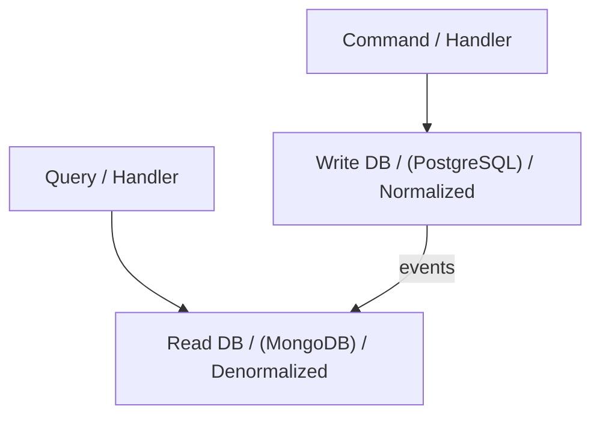
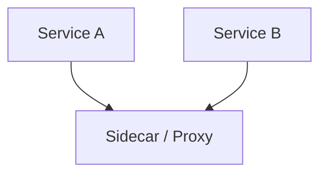
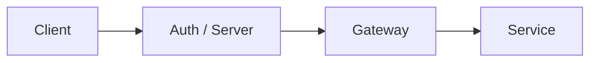
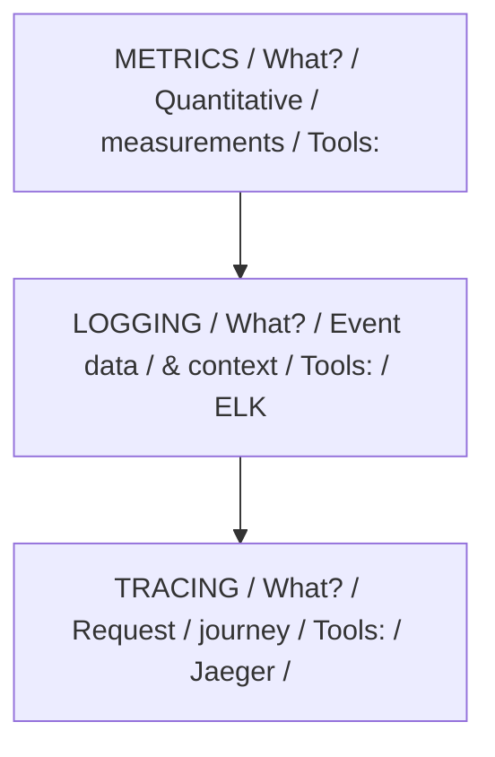
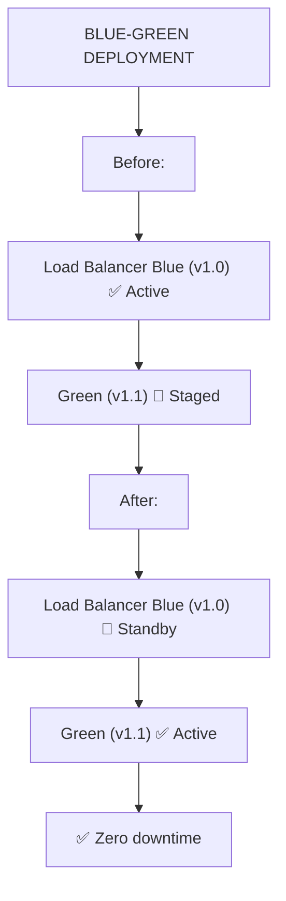
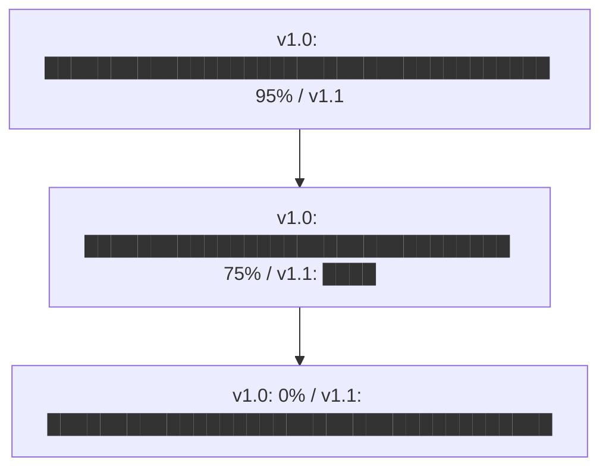
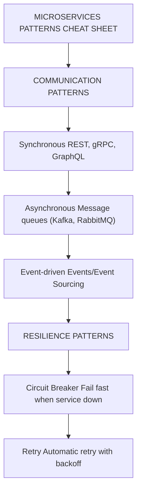

**Navigation**: [< Previous Chapter](Ch61_SB_Microservices_Core.md) | [Back to Index](../00_MASTER_INDEX.md)

---

# Config Server application.yml
server:
  port: 8888

spring:
  application:
    name: config-server
  cloud:
    config:
      server:
        git:
          uri: https://github.com/company/config-repo
          default-label: main
          search-paths: '{application}'
          clone-on-start: true
          force-pull: true
        encrypt:
          enabled: true

encrypt:
  key: ${ENCRYPT_KEY}
```

### Config Client Setup

```yaml
# bootstrap.yml for config client
spring:
  application:
    name: order-service
  cloud:
    config:
      uri: http://localhost:8888
      fail-fast: true
      retry:
        initial-interval: 1000
        max-attempts: 6
        max-interval: 2000
        multiplier: 1.1
```

### Configuration Repository Structure

```
config-repo/
├── application.yml              # Common configuration for all services
├── application-dev.yml          # Common dev configuration
├── application-prod.yml         # Common prod configuration
├── order-service/
│   ├── order-service.yml        # Order service specific
│   ├── order-service-dev.yml
│   └── order-service-prod.yml
├── user-service/
│   ├── user-service.yml
│   └── user-service-prod.yml
└── payment-service/
    └── payment-service.yml
```

### Dynamic Configuration Refresh

```java
@RestController
@RefreshScope  // Enables dynamic refresh
@RequiredArgsConstructor
public class ConfigController {
    
    @Value("${app.feature.enabled:false}")
    private boolean featureEnabled;
    
    @Value("${app.rate.limit:100}")
    private int rateLimit;
    
    @GetMapping("/config")
    public Map<String, Object> getConfig() {
        return Map.of(
            "featureEnabled", featureEnabled,
            "rateLimit", rateLimit
        );
    }
}

// Trigger refresh via POST /actuator/refresh
// Or use Spring Cloud Bus for broadcast refresh to all instances
```

### Configuration Encryption

```bash
# Encrypt sensitive values
curl -X POST http://localhost:8888/encrypt -d "mySecret"
# Returns: AQA2jxK...encrypted...

# Use in configuration
spring:
  datasource:
    password: '{cipher}AQA2jxK...encrypted...'
```

---

## Saga Pattern

### Why Saga?

```
Problem with Distributed Transactions:
┌─────────────────────────────────────────────────────────────────┐
│  Order Service → Payment Service → Inventory Service            │
│  ❌ 2PC (Two-Phase Commit) doesn't work across services          │
│  ❌ Long-running transactions lock resources                     │
│  ❌ Single service failure blocks entire transaction             │
└─────────────────────────────────────────────────────────────────┘

Saga Solution:
┌─────────────────────────────────────────────────────────────────┐
│  Local transactions with compensating actions                   │
│  Each step can be rolled back independently                     │
│  ✅ Eventually consistent                                        │
│  ✅ No distributed locks                                         │
│  ✅ Better scalability                                           │
└─────────────────────────────────────────────────────────────────┘
```

### Saga Patterns

```
CHOREOGRAPHY-BASED SAGA:
┌──────────────────────────────────────────────────────────────────┐
│                                                                  │
│   Order     ──event──▶    Payment    ──event──▶   Inventory      │
│   Service              Service               Service             │
│      │                      │                      │             │
│      └──────────────────────┴──────────────────────┘             │
│                   Event Bus (Kafka)                              │
│  ✅ Loose coupling                                                │
│  ❌ Hard to track overall progress                                │
└──────────────────────────────────────────────────────────────────┘

ORCHESTRATION-BASED SAGA:
┌──────────────────────────────────────────────────────────────────┐
│                                                                  │
│                    ┌─────────────────┐                           │
│                    │  Saga           │                           │
│                    │  Orchestrator   │                           │
│                    └────────┬────────┘                           │
│              ┌──────────────┼──────────────┐                     │
│              ▼              ▼              ▼                     │
│         Order           Payment       Inventory                  │
│         Service         Service       Service                    │
│  ✅ Clear flow visibility                                         │
│  ✅ Easier error handling                                         │
│  ❌ Orchestrator becomes single point                             │
└──────────────────────────────────────────────────────────────────┘
```

### Orchestration-Based Saga Implementation

```java
// Saga Orchestrator
@Service
@RequiredArgsConstructor
@Slf4j
public class OrderSagaOrchestrator {
    
    private final OrderService orderService;
    private final PaymentClient paymentClient;
    private final InventoryClient inventoryClient;
    private final NotificationClient notificationClient;
    
    @Transactional
    public OrderResult executeOrderSaga(OrderRequest request) {
        SagaContext context = new SagaContext();
        
        try {
            // Step 1: Create Order
            Order order = createOrder(request, context);
            
            // Step 2: Reserve Inventory
            reserveInventory(order, context);
            
            // Step 3: Process Payment
            processPayment(order, context);
            
            // Step 4: Confirm Order
            confirmOrder(order);
            
            // Step 5: Send Notification
            sendNotification(order);
            
            log.info("Saga completed successfully for order: {}", order.getId());
            return OrderResult.success(order);
            
        } catch (Exception e) {
            log.error("Saga failed, initiating compensation", e);
            compensate(context);
            return OrderResult.failure(e.getMessage());
        }
    }
    
    private Order createOrder(OrderRequest request, SagaContext context) {
        log.info("Step 1: Creating order");
        Order order = orderService.create(request);
        context.setOrder(order);
        context.addCompensation(() -> orderService.cancel(order.getId()));
        return order;
    }
    
    private void reserveInventory(Order order, SagaContext context) {
        log.info("Step 2: Reserving inventory for order: {}", order.getId());
        InventoryReservation reservation = inventoryClient.reserve(
            new ReservationRequest(order.getId(), order.getItems())
        );
        context.setReservation(reservation);
        context.addCompensation(() -> 
            inventoryClient.cancelReservation(reservation.getId()));
    }
    
    private void processPayment(Order order, SagaContext context) {
        log.info("Step 3: Processing payment for order: {}", order.getId());
        PaymentResult payment = paymentClient.process(
            new PaymentRequest(order.getId(), order.getTotalAmount())
        );
        
        if (!payment.isSuccess()) {
            throw new PaymentFailedException(payment.getMessage());
        }
        
        context.setPayment(payment);
        context.addCompensation(() -> 
            paymentClient.refund(payment.getTransactionId()));
    }
    
    private void confirmOrder(Order order) {
        log.info("Step 4: Confirming order: {}", order.getId());
        orderService.confirm(order.getId());
    }
    
    private void sendNotification(Order order) {
        log.info("Step 5: Sending notification for order: {}", order.getId());
        try {
            notificationClient.sendOrderConfirmation(order);
        } catch (Exception e) {
            // Notification failure shouldn't fail the saga
            log.warn("Failed to send notification, will retry later", e);
        }
    }
    
    private void compensate(SagaContext context) {
        log.info("Starting compensation for failed saga");
        context.executeCompensations();
    }
}

// Saga Context to track state and compensations
@Data
public class SagaContext {
    private Order order;
    private InventoryReservation reservation;
    private PaymentResult payment;
    private final Deque<Runnable> compensations = new ArrayDeque<>();
    
    public void addCompensation(Runnable compensation) {
        compensations.push(compensation);
    }
    
    public void executeCompensations() {
        while (!compensations.isEmpty()) {
            try {
                compensations.pop().run();
            } catch (Exception e) {
                // Log but continue with other compensations
                log.error("Compensation failed", e);
            }
        }
    }
}
```

### Choreography-Based Saga with Events

```java
// Order Created Event
@Data
@AllArgsConstructor
@NoArgsConstructor
public class OrderCreatedEvent {
    private String orderId;
    private String customerId;
    private List<OrderItem> items;
    private BigDecimal totalAmount;
}

// Order Service publishes events
@Service
@RequiredArgsConstructor
public class OrderService {
    
    private final OrderRepository orderRepository;
    private final StreamBridge streamBridge;
    
    public Order createOrder(OrderRequest request) {
        Order order = Order.builder()
            .customerId(request.getCustomerId())
            .items(request.getItems())
            .status(OrderStatus.PENDING)
            .build();
        
        Order savedOrder = orderRepository.save(order);
        
        // Publish event
        streamBridge.send("order-events-out-0", 
            new OrderCreatedEvent(
                savedOrder.getId(),
                savedOrder.getCustomerId(),
                savedOrder.getItems(),
                savedOrder.getTotalAmount()
            )
        );
        
        return savedOrder;
    }
    
    @Bean
    public Consumer<PaymentCompletedEvent> handlePaymentCompleted() {
        return event -> {
            log.info("Payment completed for order: {}", event.getOrderId());
            orderRepository.updateStatus(event.getOrderId(), OrderStatus.PAID);
            
            streamBridge.send("inventory-reserve-out-0",
                new ReserveInventoryCommand(event.getOrderId()));
        };
    }
    
    @Bean
    public Consumer<PaymentFailedEvent> handlePaymentFailed() {
        return event -> {
            log.warn("Payment failed for order: {}", event.getOrderId());
            orderRepository.updateStatus(event.getOrderId(), OrderStatus.PAYMENT_FAILED);
        };
    }
}

// Payment Service listens and responds
@Service
@RequiredArgsConstructor
public class PaymentService {
    
    private final PaymentGateway paymentGateway;
    private final StreamBridge streamBridge;
    
    @Bean
    public Consumer<OrderCreatedEvent> handleOrderCreated() {
        return event -> {
            log.info("Processing payment for order: {}", event.getOrderId());
            
            try {
                PaymentResult result = paymentGateway.process(
                    event.getOrderId(),
                    event.getTotalAmount()
                );
                
                if (result.isSuccess()) {
                    streamBridge.send("payment-events-out-0",
                        new PaymentCompletedEvent(
                            event.getOrderId(),
                            result.getTransactionId()
                        )
                    );
                } else {
                    streamBridge.send("payment-events-out-0",
                        new PaymentFailedEvent(
                            event.getOrderId(),
                            result.getErrorMessage()
                        )
                    );
                }
            } catch (Exception e) {
                streamBridge.send("payment-events-out-0",
                    new PaymentFailedEvent(event.getOrderId(), e.getMessage())
                );
            }
        };
    }
}
```

---


## Event-Driven Architecture

### Event Types

```
┌──────────────────────────────────────────────────────────────────┐
│                       EVENT TYPES                                │
├──────────────────────────────────────────────────────────────────┤
│  DOMAIN EVENTS                                                   │
│  Something that happened in the business domain                  │
│  Examples: OrderPlaced, PaymentReceived, UserRegistered          │
│                                                                  │
│  INTEGRATION EVENTS                                              │
│  Events shared between bounded contexts/services                 │
│  Examples: OrderCreatedIntegrationEvent                          │
│                                                                  │
│  EVENT COMMANDS                                                  │
│  Request for action (imperative)                                 │
│  Examples: ProcessPayment, ShipOrder                             │
│                                                                  │
│  EVENT QUERIES                                                   │
│  Request for data                                                │
│  Examples: GetOrderStatus                                        │
└──────────────────────────────────────────────────────────────────┘
```

### Spring Cloud Stream with Kafka

```xml
<dependency>
    <groupId>org.springframework.cloud</groupId>
    <artifactId>spring-cloud-starter-stream-kafka</artifactId>
</dependency>
```

```yaml
spring:
  cloud:
    stream:
      bindings:
        order-events-out-0:
          destination: order-events
          producer:
            partition-key-expression: headers['partitionKey']
        order-events-in-0:
          destination: order-events
          group: order-service-group
        payment-events-in-0:
          destination: payment-events
          group: order-service-group
      kafka:
        binder:
          brokers: localhost:9092
          auto-create-topics: true
          replication-factor: 3
        bindings:
          order-events-out-0:
            producer:
              configuration:
                acks: all
```

```java
// Event Publisher
@Service
@RequiredArgsConstructor
public class EventPublisher {
    
    private final StreamBridge streamBridge;
    
    public void publishOrderCreated(Order order) {
        OrderCreatedEvent event = new OrderCreatedEvent(
            order.getId(),
            order.getCustomerId(),
            order.getItems(),
            order.getTotalAmount(),
            Instant.now()
        );
        
        streamBridge.send("order-events-out-0", 
            MessageBuilder.withPayload(event)
                .setHeader("partitionKey", order.getCustomerId())
                .setHeader("eventType", "OrderCreated")
                .build()
        );
    }
}

// Event Consumer
@Configuration
public class EventConsumers {
    
    @Bean
    public Consumer<Message<OrderCreatedEvent>> orderCreatedConsumer(
            InventoryService inventoryService) {
        return message -> {
            OrderCreatedEvent event = message.getPayload();
            log.info("Received OrderCreatedEvent: {}", event.getOrderId());
            
            inventoryService.reserveInventory(
                event.getOrderId(),
                event.getItems()
            );
        };
    }
    
    @Bean  
    public Function<OrderCreatedEvent, PaymentRequestEvent> orderToPayment() {
        return order -> new PaymentRequestEvent(
            order.getOrderId(),
            order.getTotalAmount()
        );
    }
}
```

### Event Sourcing

```java
// Event Store
@Entity
@Table(name = "event_store")
@Data
public class StoredEvent {
    @Id
    @GeneratedValue(strategy = GenerationType.UUID)
    private String id;
    
    private String aggregateId;
    private String aggregateType;
    private String eventType;
    
    @Lob
    private String payload;
    
    private int version;
    private Instant timestamp;
}

@Repository
public interface EventStoreRepository extends JpaRepository<StoredEvent, String> {
    List<StoredEvent> findByAggregateIdOrderByVersionAsc(String aggregateId);
    Optional<StoredEvent> findTopByAggregateIdOrderByVersionDesc(String aggregateId);
}

// Event Store Service
@Service
@RequiredArgsConstructor
public class EventStore {
    
    private final EventStoreRepository repository;
    private final ObjectMapper objectMapper;
    
    public void append(String aggregateId, String aggregateType, 
                       Object event, int expectedVersion) {
        Optional<StoredEvent> lastEvent = repository
            .findTopByAggregateIdOrderByVersionDesc(aggregateId);
        
        int currentVersion = lastEvent.map(StoredEvent::getVersion).orElse(0);
        
        if (currentVersion != expectedVersion) {
            throw new OptimisticLockingException(
                "Expected version " + expectedVersion + " but found " + currentVersion
            );
        }
        
        StoredEvent storedEvent = new StoredEvent();
        storedEvent.setAggregateId(aggregateId);
        storedEvent.setAggregateType(aggregateType);
        storedEvent.setEventType(event.getClass().getSimpleName());
        storedEvent.setPayload(serialize(event));
        storedEvent.setVersion(currentVersion + 1);
        storedEvent.setTimestamp(Instant.now());
        
        repository.save(storedEvent);
    }
    
    public List<Object> getEvents(String aggregateId) {
        return repository.findByAggregateIdOrderByVersionAsc(aggregateId)
            .stream()
            .map(this::deserialize)
            .collect(Collectors.toList());
    }
    
    private String serialize(Object event) {
        try {
            return objectMapper.writeValueAsString(event);
        } catch (JsonProcessingException e) {
            throw new EventSerializationException(e);
        }
    }
    
    private Object deserialize(StoredEvent storedEvent) {
        try {
            Class<?> eventClass = Class.forName(
                "com.example.events." + storedEvent.getEventType()
            );
            return objectMapper.readValue(storedEvent.getPayload(), eventClass);
        } catch (Exception e) {
            throw new EventDeserializationException(e);
        }
    }
}

// Order Aggregate using Event Sourcing
@Data
public class OrderAggregate {
    private String id;
    private String customerId;
    private List<OrderItem> items = new ArrayList<>();
    private OrderStatus status;
    private BigDecimal totalAmount;
    private int version;
    
    // Apply events to rebuild state
    public void apply(Object event) {
        if (event instanceof OrderCreatedEvent e) {
            this.id = e.getOrderId();
            this.customerId = e.getCustomerId();
            this.items = e.getItems();
            this.status = OrderStatus.PENDING;
            this.totalAmount = e.getTotalAmount();
        } else if (event instanceof OrderPaidEvent e) {
            this.status = OrderStatus.PAID;
        } else if (event instanceof OrderShippedEvent e) {
            this.status = OrderStatus.SHIPPED;
        } else if (event instanceof OrderCancelledEvent e) {
            this.status = OrderStatus.CANCELLED;
        }
        this.version++;
    }
    
    // Rebuild from events
    public static OrderAggregate fromEvents(List<Object> events) {
        OrderAggregate aggregate = new OrderAggregate();
        events.forEach(aggregate::apply);
        return aggregate;
    }
}
```

---

## CQRS Pattern

### CQRS Architecture

```
┌──────────────────────────────────────────────────────────────────┐
│                        CQRS PATTERN                              │
├──────────────────────────────────────────────────────────────────┤
│                                                                  │
│                    ┌─────────────┐                               │
│                    │   Client    │                               │
│                    └──────┬──────┘                               │
│              Commands     │     Queries                          │
│           ┌───────────────┴───────────────┐                      │
│           ▼                               ▼                      │
│   ┌───────────────┐               ┌───────────────┐              │
│   │   Command     │               │    Query      │              │
│   │   Handler     │               │    Handler    │              │
│   └───────┬───────┘               └───────┬───────┘              │
│           │                               │                      │
│           ▼                               ▼                      │
│   ┌───────────────┐               ┌───────────────┐              │
│   │   Write DB    │ ──events──▶   │   Read DB     │              │
│   │  (PostgreSQL) │               │   (MongoDB)   │              │
│   │  Normalized   │               │   Denormalized│              │
│   └───────────────┘               └───────────────┘              │
│                                                                  │
└──────────────────────────────────────────────────────────────────┘
```

**Flow:**
1. Command / Handler
2. Write DB / (PostgreSQL) / Normalized
3. Query / Handler
4. Read DB / (MongoDB) / Denormalized
5. Write DB / (PostgreSQL) / Normalized --(events)--> Read DB / (MongoDB) / Denormalized



### CQRS Implementation

```java
// Commands
public sealed interface OrderCommand {
    record CreateOrder(String customerId, List<OrderItem> items) 
        implements OrderCommand {}
    record CancelOrder(String orderId, String reason) 
        implements OrderCommand {}
    record UpdateOrderStatus(String orderId, OrderStatus status) 
        implements OrderCommand {}
}

// Queries
public sealed interface OrderQuery {
    record GetOrderById(String orderId) implements OrderQuery {}
    record GetOrdersByCustomer(String customerId, int page, int size) 
        implements OrderQuery {}
    record SearchOrders(OrderSearchCriteria criteria) implements OrderQuery {}
}

// Command Handler
@Service
@RequiredArgsConstructor
public class OrderCommandHandler {
    
    private final EventStore eventStore;
    private final ApplicationEventPublisher eventPublisher;
    
    public String handle(OrderCommand.CreateOrder command) {
        String orderId = UUID.randomUUID().toString();
        
        OrderCreatedEvent event = new OrderCreatedEvent(
            orderId,
            command.customerId(),
            command.items(),
            calculateTotal(command.items()),
            Instant.now()
        );
        
        eventStore.append(orderId, "Order", event, 0);
        eventPublisher.publishEvent(event);  // For read model update
        
        return orderId;
    }
    
    public void handle(OrderCommand.CancelOrder command) {
        OrderAggregate order = loadAggregate(command.orderId());
        
        if (order.getStatus() == OrderStatus.SHIPPED) {
            throw new BusinessException("Cannot cancel shipped order");
        }
        
        OrderCancelledEvent event = new OrderCancelledEvent(
            command.orderId(),
            command.reason(),
            Instant.now()
        );
        
        eventStore.append(command.orderId(), "Order", event, order.getVersion());
        eventPublisher.publishEvent(event);
    }
    
    private OrderAggregate loadAggregate(String orderId) {
        List<Object> events = eventStore.getEvents(orderId);
        if (events.isEmpty()) {
            throw new OrderNotFoundException(orderId);
        }
        return OrderAggregate.fromEvents(events);
    }
}

// Query Handler (uses optimized read model)
@Service
@RequiredArgsConstructor
public class OrderQueryHandler {
    
    private final OrderReadRepository readRepository;
    
    public OrderView handle(OrderQuery.GetOrderById query) {
        return readRepository.findById(query.orderId())
            .orElseThrow(() -> new OrderNotFoundException(query.orderId()));
    }
    
    public Page<OrderView> handle(OrderQuery.GetOrdersByCustomer query) {
        return readRepository.findByCustomerId(
            query.customerId(),
            PageRequest.of(query.page(), query.size())
        );
    }
    
    public Page<OrderView> handle(OrderQuery.SearchOrders query) {
        return readRepository.search(query.criteria());
    }
}

// Read Model (optimized for queries)
@Document(collection = "orders")
@Data
public class OrderView {
    @Id
    private String id;
    private String customerId;
    private String customerName;  // Denormalized
    private List<OrderItemView> items;
    private OrderStatus status;
    private BigDecimal totalAmount;
    private Instant createdAt;
    private Instant updatedAt;
    
    @Data
    public static class OrderItemView {
        private String productId;
        private String productName;
        private int quantity;
        private BigDecimal price;
        private String imageUrl;  // Denormalized
    }
}

// Read Model Updater (Event Handler)
@Component
@RequiredArgsConstructor
public class OrderReadModelUpdater {
    
    private final OrderReadRepository readRepository;
    private final UserClient userClient;
    private final ProductClient productClient;
    
    @EventListener
    public void on(OrderCreatedEvent event) {
        UserDTO user = userClient.getUser(event.getCustomerId());
        
        List<OrderView.OrderItemView> itemViews = event.getItems().stream()
            .map(item -> {
                ProductDTO product = productClient.getProduct(item.getProductId());
                OrderView.OrderItemView view = new OrderView.OrderItemView();
                view.setProductId(item.getProductId());
                view.setProductName(product.getName());
                view.setQuantity(item.getQuantity());
                view.setPrice(item.getPrice());
                view.setImageUrl(product.getImageUrl());
                return view;
            })
            .collect(Collectors.toList());
        
        OrderView view = new OrderView();
        view.setId(event.getOrderId());
        view.setCustomerId(event.getCustomerId());
        view.setCustomerName(user.getName());
        view.setItems(itemViews);
        view.setStatus(OrderStatus.PENDING);
        view.setTotalAmount(event.getTotalAmount());
        view.setCreatedAt(event.getTimestamp());
        view.setUpdatedAt(event.getTimestamp());
        
        readRepository.save(view);
    }
    
    @EventListener
    public void on(OrderCancelledEvent event) {
        readRepository.updateStatus(event.getOrderId(), OrderStatus.CANCELLED);
    }
}
```

---


## Service Mesh

### Service Mesh Overview

```
┌──────────────────────────────────────────────────────────────────┐
│                      SERVICE MESH                                │
├──────────────────────────────────────────────────────────────────┤
│                                                                  │
│  Traditional:  Service A ──────────────▶ Service B               │
│                                                                  │
│  With Mesh:    ┌─────────┐          ┌─────────┐                  │
│                │Service A│          │Service B│                  │
│                └────┬────┘          └────┬────┘                  │
│                     │                    │                       │
│                ┌────┴────┐          ┌────┴────┐                  │
│                │ Sidecar │──────────│ Sidecar │                  │
│                │ Proxy   │          │ Proxy   │                  │
│                └─────────┘          └─────────┘                  │
│                     │                    │                       │
│                     └────────┬───────────┘                       │
│                          Control Plane                           │
│                   (Configuration, Policies)                      │
│                                                                  │
│  Benefits:                                                       │
│  ✅ Traffic management (routing, load balancing)                  │
│  ✅ Security (mTLS, authorization)                                │
│  ✅ Observability (metrics, tracing, logging)                     │
│  ✅ Reliability (retries, circuit breakers)                       │
│                                                                  │
│  Popular: Istio, Linkerd, Consul Connect                         │
│                                                                  │
└──────────────────────────────────────────────────────────────────┘
```

**Flow:**
1. Service A
2. Sidecar / Proxy
3. Service B
4. Sidecar / Proxy



### Istio Configuration Example

```yaml
# Virtual Service for traffic routing
apiVersion: networking.istio.io/v1beta1
kind: VirtualService
metadata:
  name: order-service
spec:
  hosts:
    - order-service
  http:
    - match:
        - headers:
            x-user-type:
              exact: premium
      route:
        - destination:
            host: order-service
            subset: v2
          weight: 100
    - route:
        - destination:
            host: order-service
            subset: v1
          weight: 90
        - destination:
            host: order-service
            subset: v2
          weight: 10

---
# Destination Rule for subsets
apiVersion: networking.istio.io/v1beta1
kind: DestinationRule
metadata:
  name: order-service
spec:
  host: order-service
  trafficPolicy:
    connectionPool:
      tcp:
        maxConnections: 100
      http:
        h2UpgradePolicy: UPGRADE
        http1MaxPendingRequests: 100
    outlierDetection:
      consecutive5xxErrors: 5
      interval: 30s
      baseEjectionTime: 30s
  subsets:
    - name: v1
      labels:
        version: v1
    - name: v2
      labels:
        version: v2
```

---

## Security Patterns

### OAuth2 / JWT Authentication

```
┌──────────────────────────────────────────────────────────────────┐
│                   OAUTH2 FLOW WITH GATEWAY                       │
├──────────────────────────────────────────────────────────────────┤
│                                                                  │
│  1. Client → Auth Server: Login (username/password)              │
│  2. Auth Server → Client: JWT Token                              │
│  3. Client → API Gateway: Request + JWT                          │
│  4. Gateway: Validate JWT, extract claims                        │
│  5. Gateway → Service: Request + User Context headers            │
│  6. Service: Process request                                     │
│                                                                  │
│  ┌────────┐    ┌──────────┐    ┌─────────┐    ┌─────────┐        │
│  │ Client │───▶│  Auth    │───▶│ Gateway │───▶│ Service │        │
│  │        │◀───│  Server  │◀───│         │◀───│         │        │
│  └────────┘    └──────────┘    └─────────┘    └─────────┘        │
│                                                                  │
└──────────────────────────────────────────────────────────────────┘
```

**Flow:**
1. Client
2. Auth / Server
3. Gateway
4. Service



### Gateway Security Configuration

```java
@Configuration
@EnableWebFluxSecurity
public class GatewaySecurityConfig {
    
    @Bean
    public SecurityWebFilterChain securityWebFilterChain(ServerHttpSecurity http) {
        return http
            .csrf(ServerHttpSecurity.CsrfSpec::disable)
            .authorizeExchange(exchanges -> exchanges
                .pathMatchers("/api/auth/**").permitAll()
                .pathMatchers("/api/public/**").permitAll()
                .pathMatchers(HttpMethod.GET, "/api/products/**").permitAll()
                .pathMatchers("/api/admin/**").hasRole("ADMIN")
                .anyExchange().authenticated()
            )
            .oauth2ResourceServer(oauth2 -> oauth2
                .jwt(jwt -> jwt.jwtAuthenticationConverter(jwtAuthConverter()))
            )
            .build();
    }
    
    @Bean
    public ReactiveJwtDecoder jwtDecoder(@Value("${jwt.secret}") String secret) {
        return NimbusReactiveJwtDecoder.withSecretKey(
            new SecretKeySpec(secret.getBytes(), "HmacSHA256")
        ).build();
    }
    
    private Converter<Jwt, Mono<AbstractAuthenticationToken>> jwtAuthConverter() {
        return jwt -> {
            Collection<GrantedAuthority> authorities = extractAuthorities(jwt);
            return Mono.just(
                new JwtAuthenticationToken(jwt, authorities, jwt.getSubject())
            );
        };
    }
    
    private Collection<GrantedAuthority> extractAuthorities(Jwt jwt) {
        List<String> roles = jwt.getClaimAsStringList("roles");
        if (roles == null) {
            return Collections.emptyList();
        }
        return roles.stream()
            .map(role -> new SimpleGrantedAuthority("ROLE_" + role))
            .collect(Collectors.toList());
    }
}
```

---


## Observability Patterns

### The Three Pillars

```
┌──────────────────────────────────────────────────────────────────┐
│              THREE PILLARS OF OBSERVABILITY                      │
├──────────────────────────────────────────────────────────────────┤
│                                                                  │
│  ┌─────────────┐   ┌─────────────┐   ┌─────────────┐             │
│  │   METRICS   │   │   LOGGING   │   │   TRACING   │             │
│  │             │   │             │   │             │             │
│  │ What?       │   │ What?       │   │ What?       │             │
│  │ Quantitative│   │ Event data  │   │ Request     │             │
│  │ measurements│   │ & context   │   │ journey     │             │
│  │             │   │             │   │             │             │
│  │ Tools:      │   │ Tools:      │   │ Tools:      │             │
│  │ Prometheus  │   │ ELK Stack   │   │ Jaeger      │             │
│  │ Grafana     │   │ Loki        │   │ Zipkin      │             │
│  │ Micrometer  │   │ Fluentd     │   │ Tempo       │             │
│  └─────────────┘   └─────────────┘   └─────────────┘             │
│                                                                  │
│  Combined: Full visibility into system behavior                  │
│                                                                  │
└──────────────────────────────────────────────────────────────────┘
```

**Flow:**
1. METRICS / What? / Quantitative / measurements / Tools:
2. LOGGING / What? / Event data / & context / Tools: / ELK
3. TRACING / What? / Request / journey / Tools: / Jaeger /



### Metrics with Micrometer

```java
@Configuration
public class MetricsConfig {
    
    @Bean
    public MeterRegistryCustomizer<MeterRegistry> metricsCommonTags() {
        return registry -> registry.config()
            .commonTags("application", "order-service")
            .commonTags("environment", System.getenv("ENV"));
    }
}

@Service
@RequiredArgsConstructor
public class OrderService {
    
    private final MeterRegistry meterRegistry;
    private final Counter orderCounter;
    private final Timer orderProcessingTimer;
    
    public OrderService(MeterRegistry meterRegistry) {
        this.meterRegistry = meterRegistry;
        this.orderCounter = Counter.builder("orders.created")
            .description("Number of orders created")
            .register(meterRegistry);
        this.orderProcessingTimer = Timer.builder("orders.processing.time")
            .description("Time to process orders")
            .register(meterRegistry);
    }
    
    public Order createOrder(OrderRequest request) {
        return orderProcessingTimer.record(() -> {
            Order order = processOrder(request);
            orderCounter.increment();
            
            // Custom metrics
            meterRegistry.gauge("orders.pending", 
                orderRepository.countByStatus(OrderStatus.PENDING));
            
            return order;
        });
    }
}
```

---


## Deployment Patterns

### Blue-Green Deployment

```
┌──────────────────────────────────────────────────────────────────┐
│                   BLUE-GREEN DEPLOYMENT                          │
├──────────────────────────────────────────────────────────────────┤
│                                                                  │
│  Before:                                                         │
│  Load Balancer ──▶ Blue (v1.0) ✅ Active                          │
│                    Green (v1.1) 🔳 Staged                         │
│                                                                  │
│  After:                                                          │
│  Load Balancer ──▶ Blue (v1.0) 🔳 Standby                         │
│                    Green (v1.1) ✅ Active                         │
│                                                                  │
│  ✅ Zero downtime                                                 │
│  ✅ Instant rollback                                              │
│  ❌ Needs 2x infrastructure                                       │
│                                                                  │
└──────────────────────────────────────────────────────────────────┘
```

**Flow:**
1. BLUE-GREEN DEPLOYMENT
2. Before:
3. Load Balancer Blue (v1.0) ✅ Active
4. Green (v1.1) 🔳 Staged
5. After:
6. Load Balancer Blue (v1.0) 🔳 Standby
7. Green (v1.1) ✅ Active



### Canary Deployment

```
┌──────────────────────────────────────────────────────────────────┐
│                    CANARY DEPLOYMENT                             │
├──────────────────────────────────────────────────────────────────┤
│                                                                  │
│  Phase 1: 5% to new version                                      │
│  ┌─────────────────────────────────────────────────────┐         │
│  │  v1.0: ██████████████████████████████████████ 95%  │          │
│  │  v1.1: ██ 5%                                        │         │
│  └─────────────────────────────────────────────────────┘         │
│                                                                  │
│  Phase 2: 25% to new version (if metrics good)                   │
│  ┌─────────────────────────────────────────────────────┐         │
│  │  v1.0: ████████████████████████████████ 75%        │          │
│  │  v1.1: ████████ 25%                                 │         │
│  └─────────────────────────────────────────────────────┘         │
│                                                                  │
│  Phase 3: 100% to new version                                    │
│  ┌─────────────────────────────────────────────────────┐         │
│  │  v1.0: 0%                                           │         │
│  │  v1.1: ██████████████████████████████████████ 100% │          │
│  └─────────────────────────────────────────────────────┘         │
│                                                                  │
│  ✅ Gradual rollout                                               │
│  ✅ Real traffic validation                                       │
│  ✅ Quick rollback if issues                                      │
│                                                                  │
└──────────────────────────────────────────────────────────────────┘
```

**Flow:**
1. v1.0: ██████████████████████████████████████ 95% / v1.1
2. v1.0: ████████████████████████████████ 75% / v1.1: ████
3. v1.0: 0% / v1.1: ██████████████████████████████████████



---


## Interview Questions

### Beginner

**Q1: What is service discovery and why is it needed?**
```
Service discovery allows services to find each other dynamically without 
hard-coded URLs. It's needed because:
- Services can scale up/down
- IP addresses change
- Services can move to different hosts
- Enables load balancing across instances
```

**Q2: What is an API Gateway?**
```
API Gateway is a single entry point for all clients that:
- Routes requests to appropriate services
- Handles cross-cutting concerns (auth, logging, rate limiting)
- Aggregates responses from multiple services
- Provides protocol translation
```

**Q3: Explain the Circuit Breaker pattern**
```
Circuit breaker prevents cascading failures:
- CLOSED: Normal operation, requests pass through
- OPEN: Failure threshold exceeded, fail fast
- HALF-OPEN: Test if service recovered

Benefits:
- Fast failure instead of waiting for timeout
- Gives failing service time to recover
- Prevents resource exhaustion
```

### Advanced

**Q4: Compare choreography vs orchestration saga**
```
Choreography:
- Services communicate via events
- Loose coupling
- No central coordinator
- Hard to track progress
- Best for: Simple workflows

Orchestration:
- Central coordinator manages flow
- Clear visibility
- Easier error handling
- Single point of failure
- Best for: Complex workflows
```

**Q5: What is CQRS and when to use it?**
```
Command Query Responsibility Segregation separates read and write operations.

Use when:
- Different read/write patterns
- Need different optimization for queries vs commands
- High read/write ratio
- Complex domain logic

Don't use when:
- Simple CRUD operations
- Small scale application
- Team unfamiliar with pattern
```

**Q6: How do you handle distributed transactions?**
```
Options:
1. Saga Pattern - Compensating transactions
2. Two-Phase Commit (2PC) - Not recommended for microservices
3. Eventual Consistency - Accept temporary inconsistency
4. Outbox Pattern - Reliable event publishing

Best practices:
- Design for idempotency
- Use correlation IDs
- Implement retry with exponential backoff
- Handle partial failures gracefully
```

---

## Quick Reference

```
┌─────────────────────────────────────────────────────────────────────┐
│                 MICROSERVICES PATTERNS CHEAT SHEET                  │
├─────────────────────────────────────────────────────────────────────┤
│ COMMUNICATION PATTERNS                                              │
│  Synchronous     │ REST, gRPC, GraphQL                              │
│  Asynchronous    │ Message queues (Kafka, RabbitMQ)                 │
│  Event-driven    │ Events/Event Sourcing                            │
├─────────────────────────────────────────────────────────────────────┤
│ RESILIENCE PATTERNS                                                 │
│  Circuit Breaker │ Fail fast when service down                      │
│  Retry           │ Automatic retry with backoff                     │
│  Bulkhead        │ Isolate failures                                 │
│  Timeout         │ Don't wait forever                               │
│  Rate Limiter    │ Protect from overload                            │
├─────────────────────────────────────────────────────────────────────┤
│ DATA PATTERNS                                                       │
│  Saga            │ Distributed transactions                         │
│  CQRS            │ Separate read/write models                       │
│  Event Sourcing  │ Store events, derive state                       │
│  Outbox          │ Reliable event publishing                        │
├─────────────────────────────────────────────────────────────────────┤
│ DEPLOYMENT PATTERNS                                                 │
│  Blue-Green      │ Zero downtime, instant rollback                  │
│  Canary          │ Gradual rollout                                  │
│  Rolling         │ Sequential instance updates                      │
├─────────────────────────────────────────────────────────────────────┤
│ DISCOVERY & ROUTING                                                 │
│  Service Registry│ Eureka, Consul                                   │
│  API Gateway     │ Spring Cloud Gateway                             │
│  Load Balancer   │ Client-side with discovery                       │
│  Service Mesh    │ Istio, Linkerd                                   │
└─────────────────────────────────────────────────────────────────────┘
```

**Flow:**
1. MICROSERVICES PATTERNS CHEAT SHEET
2. COMMUNICATION PATTERNS
3. Synchronous REST, gRPC, GraphQL
4. Asynchronous Message queues (Kafka, RabbitMQ)
5. Event-driven Events/Event Sourcing
6. RESILIENCE PATTERNS
7. Circuit Breaker Fail fast when service down



---

## Summary

Microservices patterns solve distributed system challenges:

1. **Service Discovery** - Dynamic service location
2. **API Gateway** - Single entry point, cross-cutting concerns
3. **Circuit Breaker** - Resilience against failures
4. **Saga** - Distributed transaction management
5. **CQRS** - Optimized read/write separation
6. **Event-Driven** - Loose coupling through events

**Remember**: "Start with a monolith, break into microservices when you understand the domain boundaries" - Martin Fowler

---

*Next: Part 21 - Cloud Deployment (AWS/Azure/GCP Integration)*


---


---


🔬 **Section Challenge — Summary**
>

## 🏋️ Practice & Interview Questions — OOP & Design Patterns

### Predict / Trace
**Q1.** What design pattern does this code follow?
```java
Logger logger = Logger.getInstance();
```
<details><summary>Answer</summary>

**Singleton** — ensures only one Logger instance exists globally.
</details>

**Q2.** What SOLID principle is violated?
```java
class User {
    void login() { ... }
    void logout() { ... }
    void sendEmail() { ... }  // ← ?
    void generateReport() { ... }  // ← ?
}
```
<details><summary>Answer</summary>

**SRP (Single Responsibility)** — User class has 4 responsibilities: authentication, email, reporting. Should be split into: `AuthService`, `EmailService`, `ReportService`.
</details>

### Design Pattern Problems
**Q3.** ⭐ Implement Strategy pattern for payment processing.
<details><summary>Solution</summary>

```java
interface PaymentStrategy { void pay(int amount); }
class CreditCard implements PaymentStrategy { public void pay(int amount){ /*...*/ } }
class PayPal implements PaymentStrategy { public void pay(int amount){ /*...*/ } }
class UPI implements PaymentStrategy { public void pay(int amount){ /*...*/ } }

class PaymentContext {
    private PaymentStrategy strategy;
    void setStrategy(PaymentStrategy s){ this.strategy=s; }
    void processPayment(int amount){ strategy.pay(amount); }
}
// Switch strategy at runtime — open/closed principle!
```
</details>

**Q4.** ⭐⭐ Implement Observer pattern for event notification.
<details><summary>Solution</summary>

```java
interface Observer { void update(String event); }
interface Observable {
    void subscribe(Observer o); void unsubscribe(Observer o); void notify(String event);
}
class EventBus implements Observable {
    List<Observer> observers = new ArrayList<>();
    public void subscribe(Observer o){ observers.add(o); }
    public void unsubscribe(Observer o){ observers.remove(o); }
    public void notify(String event){ observers.forEach(o -> o.update(event)); }
}
```
</details>

**Q5.** ⭐⭐ Builder pattern for a complex configuration object.
<details><summary>Solution</summary>

```java
class ServerConfig {
    private final String host; private final int port; private final int timeout;
    private ServerConfig(Builder b){ host=b.host; port=b.port; timeout=b.timeout; }

    static class Builder {
        String host="localhost"; int port=8080; int timeout=30;
        Builder host(String h){ host=h; return this; }
        Builder port(int p){ port=p; return this; }
        Builder timeout(int t){ timeout=t; return this; }
        ServerConfig build(){ return new ServerConfig(this); }
    }
}
// ServerConfig config = new ServerConfig.Builder().host("prod.com").port(443).build();
```
</details>

### MCQ Rapid Fire
| # | Question | Answer |
|---|---|---|
| 1 | SOLID: O stands for | Open/Closed Principle |
| 2 | Factory vs Abstract Factory | Factory: one product; Abstract Factory: family of products |
| 3 | Composition over inheritance means | Prefer has-a (field) over is-a (extends) for flexibility |
| 4 | Decorator pattern purpose | Add behavior dynamically without subclassing |
| 5 | Facade pattern purpose | Simplified interface to complex subsystem |
| 6 | Proxy pattern types | Virtual, protective, remote, caching |
| 7 | Command pattern encapsulates | Request as an object (supports undo/redo) |
| 8 | Template Method pattern | Defines algorithm skeleton, subclasses fill in steps |


---

## 🧠 Deep Conceptual Questions — OOP, SOLID & Design Patterns

**C1. What is the difference between an interface and an abstract class — when to use each?**
<details><summary>Deep Answer</summary>

**Abstract class**: can have fields, constructors, concrete method implementations. Models IS-A with shared state and behavior. Use when: you have partial implementation to share (template method pattern). Single inheritance: if you extend an abstract class, you can't extend another. **Interface**: pure contract, no state (Java 8+: default methods allowed). Models CAN-DO / role capability. A class can implement unlimited interfaces. Use when: defining a capability across unrelated classes (`Comparable`, `Serializable`, `Runnable`). Rule: prefer interfaces for type definitions. Use abstract class when you need to share implementation code AND all subtypes share the same "IS-A" relationship. In practice: interfaces + composition > abstract class + inheritance.
</details>

**C2. Liskov Substitution Principle: what does it actually mean and how do you violate it?**
<details><summary>Deep Answer</summary>

LSP: if `S extends P`, anywhere you use `P`, you should be able to use `S` without breaking correctness. Violation example: `Square extends Rectangle`. Rectangle behavior: setWidth and setHeight are independent. Square invariant: width must equal height. `Square s = new Square(5); s.setWidth(10);` — now `s.getHeight() == 10` (Square enforced equality) but Rectangle contract says height should still be 5. Code using Rectangle is surprised. Better: Square and Rectangle as siblings under a Shape hierarchy. Another classic: override a method and throw exception for a case the parent method handled → violates LSP. Test: can you run the parent's test suite against the child and pass?
</details>

**C3. Strategy pattern vs. if-else chains: the OCP argument.**
<details><summary>Deep Answer</summary>

```java
// BAD: add new payment type = modify this method = Open for modification (violates OCP)
if(type == "credit") { } else if(type == "paypal") { } else if(type == "crypto") { }

// GOOD: add new payment = new class, zero modification of existing code
interface PaymentStrategy { void pay(int amount); }
// Add Crypto: new CryptoPayment implements PaymentStrategy — no other file touched
```
Open/Closed Principle: open for extension, closed for modification. Each `else if` = a modification to an existing method = risk of breaking existing behavior, requires re-testing the entire method. Strategy = extension by new class = old code untouched = zero regression risk. When if-else is fine: 2-3 fixed cases that never change. When strategy shines: extensible behaviors that vary at runtime.
</details>

**C4. What is the Dependency Inversion Principle and how does it enable testability?**
<details><summary>Deep Answer</summary>

DIP: high-level modules should not depend on low-level modules — both should depend on abstractions. Without DIP: `OrderService` directly creates `MySQLOrderRepository`. To test OrderService: must have MySQL running. With DIP: `OrderService` depends on `OrderRepository` interface. In production: inject `MySQLOrderRepository`. In tests: inject `MockOrderRepository`. The high-level business logic (OrderService) has zero knowledge of the database layer. This makes: unit testing trivial (mock the interface), swapping implementations easy (SQLite, PostgreSQL, in-memory), layer boundaries clear. Dependency INJECTION (DI framework like Spring) is the mechanism that enables DIP at runtime.
</details>

**C5. Observer pattern vs. Event Bus: when does one become the other?**
<details><summary>Deep Answer</summary>

**Observer**: subject holds direct references to observer objects. Subject explicitly notifies each one. Tightly coupled (subject knows about observers). Fine for: small systems, known observers at compile time. Breaks when: observers span different modules, dynamic subscription needed, observers need to be remote. **Event Bus / Message Queue**: publishers and subscribers decoupled. Publisher sends event with a TYPE to the bus. Subscribers register for event types — publisher doesn't know who's listening. De-facto standard in large systems: Spring ApplicationEventPublisher, Kafka, RabbitMQ are all event buses. Rule: Observer for in-process tightly-coupled notification. Event bus for loose coupling, cross-module, or distributed communication.
</details>


> **Navigation**: [< Previous](Ch61_SB_Microservices_Core.md) | [Back to Index](../00_MASTER_INDEX.md) | [Next >](Ch63_SB_Cloud_Core.md)