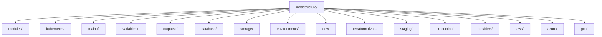
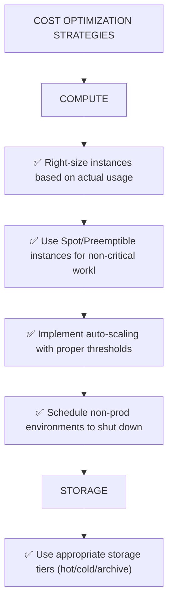
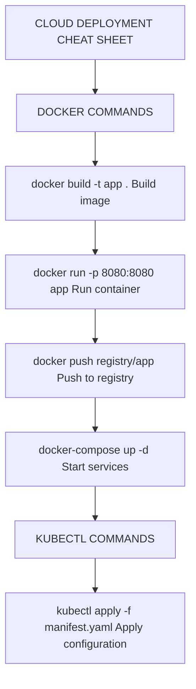

> **Navigation**: [< Previous Chapter](Ch63_SB_Cloud_Core.md) | [Back to Index](../00_MASTER_INDEX.md)

---

# application.yml for Azure
spring:
  cloud:
    azure:
      keyvault:
        secret:
          property-sources:
            - name: key-vault
              endpoint: https://mykeyvault.vault.azure.net/
      storage:
        blob:
          account-name: ${AZURE_STORAGE_ACCOUNT}
          account-key: ${AZURE_STORAGE_KEY}
          container-name: documents
      servicebus:
        connection-string: ${AZURE_SERVICEBUS_CONNECTION_STRING}
        entity-type: queue
```

### Azure Blob Storage Service

```java
@Service
@RequiredArgsConstructor
@Slf4j
public class AzureBlobStorageService {
    
    private final BlobServiceClient blobServiceClient;
    
    @Value("${spring.cloud.azure.storage.blob.container-name}")
    private String containerName;
    
    public String uploadFile(MultipartFile file, String blobName) {
        try {
            BlobContainerClient containerClient = blobServiceClient
                .getBlobContainerClient(containerName);
            
            BlobClient blobClient = containerClient.getBlobClient(blobName);
            
            blobClient.upload(file.getInputStream(), file.getSize(), true);
            
            return blobClient.getBlobUrl();
            
        } catch (IOException e) {
            throw new StorageException("Failed to upload to Azure Blob", e);
        }
    }
    
    public byte[] downloadFile(String blobName) {
        BlobClient blobClient = blobServiceClient
            .getBlobContainerClient(containerName)
            .getBlobClient(blobName);
        
        ByteArrayOutputStream outputStream = new ByteArrayOutputStream();
        blobClient.downloadStream(outputStream);
        
        return outputStream.toByteArray();
    }
    
    public String generateSasUrl(String blobName, Duration expiration) {
        BlobClient blobClient = blobServiceClient
            .getBlobContainerClient(containerName)
            .getBlobClient(blobName);
        
        OffsetDateTime expiryTime = OffsetDateTime.now().plus(expiration);
        
        BlobSasPermission permission = new BlobSasPermission()
            .setReadPermission(true);
        
        BlobServiceSasSignatureValues sasValues = new BlobServiceSasSignatureValues(
            expiryTime, permission);
        
        return blobClient.getBlobUrl() + "?" + blobClient.generateSas(sasValues);
    }
}
```

### Azure Key Vault Configuration

```java
@Configuration
public class AzureKeyVaultConfig {
    
    // Key Vault values are automatically injected when using spring-cloud-azure
    @Value("${database-password}")  // From Key Vault
    private String databasePassword;
    
    @Value("${jwt-secret}")  // From Key Vault
    private String jwtSecret;
    
    @Bean
    public DataSource dataSource(
            @Value("${spring.datasource.url}") String url,
            @Value("${spring.datasource.username}") String username) {
        
        HikariDataSource dataSource = new HikariDataSource();
        dataSource.setJdbcUrl(url);
        dataSource.setUsername(username);
        dataSource.setPassword(databasePassword);
        
        return dataSource;
    }
}
```

### AKS Deployment with Terraform

```hcl
# main.tf
provider "azurerm" {
  features {}
}

resource "azurerm_resource_group" "main" {
  name     = "rg-production"
  location = "East US"
}

resource "azurerm_kubernetes_cluster" "main" {
  name                = "aks-production"
  location            = azurerm_resource_group.main.location
  resource_group_name = azurerm_resource_group.main.name
  dns_prefix          = "production"

  default_node_pool {
    name                = "system"
    node_count          = 2
    vm_size             = "Standard_D2s_v3"
    enable_auto_scaling = true
    min_count           = 2
    max_count           = 5
    vnet_subnet_id      = azurerm_subnet.aks.id
  }

  identity {
    type = "SystemAssigned"
  }

  network_profile {
    network_plugin    = "azure"
    network_policy    = "calico"
    load_balancer_sku = "standard"
  }

  oms_agent {
    log_analytics_workspace_id = azurerm_log_analytics_workspace.main.id
  }

  tags = {
    Environment = "Production"
  }
}

resource "azurerm_kubernetes_cluster_node_pool" "app" {
  name                  = "app"
  kubernetes_cluster_id = azurerm_kubernetes_cluster.main.id
  vm_size               = "Standard_D4s_v3"
  enable_auto_scaling   = true
  min_count             = 3
  max_count             = 10
  vnet_subnet_id        = azurerm_subnet.aks.id

  node_labels = {
    "role" = "app"
  }
}

resource "azurerm_postgresql_flexible_server" "main" {
  name                   = "psql-production"
  resource_group_name    = azurerm_resource_group.main.name
  location               = azurerm_resource_group.main.location
  version                = "15"
  administrator_login    = "psqladmin"
  administrator_password = var.db_password
  zone                   = "1"
  storage_mb             = 32768
  sku_name               = "GP_Standard_D2s_v3"

  high_availability {
    mode = "ZoneRedundant"
  }
}

resource "azurerm_key_vault" "main" {
  name                = "kv-production"
  location            = azurerm_resource_group.main.location
  resource_group_name = azurerm_resource_group.main.name
  tenant_id           = data.azurerm_client_config.current.tenant_id
  sku_name            = "standard"

  access_policy {
    tenant_id = data.azurerm_client_config.current.tenant_id
    object_id = azurerm_kubernetes_cluster.main.kubelet_identity[0].object_id

    secret_permissions = [
      "Get",
      "List"
    ]
  }
}
```

---

## GCP Deployment

### GCP Architecture

```
┌──────────────────────────────────────────────────────────────────┐
│                     GOOGLE CLOUD PLATFORM                        │
├──────────────────────────────────────────────────────────────────┤
│                                                                  │
│  ┌─────────────────────────────────────────────────────────┐     │
│  │              Cloud CDN + Cloud Armor                     │    │
│  └───────────────────────────┬─────────────────────────────┘     │
│                              │                                   │
│  ┌─────────────────────────────────────────────────────────┐     │
│  │              Global HTTP(S) Load Balancer                │    │
│  └───────────────────────────┬─────────────────────────────┘     │
│                              │                                   │
│  ┌───────────────────────────┴───────────────────────────┐       │
│  │                    GKE Autopilot                       │      │
│  │  ┌──────────────────┐    ┌──────────────────┐         │       │
│  │  │   Zone A         │    │   Zone B         │         │       │
│  │  │  ┌────┐ ┌────┐   │    │  ┌────┐ ┌────┐   │         │       │
│  │  │  │Pod │ │Pod │   │    │  │Pod │ │Pod │   │         │       │
│  │  │  └────┘ └────┘   │    │  └────┘ └────┘   │         │       │
│  │  └──────────────────┘    └──────────────────┘         │       │
│  └───────────────────────────────────────────────────────┘       │
│                              │                                   │
│  ┌───────────────────────────┴───────────────────────────┐       │
│  │              Managed Services                          │      │
│  │  ┌────────┐  ┌─────────┐  ┌───────┐  ┌────────────┐  │        │
│  │  │Cloud SQL│  │MemoryStore│  │ GCS  │  │Secret Mgr │  │       │
│  │  │(Postgres)│ │ (Redis) │  │      │  │            │  │        │
│  │  └────────┘  └─────────┘  └───────┘  └────────────┘  │        │
│  └───────────────────────────────────────────────────────┘       │
│                                                                  │
└──────────────────────────────────────────────────────────────────┘
```

### GCP SDK Integration

```xml
<dependency>
    <groupId>com.google.cloud</groupId>
    <artifactId>spring-cloud-gcp-starter</artifactId>
</dependency>

<dependency>
    <groupId>com.google.cloud</groupId>
    <artifactId>spring-cloud-gcp-starter-storage</artifactId>
</dependency>

<dependency>
    <groupId>com.google.cloud</groupId>
    <artifactId>spring-cloud-gcp-starter-pubsub</artifactId>
</dependency>

<dependency>
    <groupId>com.google.cloud</groupId>
    <artifactId>spring-cloud-gcp-starter-secretmanager</artifactId>
</dependency>
```

```yaml
# application.yml for GCP
spring:
  cloud:
    gcp:
      project-id: ${GCP_PROJECT_ID}
      credentials:
        location: classpath:service-account.json
      storage:
        bucket: ${GCS_BUCKET_NAME}
      secretmanager:
        enabled: true

# Reference secrets with sm:// prefix
database:
  password: ${sm://database-password}
jwt:
  secret: ${sm://jwt-secret}
```

### Cloud Storage Service

```java
@Service
@RequiredArgsConstructor
@Slf4j
public class CloudStorageService {
    
    private final Storage storage;
    
    @Value("${spring.cloud.gcp.storage.bucket}")
    private String bucketName;
    
    public String uploadFile(MultipartFile file, String objectName) {
        try {
            BlobId blobId = BlobId.of(bucketName, objectName);
            BlobInfo blobInfo = BlobInfo.newBuilder(blobId)
                .setContentType(file.getContentType())
                .build();
            
            storage.create(blobInfo, file.getBytes());
            
            return String.format("gs://%s/%s", bucketName, objectName);
            
        } catch (IOException e) {
            throw new StorageException("Failed to upload to GCS", e);
        }
    }
    
    public byte[] downloadFile(String objectName) {
        Blob blob = storage.get(BlobId.of(bucketName, objectName));
        return blob.getContent();
    }
    
    public String getSignedUrl(String objectName, Duration expiration) {
        BlobInfo blobInfo = BlobInfo.newBuilder(
            BlobId.of(bucketName, objectName)).build();
        
        URL signedUrl = storage.signUrl(
            blobInfo,
            expiration.toMinutes(),
            TimeUnit.MINUTES,
            Storage.SignUrlOption.withV4Signature()
        );
        
        return signedUrl.toString();
    }
}
```

### Pub/Sub Integration

```java
@Configuration
public class PubSubConfig {
    
    @Bean
    public MessageChannel orderInputChannel() {
        return new PublishSubscribeChannel();
    }
    
    @Bean
    public MessageChannel orderOutputChannel() {
        return new DirectChannel();
    }
}

@Service
@RequiredArgsConstructor
@Slf4j
public class PubSubService {
    
    private final PubSubTemplate pubSubTemplate;
    
    @Value("${gcp.pubsub.order-topic}")
    private String orderTopic;
    
    public CompletableFuture<String> publishOrder(OrderEvent event) {
        try {
            String message = new ObjectMapper().writeValueAsString(event);
            
            return pubSubTemplate.publish(orderTopic, message)
                .completable()
                .thenApply(id -> {
                    log.info("Published message to {}: {}", orderTopic, id);
                    return id;
                });
                
        } catch (JsonProcessingException e) {
            throw new MessagingException("Failed to serialize order event", e);
        }
    }
}

// Message handler
@Component
@Slf4j
public class OrderSubscriber {
    
    @Bean
    public Consumer<Message<String>> orderMessageConsumer() {
        return message -> {
            log.info("Received order message: {}", message.getPayload());
            
            try {
                OrderEvent event = new ObjectMapper()
                    .readValue(message.getPayload(), OrderEvent.class);
                processOrder(event);
                
            } catch (Exception e) {
                log.error("Failed to process order message", e);
                throw new RuntimeException(e);
            }
        };
    }
    
    private void processOrder(OrderEvent event) {
        // Process the order
    }
}
```

### Cloud Run Deployment

```yaml
# cloudbuild.yaml for Cloud Run
steps:
  # Build the container
  - name: 'gcr.io/cloud-builders/docker'
    args:
      - 'build'
      - '-t'
      - 'gcr.io/$PROJECT_ID/order-service:$COMMIT_SHA'
      - '.'

  # Push to Container Registry
  - name: 'gcr.io/cloud-builders/docker'
    args:
      - 'push'
      - 'gcr.io/$PROJECT_ID/order-service:$COMMIT_SHA'

  # Deploy to Cloud Run
  - name: 'gcr.io/google.com/cloudsdktool/cloud-sdk'
    entrypoint: gcloud
    args:
      - 'run'
      - 'deploy'
      - 'order-service'
      - '--image=gcr.io/$PROJECT_ID/order-service:$COMMIT_SHA'
      - '--region=us-central1'
      - '--platform=managed'
      - '--allow-unauthenticated'
      - '--memory=1Gi'
      - '--cpu=1'
      - '--min-instances=1'
      - '--max-instances=10'
      - '--concurrency=80'
      - '--set-env-vars=SPRING_PROFILES_ACTIVE=gcp'
      - '--set-secrets=DB_PASSWORD=database-password:latest'
      - '--vpc-connector=vpc-connector'

images:
  - 'gcr.io/$PROJECT_ID/order-service:$COMMIT_SHA'
```

---

## CI/CD Pipelines

### GitHub Actions Pipeline

```yaml
# .github/workflows/deploy.yml
name: Build and Deploy

on:
  push:
    branches: [main]
  pull_request:
    branches: [main]

env:
  REGISTRY: ghcr.io
  IMAGE_NAME: ${{ github.repository }}

jobs:
  test:
    runs-on: ubuntu-latest
    steps:
      - uses: actions/checkout@v4
      
      - name: Set up JDK 21
        uses: actions/setup-java@v4
        with:
          java-version: '21'
          distribution: 'temurin'
          cache: 'gradle'
      
      - name: Run tests
        run: ./gradlew test
      
      - name: Upload test results
        uses: actions/upload-artifact@v4
        if: always()
        with:
          name: test-results
          path: build/reports/tests/

  build:
    needs: test
    runs-on: ubuntu-latest
    permissions:
      contents: read
      packages: write
    
    steps:
      - uses: actions/checkout@v4
      
      - name: Set up Docker Buildx
        uses: docker/setup-buildx-action@v3
      
      - name: Login to Container Registry
        uses: docker/login-action@v3
        with:
          registry: ${{ env.REGISTRY }}
          username: ${{ github.actor }}
          password: ${{ secrets.GITHUB_TOKEN }}
      
      - name: Extract metadata
        id: meta
        uses: docker/metadata-action@v5
        with:
          images: ${{ env.REGISTRY }}/${{ env.IMAGE_NAME }}
          tags: |
            type=sha,prefix=
            type=ref,event=branch
            type=semver,pattern={{version}}
      
      - name: Build and push
        uses: docker/build-push-action@v5
        with:
          context: .
          push: ${{ github.event_name != 'pull_request' }}
          tags: ${{ steps.meta.outputs.tags }}
          cache-from: type=gha
          cache-to: type=gha,mode=max

  deploy-staging:
    needs: build
    runs-on: ubuntu-latest
    if: github.ref == 'refs/heads/main'
    environment: staging
    
    steps:
      - uses: actions/checkout@v4
      
      - name: Configure kubectl
        uses: azure/setup-kubectl@v3
      
      - name: Set Kubernetes context
        uses: azure/k8s-set-context@v3
        with:
          kubeconfig: ${{ secrets.KUBE_CONFIG_STAGING }}
      
      - name: Deploy to staging
        run: |
          kubectl set image deployment/order-service \
            order-service=${{ env.REGISTRY }}/${{ env.IMAGE_NAME }}:${{ github.sha }} \
            -n staging
          kubectl rollout status deployment/order-service -n staging

  deploy-production:
    needs: deploy-staging
    runs-on: ubuntu-latest
    environment: production
    
    steps:
      - uses: actions/checkout@v4
      
      - name: Configure kubectl
        uses: azure/setup-kubectl@v3
      
      - name: Set Kubernetes context
        uses: azure/k8s-set-context@v3
        with:
          kubeconfig: ${{ secrets.KUBE_CONFIG_PRODUCTION }}
      
      - name: Deploy to production
        run: |
          kubectl set image deployment/order-service \
            order-service=${{ env.REGISTRY }}/${{ env.IMAGE_NAME }}:${{ github.sha }} \
            -n production
          kubectl rollout status deployment/order-service -n production
```

### GitLab CI Pipeline

```yaml
# .gitlab-ci.yml
stages:
  - test
  - build
  - deploy-staging
  - deploy-production

variables:
  GRADLE_OPTS: "-Dorg.gradle.daemon=false"
  DOCKER_IMAGE: $CI_REGISTRY_IMAGE:$CI_COMMIT_SHA

test:
  stage: test
  image: eclipse-temurin:21-jdk
  script:
    - ./gradlew test
  artifacts:
    when: always
    reports:
      junit: build/test-results/test/*.xml

build:
  stage: build
  image: docker:24
  services:
    - docker:24-dind
  before_script:
    - docker login -u $CI_REGISTRY_USER -p $CI_REGISTRY_PASSWORD $CI_REGISTRY
  script:
    - docker build -t $DOCKER_IMAGE .
    - docker push $DOCKER_IMAGE
  only:
    - main

deploy-staging:
  stage: deploy-staging
  image: bitnami/kubectl:latest
  script:
    - kubectl config use-context staging
    - kubectl set image deployment/order-service order-service=$DOCKER_IMAGE -n staging
    - kubectl rollout status deployment/order-service -n staging
  environment:
    name: staging
  only:
    - main

deploy-production:
  stage: deploy-production
  image: bitnami/kubectl:latest
  script:
    - kubectl config use-context production
    - kubectl set image deployment/order-service order-service=$DOCKER_IMAGE -n production
    - kubectl rollout status deployment/order-service -n production
  environment:
    name: production
  when: manual
  only:
    - main
```

---

## Infrastructure as Code

### Terraform Multi-Cloud Structure

```
infrastructure/
├── modules/
│   ├── kubernetes/
│   │   ├── main.tf
│   │   ├── variables.tf
│   │   └── outputs.tf
│   ├── database/
│   │   ├── main.tf
│   │   └── variables.tf
│   └── storage/
│       ├── main.tf
│       └── variables.tf
├── environments/
│   ├── dev/
│   │   ├── main.tf
│   │   ├── variables.tf
│   │   └── terraform.tfvars
│   ├── staging/
│   └── production/
└── providers/
    ├── aws/
    ├── azure/
    └── gcp/
```

> **Flow**: infrastructure/ → modules/ | infrastructure/ → kubernetes/ | infrastructure/ → main.tf | infrastructure/ → variables.tf | infrastructure/ → outputs.tf | infrastructure/ → database/ | ...+16 more



### Terraform Kubernetes Module

```hcl
# modules/kubernetes/main.tf
variable "cloud_provider" {
  type = string
  validation {
    condition     = contains(["aws", "azure", "gcp"], var.cloud_provider)
    error_message = "Cloud provider must be aws, azure, or gcp."
  }
}

variable "cluster_name" {
  type = string
}

variable "node_count" {
  type    = number
  default = 3
}

variable "node_size" {
  type = string
}

# 📌 AWS Eks
resource "aws_eks_cluster" "main" {
  count = var.cloud_provider == "aws" ? 1 : 0
  name  = var.cluster_name
  # ... EKS configuration
}

# Azure AKS
resource "azurerm_kubernetes_cluster" "main" {
  count = var.cloud_provider == "azure" ? 1 : 0
  name  = var.cluster_name
  # ... AKS configuration
}

# 📌 GCP Gke
resource "google_container_cluster" "main" {
  count = var.cloud_provider == "gcp" ? 1 : 0
  name  = var.cluster_name
  # ... GKE configuration
}

output "kubeconfig" {
  value = var.cloud_provider == "aws" ? aws_eks_cluster.main[0].kubeconfig : (
    var.cloud_provider == "azure" ? azurerm_kubernetes_cluster.main[0].kube_config_raw : (
      google_container_cluster.main[0].master_auth
    )
  )
  sensitive = true
}
```

---

## Secrets Management

### External Secrets Operator

```yaml
# external-secret.yaml
apiVersion: external-secrets.io/v1beta1
kind: ExternalSecret
metadata:
  name: app-secrets
  namespace: production
spec:
  refreshInterval: 1h
  secretStoreRef:
    name: aws-secrets-manager
    kind: ClusterSecretStore
  target:
    name: app-secrets
    creationPolicy: Owner
  data:
    - secretKey: db-password
      remoteRef:
        key: prod/database/password
    - secretKey: jwt-secret
      remoteRef:
        key: prod/jwt/secret

---
# ClusterSecretStore for AWS
apiVersion: external-secrets.io/v1beta1
kind: ClusterSecretStore
metadata:
  name: aws-secrets-manager
spec:
  provider:
    aws:
      service: SecretsManager
      region: us-east-1
      auth:
        jwt:
          serviceAccountRef:
            name: external-secrets-sa
            namespace: external-secrets

---
# ClusterSecretStore for Azure Key Vault
apiVersion: external-secrets.io/v1beta1
kind: ClusterSecretStore
metadata:
  name: azure-key-vault
spec:
  provider:
    azurekv:
      vaultUrl: "https://mykeyvault.vault.azure.net"
      authType: ManagedIdentity
```

---

## Monitoring and Logging

### Prometheus + Grafana Stack

```yaml
# prometheus-values.yaml for Helm
prometheus:
  prometheusSpec:
    retention: 30d
    storageSpec:
      volumeClaimTemplate:
        spec:
          accessModes: ["ReadWriteOnce"]
          resources:
            requests:
              storage: 100Gi
    
    serviceMonitorSelector:
      matchLabels:
        prometheus: main

grafana:
  adminPassword: ${GRAFANA_ADMIN_PASSWORD}
  persistence:
    enabled: true
    size: 10Gi
  
  dashboardProviders:
    dashboardproviders.yaml:
      apiVersion: 1
      providers:
        - name: 'spring-boot'
          folder: 'Spring Boot'
          type: file
          options:
            path: /var/lib/grafana/dashboards/spring-boot

alertmanager:
  config:
    route:
      receiver: 'slack'
      routes:
        - match:
            severity: critical
          receiver: 'pagerduty'
    receivers:
      - name: 'slack'
        slack_configs:
          - channel: '#alerts'
            send_resolved: true
      - name: 'pagerduty'
        pagerduty_configs:
          - service_key: ${PAGERDUTY_KEY}
```

### Application Logging Configuration

```yaml
# application.yml - Cloud-native logging
spring:
  application:
    name: order-service

logging:
  pattern:
    console: '{"timestamp":"%d{yyyy-MM-dd HH:mm:ss.SSS}","level":"%p","service":"${spring.application.name}","trace":"%X{traceId:-}","span":"%X{spanId:-}","class":"%logger{36}","message":"%m"}%n'
  level:
    root: INFO
    com.example: DEBUG
    org.springframework.web: INFO

management:
  endpoints:
    web:
      exposure:
        include: health,info,prometheus,metrics
  metrics:
    tags:
      application: ${spring.application.name}
      environment: ${ENVIRONMENT:local}
    export:
      prometheus:
        enabled: true
```

---

## Cost Optimization

### Best Practices

```
┌──────────────────────────────────────────────────────────────────┐
│                   COST OPTIMIZATION STRATEGIES                   │
├──────────────────────────────────────────────────────────────────┤
│                                                                  │
│  COMPUTE                                                         │
│  ✅ Right-size instances based on actual usage                    │
│  ✅ Use Spot/Preemptible instances for non-critical workloads     │
│  ✅ Implement auto-scaling with proper thresholds                 │
│  ✅ Schedule non-prod environments to shut down                   │
│                                                                  │
│  STORAGE                                                         │
│  ✅ Use appropriate storage tiers (hot/cold/archive)              │
│  ✅ Implement lifecycle policies for old data                     │
│  ✅ Compress data before storing                                  │
│                                                                  │
│  DATABASE                                                        │
│  ✅ Use reserved instances for production                         │
│  ✅ Implement read replicas for read-heavy workloads              │
│  ✅ Use serverless options for variable workloads                 │
│                                                                  │
│  NETWORK                                                         │
│  ✅ Use CDN for static content                                    │
│  ✅ Minimize cross-region data transfer                           │
│  ✅ Use private endpoints where possible                          │
│                                                                  │
└──────────────────────────────────────────────────────────────────┘
```

> **Flow**: COST OPTIMIZATION STRATEGIES → COMPUTE | COMPUTE → ✅ Right-size instances based on actual usage | ✅ Right-size instances based on actual usage → ✅ Use Spot/Preemptible instances for non-critical workl | ✅ Use Spot/Preemptible instances for non-critical workl → ✅ Implement auto-scaling with proper thresholds | ✅ Implement auto-scaling with proper thresholds → ✅ Schedule non-prod environments to shut down | ✅ Schedule non-prod environments to shut down → STORAGE | ...+1 more



### Kubernetes Cost Optimization

```yaml
# Resource quotas
apiVersion: v1
kind: ResourceQuota
metadata:
  name: production-quota
  namespace: production
spec:
  hard:
    requests.cpu: "100"
    requests.memory: "200Gi"
    limits.cpu: "200"
    limits.memory: "400Gi"
    persistentvolumeclaims: "20"

---
# Limit ranges
apiVersion: v1
kind: LimitRange
metadata:
  name: default-limits
  namespace: production
spec:
  limits:
    - default:
        memory: "512Mi"
        cpu: "500m"
      defaultRequest:
        memory: "256Mi"
        cpu: "100m"
      type: Container

---
# Vertical Pod Autoscaler
apiVersion: autoscaling.k8s.io/v1
kind: VerticalPodAutoscaler
metadata:
  name: order-service-vpa
  namespace: production
spec:
  targetRef:
    apiVersion: "apps/v1"
    kind: Deployment
    name: order-service
  updatePolicy:
    updateMode: "Auto"
  resourcePolicy:
    containerPolicies:
      - containerName: order-service
        minAllowed:
          cpu: 100m
          memory: 256Mi
        maxAllowed:
          cpu: 2
          memory: 4Gi
```

---

## Interview Questions

### Basic

**Q1: What is the difference between IaaS, PaaS, and SaaS?**
```
IaaS (Infrastructure as a Service):
- Raw infrastructure: VMs, storage, networking
- You manage: OS, runtime, applications
- Examples: EC2, Azure VMs, Compute Engine

PaaS (Platform as a Service):
- Managed platform for applications
- You manage: Application code
- Examples: Heroku, Cloud Run, App Service

SaaS (Software as a Service):
- Complete application
- You manage: Configuration, users
- Examples: Salesforce, Gmail, Slack
```

**Q2: What are the benefits of using containers?**
```
Benefits:
- Consistency across environments
- Faster deployments
- Better resource utilization
- Easy scaling
- Isolation between applications
- Version control of infrastructure
```

**Q3: Explain the difference between EKS, AKS, and GKE**
```
EKS (Elastic Kubernetes Service - AWS):
- AWS managed Kubernetes
- Deep AWS service integration
- Pay for control plane + nodes

AKS (Azure Kubernetes Service):
- Azure managed Kubernetes
- Free control plane
- Azure AD integration

GKE (Google Kubernetes Engine):
- Google managed Kubernetes
- Autopilot mode available
- Best native Kubernetes experience
```

### Advanced

**Q4: How do you handle secrets in cloud deployments?**
```
Best practices:
1. Never store secrets in code or config files
2. Use cloud secret managers:
   - AWS Secrets Manager / Parameter Store
   - Azure Key Vault
   - GCP Secret Manager
3. Use Kubernetes External Secrets Operator
4. Rotate secrets regularly
5. Use IAM roles for service-to-service auth
6. Encrypt secrets at rest and in transit
```

**Q5: Explain blue-green vs canary deployments**
```
Blue-Green:
- Two identical environments
- Switch traffic instantly
- Easy rollback
- Needs 2x resources

Canary:
- Gradual traffic shift
- Test with real traffic
- Metrics-based progression
- More complex but lower risk

Use blue-green for:
- Database schema changes
- Breaking changes

Use canary for:
- Feature releases
- Performance testing
```

**Q6: How do you ensure high availability in cloud?**
```
Strategies:
1. Multi-AZ deployment
2. Load balancing
3. Auto-scaling
4. Health checks
5. Database replication
6. CDN for static content
7. Chaos engineering
8. Regular backups
9. Disaster recovery plan
10. Monitoring and alerting
```

---

## Quick Reference

```
┌─────────────────────────────────────────────────────────────────────┐
│                    CLOUD DEPLOYMENT CHEAT SHEET                     │
├─────────────────────────────────────────────────────────────────────┤
│ DOCKER COMMANDS                                                     │
│  docker build -t app .           │ Build image                      │
│  docker run -p 8080:8080 app     │ Run container                    │
│  docker push registry/app        │ Push to registry                 │
│  docker-compose up -d            │ Start services                   │
├─────────────────────────────────────────────────────────────────────┤
│ KUBECTL COMMANDS                                                    │
│  kubectl apply -f manifest.yaml  │ Apply configuration              │
│  kubectl get pods -n namespace   │ List pods                        │
│  kubectl logs pod-name           │ View logs                        │
│  kubectl describe pod name       │ Pod details                      │
│  kubectl rollout restart deploy  │ Restart deployment               │
│  kubectl scale deploy --replicas │ Scale deployment                 │
├─────────────────────────────────────────────────────────────────────┤
│ CLOUD CLI COMMANDS                                                  │
│  AWS                                                                │
│  aws eks update-kubeconfig       │ Configure kubectl                │
│  aws ecr get-login-password      │ Docker login to ECR              │
│                                                                     │
│  AZURE                                                              │
│  az aks get-credentials          │ Configure kubectl                │
│  az acr login                    │ Docker login to ACR              │
│                                                                     │
│  GCP                                                                │
│  gcloud container clusters get-credentials│ Configure kubectl       │
│  gcloud auth configure-docker    │ Docker login to GCR              │
├─────────────────────────────────────────────────────────────────────┤
│ TERRAFORM COMMANDS                                                  │
│  terraform init                  │ Initialize                       │
│  terraform plan                  │ Preview changes                  │
│  terraform apply                 │ Apply changes                    │
│  terraform destroy               │ Destroy resources                │
└─────────────────────────────────────────────────────────────────────┘
```

> **Flow**: CLOUD DEPLOYMENT CHEAT SHEET → DOCKER COMMANDS | DOCKER COMMANDS → docker build -t app . Build image | docker build -t app . Build image → docker run -p 8080:8080 app Run container | docker run -p 8080:8080 app Run container → docker push registry/app Push to registry | docker push registry/app Push to registry → docker-compose up -d Start services | docker-compose up -d Start services → KUBECTL COMMANDS | ...+1 more



---

## Summary

Cloud deployment requires understanding:

1. **Containerization** - Docker for packaging applications
2. **Orchestration** - Kubernetes for managing containers
3. **Cloud Services** - AWS/Azure/GCP specific services
4. **CI/CD** - Automated build and deployment pipelines
5. **IaC** - Terraform for infrastructure management
6. **Observability** - Monitoring, logging, tracing
7. **Security** - Secrets management, IAM

> **Remember**: "Cloud is not a destination, it's a journey of continuous improvement and optimization"

---

*This completes the Spring Boot Cloud Deployment guide - you're now ready to deploy anywhere!*


---

> **Navigation**: [< Previous](Ch63_SB_Cloud_Core.md) | [Back to Index](../00_MASTER_INDEX.md) | [Next >](Ch28_Annotations_Core.md)