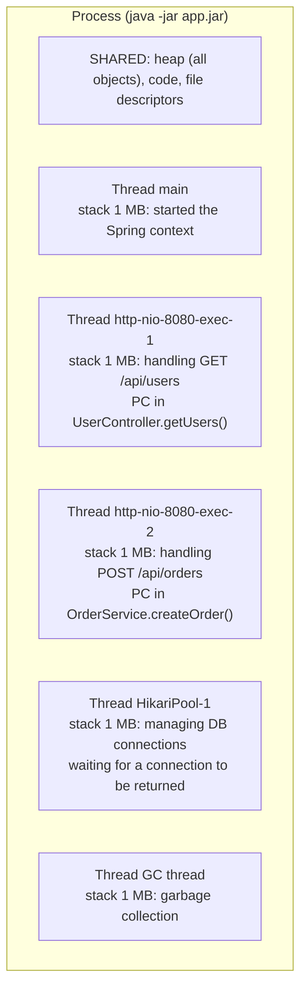
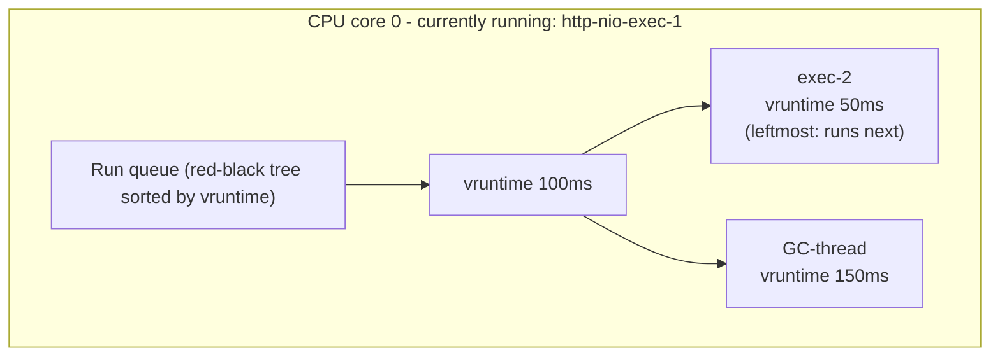
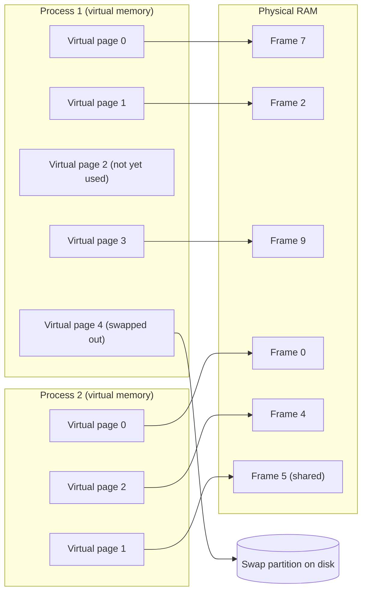
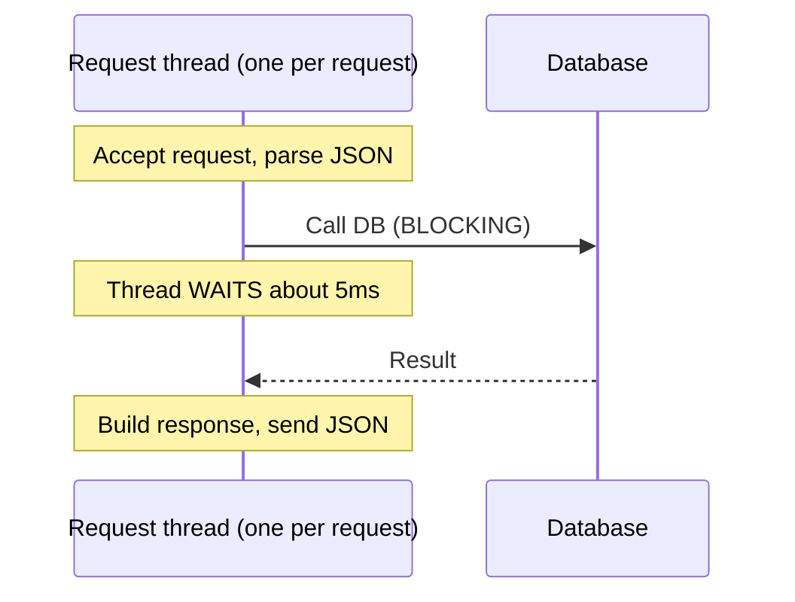
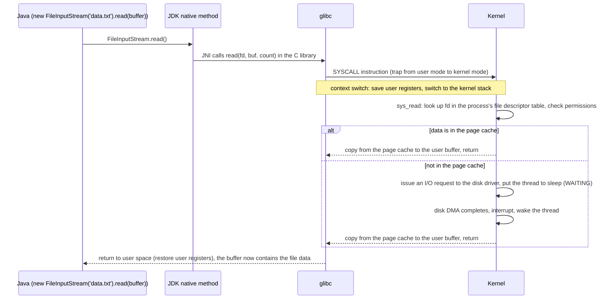
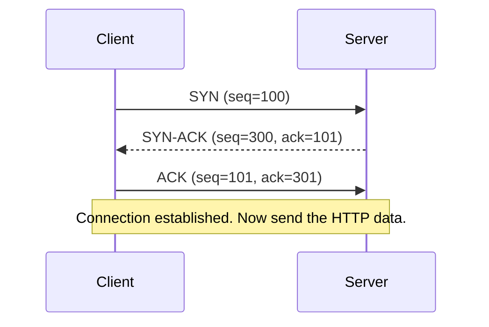

**Navigation**: [< Previous](Ch57_Spring_Security_Internals.md) | [Back to Index](../00_MASTER_INDEX.md) | [Next >](Ch66_Event_Sourcing_CQRS.md)

# 🖥️ Chapter 39 — OS Fundamentals Every Backend Developer MUST Know

**"Your Spring Boot app runs ON an operating system. When your API is slow, it might not be your code — it's context switching between 200 threads, page faults from running out of physical memory, or file descriptor exhaustion from unclosed connections. You can't diagnose what you don't understand."**

---

## Table of Contents

1. [Process vs Thread — What Actually Runs Your Code](#1-process-vs-thread--what-actually-runs-your-code)
2. [How CPU Scheduling Works — Who Gets to Run](#2-how-cpu-scheduling-works--who-gets-to-run)
3. [Context Switching — The Hidden Cost](#3-context-switching--the-hidden-cost)
4. [Virtual Memory — Why Programs Think They Have Unlimited RAM](#4-virtual-memory--why-programs-think-they-have-unlimited-ram)
5. [Page Faults — When Memory Isn't Where You Think](#5-page-faults--when-memory-isnt-where-you-think)
6. [Threads vs Async I/O — Two Models for Concurrency](#6-threads-vs-async-io--two-models-for-concurrency)
7. [File Descriptors — Why "Too Many Open Files" Happens](#7-file-descriptors--why-too-many-open-files-happens)
8. [System Calls — How Your App Talks to the OS](#8-system-calls--how-your-app-talks-to-the-os)
9. [I/O Models — Blocking, Non-Blocking, Multiplexing](#9-io-models--blocking-non-blocking-multiplexing)
10. [Signals and Process Lifecycle](#10-signals-and-process-lifecycle)
11. [How the Network Stack Processes Your API Call](#11-how-the-network-stack-processes-your-api-call)
12. [OS Concepts in Java — Direct Mapping](#12-os-concepts-in-java--direct-mapping)
13. [Key Numbers Every Developer Should Know](#13-key-numbers-every-developer-should-know)

---

## 1. Process vs Thread — What Actually Runs Your Code

**Process.** An instance of a running program. It has its OWN address space, file descriptors, PID and memory allocation.

When you run `java -jar app.jar`, the OS creates a PROCESS (PID 1234):

| Part of the process | Contents |
| --- | --- |
| Virtual address space, high addresses (for example 0xFFFF...) | **Stack:** local variables and method call frames (grows downward) |
| | *(free):* unused address space |
| | **Heap:** objects (`new User()`), managed by the GC (the maximum is set by `-Xmx`) |
| | **BSS:** uninitialized static variables |
| | **Data:** initialized static variables |
| Virtual address space, low addresses (0x0000...) | **Text:** compiled code |
| File descriptors | `[0=stdin, 1=stdout, 2=stderr, 3=socket, ...]` |
| Process info | PID 1234, parent PID 1 (init/systemd), state RUNNING |

> [!NOTE]
> This is the classic process layout. The JVM reserves its heap with `mmap` rather than growing a classic `brk` heap, but the idea of separate regions for stack, heap and code is the same.

**Thread.** A unit of execution WITHIN a process. Threads share the address space, heap, file descriptors and code. Each has its OWN stack, program counter, registers and thread ID.

Your Spring Boot app with Tomcat:



**How to read this diagram.** Every thread has its own stack and program counter, while the heap and file descriptors are shared by all of them. A typical Spring Boot app has a couple of hundred threads (Tomcat up to 200, HikariCP about 10, GC about 4-8, plus schedulers).

**Why threads, not processes?**

| | Thread | Process |
| --- | --- | --- |
| Creation | Cheap; costs mainly its stack memory (about 1 MB reserved) | Much more expensive (a new address space; fork uses copy-on-write) |
| Context switch | Cheaper (shared address space) | More expensive (TLB flush, page-table swap) |

---

## 2. How CPU Scheduling Works — Who Gets to Run

**The problem**

```text
Your server has 4 CPU cores.
Your Spring Boot app has 200+ threads.
200 threads, 4 cores → 50 threads per core competing for time.

The SCHEDULER decides who gets CPU time.
```

**LINUX CFS (Completely Fair Scheduler)**



**How to read this diagram.** Each core keeps its runnable threads in a red-black tree ordered by *vruntime* (the CPU time a thread has used, scaled by its weight). The scheduler always runs the **leftmost** node, the thread with the lowest vruntime. Higher priority means a smaller weight, so its vruntime grows more slowly and it gets picked more often.


**Scheduling decisions for your app**

```text
1. Tomcat request thread is CPU-bound (computing):
   → Scheduler gives it a time slice (1-10ms)
   → After time slice expires → preempted → back to run queue
   → Another thread gets to run

2. Thread does I/O (database query):
   → Thread calls read() on socket
   → OS moves thread to WAITING state
   → Thread removed from run queue (not using CPU!)
   → When data arrives: OS moves thread back to RUNNABLE
   → Scheduler picks it up when a core is free

3. Thread calls Thread.sleep() or Object.wait():
   → Thread moves to SLEEPING/WAITING
   → Not in run queue
   → Timer interrupt or notify() → back to RUNNABLE
```

**THREAD STATES (OS view)**

```text
RUNNING ← actually executing on CPU
   ↕ (preemption / scheduled)
RUNNABLE ← ready to run, waiting for CPU
   ↕ (I/O request / I/O complete)
WAITING ← blocked on I/O, lock, sleep
   ↕ (terminated)
ZOMBIE ← finished but parent hasn't collected exit status
```

---

🔬 **Section Challenge — 2. How CPU Scheduling Works — Who Gets to Run**

**Challenge 1 (Reasoning):** If a Java thread enters a `synchronized` block and the lock is already held, what state does the thread transition into, and how does this affect the CPU scheduler?

<details><summary>Answer</summary>

Standard I/O requires the OS to read data from disk into Kernel Space, copy it to User Space (JVM buffer), and then copy it back to Kernel Space to send over a socket. `transferTo()` uses Zero-Copy DMA (Direct Memory Access). The OS transfers data directly from the disk buffer to the network socket buffer entirely within Kernel Space. It bypasses the JVM memory and avoids expensive CPU context switches between User and Kernel mode.

</details>

## 3. Context Switching — The Hidden Cost

**WHAT HAPPENS ON A CONTEXT SWITCH:**

```text
Thread A is running → Time slice expires or Thread A blocks on I/O

1. SAVE Thread A's state:
   ├── General registers (RAX, RBX, RCX, RDX, RSI, RDI, etc.)
   ├── Stack pointer (RSP)
   ├── Program counter (RIP) — where it was executing
   ├── Flags register (RFLAGS)
   └── FPU/SSE/AVX registers (floating point state)
   → All saved to Thread A's kernel stack (Thread Control Block)

2. SWITCH to Thread B:
   ├── Restore Thread B's registers from its kernel stack
   ├── Restore stack pointer → now using Thread B's stack
   ├── Restore program counter → jump to where Thread B left off
   └── If different process: flush TLB (Translation Lookaside Buffer)

3. HIDDEN COSTS (often larger than the switch itself):
   ├── CPU cache pollution:
Thread A had its working data in L1/L2 cache
Thread B needs DIFFERENT data → cache misses!
L1 miss: 1ns → L2: 4ns → L3: 12ns → RAM: 100ns

   ├── TLB misses (if process switch):
TLB caches virtual→physical page mappings
Different process = different page table = TLB flush
Each memory access after flush: TLB miss → page table walk

   └── Pipeline flush:
       CPU was speculatively executing Thread A's instructions
       All that speculative work is thrown away

THE COST IN NUMBERS:

Direct cost (save/restore registers): ~1-2 μs
Indirect cost (cache/TLB pollution): ~5-50 μs

If 200 threads on 4 cores and each blocks after 1ms of work:
→ 200 context switches per millisecond
→ 200 × 10μs = 2ms of overhead per ms of work
→ That's 2/3 of CPU time wasted on switching!

THIS IS WHY:
- Virtual threads (Project Loom) exist: millions of virtual threads mapped to few OS threads
- WebFlux/reactive exists: one thread handles many connections, no blocking
- HikariCP pool is small (10): fewer threads = fewer switches
- Node.js uses single thread + event loop: zero context switching for app code
```

---

🔬 **Section Challenge — 3. Context Switching — The Hidden Cost**

**Challenge 1 (Reasoning):** Why do heavily I/O-bound applications (like typical web servers) experience severe performance degradation when scaled to 10,000 concurrent threads, and how do Virtual Threads (Project Loom) solve this?

<details><summary>Answer</summary>

10,000 OS threads require ~10GB of memory just for stacks. More importantly, when threads constantly block on I/O, the OS performs thousands of context switches per second, destroying CPU caches (TLB/L1/L2 pollution) and wasting CPU cycles just swapping context. Virtual Threads solve this by mapping millions of lightweight threads onto a small pool of OS carrier threads. When a Virtual Thread blocks on I/O, the JVM 'unmounts' it in user-space without triggering an OS-level context switch.

</details>

## 4. Virtual Memory — Why Programs Think They Have Unlimited RAM

**The illusion.** Your Java process uses `-Xmx4g` (a 4 GB heap), the server has 8 GB of physical RAM, and 10 Java services are running. That would need 40 GB, but only 8 GB exists. How? **Virtual memory.**

Each process gets its own VIRTUAL address space (for example 128 TB on 64-bit Linux). The OS maps virtual pages to physical frames ON DEMAND.



**How to read this diagram.** Each arrow maps a virtual page to the physical frame that currently holds it. A page that has never been touched has no frame, a swapped-out page lives on disk, and two processes can map to the same frame (shared memory).

**Page table translation.** For a virtual address such as `0x00007fff12345678`:

- The top bits index page table level 4 (PML4).
- The next bits index level 3 (PDPT), then level 2 (PD), then level 1 (PT).
- The bottom 12 bits are the offset within the 4 KB page.

A 4-level page table walk on every memory access would be too slow, which is why the **TLB** (Translation Lookaside Buffer) exists: a CPU-level cache of recent virtual-to-physical translations. A TLB hit costs about a nanosecond and covers the vast majority of accesses. A TLB miss costs tens of nanoseconds, because the CPU must walk the page table.

**Why this matters for your app**

1. **The JVM heap is virtual until used.** `-Xmx4g` reserves 4 GB of VIRTUAL address space. Physical pages are allocated only when first written (a page fault).
2. **Fork + exec is cheap (copy-on-write).** `fork()` doesn't copy all pages. Pages are marked copy-on-write, and a physical copy is made only when the child or the parent MODIFIES a page.
3. **Memory-mapped files (`mmap`).** File contents are mapped directly into the virtual address space, and the OS reads from disk into pages on demand. Used by Kafka (log segments), databases and the JVM (for example class data).

---

🔬 **Section Challenge — 4. Virtual Memory — Why Programs Think They Have Unlimited RAM**

**Challenge 1 (Reasoning):** How can a Java process with `-Xmx4g` (4GB heap) successfully run on a server with only 2GB of physical RAM, and what is the severe performance risk of doing so?

<details><summary>Answer</summary>

The OS allocates 4GB of _Virtual Memory_ address space. Physical memory frames are only mapped on demand when the JVM actually writes to the pages. The risk is that if the JVM actually tries to use >2GB, the OS will start 'swapping' pages to disk. When the Garbage Collector runs, it must scan the heap, triggering massive numbers of Major Page Faults as pages are pulled from disk. This can turn a 20ms GC pause into a 10-second system freeze.

</details>

## 5. Page Faults — When Memory Isn't Where You Think

```text
A page fault happens when a program accesses a virtual page
that isn't currently in physical RAM.
```

**MINOR PAGE FAULT (soft fault)**

```text
Page exists but hasn't been mapped yet.

1. Program accesses virtual page 42
2. MMU: "Page 42 not in page table → trap to kernel"
3. Kernel: "This is a valid mapping, just not loaded yet"
4. Kernel: Allocate physical frame, zero it out
5. Update page table: virtual page 42 → physical frame X
6. Resume program

Cost: ~1-5 μs
Happens: First time accessing each heap page (JVM startup, object allocation)
```

**MAJOR PAGE FAULT (hard fault)**

```text
Page was swapped out to disk (or reading from mmap'd file).

1. Program accesses virtual page 42
2. MMU: "Page 42 not present → trap to kernel"
3. Kernel: "Page 42 is in swap/disk"
4. Kernel: Find a free physical frame (or EVICT one)
5. Read page from disk → physical frame (disk I/O: ~5-10ms for HDD, ~100μs for SSD)
6. Update page table
7. Resume program

Cost: ~100μs (SSD) to ~10ms (HDD)
Happens: When physical RAM is exhausted and OS uses swap
```

**Why your app suddenly slows down**

```text
8GB RAM server running multiple services:

Service A: 3GB heap (using 2.5GB)
Service B: 3GB heap (using 2.8GB)
Service C: 2GB heap (using 1.8GB)
OS + buffers: 1GB

Total: 8.1GB needed > 8GB physical RAM

→ OS starts SWAPPING: moves least-recently-used pages to disk
→ Your Java GC now:
  1. Scans heap (needs to READ every page)
  2. Pages swapped out → major page faults
  3. GC pause: 20ms → 5000ms (250x slower!)

THIS IS WHY:
- NEVER let servers swap. Set vm.swappiness = 1
- Kubernetes: set memory LIMITS properly
- JVM: -Xmx should be < available physical RAM
- Monitor: vmstat, free -m, /proc/meminfo
```

---

🔬 **Section Challenge — 5. Page Faults — When Memory Isn't Where You Think**

**Challenge 1 (Reasoning):** What is the difference between a Minor Page Fault and a Major Page Fault, and which one occurs when a JVM first allocates an object in Eden space?

<details><summary>Answer</summary>

A Minor Page Fault occurs when a page is valid but not yet mapped to a physical frame in the MMU (resolved quickly in RAM). A Major Page Fault occurs when the page has been swapped out to disk and requires a slow disk I/O operation to retrieve. When the JVM allocates a new object in previously unused Eden space, a Minor Page Fault occurs as the OS provisions a new zeroed-out physical frame for that virtual page.

</details>

## 6. Threads vs Async I/O — Two Models for Concurrency

**MODEL 1: Thread-per-request (Tomcat / Spring MVC)**



**How to read this diagram.** Every request owns one thread for its whole life. While the database call is in flight the thread just waits, holding its stack and doing nothing. The same timeline repeats for Thread-1, Thread-2, Thread-3 and so on, in parallel.

- 10,000 concurrent requests = 10,000 threads
- 10,000 × 1 MB stack = 10 GB just for stacks
- Context switching between 10K threads: severe overhead


**MODEL 2: Event loop / Async I/O (Node.js / Netty / WebFlux)**

**ONE Thread (event loop)**

```text
Accept request-1   → start DB query (non-blocking!) → register callback
Accept request-2   → start DB query → register callback
Accept request-3   → start DB query → register callback
...
[Event: DB response for request-1 ready!]
Process request-1 response → send JSON
[Event: DB response for request-3 ready!]
Process request-3 response → send JSON
...

→ 10,000 concurrent requests = 1 thread (or few threads)
→ No context switching
→ No stack memory waste
→ But: one slow computation blocks EVERYTHING (no preemption)
```

**UNDERLYING OS MECHANISM — epoll (Linux)**

```text
int epoll_fd = epoll_create1(0);

// Register interest in file descriptors:
epoll_ctl(epoll_fd, EPOLL_CTL_ADD, socket_fd_1, {EPOLLIN});
epoll_ctl(epoll_fd, EPOLL_CTL_ADD, socket_fd_2, {EPOLLIN});
epoll_ctl(epoll_fd, EPOLL_CTL_ADD, socket_fd_3, {EPOLLIN});

// Wait for ANY of them to be ready:
int n = epoll_wait(epoll_fd, events, MAX_EVENTS, timeout);
// Returns: "socket 2 and 3 have data ready!"
// One syscall monitors thousands of connections!
```

**MODEL 3: Virtual Threads (Java 21+ / Project Loom)**

```text
The BEST of both worlds:

1,000,000 virtual threads → mapped to ~4 OS (carrier) threads

Virtual Thread:
- Looks like a regular thread (blocking API works!)
- When it blocks on I/O → JVM UNMOUNTS it from carrier thread
- Carrier thread picks up another virtual thread
- When I/O completes → virtual thread remounted on any carrier

Code stays simple:     var user = userRepo.findById(id);   // looks blocking
But underneath:         JVM does the async dance for you
```

---

🔬 **Section Challenge — 6. Threads vs Async I/O — Two Models for Concurrency**

**Challenge 1 (System Design):** In an event-loop architecture like Node.js or Spring WebFlux, a single thread can handle thousands of concurrent I/O operations without blocking. What underlying OS system call makes this possible?

<details><summary>Answer</summary>

System calls like `epoll` (Linux), `kqueue` (macOS), or `IOCP` (Windows). These allow a single thread to register interest in thousands of non-blocking file descriptors (sockets) and then 'sleep' until the OS notifies it that specific sockets have data ready to read or write. This I/O multiplexing eliminates the need for one thread per connection.

</details>

## 7. File Descriptors — Why "Too Many Open Files" Happens

A file descriptor is a small integer that represents an open "file" (a file, socket, pipe, and so on).

**Per-process file descriptor table**

| FD | Type | Description |
| --- | --- | --- |
| 0 | stdin | Standard input |
| 1 | stdout | Standard output (console) |
| 2 | stderr | Standard error (console) |
| 3 | socket | TCP connection to client 1 |
| 4 | socket | TCP connection to client 2 |
| 5 | socket | TCP connection to PostgreSQL |
| 6 | socket | TCP connection to PostgreSQL |
| 7 | file | `/var/log/app.log` (open for writing) |
| 8 | socket | TCP connection to Redis |
| 9 | pipe | IPC pipe to child process |
| ... | ... | ... |
| 1023 | socket | TCP connection to client 997 |

Default limit: **1024 per process** (Linux).


**How to hit the limit**

```text
Spring Boot app with:
   200 Tomcat threads (potential connections) = 200 FDs
   10 HikariCP connections (to DB) = 10 FDs
   5 Redis connections = 5 FDs
   Log files = 2-5 FDs
   Misc (libs, temp files) = 10-20 FDs

Total: ~240 FDs for normal operation
Limit: 1024 — seems fine

BUT: If clients connect faster than you can process:
→ 800+ open connections → 800+ FDs
→ Plus DB + Redis + logs
→ "Too many open files" → java.net.SocketException
→ App stops accepting connections!
```

**Fix**

```text
# Check current limit
ulimit -n
# 1024

# Increase (temporary)
ulimit -n 65535

# Increase (permanent) — /etc/security/limits.conf:
# appuser   soft   nofile   65535
# appuser   hard   nofile   65535

# System-wide max — /etc/sysctl.conf:
# fs.file-max = 2097152


REAL-WORLD LESSON:
Connection pool leaks (not returning connections) slowly exhaust FDs.
Monitor with: ls -la /proc/<PID>/fd | wc -l
```

---

## 8. System Calls — How Your App Talks to the OS

**User space vs kernel space**

| | User space | Kernel space |
| --- | --- | --- |
| **Contains** | Your Java app, JDK libraries, C library (glibc) | Process scheduler, memory manager, file system driver, network stack (TCP/IP), device drivers |
| **Privilege** | Cannot access hardware, manage memory or talk to the network directly | CAN access hardware, manage memory, and do everything (full privilege) |

The **system call boundary** sits between the two.

**What happens when your code reads from a file**



**How to read this diagram.** The Java call goes down through the JDK and glibc to a system call. The kernel serves the read from the page cache if it can, and otherwise sleeps the thread until the disk responds.

**Common system calls your app uses**

| System call | Purpose |
| --- | --- |
| `read()` / `write()` | File and socket I/O |
| `open()` / `close()` | File descriptor management |
| `socket()` / `connect()` / `accept()` / `bind()` / `listen()` | Networking |
| `mmap()` / `munmap()` | Memory mapping |
| `epoll_create()` / `epoll_wait()` | I/O multiplexing |
| `futex()` | Fast user-space mutex (used under contended locks and thread parking) |
| `clone()` | Thread/process creation |
| `brk()` / `mmap()` | Heap allocation (`malloc`, and JVM heap growth) |

---

## 9. I/O Models — Blocking, Non-Blocking, Multiplexing

**MODEL                │  HOW IT WORKS           │  JAVA FRAMEWORK**

```text
                     │                          │
BLOCKING I/O         │  Thread calls read()     │  java.io.*
                     │  Thread sleeps until     │  (InputSteam,
                     │  data arrives             │   OutputStream)
                     │  1 thread per connection  │  Tomcat (default)
                     │                          │
                     │                          │
NON-BLOCKING I/O     │  Thread calls read()     │  java.nio.*
                     │  Returns immediately      │  (Channel, Buffer,
                     │  (-1 if no data)          │   Selector)
                     │  Thread must poll/retry   │  Netty, WebFlux
                     │                          │
                     │                          │
I/O MULTIPLEXING     │  One thread monitors     │  java.nio.Selector
(select/poll/epoll)  │  MANY FDs at once         │  (wraps epoll)
                     │  "Which FDs have data?"   │  Netty EventLoop
                     │  → process only ready ones│
                     │                          │
                     │                          │
ASYNC I/O            │  Thread submits I/O      │  AsynchronousChannel
(io_uring on Linux)  │  OS does the work        │  (rarely used in
                     │  Callback when done       │   practice)
                     │                          │

 SELECT vs POLL vs EPOLL:

 select():  O(n) — scans ALL file descriptors every call. Max 1024 FDs.
 poll():    O(n) — no FD limit, but still scans all on each call.
 epoll():   O(1) — kernel maintains interest list, notifies only ready FDs.
            ↑ This is what Netty/Tomcat NIO uses on Linux

 10,000 connections:
 select: scan 10,000 FDs every call → slow
 epoll:  kernel says "FDs 42, 99, 7031 are ready" → process only 3 → fast!
```

---

🔬 **Section Challenge — 9. I/O Models — Blocking, Non-Blocking, Multiplexing**

**Challenge 1 (Reasoning):** Why is reading a 1GB file in 4KB chunks using standard `FileInputStream.read()` significantly slower than using `FileChannel.transferTo()` (Zero-Copy)?

<details><summary>Answer</summary>

Standard I/O requires the OS to read data from disk into Kernel Space, copy it to User Space (JVM buffer), and then copy it back to Kernel Space to send over a socket. `transferTo()` uses Zero-Copy DMA (Direct Memory Access). The OS transfers data directly from the disk buffer to the network socket buffer entirely within Kernel Space. It bypasses the JVM memory and avoids expensive CPU context switches between User and Kernel mode.

</details>

## 10. Signals and Process Lifecycle

**Process lifecycle**

```text
fork() → child created (copy of parent)
exec() → child replaces itself with new program
exit() → process terminates
wait() → parent collects child's exit status
```

**Signals your jvm cares about**

| Signal | Number | Default Action | Purpose |
| --- | --- | --- | --- |
| SIGTERM | 15 | Terminate | Graceful shutdown request<br>JVM runs shutdown hooks!<br>Docker sends this first.<br>Spring Boot graceful shutdown. |
| SIGKILL | 9 | Terminate | Force kill. CANNOT be caught.<br>No shutdown hooks, no cleanup.<br>Docker sends after timeout. |
| SIGHUP | 1 | Terminate | Terminal hangup. Sometimes used for config reload. |
| SIGINT | 2 | Terminate | Ctrl+C in terminal.<br>JVM runs shutdown hooks. |
| SIGSEGV | 11 | Core dump | Segmentation fault.<br>JVM crash (hs_err_pid.log). |
| SIGQUIT | 3 | Core dump | Ctrl+\. JVM generates thread dump to stdout! |

**Kubernetes shutdown**

```text
Pod termination:
1. K8s sends SIGTERM to PID 1 in container
2. Spring Boot receives signal → triggers shutdown:
   → Stop accepting new requests
   → Wait for in-flight requests to finish (grace period)
   → Close DB connections (HikariCP shutdown)
   → Close application context
3. If still running after terminationGracePeriodSeconds (default 30s):
4. K8s sends SIGKILL → instant death, no cleanup

Spring Boot config:
server.shutdown=graceful
spring.lifecycle.timeout-per-shutdown-phase=30s
```

---

## 11. How the Network Stack Processes Your API Call

**How a request travels the network layers.** The client calls `GET http://your-app:8080/api/users`.

| Layer | Client side (sending) | Server side (receiving) |
| --- | --- | --- |
| **Application (HTTP)** | `GET /api/users HTTP/1.1`, `Host: your-app:8080` | Parse the HTTP request, route to the controller |
| **Transport (TCP)** | Source port 52431 (ephemeral), dest port 8080, sequence numbers to track ordering, segment data into packets, retransmit if there is no ACK | Dest port 8080, assemble segments in order, ACK received segments, deliver the complete stream to the app, flow control (receive window) |
| **Network (IP)** | Source IP 10.0.1.5, dest IP 10.0.2.10, TTL 64, fragment if larger than the MTU (1500 bytes) | Check the dest IP ("is it for me?"), reassemble fragments, pass to TCP |
| **Link (Ethernet)** | ARP resolves IP → MAC address, build the frame (src MAC → dest MAC), send on the wire or wifi | Check the dest MAC address, strip the frame header, pass to IP |

Between the two sides is the **physical network**. Data goes DOWN the layers on the client, across the network, and UP the layers on the server.

**TCP 3-way handshake (before any data)**



**How to read this diagram.** Three messages are exchanged before any data can flow.

**Cost:** 1.5 round trips before any data. If RTT = 1 ms, that is 1.5 ms just to connect. If RTT = 100 ms (cross-continent), that is 150 ms!

> [!TIP]
> **This is why connection pooling matters** (HikariCP keeps connections open) and why HTTP keep-alive reuses TCP connections.

---

🔬 **Section Challenge — 11. How the Network Stack Processes Your API Call**

**Challenge 1 (Reasoning):** What is the primary latency cost of establishing a new database connection over a WAN, and how does connection pooling mitigate it?

<details><summary>Answer</summary>

A new TCP connection requires a 3-way handshake (1.5 Round Trip Times) before any data is sent. Over a WAN with 100ms latency, this adds 150ms of pure overhead. If TLS is involved, it adds another 1-2 RTTs (up to 350ms total). Connection pooling (like HikariCP) mitigates this by keeping a pool of already-established TCP connections open and reusing them, reducing connection setup overhead to 0.

</details>

## 12. OS Concepts in Java — Direct Mapping

**OS CONCEPT              │ JAVA EQUIVALENT**

```text
Process                 │ JVM instance (java -jar app.jar)
Thread                  │ java.lang.Thread (maps 1:1 to OS thread)
Virtual Thread          │ Thread.ofVirtual() (many:1 to OS thread)
Mutex                   │ synchronized block / ReentrantLock
Semaphore               │ java.util.concurrent.Semaphore
Condition variable      │ Object.wait/notify or Condition
Shared memory           │ Heap (all threads share same heap)
File descriptor         │ FileInputStream, Socket, Channel
Virtual memory          │ JVM address space (-Xmx)
Page fault              │ First access to allocated but untouched mem
Context switch          │ Thread scheduling (200 Tomcat threads)
System call             │ Any I/O operation (file, network, etc.)
Signal (SIGTERM)        │ Runtime.addShutdownHook()
Signal (SIGQUIT)        │ Thread dump to stdout (kill -3 PID)
mmap                    │ MappedByteBuffer (FileChannel.map())
epoll                   │ java.nio.Selector (NIO)
fork + exec             │ ProcessBuilder / Runtime.exec()
Pipe                    │ PipedInputStream / PipedOutputStream
Socket                  │ java.net.Socket / ServerSocket
CPU affinity            │ Not directly exposed (use taskset)
Nice value (priority)   │ Thread.setPriority() (hint, not guarantee)
```

---

🔬 **Section Challenge — 12. OS Concepts in Java — Direct Mapping**

**Challenge 1 (Reasoning):** If a developer uses `Runtime.getRuntime().exec("ls")` in Java, which two fundamental OS system calls are being triggered underneath?

<details><summary>Answer</summary>

The `fork()` and `exec()` system calls. The JVM first calls `fork()` to create a child process (copying the parent's file descriptors and virtual address space), and then the child calls `exec()` to replace its memory space with the `ls` executable. This is extremely heavy compared to simply spawning a new thread.

</details>

## 13. Key Numbers Every Developer Should Know

**OPERATION                             │  LATENCY**

```text
L1 cache reference                    │  1 ns
L2 cache reference                    │  4 ns
L3 cache reference                    │  12 ns
Main memory reference (RAM)           │  100 ns
SSD random read                       │  16 μs
HDD random read (seek)                │  4 ms
Network round trip (same datacenter)  │  500 μs
Network round trip (cross-continent)  │  150 ms
Context switch (thread)               │  1-10 μs
System call                           │  0.5-1 μs
Mutex lock/unlock (uncontended)       │  25 ns
Java object allocation (TLAB)         │  10 ns
TCP connection setup (handshake)      │  1.5 × RTT
Read 1 MB from SSD                    │  50 μs
Read 1 MB from HDD                    │  2 ms
Read 1 MB from RAM                    │  3 μs
Read 1 MB from network (1 Gbps)      │  10 ms
Compress 1 KB with Snappy             │  3 μs
Send packet within same datacenter    │  200 μs

 RULES OF THUMB:

 1. RAM is 100x faster than SSD, SSD is 1000x faster than HDD
 2. Network within datacenter: ~500μs. Cross-continent: ~150ms (300x slower)
 3. One disk seek = 400,000 ns = time for 4 million L1 cache reads
 4. Allocating an object in Java (TLAB) ≈ 10ns. Creating a thread: ~1,000,000ns
 5. If your API P99 > 100ms, you're probably doing too many network/disk hops
```

---

**Next Chapter**: [Event Sourcing & CQRS →](Ch66_Event_Sourcing_CQRS.md)


---

## Reality Check

**"The JVM abstracts away the operating system"** — The JVM runs ON an OS and is constrained by it. File descriptor limits (ulimit -n) limit concurrent socket connections. Thread stack size is OS memory. The JVM's memory-mapped file I/O depends on the OS page cache. Linux OOM killer can terminate the JVM process without triggering shutdown hooks. Container cgroup limits override JVM's view of available CPUs and memory — Java 10+ reads cgroup limits, older versions see the host's total resources and overallocate.

**"Threads are lightweight"** — Platform threads in Java map 1:1 to OS kernel threads. Each thread consumes 512KB-1MB stack memory. Creating 10000 threads requires 5-10GB just for stacks, plus kernel scheduling overhead. This is why Tomcat defaults to 200 threads and NIO non-blocking I/O is used for high concurrency. Virtual threads (Java 21+) solve this by mapping many virtual threads to few carrier (platform) threads.

**"More RAM is always better for Java applications"** — More heap means longer garbage collection pauses. A 32GB heap with G1GC can pause for 200-500ms during mixed GC. A 4GB heap with the same collector pauses for 10-50ms. Right-sizing the heap, choosing the appropriate GC algorithm (ZGC for low latency, G1 for balanced, Parallel for throughput), and reducing allocation rate matter more than raw heap size.

**"Linux file permissions are simple: read, write, execute"** — File permissions are the first layer. SELinux/AppArmor add mandatory access controls that override file permissions. Container security contexts add another layer. Kubernetes PodSecurityPolicies restrict what containers can do. A file with chmod 777 can still be inaccessible if SELinux policy blocks the process category. Production debugging often requires checking ALL permission layers, not just rwx.

**"TCP connections are instant"** — TCP three-way handshake takes one round-trip time (RTT). TLS adds 1-2 more round-trips. Connection to a database in another availability zone with 2ms RTT takes 6-8ms to establish. A request handler that opens a new database connection per request adds this latency to every response. Connection pooling (HikariCP) amortizes this cost by reusing established connections across requests.
