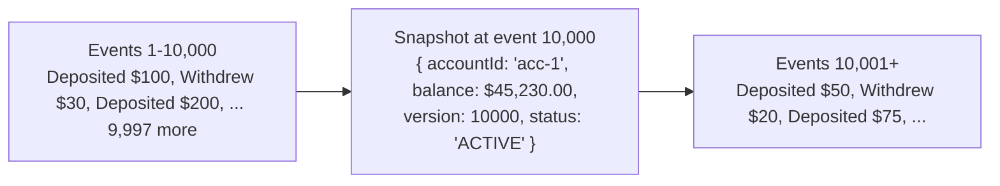
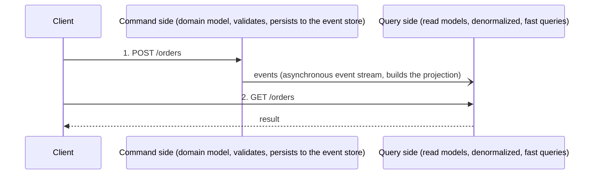
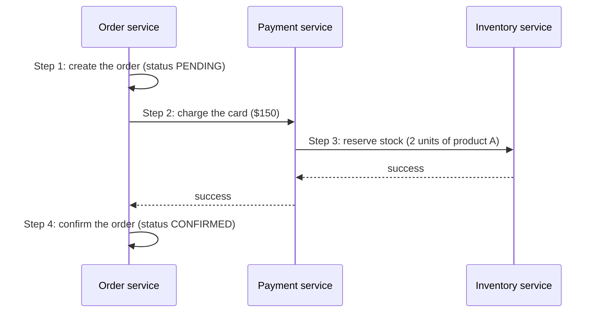
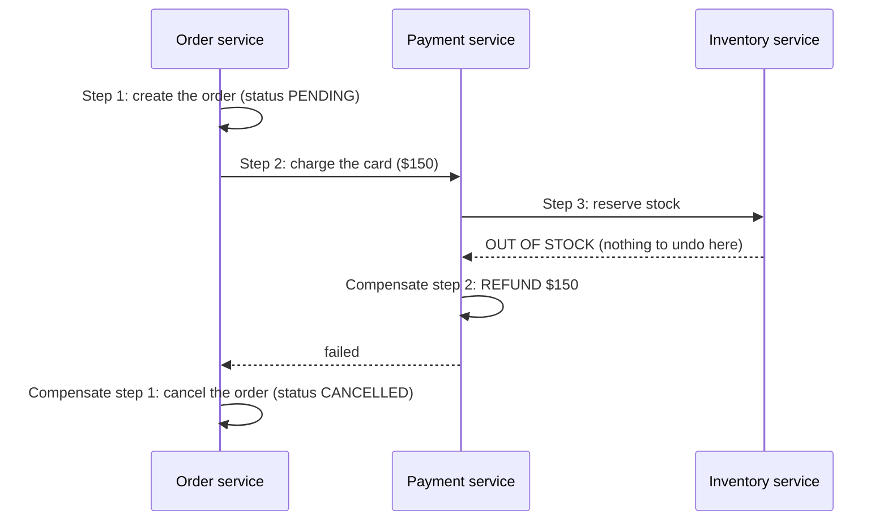
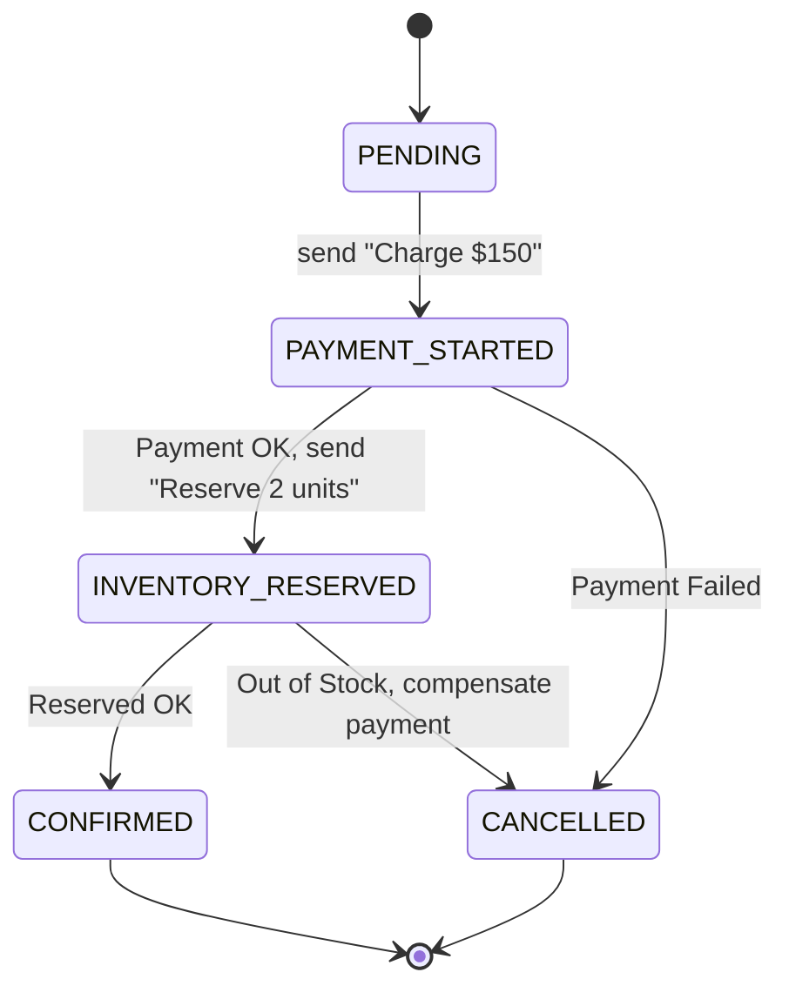
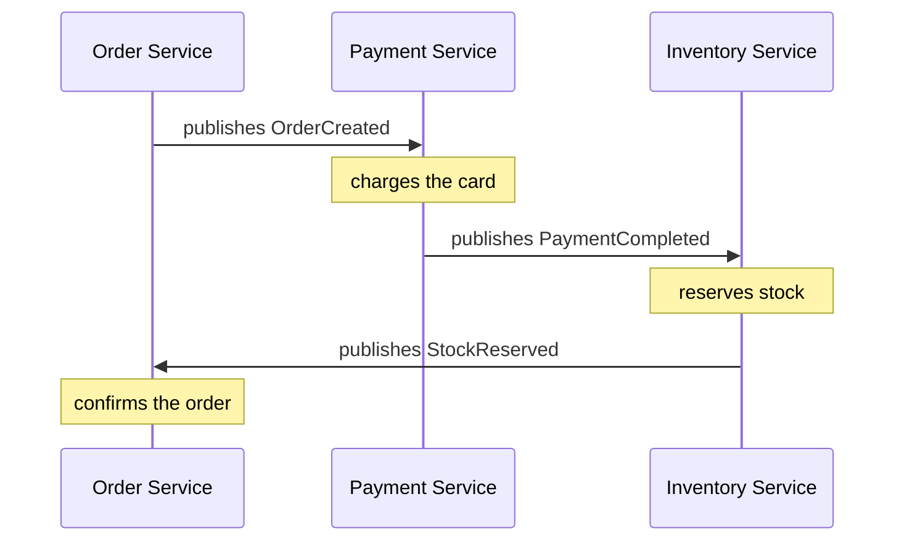

**Navigation**: [< Previous](Ch65_OS_Fundamentals.md) | [Back to Index](../00_MASTER_INDEX.md) | [Next >](Ch67_Kubernetes_Deep_Dive.md)

# 📜 Chapter 40 — Event Sourcing, CQRS, and the Saga Pattern

**"Instead of storing current state (balance = $500), store every event that led to it (deposited $200, deposited $400, withdrew $100). Now you have complete audit trail, can rebuild state at ANY point in time, can replay events into different projections, and can debug production issues by replaying exactly what happened."**

---

## Table of Contents

1. [Traditional CRUD vs Event Sourcing — The Fundamental Shift](#1-traditional-crud-vs-event-sourcing--the-fundamental-shift)
2. [Event Store — The Single Source of Truth](#2-event-store--the-single-source-of-truth)
3. [Rebuilding State from Events](#3-rebuilding-state-from-events)
4. [Snapshots — Because Replaying 1 Million Events is Slow](#4-snapshots--because-replaying-1-million-events-is-slow)
5. [Event Versioning — What Happens When Events Change](#5-event-versioning--what-happens-when-events-change)
6. [CQRS — Separate Read and Write Models](#6-cqrs--separate-read-and-write-models)
7. [Projections — Building Read Models from Events](#7-projections--building-read-models-from-events)
8. [The Saga Pattern — Distributed Transactions Without 2PC](#8-the-saga-pattern--distributed-transactions-without-2pc)
9. [Orchestration vs Choreography — Two Saga Approaches](#9-orchestration-vs-choreography--two-saga-approaches)
10. [When to Use (and NOT Use) Event Sourcing](#10-when-to-use-and-not-use-event-sourcing)

---

## 1. Traditional CRUD vs Event Sourcing — The Fundamental Shift

**Traditional crud**

User places order → UPDATE orders SET status='CONFIRMED' WHERE id=42

**What you have in DB**

**id │ status    │ total  │ updated_at          │ items**

```text
42 │ CONFIRMED │ 150.00 │ 2024-01-15 10:30:00 │ [item1, item2]
```

**Questions you CANNOT answer**

❌ When was this order created? (updated_at shows last change)

❌ Was the total originally different? (overwritten)

❌ Who changed the status and when? (no history)

❌ Did the customer add items and then remove them? (no trace)

❌ What was status at 10:15 AM? (only current state)

**Event sourcing**

User places order → append OrderCreated event

**What you have in Event Store**

**event_id │ aggregate_id │ event_type       │ data                 │ time**

```text
1        │ order-42     │ OrderCreated     │ {items:[A,B],total:100}│10:00
2        │ order-42     │ ItemAdded        │ {item:C, price:50}    │10:10
3        │ order-42     │ OrderConfirmed   │ {confirmedBy:"Harsha"}│10:30
4        │ order-42     │ PaymentReceived  │ {amount:150,method:CC}│10:35
```

**NOW you can answer**

✅ When was order created? → Event 1, 10:00 AM

✅ What was original total? → $100 (event 1), then item added (event 2) → $150

✅ Who confirmed? → "Harsha" at 10:30 AM

✅ State at 10:15 AM? → Replay events 1-2 only → status=CREATED, total=$150

✅ Complete audit trail → every change recorded, immutable

---

🔬 **Section Challenge — 1. Traditional CRUD vs Event Sourcing — The Fundamental Shift**

**Challenge 1 (Reasoning):** Why is a traditional CRUD database fundamentally unable to provide a mathematically provable audit trail, even if you add an `updated_at` column and an `audit_log` table?

<details><summary>Answer</summary>

Because CRUD inherently relies on **destructive mutation**. When an `UPDATE` runs, the previous state is physically overwritten. While an `audit_log` table can track changes, it is a secondary, derived data structure. If a bug occurs, the audit log and the actual table can drift out of sync. In Event Sourcing, the audit log _is_ the database. The state is entirely derived from immutable facts, meaning the audit trail is mathematically guaranteed to be the single source of truth.

</details>

## 2. Event Store — The Single Source of Truth

**Core rules**

```text
1. Events are IMMUTABLE — never update, never delete
2. Events are APPEND-ONLY — new events go at the end
3. Events are ORDERED — sequence matters (cannot reorder)
4. Events represent FACTS — things that HAPPENED (past tense)
```

**Event structure**

```text
{
  "eventId": "uuid-123",           // globally unique
  "aggregateId": "order-42",       // which entity this belongs to
  "aggregateType": "Order",        // type of aggregate
  "eventType": "OrderConfirmed",   // what happened
  "version": 3,                    // position in aggregate's stream
  "timestamp": "2024-01-15T10:30:00Z",
  "data": {                        // event-specific payload
    "confirmedBy": "Harsha",
    "confirmedAt": "2024-01-15T10:30:00Z"
  },
  "metadata": {                    // cross-cutting concerns
    "correlationId": "req-abc",
    "causationId": "evt-2",
    "userId": "user-5"
  }
}
```

**Storage options**

| Storage | Pros | Cons |
| --- | --- | --- |
| EventStoreDB (eventstore.com) | Purpose-built, subscriptions<br>Projections built in | Another DB to manage<br>Smaller community |
| PostgreSQL (as event store) | Familiar, ACID, proven<br>JSON columns for event data | You build the append mechanics yourself |
| Apache Kafka (as event log) | Distributed, high throughput<br>Natural event streaming | Not a database<br>Compaction != snapshots |
| DynamoDB (single table) | Serverless, scales<br>Conditional writes for OCC | Vendor lock-in<br>Query limitations |

**Postgresql event store table**

```text
CREATE TABLE events (
    event_id        UUID PRIMARY KEY DEFAULT gen_random_uuid(),
    aggregate_id    VARCHAR(255) NOT NULL,
    aggregate_type  VARCHAR(100) NOT NULL,
    event_type      VARCHAR(100) NOT NULL,
    version         INT NOT NULL,
    data            JSONB NOT NULL,
    metadata        JSONB,
    created_at      TIMESTAMPTZ NOT NULL DEFAULT NOW(),

    -- Optimistic concurrency: only ONE event per aggregate per version
    UNIQUE (aggregate_id, version)
);

CREATE INDEX idx_events_aggregate ON events (aggregate_id, version);
```

---

🔬 **Section Challenge — 2. Event Store — The Single Source of Truth**

**Challenge 1 (Database Design):** If you are using PostgreSQL as an Event Store, how do you prevent two concurrent threads from appending conflicting events to the same aggregate at the exact same time (e.g., both trying to deduct $100 from a balance of $150)?

<details><summary>Answer</summary>

Optimistic Concurrency Control (OCC) using the `version` column. You place a `UNIQUE (aggregate_id, version)` constraint on the events table. When a thread loads an aggregate at Version 5, applies business logic, and tries to save a new event, it inserts it as Version 6. If another thread beat it to the punch and already inserted Version 6, the database throws a Unique Constraint Violation. The failing thread catches the exception, reloads the aggregate (now at V6), recalculates, and tries to insert V7.

</details>

## 3. Rebuilding State from Events

To get the current state of `Order-42`:

1. Load ALL events for `aggregate_id = "order-42"` (ordered by version).
2. Start with an empty state.
3. Apply each event to build up the state.

**Event stream for Order-42**

| # | Event | Data |
| --- | --- | --- |
| 1 | `OrderCreated` | `{items:[A,B], total:100}` |
| 2 | `ItemAdded` | `{item:C, price:50}` |
| 3 | `OrderConfirmed` | `{confirmedBy:"Harsha"}` |
| 4 | `PaymentReceived` | `{amount:150, method:"CC"}` |

**Applying the events**

| After event | State |
| --- | --- |
| 1 (`OrderCreated`) | `{ status: "CREATED", items: [A,B], total: 100, version: 1 }` |
| 2 (`ItemAdded`) | `{ status: "CREATED", items: [A,B,C], total: 150, version: 2 }` |
| 3 (`OrderConfirmed`) | `{ status: "CONFIRMED", items: [A,B,C], total: 150, version: 3 }` |
| 4 (`PaymentReceived`) | `{ status: "PAID", items: [A,B,C], total: 150, paid: 150, version: 4 }` |

The final state is the state after the last event.

```java
// Java implementation:
public class Order {
    private String orderId;
    private OrderStatus status;
    private List<OrderItem> items = new ArrayList<>();
    private BigDecimal total = BigDecimal.ZERO;
    private int version;

    // REBUILD from events
    public static Order fromEvents(List<DomainEvent> events) {
        Order order = new Order();
        for (DomainEvent event : events) {
            order.apply(event);
        }
        return order;
    }

    // Apply each event type
    private void apply(DomainEvent event) {
        switch (event) {
            case OrderCreated e -> {
                this.orderId = e.orderId();
                this.items = new ArrayList<>(e.items());
                this.total = e.total();
                this.status = OrderStatus.CREATED;
            }
            case ItemAdded e -> {
                this.items.add(e.item());
                this.total = this.total.add(e.price());
            }
            case OrderConfirmed e -> {
                this.status = OrderStatus.CONFIRMED;
            }
            case PaymentReceived e -> {
                this.status = OrderStatus.PAID;
            }
            default -> throw new IllegalArgumentException("Unknown event: " + event);
        }
        this.version++;
    }

    // COMMAND: Confirm order → produces event
    public OrderConfirmed confirm(String userId) {
        if (this.status != OrderStatus.CREATED) {
            throw new IllegalStateException("Can only confirm CREATED orders");
        }
        OrderConfirmed event = new OrderConfirmed(this.orderId, userId, Instant.now());
        this.apply(event);  // Apply locally
        return event;        // Return to be persisted in event store
    }
}
```

---

🔬 **Section Challenge — 3. Rebuilding State from Events**

**Challenge 1 (Architecture):** When your Java application restarts, loading all past events for thousands of active Orders into memory could take minutes. How do you mitigate this startup latency?

<details><summary>Answer</summary>

You don't load all aggregates into memory at startup. Event Sourced aggregates are typically loaded **on-demand** when a command targets them. If the rebuild time for a single active aggregate is too slow, you implement **Snapshots**. For read-heavy operations across _multiple_ orders (like a dashboard), you never read from the Event Store at all; you query a pre-calculated CQRS Read Model.

</details>

## 4. Snapshots — Because Replaying 1 Million Events is Slow

**The problem.** A bank account that has been open for 10 years might have 50,000 transactions. Loading the current balance means loading 50,000 events and replaying them, for every single query.

**The solution: snapshots.** Periodically save the COMPUTED STATE as a snapshot, then replay only the events AFTER the snapshot.



**How to read this diagram.** The snapshot captures the state after the first 10,000 events, so a rebuild starts from it instead of from the beginning.

**To get the current state**

1. Load the snapshot (version 10,000, state `{balance: $45,230}`).
2. Load the events AFTER version 10,000 (only 3 events).
3. Replay only those 3 events on top of the snapshot.

Instead of replaying 10,003 events, you replay 3.

**When to snapshot**

| Strategy | Example |
| --- | --- |
| Every N events | Every 100 events |
| Every N minutes | Every hour |
| When the rebuild time exceeds a threshold | More than 100 ms |

Typical: snapshot every 100-500 events.

---

🔬 **Section Challenge — 4. Snapshots — Because Replaying 1 Million Events is Slow**

**Challenge 1 (System Optimization):** In Event Sourcing, how do you handle querying the "current state" of an entity if it has 10,000 past events? Do you replay them all every time a command arrives?

<details><summary>Answer</summary>

No, that would destroy command-side performance. For the Write Model (to validate new commands), you create "Snapshots" every N events (e.g., every 100 events). A snapshot is simply the serialized current state of the aggregate at a specific version. To rebuild the state, you load the _latest Snapshot_, and then only query the Event Store for events that occurred _after_ that snapshot's version, merging the two in memory.

</details>

## 5. Event Versioning — What Happens When Events Change

**The problem**

```text
Version 1 of your app stored events like:
OrderCreated { customer: "Harsha", total: 100 }

Version 2 needs split name:
OrderCreated { firstName: "Harsha", lastName: "V", total: 100, currency: "USD" }

Old events in the store have the V1 format.
You can NEVER change them (immutable!).
How do you handle this?
```

**SOLUTION: Upcasters**

```text
When loading events, transform old format → new format on the fly:

class OrderCreatedV1toV2Upcaster {
    public OrderCreatedV2 upcast(OrderCreatedV1 oldEvent) {
        return new OrderCreatedV2(
            firstName: oldEvent.customer.split(" ")[0],  // "Harsha"
            lastName: oldEvent.customer.split(" ")[1],    // "V" (or "")
            total: oldEvent.total,
            currency: "USD"  // default, didn't exist in V1
        );
    }
}

Event loaded from store (V1) → upcaster → V2 format → apply to aggregate
```

**Versioning strategies**

| Strategy | How | When to use |
| --- | --- | --- |
| Upcasting (runtime) | Transform on read; old events stay in the store | Additive changes, rename/split fields |
| Weak schema | Use JSONB, ignore unknown fields, defaults for missing | Adding new optional fields |
| New event type | `OrderCreatedV2` as a new type; V1 and V2 coexist | Breaking changes, semantic shifts |
| Copy-transform | Migrate the entire stream, transform all events | Last resort: expensive but clean |

> [!IMPORTANT]
> **Golden rule:** events are contracts. Be backward-compatible. Add fields (with defaults), never remove or rename in the same type.

---

🔬 **Section Challenge — 5. Event Versioning — What Happens When Events Change**

**Challenge 1 (Data Integrity):** You realize a past `OrderCreated` event was written with a typo in the customer's email address. Since events are immutable, how do you fix the typo?

<details><summary>Answer</summary>

You **never** edit the past event. Instead, you issue a new **Compensating Event** or **Correction Event**, such as `CustomerEmailCorrected`. The event stream is a ledger of historical facts, including mistakes. If you alter a past event, you invalidate the cryptographic integrity of the event stream and destroy the true historical audit trail.

</details>

## 6. CQRS — Separate Read and Write Models

**Command Query Responsibility Segregation (CQRS)**

**Traditional: a single model for reads AND writes**

One database with an `orders` table (`id`, `customer_id`, `status`, `total`, `items_json`, ...):

- **Writes:** INSERT and UPDATE (normalized, constraints, ACID).
- **Reads:** complex JOINs, aggregations, search.

> [!WARNING]
> **Problem:** you can't optimize for BOTH patterns. A model normalized for writes is slow for complex reads, and one denormalized for reads is complex to write.

**CQRS: separate models**



**How to read this diagram.** Commands go to the command side, which publishes events. The query side builds its own read models from those events, and queries are answered only from them.

| | Command side | Query side |
| --- | --- | --- |
| **Handles** | `CreateOrder`, `CancelOrder`, `AddItem`, `ConfirmPayment` | `GetOrderDetails`, `SearchOrders`, `GetDashboardSummary` |
| **Model** | Domain objects (rich behavior) | DTOs / view models (flat, denormalized, fast) |
| **Storage** | Event store (or a normalized RDBMS) | Read-optimized DB (materialized views, Redis, Elasticsearch, denormalized tables) |

> [!IMPORTANT]
> **Key benefit:** each side is optimized for its specific use case. The write side gets ACID compliance and rich domain logic. The read side gets fast queries, denormalized for O(1) lookups.

**The key insight.** Read and write have DIFFERENT requirements:

| Write | Read |
| --- | --- |
| Consistency (ACID) | Speed (sub-millisecond) |
| Validation (business rules) | Flexibility (many query patterns) |
| Normalized (no redundancy) | Denormalized (no JOINs needed) |
| Low throughput (fewer writes) | High throughput (many reads) |

Optimizing for both in one model is a compromise on both. Separating them lets you optimize each independently.

---

## 7. Projections — Building Read Models from Events

A PROJECTION is a function that processes events and builds a read-optimized view.

**Event stream**

OrderCreated{id:42, customer:"Harsha", items:[A,B], total:100}

OrderConfirmed{id:42}

PaymentReceived{id:42, amount:100}

OrderCreated{id:43, customer:"John", items:[C], total:50}

OrderShipped{id:42, tracking:"TRK-123"}

PROJECTION 1: Order Details (for customer portal)

**┌── order_details_view ─────────────────────────────────────────┐ — order_id │ customer │ status  │ total │ tracking │ items**

```text
42       │ Harsha   │ SHIPPED │ 100   │ TRK-123  │ [A,B]
43       │ John     │ CREATED │ 50    │ null     │ [C]
```

PROJECTION 2: Dashboard Summary (for admin)

**┌── dashboard_stats ────────────────────────┐ — total_orders │ total_revenue │ avg_order**

```text
2            │ 150           │ 75
```

PROJECTION 3: Customer Order Count (for analytics)

**┌── customer_stats ─────────────────┐ — customer │ order_count │ total_spent**

```text
Harsha   │ 1           │ 100
John     │ 1           │ 50
```

Same events → 3 completely different read models.

Each optimized for its specific query pattern.

No JOINs needed — data is pre-computed.

```java
// Projection implementation:
@Component
public class OrderDetailsProjection {

    private final OrderDetailsViewRepository viewRepo;

    @EventHandler  // Framework-specific annotation (Axon, custom, etc.)
    public void on(OrderCreated event) {
        OrderDetailsView view = new OrderDetailsView();
        view.setOrderId(event.orderId());
        view.setCustomer(event.customer());
        view.setStatus("CREATED");
        view.setTotal(event.total());
        view.setItems(event.items());
        viewRepo.save(view);
    }

    @EventHandler
    public void on(OrderConfirmed event) {
        OrderDetailsView view = viewRepo.findById(event.orderId()).orElseThrow();
        view.setStatus("CONFIRMED");
        viewRepo.save(view);
    }

    @EventHandler
    public void on(OrderShipped event) {
        OrderDetailsView view = viewRepo.findById(event.orderId()).orElseThrow();
        view.setStatus("SHIPPED");
        view.setTracking(event.trackingNumber());
        viewRepo.save(view);
    }
}
```

---

🔬 **Section Challenge — 7. Projections — Building Read Models from Events**

**Challenge 1 (Eventual Consistency):** A user submits an order, it is successfully appended to the Event Store, and they are immediately redirected to the "Order Details" page. However, the page says "Order Not Found." Why did this happen, and how do you fix the UX?

<details><summary>Answer</summary>

This is the classic **Eventual Consistency** problem in CQRS. The Read Model (Projection) is updated asynchronously and hasn't processed the `OrderCreated` event yet. To fix the UX, you can: (1) Have the UI poll the read endpoint until the order appears, (2) Use WebSockets/Server-Sent Events to push the update to the client when the projection finishes, or (3) Use "Optimistic UI" where the frontend temporarily displays local state while waiting for backend confirmation.

</details>

## 8. The Saga Pattern — Distributed Transactions Without 2PC

**The problem.** An e-commerce order involves 3 services:

1. Order service: create the order.
2. Payment service: charge the credit card.
3. Inventory service: reserve stock.

In a monolith: `BEGIN TRANSACTION; do all three; COMMIT;`. In microservices, each service has its own database, and traditional distributed transactions (2PC) are slow and fragile.

**The saga solution.** A saga is a sequence of LOCAL transactions. Each step either succeeds (move to the next) or fails (compensate the previous steps).

**Happy path**



**Failure path** (step 3 fails: out of stock)



**How to read these diagrams.** On the happy path every local transaction succeeds. On the failure path, the saga runs a compensating action for each step that already completed, in reverse order.

**Each step has a compensating action**

| Step | Compensating action |
| --- | --- |
| Create order | Cancel order |
| Charge credit card | Refund credit card |
| Reserve inventory | Release inventory |
| Send email | Send cancellation email |
| Ship package | ?? (it can't be unsent, so it needs manual handling) |

> [!IMPORTANT]
> Compensations are NOT rollbacks. They are new transactions that logically undo the previous effect. Both the charge and the refund appear in the payment history, so the audit trail is preserved.

---

🔬 **Section Challenge — 8. The Saga Pattern — Distributed Transactions Without 2PC**

**Challenge 1 (System Design):** In a Saga, you successfully charge a user's credit card, but the next step (booking the flight) fails because the plane just sold out. You issue a compensating transaction to refund the card. From an accounting perspective, why is this better than a traditional database rollback?

<details><summary>Answer</summary>

A traditional database rollback erases history—it's as if the transaction never happened. In the real world (and in accounting), the fact that you temporarily held the user's funds is a legally significant event. A compensating transaction explicitly records the charge _and_ the subsequent refund in the ledger. This preserves the true sequence of events, ensuring financial audits match the actual interactions with the payment gateway.

</details>

## 9. Orchestration vs Choreography — Two Saga Approaches

**ORCHESTRATION (Central Coordinator)**

One service (the saga orchestrator) tells the other services what to do, like a conductor leading an orchestra.



**How to read this diagram.** The orchestrator keeps the saga's state machine. Each success moves it one step forward; any failure moves it to `CANCELLED` after sending compensating commands to the steps already done.

1. Create the order (local).
2. Send a command to the Payment Service: "Charge $150".
3. Wait for the reply: "Payment OK" or "Payment Failed".
4. Send a command to the Inventory Service: "Reserve 2 units".
5. Wait for the reply: "Reserved OK" or "Out of Stock".
6. If all succeed, confirm the order.
7. If any fails, send compensating commands to the already-completed steps.

| Pros | Cons |
| --- | --- |
| ✅ Easy to understand the flow | ❌ Single point of failure |
| ✅ Easy to add new steps | ❌ Orchestrator can become complex |
| ✅ Centralized error handling | ❌ Tight coupling to the orchestrator |
| ✅ Easy to test and debug | ❌ Orchestrator knows all services |

**CHOREOGRAPHY (Event-driven, no coordinator)**

Each service listens for events and reacts, like dancers responding to music. There is no coordinator.



**How to read this diagram.** Nobody issues commands. Each service reacts to the event published by the previous one and publishes its own, so the flow emerges from the chain of events.

| Pros | Cons |
| --- | --- |
| ✅ Loose coupling | ❌ Hard to understand the full flow |
| ✅ No single point of failure | ❌ Hard to debug (trace events) |
| ✅ Each service is autonomous | ❌ Cyclic dependencies possible |
| ✅ Easy to add consumers | ❌ Compensation logic is scattered |

**When to use which**

| Approach | Use for |
| --- | --- |
| Orchestration | Complex flows (5+ steps), need clear visibility, critical paths |
| Choreography | Simple flows (2-3 steps), high autonomy, scalability priority |

---

🔬 **Section Challenge — 9. Orchestration vs Choreography — Two Saga Approaches**

**Challenge 1 (Architecture):** When building a system with 15 different microservices that interact in complex, branching workflows, why is Choreography often a dangerous anti-pattern?

<details><summary>Answer</summary>

In complex workflows, Choreography leads to a **"Distributed Monolith"** or **"Pinball Architecture."** Because there is no central coordinator, understanding the overall business process requires tracing events bouncing across 15 different codebases. If a process gets stuck, there is no single place to check its state. For complex, branching logic, an **Orchestrator** (like AWS Step Functions or Netflix Conductor) is preferred because it centralizes the state machine and makes the workflow explicitly visible.

</details>

## 10. When to Use (and NOT Use) Event Sourcing

**✅ use event sourcing when**

```text
• Audit trail is a REQUIREMENT (finance, healthcare, compliance)
• You need temporal queries ("what was state at time T?")
• Domain has distinct events (orders, payments, bookings)
• Debugging requires replaying exact sequence of events
• Multiple read models needed from same data
• Event-driven architecture already in place

REAL EXAMPLES:
• Banking: Every transaction is an event (ledger is event-sourced by nature!)
• E-commerce: Order lifecycle (created→confirmed→paid→shipped→delivered)
• Git: Commits are events, working directory is current state (projection!)
• Accounting: Double-entry bookkeeping IS event sourcing
```

**❌ do not use event sourcing when**

```text
• Simple CRUD with no audit needs
• Entities with many frequent updates (100+ events/second per entity)
• Complex queries on current state (easier with traditional DB)
• Small team unfamiliar with the pattern (steep learning curve)
• No clear domain events (if you can't name the events, don't use it)
```

**Complexity trade-offs**

```text
TRADITIONAL                          EVENT SOURCED
───────────                          ─────────────
Simple reads (just query DB)         Complex reads (build projections)
Complex writes (ensure consistency)  Simple writes (just append event)
No built-in audit trail              Full audit trail for free
Schema migrations                    Event versioning / upcasting
One model                            Multiple models (CQRS)
SQL knowledge sufficient             Event modeling expertise needed


START SIMPLE:
Use CQRS without event sourcing first.
Separate read/write models with traditional DB.
Add event sourcing later IF you need the audit trail.
```

---

**Next Chapter**: [Kubernetes Deep Dive →](Ch67_Kubernetes_Deep_Dive.md)

🔬 **Section Challenge — 10. When to Use (and NOT Use) Event Sourcing**

**Challenge 1 (Trade-offs):** Your startup is building a simple CRUD application to manage a list of employee office desk assignments. A senior engineer insists on using Event Sourcing to "future-proof" the app. Why is this a terrible idea?

<details><summary>Answer</summary>

Event Sourcing introduces immense accidental complexity: managing Event Stores, writing asynchronous Projections, handling eventual consistency in the UI, and dealing with event versioning/upcasting. For a simple domain like desk assignments with no regulatory audit requirements and no complex business invariants, a traditional CRUD relational database will take 1/10th the time to build and maintain. Event Sourcing should be reserved for core domains where the history of state changes is highly valuable (e.g., finance, cart lifecycle).

</details>


---

## Reality Check

**"Event sourcing is the correct way to model all domains"** — Event sourcing stores every state change as an immutable event. For an entity with 10000 state changes, reconstructing current state requires replaying all 10000 events (mitigated by snapshots). For simple CRUD domains like user profiles or configuration settings, event sourcing adds enormous complexity for no business value. Use it for domains where audit history IS the business requirement: financial transactions, medical records, legal documents.

**"CQRS means separate read and write databases"** — CQRS means separate read and write MODELS, not necessarily separate databases. A single database with a normalized schema for writes and materialized views for reads is CQRS. Separate databases add eventual consistency challenges. Start with CQRS at the code level (separate command and query DTOs/services), then introduce separate data stores only when read and write scaling requirements diverge.

**"Events are just messages"** — Events represent facts that HAPPENED (past tense: OrderPlaced, PaymentReceived). Commands represent intentions (imperative: PlaceOrder, ProcessPayment). This distinction matters: events cannot be rejected (they already happened), but commands can be validated and rejected. An event handler that rejects an event creates an inconsistent system because the event is already in the event store.

**"Eventual consistency means it will be consistent eventually"** — Eventual consistency means if no new updates arrive, all replicas CONVERGE to the same state. But in a live system, updates never stop arriving. The practical question is: what is the consistency WINDOW? If your read model is 50ms behind the write model, users who write and immediately read see stale data. Solutions include read-your-writes consistency (routing reads to the write model after a write) or UI optimistic updates.

**"Event replay gives you a time machine"** — Replaying events to reconstruct past state works IF the event handlers have not changed. If you deployed a new version that processes OrderPlaced differently, replaying old events through new handlers produces different state than what existed at that time. For true time-travel, you need versioned event handlers or immutable snapshots at each point in time.
