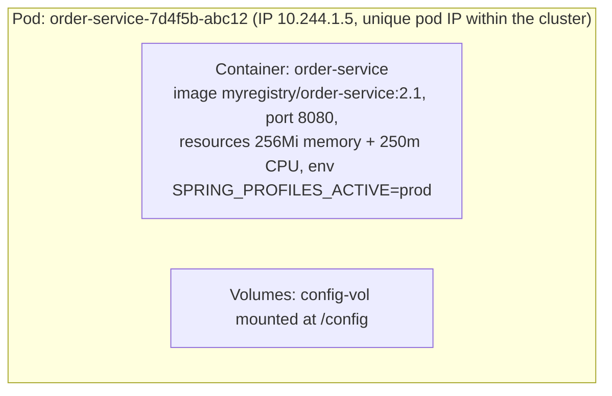
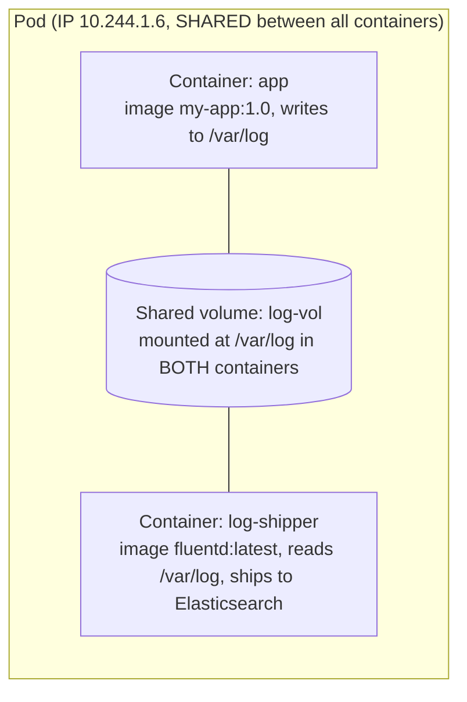
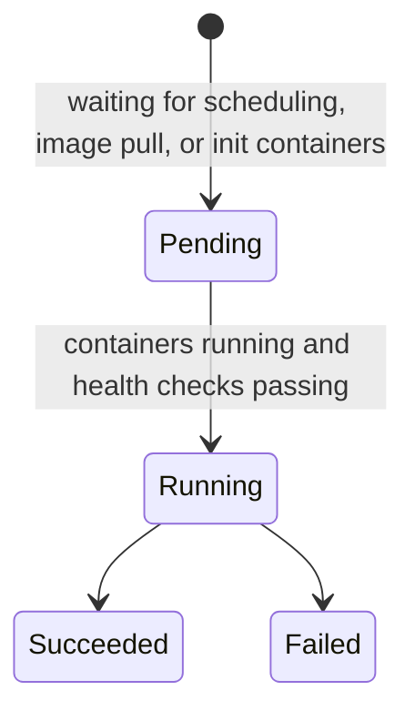
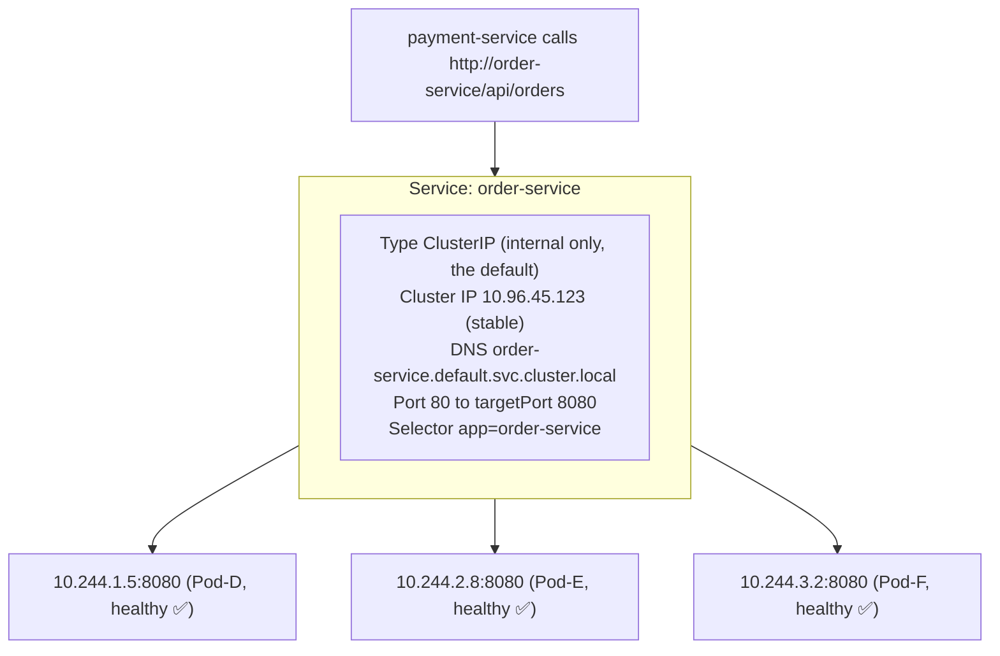
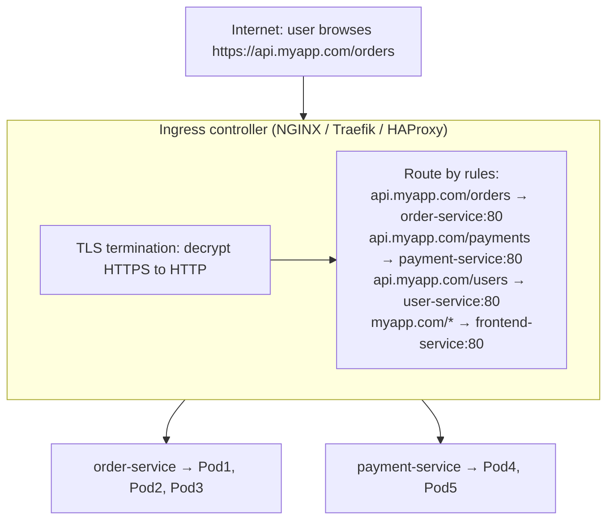
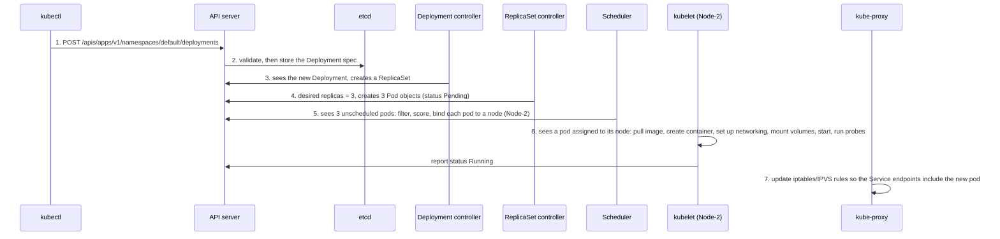

**Navigation**: [< Previous](Ch66_Event_Sourcing_CQRS.md) | [Back to Index](../00_MASTER_INDEX.md) | [Next >](Ch68_Distributed_Patterns.md)

# ☸️ Chapter 41 — Kubernetes Deep Dive: How Container Orchestration Actually Works

**"kubectl apply -f deployment.yaml — and within seconds, Kubernetes has scheduled your pods across nodes, pulled images, created containers, set up networking, attached storage, and started health checks. Understanding this machinery is the difference between deploying apps and debugging production outages at 3 AM."**

---

## Table of Contents

1. [The Big Picture — What Kubernetes Actually Solves](#1-the-big-picture--what-kubernetes-actually-solves)
2. [Architecture — Control Plane vs Worker Nodes](#2-architecture--control-plane-vs-worker-nodes)
3. [Pods — The Smallest Deployable Unit](#3-pods--the-smallest-deployable-unit)
4. [Deployments — How Rolling Updates Work](#4-deployments--how-rolling-updates-work)
5. [Services — How Networking Works Inside the Cluster](#5-services--how-networking-works-inside-the-cluster)
6. [Ingress — How External Traffic Reaches Your App](#6-ingress--how-external-traffic-reaches-your-app)
7. [ConfigMaps and Secrets — Configuration Management](#7-configmaps-and-secrets--configuration-management)
8. [StatefulSets — For Databases and Stateful Apps](#8-statefulsets--for-databases-and-stateful-apps)
9. [Resource Management — Requests, Limits, and QoS](#9-resource-management--requests-limits-and-qos)
10. [Health Checks — Liveness, Readiness, Startup Probes](#10-health-checks--liveness-readiness-startup-probes)
11. [How Scheduling Works — From YAML to Running Pod](#11-how-scheduling-works--from-yaml-to-running-pod)
12. [Common Production Patterns](#12-common-production-patterns)

---

## 1. The Big Picture — What Kubernetes Actually Solves

**Without kubernetes**

```text
3 servers, 5 microservices. You manually:
❌ Decide which service runs where
❌ SSH into servers to deploy new versions
❌ Restart crashed services (if you notice!)
❌ Scale up manually when traffic increases
❌ Update one by one, hoping nothing breaks
❌ Configure networking between services manually
❌ Manage environment variables per server
```

**With kubernetes**

```text
You DECLARE desired state: "Run 3 replicas of order-service, version 2.1"

Kubernetes CONTINUOUSLY ensures reality matches desired state:
✅ Schedules pods onto healthy nodes with sufficient resources
✅ Restarts crashed containers automatically
✅ Scales up/down based on CPU/memory metrics
✅ Rolling updates: new version deployed with zero downtime
✅ Service discovery: services find each other by name
✅ Load balancing: traffic distributed across healthy pods
✅ Config management: environment variables, secrets, mounted files
```

**THE CORE PRINCIPLE: Declarative, not Imperative**

```text
Imperative (without K8s): "Start container X on server A"
Declarative (with K8s):    "I want 3 instances of X running"
                            K8s figures out the HOW
```

---

🔬 **Section Challenge — 1. The Big Picture — What Kubernetes Actually Solves**

**Challenge 1 (Architecture):** Kubernetes is often described as a "Declarative" system rather than an "Imperative" system. Why is this distinction critical for recovering from a sudden node failure?

<details><summary>Answer</summary>

In an imperative system (like a script), you tell the system _how_ to do things (e.g., "Start Pod A on Node 1"). If Node 1 crashes, the script doesn't know what to do unless you wrote explicit failure-handling code. In a declarative system, you tell Kubernetes the _desired state_ ("I want 3 instances of Pod A running"). Kubernetes continuously runs control loops comparing the actual state to the desired state. When Node 1 crashes, the actual state drops to 2 instances. Kubernetes automatically detects this divergence and schedules a new pod on another node to restore the desired state of 3, requiring zero human intervention.

</details>

## 2. Architecture — Control Plane vs Worker Nodes

```text
• Front door to the cluster (REST API)
• ALL communication goes through here
• kubectl → API Server → etcd
• Authentication, Authorization, Admission Control
```

```text
• Distributed key-value store
• SINGLE SOURCE OF TRUTH for cluster state
• Stores: all resource definitions, pod locations, configs
• Uses Raft consensus for consistency
• If etcd dies, cluster is brain-dead
```

```text
• Watches for unscheduled pods
• Decides which node to place each pod on
• Considers: resources, affinity, taints, topology
```

```text
• Runs control loops that reconcile desired vs actual state
• Deployment Controller: manages ReplicaSets
• ReplicaSet Controller: ensures right number of pods
• Node Controller: monitors node health
• Job Controller: manages batch jobs
```

```text
• Agent on every node
• Talks to API Server: "What pods should I run?"
• Talks to container runtime: "Start/stop this container"
• Reports node status and pod health back to API Server
```

```text
• Network proxy on every node
• Maintains iptables/IPVS rules for Service routing
• Enables: service-name → pod-IP load balancing
```

```text
• Actually runs the containers
• Pulls images, manages container lifecycle
• containerd (default), CRI-O, Docker (deprecated as runtime)
```

```text
[order-svc-abc12]  [payment-svc-def34]  [user-svc-ghi56]
```

---

## 3. Pods — The Smallest Deployable Unit

A Pod is NOT a container. A Pod CONTAINS one or more containers.

**Single-container pod (the most common)**



**Multi-container pod (sidecar pattern)**



**How to read these diagrams.** The outer box is the pod, and the boxes inside are containers. In the second pod, both containers mount the same volume, so what `app` writes the log shipper can read.

Containers in the same pod:

- Share the network namespace (`localhost` works between them).
- Share volumes (they can read and write the same files).
- Share the IPC namespace.
- Are scheduled together on the same node.
- Live and die together.

**Pod lifecycle**



---

## 4. Deployments — How Rolling Updates Work

```yaml


🔬 **Section Challenge — 4. Deployments — How Rolling Updates Work**

**Challenge 1 (Deployment Strategy):** During a Rolling Update of your Deployment, your new v2 pods are starting up, but they have a fatal bug and crash immediately on boot. How does Kubernetes prevent this from taking down your entire application?
<details><summary>Answer</summary>

Kubernetes relies on the `maxUnavailable` setting and Readiness Probes. When the Deployment Controller spins up a new v2 pod, it waits for that pod's Readiness Probe to pass before it terminates one of the old v1 pods. Because the v2 pods are crashing, their Readiness Probes fail. The rollout pauses indefinitely, leaving the remaining healthy v1 pods untouched and continuing to serve traffic. This provides automatic "Zero Downtime" protection against bad releases.
</details>


# deployment.yaml
apiVersion: apps/v1
kind: Deployment
metadata:
  name: order-service
spec:
  replicas: 3                    # I want 3 pods running
  strategy:
    type: RollingUpdate
    rollingUpdate:
      maxSurge: 1                # Create 1 extra pod during update
      maxUnavailable: 0          # Never go below 3 healthy pods
  selector:
    matchLabels:
      app: order-service
  template:
    metadata:
      labels:
        app: order-service
    spec:
      containers:
      - name: order-service
        image: myregistry/order-service:2.1
        ports:
        - containerPort: 8080
        resources:
          requests:
            memory: "256Mi"
            cpu: "250m"
          limits:
            memory: "512Mi"
            cpu: "500m"
```

**ROLLING UPDATE — What happens when you change image to :2.2**

```text
BEFORE (v2.1):
[Pod-A v2.1 ✅] [Pod-B v2.1 ✅] [Pod-C v2.1 ✅]

Step 1: Create new pod with v2.2 (maxSurge=1 allows 4 pods temporarily)
[Pod-A v2.1 ✅] [Pod-B v2.1 ✅] [Pod-C v2.1 ✅] [Pod-D v2.2 🔄 starting]

Step 2: Pod-D passes readiness check
[Pod-A v2.1 ✅] [Pod-B v2.1 ✅] [Pod-C v2.1 ✅] [Pod-D v2.2 ✅]

Step 3: Terminate oldest v2.1 pod (maxUnavailable=0, we have 4 healthy)
[Pod-A v2.1 ❌ terminating] [Pod-B v2.1 ✅] [Pod-C v2.1 ✅] [Pod-D v2.2 ✅]

Step 4-5: Repeat for remaining pods
[Pod-B v2.1 ✅] [Pod-C v2.1 ✅] [Pod-D v2.2 ✅] [Pod-E v2.2 🔄]
→ [Pod-C v2.1 ✅] [Pod-D v2.2 ✅] [Pod-E v2.2 ✅] [Pod-F v2.2 🔄]

FINAL:
[Pod-D v2.2 ✅] [Pod-E v2.2 ✅] [Pod-F v2.2 ✅]

→ ZERO DOWNTIME! At least 3 healthy pods at all times
→ If v2.2 fails readiness check → rollout pauses → v2.1 still serving
```

**Hierarchy**

```text
Deployment (you manage this)
    │
    ├── creates ReplicaSet-v2.1  (manages v2.1 pods)
    │   └── Pod-A, Pod-B, Pod-C
    │
    └── creates ReplicaSet-v2.2  (manages v2.2 pods)
        └── Pod-D, Pod-E, Pod-F
```

---

## 5. Services — How Networking Works Inside the Cluster

**Problem.** Pods get random IPs, and pods die and get recreated with new IPs. How does `payment-service` find `order-service`?

**Answer:** a Kubernetes Service is a stable DNS name plus a load balancer.



**How to read this diagram.** The Service has one stable address. The endpoints behind it are the healthy pods that match its selector.

When `payment-service` calls `http://order-service/api/orders`:

1. DNS lookup: `order-service` → `10.96.45.123`.
2. kube-proxy (iptables/IPVS) intercepts traffic to `10.96.45.123`.
3. It load-balances to one of the endpoint pods (round-robin).
4. If a pod dies, it is removed from the endpoints and no traffic is routed to it.

**Service types**

| Type | Scope | Use case |
| --- | --- | --- |
| `ClusterIP` (default) | Internal only; a cluster IP is assigned | Service-to-service communication, databases, internal APIs |
| `NodePort` | External via the node IP, port 30000-32767 | Direct access for testing: `$NodeIP:$NodePort` → pod |
| `LoadBalancer` | External via a cloud load balancer (it provisions one) | Production external access: AWS ALB, GCP LB, Azure LB |
| `ExternalName` | DNS alias (CNAME record) | Map to an external service such as `external-db.company.com` |

---

🔬 **Section Challenge — 5. Services — How Networking Works Inside the Cluster**

**Challenge 1 (Networking):** You have a `payment-service` Deployment with 3 pods and a `ClusterIP` Service. If `order-service` makes an HTTP call to `http://payment-service:8080`, does the traffic go through a centralized load balancer proxy like NGINX?

<details><summary>Answer</summary>

No. Kubernetes `ClusterIP` Services do not use a centralized proxy hop. The DNS resolves the service name to a virtual IP (the ClusterIP). When the pod sends traffic to that IP, `kube-proxy` (which manages `iptables` or `IPVS` rules on _every single node_) intercepts the packet at the kernel level and rewrites the destination IP to directly target one of the 3 healthy pod IPs. It's a completely distributed, client-side (kernel-level) load balancing mechanism.

</details>

## 6. Ingress — How External Traffic Reaches Your App

An Ingress is the single entry point for external HTTP(S) traffic into the cluster: **Internet → Ingress controller → Services → Pods**.



**How to read this diagram.** The controller terminates TLS, then routes each request by host and path to a ClusterIP Service, which load-balances across its pods.

```yaml


🔬 **Section Challenge — 6. Ingress — How External Traffic Reaches Your App**

**Challenge 1 (Architecture):** If a `LoadBalancer` Service already provisions a cloud load balancer (like AWS ALB) to expose your app to the internet, why do we need `Ingress`?
<details><summary>Answer</summary>

Cost and Routing complexity. If you have 20 microservices and expose each using a `LoadBalancer` Service, the cloud provider will spin up 20 separate physical load balancers, and you will pay for all of them. An `Ingress` acts as a single Layer 7 reverse proxy (backed by a *single* LoadBalancer). It allows you to route external traffic to all 20 services based on URL paths (`/orders`, `/users`) or hostnames, using only one public IP and paying for only one cloud load balancer.
</details>


# ingress.yaml
apiVersion: networking.k8s.io/v1
kind: Ingress
metadata:
  name: api-ingress
  annotations:
    nginx.ingress.kubernetes.io/rewrite-target: /
spec:
  tls:
  - hosts:
    - api.myapp.com
    secretName: tls-secret
  rules:
  - host: api.myapp.com
    http:
      paths:
      - path: /orders
        pathType: Prefix
        backend:
          service:
            name: order-service
            port:
              number: 80
      - path: /payments
        pathType: Prefix
        backend:
          service:
            name: payment-service
            port:
              number: 80
```

---

## 7. ConfigMaps and Secrets — Configuration Management

```yaml
# ConfigMap — for non-sensitive configuration
apiVersion: v1
kind: ConfigMap
metadata:
  name: app-config
data:
  SPRING_PROFILES_ACTIVE: "prod"
  DATABASE_URL: "jdbc:postgresql://db-service:5432/orders"
  LOG_LEVEL: "INFO"

---
# Secret — for sensitive data (Base64 encoded, NOT encrypted by default!)
apiVersion: v1
kind: Secret
metadata:
  name: app-secrets
type: Opaque
data:
  DB_PASSWORD: cGFzc3dvcmQxMjM= # base64("password123")
  JWT_SECRET: c3VwZXJzZWNyZXQ= # base64("supersecret")
```

**How pods use them**

```text
METHOD 1: Environment variables

env:
- name: DB_URL
  valueFrom:
    configMapKeyRef:
      name: app-config
      key: DATABASE_URL
- name: DB_PASSWORD
  valueFrom:
    secretKeyRef:
      name: app-secrets
      key: DB_PASSWORD


METHOD 2: Volume mounts (files)

volumes:
- name: config-volume
  configMap:
    name: app-config

containers:
- volumeMounts:
  - name: config-volume
    mountPath: /etc/config
    # Creates files: /etc/config/SPRING_PROFILES_ACTIVE
    #                /etc/config/DATABASE_URL
    #                /etc/config/LOG_LEVEL


⚠️ SECRETS ARE NOT ENCRYPTED: Base64 encoding is NOT security.
For production, use:
• External secrets (AWS Secrets Manager, HashiCorp Vault)
• Sealed Secrets (encrypted in Git, decrypted in cluster)
• etcd encryption at rest
```

---

## 8. StatefulSets — For Databases and Stateful Apps

**Deployment vs StatefulSet**

| | Deployment | StatefulSet |
| --- | --- | --- |
| Pod names | Random (`app-7d4f-abc`) | Ordered (`app-0`, `app-1`) |
| Startup order | All at once | Sequential (0, 1, 2) |
| Shutdown order | Any order | Reverse (2, 1, 0) |
| Network identity | No stable hostname | `app-0.service`, `app-1.service`, ... |
| Storage | Shared or ephemeral | Each pod owns its PVC |
| Use case | Stateless apps | Databases, Kafka, ZooKeeper |

**Why databases need StatefulSets.** PostgreSQL with replication, as a StatefulSet named `postgres`:

| Pod | Hostname | PVC | Role |
| --- | --- | --- | --- |
| `postgres-0` (PRIMARY) | `postgres-0.postgres-headless.default.svc` | `data-postgres-0` (100Gi SSD, survives a pod restart) | Accepts reads AND writes |
| `postgres-1` (REPLICA) | `postgres-1.postgres-headless.default.svc` | `data-postgres-1` (100Gi SSD, its OWN separate disk) | Read-only replica, streams the WAL from `postgres-0` |
| `postgres-2` (REPLICA) | `postgres-2.postgres-headless.default.svc` | `data-postgres-2` (100Gi SSD) | Read-only replica |

If `postgres-1` dies and restarts, it gets the SAME name (`postgres-1`) and the SAME PVC (`data-postgres-1`). It reattaches to its data, so there is no data loss. With a Deployment, the pod would get a random name and a different PVC, and the DATA would be LOST.

---

## 9. Resource Management — Requests, Limits, and QoS

```yaml
resources:
  requests: # "I NEED at least this much"
    memory: "256Mi" # Used for SCHEDULING decisions
    cpu: "250m" # Scheduler won't place pod on node without this available
  limits: # "NEVER use more than this"
    memory: "512Mi" # If exceeded → OOMKilled! (Out of Memory)
    cpu: "500m" # If exceeded → throttled (not killed)
```

**CPU UNITS: — 1 CPU = 1000m (millicores) — 250m = 25% of one CPU core — 0.5 = 500m = half a core — MEMORY UNITS: — Mi = Mebibytes (1024-based) — 256Mi = 268,435,456 bytes — QoS CLASSES (determined by how you set requests/limits): — QoS Class     │ Condition                                │ Eviction**

```text
Guaranteed    │ requests == limits for ALL containers    │ Last to die
              │ (CPU and memory both set and equal)      │ Most stable
Burstable     │ At least one request OR limit set        │ Middle
              │ (requests < limits, or only one set)     │
BestEffort    │ NO requests AND NO limits set            │ First to die
              │ (gets whatever is left over)              │ Avoid in prod

  When node runs out of memory:
  1. Kill BestEffort pods first
  2. Kill Burstable pods exceeding requests
  3. Kill Guaranteed pods only as last resort

  PRODUCTION RULE: ALWAYS set requests and limits.
  Prefer Guaranteed for critical services (DB, payment).
  Burstable OK for general services (tolerate occasional eviction).
```

---

## 10. Health Checks — Liveness, Readiness, Startup Probes

**THREE TYPES OF PROBES: — Probe      │ Question                   │ If Fails**

```text
Startup    │ "Has the app STARTED?"     │ Keep waiting (don't restart)
           │ Runs once at beginning      │ If exceeds timeout → restart
           │                              │ Protects slow-starting apps
Liveness   │ "Is the app ALIVE?"        │ RESTART the container
           │ Runs continuously            │ (kills and recreates)
           │                              │ For deadlocks, hung states
Readiness  │ "Can the app SERVE traffic?"│ REMOVE from service endpoints
           │ Runs continuously            │ (stop sending requests)
           │                              │ For warmup, dependency down
```

```yaml


🔬 **Section Challenge — 10. Health Checks — Liveness, Readiness, Startup Probes**

**Challenge 1 (Reasoning):** Your K8s pod is stuck in `CrashLoopBackOff`. How do you diagnose it step by step?
<details><summary>Answer</summary>

1) `kubectl describe pod <name>` — check Events section for reasons. 2) `kubectl logs <pod> --previous` — see logs from the CRASHED container (not the current restart). 3) Check: OOMKilled (out of memory → increase memory limit), exit code 1 (app error → check logs), exit code 137 (SIGKILL from OOM or liveness probe). 4) If liveness probe failing: disable temporarily to investigate live state. 5) Check startup probe vs liveness probe config — maybe app needs more init time.
</details>

**Challenge 2 (Design):** Explain the difference between a liveness probe and a readiness probe. What happens when each fails?
<details><summary>Answer</summary>

**Liveness**: is the pod healthy? Failure → K8s KILLS and restarts the pod. Use for: hung processes that are running but unresponsive. **Readiness**: is the pod ready to serve traffic? Failure → pod is REMOVED from Service endpoints (no traffic sent), but NOT restarted. Use for: app still initializing, temporarily overloaded, downstream dependency unavailable. Common mistake: using liveness for readiness scenarios → pod gets killed/restarted when it should just be temporarily excluded from load balancing.
</details>


# Spring Boot health check configuration
containers:
- name: order-service
  image: order-service:2.1

  startupProbe:
    httpGet:
      path: /actuator/health
      port: 8080
    failureThreshold: 30        # Try 30 times
    periodSeconds: 10           # Every 10 seconds = 300s max startup time

  livenessProbe:
    httpGet:
      path: /actuator/health/liveness
      port: 8080
    initialDelaySeconds: 0      # Startup probe handles initial delay
    periodSeconds: 10
    failureThreshold: 3         # 3 consecutive failures → restart

  readinessProbe:
    httpGet:
      path: /actuator/health/readiness
      port: 8080
    periodSeconds: 5
    failureThreshold: 3         # 3 failures → remove from service
```

---

## 11. How Scheduling Works — From YAML to Running Pod

**What happens on `kubectl apply -f deployment.yaml`**



**How to read this diagram.** Every component watches the API server for changes and reacts to them. No component calls another directly.

**Step 5 in detail: the scheduler, for each pod**

- **Filtering** (which nodes CAN run this pod?):
  - Does the node have enough CPU (request: 250m)?
  - Does it have enough memory (request: 256Mi)?
  - Does the pod have a node selector or affinity that matches?
  - Is the node tainted, and does the pod tolerate it?
  - Result: 2 of 3 nodes pass.
- **Scoring** (which node SHOULD run this pod?):
  - Balance pods across nodes (spread).
  - Prefer nodes with more available resources.
  - Prefer nodes where the image is already pulled.
  - Apply anti-affinity rules (don't colocate with the same app).
  - Result: Node-2 scores highest.
- **Bind:** assign the pod to Node-2 and update etcd.

**Step 6 in detail: the kubelet on Node-2**

1. Pull the image if it isn't cached (`docker pull myregistry/order-service:2.1`).
2. Create the container via containerd.
3. Set up networking (CNI plugin) and assign the pod IP.
4. Mount volumes (ConfigMap, Secret, PVC).
5. Start the container (`java -jar app.jar`).
6. Run the startup probe and wait for success.
7. Set the pod status to Running and report it back to the API server.

**Step 7:** kube-proxy updates the iptables/IPVS rules. The Service endpoints now include the new pod, and traffic can flow to it.

---

🔬 **Section Challenge — 11. How Scheduling Works — From YAML to Running Pod**

**Challenge 1 (System Design):** You submit a Deployment YAML to create a Pod that requests `1000m` CPU. All nodes in your cluster only have `500m` CPU available. What is the exact status of the Pod, and which component made that decision?

<details><summary>Answer</summary>

The Pod will remain in a `Pending` state indefinitely. The **kube-scheduler** made this decision during the "Filtering" phase. It evaluated all available nodes, saw that none of them met the `1000m` CPU resource request, and therefore refused to bind the pod to any node. The API server stores the pod as `Pending` until a node frees up enough resources or a new node is added to the cluster.

</details>

## 12. Common Production Patterns

### Pod Disruption Budget

```yaml
# "Always keep at least 2 pods running during voluntary disruptions"
# (node drain, rolling update, cluster upgrade)
apiVersion: policy/v1
kind: PodDisruptionBudget
metadata:
  name: order-service-pdb
spec:
  minAvailable: 2
  selector:
    matchLabels:
      app: order-service
```

### Horizontal Pod Autoscaler

```yaml
# Auto-scale between 3-10 pods based on CPU
apiVersion: autoscaling/v2
kind: HorizontalPodAutoscaler
metadata:
  name: order-service-hpa
spec:
  scaleTargetRef:
    apiVersion: apps/v1
    kind: Deployment
    name: order-service
  minReplicas: 3
  maxReplicas: 10
  metrics:
    - type: Resource
      resource:
        name: cpu
        target:
          type: Utilization
          averageUtilization: 70 # Scale up when avg CPU > 70%
```

### Pod Anti-Affinity

```yaml
# Spread pods across different nodes (survive node failure)
spec:
  affinity:
    podAntiAffinity:
      preferredDuringSchedulingIgnoredDuringExecution:
        - weight: 100
          podAffinityTerm:
            labelSelector:
              matchExpressions:
                - key: app
                  operator: In
                  values:
                    - order-service
            topologyKey: kubernetes.io/hostname
```

---

**Next Chapter**: [Distributed Patterns & Consensus →](Ch68_Distributed_Patterns.md)


---

## Reality Check

**"Kubernetes is necessary for production deployments"** — Kubernetes adds operational complexity: etcd cluster management, networking (CNI plugins, service mesh), RBAC configuration, resource quota management, node scaling, and upgrade coordination. A single Spring Boot application serving 1000 requests per second runs fine on 2 VMs behind a load balancer with zero Kubernetes overhead. Use Kubernetes when you have 10+ services, need automated scaling, or require self-healing infrastructure.

**"Pod resource limits prevent OOM kills"** — Resource limits tell Kubernetes the MAXIMUM a pod can use. If your JVM heap is 512MB but the container limit is 400MB, the kernel OOM-kills the JVM without warning (no graceful shutdown, no heap dump). The container limit must exceed: JVM heap (Xmx) + metaspace + thread stacks + direct memory + native memory + JVM overhead. A safe formula: container memory limit is at least 1.5x the -Xmx value.

**"Rolling deployments are always safe"** — During a rolling deployment, old and new versions run simultaneously. If the new version writes data in a format the old version cannot read, active old pods crash. Database migrations that remove columns break old pods still using those columns. Rolling deployments require: backward-compatible code changes, expand-then-contract database migrations, and feature flags for behavior changes.

**"Horizontal Pod Autoscaler reacts instantly to load spikes"** — HPA checks metrics every 15 seconds by default, then adds pods. New pods need: image pull (seconds to minutes if not cached), JVM startup (5-15 seconds), Spring context initialization (10-60 seconds), and readiness probe passing (configurable delay). Total time from load spike to new pod serving traffic: 30 seconds to 3 minutes. Size your baseline replica count to handle expected traffic spikes without autoscaling.

**"ConfigMaps and Secrets are the same except for encoding"** — Secrets are Base64-encoded (NOT encrypted) at rest in etcd by default. Anyone with etcd access reads all secrets in plaintext. Kubernetes Secrets are slightly more secure than ConfigMaps because: they can be mounted as tmpfs (not written to node disk), RBAC can restrict access separately, and encryption at rest can be configured. But without encryption-at-rest configuration, Secrets provide obscurity, not security.
