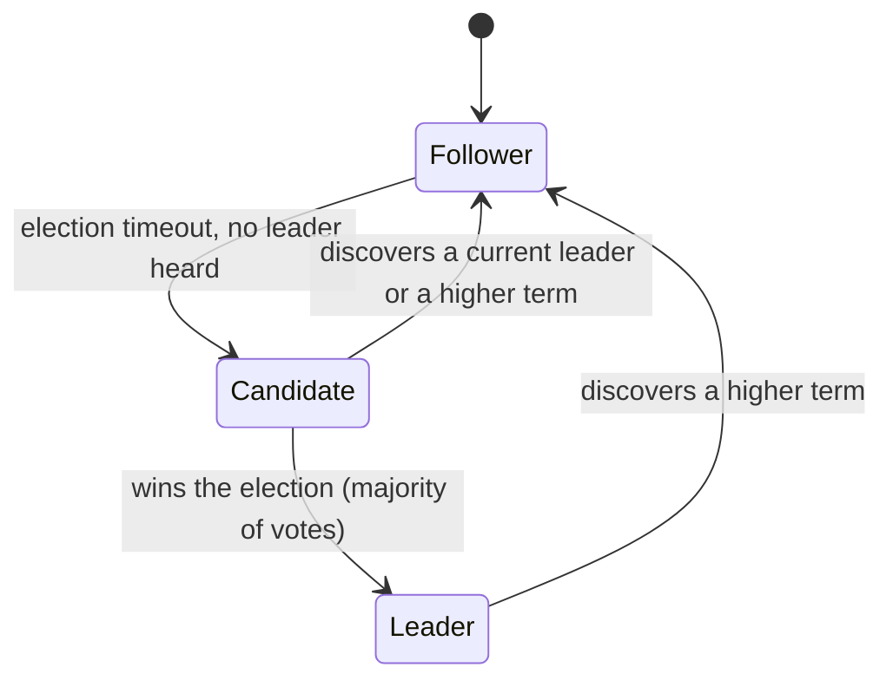
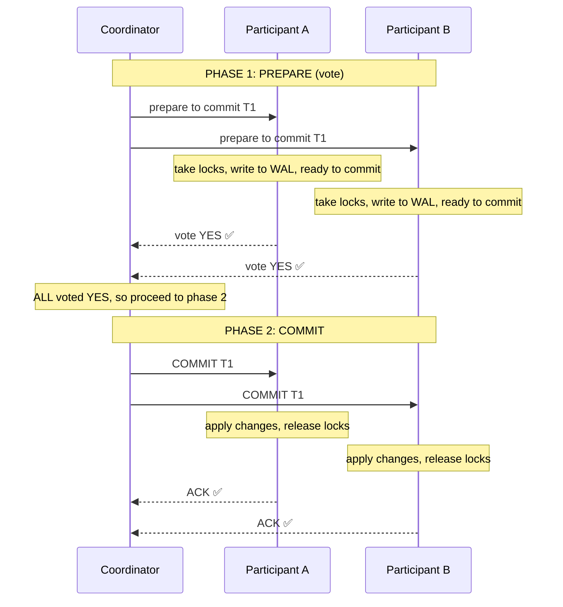
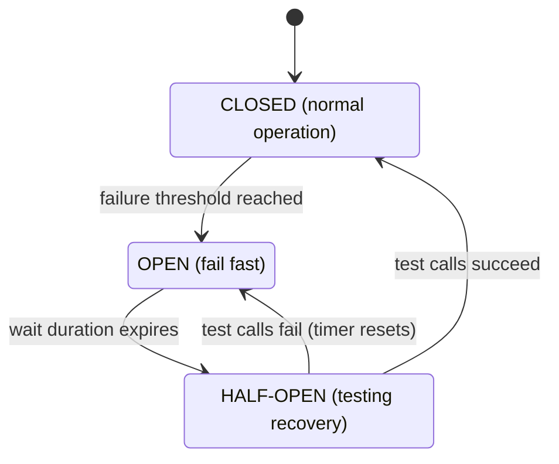
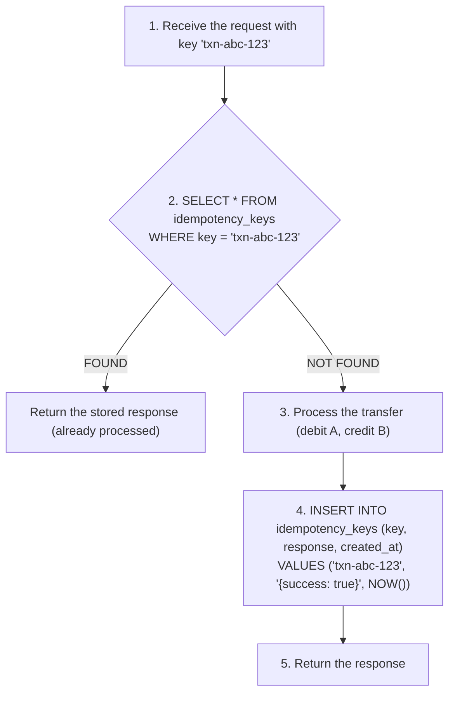
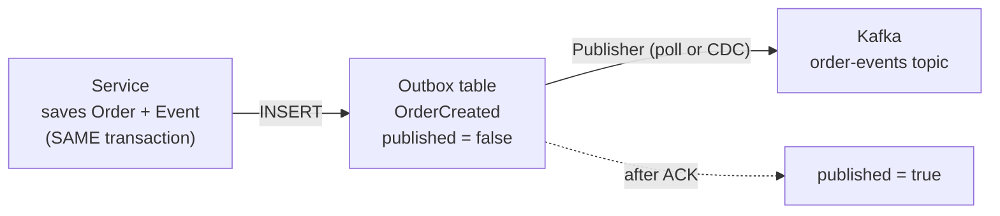

**Navigation**: [< Previous](Ch67_Kubernetes_Deep_Dive.md) | [Back to Index](../00_MASTER_INDEX.md) | [Next >](Ch69_Performance_Engineering.md)

# 🌐 Chapter 42 — Distributed Patterns & Consensus: How Systems Agree

**"If 5 database replicas receive a write, how do they agree on the order? If a network partition splits your cluster in half, which half keeps accepting writes? These questions define distributed systems — and the answers are Raft, Paxos, 2PC, and the patterns built on top of them."**

---

## Table of Contents

1. [The CAP Theorem — The Fundamental Trade-off](#1-the-cap-theorem--the-fundamental-trade-off)
2. [Raft Consensus — How Leaders Get Elected](#2-raft-consensus--how-leaders-get-elected)
3. [Two-Phase Commit (2PC) — Distributed Transactions](#3-two-phase-commit-2pc--distributed-transactions)
4. [Consistent Hashing — How Data Is Distributed](#4-consistent-hashing--how-data-is-distributed)
5. [Leader Election — Who's in Charge](#5-leader-election--whos-in-charge)
6. [Crdt — Conflict-Free Replicated Data Types](#6-crdt--conflict-free-replicated-data-types)
7. [Circuit Breaker — Failing Fast and Recovering](#7-circuit-breaker--failing-fast-and-recovering)
8. [Idempotency — Safe Retries in Distributed Systems](#8-idempotency--safe-retries-in-distributed-systems)
9. [Distributed Locking — Mutual Exclusion Across Services](#9-distributed-locking--mutual-exclusion-across-services)
10. [Outbox Pattern — Reliable Event Publishing](#10-outbox-pattern--reliable-event-publishing)

---

## 1. The CAP Theorem — The Fundamental Trade-off

In a DISTRIBUTED system, you can have at most TWO of three:

**Consistency (C)**

| Property | Meaning |
| --- | --- |
| **C**onsistency | Every read gets the most recent write |
| **A**vailability | Every request gets a response (not an error) |
| **P**artition tolerance | The system works despite network partitions |

Network partitions WILL happen, so in practice you choose between:

| Choice | During a partition | Examples | When to use |
| --- | --- | --- | --- |
| **CP** (consistency + partition tolerance) | Refuse requests (return errors) | ZooKeeper, etcd, HBase, PostgreSQL (single primary) | Financial data, inventory counts, leader election |
| **AP** (availability + partition tolerance) | Return possibly stale data | Cassandra, DynamoDB, CouchDB, DNS | Shopping carts, social feeds, caches |

---

## 2. Raft Consensus — How Leaders Get Elected

Raft is the consensus algorithm used by etcd (Kubernetes), CockroachDB, TiKV, Consul and RabbitMQ quorum queues.

**Core idea:** one LEADER, the rest are FOLLOWERS. All writes go to the leader, and the leader replicates them to a majority.

**Three states**



**How to read this diagram.** Every node starts as a follower. If it stops hearing from a leader, it becomes a candidate and asks for votes. A candidate that wins a majority becomes the leader.

**Leader election**

| Stage | Node-1 | Node-2 | Node-3 |
| --- | --- | --- | --- |
| Normal operation | LEADER (term 5), sends heartbeats to both followers | FOLLOWER (term 5), ACKs | FOLLOWER (term 5), ACKs |
| Leader dies | DEAD ❌ | FOLLOWER: no heartbeat within the election timeout (about 150-300 ms) | FOLLOWER |
| Timeout fires | DEAD ❌ | CANDIDATE (term 6): "Vote for me!" | FOLLOWER: "OK, I vote for Node-2" |
| Majority reached (2 of 3) | DEAD ❌ | LEADER (term 6), sends heartbeats | FOLLOWER (term 6) |

**Log replication (how writes work).** The client sends the leader `SET key=value`:

1. The leader appends to its log: `[index:7, term:6, SET key=value]`.
2. The leader sends an `AppendEntries` RPC to all followers.
3. Followers append to their logs and respond with an ACK.
4. When a MAJORITY responds (2 of 3), the leader COMMITS the entry (applies it to the state machine) and responds to the client with "SUCCESS".
5. The next heartbeat tells the followers: "commit up to index 7".
6. The followers apply the entry to their state machines.

Majority = (N/2) + 1. A 3-node cluster has a majority of 2 and tolerates 1 failure. A 5-node cluster has a majority of 3 and tolerates 2 failures.

---

## 3. Two-Phase Commit (2PC) — Distributed Transactions

Two-phase commit (2PC) is for when you NEED atomic transactions across multiple databases or services.



**How to read this diagram.** In phase 1 every participant votes after preparing. If all vote YES, phase 2 commits on every participant.

**If any participant votes NO,** the coordinator sends ABORT to all participants. Everyone rolls back and releases their locks.

**The problems with 2PC**

1. **Blocking:** if the coordinator crashes after phase 1 but before phase 2, participants are stuck holding locks, waiting forever.
2. **Slow:** at least 2 network round trips (4 messages per participant).
3. **Single point of failure:** a coordinator crash means stuck transactions.

This is why microservices prefer the SAGA pattern instead. 2PC is used within a single system (for example inside a database).

---

🔬 **Section Challenge — 3. Two-Phase Commit (2PC) — Distributed Transactions**

**Challenge 1 (System Failure):** In a Two-Phase Commit protocol, the Coordinator sends the "Prepare" message, and all participants vote "YES" and acquire locks. Immediately after, the Coordinator's server crashes and its hard drive burns before it can send the "Commit" message. What happens to the participants?

<details><summary>Answer</summary>

This exposes the fatal flaw of 2PC: **Blocking**. The participants are stuck holding exclusive write locks on the records they prepared, waiting for a coordinator that will never respond. They cannot unilaterally abort (because another participant might have committed), nor can they commit. The system grinds to a halt until the coordinator is restored or manual DBA intervention clears the locks.

</details>

## 4. Consistent Hashing — How Data Is Distributed

```text
PROBLEM: You have 4 cache servers. Which server holds key "user:42"?

NAIVE APPROACH: server = hash(key) % 4
Works until you add/remove a server → ALL keys remap! Cache invalidation storm.
```

**Consistent hashing**

```text
Imagine a ring (0 to 2^32-1)

                      0 (= 2^32)
                     ╱    ╲
                   ╱        ╲
                 ╱            ╲
Server-A (pos 100)            Server-B (pos 800)
               ╲                ╱
                 ╲            ╱
                   ╲        ╱
                     ╲    ╱
                Server-C (pos 500)

To find which server owns key "user:42":
1. Hash the key: hash("user:42") = 350
2. Walk clockwise from 350
3. First server you hit: Server-C (at position 500)
4. Server-C owns "user:42"
```

**WHEN SERVER-D (pos 650) IS ADDED**

```text
Only keys between Server-C(500) and Server-D(650) remap!
Keys at 350 (→ still Server-C), 700 (→ now Server-D, was Server-B)

Instead of ALL keys moving → only ~1/N keys move. Minimal disruption.
```

**VIRTUAL NODES (vnodes)**

```text
Problem: With few servers, distribution is uneven.
Solution: Each server gets multiple positions on the ring.

Server-A: vnodes at positions [100, 300, 700, 950]
Server-B: vnodes at positions [200, 450, 600, 850]

Now the ring is more evenly divided.

USED BY: Cassandra, DynamoDB, Redis Cluster, Memcached, CDNs
```

---

🔬 **Section Challenge — 4. Consistent Hashing — How Data Is Distributed**

**Challenge 2 (System Design):** You have a cache cluster with 3 servers using Consistent Hashing. You notice Server A is taking 80% of all the traffic, while Servers B and C are mostly idle. Why is this happening, and how do Virtual Nodes fix it?

<details><summary>Answer</summary>

The random hashing of just 3 server IP addresses placed them unevenly on the ring (e.g., A at 10°, B at 20°, C at 30°). This means Server A "owns" the vast 330° remaining segment of the hash space. **Virtual Nodes (vnodes)** fix this by assigning each physical server hundreds of points on the ring (A1, A2, A3...). This artificially interweaves their coverage areas, mathematically guaranteeing an even distribution of the hash space regardless of the physical server count.

</details>

## 5. Leader Election — Who's in Charge

```text
Many systems need ONE leader for coordination:
- Database primary (accepts writes)
- Kafka partition leader (handles produce/consume)
- Cron job runner (only one should execute)
- Cache invalidation coordinator
```

**USING ZOOKEEPER/etcd (external coordinator)**

```text
1. All nodes try to create an EPHEMERAL node: /election/leader
2. Only ONE succeeds (atomic create) → becomes leader
3. Others watch the node for deletion
4. If leader dies → ephemeral node auto-deleted (session timeout)
5. Watchers notified → race to create /election/leader again
6. First one wins → new leader
```

**USING REDIS (Redlock)**

```text
SET leader_lock "node-1" NX PX 30000
(NX = only if not exists, PX = expire in 30 seconds)

If SET succeeds: you're the leader
Must RENEW before 30s expires (heartbeat)
If fails: someone else is leader, retry periodically

⚠️ Single Redis = single point of failure
Redlock algorithm: acquire lock on majority of Redis instances
```

**Using database**

```text
-- Leader table with optimistic locking
CREATE TABLE leader_election (
    id INT PRIMARY KEY DEFAULT 1,
    leader_id VARCHAR(255),
    heartbeat TIMESTAMP,
    CHECK (id = 1)  -- only one row ever
);

-- Try to become leader (if no recent heartbeat):
UPDATE leader_election
SET leader_id = 'node-1', heartbeat = NOW()
WHERE heartbeat < NOW() - INTERVAL '30 seconds';
-- If rows affected = 1: you're the leader
-- If rows affected = 0: someone else is alive
```

---

🔬 **Section Challenge — 5. Leader Election — Who's in Charge**

**Challenge 3 (Edge Cases):** Service Instance A acquires a distributed lock in Redis to process an important daily batch job. While processing, Instance A experiences a 60-second JVM Garbage Collection pause. The lock expires in Redis after 30 seconds, and Instance B takes the lock and starts processing. Instance A wakes up and continues processing. Both instances write to the database. How do you prevent this?

<details><summary>Answer</summary>

You must use **Fencing Tokens**. When a lock is acquired, the lock service must return a monotonically increasing integer (e.g., token 34). The service passes this token to the database with its writes. When Instance B acquires the lock, it gets token 35. If Instance A wakes up and tries to write to the database with token 34, the database sees that a newer token (35) has already been active, and outright rejects Instance A's write.

</details>

## 6. CRDT — Conflict-Free Replicated Data Types

```text
IN AP SYSTEMS (eventual consistency), concurrent writes can conflict.

Node-A: counter = 5, increment → counter = 6
Node-B: counter = 5, increment → counter = 6  (simultaneously)

When they sync: counter should be 7, but both say 6!


CRDT SOLUTION: Design data structures that MERGE without conflicts.
```

**G-COUNTER (Grow-only Counter)**

```text
Each node tracks its OWN increments:

Node-A state: {A: 3, B: 0, C: 0}  → total = 3
Node-B state: {A: 0, B: 5, C: 0}  → total = 5
Node-C state: {A: 0, B: 0, C: 2}  → total = 2

Merge: take MAX of each node's counter:
Merged: {A: 3, B: 5, C: 2} → total = 10 ✅

No conflicts! No coordination needed! Works offline!
```

**Real uses**

```text
• Redis CRDTs (Redis Enterprise)
• Riak (distributed database)
• Automerge (collaborative editing library)
• Shopping carts (add items from multiple devices)
• Like counters (social media)
```

---

🔬 **Section Challenge — 6. CRDT — Conflict-Free Replicated Data Types**

**Challenge 4 (Reasoning — Who/When/What):** A G-Counter CRDT has 3 nodes each with vector `[node1, node2, node3]`. Node1=`[5,3,2]`, Node2=`[3,7,1]`. **Who** merges them? **What** is the merged value? **When** does eventual consistency converge?\n\n<details><summary>Answer</summary>\n\n**Who merges?** Any node receiving the state from another — no coordinator needed (fully decentralized). **Merged value:** Element-wise MAX: `[max(5,3), max(3,7), max(2,1)]` = `[5,7,2]`. Total count = 5+7+2 = 14. **When convergence?** Once all nodes have exchanged their states (gossip protocol), every node will have the same vector and same total. CRDTs guarantee convergence regardless of message ordering or delivery. **Why MAX works:** Each element represents a node's OWN increment count. A node never decrements its own slot. MAX safely captures the highest observed count per node without losing any increments, even when messages arrive out of order.\n\n</details>

## 7. Circuit Breaker — Failing Fast and Recovering

**Problem.** Service B is down and Service A keeps calling it. 100 requests → 100 timeouts → 100 × 30 s = 50 minutes of wasted threads.

**Circuit breaker: detailed state machine**



**How to read this diagram.** The breaker moves between three states. CLOSED lets everything through, OPEN blocks everything, and HALF-OPEN tests whether the service has recovered.

| State | What happens |
| --- | --- |
| **CLOSED** (normal operation) | ✓ All requests pass through to Service B.<br>✓ Failures are tracked in a sliding window (the last N calls).<br>✓ A success resets the failure count.<br>If failures reach the threshold (for example 5 failures in 10 calls), the circuit OPENS. |
| **OPEN** (fail fast) | ✗ ALL requests FAIL IMMEDIATELY (no call to Service B).<br>✗ A fallback or error is returned to the caller.<br>✓ Service B is protected from being overwhelmed.<br>✓ Threads don't block on timeouts.<br>A timer runs for `waitDurationInOpenState` (for example 60 seconds). When it expires, the circuit goes HALF-OPEN. |
| **HALF-OPEN** (testing recovery) | A limited number of test requests are allowed through to Service B.<br>If the test requests SUCCEED, the circuit CLOSES (Service B recovered) and the failure count is reset.<br>If they FAIL, the circuit re-OPENS (Service B is still broken) and the timer is reset. |

**Production Resilience4j config example**

```yaml
failureRateThreshold: 50        # Open if 50%+ of calls fail
waitDurationInOpenState: 60s    # Test again after 60 seconds
slidingWindowSize: 10           # Track the last 10 calls
minimumNumberOfCalls: 5         # Need 5 calls before evaluating
```

```java
// Using Resilience4j (modern Java library):
@CircuitBreaker(name = "paymentService", fallbackMethod = "paymentFallback")
public PaymentResult processPayment(PaymentRequest request) {
    return paymentClient.charge(request);  // calls external service
}

public PaymentResult paymentFallback(PaymentRequest request, Throwable t) {
    // Fallback: queue for later processing
    paymentQueue.enqueue(request);
    return PaymentResult.pending("Payment queued, will process shortly");
}

// application.yml
// resilience4j.circuitbreaker.instances.paymentService:
//   failureRateThreshold: 50        # Open if 50% of calls fail
//   waitDurationInOpenState: 60s    # Stay open for 60 seconds
//   slidingWindowSize: 10           # Measure over last 10 calls
//   minimumNumberOfCalls: 5         # Need at least 5 calls to evaluate
```

---

🔬 **Section Challenge — 7. Circuit Breaker — Failing Fast and Recovering**

**Challenge 5 (Reasoning):** In a microservice architecture, why is a naive Retry mechanism often more dangerous than failing fast?

<details><summary>Answer</summary>

Retry Storms. If Service B is struggling and timing out, Service A aggressively retrying requests will multiply the load on Service B, causing it to completely collapse (cascading failure). Retries must _always_ be paired with Exponential Backoff (to space out load), Jitter (to prevent synchronized waves of retries), and a Circuit Breaker (to completely cut off traffic and let Service B recover once a failure threshold is reached).

</details>

## 8. Idempotency — Safe Retries in Distributed Systems

**Problem.** The client sends "transfer $100", the network times out, and the client doesn't know whether it succeeded. If it retries "transfer $100", was $200 transferred?

**Idempotent** means the same operation applied multiple times gives the same result.

| Naturally idempotent | NOT idempotent |
| --- | --- |
| `GET /users/42` | `POST /transfers {amount: 100}` |
| `PUT /users/42 {name:"H"}` | `POST /orders` (creates a new one each time) |
| `DELETE /users/42` | `counter++` |
| `SET key=value` | append to a list |

**Making non-idempotent operations safe: use an idempotency key.**

The client sends `POST /transfers` with the header `Idempotency-Key: "txn-abc-123"` (a UUID generated by the client) and the body `{from: "A", to: "B", amount: 100}`.



**How to read this diagram.** The server looks up the key first. A known key returns the stored response without redoing the work.

> [!IMPORTANT]
> Steps 3 and 4 happen in the SAME database transaction. Now the client can safely retry: the same key gives the same (stored) response.

---

🔬 **Section Challenge — 8. Idempotency — Safe Retries in Distributed Systems**

**Challenge 6 (Edge Cases):** A client sends a `POST /checkout` request with an `Idempotency-Key`. The server receives it, but before the database transaction finishes, the client times out and retries with the _exact same_ `Idempotency-Key`. If the server simply checks the database for an existing completed response, what race condition occurs?

<details><summary>Answer</summary>

Because the first request hasn't committed yet, the `Idempotency-Key` check in the database will return "Not Found". The server will spin up a _second_ transaction for the retry, resulting in a double-charge! To fix this, you must acquire a distributed lock on the `Idempotency-Key` _before_ checking the DB, or use a unique constraint on the database column so the second transaction fails to insert the pending key.

</details>

## 9. Distributed Locking — Mutual Exclusion Across Services

```text
PROBLEM: Two instances of "report-generator" service both try to
generate the same monthly report at the same time → duplicates.

Need: Only ONE instance runs the report at a time.
In one JVM: synchronized or ReentrantLock.
Across JVMs/services: DISTRIBUTED LOCK.
```

**Redis-based lock**

```text
ACQUIRE:
SET report_lock "instance-1" NX PX 30000
// NX: only if key doesn't exist (atomic check-and-set)
// PX 30000: auto-expire in 30 seconds (prevent deadlock if holder crashes)

If SET returns OK → lock acquired!
If SET returns nil → lock held by someone else → retry or abort

RELEASE:
// MUST verify you're the owner before deleting!
// Lua script for atomicity:
if redis.call("GET", KEYS[1]) == ARGV[1] then
    return redis.call("DEL", KEYS[1])
else
    return 0
end

WHY Lua script? Between GET and DEL, lock might have expired
and been acquired by someone else. Lua runs atomically in Redis.
```

**⚠️ the fencing token problem**

```text
Timeline:
Client-1 acquires lock (token: 34) → starts work
Client-1 has long GC pause → lock expires!
Client-2 acquires lock (token: 35) → starts work
Client-1 GC ends → thinks it still holds lock → writes to DB!

Now BOTH wrote to DB. Lock didn't protect!

SOLUTION: Fencing tokens
Each lock acquisition gets an incrementing token.
Database rejects writes with token < last seen token.

Client-1 writes with token 34 → accepted
Client-2 writes with token 35 → accepted
Client-1 retries with token 34 → REJECTED (34 < 35)
```

---

🔬 **Section Challenge — 9. Distributed Locking — Mutual Exclusion Across Services**

**Challenge 7 (System Design):** Why is implementing a distributed lock using `SET key value NX` in a single Redis node dangerous for mission-critical operations, and what is the Redlock algorithm?

<details><summary>Answer</summary>

A single Redis node is a single point of failure. If the master crashes _after_ granting a lock, but _before_ replicating that key to the replica, the replica will get promoted to master without knowing about the lock. It will then grant the lock to a second client! The **Redlock algorithm** solves this by requiring the client to sequentially request the lock from N independent Redis nodes. The lock is only considered acquired if the client successfully locks `(N/2)+1` majority nodes.

</details>

## 10. Outbox Pattern — Reliable Event Publishing

**Problem**

```text
@Transactional
public void createOrder(OrderRequest req) {
    Order order = new Order(req);
    orderRepo.save(order);                    // DB write
    kafkaTemplate.send("order-events", new OrderCreated(order));  // Kafka publish
}

What if DB commit succeeds but Kafka publish fails?
→ Order exists in DB but no event published → other services never know!

What if Kafka publish succeeds but DB commit fails?
→ Event published but no order exists → downstream processes phantom data!

You CANNOT have an atomic transaction across DB + Kafka.
```

**Step 1:** write the event to an OUTBOX TABLE in the SAME database transaction.

```java
@Transactional
public void createOrder(OrderRequest req) {
    Order order = new Order(req);
    orderRepo.save(order);

    // Same transaction! Both succeed or both fail.
    OutboxEvent event = new OutboxEvent(
        "OrderCreated",
        objectMapper.writeValueAsString(new OrderCreatedEvent(order))
    );
    outboxRepo.save(event);
}
```

Outbox table after the commit:

| id | event_type | payload | published | created |
| --- | --- | --- | --- | --- |
| 1 | `OrderCreated` | `{"orderId":42,...}` | false | 10:30 |

**Step 2:** a separate process reads unpublished events and sends them to Kafka.

- **Option A: polling publisher (simplest).** Every second, run `SELECT * FROM outbox WHERE published = false ORDER BY created_at`. For each event, `kafkaTemplate.send(event)`. When Kafka ACKs, run `UPDATE outbox SET published = true WHERE id = ?`.
- **Option B: CDC (Change Data Capture) with Debezium.** Reads the database WAL (write-ahead log), detects INSERTs into the outbox table and publishes them to Kafka automatically. No polling and real-time, but more complex to set up.



**How to read this diagram.** The service writes the business row and the outbox row in one local transaction, so they succeed or fail together. A publisher then moves unpublished rows from the outbox to the Kafka topic and marks them published only after Kafka acknowledges.

**Guarantees**

- If the DB transaction fails, there is no outbox event, so nothing is published and the system stays consistent.
- If the publisher fails to send, the event stays unpublished and is retried, giving **at-least-once** delivery.
- The consumer must be idempotent (it may receive duplicates).

---

**Next Chapter**: [Performance Engineering →](Ch69_Performance_Engineering.md)

---

🔬 **Section Challenge — 10. Outbox Pattern — Reliable Event Publishing**

**Challenge 8 (System Design):** In the Transactional Outbox pattern, you write the business entity (Order) and the Event (OrderCreated) to the database in the same transaction. A background publisher reads the Outbox table and publishes to Kafka. Why must the Kafka Consumer on the other end be built to be completely Idempotent?

<details><summary>Answer</summary>

Because of the **At-Least-Once** delivery guarantee. If the background publisher successfully sends the message to Kafka, but its server crashes _before_ it can update the `published = true` flag in the database, it will restart, read the table, and publish the exact same event again. The consumer is guaranteed to see every message _at least once_, but will likely see duplicates during failure recoveries.

</details>


---

## Reality Check

**"Distributed systems are just networked applications"** — The fallacies of distributed computing are not theoretical: the network IS unreliable (packets drop), latency IS nonzero (cross-region calls take 60-200ms), bandwidth IS limited (serializing large objects saturates links), and the network IS insecure (man-in-the-middle without mTLS). Every remote call can fail in ways local calls cannot: timeout, partial failure, duplicate delivery, and out-of-order messages.

**"Idempotency is just handling duplicate requests"** — Idempotency means the EFFECT of a repeated operation is the same as doing it once. For a payment endpoint, idempotency requires: storing the idempotency key with the result, checking for existing results before processing, and returning the cached result for duplicates. Without this, a network timeout causes the client to retry, and the customer is charged twice. Idempotency is a correctness requirement, not an optimization.

**"CAP theorem means choose two of three"** — CAP is more nuanced: in the ABSENCE of a network partition, you can have both consistency and availability. The choice between C and A only matters DURING a partition. Most systems are CP (reject requests during partition to stay consistent) or AP (serve potentially stale data during partition to stay available). But partitions are rare — the real tradeoff in practice is between consistency and LATENCY (the PACELC theorem).

**"Leader election is a solved problem"** — Leader election algorithms (Raft, Paxos, ZAB) are proven correct but their implementations have edge cases: clock skew causing split-brain, network partitions causing multiple leaders, and slow followers causing leader re-election storms. Even using a coordination service like ZooKeeper or etcd, your application must handle: becoming leader mid-operation, losing leadership while holding locks, and the window between losing leadership and detecting it.

**"Retry with exponential backoff handles all transient failures"** — Exponential backoff prevents overwhelming a recovering service, but without jitter (randomization), all clients retry at the same exponential intervals creating thundering herd spikes. Also, retrying is only safe for IDEMPOTENT operations — retrying a non-idempotent payment creates duplicate charges. And retrying indefinitely keeps connections open, eventually exhausting connection pools. Set a maximum retry count and a circuit breaker.
