**Navigation**: [Back to Index](../00_MASTER_INDEX.md) | [Next >](02_DataTypes_Constraints.md)

**SQL Chapter 01/20** |  | [Index](../00_MASTER_INDEX.md) | [Next →](02_DataTypes_Constraints.md)

---

## 🔑 SQL Query Execution Order — The Most Critical Mental Model

[!IMPORTANT]
**This is the #1 source of confusion in SQL.** The order you WRITE a query is NOT the order SQL EXECUTES it. Memorize this before studying anything else.

```
WRITE ORDER vs EXECUTION ORDER
══════════════════════════════════════════════════════════════
What you write:          What SQL actually executes:
─────────────────        ──────────────────────────
1. SELECT                1. FROM       ← Load the table(s)
2. FROM                  2. JOIN       ← Combine tables
3. WHERE                 3. WHERE      ← Filter ROWS (before grouping)
4. GROUP BY              4. GROUP BY   ← Group remaining rows
5. HAVING                5. HAVING     ← Filter GROUPS (after grouping)
6. ORDER BY              6. SELECT     ← Pick columns / compute expressions
7. LIMIT                 7. DISTINCT   ← Remove duplicates
                         8. ORDER BY   ← Sort the result set
                         9. LIMIT      ← Cut to N rows
══════════════════════════════════════════════════════════════

WHY DOES THIS MATTER?

1. WHY can't WHERE filter by a SELECT alias?
   e.g. SELECT salary * 1.1 AS new_salary FROM ... WHERE new_salary > 5000  ← FAILS!
   Because WHERE runs BEFORE SELECT — the alias doesn't exist yet.
   Fix: Use a subquery/CTE, or repeat the expression in WHERE.

2. WHY does HAVING exist if WHERE also filters?
   WHERE filters ROWS before grouping (individual rows).
   HAVING filters GROUPS after grouping (aggregated results).
   "Filter by salary > 5000"  → WHERE  (individual row comparison)
   "Filter by AVG(salary) > 5000" → HAVING (group/aggregate comparison)

3. WHY can ORDER BY use SELECT aliases but WHERE can't?
   ORDER BY runs AFTER SELECT — aliases already exist by then.

ANALOGY — A Restaurant Kitchen:
  FROM    = Gather ingredients from pantry
  WHERE   = Discard ingredients that don't meet quality bar
  GROUP BY = Sort ingredients into bowls by category
  HAVING  = Discard bowls that don't have enough pieces
  SELECT  = Plate only what the customer ordered
  ORDER BY = Arrange the plate beautifully
  LIMIT   = Only serve 10 plates per table
```

🔬 **Section Challenge — SQL Query Execution Order**

**Challenge 1 (Reasoning):** This query fails: `SELECT dept, AVG(salary) AS avg_sal FROM emp GROUP BY dept WHERE avg_sal > 50000`. Identify 2 bugs and fix them.
<details><summary>Answer</summary>

Bug 1: WHERE must come before GROUP BY in the written order. Bug 2: WHERE cannot reference aggregate alias `avg_sal` — WHERE runs before SELECT. Fix: `SELECT dept, AVG(salary) AS avg_sal FROM emp GROUP BY dept HAVING AVG(salary) > 50000`. HAVING is the correct clause for filtering after grouping.
</details>

**Challenge 2 (Reasoning):** `SELECT DISTINCT col FROM t ORDER BY col2` — why does this fail?
<details><summary>Answer</summary>

DISTINCT removes duplicates based on the SELECT list. ORDER BY col2 means "sort by col2" but col2 is NOT in the SELECT list. After DISTINCT is applied, only `col` remains — there's no `col2` to sort by. Rule: When using DISTINCT, ORDER BY can only reference columns in the SELECT list.
</details>

---

## Chapter 1: Database Fundamentals

### What is a Database?

```
┌─────────────────────────────────────────────────────────────────────────────────┐
│                    DATABASE FUNDAMENTALS                                        │
├─────────────────────────────────────────────────────────────────────────────────┤
│                                                                                 │
│  DATABASE = Organized collection of structured data                             │
│                                                                                 │
│  REAL-WORLD ANALOGY:                                                            │
│  ┌────────────────────────────────────────────────────────────────────────────┐ │
│  │                                                                            │ │
│  │  Database     = Library                                                    │ │
│  │  Tables       = Sections (Fiction, Science, History)                       │ │
│  │  Rows         = Individual Books                                           │ │
│  │  Columns      = Book attributes (Title, Author, ISBN, Year)                │ │
│  │  Primary Key  = Unique Book ID                                             │ │
│  │  Foreign Key  = Author ID linking to Authors section                       │ │
│  │                                                                            │ │
│  └────────────────────────────────────────────────────────────────────────────┘ │
│                                                                                 │
│                                                                                 │
│  DATABASE TYPES:                                                                │
│  ┌────────────────────────────────────────────────────────────────────────────┐ │
│  │                                                                            │ │
│  │  1. RELATIONAL (SQL) ─────────────────────────────────────────────────    │  │
│  │     • Data in tables with rows & columns                                   │ │
│  │     • Relationships via keys                                               │ │
│  │     • Examples: MySQL, PostgreSQL, Oracle, SQL Server                      │ │
│  │     • Best for: Structured data, transactions, reports                    │  │
│  │                                                                            │ │
│  │  2. NoSQL ────────────────────────────────────────────────────────────    │  │
│  │     • Document: MongoDB (JSON-like documents)                              │ │
│  │     • Key-Value: Redis (Fast caching)                                      │ │
│  │     • Column-Family: Cassandra (Big data)                                  │ │
│  │     • Graph: Neo4j (Relationships)                                         │ │
│  │     • Best for: Unstructured data, scalability, flexibility               │  │
│  │                                                                            │ │
│  └────────────────────────────────────────────────────────────────────────────┘ │
│                                                                                 │
└─────────────────────────────────────────────────────────────────────────────────┘
```

**Flow:**
1. DATABASE FUNDAMENTALS
2. DATABASE = Organized collection of structured data
3. REAL-WORLD ANALOGY:
4. Database = Library
5. Tables = Sections (Fiction, Science, History)
6. Rows = Individual Books
7. Columns = Book attributes (Title, Author, ISBN, Year)

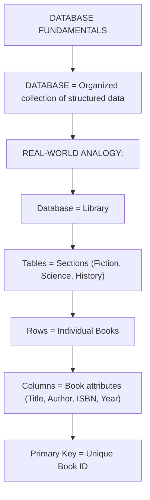

### RDBMS Architecture

```
┌─────────────────────────────────────────────────────────────────────────────────┐
│                    RDBMS ARCHITECTURE                                           │
├─────────────────────────────────────────────────────────────────────────────────┤
│                                                                                 │
│                         ┌─────────────────────┐                                 │
│                         │   APPLICATION       │                                 │
│                         │   (Your Java/Python │                                 │
│                         │    code)            │                                 │
│                         └──────────┬──────────┘                                 │
│                                    │ SQL Queries                                │
│                                    ▼                                            │
│                         ┌─────────────────────┐                                 │
│                         │   DBMS ENGINE       │                                 │
│                         │   ┌───────────────┐ │                                 │
│                         │   │ Query Parser  │ │ ← Syntax check                  │
│                         │   ├───────────────┤ │                                 │
│                         │   │ Query         │ │ ← Creates execution plan        │
│                         │   │ Optimizer     │ │                                 │
│                         │   ├───────────────┤ │                                 │
│                         │   │ Execution     │ │ ← Runs the query                │
│                         │   │ Engine        │ │                                 │
│                         │   └───────────────┘ │                                 │
│                         └──────────┬──────────┘                                 │
│                                    │                                            │
│                                    ▼                                            │
│                         ┌─────────────────────┐                                 │
│                         │   STORAGE ENGINE    │                                 │
│                         │   ┌───────────────┐ │                                 │
│                         │   │ Buffer Pool   │ │ ← In-memory cache               │
│                         │   ├───────────────┤ │                                 │
│                         │   │ Transaction   │ │ ← ACID compliance               │
│                         │   │ Manager       │ │                                 │
│                         │   ├───────────────┤ │                                 │
│                         │   │ Lock Manager  │ │ ← Concurrency control           │
│                         │   └───────────────┘ │                                 │
│                         └──────────┬──────────┘                                 │
│                                    │                                            │
│                                    ▼                                            │
│                         ┌─────────────────────┐                                 │
│                         │   DISK STORAGE      │                                 │
│                         │   (Data files,      │                                 │
│                         │    Index files,     │                                 │
│                         │    Log files)       │                                 │
│                         └─────────────────────┘                                 │
│                                                                                 │
└─────────────────────────────────────────────────────────────────────────────────┘
```

**Flow:**
1. APPLICATION / (Your Java/Python / code)
2. DBMS ENGINE / Query Parser / Query / Optimizer / Execut
3. STORAGE ENGINE / Buffer Pool / Transaction / Manager /
4. DISK STORAGE / (Data files, / Index files, / Log files)

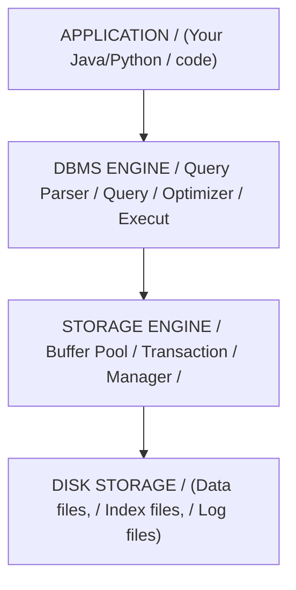

### SQL Categories

```
┌─────────────────────────────────────────────────────────────────────────────────┐
│                    SQL COMMAND CATEGORIES                                       │
├─────────────────────────────────────────────────────────────────────────────────┤
│                                                                                 │
│  1. DDL - Data Definition Language (Structure)                                  │
│  ┌────────────────────────────────────────────────────────────────────────────┐ │
│  │  CREATE   - Create database objects (tables, views, indexes)               │ │
│  │  ALTER    - Modify existing objects                                        │ │
│  │  DROP     - Delete objects                                                 │ │
│  │  TRUNCATE - Remove all data from table (keeps structure)                   │ │
│  │  RENAME   - Rename objects                                                 │ │
│  └────────────────────────────────────────────────────────────────────────────┘ │
│                                                                                 │
│  2. DML - Data Manipulation Language (Data)                                     │
│  ┌────────────────────────────────────────────────────────────────────────────┐ │
│  │  SELECT   - Retrieve data                                                  │ │
│  │  INSERT   - Add new data                                                   │ │
│  │  UPDATE   - Modify existing data                                           │ │
│  │  DELETE   - Remove data                                                    │ │
│  │  MERGE    - Insert or update (upsert)                                      │ │
│  └────────────────────────────────────────────────────────────────────────────┘ │
│                                                                                 │
│  3. DCL - Data Control Language (Permissions)                                   │
│  ┌────────────────────────────────────────────────────────────────────────────┐ │
│  │  GRANT    - Give permissions                                               │ │
│  │  REVOKE   - Remove permissions                                             │ │
│  └────────────────────────────────────────────────────────────────────────────┘ │
│                                                                                 │
│  4. TCL - Transaction Control Language                                          │
│  ┌────────────────────────────────────────────────────────────────────────────┐ │
│  │  COMMIT     - Save changes permanently                                     │ │
│  │  ROLLBACK   - Undo changes                                                 │ │
│  │  SAVEPOINT  - Create rollback point                                        │ │
│  └────────────────────────────────────────────────────────────────────────────┘ │
│                                                                                 │
└─────────────────────────────────────────────────────────────────────────────────┘
```

**Flow:**
1. CREATE - Create database objects (tables, views, indexe
2. SELECT - Retrieve data / INSERT - Add new data / UPDATE
3. GRANT - Give permissions / REVOKE - Remove permissions
4. COMMIT - Save changes permanently / ROLLBACK - Undo cha

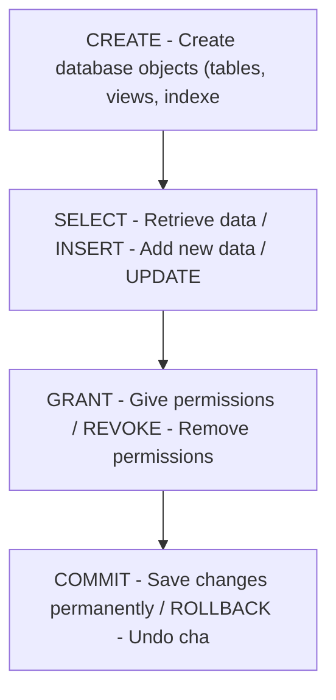

---

# ═══════════════════════════════════════════════════════════════════
# MERGED FROM: 01_SQL_Foundations_WHY_HOW.md (WHY-HOW Framework Edition)
# ═══════════════════════════════════════════════════════════════════

# 📊 SQL FOUNDATIONS - WHY-HOW Framework

**From Zero to SQL Fluency - Every Concept Explained with Real-World Context**
_"Understanding WHY before HOW makes learning permanent"_

---

# 🎯 LEARNING PHILOSOPHY

```
                  THE WHY-HOW FRAMEWORK FOR SQL
──────────────────────────────────────────────────

For every SQL concept, we answer:

🔵 WHY does this exist?
   └── What real-world problem does it solve?
   └── What would happen without it?
   └── Which companies use this? When?

🟢 HOW does it work?
   └── Core syntax and mechanics
   └── Step-by-step execution
   └── Visual representation

🟡 WHEN to use it?
   └── Best practice scenarios
   └── Anti-patterns to avoid
   └── Performance implications

🔴 REAL-WORLD Story
   └── Production incident or use case
   └── How it was solved using this concept

```

**Flow:**
1. 🔵 WHY does this exist?
2. What real-world problem does it solve?
3. 🔵 WHY does this exist?
4. What would happen without it?
5. 🔵 WHY does this exist?
6. Which companies use this? When?
7. 🟢 HOW does it work?
8. Core syntax and mechanics
9. 🟢 HOW does it work?
10. Step-by-step execution
11. 🟢 HOW does it work?
12. Visual representation

```mermaid
flowchart TD
    N1["🔵 WHY does this exist?"]
    N2["What real-world problem does it solve?"]
    N3["What would happen without it?"]
    N4["Which companies use this? When?"]
    N5["🟢 HOW does it work?"]
    N6["Core syntax and mechanics"]
    N7["Step-by-step execution"]
    N8["Visual representation"]
    N9["🟡 WHEN to use it?"]
    N10["Best practice scenarios"]
    N11["Anti-patterns to avoid"]
    N12["Performance implications"]
    N13["🔴 REAL-WORLD Story"]
    N14["Production incident or use case"]
    N15["How it was solved using this concept"]
    N1 --> N2
    N1 --> N3
    N1 --> N4
    N5 --> N6
    N5 --> N7
    N5 --> N8
    N9 --> N10
    N9 --> N11
    N9 --> N12
    N13 --> N14
    N13 --> N15
```

---

# 🗄️ Part 1: Why Databases Exist

---

## Chapter 1: Understanding the Problem Before the Solution

### 🧠 Theory Lens: Relational Theory vs State Machine Physics
Before looking at tables and tablespaces, we must understand the fundamental dual-nature of a Database Management System (DBMS). A modern database elegantly solves two distinct theoretical problems:

1. **Information Theory (The Set Theory Model)**: How do we mathematically guarantee data meaning? Edgar F. Codd created the relational algebra based on mathematical *Set Theory*. Tables correspond strictly to sets, and SQL is a declarative translation of set operations (Intersect, Union, Cartesian Product). This profoundly decoupled the *logical* organization of data from its *physical* implementation.
2. **Concurrency & Failure Physics (ACID State)**: How do we handle thousands of concurrent users mutating data without entropy/corruption? At its core, a relational database is a **strictly serialized state-machine**. Through mechanisms like the Write-Ahead Log (WAL) and Two-Phase Locking, the DBMS guarantees that even if the physical server loses power mid-write, the state mathematically remains pristine and predictable. 

Databases exist primarily because building a mathematically pure set-query engine merged with a physically indestructible concurrency engine inside standard application code is mathematically unsustainable.

---

### 🔵 WHY: The World Before Databases


## Life Without Databases


**Scenario**: E-commerce Company with 1 Million Users
WITHOUT DATABASE (Using Files):
users.txt                     orders.txt
─────────                     ──────────
1,John,john@email.com         1001,1,2024-01-15,500.00
2,Jane,jane@email.com         1002,2,2024-01-15,250.00
3,Bob,bob@email.com           1003,1,2024-01-16,750.00
...1 million more lines        ...5 million more lines

**Problems**:
1. SPEED: Find all orders for user 567,823?
→ Must read entire 5 million line file! Takes minutes.
2. CONSISTENCY: Two systems update same user simultaneously?
→ Data corruption! Which version is correct?
3. INTEGRITY: Delete user but orders still reference them?
→ Orphan data! Orders point to non-existent user.
4. CONCURRENT ACCESS: 10,000 users reading/writing files?
→ File locks! System crashes! Data loss!
5. RECOVERY: Power outage during file write?
→ Partial data! Corrupted files! Business disaster!
🔴 REAL INCIDENT: In 2003, a major airline lost $50M in revenue
when their flat-file booking system crashed during peak season.
Recovery took 3 days. They migrated to Oracle within 6 months.

### How Databases Solve These Problems

## Database Solutions

| Problem               | Database Solution          | How It Works |
┼────────────────────────────┼
| Slow Search           | INDEXES                    | B-Tree structure: O(log n) |
│ 1M rows → ~20 lookups
┼────────────────────────────┼
| Data Corruption       | TRANSACTIONS + ACID        | All-or-nothing updates |
│ Locks during writes
┼────────────────────────────┼
| Orphan Data           | FOREIGN KEYS               | Can't delete parent if |
│ children exist (CASCADE)
┼────────────────────────────┼
| Concurrent Access     | LOCK MANAGER               | Row/Table level locks |
MVCC (PostgreSQL)          │ Version control for data
┼────────────────────────────┼
| Data Loss             | TRANSACTION LOGS (WAL)     | Replay logs after crash |
Checkpoints                │ Regular state snapshots

---

# 🗃️ Part 2: SQL Command Categories — Why Each Exists

---

## Chapter 2: DDL - Data Definition Language

### 🔵 WHY: Why Do We Need DDL?


## Why Ddl Exists


💡 **ANALOGY: Building a House**
Before putting furniture (DATA), you need:
1. BLUEPRINT (Schema)     → CREATE DATABASE
2. ROOMS (Structure)      → CREATE TABLE
3. ROOM TYPES (Rules)     → Data Types + Constraints
4. RENOVATIONS            → ALTER TABLE
5. DEMOLITION             → DROP TABLE
🔴 REAL INCIDENT: Flipkart's Big Billion Day 2015

**What Happened**:
- Expected 10M orders, got 15M in first hour
- Original schema: Single 'orders' table with all columns
- Result: Table locks, 30-minute delays, customer rage

**What They Learned**:
- Normalize tables: orders, order_items, order_status (separate tables)
- Add proper indexes on order_id, customer_id, created_at
- Partition tables by date for faster queries

**Outcome**: 2016 sale handled 8x the traffic with no issues

### 🟢 HOW: CREATE TABLE - Deep Dive

```sql
-- ═══════════════════════════════════════════════════════════════════════════════
-- CREATE TABLE: THE COMPLETE PICTURE
-- ═══════════════════════════════════════════════════════════════════════════════

-- ═══════════════════════════════════════════════════════════════════════════════
-- EXAMPLE 1: E-commerce System (Production-Grade Schema)
-- ═══════════════════════════════════════════════════════════════════════════════

-- WHY this structure? Let's break down EVERY decision:

CREATE TABLE customers (
    -- PRIMARY KEY: WHY INT vs BIGINT?
    -- INT: 2.1 billion max - sufficient for most companies
    -- BIGINT: 9.2 quintillion - use for app with billions of records (like Facebook)
    customer_id     INT PRIMARY KEY AUTO_INCREMENT,

    -- WHY VARCHAR(100) for email?
    -- RFC 5321 allows 254 chars, but 99.9% emails < 100 chars
    -- Shorter = faster index, less storage
    -- WHY UNIQUE? One account per email
    email           VARCHAR(100) NOT NULL UNIQUE,

    -- WHY separate first_name and last_name?
    -- Sorting by last name
    -- Addressing in emails: "Dear John"
    -- Search flexibility
    first_name      VARCHAR(50) NOT NULL,
    last_name       VARCHAR(50) NOT NULL,

    -- WHY CHAR(60) for password hash?
    -- bcrypt always produces 60 character hash
    -- CHAR is faster than VARCHAR for fixed-length data
    password_hash   CHAR(60) NOT NULL,

    -- WHY VARCHAR(15) for phone?
    -- International format: +1-234-567-8901 = 14 chars
    -- Leave 1 char buffer
    phone           VARCHAR(15),

    -- WHY TIMESTAMP vs DATETIME?
    -- TIMESTAMP: Auto timezone conversion, 4 bytes, range 1970-2038
    -- DATETIME: No timezone, 8 bytes, range 1000-9999
    -- Use TIMESTAMP for audit fields (created_at, updated_at)
    created_at      TIMESTAMP DEFAULT CURRENT_TIMESTAMP,
    updated_at      TIMESTAMP DEFAULT CURRENT_TIMESTAMP ON UPDATE CURRENT_TIMESTAMP,

    -- WHY BOOLEAN with DEFAULT?
    -- New accounts should be active by default
    -- Soft delete: Set is_active = FALSE instead of DELETE
    is_active       BOOLEAN DEFAULT TRUE,

    -- WHY INDEX on created_at?
    -- "Show me users who signed up in last 7 days" - common query
    INDEX idx_created_at (created_at),

    -- WHY composite INDEX on (last_name, first_name)?
    -- "Find users named 'Smith, John'" - searches both fields
    -- Index on (A, B) can be used for queries on A alone, but not B alone
    INDEX idx_name (last_name, first_name)
);

-- ═══════════════════════════════════════════════════════════════════════════════
-- EXAMPLE 2: Order System with Full Relationships
-- ═══════════════════════════════════════════════════════════════════════════════

CREATE TABLE orders (
    order_id        BIGINT PRIMARY KEY AUTO_INCREMENT,

    -- WHY CHAR(20) for order_number?
    -- Business-readable ID: "ORD-2024-00123456"
    -- Internal ID (order_id) for joins, external (order_number) for customers
    order_number    CHAR(20) UNIQUE NOT NULL,

    customer_id     INT NOT NULL,

    -- WHY DECIMAL(12,2) for amounts?
    -- 12,2 means max 9,999,999,999.99 (10 billion)
    -- NEVER use FLOAT for money! 0.1 + 0.2 = 0.30000000000000004 in FLOAT
    subtotal        DECIMAL(12, 2) NOT NULL,
    tax             DECIMAL(12, 2) DEFAULT 0.00,
    shipping        DECIMAL(12, 2) DEFAULT 0.00,
    total           DECIMAL(12, 2) NOT NULL,

    -- WHY ENUM for status?
    -- Limited valid values
    -- Storage: 1-2 bytes (vs VARCHAR which uses more)
    -- Database enforces valid status values
    status          ENUM('pending', 'confirmed', 'processing', 'shipped',
                        'delivered', 'cancelled', 'refunded') DEFAULT 'pending',

    -- WHY separate ordered_at from created_at?
    -- ordered_at: When customer placed order
    -- created_at: When record was inserted (might differ in batch imports)
    ordered_at      TIMESTAMP NOT NULL,
    shipped_at      TIMESTAMP NULL,
    delivered_at    TIMESTAMP NULL,
    created_at      TIMESTAMP DEFAULT CURRENT_TIMESTAMP,

    -- FOREIGN KEY with CASCADE
    -- WHY CASCADE on UPDATE but RESTRICT on DELETE?
    -- If customer_id changes (rare), update order automatically
    -- If customer tries to delete, PREVENT if they have orders
    -- This protects business data - orders are financial records
    CONSTRAINT fk_customer
        FOREIGN KEY (customer_id) REFERENCES customers(customer_id)
        ON UPDATE CASCADE
        ON DELETE RESTRICT,

    -- WHY compound INDEX on (customer_id, ordered_at)?
    -- Most common query: "Show me orders for customer X in date range"
    -- This single index handles: customer orders, recent orders, date filtering
    INDEX idx_customer_orders (customer_id, ordered_at DESC),

    -- WHY INDEX on status?
    -- "Show all pending orders" - operations team query
    -- Low cardinality but frequently filtered
    INDEX idx_status (status)
);

-- ═══════════════════════════════════════════════════════════════════════════════
-- EXAMPLE 3: Order Items (Many-to-Many relationship)
-- ═══════════════════════════════════════════════════════════════════════════════

CREATE TABLE order_items (
    -- WHY composite PRIMARY KEY?
    -- One product appears once per order
    -- Prevents duplicate line items
    item_id         BIGINT PRIMARY KEY AUTO_INCREMENT,
    order_id        BIGINT NOT NULL,
    product_id      INT NOT NULL,

    -- WHY store price here? Product price can change!
    -- Historical accuracy: Order shows price AT TIME OF PURCHASE
    -- Business requirement: Invoice must match what customer paid
    unit_price      DECIMAL(10, 2) NOT NULL,
    quantity        INT NOT NULL CHECK (quantity > 0),

    -- WHY store computed total?
    -- Performance: Don't calculate on every read
    -- Flexibility: Can apply line-item discounts
    line_total      DECIMAL(12, 2) GENERATED ALWAYS AS (unit_price * quantity) STORED,

    FOREIGN KEY (order_id) REFERENCES orders(order_id) ON DELETE CASCADE,
    FOREIGN KEY (product_id) REFERENCES products(product_id) ON DELETE RESTRICT,

    -- WHY UNIQUE on (order_id, product_id)?
    -- One line item per product per order
    -- Customer wants 2 units? Update quantity, don't add new row
    UNIQUE KEY uk_order_product (order_id, product_id)
);
```

### Visual: How Tables Relate

```
┌─────────────────────────────────────────────────────────────────────────────────┐
│                    E-COMMERCE DATABASE RELATIONSHIPS                            │
├─────────────────────────────────────────────────────────────────────────────────┤
│                                                                                 │
│                         ┌───────────────────┐                                   │
│                         │    CUSTOMERS      │                                   │
│                         ├───────────────────┤                                   │
│                         │ PK: customer_id   │                                   │
│                         │    email          │                                   │
│                         │    first_name     │                                   │
│                         │    last_name      │                                   │
│                         └────────┬──────────┘                                   │
│                                  │ 1                                            │
│                                  │                                              │
│                                  │ has many                                     │
│                                  │                                              │
│                                  ▼ ∞                                            │
│                         ┌───────────────────┐         ┌───────────────────┐     │
│                         │     ORDERS        │         │     PRODUCTS      │     │
│                         ├───────────────────┤         ├───────────────────┤     │
│                         │ PK: order_id      │         │ PK: product_id    │     │
│                         │ FK: customer_id ──┼─────────│    name           │     │
│                         │    order_number   │         │    price          │     │
│                         │    total          │         │    stock          │     │
│                         │    status         │         └─────────┬─────────┘     │
│                         └────────┬──────────┘                   │               │
│                                  │ 1                            │ 1             │
│                                  │                              │               │
│                                  │ contains                     │ appears in    │
│                                  │                              │               │
│                                  ▼ ∞                            ▼ ∞             │
│                         ┌──────────────────────────────────────────────────┐    │
│                         │               ORDER_ITEMS                         │   │
│                         ├──────────────────────────────────────────────────┤    │
│                         │ PK: item_id                                       │   │
│                         │ FK: order_id ────────────────────┐                │   │
│                         │ FK: product_id ──────────────────┘                │   │
│                         │     quantity                                      │   │
│                         │     unit_price (snapshot at purchase time)        │   │
│                         └──────────────────────────────────────────────────┘    │
│                                                                                 │
│  CARDINALITY:                                                                   │
│  ─────────────                                                                  │
│  Customer (1) ─────→ (∞) Orders      "A customer has many orders"               │
│  Order (1) ─────────→ (∞) Items      "An order has many items"                  │
│  Product (1) ───────→ (∞) Items      "A product appears in many orders"         │
│  Order (∞) ←────────→ (∞) Products   "Many-to-Many via order_items"             │
│                                                                                 │
└─────────────────────────────────────────────────────────────────────────────────┘
```

**Flow:**
1. CUSTOMERS / PK: customer_id / email / first_name / last
2. ORDERS / PK: order_id / FK: customer_id / order_number
3. PRODUCTS / PK: product_id / name / price / stock
4. ORDER_ITEMS / PK: item_id / FK: order_id / FK: product_

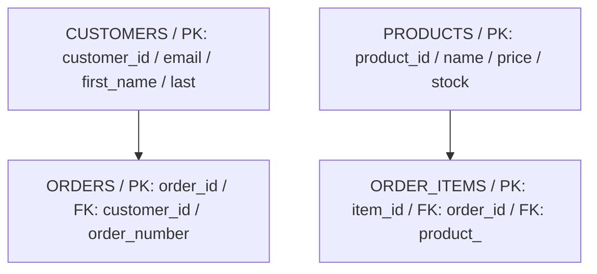

---

## Chapter 3: ALTER TABLE - Schema Evolution

### 🔵 WHY: Why Do Schemas Change?

```
┌─────────────────────────────────────────────────────────────────────────────────┐
│                    WHY SCHEMAS EVOLVE                                           │
├─────────────────────────────────────────────────────────────────────────────────┤
│                                                                                 │
│  BUSINESS REASONS:                                                              │
│  ┌────────────────────────────────────────────────────────────────────────────┐ │
│  │                                                                            │ │
│  │  1. NEW FEATURES                                                           │ │
│  │     - "We need to store user's profile photo"                              │ │
│  │     → ALTER TABLE users ADD COLUMN profile_url VARCHAR(500);               │ │
│  │                                                                            │ │
│  │  2. REGULATORY COMPLIANCE                                                  │ │
│  │     - "GDPR requires consent tracking"                                     │ │
│  │     → ALTER TABLE users ADD COLUMN gdpr_consent_date TIMESTAMP;            │ │
│  │                                                                            │ │
│  │  3. PERFORMANCE ISSUES                                                     │ │
│  │     - "Search is slow"                                                     │ │
│  │     → ALTER TABLE products ADD INDEX idx_search (name, category);          │ │
│  │                                                                            │ │
│  │  4. DATA GROWTH                                                            │ │
│  │     - "Product IDs exceeded INT limit"                                     │ │
│  │     → ALTER TABLE products MODIFY product_id BIGINT;                       │ │
│  │                                                                            │ │
│  │  5. BUG FIXES                                                              │ │
│  │     - "Emails should be case-insensitive unique"                           │ │
│  │     → ALTER TABLE users ADD UNIQUE INDEX idx_email_ci (email) USING BTREE; │ │
│  │                                                                            │ │
│  └────────────────────────────────────────────────────────────────────────────┘ │
│                                                                                 │
│  🔴 REAL INCIDENT: Twitter's early scaling problems (2007-2009)                  │
│                                                                                 │
│  PROBLEM: Single 'tweets' table with all data                                   │
│  SYMPTOMS: "Fail Whale" error page became famous                                │
│                                                                                 │
│  MIGRATION JOURNEY:                                                             │
│  1. Split tweets table by user_id ranges (sharding)                             │
│  2. Moved from MySQL to custom storage (Manhattan)                              │
│  3. Added read replicas for timeline queries                                    │
│  4. Denormalized data for read performance                                      │
│                                                                                 │
│  LESSON: Schema design decisions at day 1 affect scalability at day 1000        │
│                                                                                 │
└─────────────────────────────────────────────────────────────────────────────────┘
```

**Flow:**
1. WHY SCHEMAS EVOLVE
2. BUSINESS REASONS:
3. 1. NEW FEATURES
4. - 'We need to store user's profile photo'
5. ALTER TABLE users ADD COLUMN profile_url VARCHAR(500)
6. 2. REGULATORY COMPLIANCE
7. - 'GDPR requires consent tracking'

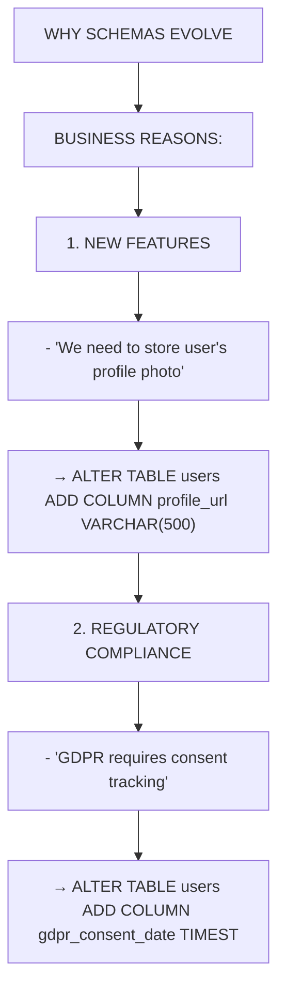

### 🟢 HOW: ALTER TABLE Operations

```sql
-- ═══════════════════════════════════════════════════════════════════════════════
-- ALTER TABLE: COMPLETE OPERATIONS GUIDE
-- ═══════════════════════════════════════════════════════════════════════════════

-- ═══════════════════════════════════════════════════════════════════════════════
-- 1. ADDING COLUMNS
-- ═══════════════════════════════════════════════════════════════════════════════

-- Add single column
ALTER TABLE customers
ADD COLUMN loyalty_points INT DEFAULT 0;

-- Add column at specific position (MySQL)
ALTER TABLE customers
ADD COLUMN middle_name VARCHAR(50) AFTER first_name;

-- Add multiple columns
ALTER TABLE customers
ADD COLUMN date_of_birth DATE,
ADD COLUMN gender ENUM('M', 'F', 'Other', 'Prefer not to say'),
ADD COLUMN referral_code VARCHAR(20);

-- ═══════════════════════════════════════════════════════════════════════════════
-- 2. MODIFYING COLUMNS
-- ═══════════════════════════════════════════════════════════════════════════════

-- Change data type (⚠️ DANGEROUS - can lose data!)
-- Safe: VARCHAR(50) → VARCHAR(100) (expanding)
-- Risky: VARCHAR(100) → VARCHAR(50) (truncation)
-- Risky: VARCHAR → INT (conversion errors)

ALTER TABLE customers
MODIFY COLUMN phone VARCHAR(20);  -- Expand phone field

-- Rename column (MySQL 8.0+)
ALTER TABLE customers
RENAME COLUMN phone TO phone_number;

-- Change column WITH data conversion
-- Always test on staging first!
ALTER TABLE orders
MODIFY COLUMN total DECIMAL(15, 2);  -- Increase precision

-- ═══════════════════════════════════════════════════════════════════════════════
-- 3. DROPPING COLUMNS
-- ═══════════════════════════════════════════════════════════════════════════════

-- ⚠️ IRREVERSIBLE! Always backup first!
ALTER TABLE customers
DROP COLUMN middle_name;

-- Drop multiple columns
ALTER TABLE customers
DROP COLUMN temp_field1,
DROP COLUMN temp_field2;

-- ═══════════════════════════════════════════════════════════════════════════════
-- 4. ADDING/DROPPING CONSTRAINTS
-- ═══════════════════════════════════════════════════════════════════════════════

-- Add UNIQUE constraint
ALTER TABLE products
ADD CONSTRAINT uk_sku UNIQUE (sku);

-- Add CHECK constraint
ALTER TABLE products
ADD CONSTRAINT chk_price CHECK (price >= 0);

-- Add FOREIGN KEY
ALTER TABLE orders
ADD CONSTRAINT fk_shipping_address
FOREIGN KEY (shipping_address_id) REFERENCES addresses(address_id);

-- Drop constraint
ALTER TABLE products
DROP CONSTRAINT chk_price;

-- ═══════════════════════════════════════════════════════════════════════════════
-- 5. INDEX OPERATIONS
-- ═══════════════════════════════════════════════════════════════════════════════

-- Add index (can be done while table is in use, but slows down)
ALTER TABLE customers
ADD INDEX idx_email (email);

-- Add composite index
ALTER TABLE orders
ADD INDEX idx_customer_date (customer_id, ordered_at DESC);

-- Drop index
ALTER TABLE customers
DROP INDEX idx_email;

-- ═══════════════════════════════════════════════════════════════════════════════
-- 6. TABLE OPERATIONS
-- ═══════════════════════════════════════════════════════════════════════════════

-- Rename table
ALTER TABLE customers RENAME TO users;

-- Change storage engine (MySQL)
ALTER TABLE logs ENGINE = InnoDB;

-- Change character set
ALTER TABLE products CONVERT TO CHARACTER SET utf8mb4 COLLATE utf8mb4_unicode_ci;
```

### 🟡 WHEN: Safe vs Risky ALTER Operations

```
┌─────────────────────────────────────────────────────────────────────────────────┐
│                    ALTER TABLE: RISK ASSESSMENT                                 │
├─────────────────────────────────────────────────────────────────────────────────┤
│                                                                                 │
│  ✅ SAFE (Can do in production):                                                 │
│  ┌────────────────────────────────────────────────────────────────────────────┐ │
│  │  • ADD COLUMN with DEFAULT (MySQL 8.0+, PostgreSQL)                        │ │
│  │  • ADD INDEX CONCURRENTLY (PostgreSQL)                                     │ │
│  │  • Create new INDEX (fast for small tables)                                │ │
│  │  • DROP unused INDEX                                                       │ │
│  │  • ADD nullable column                                                     │ │
│  └────────────────────────────────────────────────────────────────────────────┘ │
│                                                                                 │
│  ⚠️ CAUTION (Do during low traffic):                                            │
│  ┌────────────────────────────────────────────────────────────────────────────┐ │
│  │  • ADD INDEX on large table (locks table in MySQL < 8.0)                   │ │
│  │  • MODIFY column (rewrites table)                                          │ │
│  │  • ADD FOREIGN KEY (validates existing data)                               │ │
│  │  • Change VARCHAR length (may rewrite)                                     │ │
│  └────────────────────────────────────────────────────────────────────────────┘ │
│                                                                                 │
│  🚨 DANGEROUS (Plan maintenance window):                                         │
│  ┌────────────────────────────────────────────────────────────────────────────┐ │
│  │  • DROP COLUMN (irreversible, may break app)                               │ │
│  │  • Change column type (data loss possible)                                 │ │
│  │  • RENAME TABLE (breaks queries)                                           │ │
│  │  • ADD NOT NULL to existing column (fails if NULLs exist)                  │ │
│  │  • Change PRIMARY KEY                                                      │ │
│  └────────────────────────────────────────────────────────────────────────────┘ │
│                                                                                 │
│  PRODUCTION MIGRATION CHECKLIST:                                                │
│  ┌────────────────────────────────────────────────────────────────────────────┐ │
│  │  □ Test on staging with production-size data                               │ │
│  │  □ Measure migration time (will table be locked?)                          │ │
│  │  □ Take backup before migration                                            │ │
│  │  □ Prepare rollback script                                                 │ │
│  │  □ Schedule during low-traffic window                                      │ │
│  │  □ Monitor application errors during/after                                 │ │
│  │  □ Have DBA on call                                                        │ │
│  └────────────────────────────────────────────────────────────────────────────┘ │
│                                                                                 │
└─────────────────────────────────────────────────────────────────────────────────┘
```

**Flow:**
1. • ADD COLUMN with DEFAULT (MySQL 8.0+, PostgreSQL) / •
2. • ADD INDEX on large table (locks table in MySQL < 8
3. • DROP COLUMN (irreversible, may break app) / • Change
4. □ Test on staging with production-size data / □ Measure

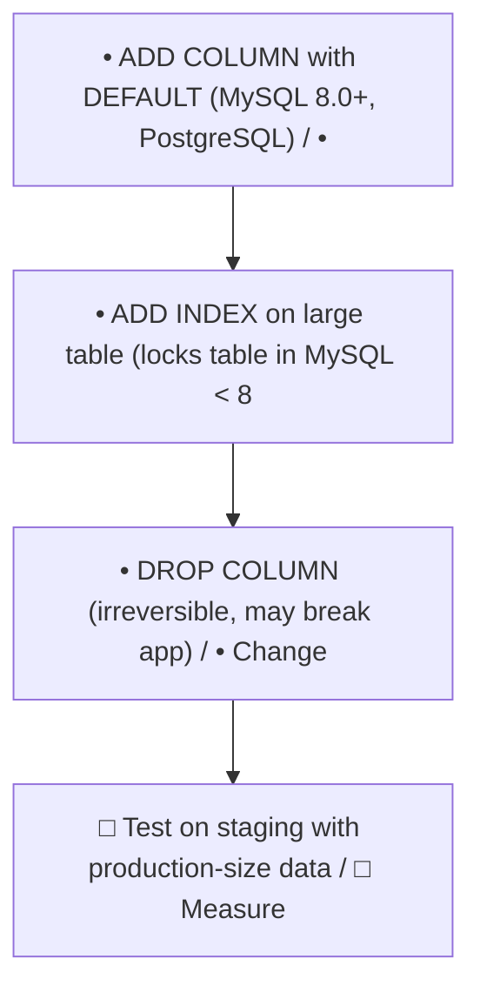

---

## Chapter 4: DML - Data Manipulation Language

### 🔵 WHY: CRUD Operations

```
┌─────────────────────────────────────────────────────────────────────────────────┐
│                    WHY DML EXISTS                                               │
├─────────────────────────────────────────────────────────────────────────────────┤
│                                                                                 │
│  CRUD = Create, Read, Update, Delete                                            │
│                                                                                 │
│  MAPPING TO SQL:                                                                │
│  ┌────────────────────────────────────────────────────────────────────────────┐ │
│  │                                                                            │ │
│  │  CREATE  ──────────→  INSERT                                               │ │
│  │  READ    ──────────→  SELECT                                               │ │
│  │  UPDATE  ──────────→  UPDATE                                               │ │
│  │  DELETE  ──────────→  DELETE                                               │ │
│  │                                                                            │ │
│  └────────────────────────────────────────────────────────────────────────────┘ │
│                                                                                 │
│  MAPPING TO REST APIs:                                                          │
│  ┌────────────────────────────────────────────────────────────────────────────┐ │
│  │                                                                            │ │
│  │  HTTP Method │ SQL Operation │ Example                                     │ │
│  │  ────────────┼───────────────┼───────────────────────────────────────────  │ │
│  │  POST        │ INSERT        │ Create new user account                     │ │
│  │  GET         │ SELECT        │ Fetch user profile                          │ │
│  │  PUT/PATCH   │ UPDATE        │ Update email address                        │ │
│  │  DELETE      │ DELETE        │ Remove user account                         │ │
│  │                                                                            │ │
│  └────────────────────────────────────────────────────────────────────────────┘ │
│                                                                                 │
│  🔴 REAL INCIDENT: GitLab Database Deletion (2017)                               │
│                                                                                 │
│  WHAT HAPPENED:                                                                 │
│  - Admin ran DELETE without WHERE clause during maintenance                     │
│  - Command: "DELETE FROM production_db"                                         │
│  - 300GB of production data wiped in seconds                                    │
│                                                                                 │
│  WHAT FAILED:                                                                   │
│  - 5 different backup methods, ALL failed                                       │
│  - LVM snapshots: configured wrong                                              │
│  - S3 backups: not running                                                      │
│  - Azure disk snapshots: never enabled                                          │
│                                                                                 │
│  AFTERMATH:                                                                     │
│  - 6 hours of data lost                                                         │
│  - GitLab was transparent, live-streamed recovery                               │
│  - Now they have mandatory WHERE clause checks                                  │
│                                                                                 │
│  LESSON: "DELETE FROM table" should NEVER work without WHERE                    │
│          Use sql_safe_updates=1 in MySQL!                                       │
│                                                                                 │
└─────────────────────────────────────────────────────────────────────────────────┘
```

**Flow:**
1. CREATE
2. INSERT / READ
3. SELECT / UPDATE
4. UPDATE / DEL
5. HTTP Method SQL Operation Example / POST INSERT Create

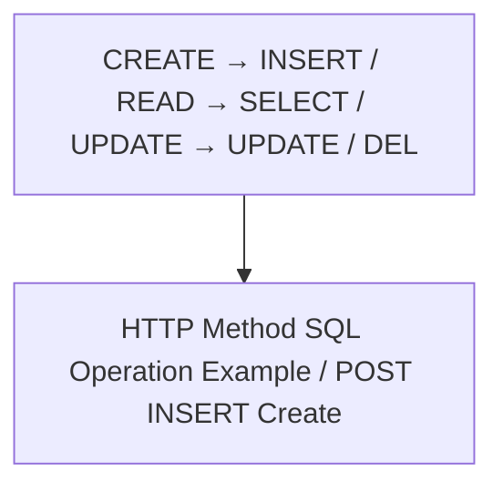

### 🟢 HOW: INSERT Operations

```sql
-- ═══════════════════════════════════════════════════════════════════════════════
-- INSERT: ALL VARIATIONS
-- ═══════════════════════════════════════════════════════════════════════════════

-- ═══════════════════════════════════════════════════════════════════════════════
-- 1. BASIC INSERT
-- ═══════════════════════════════════════════════════════════════════════════════

-- Single row with all columns specified
INSERT INTO customers (email, first_name, last_name, password_hash)
VALUES ('john@example.com', 'John', 'Doe', '$2a$10$abc123hash');

-- Single row relying on defaults
-- created_at, is_active will use DEFAULT values
INSERT INTO customers (email, first_name, last_name, password_hash)
VALUES ('jane@example.com', 'Jane', 'Smith', '$2a$10$xyz789hash');

-- ═══════════════════════════════════════════════════════════════════════════════
-- 2. MULTIPLE ROWS (BATCH INSERT)
-- ═══════════════════════════════════════════════════════════════════════════════

-- WHY batch inserts?
-- 1000 individual INSERTs = 1000 transactions, 1000 network round trips
-- 1 batch INSERT = 1 transaction, 1 network round trip
-- Performance: 10-100x faster!

INSERT INTO customers (email, first_name, last_name, password_hash)
VALUES
    ('user1@example.com', 'User', 'One', '$hash1'),
    ('user2@example.com', 'User', 'Two', '$hash2'),
    ('user3@example.com', 'User', 'Three', '$hash3'),
    ('user4@example.com', 'User', 'Four', '$hash4'),
    ('user5@example.com', 'User', 'Five', '$hash5');

-- ═══════════════════════════════════════════════════════════════════════════════
-- 3. INSERT FROM SELECT (Data Migration/ETL)
-- ═══════════════════════════════════════════════════════════════════════════════

-- Copy data from one table to another
INSERT INTO customers_archive (customer_id, email, first_name, last_name, created_at)
SELECT customer_id, email, first_name, last_name, created_at
FROM customers
WHERE created_at < '2023-01-01';

-- Create summary table
INSERT INTO monthly_sales_summary (month, total_sales, order_count)
SELECT
    DATE_FORMAT(ordered_at, '%Y-%m') AS month,
    SUM(total) AS total_sales,
    COUNT(*) AS order_count
FROM orders
WHERE ordered_at >= '2024-01-01'
GROUP BY DATE_FORMAT(ordered_at, '%Y-%m');

-- ═══════════════════════════════════════════════════════════════════════════════
-- 4. INSERT OR UPDATE (UPSERT)
-- ═══════════════════════════════════════════════════════════════════════════════

-- MySQL: INSERT ... ON DUPLICATE KEY UPDATE
-- WHY: Avoid checking if record exists, then deciding INSERT or UPDATE
INSERT INTO product_inventory (product_id, quantity, last_updated)
VALUES (101, 50, NOW())
ON DUPLICATE KEY UPDATE
    quantity = quantity + VALUES(quantity),
    last_updated = NOW();

-- PostgreSQL: INSERT ... ON CONFLICT
INSERT INTO product_inventory (product_id, quantity, last_updated)
VALUES (101, 50, NOW())
ON CONFLICT (product_id) DO UPDATE SET
    quantity = product_inventory.quantity + EXCLUDED.quantity,
    last_updated = NOW();

-- ═══════════════════════════════════════════════════════════════════════════════
-- 5. INSERT IGNORE (Skip Duplicates)
-- ═══════════════════════════════════════════════════════════════════════════════

-- WHY: Bulk import where some records may already exist
-- Instead of failing on duplicate, silently skip
INSERT IGNORE INTO customers (email, first_name, last_name, password_hash)
VALUES
    ('existing@email.com', 'Will', 'Skip', '$hash'),    -- Skipped if exists
    ('new@email.com', 'Will', 'Insert', '$hash');       -- Inserted
```

### 🟢 HOW: UPDATE Operations

```sql
-- ═══════════════════════════════════════════════════════════════════════════════
-- UPDATE: SAFE PRACTICES
-- ═══════════════════════════════════════════════════════════════════════════════

-- ═══════════════════════════════════════════════════════════════════════════════
-- 1. BASIC UPDATE (Always use WHERE!)
-- ═══════════════════════════════════════════════════════════════════════════════

-- Single record update
UPDATE customers
SET email = 'newemail@example.com'
WHERE customer_id = 12345;

-- Multiple columns
UPDATE customers
SET
    first_name = 'Jonathan',
    phone = '+1-555-123-4567',
    updated_at = NOW()
WHERE customer_id = 12345;

-- ═══════════════════════════════════════════════════════════════════════════════
-- 2. CONDITIONAL UPDATE (CASE)
-- ═══════════════════════════════════════════════════════════════════════════════

-- Update multiple records with different values based on condition
UPDATE products
SET price = CASE
    WHEN category = 'Electronics' THEN price * 0.90  -- 10% off electronics
    WHEN category = 'Clothing' THEN price * 0.80     -- 20% off clothing
    ELSE price * 0.95                                 -- 5% off everything else
END
WHERE is_on_sale = TRUE;

-- ═══════════════════════════════════════════════════════════════════════════════
-- 3. UPDATE WITH JOIN
-- ═══════════════════════════════════════════════════════════════════════════════

-- Update based on data from another table
-- Example: Mark orders as "VIP" if customer has spent > $10000
UPDATE orders o
JOIN (
    SELECT customer_id
    FROM orders
    GROUP BY customer_id
    HAVING SUM(total) > 10000
) vip ON o.customer_id = vip.customer_id
SET o.priority = 'VIP';

-- ═══════════════════════════════════════════════════════════════════════════════
-- 4. SAFE UPDATE PATTERN
-- ═══════════════════════════════════════════════════════════════════════════════

-- ALWAYS: Run SELECT first to verify scope!
-- Step 1: Check what will be updated
SELECT customer_id, email, first_name
FROM customers
WHERE email LIKE '%@olddomain.com';
-- Returns: 247 rows

-- Step 2: Update with confidence
UPDATE customers
SET email = REPLACE(email, '@olddomain.com', '@newdomain.com')
WHERE email LIKE '%@olddomain.com';
-- Query OK, 247 rows affected

-- ═══════════════════════════════════════════════════════════════════════════════
-- 5. LIMIT UPDATE (MySQL - for safety)
-- ═══════════════════════════════════════════════════════════════════════════════

-- Process in batches to avoid long locks
UPDATE orders
SET status = 'archived'
WHERE status = 'delivered'
  AND delivered_at < '2023-01-01'
LIMIT 1000;  -- Only update 1000 at a time
```

### 🟢 HOW: DELETE Operations

```sql
-- ═══════════════════════════════════════════════════════════════════════════════
-- DELETE: DANGER ZONE - BE CAREFUL!
-- ═══════════════════════════════════════════════════════════════════════════════

-- ═══════════════════════════════════════════════════════════════════════════════
-- 1. BASIC DELETE (Always verify first!)
-- ═══════════════════════════════════════════════════════════════════════════════

-- Step 1: ALWAYS run SELECT first!
SELECT * FROM customers WHERE customer_id = 12345;

-- Step 2: Delete with confidence
DELETE FROM customers WHERE customer_id = 12345;

-- ═══════════════════════════════════════════════════════════════════════════════
-- 2. DELETE WITH JOIN
-- ═══════════════════════════════════════════════════════════════════════════════

-- Delete orders for inactive customers
DELETE o FROM orders o
JOIN customers c ON o.customer_id = c.customer_id
WHERE c.is_active = FALSE;

-- ═══════════════════════════════════════════════════════════════════════════════
-- 3. SOFT DELETE (Recommended Pattern)
-- ═══════════════════════════════════════════════════════════════════════════════

-- WHY soft delete?
-- 1. Data can be recovered
-- 2. Audit trail preserved
-- 3. Related records don't break
-- 4. Legal requirements (data retention)

-- Instead of: DELETE FROM customers WHERE customer_id = 12345;
-- Do this:
UPDATE customers
SET
    is_active = FALSE,
    deleted_at = NOW(),
    deleted_by = 'admin_user'
WHERE customer_id = 12345;

-- Application queries should filter:
SELECT * FROM customers WHERE is_active = TRUE;

-- ═══════════════════════════════════════════════════════════════════════════════
-- 4. DELETE SAFETY SETTINGS (MySQL)
-- ═══════════════════════════════════════════════════════════════════════════════

-- Enable safe mode - prevents DELETE/UPDATE without WHERE
SET sql_safe_updates = 1;

-- This will now ERROR:
DELETE FROM customers;  -- Error 1175: no WHERE clause!

-- This works:
DELETE FROM customers WHERE customer_id = 12345;

-- ═══════════════════════════════════════════════════════════════════════════════
-- 5. TRUNCATE vs DELETE
-- ═══════════════════════════════════════════════════════════════════════════════

/*
TRUNCATE:
- Removes ALL rows
- Cannot use WHERE
- Resets AUTO_INCREMENT
- Cannot rollback (in most DBs)
- Very fast (doesn't log individual rows)
- Cannot have foreign key references

DELETE:
- Can remove specific rows
- Uses WHERE
- Keeps AUTO_INCREMENT
- Can rollback
- Slower (logs each row)
- Works with foreign keys (CASCADE)
*/

-- When to use TRUNCATE:
-- Resetting test data
-- Clearing staging tables
-- Performance: Need to empty huge table fast
TRUNCATE TABLE temp_import_data;

-- When to use DELETE:
-- Production data
-- Need audit trail
-- Specific records only
DELETE FROM temp_import_data WHERE import_date < '2024-01-01';
```

---

## Chapter 5: DCL - Data Control Language

### 🔵 WHY: Security and Access Control

```
┌─────────────────────────────────────────────────────────────────────────────────┐
│                    WHY DCL EXISTS                                               │
├─────────────────────────────────────────────────────────────────────────────────┤
│                                                                                 │
│  PRINCIPLE OF LEAST PRIVILEGE:                                                  │
│  ┌────────────────────────────────────────────────────────────────────────────┐ │
│  │                                                                            │ │
│  │  "Every user should have only the minimum permissions                      │ │
│  │   necessary to perform their job function"                                 │ │
│  │                                                                            │ │
│  │  WHY THIS MATTERS:                                                         │ │
│  │                                                                            │ │
│  │  Developer needs:     Read production logs                                 │ │
│  │  Developer gets:      SELECT on logs table only                            │ │
│  │  Developer should NOT get: DELETE on users table!                          │ │
│  │                                                                            │ │
│  │  Analyst needs:       Run reports                                          │ │
│  │  Analyst gets:        SELECT on all tables                                 │ │
│  │  Analyst should NOT get: UPDATE or DELETE anything!                        │ │
│  │                                                                            │ │
│  │  Application needs:   CRUD on specific tables                              │ │
│  │  Application gets:    SELECT, INSERT, UPDATE on app tables                 │ │
│  │  Application should NOT get: DROP TABLE!                                   │ │
│  │                                                                            │ │
│  └────────────────────────────────────────────────────────────────────────────┘ │
│                                                                                 │
│  🔴 REAL INCIDENT: Marriott Data Breach (2018)                                   │
│                                                                                 │
│  WHAT HAPPENED:                                                                 │
│  - Attackers gained access to ONE compromised account                           │
│  - That account had excessive permissions (admin rights)                        │
│  - 500 million guest records exposed                                            │
│  - $124 million GDPR fine                                                       │
│                                                                                 │
│  ROOT CAUSE:                                                                    │
│  - Accounts had more permissions than needed                                    │
│  - No separation between read-only and admin users                              │
│  - Legacy Starwood systems never had proper DCL setup                           │
│                                                                                 │
│  LESSON: Proper GRANT/REVOKE setup can limit breach impact                      │
│                                                                                 │
└─────────────────────────────────────────────────────────────────────────────────┘
```

**Flow:**
1. WHY DCL EXISTS
2. PRINCIPLE OF LEAST PRIVILEGE:
3. 'Every user should have only the minimum permissions
4. necessary to perform their job function'
5. WHY THIS MATTERS:
6. Developer needs: Read production logs
7. Developer gets: SELECT on logs table only

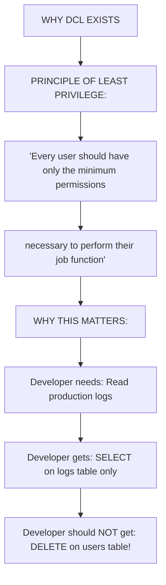

### 🟢 HOW: GRANT and REVOKE

```sql
-- ═══════════════════════════════════════════════════════════════════════════════
-- DCL: USERS AND PERMISSIONS
-- ═══════════════════════════════════════════════════════════════════════════════

-- ═══════════════════════════════════════════════════════════════════════════════
-- 1. CREATE USERS
-- ═══════════════════════════════════════════════════════════════════════════════

-- MySQL
CREATE USER 'app_user'@'localhost' IDENTIFIED BY 'SecureP@ss123!';
CREATE USER 'analyst'@'%' IDENTIFIED BY 'AnalystP@ss!';  -- % = any host
CREATE USER 'readonly'@'192.168.1.%' IDENTIFIED BY 'ReadP@ss!';  -- Subnet only

-- PostgreSQL
CREATE USER app_user WITH PASSWORD 'SecureP@ss123!';
CREATE USER analyst WITH PASSWORD 'AnalystP@ss!';

-- ═══════════════════════════════════════════════════════════════════════════════
-- 2. GRANT PERMISSIONS
-- ═══════════════════════════════════════════════════════════════════════════════

-- Grant specific permissions on specific tables
GRANT SELECT, INSERT, UPDATE ON ecommerce.customers TO 'app_user'@'localhost';
GRANT SELECT, INSERT, UPDATE ON ecommerce.orders TO 'app_user'@'localhost';
GRANT SELECT, INSERT, UPDATE, DELETE ON ecommerce.order_items TO 'app_user'@'localhost';

-- Grant read-only on all tables
GRANT SELECT ON ecommerce.* TO 'analyst'@'%';

-- Grant all on specific database
GRANT ALL PRIVILEGES ON ecommerce.* TO 'admin_user'@'localhost';

-- Grant with option to re-grant (admin)
GRANT ALL PRIVILEGES ON *.* TO 'dba'@'localhost' WITH GRANT OPTION;

-- ═══════════════════════════════════════════════════════════════════════════════
-- 3. ROLE-BASED ACCESS (Modern approach)
-- ═══════════════════════════════════════════════════════════════════════════════

-- Create roles
CREATE ROLE 'app_read_write';
CREATE ROLE 'analyst_read_only';
CREATE ROLE 'developer';

-- Assign permissions to roles
GRANT SELECT, INSERT, UPDATE ON ecommerce.* TO 'app_read_write';
GRANT SELECT ON ecommerce.* TO 'analyst_read_only';
GRANT SELECT, INSERT, UPDATE, DELETE ON ecommerce_dev.* TO 'developer';

-- Assign roles to users
GRANT 'app_read_write' TO 'app_user'@'localhost';
GRANT 'analyst_read_only' TO 'analyst'@'%';
GRANT 'developer' TO 'dev_john'@'localhost';
GRANT 'developer' TO 'dev_jane'@'localhost';

-- ═══════════════════════════════════════════════════════════════════════════════
-- 4. REVOKE PERMISSIONS
-- ═══════════════════════════════════════════════════════════════════════════════

-- Revoke specific permission
REVOKE DELETE ON ecommerce.orders FROM 'app_user'@'localhost';

-- Revoke all permissions on database
REVOKE ALL PRIVILEGES ON ecommerce.* FROM 'terminated_user'@'localhost';

-- Revoke role
REVOKE 'developer' FROM 'dev_john'@'localhost';

-- ═══════════════════════════════════════════════════════════════════════════════
-- 5. VIEW PERMISSIONS
-- ═══════════════════════════════════════════════════════════════════════════════

-- MySQL: Show grants for user
SHOW GRANTS FOR 'app_user'@'localhost';

-- MySQL: Show current user's grants
SHOW GRANTS;

-- PostgreSQL: View permissions
\du  -- List all roles
\dp  -- List table permissions
```

---

## Chapter 6: TCL - Transaction Control Language

### 🔵 WHY: Data Integrity

```
┌─────────────────────────────────────────────────────────────────────────────────┐
│                    WHY TRANSACTIONS EXIST                                       │
├─────────────────────────────────────────────────────────────────────────────────┤
│                                                                                 │
│  THE BANK TRANSFER PROBLEM:                                                     │
│  ┌────────────────────────────────────────────────────────────────────────────┐ │
│  │                                                                            │ │
│  │  Transfer ₹10,000 from Account A to Account B                              │ │
│  │                                                                            │ │
│  │  WITHOUT TRANSACTIONS:                                                     │ │
│  │  ┌──────────────────────────────────────────────────────────────────────┐ │  │
│  │  │ Step 1: UPDATE accounts SET balance = balance - 10000                │ │  │
│  │  │         WHERE account_id = 'A';  -- ✓ Success                         │ │ │
│  │  │                                                                      │ │  │
│  │  │         ⚡ POWER FAILURE / SERVER CRASH HERE ⚡                       │ │   │
│  │  │                                                                      │ │  │
│  │  │ Step 2: UPDATE accounts SET balance = balance + 10000                │ │  │
│  │  │         WHERE account_id = 'B';  -- ✗ Never executed!                 │ │ │
│  │  └──────────────────────────────────────────────────────────────────────┘ │  │
│  │                                                                            │ │
│  │  RESULT: ₹10,000 disappeared! Money debited but never credited.            │ │
│  │                                                                            │ │
│  │  WITH TRANSACTIONS:                                                        │ │
│  │  ┌──────────────────────────────────────────────────────────────────────┐ │  │
│  │  │ START TRANSACTION;                                                   │ │  │
│  │  │                                                                      │ │  │
│  │  │ UPDATE accounts SET balance = balance - 10000                        │ │  │
│  │  │ WHERE account_id = 'A';                                               │ │ │
│  │  │                                                                      │ │  │
│  │  │ ⚡ POWER FAILURE ⚡                                                   │ │   │
│  │  │                                                                      │ │  │
│  │  │ -- Transaction never committed                                       │ │  │
│  │  │ -- On restart: ROLLBACK automatically                                │ │  │
│  │  │ -- Account A balance restored!                                       │ │  │
│  │  └──────────────────────────────────────────────────────────────────────┘ │  │
│  │                                                                            │ │
│  │  RESULT: Either BOTH updates happen, or NEITHER happens. Never partial.    │ │
│  │                                                                            │ │
│  └────────────────────────────────────────────────────────────────────────────┘ │
│                                                                                 │
│  🔴 REAL INCIDENT: Knight Capital Trading Loss (2012)                            │
│                                                                                 │
│  WHAT HAPPENED:                                                                 │
│  - Software deployment error activated old test code                            │
│  - System executed millions of trades in 45 minutes                             │
│  - No transactional rollback capability for market orders                       │
│  - $440 MILLION lost in 45 minutes                                              │
│                                                                                 │
│  LESSON: Critical operations MUST be transactional with rollback capability     │
│                                                                                 │
└─────────────────────────────────────────────────────────────────────────────────┘
```

**Flow:**
1. Step 1: UPDATE accounts SET balance = balance - 10000 /
2. START TRANSACTION; / UPDATE accounts SET balance = bala

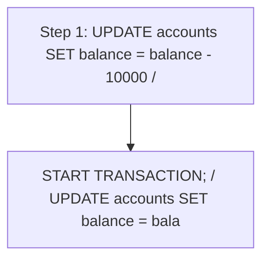

### 🟢 HOW: ACID Properties

```
┌─────────────────────────────────────────────────────────────────────────────────┐
│                    ACID PROPERTIES EXPLAINED                                    │
├─────────────────────────────────────────────────────────────────────────────────┤
│                                                                                 │
│  A - ATOMICITY ("All or Nothing")                                               │
│  ┌────────────────────────────────────────────────────────────────────────────┐ │
│  │                                                                            │ │
│  │  Like an ATOM - indivisible unit                                           │ │
│  │                                                                            │ │
│  │  Transaction with 5 SQL statements:                                        │ │
│  │  ┌───────────────────────────────────────────────────────────────────┐    │  │
│  │  │ INSERT → UPDATE → UPDATE → INSERT → DELETE                        │    │  │
│  │  │    ↓        ↓        ↓        ↓        ↓                          │    │  │
│  │  │   ✓        ✓        ✓        ✗ (error)                           │    │   │
│  │  │                                                                   │    │  │
│  │  │   ALL get ROLLED BACK - database unchanged                        │    │  │
│  │  └───────────────────────────────────────────────────────────────────┘    │  │
│  │                                                                            │ │
│  └────────────────────────────────────────────────────────────────────────────┘ │
│                                                                                 │
│  C - CONSISTENCY ("Valid State to Valid State")                                 │
│  ┌────────────────────────────────────────────────────────────────────────────┐ │
│  │                                                                            │ │
│  │  Database rules (constraints) ALWAYS enforced                              │ │
│  │                                                                            │ │
│  │  Example: Account balance cannot go negative                               │ │
│  │  CHECK (balance >= 0)                                                      │ │
│  │                                                                            │ │
│  │  Transaction: Transfer ₹10,000 from account with ₹5,000 balance           │  │
│  │  Result: Transaction REJECTED - would violate constraint                   │ │
│  │                                                                            │ │
│  └────────────────────────────────────────────────────────────────────────────┘ │
│                                                                                 │
│  I - ISOLATION ("Transactions Don't Interfere")                                 │
│  ┌────────────────────────────────────────────────────────────────────────────┐ │
│  │                                                                            │ │
│  │  Two transactions running simultaneously:                                  │ │
│  │                                                                            │ │
│  │  T1: Read balance, calculate interest, update balance                      │ │
│  │  T2: Read balance, debit payment, update balance                           │ │
│  │                                                                            │ │
│  │  WITHOUT isolation: Both read ₹10,000, both write different values        │  │
│  │                     One update gets lost!                                  │ │
│  │                                                                            │ │
│  │  WITH isolation: T1 completes fully, THEN T2 runs                          │ │
│  │                  OR they see each other's intermediate results             │ │
│  │                  (depends on isolation level)                              │ │
│  │                                                                            │ │
│  └────────────────────────────────────────────────────────────────────────────┘ │
│                                                                                 │
│  D - DURABILITY ("Committed = Permanent")                                       │
│  ┌────────────────────────────────────────────────────────────────────────────┐ │
│  │                                                                            │ │
│  │  After COMMIT, data survives:                                              │ │
│  │  - Power failure                                                           │ │
│  │  - Server crash                                                            │ │
│  │  - Disk failure (with proper backup)                                       │ │
│  │                                                                            │ │
│  │  HOW: Write-Ahead Logging (WAL)                                            │ │
│  │  1. Write change to log file FIRST                                         │ │
│  │  2. Then write to actual data file                                         │ │
│  │  3. On crash: Replay log to recover committed transactions                 │ │
│  │                                                                            │ │
│  └────────────────────────────────────────────────────────────────────────────┘ │
│                                                                                 │
└─────────────────────────────────────────────────────────────────────────────────┘
```

**Flow:**
1. Like an ATOM - indivisible unit / Transaction with 5 SQ
2. Database rules (constraints) ALWAYS enforced / Example:
3. Two transactions running simultaneously: / T1: Read bal
4. After COMMIT, data survives: / - Power failure / - Serv

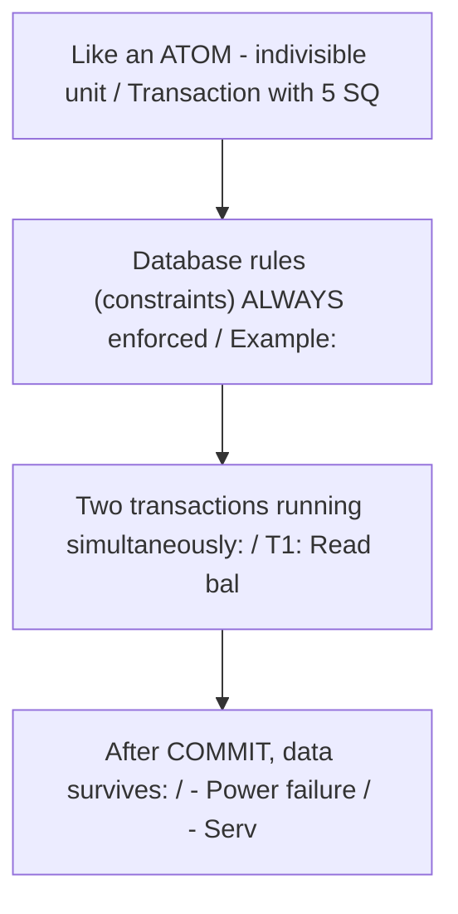

### 🟢 HOW: Transaction Syntax

```sql
-- ═══════════════════════════════════════════════════════════════════════════════
-- TRANSACTION CONTROL: COMPLETE GUIDE
-- ═══════════════════════════════════════════════════════════════════════════════

-- ═══════════════════════════════════════════════════════════════════════════════
-- 1. BASIC TRANSACTION
-- ═══════════════════════════════════════════════════════════════════════════════

-- MySQL / PostgreSQL
START TRANSACTION;
-- or
BEGIN;

-- SQL statements here
UPDATE accounts SET balance = balance - 10000 WHERE account_id = 'A';
UPDATE accounts SET balance = balance + 10000 WHERE account_id = 'B';

-- If successful
COMMIT;

-- If error or want to cancel
ROLLBACK;

-- ═══════════════════════════════════════════════════════════════════════════════
-- 2. REAL EXAMPLE: E-commerce Order Processing
-- ═══════════════════════════════════════════════════════════════════════════════

DELIMITER //

CREATE PROCEDURE place_order(
    IN p_customer_id INT,
    IN p_product_id INT,
    IN p_quantity INT,
    OUT p_order_id BIGINT,
    OUT p_status VARCHAR(50)
)
BEGIN
    DECLARE v_price DECIMAL(10,2);
    DECLARE v_stock INT;
    DECLARE v_total DECIMAL(12,2);

    -- Declare handler for errors
    DECLARE EXIT HANDLER FOR SQLEXCEPTION
    BEGIN
        ROLLBACK;
        SET p_status = 'ERROR: Transaction rolled back';
    END;

    START TRANSACTION;

    -- 1. Check stock and get price (with lock to prevent concurrent reads)
    SELECT price, stock_quantity
    INTO v_price, v_stock
    FROM products
    WHERE product_id = p_product_id
    FOR UPDATE;  -- Lock this row!

    -- 2. Validate stock
    IF v_stock < p_quantity THEN
        ROLLBACK;
        SET p_status = 'ERROR: Insufficient stock';
    ELSE
        -- 3. Calculate total
        SET v_total = v_price * p_quantity;

        -- 4. Create order
        INSERT INTO orders (customer_id, total, status, ordered_at)
        VALUES (p_customer_id, v_total, 'pending', NOW());

        SET p_order_id = LAST_INSERT_ID();

        -- 5. Create order item
        INSERT INTO order_items (order_id, product_id, quantity, unit_price)
        VALUES (p_order_id, p_product_id, p_quantity, v_price);

        -- 6. Reduce stock
        UPDATE products
        SET stock_quantity = stock_quantity - p_quantity
        WHERE product_id = p_product_id;

        -- 7. All successful - commit!
        COMMIT;
        SET p_status = 'SUCCESS';
    END IF;
END //

DELIMITER ;

-- Usage:
CALL place_order(1, 101, 2, @order_id, @status);
SELECT @order_id, @status;

-- ═══════════════════════════════════════════════════════════════════════════════
-- 3. SAVEPOINTS (Partial Rollback)
-- ═══════════════════════════════════════════════════════════════════════════════

-- WHY: Complex transaction where you want to undo part, not all

START TRANSACTION;

-- Part 1: Create customer
INSERT INTO customers (email, first_name, last_name, password_hash)
VALUES ('new@email.com', 'New', 'User', '$hash');
SET @new_customer_id = LAST_INSERT_ID();

SAVEPOINT customer_created;

-- Part 2: Create initial order (might fail)
INSERT INTO orders (customer_id, total, status)
VALUES (@new_customer_id, 0, 'draft');

-- Oops, something wrong with order logic
ROLLBACK TO customer_created;
-- Customer still exists, order rolled back

-- Try again with correct order
INSERT INTO orders (customer_id, total, status)
VALUES (@new_customer_id, 100.00, 'pending');

COMMIT;
-- Both customer and order saved

-- ═══════════════════════════════════════════════════════════════════════════════
-- 4. ISOLATION LEVELS
-- ═══════════════════════════════════════════════════════════════════════════════

-- Check current isolation level
SELECT @@transaction_isolation;  -- MySQL 8.0+
-- or
SELECT @@tx_isolation;  -- MySQL 5.7

-- Set isolation level
SET TRANSACTION ISOLATION LEVEL READ UNCOMMITTED;  -- Dirty reads allowed
SET TRANSACTION ISOLATION LEVEL READ COMMITTED;    -- No dirty reads (PostgreSQL default)
SET TRANSACTION ISOLATION LEVEL REPEATABLE READ;   -- No dirty, no non-repeatable (MySQL default)
SET TRANSACTION ISOLATION LEVEL SERIALIZABLE;      -- Full isolation (slowest)

/*
ISOLATION LEVEL COMPARISON:
┌─────────────────────┬──────────────┬────────────────────┬─────────────────┐
│ Level               │ Dirty Read   │ Non-Repeatable Read│ Phantom Read    │
├─────────────────────┼──────────────┼────────────────────┼─────────────────┤
│ READ UNCOMMITTED    │ Possible     │ Possible           │ Possible        │
│ READ COMMITTED      │ Not Possible │ Possible           │ Possible        │
│ REPEATABLE READ     │ Not Possible │ Not Possible       │ Possible        │
│ SERIALIZABLE        │ Not Possible │ Not Possible       │ Not Possible    │
└─────────────────────┴──────────────┴────────────────────┴─────────────────┘

TRADE-OFF: Higher isolation = Slower performance (more locking)
*/
```

---


🔬 **Section Challenge — Chapter 6: TCL - Transaction Control Language**

**Challenge 1 (Reasoning):** Two transactions T1 and T2 both run `SELECT balance WHERE id=1; UPDATE balance=balance-100 WHERE id=1`. What anomaly occurs at READ COMMITTED and how does REPEATABLE READ fix it?
<details><summary>Answer</summary>

READ COMMITTED: both T1 and T2 read balance=1000. Both compute 900. Both write 900. Final balance: 900 (expected: 800). Lost update! REPEATABLE READ (with locking SELECT FOR UPDATE): first SELECT acquires a read lock. T2's SELECT blocks until T1 commits. After T1 commits (balance=900), T2 reads 900, writes 800. Correct! Alternatively: use `UPDATE ... WHERE balance=1000` (optimistic locking with version check).
</details>


# 💪 Practice Problems

```sql
-- ═══════════════════════════════════════════════════════════════════════════════
-- PRACTICE PROBLEMS: DDL, DML, DCL, TCL
-- ═══════════════════════════════════════════════════════════════════════════════

-- PROBLEM 1: Design a Library Database
-- Create tables for: books, authors, members, loans
-- Include proper constraints, foreign keys, and indexes

-- PROBLEM 2: User Management System
-- Create users with different roles (admin, librarian, member)
-- Grant appropriate permissions using ROLE-based access

-- PROBLEM 3: Transaction Safety
-- Write a procedure to handle book checkout that:
-- - Checks if book is available
-- - Creates loan record
-- - Updates book status
-- - All in a transaction with proper error handling

-- PROBLEM 4: Schema Migration
-- Given existing 'users' table, write ALTER statements to:
-- - Add email verification columns
-- - Add audit columns (created_by, updated_by)
-- - Create appropriate indexes for common queries

-- Solutions available in 06_SQL_Practice_Projects.md
```

---

# 📖 Quick Reference

```
╔══════════════════════════════════════════════════════════════════════════════════╗
║                    SQL FOUNDATIONS - QUICK REFERENCE                             ║
╠══════════════════════════════════════════════════════════════════════════════════╣
║                                                                                  ║
║  DDL (Structure):                                                                ║
║    CREATE DATABASE, CREATE TABLE, ALTER TABLE, DROP TABLE, TRUNCATE TABLE        ║
║                                                                                  ║
║  DML (Data):                                                                     ║
║    INSERT, SELECT, UPDATE, DELETE, MERGE                                         ║
║                                                                                  ║
║  DCL (Permissions):                                                              ║
║    GRANT, REVOKE, CREATE USER, CREATE ROLE                                       ║
║                                                                                  ║
║  TCL (Transactions):                                                             ║
║    START TRANSACTION, COMMIT, ROLLBACK, SAVEPOINT                                ║
║                                                                                  ║
║  ACID:                                                                           ║
║    Atomicity, Consistency, Isolation, Durability                                 ║
║                                                                                  ║
║  GOLDEN RULES:                                                                   ║
║    ✓ Always use WHERE with UPDATE/DELETE                                         ║
║    ✓ Run SELECT before UPDATE/DELETE to verify                                   ║
║    ✓ Use transactions for multi-statement operations                             ║
║    ✓ Principle of least privilege for users                                      ║
║    ✓ Never store money as FLOAT - use DECIMAL                                    ║
║    ✓ Test schema changes on staging first                                        ║
║                                                                                  ║
╚══════════════════════════════════════════════════════════════════════════════════╝
```

**Flow:**
1. SQL FOUNDATIONS - QUICK REFERENCE
2. DDL (Structure):
3. DML (Data):
4. INSERT, SELECT, UPDATE, DELETE, MERGE
5. DCL (Permissions):
6. GRANT, REVOKE, CREATE USER, CREATE ROLE
7. TCL (Transactions):

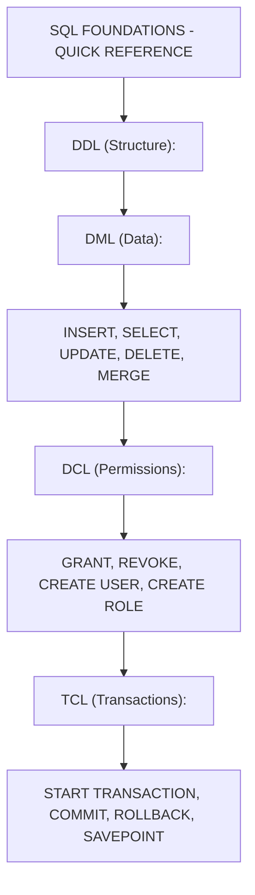

---

_"Understanding WHY makes HOW unforgettable"_

---

**NEXT: 02_SQL_Intermediate_JoinsWindows.md - JOINs, Subqueries, CTEs, Window Functions**


---


---

## 🏋️ Practice & Interview Questions — SQL

### Predict / Trace
**Q1.** What's the difference between WHERE and HAVING?
<details><summary>Answer</summary>

`WHERE` filters rows **before** grouping. `HAVING` filters groups **after** `GROUP BY`. You can't use aggregate functions in WHERE. `HAVING COUNT(*) > 5` works, `WHERE COUNT(*) > 5` does not.
</details>

**Q2.** What does this return? `SELECT 1 FROM dual WHERE NULL = NULL`
<details><summary>Answer</summary>

**No rows returned.** NULL is not equal to NULL — use `IS NULL` or `IS NOT NULL`. `NULL = NULL` evaluates to UNKNOWN, not TRUE.
</details>

### Coding Problems
**Q3.** ⭐ Second highest salary — handle the case where it doesn't exist (return NULL).
<details><summary>Solution</summary>

```sql
SELECT MAX(salary) AS SecondHighestSalary
FROM Employee
WHERE salary < (SELECT MAX(salary) FROM Employee);
-- or
SELECT IFNULL((SELECT DISTINCT salary FROM Employee ORDER BY salary DESC LIMIT 1 OFFSET 1), NULL)
```
</details>

**Q4.** ⭐ Find employees earning more than their manager.
<details><summary>Solution</summary>

```sql
SELECT e.name FROM Employee e
JOIN Employee m ON e.managerId = m.id
WHERE e.salary > m.salary;
```
</details>

**Q5.** ⭐ Find duplicate emails.
<details><summary>Solution</summary>

```sql
SELECT email FROM Person GROUP BY email HAVING COUNT(*) > 1;
```
</details>

**Q6.** ⭐⭐ Rank scores without RANK() function.
<details><summary>Solution</summary>

```sql
SELECT s.score,
  (SELECT COUNT(DISTINCT s2.score) FROM Scores s2 WHERE s2.score >= s.score) AS rank
FROM Scores s ORDER BY score DESC;
```
</details>

**Q7.** ⭐⭐ Consecutive numbers — find numbers that appear 3+ times consecutively.
<details><summary>Solution</summary>

```sql
SELECT DISTINCT l1.Num AS ConsecutiveNums
FROM Logs l1, Logs l2, Logs l3
WHERE l1.Id=l2.Id-1 AND l2.Id=l3.Id-1
AND l1.Num=l2.Num AND l2.Num=l3.Num;
-- or use LAG/LEAD window functions
```
</details>

**Q8.** ⭐⭐ Department top 3 salaries (dense rank).
<details><summary>Solution</summary>

```sql
SELECT d.name AS Department, e.name AS Employee, e.salary AS Salary
FROM Employee e JOIN Department d ON e.departmentId = d.id
WHERE (SELECT COUNT(DISTINCT e2.salary) FROM Employee e2
       WHERE e2.departmentId=e.departmentId AND e2.salary>e.salary) < 3;
```
</details>

**Q9.** ⭐⭐ Running total with window function.
<details><summary>Solution</summary>

```sql
SELECT date, amount,
  SUM(amount) OVER (ORDER BY date ROWS BETWEEN UNBOUNDED PRECEDING AND CURRENT ROW) AS running_total
FROM transactions;
```
</details>

**Q10.** ⭐⭐ Pivot rows to columns (conditional aggregation).
<details><summary>Solution</summary>

```sql
SELECT year,
  SUM(CASE WHEN quarter=1 THEN revenue END) AS Q1,
  SUM(CASE WHEN quarter=2 THEN revenue END) AS Q2,
  SUM(CASE WHEN quarter=3 THEN revenue END) AS Q3,
  SUM(CASE WHEN quarter=4 THEN revenue END) AS Q4
FROM sales GROUP BY year;
```
</details>

**Q11.** ⭐⭐⭐ Find the median salary — without MEDIAN() function.
<details><summary>Solution</summary>

```sql
SELECT AVG(salary) AS median
FROM (SELECT salary, ROW_NUMBER() OVER(ORDER BY salary) AS rn, COUNT(*) OVER() AS cnt FROM Employee) t
WHERE rn IN (FLOOR((cnt+1)/2), CEIL((cnt+1)/2));
```
</details>

### Interview Questions
**Q12.** INNER JOIN vs LEFT JOIN — when does LEFT produce more rows?
<details><summary>Answer</summary>

LEFT JOIN includes ALL rows from the left table even if no match in right table (fills NULLs). INNER JOIN only includes rows where both sides have a match. If left table has rows with no match in right: LEFT produces more rows.
</details>

**Q13.** What is a covering index?
<details><summary>Answer</summary>

An index that contains ALL columns needed by a query — the DB can answer from the index alone without touching the table ("index-only scan"). Faster because it avoids the extra heap fetch.
</details>

**Q14.** EXPLAIN shows "Full Table Scan" — how do you fix it?
<details><summary>Answer</summary>

Add an index on the WHERE/JOIN/ORDER BY column. Check if the column has low cardinality (boolean — index may not help). Ensure the query isn't wrapping the column in a function (`WHERE YEAR(date) = 2024` prevents index use — rewrite as `WHERE date BETWEEN '2024-01-01' AND '2024-12-31'`).
</details>

### MCQ Rapid Fire
| # | Question | Answer |
|---|---|---|
| 1 | NULL = NULL evaluates to? | UNKNOWN (use IS NULL) |
| 2 | COUNT(*) vs COUNT(col) | COUNT(*) counts all rows, COUNT(col) skips NULLs |
| 3 | RANK() vs DENSE_RANK() | RANK() skips numbers after ties, DENSE_RANK() doesn't |
| 4 | CROSS JOIN produces | Cartesian product (m × n rows) |
| 5 | Can you ORDER BY in a subquery? | Only when using TOP/LIMIT |
| 6 | TRUNCATE vs DELETE | TRUNCATE: no WHERE, no undo, faster. DELETE: filterable, transactional |
| 7 | What does COALESCE do? | Returns first non-NULL value from its arguments |
| 8 | Index on VARCHAR — what to watch out for? | Case sensitivity, collation, function-based searches bypass index |


---

## 🧠 Deep Conceptual Questions — SQL Internals & Reasoning

**C1. How does a SQL database execute a SELECT query internally?**
<details><summary>Deep Answer</summary>

1. **Parse**: SQL text → AST (syntax tree)
2. **Bind**: resolve table names, column names, types
3. **Optimize**: query planner generates candidate execution plans, estimates costs (based on statistics: row counts, column cardinality, index existence), picks cheapest
4. **Execute**: follow the plan — scan tables, apply filters, join, sort, project

The optimizer transforms: `SELECT ... WHERE ... JOIN ... ORDER BY` into an operator tree (Volcano model): TableScan → Filter → HashJoin → Sort → Project. Each operator is an iterator: `next()` pulls one row from its child. This pull-based model (lazy evaluation) avoids materializing intermediate results.
</details>

**C2. B-Tree index: why is it the default index structure in databases?**
<details><summary>Deep Answer</summary>

B-Tree (not binary tree — B stands for Balanced, not Binary): a self-balancing tree where each node can hold many keys. Properties: (1) height O(log_m N) where m=fan-out (typically 100-1000) → very short tree for millions of rows, (2) all leaf nodes at same depth → guaranteed O(log N) worst case, (3) range scans efficient — leaves linked in sequence, (4) supports equality AND range queries. Hash index: only equality (no range). Sequential scan: no index at all. B+Tree (variant): internal nodes only store keys (no values), leaves store data. All row pointers in leaves → better range scan (follow linked list of leaves).
</details>

**C3. Why does adding an index sometimes SLOW DOWN a query?**
<details><summary>Deep Answer</summary>

1. **Low cardinality**: index on a boolean column — if 50% rows have `active=true`, index gives you 50% of rows. Database may choose full table scan (cheaper: sequential I/O) over index (random I/O for 50% of rows). 
2. **Function on column**: `WHERE YEAR(created_at) = 2024` — index on `created_at` unused. Rewrite: `WHERE created_at >= '2024-01-01' AND created_at < '2025-01-01'`.
3. **Write overhead**: every INSERT/UPDATE/DELETE must update ALL indexes. 5 indexes × N rows = 5× write amplification.
4. **Index not covering**: index exists but the SELECT columns aren't in the index → each index match → separate heap fetch → many random I/O. Solution: covering index (include all needed columns in index).
</details>

**C4. EXPLAIN / query execution plan: what are the key things to look for?**
<details><summary>Deep Answer</summary>

Red flags: (1) **"Full Table Scan" / "Seq Scan"** on a large table → missing index, (2) **high "rows" estimate** in join conditions → cartesian product risk, (3) **"Using filesort"** → ORDER BY can't use index, (4) **"Using temporary"** → intermediate table materialization, (5) **nested loops on large tables** → should be hash join or merge join. Green flags: "Using index" (covering index), "ref" or "eq_ref" access type (index used). Start fixing: add or fix index on WHERE/JOIN/ORDER BY columns, rewrite function-wrapped columns.
</details>

**C5. Window functions vs GROUP BY — when must you use window functions?**
<details><summary>Deep Answer</summary>

`GROUP BY` collapses rows to one per group — individual row data is lost. Window functions compute aggregates but **keep all rows**. Use window when: (1) you need both the aggregate AND the individual row (rank each employee and show their salary), (2) running totals (each row needs sum of all prior rows — GROUP BY can't do this), (3) lag/lead access (compare each row to previous/next — GROUP BY has no row ordering concept), (4) top-N per group (ROW_NUMBER partition — classic GROUP BY can't do this cleanly). Window functions = aggregation without collapsing.
</details>

**C6. Transaction isolation levels — what anomaly does each prevent?**
<details><summary>Deep Answer</summary>

| Level | Dirty Read | Non-repeatable Read | Phantom Read |
|---|---|---|---|
| READ UNCOMMITTED | Possible | Possible | Possible |
| READ COMMITTED | ✅ Prevented | Possible | Possible |
| REPEATABLE READ | ✅ | ✅ | Possible (MySQL InnoDB: prevented!) |
| SERIALIZABLE | ✅ | ✅ | ✅ |

**Dirty read**: read uncommitted data from another transaction (which may rollback). **Non-repeatable**: same query in same transaction returns different row values (another transaction committed update). **Phantom**: same query returns different row COUNT (another transaction inserted/deleted rows). Higher isolation = fewer anomalies but more lock contention. Most production databases use READ COMMITTED or REPEATABLE READ.
</details>

**C7. N+1 query problem: what is it, why does it happen, and how to fix?**
<details><summary>Deep Answer</summary>

**What**: fetching N orders, then for each order making a separate query for the customer = 1 + N queries total. Scales terribly: 1000 orders = 1001 queries. **Why**: ORMs (Hibernate, JPA) with lazy loading — accessing a relationship triggers a new query. **Fix 1**: Eager loading — `JOIN FETCH` or `.fetch()` — load everything in one query. **Fix 2**: Batch loading — fetch all order IDs, then `WHERE customer_id IN (id1, id2, ...)` — 2 queries. **Fix 3**: Projection/DTO query — `SELECT o.id, c.name FROM orders o JOIN customers c` — 1 query. **Detection**: count DB queries in tests (Spring: `@QueryCount`), log slow query warnings.
</details>


> **Navigation**: [Back to Index](../00_MASTER_INDEX.md) | [Next >](02_DataTypes_Constraints.md)