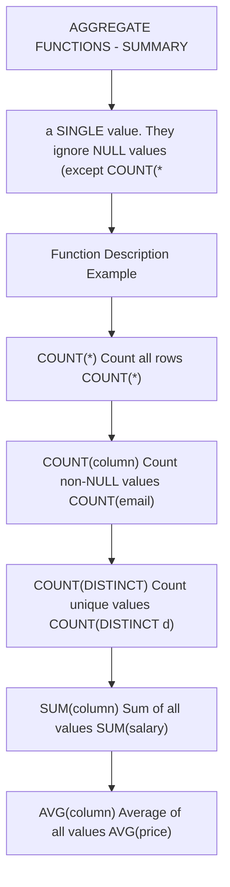
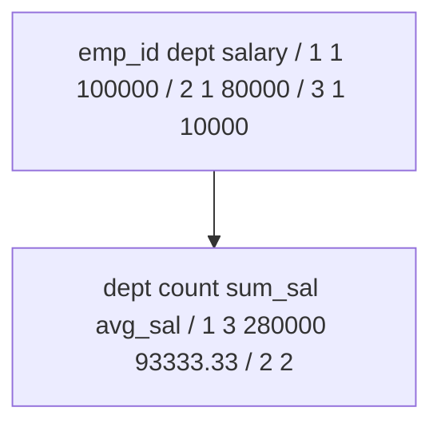

> **SQL Chapter 06/20** | [← Previous](05_Queries_SELECT_WHERE.md) | [Index](../00_MASTER_INDEX.md) | [Next →](07_JOINs_Complete.md)

---

## Chapter 6: Aggregate Functions & GROUP BY

### 🧠 Understanding Aggregation — Collapsing Many Rows Into One

Aggregation is the process of **combining multiple rows into a single summary value**. Think of it as zooming out: instead of seeing every individual employee's salary, you see the average salary per department. This is fundamental to data analysis — business decisions are made on summaries, not individual records.

#### Why GROUP BY Exists — The Single-Value Rule

When you use an aggregate function like `AVG(salary)`, the database collapses all rows into one result. But what if you want the average salary **per department**? You need `GROUP BY dept_id` — this tells the database to create separate "buckets" (one per department) and apply the aggregate to each bucket independently.

The **critical rule**: Every column in your `SELECT` must either be:
1. Inside an aggregate function (`SUM(salary)`, `COUNT(*)`, etc.), OR
2. Listed in the `GROUP BY` clause

Why? Because if you say `SELECT dept_id, first_name, AVG(salary)`, the database doesn't know *which* `first_name` to pick for each department — there are many employees per department, but only one average. This creates an ambiguity that SQL prevents by requiring the GROUP BY rule.

#### WHERE vs HAVING — When to Filter

This distinction confuses everyone at first, but it's simple once you understand the execution order:

- **WHERE** filters **individual rows** *before* groups are formed. Use it when your condition operates on raw column values (e.g., `WHERE salary > 50000`).
- **HAVING** filters **groups** *after* aggregation. Use it when your condition operates on aggregate results (e.g., `HAVING AVG(salary) > 50000`).

Think of it this way: WHERE decides which employees to consider. HAVING decides which departments to show in the final result.

> 💡 **Performance Tip:** Always prefer WHERE over HAVING when possible. Filtering rows early (with WHERE) means fewer rows to aggregate, which is faster. Only use HAVING for conditions that *require* aggregate values.

#### 📝 Formal Syntax — Aggregate Functions

```
SELECT <aggregate_function>(<column_name>)
FROM <table_name>
[WHERE <condition>];

-- Available aggregate functions:
COUNT(*)                                         -- Count all rows (including NULLs)
COUNT(<column>)                                  -- Count non-NULL values
COUNT(DISTINCT <column>)                         -- Count unique non-NULL values
SUM(<column>)                                    -- Sum of all values
AVG(<column>)                                    -- Average of all values
MIN(<column>)                                    -- Minimum value
MAX(<column>)                                    -- Maximum value
```

#### 📝 Formal Syntax — GROUP BY with HAVING

```
SELECT <column1>, <column2>, <aggregate_function>(<column>)
FROM <table_name>
[WHERE <row_condition>]                          -- Filters rows BEFORE grouping
GROUP BY <column1>, <column2>                    -- Creates groups
[HAVING <aggregate_condition>]                   -- Filters groups AFTER aggregation
[ORDER BY <column_or_aggregate> [ASC|DESC]];
```

#### 📝 Formal Syntax — ROLLUP & CUBE (Subtotals)

```
-- ROLLUP: Generates subtotals in hierarchical order
GROUP BY ROLLUP (<column1>, <column2>);          -- Subtotals for col1, then grand total

-- CUBE: Generates subtotals for ALL combinations
GROUP BY CUBE (<column1>, <column2>);            -- Subtotals for col1, col2, col1+col2, grand total
```

---

```
┌─────────────────────────────────────────────────────────────────────────────────┐
│                    AGGREGATE FUNCTIONS - SUMMARY                                │
├─────────────────────────────────────────────────────────────────────────────────┤
│                                                                                 │
│  Aggregate functions perform calculations on a SET of values and return         │
│  a SINGLE value. They ignore NULL values (except COUNT(*)).                     │
│                                                                                 │
│  ┌──────────────────────────────────────────────────────────────────────────┐   │
│  │  Function       │ Description                        │ Example           │   │
│  ├─────────────────┼────────────────────────────────────┼───────────────────┤   │
│  │ COUNT(*)        │ Count all rows                     │ COUNT(*)          │   │
│  │ COUNT(column)   │ Count non-NULL values              │ COUNT(email)      │   │
│  │ COUNT(DISTINCT) │ Count unique values                │ COUNT(DISTINCT d) │   │
│  │ SUM(column)     │ Sum of all values                  │ SUM(salary)       │   │
│  │ AVG(column)     │ Average of all values              │ AVG(price)        │   │
│  │ MIN(column)     │ Minimum value                      │ MIN(hire_date)    │   │
│  │ MAX(column)     │ Maximum value                      │ MAX(salary)       │   │
│  │ GROUP_CONCAT()  │ Concatenate values (MySQL)         │ GROUP_CONCAT(name)│   │
│  │ STRING_AGG()    │ Concatenate values (PostgreSQL)    │ STRING_AGG(n,',') │   │
│  └──────────────────────────────────────────────────────────────────────────┘   │
│                                                                                 │
└─────────────────────────────────────────────────────────────────────────────────┘
```

**Flow:**
- AGGREGATE FUNCTIONS - SUMMARY
- ↓
- a SINGLE value. They ignore NULL values (except COUNT(*
- ↓
- Function Description Example
- ↓
- COUNT(*) Count all rows COUNT(*)
- ↓
- COUNT(column) Count non-NULL values COUNT(email)
- ↓
- COUNT(DISTINCT) Count unique values COUNT(DISTINCT d)
- ↓
- SUM(column) Sum of all values SUM(salary)



```sql
-- ═══════════════════════════════════════════════════════════════════════════════
-- AGGREGATE FUNCTIONS - EXAMPLES
-- ═══════════════════════════════════════════════════════════════════════════════

-- COUNT - Counting rows
SELECT COUNT(*) AS total_employees FROM employees;
SELECT COUNT(phone) AS employees_with_phone FROM employees;  -- Ignores NULL
SELECT COUNT(DISTINCT dept_id) AS department_count FROM employees;

-- SUM - Total of numeric column
SELECT SUM(salary) AS total_salary FROM employees;
SELECT SUM(salary) AS eng_salary FROM employees WHERE dept_id = 1;

-- AVG - Average value
SELECT AVG(salary) AS avg_salary FROM employees;
SELECT ROUND(AVG(salary), 2) AS avg_salary FROM employees;  -- Rounded

-- MIN / MAX
SELECT MIN(salary) AS min_salary, MAX(salary) AS max_salary FROM employees;
SELECT MIN(hire_date) AS first_hire, MAX(hire_date) AS latest_hire FROM employees;

-- All aggregates together
SELECT
    COUNT(*) AS total_employees,
    SUM(salary) AS total_salary,
    AVG(salary) AS avg_salary,
    MIN(salary) AS min_salary,
    MAX(salary) AS max_salary
FROM employees;

-- GROUP_CONCAT (MySQL) - Concatenate values into string
SELECT GROUP_CONCAT(first_name) AS all_names FROM employees WHERE dept_id = 1;
-- Result: "Rajesh,Priya,Amit"

SELECT GROUP_CONCAT(first_name ORDER BY first_name SEPARATOR ', ') AS all_names
FROM employees WHERE dept_id = 1;
-- Result: "Amit, Priya, Rajesh"

-- STRING_AGG (PostgreSQL)
SELECT STRING_AGG(first_name, ', ' ORDER BY first_name) AS all_names
FROM employees WHERE dept_id = 1;
```

### GROUP BY - Grouping Data

```
┌─────────────────────────────────────────────────────────────────────────────────┐
│                    GROUP BY - HOW IT WORKS                                      │
├─────────────────────────────────────────────────────────────────────────────────┤
│                                                                                 │
│  GROUP BY divides rows into groups based on column values.                      │
│  Aggregate functions are then applied to each group separately.                 │
│                                                                                 │
│  Original Data:                    After GROUP BY dept_id:                      │
│  ┌──────────────────────────┐     ┌────────────────────────────────────────┐    │
│  │ emp_id │ dept │ salary   │     │ dept │ count │ sum_sal  │ avg_sal     │     │
│  ├────────┼──────┼──────────┤     ├──────┼───────┼──────────┼─────────────┤     │
│  │ 1      │ 1    │ 100000   │     │ 1    │ 3     │ 280000   │ 93333.33    │     │
│  │ 2      │ 1    │ 80000    │     │ 2    │ 2     │ 150000   │ 75000.00    │     │
│  │ 3      │ 1    │ 100000   │     └────────────────────────────────────────┘    │
│  │ 4      │ 2    │ 90000    │                                                   │
│  │ 5      │ 2    │ 60000    │     SELECT dept_id,                               │
│  └──────────────────────────┘            COUNT(*) AS count,                     │
│                                          SUM(salary) AS sum_sal,                │
│                                          AVG(salary) AS avg_sal                 │
│                                   FROM employees                                │
│                                   GROUP BY dept_id;                             │
│                                                                                 │
└─────────────────────────────────────────────────────────────────────────────────┘
```

**Flow:**
- emp_id dept salary / 1 1 100000 / 2 1 80000 / 3 1 10000
- ↓
- dept count sum_sal avg_sal / 1 3 280000 93333.33 / 2 2



```sql
-- ═══════════════════════════════════════════════════════════════════════════════
-- GROUP BY - EXAMPLES
-- ═══════════════════════════════════════════════════════════════════════════════

-- Basic GROUP BY
SELECT dept_id, COUNT(*) AS employee_count
FROM employees
GROUP BY dept_id;

-- GROUP BY with multiple aggregates
SELECT
    dept_id,
    COUNT(*) AS emp_count,
    SUM(salary) AS total_salary,
    AVG(salary) AS avg_salary,
    MIN(salary) AS min_salary,
    MAX(salary) AS max_salary
FROM employees
GROUP BY dept_id;

-- GROUP BY with JOIN (show department name)
SELECT
    d.dept_name,
    COUNT(*) AS emp_count,
    ROUND(AVG(e.salary), 2) AS avg_salary
FROM employees e
JOIN departments d ON e.dept_id = d.dept_id
GROUP BY d.dept_id, d.dept_name;

-- GROUP BY multiple columns
SELECT
    dept_id,
    job_title,
    COUNT(*) AS count,
    AVG(salary) AS avg_salary
FROM employees
GROUP BY dept_id, job_title
ORDER BY dept_id, avg_salary DESC;

-- GROUP BY with expressions
SELECT
    YEAR(hire_date) AS hire_year,
    COUNT(*) AS hires
FROM employees
GROUP BY YEAR(hire_date)
ORDER BY hire_year;

-- GROUP BY with CASE (custom grouping)
SELECT
    CASE
        WHEN salary >= 100000 THEN 'High'
        WHEN salary >= 50000 THEN 'Medium'
        ELSE 'Low'
    END AS salary_band,
    COUNT(*) AS employee_count
FROM employees
GROUP BY
    CASE
        WHEN salary >= 100000 THEN 'High'
        WHEN salary >= 50000 THEN 'Medium'
        ELSE 'Low'
    END;


-- ═══════════════════════════════════════════════════════════════════════════════
-- HAVING - FILTERING GROUPS
-- ═══════════════════════════════════════════════════════════════════════════════

-- WHERE filters ROWS before grouping
-- HAVING filters GROUPS after grouping

-- Find departments with more than 2 employees
SELECT dept_id, COUNT(*) AS emp_count
FROM employees
GROUP BY dept_id
HAVING COUNT(*) > 2;

-- Find departments where average salary > 80000
SELECT dept_id, AVG(salary) AS avg_salary
FROM employees
GROUP BY dept_id
HAVING AVG(salary) > 80000;

-- Combined WHERE and HAVING
SELECT
    dept_id,
    COUNT(*) AS active_count,
    AVG(salary) AS avg_salary
FROM employees
WHERE is_active = TRUE           -- Filter rows first
GROUP BY dept_id
HAVING COUNT(*) >= 2             -- Then filter groups
   AND AVG(salary) > 70000
ORDER BY avg_salary DESC;


-- ═══════════════════════════════════════════════════════════════════════════════
-- EXECUTION ORDER (Important!)
-- ═══════════════════════════════════════════════════════════════════════════════

/*
SQL Execution Order:
1. FROM        - Get data from tables
2. JOIN        - Join tables together
3. WHERE       - Filter individual rows
4. GROUP BY    - Create groups
5. HAVING      - Filter groups
6. SELECT      - Choose columns and compute aggregates
7. DISTINCT    - Remove duplicates
8. ORDER BY    - Sort results
9. LIMIT       - Restrict output count

This is why you can't use column aliases in WHERE but can in ORDER BY!
*/


-- ═══════════════════════════════════════════════════════════════════════════════
-- ROLLUP & CUBE - SUBTOTALS
-- ═══════════════════════════════════════════════════════════════════════════════

-- ROLLUP: Creates subtotals at each level + grand total
SELECT
    COALESCE(d.dept_name, 'TOTAL') AS department,
    COALESCE(e.job_title, 'Subtotal') AS job_title,
    COUNT(*) AS emp_count,
    SUM(e.salary) AS total_salary
FROM employees e
JOIN departments d ON e.dept_id = d.dept_id
GROUP BY d.dept_name, e.job_title WITH ROLLUP;

-- CUBE: Creates subtotals for all combinations (PostgreSQL)
SELECT
    COALESCE(d.dept_name, 'ALL') AS department,
    COALESCE(e.job_title, 'ALL') AS job_title,
    COUNT(*) AS emp_count
FROM employees e
JOIN departments d ON e.dept_id = d.dept_id
GROUP BY CUBE(d.dept_name, e.job_title);

-- GROUPING SETS: Explicit grouping combinations
SELECT
    d.dept_name,
    YEAR(e.hire_date) AS hire_year,
    COUNT(*) AS emp_count
FROM employees e
JOIN departments d ON e.dept_id = d.dept_id
GROUP BY GROUPING SETS (
    (d.dept_name),
    (YEAR(e.hire_date)),
    (d.dept_name, YEAR(e.hire_date))
);
```

---

> **Navigation**: [< Previous](05_Queries_SELECT_WHERE.md) | [Back to Index](../00_MASTER_INDEX.md) | [Next >](07_JOINs_Complete.md)