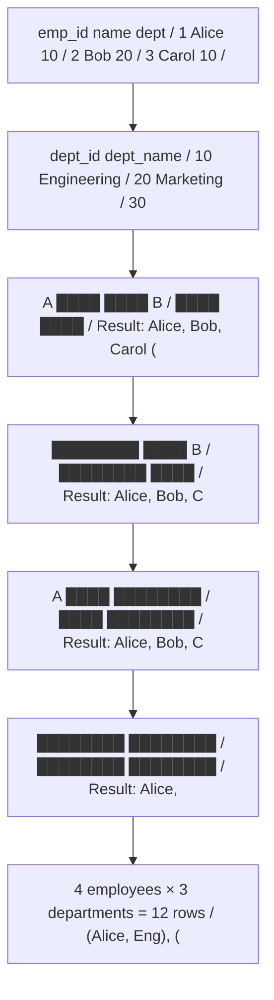

> **SQL Chapter 07/20** | [← Previous](06_Aggregations_GroupBy.md) | [Index](../00_MASTER_INDEX.md) | [Next →](08_Subqueries_CTEs.md)

---

## Chapter 7: JOINs - Combining Tables

### 🧠 Why JOINs Exist — The Foundation of Relational Databases

JOINs are arguably **the most important concept in SQL**. They are the reason relational databases are called "relational" — they let you combine related data that has been deliberately split across multiple tables.

#### Why Data Is Split Across Tables (Normalization)

Consider storing order data in a single table: `order_id, customer_name, customer_email, customer_phone, product_name, product_price, quantity`. Every time the same customer orders something, their name, email, and phone are duplicated. If the customer changes their email, you'd have to update it in *every row of every order they've ever placed*. Miss one row, and your data is now inconsistent.

The solution: **split data by topic**. Customers go in a `customers` table (one row per customer), orders go in an `orders` table (one row per order), and a `customer_id` in the orders table links back to the customer. This eliminates duplication and ensures one source of truth. But now, to get "which customer placed which order," you need to **JOIN** the tables back together.

> 💡 **Core Insight:** JOINs are the price you pay for data integrity. Normalization prevents duplication and inconsistency; JOINs reassemble the data when you need to see the full picture.

#### How JOIN Processing Actually Works

When you write `SELECT ... FROM A JOIN B ON A.id = B.a_id`, the database has to figure out which rows in A match which rows in B. Internally, it uses one of three algorithms:

| Algorithm | How It Works | Best When |
|-----------|-------------|-----------|
| **Nested Loop Join** | For each row in A, scan all rows of B looking for matches. Like two nested for-loops. | One table is very small (< 1000 rows), or join column is indexed |
| **Hash Join** | Load the smaller table into a hash map in memory, then scan the larger table and look up matches in O(1). | Large tables, no useful indexes, lots of memory available |
| **Sort-Merge Join** | Sort both tables by the join column, then merge them like merge sort. Both pointers advance together. | Both tables are already sorted (or have sorted indexes) |

The database's **query optimizer** automatically chooses the best algorithm based on table sizes, available indexes, and memory. This is why indexing foreign key columns is critical — it enables the fast nested loop join.

#### When to Use Each JOIN Type — A Decision Framework

| Your Question | JOIN Type | Example |
|--------------|-----------|---------|
| "Show me data where **both sides have matches**" | `INNER JOIN` | Employees WITH departments |
| "Show me **all items from the left**, even if no match on right" | `LEFT JOIN` | All employees, even those without departments |
| "Show me **all items from the right**, even if no match on left" | `RIGHT JOIN` | All departments, even those without employees |
| "Show me **everything from both sides**" | `FULL OUTER JOIN` | All employees AND all departments, matched where possible |
| "Find **orphan records** (missing relationships)" | `LEFT JOIN ... WHERE right.id IS NULL` | Employees who don't belong to any department |
| "Generate **all possible combinations**" | `CROSS JOIN` | Every employee paired with every project (for assignment planning) |

> ⚠️ **Common Mistake:** Using `LEFT JOIN` when you actually want `INNER JOIN`. Left join returns NULL-padded rows for non-matches, which can silently produce incorrect aggregations (COUNT, SUM include NULLs differently). Always ask yourself: "Do I want rows with NO match?"

#### 📝 Formal Syntax — JOIN Types

```
-- INNER JOIN: Only rows that match in BOTH tables
SELECT <columns>
FROM <table_A>
INNER JOIN <table_B> ON <table_A>.<column> = <table_B>.<column>;

-- LEFT JOIN (LEFT OUTER JOIN): All rows from left table + matches from right
SELECT <columns>
FROM <table_A>
LEFT JOIN <table_B> ON <table_A>.<column> = <table_B>.<column>;

-- RIGHT JOIN (RIGHT OUTER JOIN): All rows from right table + matches from left
SELECT <columns>
FROM <table_A>
RIGHT JOIN <table_B> ON <table_A>.<column> = <table_B>.<column>;

-- FULL OUTER JOIN: All rows from BOTH tables
SELECT <columns>
FROM <table_A>
FULL OUTER JOIN <table_B> ON <table_A>.<column> = <table_B>.<column>;

-- CROSS JOIN: Every row in A paired with every row in B (Cartesian product)
SELECT <columns>
FROM <table_A>
CROSS JOIN <table_B>;

-- SELF JOIN: A table joined with itself (uses aliases to distinguish)
SELECT <columns>
FROM <table_name> AS <alias_1>
JOIN <table_name> AS <alias_2> ON <alias_1>.<column> = <alias_2>.<column>;

-- Finding orphan records (LEFT JOIN anti-pattern):
SELECT <columns>
FROM <table_A>
LEFT JOIN <table_B> ON <table_A>.<column> = <table_B>.<column>
WHERE <table_B>.<column> IS NULL;               -- Rows in A with no match in B
```

---

```
┌─────────────────────────────────────────────────────────────────────────────────┐
│                    SQL JOINS - VISUAL GUIDE                                     │
├─────────────────────────────────────────────────────────────────────────────────┤
│                                                                                 │
│  Table A: employees              Table B: departments                           │
│  ┌────────┬─────────┬─────┐     ┌─────────┬─────────────┐                       │
│  │ emp_id │ name    │dept │     │ dept_id │ dept_name   │                       │
│  ├────────┼─────────┼─────┤     ├─────────┼─────────────┤                       │
│  │ 1      │ Alice   │ 10  │     │ 10      │ Engineering │                       │
│  │ 2      │ Bob     │ 20  │     │ 20      │ Marketing   │                       │
│  │ 3      │ Carol   │ 10  │     │ 30      │ Finance     │  ← No employees       │
│  │ 4      │ Dave    │ 40  │← No dept  │                │                        │
│  └────────┴─────────┴─────┘     └─────────┴─────────────┘                       │
│                                                                                 │
│                                                                                 │
│  1. INNER JOIN - Only matching rows from both tables                            │
│  ┌───────────────────────────────────────────────────────────────────────────┐  │
│  │     ┌─────────┐                                                           │  │
│  │     │  A  ████│████  B                                                    │  │
│  │     │     ████│████                                                       │  │
│  │     └─────────┘                                                           │  │
│  │                                                                           │  │
│  │  Result: Alice, Bob, Carol (Dave excluded - no matching dept)             │  │
│  │                            (Finance excluded - no employees)              │  │
│  └───────────────────────────────────────────────────────────────────────────┘  │
│                                                                                 │
│  2. LEFT JOIN - All from A + matching from B                                    │
│  ┌───────────────────────────────────────────────────────────────────────────┐  │
│  │     ┌─────────┐                                                           │  │
│  │     │████████│████  B                                                    │   │
│  │     │████████│████                                                       │   │
│  │     └─────────┘                                                           │  │
│  │                                                                           │  │
│  │  Result: Alice, Bob, Carol, Dave (Dave included with NULL dept_name)      │  │
│  └───────────────────────────────────────────────────────────────────────────┘  │
│                                                                                 │
│  3. RIGHT JOIN - All from B + matching from A                                   │
│  ┌───────────────────────────────────────────────────────────────────────────┐  │
│  │     ┌─────────┐                                                           │  │
│  │       A  ████│████████                                                    │  │
│  │          ████│████████                                                    │  │
│  │     └─────────┘                                                           │  │
│  │                                                                           │  │
│  │  Result: Alice, Bob, Carol + Finance (with NULL employee columns)         │  │
│  └───────────────────────────────────────────────────────────────────────────┘  │
│                                                                                 │
│  4. FULL OUTER JOIN - All from both tables                                      │
│  ┌───────────────────────────────────────────────────────────────────────────┐  │
│  │     ┌─────────┐                                                           │  │
│  │     │████████│████████                                                    │  │
│  │     │████████│████████                                                    │  │
│  │     └─────────┘                                                           │  │
│  │                                                                           │  │
│  │  Result: Alice, Bob, Carol, Dave (NULL dept), Finance (NULL emp)          │  │
│  └───────────────────────────────────────────────────────────────────────────┘  │
│                                                                                 │
│  5. CROSS JOIN - Cartesian product (every A with every B)                       │
│  ┌───────────────────────────────────────────────────────────────────────────┐  │
│  │                                                                           │  │
│  │  4 employees × 3 departments = 12 rows                                    │  │
│  │  (Alice, Eng), (Alice, Mkt), (Alice, Fin), (Bob, Eng)... etc.            │   │
│  │                                                                           │  │
│  └───────────────────────────────────────────────────────────────────────────┘  │
│                                                                                 │
└─────────────────────────────────────────────────────────────────────────────────┘
```

**Flow:**
- emp_id name dept / 1 Alice 10 / 2 Bob 20 / 3 Carol 10 /
- ↓
- dept_id dept_name / 10 Engineering / 20 Marketing / 30
- ↓
- A ████ ████ B / ████ ████ / Result: Alice, Bob, Carol (
- ↓
- ████████ ████ B / ████████ ████ / Result: Alice, Bob, C
- ↓
- A ████ ████████ / ████ ████████ / Result: Alice, Bob, C
- ↓
- ████████ ████████ / ████████ ████████ / Result: Alice,
- ↓
- 4 employees × 3 departments = 12 rows / (Alice, Eng), (



### JOIN Syntax and Examples

```sql
-- ═══════════════════════════════════════════════════════════════════════════════
-- INNER JOIN - Most common join type
-- ═══════════════════════════════════════════════════════════════════════════════

-- Basic INNER JOIN
SELECT
    e.emp_id,
    e.first_name,
    e.last_name,
    d.dept_name
FROM employees e
INNER JOIN departments d ON e.dept_id = d.dept_id;

-- Multiple conditions in JOIN
SELECT e.*, d.dept_name
FROM employees e
INNER JOIN departments d
    ON e.dept_id = d.dept_id
    AND d.is_active = TRUE;

-- Join with additional WHERE
SELECT e.*, d.dept_name
FROM employees e
INNER JOIN departments d ON e.dept_id = d.dept_id
WHERE e.salary > 80000;


-- ═══════════════════════════════════════════════════════════════════════════════
-- LEFT JOIN (LEFT OUTER JOIN)
-- ═══════════════════════════════════════════════════════════════════════════════

-- Get all employees, even those without departments
SELECT
    e.emp_id,
    e.first_name,
    d.dept_name,
    COALESCE(d.dept_name, 'No Department') AS department
FROM employees e
LEFT JOIN departments d ON e.dept_id = d.dept_id;

-- Find employees WITHOUT a department (orphan records)
SELECT e.*
FROM employees e
LEFT JOIN departments d ON e.dept_id = d.dept_id
WHERE d.dept_id IS NULL;


-- ═══════════════════════════════════════════════════════════════════════════════
-- RIGHT JOIN (RIGHT OUTER JOIN)
-- ═══════════════════════════════════════════════════════════════════════════════

-- Get all departments, even those without employees
SELECT
    d.dept_name,
    COUNT(e.emp_id) AS employee_count
FROM employees e
RIGHT JOIN departments d ON e.dept_id = d.dept_id
GROUP BY d.dept_id, d.dept_name;

-- Find departments WITHOUT employees
SELECT d.*
FROM employees e
RIGHT JOIN departments d ON e.dept_id = d.dept_id
WHERE e.emp_id IS NULL;


-- ═══════════════════════════════════════════════════════════════════════════════
-- FULL OUTER JOIN
-- ═══════════════════════════════════════════════════════════════════════════════

-- PostgreSQL - Native support
SELECT
    e.first_name,
    d.dept_name
FROM employees e
FULL OUTER JOIN departments d ON e.dept_id = d.dept_id;

-- MySQL - Simulate with UNION
SELECT e.first_name, d.dept_name
FROM employees e
LEFT JOIN departments d ON e.dept_id = d.dept_id
UNION
SELECT e.first_name, d.dept_name
FROM employees e
RIGHT JOIN departments d ON e.dept_id = d.dept_id;


-- ═══════════════════════════════════════════════════════════════════════════════
-- SELF JOIN - Table joined to itself
-- ═══════════════════════════════════════════════════════════════════════════════

-- Find employees and their managers
SELECT
    e.first_name AS employee,
    e.job_title AS employee_title,
    m.first_name AS manager,
    m.job_title AS manager_title
FROM employees e
LEFT JOIN employees m ON e.manager_id = m.emp_id;

-- Find employees who earn more than their managers
SELECT
    e.first_name AS employee,
    e.salary AS emp_salary,
    m.first_name AS manager,
    m.salary AS mgr_salary
FROM employees e
INNER JOIN employees m ON e.manager_id = m.emp_id
WHERE e.salary > m.salary;


-- ═══════════════════════════════════════════════════════════════════════════════
-- CROSS JOIN - Cartesian Product
-- ═══════════════════════════════════════════════════════════════════════════════

-- Generate all employee-project combinations
SELECT e.first_name, p.project_name
FROM employees e
CROSS JOIN projects p;

-- Generate a calendar (all dates in a range)
-- Using numbers table technique
SELECT
    DATE_ADD('2024-01-01', INTERVAL n.num DAY) AS calendar_date
FROM (
    SELECT 0 AS num UNION SELECT 1 UNION SELECT 2 UNION SELECT 3
    UNION SELECT 4 UNION SELECT 5 UNION SELECT 6
) n;


-- ═══════════════════════════════════════════════════════════════════════════════
-- MULTIPLE JOINS - Joining 3+ tables
-- ═══════════════════════════════════════════════════════════════════════════════

-- Orders with customer and product details
SELECT
    o.order_number,
    c.first_name AS customer,
    p.name AS product,
    oi.quantity,
    oi.unit_price,
    oi.total_price
FROM orders o
INNER JOIN customers c ON o.customer_id = c.customer_id
INNER JOIN order_items oi ON o.order_id = oi.order_id
INNER JOIN products p ON oi.product_id = p.product_id
WHERE o.order_date >= '2024-01-01'
ORDER BY o.order_date DESC;

-- Employee hierarchy with department
SELECT
    e.first_name AS employee,
    e.job_title,
    d.dept_name,
    m.first_name AS manager,
    md.dept_name AS manager_dept
FROM employees e
LEFT JOIN departments d ON e.dept_id = d.dept_id
LEFT JOIN employees m ON e.manager_id = m.emp_id
LEFT JOIN departments md ON m.dept_id = md.dept_id;


-- ═══════════════════════════════════════════════════════════════════════════════
-- JOIN PERFORMANCE TIPS
-- ═══════════════════════════════════════════════════════════════════════════════

/*
1. Always join on indexed columns (usually PRIMARY KEY / FOREIGN KEY)
2. Put the smaller table on the left side of the JOIN
3. Filter with WHERE before joining when possible
4. Use INNER JOIN instead of LEFT JOIN when you don't need nulls
5. Avoid joining on computed columns or functions:
   BAD:  ON YEAR(a.date) = YEAR(b.date)
   GOOD: ON a.date_year = b.date_year (pre-computed column)
*/

-- Example: Filter before join with subquery
SELECT e.*, d.dept_name
FROM (
    SELECT * FROM employees WHERE salary > 100000
) e
INNER JOIN departments d ON e.dept_id = d.dept_id;
```

---

> **Navigation**: [< Previous](06_Aggregations_GroupBy.md) | [Back to Index](../00_MASTER_INDEX.md) | [Next >](08_Subqueries_CTEs.md)

> 🔬 **Section Challenge — Chapter 7: JOINs - Combining Tables**
>
> **Challenge 1 (Reasoning):** `LEFT JOIN` returns all rows from the left table. When does it return MORE rows than the left table?
> <details><summary>Answer</summary>
>
> When the right table has MULTIPLE matching rows for one left-table row. Example: Orders LEFT JOIN OrderItems — one order with 5 items = 5 result rows for that one order. Analogy: `1 order × 5 items = 5 rows`. Always check your join multiplicity. Use `SELECT COUNT(*) vs COUNT(DISTINCT left.id)` to detect row explosion.
> </details>
>
> **Challenge 2 (Bug Hunt):** `SELECT * FROM A, B WHERE A.id = B.a_id` — what join type is this and is it equivalent to `A JOIN B ON A.id = B.a_id`?
> <details><summary>Answer</summary>
>
> It's an old-style INNER JOIN. Functionally equivalent to `A INNER JOIN B ON A.id = B.a_id` — only returns rows where both sides match. BUT: the comma syntax is dangerous. Forgetting the WHERE clause on a multi-table comma join → CROSS JOIN (cartesian product). Explicit JOIN syntax with ON makes intent clear and prevents the accidental cross join.
> </details>
>

