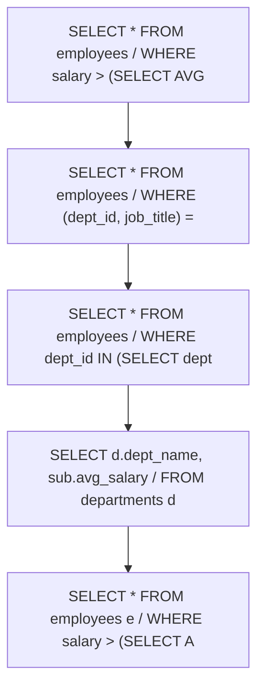

> **SQL Chapter 08/20** | [← Previous](07_JOINs_Complete.md) | [Index](../00_MASTER_INDEX.md) | [Next →](09_Window_Functions.md)

---

## Chapter 8: Subqueries & CTEs

### 🧠 Understanding Subqueries — Queries Within Queries

A subquery is a `SELECT` statement nested inside another SQL statement. It lets you use the **result of one query as input to another**. This is powerful because many real-world questions are two-step: first, find something (like the average salary), then use that result to filter or compare.

#### Subquery vs JOIN — Which to Use?

Both can often solve the same problem, but they differ in important ways:

| Aspect | Subquery | JOIN |
|--------|----------|------|
| **Readability** | Better when asking "exists/doesn't exist" questions | Better when combining columns from multiple tables |
| **Performance** | Correlated subqueries run *once per row* of the outer query — can be very slow on large tables | JOINs are typically optimized better by the query planner |
| **Use when** | Checking existence, comparing to aggregates, filtering by derived values | Retrieving columns from related tables |

> 💡 **Rule of Thumb:** If you need columns from both tables in your output, use a JOIN. If you only need data from one table but need to check a condition against another, a subquery or EXISTS is often cleaner.

#### Correlated vs Non-Correlated — The Performance Trap

- **Non-correlated subquery:** Runs once, independently of the outer query. Like a constant. `WHERE salary > (SELECT AVG(salary) FROM employees)` — the average is computed once and reused for every row. This is fast.

- **Correlated subquery:** References the outer query, so it runs **once for every row** in the outer query. `WHERE salary > (SELECT AVG(salary) FROM employees e2 WHERE e2.dept_id = e.dept_id)` — the average is recomputed for each employee's department. For 10,000 employees, this runs 10,000 subqueries. This can be rewritten as a JOIN for much better performance.

### Why CTEs Exist — Readable, Modular SQL

CTEs (Common Table Expressions, the `WITH` clause) let you break complex queries into **named, sequential steps**. Without CTEs, complex queries become deeply nested subqueries that are nearly impossible to read or debug. CTEs make SQL readable like a story: "First, calculate X. Then, using X, calculate Y. Finally, show Y."

CTEs are also the **only way to write recursive queries** in SQL — traversing hierarchies (org charts, category trees, file systems) requires the query to reference its own previous results, which only `WITH RECURSIVE` supports.

#### 📝 Formal Syntax — Subqueries

```
-- Scalar subquery (returns single value, used in WHERE):
SELECT <columns>
FROM <table>
WHERE <column> <operator> (SELECT <single_column> FROM <table> [WHERE ...]);

-- Column subquery (returns a list, used with IN):
SELECT <columns>
FROM <table>
WHERE <column> IN (SELECT <single_column> FROM <table> [WHERE ...]);

-- Table subquery (returns a result set, used as derived table in FROM):
SELECT <columns>
FROM (SELECT <columns> FROM <table> [WHERE ...]) AS <alias>;

-- EXISTS subquery (returns TRUE/FALSE based on whether rows exist):
SELECT <columns>
FROM <table_A> AS a
WHERE [NOT] EXISTS (SELECT 1 FROM <table_B> WHERE <table_B>.<col> = a.<col>);

-- Correlated subquery (references outer query — runs once per row):
SELECT <columns>
FROM <table> AS outer_alias
WHERE <column> <operator> (
    SELECT <aggregate>(<column>) FROM <table> WHERE <column> = outer_alias.<column>
);
```

#### 📝 Formal Syntax — CTE (Common Table Expression)

```
WITH <cte_name> AS (
    SELECT <columns>
    FROM <table>
    [WHERE <condition>]
)
SELECT <columns>
FROM <cte_name>
[JOIN <other_table> ON ...];

-- Multiple CTEs (chained):
WITH
    <cte_1> AS (SELECT ...),
    <cte_2> AS (SELECT ... FROM <cte_1> ...)
SELECT ... FROM <cte_2>;
```

#### 📝 Formal Syntax — Recursive CTE

```
WITH RECURSIVE <cte_name> AS (
    -- Base case (anchor member):
    SELECT <columns> FROM <table> WHERE <start_condition>

    UNION ALL

    -- Recursive case (references itself):
    SELECT <columns>
    FROM <table>
    JOIN <cte_name> ON <table>.<parent_col> = <cte_name>.<child_col>
)
SELECT * FROM <cte_name>;
```

---

```
┌─────────────────────────────────────────────────────────────────────────────────┐
│                    SUBQUERY TYPES                                               │
├─────────────────────────────────────────────────────────────────────────────────┤
│                                                                                 │
│  1. SCALAR SUBQUERY - Returns single value                                      │
│  ┌────────────────────────────────────────────────────────────────────────────┐ │
│  │  SELECT * FROM employees                                                   │ │
│  │  WHERE salary > (SELECT AVG(salary) FROM employees);                       │ │
│  │               └──────────────────────────────────────┘                     │ │
│  │                    Returns: 85000 (single value)                           │ │
│  └────────────────────────────────────────────────────────────────────────────┘ │
│                                                                                 │
│  2. ROW SUBQUERY - Returns single row                                           │
│  ┌────────────────────────────────────────────────────────────────────────────┐ │
│  │  SELECT * FROM employees                                                   │ │
│  │  WHERE (dept_id, job_title) = (SELECT dept_id, job_title                  │  │
│  │                                 FROM employees WHERE emp_id = 1);          │ │
│  └────────────────────────────────────────────────────────────────────────────┘ │
│                                                                                 │
│  3. COLUMN SUBQUERY - Returns single column (multiple rows)                     │
│  ┌────────────────────────────────────────────────────────────────────────────┐ │
│  │  SELECT * FROM employees                                                   │ │
│  │  WHERE dept_id IN (SELECT dept_id FROM departments                        │  │
│  │                    WHERE location = 'New York');                           │ │
│  │                └─────────────────────────────────────────┘                 │ │
│  │                     Returns: (1, 2, 5) - list of values                    │ │
│  └────────────────────────────────────────────────────────────────────────────┘ │
│                                                                                 │
│  4. TABLE SUBQUERY - Returns multiple rows and columns                          │
│  ┌────────────────────────────────────────────────────────────────────────────┐ │
│  │  SELECT d.dept_name, sub.avg_salary                                        │ │
│  │  FROM departments d                                                        │ │
│  │  JOIN (SELECT dept_id, AVG(salary) as avg_salary                          │  │
│  │        FROM employees GROUP BY dept_id) sub                                │ │
│  │  ON d.dept_id = sub.dept_id;                                               │ │
│  └────────────────────────────────────────────────────────────────────────────┘ │
│                                                                                 │
│  5. CORRELATED SUBQUERY - References outer query                                │
│  ┌────────────────────────────────────────────────────────────────────────────┐ │
│  │  SELECT * FROM employees e                                                 │ │
│  │  WHERE salary > (SELECT AVG(salary) FROM employees                        │  │
│  │                  WHERE dept_id = e.dept_id);   ←─ References e             │ │
│  │                                                                            │ │
│  │  Executes subquery ONCE PER ROW in outer query (can be slow!)             │  │
│  └────────────────────────────────────────────────────────────────────────────┘ │
│                                                                                 │
└─────────────────────────────────────────────────────────────────────────────────┘
```

**Flow:**
- SELECT * FROM employees / WHERE salary > (SELECT AVG
- ↓
- SELECT * FROM employees / WHERE (dept_id, job_title) =
- ↓
- SELECT * FROM employees / WHERE dept_id IN (SELECT dept
- ↓
- SELECT d.dept_name, sub.avg_salary / FROM departments d
- ↓
- SELECT * FROM employees e / WHERE salary > (SELECT A



```sql
-- ═══════════════════════════════════════════════════════════════════════════════
-- SUBQUERIES IN SELECT
-- ═══════════════════════════════════════════════════════════════════════════════

-- Scalar subquery in SELECT
SELECT
    first_name,
    salary,
    (SELECT AVG(salary) FROM employees) AS company_avg,
    salary - (SELECT AVG(salary) FROM employees) AS diff_from_avg
FROM employees;

-- Correlated subquery in SELECT (department average)
SELECT
    e.first_name,
    e.dept_id,
    e.salary,
    (SELECT AVG(salary) FROM employees e2 WHERE e2.dept_id = e.dept_id) AS dept_avg
FROM employees e;


-- ═══════════════════════════════════════════════════════════════════════════════
-- SUBQUERIES IN WHERE
-- ═══════════════════════════════════════════════════════════════════════════════

-- Scalar subquery
SELECT * FROM employees
WHERE salary > (SELECT AVG(salary) FROM employees);

-- IN subquery (column subquery)
SELECT * FROM employees
WHERE dept_id IN (
    SELECT dept_id FROM departments WHERE budget > 1000000
);

-- NOT IN subquery
SELECT * FROM departments
WHERE dept_id NOT IN (
    SELECT DISTINCT dept_id FROM employees WHERE dept_id IS NOT NULL
);

-- ANY / SOME (match any value from subquery)
SELECT * FROM employees
WHERE salary > ANY (
    SELECT salary FROM employees WHERE dept_id = 1
);

-- ALL (match all values from subquery)
SELECT * FROM employees
WHERE salary > ALL (
    SELECT salary FROM employees WHERE dept_id = 2
);


-- ═══════════════════════════════════════════════════════════════════════════════
-- EXISTS / NOT EXISTS
-- ═══════════════════════════════════════════════════════════════════════════════

-- EXISTS - Check if subquery returns any rows
-- Often faster than IN for large datasets

-- Find departments that have employees
SELECT * FROM departments d
WHERE EXISTS (
    SELECT 1 FROM employees e WHERE e.dept_id = d.dept_id
);

-- Find departments without employees
SELECT * FROM departments d
WHERE NOT EXISTS (
    SELECT 1 FROM employees e WHERE e.dept_id = d.dept_id
);

-- Find employees who have placed orders
SELECT * FROM customers c
WHERE EXISTS (
    SELECT 1 FROM orders o WHERE o.customer_id = c.customer_id
);


-- ═══════════════════════════════════════════════════════════════════════════════
-- SUBQUERIES IN FROM (Derived Tables)
-- ═══════════════════════════════════════════════════════════════════════════════

-- Calculate aggregates and then filter
SELECT dept_name, avg_salary
FROM (
    SELECT
        d.dept_name,
        AVG(e.salary) AS avg_salary
    FROM employees e
    JOIN departments d ON e.dept_id = d.dept_id
    GROUP BY d.dept_id, d.dept_name
) AS dept_stats
WHERE avg_salary > 80000;

-- Top earner per department
SELECT dept_name, top_earner, max_salary
FROM (
    SELECT
        d.dept_name,
        e.first_name AS top_earner,
        e.salary AS max_salary,
        RANK() OVER (PARTITION BY d.dept_id ORDER BY e.salary DESC) AS rnk
    FROM employees e
    JOIN departments d ON e.dept_id = d.dept_id
) ranked
WHERE rnk = 1;


-- ═══════════════════════════════════════════════════════════════════════════════
-- CORRELATED SUBQUERIES (Advanced)
-- ═══════════════════════════════════════════════════════════════════════════════

-- Employees who earn above their department average
SELECT e.*
FROM employees e
WHERE e.salary > (
    SELECT AVG(e2.salary)
    FROM employees e2
    WHERE e2.dept_id = e.dept_id
);

-- Get the latest order for each customer
SELECT *
FROM orders o1
WHERE o1.order_date = (
    SELECT MAX(o2.order_date)
    FROM orders o2
    WHERE o2.customer_id = o1.customer_id
);

-- Employees who are the highest paid in their department
SELECT e.*
FROM employees e
WHERE e.salary = (
    SELECT MAX(e2.salary)
    FROM employees e2
    WHERE e2.dept_id = e.dept_id
);


-- ═══════════════════════════════════════════════════════════════════════════════
-- CTEs (Common Table Expressions) - WITH Clause
-- ═══════════════════════════════════════════════════════════════════════════════

-- Basic CTE
WITH dept_stats AS (
    SELECT
        dept_id,
        COUNT(*) AS emp_count,
        AVG(salary) AS avg_salary
    FROM employees
    GROUP BY dept_id
)
SELECT
    d.dept_name,
    ds.emp_count,
    ds.avg_salary
FROM dept_stats ds
JOIN departments d ON ds.dept_id = d.dept_id
WHERE ds.avg_salary > 80000;

-- Multiple CTEs
WITH
    high_earners AS (
        SELECT * FROM employees WHERE salary > 100000
    ),
    dept_counts AS (
        SELECT dept_id, COUNT(*) as cnt FROM high_earners GROUP BY dept_id
    )
SELECT
    d.dept_name,
    COALESCE(dc.cnt, 0) AS high_earner_count
FROM departments d
LEFT JOIN dept_counts dc ON d.dept_id = dc.dept_id;

-- CTE with calculations
WITH monthly_revenue AS (
    SELECT
        DATE_FORMAT(order_date, '%Y-%m') AS month,
        SUM(total) AS revenue
    FROM orders
    WHERE status = 'delivered'
    GROUP BY DATE_FORMAT(order_date, '%Y-%m')
),
revenue_with_growth AS (
    SELECT
        month,
        revenue,
        LAG(revenue) OVER (ORDER BY month) AS prev_revenue,
        revenue - LAG(revenue) OVER (ORDER BY month) AS growth
    FROM monthly_revenue
)
SELECT
    month,
    revenue,
    prev_revenue,
    growth,
    ROUND(growth / prev_revenue * 100, 2) AS growth_pct
FROM revenue_with_growth
WHERE prev_revenue IS NOT NULL;


-- ═══════════════════════════════════════════════════════════════════════════════
-- RECURSIVE CTEs
-- ═══════════════════════════════════════════════════════════════════════════════

-- Generate number sequence
WITH RECURSIVE numbers AS (
    SELECT 1 AS n
    UNION ALL
    SELECT n + 1 FROM numbers WHERE n < 10
)
SELECT * FROM numbers;

-- Employee hierarchy (org chart)
WITH RECURSIVE org_chart AS (
    -- Base case: top-level managers (no manager)
    SELECT
        emp_id,
        first_name,
        manager_id,
        0 AS level,
        CAST(first_name AS CHAR(1000)) AS path
    FROM employees
    WHERE manager_id IS NULL

    UNION ALL

    -- Recursive case: employees with managers
    SELECT
        e.emp_id,
        e.first_name,
        e.manager_id,
        oc.level + 1,
        CONCAT(oc.path, ' -> ', e.first_name)
    FROM employees e
    INNER JOIN org_chart oc ON e.manager_id = oc.emp_id
)
SELECT
    REPEAT('  ', level) || first_name AS employee_tree,
    level,
    path
FROM org_chart
ORDER BY path;

-- Category tree (for e-commerce)
WITH RECURSIVE category_tree AS (
    SELECT
        category_id,
        name,
        parent_id,
        1 AS level,
        name AS full_path
    FROM categories
    WHERE parent_id IS NULL

    UNION ALL

    SELECT
        c.category_id,
        c.name,
        c.parent_id,
        ct.level + 1,
        CONCAT(ct.full_path, ' > ', c.name)
    FROM categories c
    INNER JOIN category_tree ct ON c.parent_id = ct.category_id
)
SELECT * FROM category_tree ORDER BY full_path;
```

---

> **Navigation**: [< Previous](07_JOINs_Complete.md) | [Back to Index](../00_MASTER_INDEX.md) | [Next >](09_Window_Functions.md)