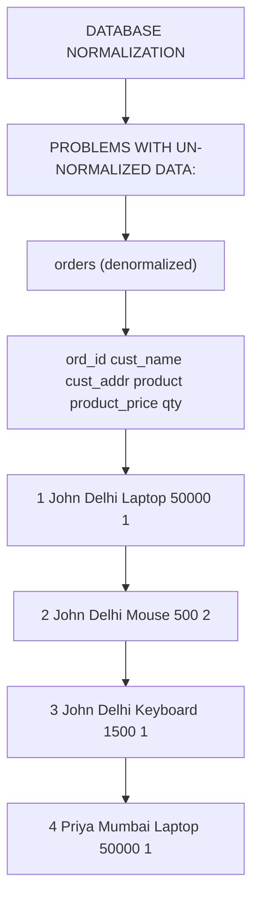
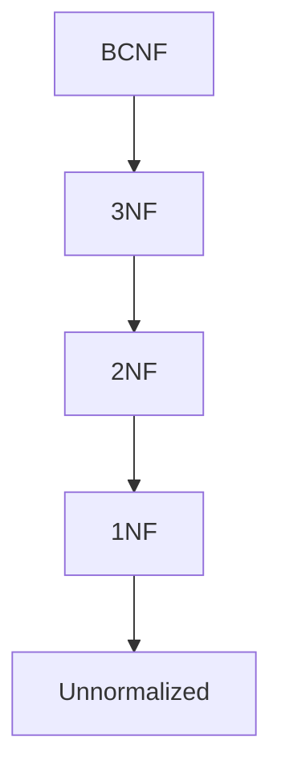
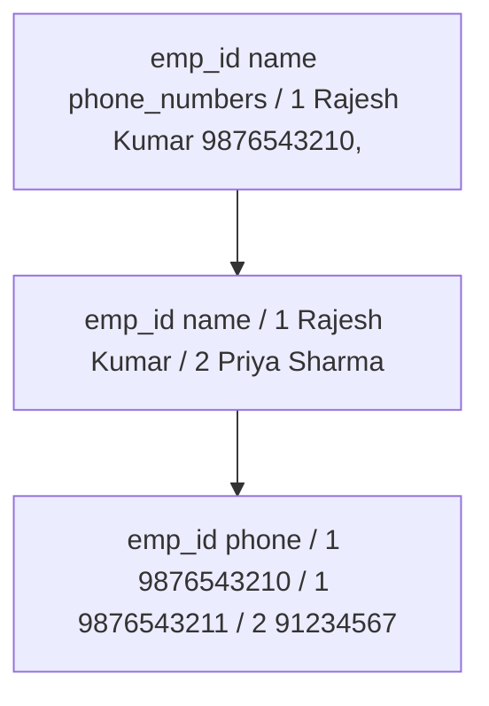
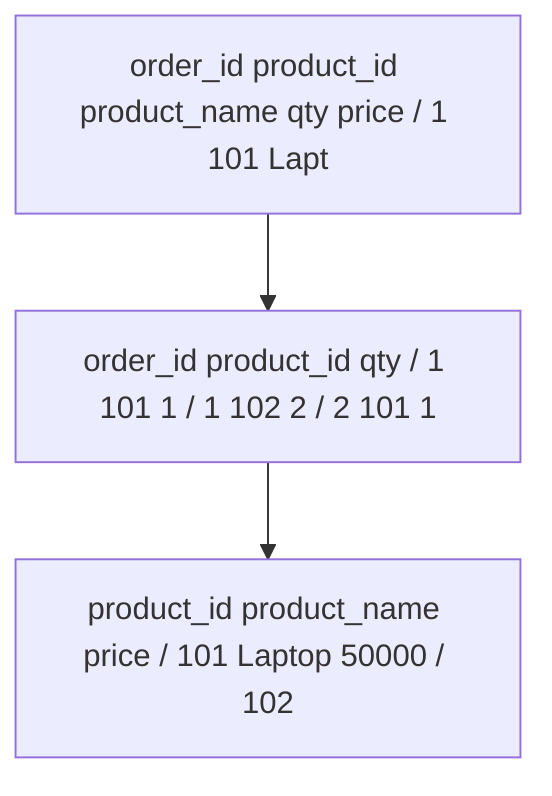
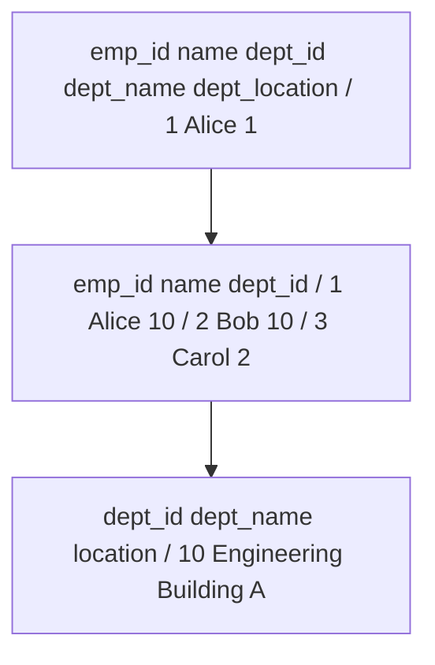
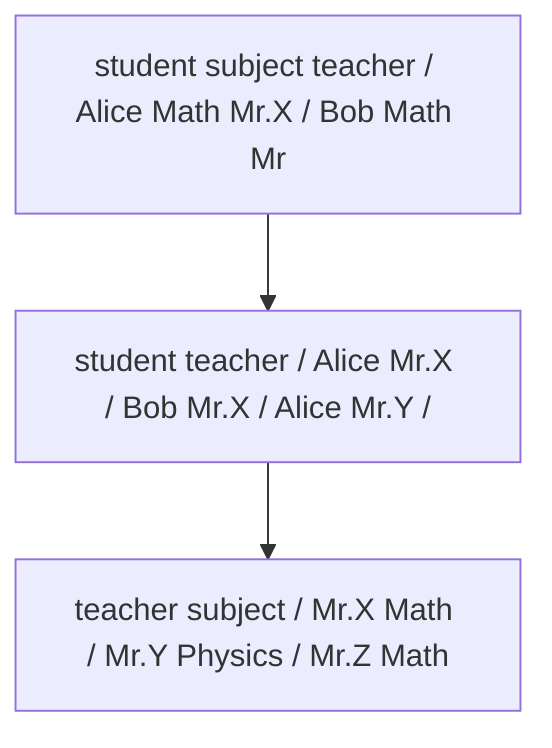

> **SQL Chapter 10/20** | [← Previous](09_Window_Functions.md) | [Index](../00_MASTER_INDEX.md) | [Next →](11_Indexes_Performance.md)

---

## Chapter 10: Database Normalization (1NF to BCNF)

### Why Normalization?

```
┌─────────────────────────────────────────────────────────────────────────────────┐
│                    DATABASE NORMALIZATION                                       │
├─────────────────────────────────────────────────────────────────────────────────┤
│                                                                                 │
│  PROBLEMS WITH UN-NORMALIZED DATA:                                              │
│                                                                                 │
│  ┌────────────────────────────────────────────────────────────────────────────┐ │
│  │  orders (denormalized)                                                     │ │
│  │  ┌──────┬──────────┬─────────┬───────────────┬──────────────┬───────────┐ │  │
│  │  │ord_id│cust_name │cust_addr│ product       │ product_price│ qty       │ │  │
│  │  ├──────┼──────────┼─────────┼───────────────┼──────────────┼───────────┤ │  │
│  │  │ 1    │ John     │ Delhi   │ Laptop        │ 50000        │ 1         │ │  │
│  │  │ 2    │ John     │ Delhi   │ Mouse         │ 500          │ 2         │ │  │
│  │  │ 3    │ John     │ Delhi   │ Keyboard      │ 1500         │ 1         │ │  │
│  │  │ 4    │ Priya    │ Mumbai  │ Laptop        │ 50000        │ 1         │ │  │
│  │  └──────┴──────────┴─────────┴───────────────┴──────────────┴───────────┘ │  │
│  │                                                                            │ │
│  │  PROBLEMS:                                                                 │ │
│  │  1. UPDATE ANOMALY: John moves to Bangalore → update 3 rows!              │  │
│  │  2. INSERT ANOMALY: Can't add customer without order                       │ │
│  │  3. DELETE ANOMALY: Delete order 4 → lose Priya's info!                   │  │
│  │  4. DATA REDUNDANCY: John's name/address repeated 3 times                  │ │
│  │  5. STORAGE WASTE: Same product prices stored multiple times              │  │
│  └────────────────────────────────────────────────────────────────────────────┘ │
│                                                                                 │
│  NORMALIZATION solves these by organizing data into separate tables!            │
│                                                                                 │
└─────────────────────────────────────────────────────────────────────────────────┘
```

> **Flow**: DATABASE NORMALIZATION → PROBLEMS WITH UN-NORMALIZED DATA: | PROBLEMS WITH UN-NORMALIZED DATA: → orders (denormalized) | orders (denormalized) → ord_id cust_name cust_addr product product_price qty | ord_id cust_name cust_addr product product_price qty → 1 John Delhi Laptop 50000 1 | 1 John Delhi Laptop 50000 1 → 2 John Delhi Mouse 500 2 | 2 John Delhi Mouse 500 2 → 3 John Delhi Keyboard 1500 1 | ...+1 more



### Normal Forms

```
┌─────────────────────────────────────────────────────────────────────────────────┐
│                    NORMAL FORMS HIERARCHY                                       │
├─────────────────────────────────────────────────────────────────────────────────┤
│                                                                                 │
│                           ┌─────────────┐                                       │
│                           │    BCNF     │ ← Every determinant is a candidate key│
│                           └──────┬──────┘                                       │
│                                  │                                              │
│                           ┌──────▼──────┐                                       │
│                           │     3NF     │ ← No transitive dependencies          │
│                           └──────┬──────┘                                       │
│                                  │                                              │
│                           ┌──────▼──────┐                                       │
│                           │     2NF     │ ← No partial dependencies             │
│                           └──────┬──────┘                                       │
│                                  │                                              │
│                           ┌──────▼──────┐                                       │
│                           │     1NF     │ ← Atomic values, no repeating groups  │
│                           └──────┬──────┘                                       │
│                                  │                                              │
│                           ┌──────▼──────┐                                       │
│                           │ Unnormalized│                                       │
│                           └─────────────┘                                       │
│                                                                                 │
│  Each form builds on the previous one!                                          │
│                                                                                 │
└─────────────────────────────────────────────────────────────────────────────────┘
```

> **Flow**: BCNF → 3NF | 3NF → 2NF | 2NF → 1NF | 1NF → Unnormalized



### First Normal Form (1NF)

```
┌─────────────────────────────────────────────────────────────────────────────────┐
│                    1NF - FIRST NORMAL FORM                                      │
├─────────────────────────────────────────────────────────────────────────────────┤
│                                                                                 │
│  RULES:                                                                         │
│  1. Each column contains ATOMIC (indivisible) values                            │
│  2. No REPEATING GROUPS or arrays                                               │
│  3. Each row is UNIQUE (has a primary key)                                      │
│                                                                                 │
│  BEFORE (Violates 1NF):                                                         │
│  ┌────────┬───────────────────┬─────────────────────────────────────────────┐   │
│  │ emp_id │ name              │ phone_numbers                               │   │
│  ├────────┼───────────────────┼─────────────────────────────────────────────┤   │
│  │ 1      │ Rajesh Kumar      │ 9876543210, 9876543211                      │   │
│  │ 2      │ Priya Sharma      │ 9123456789                                  │   │
│  └────────┴───────────────────┴─────────────────────────────────────────────┘   │
│  ↑ PROBLEM: phone_numbers contains multiple values (not atomic)                 │
│                                                                                 │
│  AFTER (1NF):                                                                   │
│  employees                         employee_phones                              │
│  ┌────────┬────────────────┐      ┌────────┬──────────────┐                     │
│  │ emp_id │ name           │      │ emp_id │ phone        │                     │
│  ├────────┼────────────────┤      ├────────┼──────────────┤                     │
│  │ 1      │ Rajesh Kumar   │      │ 1      │ 9876543210   │                     │
│  │ 2      │ Priya Sharma   │      │ 1      │ 9876543211   │                     │
│  └────────┴────────────────┘      │ 2      │ 9123456789   │                     │
│                                   └────────┴──────────────┘                     │
│                                                                                 │
└─────────────────────────────────────────────────────────────────────────────────┘
```

> **Flow**: emp_id name phone_numbers / 1 Rajesh Kumar 9876543210,  → emp_id name / 1 Rajesh Kumar / 2 Priya Sharma | emp_id name / 1 Rajesh Kumar / 2 Priya Sharma → emp_id phone / 1 9876543210 / 1 9876543211 / 2 91234567



### Second Normal Form (2NF)

```
┌─────────────────────────────────────────────────────────────────────────────────┐
│                    2NF - SECOND NORMAL FORM                                     │
├─────────────────────────────────────────────────────────────────────────────────┤
│                                                                                 │
│  RULES:                                                                         │
│  1. Must be in 1NF                                                              │
│  2. No PARTIAL DEPENDENCY (non-key column depends on PART of composite key)     │
│                                                                                 │
│  BEFORE (Violates 2NF):                                                         │
│  order_items (PK: order_id, product_id)                                         │
│  ┌──────────┬────────────┬──────────────┬───────┬─────────┐                     │
│  │ order_id │ product_id │ product_name │ qty   │ price   │                     │
│  ├──────────┼────────────┼──────────────┼───────┼─────────┤                     │
│  │ 1        │ 101        │ Laptop       │ 1     │ 50000   │                     │
│  │ 1        │ 102        │ Mouse        │ 2     │ 500     │                     │
│  │ 2        │ 101        │ Laptop       │ 1     │ 50000   │                     │
│  └──────────┴────────────┴──────────────┴───────┴─────────┘                     │
│                                                                                 │
│  PROBLEM: product_name and price depend ONLY on product_id, not full PK!        │
│           (Partial dependency on composite key)                                 │
│                                                                                 │
│  AFTER (2NF):                                                                   │
│  order_items                           products                                 │
│  ┌──────────┬────────────┬───────┐    ┌────────────┬──────────────┬─────────┐   │
│  │ order_id │ product_id │ qty   │    │ product_id │ product_name │ price   │   │
│  ├──────────┼────────────┼───────┤    ├────────────┼──────────────┼─────────┤   │
│  │ 1        │ 101        │ 1     │    │ 101        │ Laptop       │ 50000   │   │
│  │ 1        │ 102        │ 2     │    │ 102        │ Mouse        │ 500     │   │
│  │ 2        │ 101        │ 1     │    └────────────┴──────────────┴─────────┘   │
│  └──────────┴────────────┴───────┘                                              │
│                                                                                 │
└─────────────────────────────────────────────────────────────────────────────────┘
```

> **Flow**: order_id product_id product_name qty price / 1 101 Lapt → order_id product_id qty / 1 101 1 / 1 102 2 / 2 101 1 | order_id product_id qty / 1 101 1 / 1 102 2 / 2 101 1 → product_id product_name price / 101 Laptop 50000 / 102 



### Third Normal Form (3NF)

```
┌─────────────────────────────────────────────────────────────────────────────────┐
│                    3NF - THIRD NORMAL FORM                                      │
├─────────────────────────────────────────────────────────────────────────────────┤
│                                                                                 │
│  RULES:                                                                         │
│  1. Must be in 2NF                                                              │
│  2. No TRANSITIVE DEPENDENCY (non-key depends on another non-key)               │
│                                                                                 │
│  BEFORE (Violates 3NF):                                                         │
│  employees (PK: emp_id)                                                         │
│  ┌────────┬────────┬─────────┬───────────────┬─────────────────┐                │
│  │ emp_id │ name   │ dept_id │ dept_name     │ dept_location   │                │
│  ├────────┼────────┼─────────┼───────────────┼─────────────────┤                │
│  │ 1      │ Alice  │ 10      │ Engineering   │ Building A      │                │
│  │ 2      │ Bob    │ 10      │ Engineering   │ Building A      │                │
│  │ 3      │ Carol  │ 20      │ Marketing     │ Building B      │                │
│  └────────┴────────┴─────────┴───────────────┴─────────────────┘                │
│                                                                                 │
│  PROBLEM: dept_name, dept_location depend on dept_id, NOT emp_id!               │
│           emp_id → dept_id → dept_name (Transitive dependency)                  │
│                                                                                 │
│  AFTER (3NF):                                                                   │
│  employees                             departments                              │
│  ┌────────┬────────┬─────────┐        ┌─────────┬─────────────┬─────────────┐   │
│  │ emp_id │ name   │ dept_id │        │ dept_id │ dept_name   │ location    │   │
│  ├────────┼────────┼─────────┤        ├─────────┼─────────────┼─────────────┤   │
│  │ 1      │ Alice  │ 10      │        │ 10      │ Engineering │ Building A  │   │
│  │ 2      │ Bob    │ 10      │        │ 20      │ Marketing   │ Building B  │   │
│  │ 3      │ Carol  │ 20      │        └─────────┴─────────────┴─────────────┘   │
│  └────────┴────────┴─────────┘                                                  │
│                                                                                 │
└─────────────────────────────────────────────────────────────────────────────────┘
```

> **Flow**: emp_id name dept_id dept_name dept_location / 1 Alice 1 → emp_id name dept_id / 1 Alice 10 / 2 Bob 10 / 3 Carol 2 | emp_id name dept_id / 1 Alice 10 / 2 Bob 10 / 3 Carol 2 → dept_id dept_name location / 10 Engineering Building A 



### BCNF (Boyce-Codd Normal Form)

```
┌─────────────────────────────────────────────────────────────────────────────────┐
│                    BCNF - BOYCE-CODD NORMAL FORM                                │
├─────────────────────────────────────────────────────────────────────────────────┤
│                                                                                 │
│  RULES:                                                                         │
│  1. Must be in 3NF                                                              │
│  2. Every DETERMINANT must be a CANDIDATE KEY                                   │
│     (If X → Y, then X must be a candidate key)                                  │
│                                                                                 │
│  BEFORE (3NF but violates BCNF):                                                │
│  student_courses (student can have only one teacher per subject)                │
│  ┌──────────┬──────────┬─────────┐                                              │
│  │ student  │ subject  │ teacher │   PK: (student, subject)                     │
│  ├──────────┼──────────┼─────────┤   Each teacher teaches only ONE subject      │
│  │ Alice    │ Math     │ Mr.X    │                                              │
│  │ Bob      │ Math     │ Mr.X    │   Functional Dependencies:                   │
│  │ Alice    │ Physics  │ Mr.Y    │   (student, subject) → teacher               │
│  │ Carol    │ Math     │ Mr.Z    │   teacher → subject  ← PROBLEM!              │
│  └──────────┴──────────┴─────────┘   (teacher determines subject but isn't key) │
│                                                                                 │
│  AFTER (BCNF):                                                                  │
│  student_teacher                       teacher_subject                          │
│  ┌──────────┬─────────┐               ┌─────────┬──────────┐                    │
│  │ student  │ teacher │               │ teacher │ subject  │                    │
│  ├──────────┼─────────┤               ├─────────┼──────────┤                    │
│  │ Alice    │ Mr.X    │               │ Mr.X    │ Math     │                    │
│  │ Bob      │ Mr.X    │               │ Mr.Y    │ Physics  │                    │
│  │ Alice    │ Mr.Y    │               │ Mr.Z    │ Math     │                    │
│  │ Carol    │ Mr.Z    │               └─────────┴──────────┘                    │
│  └──────────┴─────────┘                                                         │
│                                                                                 │
│  Now teacher → subject is in its own table where teacher IS the key!            │
│                                                                                 │
└─────────────────────────────────────────────────────────────────────────────────┘
```

> **Flow**: student subject teacher / Alice Math Mr.X / Bob Math Mr → student teacher / Alice Mr.X / Bob Mr.X / Alice Mr.Y /  | student teacher / Alice Mr.X / Bob Mr.X / Alice Mr.Y /  → teacher subject / Mr.X Math / Mr.Y Physics / Mr.Z Math



### Normalization Summary

```sql
-- ═══════════════════════════════════════════════════════════════════════════════
-- NORMALIZATION QUICK REFERENCE
-- ═══════════════════════════════════════════════════════════════════════════════

/*
1NF: No multi-valued attributes, no repeating groups
     → Split arrays into separate rows/tables

2NF: No partial dependencies (for composite keys)
     → Every non-key column depends on ENTIRE primary key

3NF: No transitive dependencies
     → Non-key columns don't depend on other non-key columns

BCNF: Every determinant is a candidate key
      → Stricter than 3NF, handles special cases


DENORMALIZATION (intentional):
Sometimes we DENORMALIZE for:
1. Read performance (fewer JOINs)
2. Reporting tables
3. Data warehousing

Example: Store customer name in orders table to avoid JOINs:
CREATE TABLE orders (
    order_id INT PRIMARY KEY,
    customer_id INT,
    customer_name VARCHAR(100),  -- Denormalized for reporting
    ...
);
*/
```

---

> **Navigation**: [< Previous](09_Window_Functions.md) | [Back to Index](../00_MASTER_INDEX.md) | [Next >](11_Indexes_Performance.md)