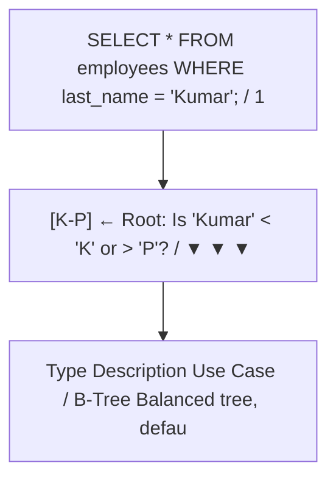

> **SQL Chapter 11/20** | [← Previous](10_Normalization.md) | [Index](../00_MASTER_INDEX.md) | [Next →](12_Views_StoredProcs_Triggers.md)

---

## Chapter 11: Indexes & Query Performance

### 🧠 Understanding Indexes — Why They Exist and How They Work

An index is a **separate data structure** that the database maintains alongside your table, specifically designed to speed up data retrieval. Without an index, finding a row requires a **full table scan** — the database reads every single row, one by one, checking if it matches your WHERE clause. For a table with 10 million rows, this means reading 10 million rows even if only one matches.

With an index, the database can jump directly to the matching rows, just like a book's index lets you jump to the right page instead of reading every page.

#### How B-Tree Indexes Actually Work

The most common index type is the **B-Tree** (Balanced Tree). Understanding its structure explains *why* certain queries use indexes and others don't:

A B-Tree organizes data into a **hierarchy of sorted pages**. Each page holds multiple keys and pointers. Starting from the root, the database compares your search value against the keys in each page to decide which child page to visit next. This process repeats until it reaches a leaf page containing the actual row location.

**Key Properties:**
- The tree is always **balanced** — every path from root to leaf is the same length. This guarantees O(log n) lookups regardless of data distribution.
- Leaf pages are **linked together** in sorted order, which makes range queries (`BETWEEN`, `<`, `>`) efficient — once you find the start of the range, you just follow the linked list.
- For a table with 10 million rows, a B-Tree typically has **3-4 levels**. This means finding any row requires only 3-4 disk reads, instead of millions.

#### The Read-Write Trade-Off — Indexes Are NOT Free

Every index you create has a cost:

- **Storage:** An index is a copy of the indexed column(s) plus pointers, stored in a separate B-Tree structure. Multiple indexes on a large table can collectively be larger than the table itself.
- **Write Overhead:** Every `INSERT`, `UPDATE`, or `DELETE` on the table must also update every index that references the affected columns. If a table has 5 indexes and you insert 1 row, the database performs 6 write operations (1 table + 5 indexes).
- **Maintenance:** Indexes can become **fragmented** over time as data is inserted and deleted, requiring periodic rebuilding.

> 💡 **Rule of Thumb:** Index columns that are frequently used in `WHERE`, `JOIN`, and `ORDER BY` clauses. Don't index columns that are rarely queried or frequently updated. For write-heavy tables (logging, event tracking), keep indexes minimal.

#### Index Selectivity — Why Some Indexes Are Useless

**Selectivity** is the ratio of distinct values to total rows. A column with high selectivity (many unique values, like `email` or `user_id`) makes an excellent index candidate because each lookup narrows down to very few rows.

A column with low selectivity (few unique values, like `gender` with only `M`/`F`/`O`) makes a **terrible** index. If 50% of rows are `M`, the database would still need to read half the table — at that point, a full table scan is actually faster because it avoids the overhead of jumping between index and table pages.

| Column | Distinct Values | Selectivity | Worth Indexing? |
|--------|----------------|-------------|-----------------|
| `user_id` | 10,000,000 | Very High | ✅ Yes — each lookup returns 1 row |
| `email` | 9,800,000 | Very High | ✅ Yes — nearly unique |
| `city` | 5,000 | Medium | ⚠️ Maybe — depends on query patterns |
| `gender` | 3 | Very Low | ❌ No — each value matches ~33% of rows |
| `is_active` | 2 | Very Low | ❌ No (unless using **partial index** on just active rows) |

#### Composite Indexes — Column Order Is Everything

A composite index on `(dept_id, salary)` is sorted **first by dept_id, then by salary within each dept_id**. Think of it like a phone book sorted by last name, then first name. This means:

- ✅ `WHERE dept_id = 1` — uses the index (leftmost column)
- ✅ `WHERE dept_id = 1 AND salary > 50000` — uses the index (both columns, in order)
- ❌ `WHERE salary > 50000` — **cannot use this index!** (skipping the leftmost column is like trying to find everyone named "John" in a phone book sorted by last name — you'd have to scan the entire book)

This is called the **leftmost prefix rule** and is one of the most commonly misunderstood aspects of database indexing.

---

```
┌─────────────────────────────────────────────────────────────────────────────────┐
│                    DATABASE INDEXES                                             │
├─────────────────────────────────────────────────────────────────────────────────┤
│                                                                                 │
│  INDEX = Data structure that improves query speed (like book index)             │
│                                                                                 │
│  WITHOUT INDEX (Full Table Scan):                                               │
│  ┌────────────────────────────────────────────────────────────────────────────┐ │
│  │  SELECT * FROM employees WHERE last_name = 'Kumar';                        │ │
│  │                                                                            │ │
│  │  ┌───┬───┬───┬───┬───┬───┬───┬───┬───┬───┐                               │   │
│  │  │ 1 │ 2 │ 3 │ 4 │ 5 │ 6 │ 7 │ 8 │ 9 │10 │  ← Check EVERY row            │   │
│  │  └───┴───┴───┴───┴───┴───┴───┴───┴───┴───┘    (O(n) - slow!)              │  │
│  └────────────────────────────────────────────────────────────────────────────┘ │
│                                                                                 │
│  WITH INDEX (B-Tree Search):                                                    │
│  ┌────────────────────────────────────────────────────────────────────────────┐ │
│  │                     ┌─────────────┐                                        │ │
│  │                     │   [K-P]     │ ← Root: Is 'Kumar' < 'K' or > 'P'?     │ │
│  │                     └──────┬──────┘                                        │ │
│  │              ┌─────────────┼─────────────┐                                 │ │
│  │         ┌────▼────┐   ┌────▼────┐   ┌────▼────┐                            │ │
│  │         │ [A-J]   │   │ [K-P]   │   │ [Q-Z]   │ ← Navigate down            │ │
│  │         └─────────┘   └────┬────┘   └─────────┘                            │ │
│  │                            ▼                                               │ │
│  │                    ┌───────────────┐                                       │ │
│  │                    │ Kumar → Row 5 │ ← Found! (O(log n) - fast!)           │ │
│  │                    └───────────────┘                                       │ │
│  └────────────────────────────────────────────────────────────────────────────┘ │
│                                                                                 │
│                                                                                 │
│  INDEX TYPES:                                                                   │
│  ┌────────────────────────────────────────────────────────────────────────────┐ │
│  │  Type          │ Description                        │ Use Case             │ │
│  ├────────────────┼────────────────────────────────────┼──────────────────────┤ │
│  │ B-Tree         │ Balanced tree, default type        │ Most queries         │ │
│  │ Hash           │ Hash table lookup                  │ Exact match only     │ │
│  │ Full-Text      │ Text search with stemming          │ Search in documents  │ │
│  │ Spatial/GiST   │ Geographic data                    │ Location queries     │ │
│  │ Composite      │ Multiple columns                   │ Multi-column WHERE   │ │
│  │ Covering       │ Includes all needed columns        │ Avoid table access   │ │
│  │ Partial        │ Index subset of rows               │ Filtered data        │ │
│  └────────────────────────────────────────────────────────────────────────────┘ │
│                                                                                 │
└─────────────────────────────────────────────────────────────────────────────────┘
```

> **Flow**: SELECT * FROM employees WHERE last_name = 'Kumar'; / 1  → [K-P] ← Root: Is 'Kumar' &lt; 'K' or &gt; 'P'? / ▼ ▼ ▼  | [K-P] ← Root: Is 'Kumar' &lt; 'K' or &gt; 'P'? / ▼ ▼ ▼  → Type Description Use Case / B-Tree Balanced tree, defau



```sql
-- ═══════════════════════════════════════════════════════════════════════════════
-- CREATING AND MANAGING INDEXES
-- ═══════════════════════════════════════════════════════════════════════════════

-- Single column index
CREATE INDEX idx_emp_lastname ON employees(last_name);

-- Composite index (column order matters!)
CREATE INDEX idx_emp_dept_salary ON employees(dept_id, salary);
-- Good for: WHERE dept_id = 1 AND salary > 50000
-- Good for: WHERE dept_id = 1  (leftmost column)
-- BAD for: WHERE salary > 50000  (doesn't use index!)

-- Unique index
CREATE UNIQUE INDEX idx_emp_email ON employees(email);

-- Descending index (for ORDER BY DESC queries)
CREATE INDEX idx_orders_date_desc ON orders(order_date DESC);

-- Partial index (PostgreSQL) - index only relevant rows
CREATE INDEX idx_active_orders ON orders(order_date)
WHERE status = 'active';

-- Full-text index (MySQL)
CREATE FULLTEXT INDEX idx_product_search ON products(name, description);

-- Using full-text search
SELECT * FROM products
WHERE MATCH(name, description) AGAINST('laptop gaming' IN NATURAL LANGUAGE MODE);


-- ═══════════════════════════════════════════════════════════════════════════════
-- INDEX MAINTENANCE
-- ═══════════════════════════════════════════════════════════════════════════════

-- View indexes on a table
SHOW INDEX FROM employees;  -- MySQL
-- PostgreSQL:
SELECT * FROM pg_indexes WHERE tablename = 'employees';

-- Drop index
DROP INDEX idx_emp_lastname ON employees;  -- MySQL
DROP INDEX IF EXISTS idx_emp_lastname;      -- PostgreSQL

-- Rebuild/Optimize index
ALTER INDEX idx_emp_lastname REBUILD;  -- PostgreSQL
OPTIMIZE TABLE employees;               -- MySQL (rebuilds indexes)


-- ═══════════════════════════════════════════════════════════════════════════════
-- WHEN TO INDEX / NOT INDEX
-- ═══════════════════════════════════════════════════════════════════════════════

/*
CREATE INDEX when:
✓ Column used in WHERE clauses frequently
✓ Column used in JOIN conditions
✓ Column used in ORDER BY
✓ Column with high cardinality (many unique values)
✓ Foreign key columns

DON'T index when:
✗ Small tables (full scan is fast enough)
✗ Columns rarely used in queries
✗ Columns with low cardinality (e.g., gender: M/F)
✗ Tables with heavy INSERT/UPDATE/DELETE
✗ Columns frequently updated

REMEMBER: Indexes speed up reads but slow down writes!
*/
```

### Query Execution Plans

```sql
-- ═══════════════════════════════════════════════════════════════════════════════
-- EXPLAIN - UNDERSTANDING QUERY EXECUTION
-- ═══════════════════════════════════════════════════════════════════════════════

-- MySQL EXPLAIN
EXPLAIN SELECT * FROM employees WHERE last_name = 'Kumar';

/*
Output:
+----+-------------+-----------+------+---------------+------+---------+------+------+-------------+
| id | select_type | table     | type | possible_keys | key  | key_len | ref  | rows | Extra       |
+----+-------------+-----------+------+---------------+------+---------+------+------+-------------+
| 1  | SIMPLE      | employees | ref  | idx_lastname  | idx..| 202     | const| 5    | Using index |
+----+-------------+-----------+------+---------------+------+---------+------+------+-------------+

KEY COLUMNS:
- type: Access method (best to worst)
  ALL        : Full table scan (BAD!)
  index      : Full index scan
  range      : Index range scan (BETWEEN, <, >)
  ref        : Index lookup for non-unique values
  eq_ref     : Index lookup for unique values (best for JOINs)
  const      : Single row lookup by PK (best!)

- key: Which index is used (NULL = no index used)
- rows: Estimated rows to examine
- Extra: Additional info
  Using index      : Covered by index (good!)
  Using where      : Additional filtering needed
  Using filesort   : Sorting without index (slow)
  Using temporary  : Temp table needed (slow)
*/

-- More detailed explain
EXPLAIN ANALYZE SELECT * FROM employees WHERE last_name = 'Kumar';

-- PostgreSQL
EXPLAIN (ANALYZE, BUFFERS, FORMAT TEXT)
SELECT * FROM employees WHERE last_name = 'Kumar';


-- ═══════════════════════════════════════════════════════════════════════════════
-- QUERY OPTIMIZATION EXAMPLES
-- ═══════════════════════════════════════════════════════════════════════════════

-- BAD: Function on indexed column (can't use index)
SELECT * FROM employees WHERE YEAR(hire_date) = 2023;

-- GOOD: Range query (uses index)
SELECT * FROM employees
WHERE hire_date >= '2023-01-01' AND hire_date < '2024-01-01';


-- BAD: Leading wildcard (can't use index)
SELECT * FROM products WHERE name LIKE '%phone%';

-- GOOD: Trailing wildcard (uses index)
SELECT * FROM products WHERE name LIKE 'phone%';


-- BAD: Implicit conversion (index might not be used)
SELECT * FROM employees WHERE emp_code = 123;  -- emp_code is VARCHAR

-- GOOD: Match data types
SELECT * FROM employees WHERE emp_code = '123';


-- BAD: OR can prevent index usage
SELECT * FROM employees WHERE dept_id = 1 OR dept_id = 2;

-- GOOD: Use IN instead
SELECT * FROM employees WHERE dept_id IN (1, 2);


-- BAD: Not using covering index
SELECT * FROM employees WHERE dept_id = 1;

-- GOOD: Select only indexed columns (index-only scan)
SELECT emp_id, dept_id FROM employees WHERE dept_id = 1;
```

---

> **Navigation**: [< Previous](10_Normalization.md) | [Back to Index](../00_MASTER_INDEX.md) | [Next >](12_Views_StoredProcs_Triggers.md)