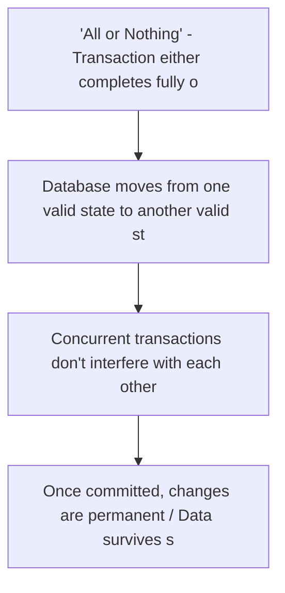

> **SQL Chapter 13/20** | [← Previous](12_Views_StoredProcs_Triggers.md) | [Index](../00_MASTER_INDEX.md) | [Next →](14_Query_Optimization.md)

---

## Chapter 15: Transactions & ACID Properties

```
┌─────────────────────────────────────────────────────────────────────────────────┐
│                    ACID PROPERTIES                                              │
├─────────────────────────────────────────────────────────────────────────────────┤
│                                                                                 │
│  A - ATOMICITY                                                                  │
│  ┌────────────────────────────────────────────────────────────────────────────┐ │
│  │  "All or Nothing" - Transaction either completes fully or not at all       │ │
│  │                                                                            │ │
│  │  Transfer $100 from Account A to Account B:                                │ │
│  │  1. Deduct $100 from A  ─┐                                                 │ │
│  │  2. Add $100 to B       ─┴─ Both must succeed, or neither happens          │ │
│  │                                                                            │ │
│  │  If step 2 fails, step 1 is automatically rolled back!                     │ │
│  └────────────────────────────────────────────────────────────────────────────┘ │
│                                                                                 │
│  C - CONSISTENCY                                                                │
│  ┌────────────────────────────────────────────────────────────────────────────┐ │
│  │  Database moves from one valid state to another valid state                │ │
│  │  All constraints, triggers, and rules are maintained                       │ │
│  │                                                                            │ │
│  │  Before: Total money = $1000                                               │ │
│  │  After:  Total money = $1000 (unchanged!)                                  │ │
│  └────────────────────────────────────────────────────────────────────────────┘ │
│                                                                                 │
│  I - ISOLATION                                                                  │
│  ┌────────────────────────────────────────────────────────────────────────────┐ │
│  │  Concurrent transactions don't interfere with each other                   │ │
│  │  Each transaction sees database as if it's the only one running            │ │
│  │                                                                            │ │
│  │  Transaction 1: Reading balance                                            │ │
│  │  Transaction 2: Updating balance                                           │ │
│  │  → T1 sees either before or after T2, never partial update                 │ │
│  └────────────────────────────────────────────────────────────────────────────┘ │
│                                                                                 │
│  D - DURABILITY                                                                 │
│  ┌────────────────────────────────────────────────────────────────────────────┐ │
│  │  Once committed, changes are permanent                                     │ │
│  │  Data survives system crashes, power failures                              │ │
│  │                                                                            │ │
│  │  Achieved through: Write-ahead logging, disk writes, replication           │ │
│  └────────────────────────────────────────────────────────────────────────────┘ │
│                                                                                 │
└─────────────────────────────────────────────────────────────────────────────────┘
```

> **Flow**: 'All or Nothing' - Transaction either completes fully o → Database moves from one valid state to another valid st | Database moves from one valid state to another valid st → Concurrent transactions don't interfere with each other | Concurrent transactions don't interfere with each other → Once committed, changes are permanent / Data survives s



```sql
-- ═══════════════════════════════════════════════════════════════════════════════
-- TRANSACTIONS - EXAMPLES
-- ═══════════════════════════════════════════════════════════════════════════════

-- Basic transaction
START TRANSACTION;  -- or BEGIN

UPDATE accounts SET balance = balance - 100 WHERE account_id = 1;
UPDATE accounts SET balance = balance + 100 WHERE account_id = 2;

COMMIT;  -- Make changes permanent
-- or ROLLBACK;  -- Undo all changes


-- Transaction with error handling (MySQL)
DELIMITER //
CREATE PROCEDURE transfer_funds(
    IN p_from_account INT,
    IN p_to_account INT,
    IN p_amount DECIMAL(10,2)
)
BEGIN
    DECLARE v_from_balance DECIMAL(10,2);

    -- Error handler - rollback on any error
    DECLARE EXIT HANDLER FOR SQLEXCEPTION
    BEGIN
        ROLLBACK;
        RESIGNAL;  -- Re-throw the error
    END;

    START TRANSACTION;

    -- Check sufficient funds
    SELECT balance INTO v_from_balance
    FROM accounts WHERE account_id = p_from_account FOR UPDATE;

    IF v_from_balance < p_amount THEN
        SIGNAL SQLSTATE '45000'
        SET MESSAGE_TEXT = 'Insufficient funds';
    END IF;

    -- Perform transfer
    UPDATE accounts SET balance = balance - p_amount WHERE account_id = p_from_account;
    UPDATE accounts SET balance = balance + p_amount WHERE account_id = p_to_account;

    -- Log the transaction
    INSERT INTO transactions (from_account, to_account, amount, transaction_date)
    VALUES (p_from_account, p_to_account, p_amount, NOW());

    COMMIT;
END //
DELIMITER ;


-- SAVEPOINT - Partial rollback
START TRANSACTION;

INSERT INTO orders (customer_id, total) VALUES (1, 100);
SAVEPOINT order_created;

INSERT INTO order_items (order_id, product_id, qty) VALUES (LAST_INSERT_ID(), 1, 2);
SAVEPOINT items_added;

-- Oops, wrong item!
ROLLBACK TO SAVEPOINT items_added;

-- Try again
INSERT INTO order_items (order_id, product_id, qty) VALUES (LAST_INSERT_ID(), 2, 1);

COMMIT;


-- ═══════════════════════════════════════════════════════════════════════════════
-- ISOLATION LEVELS
-- ═══════════════════════════════════════════════════════════════════════════════

/*
Isolation Level        │ Dirty Read │ Non-Repeatable Read │ Phantom Read
───────────────────────┼────────────┼─────────────────────┼─────────────
READ UNCOMMITTED       │ Yes        │ Yes                 │ Yes
READ COMMITTED         │ No         │ Yes                 │ Yes
REPEATABLE READ        │ No         │ No                  │ Yes (MySQL: No)
SERIALIZABLE           │ No         │ No                  │ No

Dirty Read: Reading uncommitted changes from another transaction
Non-Repeatable Read: Same query returns different results in same transaction
Phantom Read: New rows appear that match a previous query condition
*/

-- Set isolation level
SET TRANSACTION ISOLATION LEVEL READ COMMITTED;
START TRANSACTION;
-- Your queries here
COMMIT;

-- Session-level setting
SET SESSION TRANSACTION ISOLATION LEVEL REPEATABLE READ;


-- ═══════════════════════════════════════════════════════════════════════════════
-- LOCKING
-- ═══════════════════════════════════════════════════════════════════════════════

-- SELECT with shared lock (read lock)
SELECT * FROM products WHERE product_id = 1 FOR SHARE;
-- Other transactions can read but not modify

-- SELECT with exclusive lock (write lock)
SELECT * FROM products WHERE product_id = 1 FOR UPDATE;
-- Other transactions can't read or modify

-- Skip locked rows (useful for job queues)
SELECT * FROM jobs WHERE status = 'pending'
LIMIT 1 FOR UPDATE SKIP LOCKED;

-- Explicit table lock (use carefully!)
LOCK TABLES employees WRITE;
-- Perform operations
UNLOCK TABLES;


-- ═══════════════════════════════════════════════════════════════════════════════
-- DEADLOCK PREVENTION
-- ═══════════════════════════════════════════════════════════════════════════════

/*
Deadlock occurs when:
Transaction A: Locks row 1, waits for row 2
Transaction B: Locks row 2, waits for row 1

Prevention strategies:
1. Always acquire locks in same order
2. Keep transactions short
3. Use lock timeouts
4. Use lower isolation levels when possible
*/

-- Set lock timeout (MySQL)
SET innodb_lock_wait_timeout = 10;  -- 10 seconds

-- PostgreSQL
SET lock_timeout = '10s';
```

---

## 📝 PRACTICE EXERCISES - PART 3

```sql
-- ═══════════════════════════════════════════════════════════════════════════════
-- PRACTICE PROBLEMS - ADVANCED
-- ═══════════════════════════════════════════════════════════════════════════════

-- NORMALIZATION

-- 1. Identify which normal form this table violates and fix it:
--    CREATE TABLE orders (
--        order_id INT, customer_name VARCHAR(100), customer_email VARCHAR(100),
--        products VARCHAR(500), total DECIMAL(10,2)
--    );

-- 2. Split this 2NF table into 3NF:
--    order_items(order_id, product_id, product_name, product_category, qty)


-- INDEXES

-- 3. What indexes would you create for this query?
--    SELECT * FROM orders WHERE customer_id = ? AND order_date > ? ORDER BY total DESC

-- 4. Explain why this query might not use an index:
--    SELECT * FROM employees WHERE UPPER(last_name) = 'KUMAR'


-- VIEWS & PROCEDURES

-- 5. Create a view showing each product with its total sales quantity

-- 6. Create a stored procedure that gives raises to all employees in a department


-- TRIGGERS

-- 7. Create a trigger that prevents deleting orders with status 'shipped'

-- 8. Create an audit trigger for the products table


-- TRANSACTIONS

-- 9. Write a transaction that:
--    a) Creates an order
--    b) Adds items to the order
--    c) Updates product inventory
--    d) Rolls back everything if inventory is insufficient
```

---

_"Part 3 Complete! You now understand Normalization, Indexes, Views, Stored Procedures, Triggers, and Transactions."_

---

> **Navigation**: [< Previous](12_Views_StoredProcs_Triggers.md) | [Back to Index](../00_MASTER_INDEX.md) | [Next >](14_Query_Optimization.md)