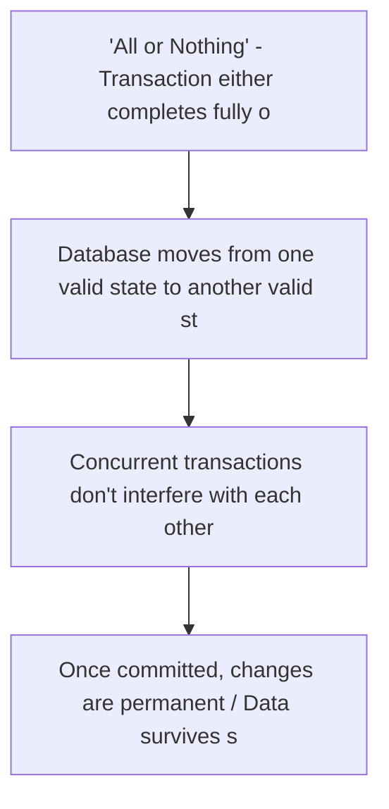

> **SQL Chapter 13/20** | [← Previous](12_Views_StoredProcs_Triggers.md) | [Index](../00_MASTER_INDEX.md) | [Next →](14_Query_Optimization.md)

---

## Chapter 15: Transactions & ACID Properties

### 🧠 What Is a Transaction — The Concept

A transaction is a **logical unit of work** — a group of SQL operations that must either **all succeed together or all fail together**. There is no in-between. The database guarantees this even if the server crashes mid-operation, even if another user is modifying the same data simultaneously, even if the power goes out.

**Real-world analogy:** Think of transferring money between bank accounts. Two operations must happen: (1) deduct from sender's account, (2) add to receiver's account. If operation 1 succeeds but operation 2 fails (due to a crash), money has disappeared from the sender but never arrived at the receiver. The bank's total money has decreased — an impossible inconsistency. Transactions prevent this by treating both operations as a single atomic unit.

### Why ACID Properties Matter — Deep Understanding

The ACID properties are not arbitrary rules — each one prevents a specific category of real-world disaster:

#### Atomicity — "All or Nothing"
**What it prevents:** Partial operations in a multi-step process. If you're processing a purchase (create order → deduct inventory → charge payment → send confirmation), atomicity ensures that if the payment fails, the inventory deduction is also rolled back. Without atomicity, you'd have "ghost orders" — inventory reduced but no payment collected.

**How it works internally:** The database uses a **Write-Ahead Log (WAL)**. Before making any change to the actual data, the database first writes the change to a log file. If a crash occurs, the database reads this log during recovery and either replays committed transactions or undoes incomplete ones.

#### Consistency — "Valid State to Valid State"
**What it prevents:** Data that violates your schema's rules. Consistency means every transaction takes the database from one valid state to another. "Valid" is defined by your constraints — foreign keys must reference existing rows, CHECK constraints must be satisfied, unique values must remain unique. If a transaction would violate any constraint, the entire transaction is rejected.

#### Isolation — "Transactions Don't Interfere"
**What it prevents:** Concurrent transactions seeing each other's intermediate (incomplete) changes. This is the most complex ACID property because there's a fundamental tension between **correctness** and **performance**:

- **Perfect isolation** (SERIALIZABLE) means transactions execute as if they were sequential — no concurrency at all. This is correct but slow — every transaction waits for others to finish.
- **Relaxed isolation** (READ COMMITTED) allows more concurrency but permits phenomena like non-repeatable reads — you read a row, another transaction modifies it, and when you read it again, the value has changed.

The isolation levels represent a **spectrum of trade-offs**:

| Isolation Level | Concurrency | Correctness | Use When |
|----------------|-------------|-------------|----------|
| **READ UNCOMMITTED** | Highest | Lowest (dirty reads possible) | Almost never — only for rough analytics where accuracy doesn't matter |
| **READ COMMITTED** | High | Good (no dirty reads) | Default for PostgreSQL — good for most OLTP workloads |
| **REPEATABLE READ** | Medium | Better (stable reads within a transaction) | Default for MySQL/InnoDB — good when you need consistent reads |
| **SERIALIZABLE** | Lowest | Perfect (as if sequential) | Financial systems, inventory management — where correctness is critical |

#### How Modern Databases Achieve Isolation: MVCC

Most modern databases (PostgreSQL, MySQL InnoDB, Oracle) use **Multi-Version Concurrency Control (MVCC)** instead of simple locking. The idea is brilliantly simple: **instead of blocking readers when a writer is modifying a row, keep old versions of the row available.**

When you start a transaction, you get a "snapshot" of the database as of that moment. Your reads see that snapshot, even if other transactions modify the data. This means **readers never block writers, and writers never block readers.** The database maintains multiple versions of each row and garbage-collects old versions after all transactions that might need them have finished.

#### Durability — "Committed Means Permanent"
**What it prevents:** Data loss after the database confirms a commit. When the database says `COMMIT` succeeded, the changes are guaranteed to survive any failure — power outages, disk crashes, operating system panics. This is achieved through:
- Writing to the **WAL** on disk before acknowledging the commit
- **Flushing the WAL to disk** (fsync) to ensure the OS actually writes to the physical disk, not just an in-memory buffer
- **Replication** to other servers (in production setups) for protection against hardware failure

---

```
┌─────────────────────────────────────────────────────────────────────────────────┐
│                    ACID PROPERTIES                                              │
├─────────────────────────────────────────────────────────────────────────────────┤
│                                                                                 │
│  A - ATOMICITY                                                                  │
│  ┌────────────────────────────────────────────────────────────────────────────┐ │
│  │  "All or Nothing" - Transaction either completes fully or not at all       │ │
│  │                                                                            │ │
│  │  Transfer $100 from Account A to Account B:                                │ │
│  │  1. Deduct $100 from A  ─┐                                                 │ │
│  │  2. Add $100 to B       ─┴─ Both must succeed, or neither happens          │ │
│  │                                                                            │ │
│  │  If step 2 fails, step 1 is automatically rolled back!                     │ │
│  └────────────────────────────────────────────────────────────────────────────┘ │
│                                                                                 │
│  C - CONSISTENCY                                                                │
│  ┌────────────────────────────────────────────────────────────────────────────┐ │
│  │  Database moves from one valid state to another valid state                │ │
│  │  All constraints, triggers, and rules are maintained                       │ │
│  │                                                                            │ │
│  │  Before: Total money = $1000                                               │ │
│  │  After:  Total money = $1000 (unchanged!)                                  │ │
│  └────────────────────────────────────────────────────────────────────────────┘ │
│                                                                                 │
│  I - ISOLATION                                                                  │
│  ┌────────────────────────────────────────────────────────────────────────────┐ │
│  │  Concurrent transactions don't interfere with each other                   │ │
│  │  Each transaction sees database as if it's the only one running            │ │
│  │                                                                            │ │
│  │  Transaction 1: Reading balance                                            │ │
│  │  Transaction 2: Updating balance                                           │ │
│  │  → T1 sees either before or after T2, never partial update                 │ │
│  └────────────────────────────────────────────────────────────────────────────┘ │
│                                                                                 │
│  D - DURABILITY                                                                 │
│  ┌────────────────────────────────────────────────────────────────────────────┐ │
│  │  Once committed, changes are permanent                                     │ │
│  │  Data survives system crashes, power failures                              │ │
│  │                                                                            │ │
│  │  Achieved through: Write-ahead logging, disk writes, replication           │ │
│  └────────────────────────────────────────────────────────────────────────────┘ │
│                                                                                 │
└─────────────────────────────────────────────────────────────────────────────────┘
```

**Flow:**
- 'All or Nothing' - Transaction either completes fully o
- ↓
- Database moves from one valid state to another valid st
- ↓
- Concurrent transactions don't interfere with each other
- ↓
- Once committed, changes are permanent / Data survives s



```sql
-- ═══════════════════════════════════════════════════════════════════════════════
-- TRANSACTIONS - EXAMPLES
-- ═══════════════════════════════════════════════════════════════════════════════

-- Basic transaction
START TRANSACTION;  -- or BEGIN

UPDATE accounts SET balance = balance - 100 WHERE account_id = 1;
UPDATE accounts SET balance = balance + 100 WHERE account_id = 2;

COMMIT;  -- Make changes permanent
-- or ROLLBACK;  -- Undo all changes


-- Transaction with error handling (MySQL)
DELIMITER //
CREATE PROCEDURE transfer_funds(
    IN p_from_account INT,
    IN p_to_account INT,
    IN p_amount DECIMAL(10,2)
)
BEGIN
    DECLARE v_from_balance DECIMAL(10,2);

    -- Error handler - rollback on any error
    DECLARE EXIT HANDLER FOR SQLEXCEPTION
    BEGIN
        ROLLBACK;
        RESIGNAL;  -- Re-throw the error
    END;

    START TRANSACTION;

    -- Check sufficient funds
    SELECT balance INTO v_from_balance
    FROM accounts WHERE account_id = p_from_account FOR UPDATE;

    IF v_from_balance < p_amount THEN
        SIGNAL SQLSTATE '45000'
        SET MESSAGE_TEXT = 'Insufficient funds';
    END IF;

    -- Perform transfer
    UPDATE accounts SET balance = balance - p_amount WHERE account_id = p_from_account;
    UPDATE accounts SET balance = balance + p_amount WHERE account_id = p_to_account;

    -- Log the transaction
    INSERT INTO transactions (from_account, to_account, amount, transaction_date)
    VALUES (p_from_account, p_to_account, p_amount, NOW());

    COMMIT;
END //
DELIMITER ;


-- SAVEPOINT - Partial rollback
START TRANSACTION;

INSERT INTO orders (customer_id, total) VALUES (1, 100);
SAVEPOINT order_created;

INSERT INTO order_items (order_id, product_id, qty) VALUES (LAST_INSERT_ID(), 1, 2);
SAVEPOINT items_added;

-- Oops, wrong item!
ROLLBACK TO SAVEPOINT items_added;

-- Try again
INSERT INTO order_items (order_id, product_id, qty) VALUES (LAST_INSERT_ID(), 2, 1);

COMMIT;


-- ═══════════════════════════════════════════════════════════════════════════════
-- ISOLATION LEVELS
-- ═══════════════════════════════════════════════════════════════════════════════

/*
Isolation Level        │ Dirty Read │ Non-Repeatable Read │ Phantom Read
───────────────────────┼────────────┼─────────────────────┼─────────────
READ UNCOMMITTED       │ Yes        │ Yes                 │ Yes
READ COMMITTED         │ No         │ Yes                 │ Yes
REPEATABLE READ        │ No         │ No                  │ Yes (MySQL: No)
SERIALIZABLE           │ No         │ No                  │ No

Dirty Read: Reading uncommitted changes from another transaction
Non-Repeatable Read: Same query returns different results in same transaction
Phantom Read: New rows appear that match a previous query condition
*/

-- Set isolation level
SET TRANSACTION ISOLATION LEVEL READ COMMITTED;
START TRANSACTION;
-- Your queries here
COMMIT;

-- Session-level setting
SET SESSION TRANSACTION ISOLATION LEVEL REPEATABLE READ;


-- ═══════════════════════════════════════════════════════════════════════════════
-- LOCKING
-- ═══════════════════════════════════════════════════════════════════════════════

-- SELECT with shared lock (read lock)
SELECT * FROM products WHERE product_id = 1 FOR SHARE;
-- Other transactions can read but not modify

-- SELECT with exclusive lock (write lock)
SELECT * FROM products WHERE product_id = 1 FOR UPDATE;
-- Other transactions can't read or modify

-- Skip locked rows (useful for job queues)
SELECT * FROM jobs WHERE status = 'pending'
LIMIT 1 FOR UPDATE SKIP LOCKED;

-- Explicit table lock (use carefully!)
LOCK TABLES employees WRITE;
-- Perform operations
UNLOCK TABLES;


-- ═══════════════════════════════════════════════════════════════════════════════
-- DEADLOCK PREVENTION
-- ═══════════════════════════════════════════════════════════════════════════════

/*
Deadlock occurs when:
Transaction A: Locks row 1, waits for row 2
Transaction B: Locks row 2, waits for row 1

Prevention strategies:
1. Always acquire locks in same order
2. Keep transactions short
3. Use lock timeouts
4. Use lower isolation levels when possible
*/

-- Set lock timeout (MySQL)
SET innodb_lock_wait_timeout = 10;  -- 10 seconds

-- Set lock timeout (MySQL)
SET innodb_lock_wait_timeout = 10;  -- 10 seconds

-- PostgreSQL
SET lock_timeout = '10s';
```

---

## Part 2: Advanced Isolation Anomalies

```sql
/*
Beyond the basic 3 anomalies (Dirty Read, Non-Repeatable Read, Phantom Read),
real-world systems suffer from subtle concurrency bugs that aren't fixed by REPEATABLE READ.
*/

-- 1. LOST UPDATE (Overwriting uncommitted changes)
-- Two users read balance=100.
-- User A adds 50 (writes 150). User B subtracts 20 (writes 80).
-- Final balance is 80 (User A's 50 was "lost").
-- FIX: FOR UPDATE locks, or Optimistic Concurrency Control (Version columns)

-- LOST UPDATE PREVENTION (Pessimistic)
BEGIN;
SELECT balance FROM accounts WHERE id = 1 FOR UPDATE; -- Blocks other readers!
UPDATE accounts SET balance = balance + 50 WHERE id = 1;
COMMIT;

-- LOST UPDATE PREVENTION (Optimistic)
BEGIN;
-- Read current version
SELECT balance, version FROM accounts WHERE id = 1; -- version = 5
-- Application logic...
UPDATE accounts SET balance = 150, version = 6 
WHERE id = 1 AND version = 5; -- Fails if someone else updated it!
COMMIT;

-- 2. WRITE SKEW
-- Concept: Two concurrent transactions read a dataset, check a condition, 
-- and then write to DIFFERENT rows, causing the overall condition to be violated.
-- Example: Doctors on call. Rule: At least 1 doctor must be on call.
-- Both Alice and Bob are on call. They both check concurrently.
-- Alice sees 2 on call → sets herself off call.
-- Bob sees 2 on call → sets himself off call.
-- Result: 0 doctors on call! (Violates business rule).
-- FIX: Only SERIALIZABLE isolation prevents Write Skew!
```

---

## Part 3: Distributed Transactions (Microservices)

```
┌─────────────────────────────────────────────────────────────────────────────────┐
│  When a transaction spans MULTIPLE databases or microservices, standard ACID    │
│  doesn't work. How do you guarantee atomicity across network boundaries?        │
│                                                                                 │
│  1. TWO-PHASE COMMIT (2PC) - The Legacy Approach                                │
│  → Uses a "Coordinator"                                                         │
│  → Phase 1 (Prepare): Ask all nodes "Can you commit?"                           │
│  → Phase 2 (Commit): If all say yes, tell them to commit. If ANY no, abort.     │
│  → Problem: Blocking! If Coordinator crashes during Phase 2, nodes are STUCK    │
│    holding locks indefinitely.                                                  │
│                                                                                 │
│  2. SAGA PATTERN - The Modern Microservices Approach                            │
│  → No distributed locks. A sequence of local, independent transactions.         │
│  → Example: E-Commerce Order                                                    │
│    1. Order Service: Create Order (Status: Pending)                             │
│    2. Inventory Service: Deduct Items (Success)                                 │
│    3. Payment Service: Charge Card (FAILS!)                                     │
│  → How to rollback? COMPENSATING TRANSACTIONS.                                  │
│  → Since we can't "rollback" the inventory (it's already committed locally),    │
│    we run a new transaction: Refund/Add Items Back.                             │
│                                                                                 │
│  SAGA TRADE-OFFS:                                                               │
│  ✅ Highly scalable, no distributed locks                                      │
│  ❌ Eventual consistency (temporary invalid states exist)                       │
│  ❌ High application complexity (must write rollback code for everything)       │
└─────────────────────────────────────────────────────────────────────────────────┘
```

---

## Part 4: Concurrency Control Models

```
There are two fundamental philosophies for handling concurrent database access:

1. PESSIMISTIC CONCURRENCY CONTROL (Locking)
   "Assume conflicts will happen. Prevent them with locks."
   - Uses row/table locks (SELECT ... FOR UPDATE).
   - Pros: Guarantees absolute consistency, no application retry logic needed.
   - Cons: Slow, creates bottlenecks, high risk of deadlocks.
   - Best for: Real-time financial trading, high-conflict tables.

2. OPTIMISTIC CONCURRENCY CONTROL (MVCC / Versioning)
   "Assume conflicts are rare. Let reads/writes happen, check at the end."
   - Uses version columns, timestamps, or MVCC snapshots.
   - Pros: Extremely fast reads, highly scalable, no read locks.
   - Cons: App must handle failures and retry transactions if conflicts occur.
   - Best for: Most web applications, low-conflict environments.
```

---

## 📝 PRACTICE EXERCISES - PART 5

```sql
-- ═══════════════════════════════════════════════════════════════════════════════
-- PRACTICE PROBLEMS - ADVANCED
-- ═══════════════════════════════════════════════════════════════════════════════

-- NORMALIZATION

-- 1. Identify which normal form this table violates and fix it:
--    CREATE TABLE orders (
--        order_id INT, customer_name VARCHAR(100), customer_email VARCHAR(100),
--        products VARCHAR(500), total DECIMAL(10,2)
--    );

-- 2. Split this 2NF table into 3NF:
--    order_items(order_id, product_id, product_name, product_category, qty)


-- INDEXES

-- 3. What indexes would you create for this query?
--    SELECT * FROM orders WHERE customer_id = ? AND order_date > ? ORDER BY total DESC

-- 4. Explain why this query might not use an index:
--    SELECT * FROM employees WHERE UPPER(last_name) = 'KUMAR'


-- VIEWS & PROCEDURES

-- 5. Create a view showing each product with its total sales quantity

-- 6. Create a stored procedure that gives raises to all employees in a department


-- TRIGGERS

-- 7. Create a trigger that prevents deleting orders with status 'shipped'

-- 8. Create an audit trigger for the products table


-- TRANSACTIONS

-- 9. Write a transaction that:
--    a) Creates an order
--    b) Adds items to the order
--    c) Updates product inventory
--    d) Rolls back everything if inventory is insufficient
```

---

_"Part 5 Complete! You now understand Normalization, Indexes, Views, Stored Procedures, Triggers, Transactions, and Distributed Consistency Patterns."_

---

> **Navigation**: [< Previous](12_Views_StoredProcs_Triggers.md) | [Back to Index](../00_MASTER_INDEX.md) | [Next >](14_Query_Optimization.md)