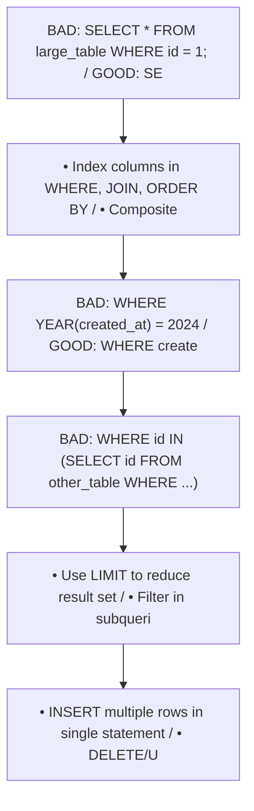

> **SQL Chapter 14/20** | [← Previous](13_Transactions_ACID.md) | [Index](../00_MASTER_INDEX.md) | [Next →](15_Analytics_Warehousing_ETL.md)

---

## Chapter 16: Query Optimization & Execution Plans

### Query Optimization Strategies

```
┌─────────────────────────────────────────────────────────────────────────────────┐
│                    QUERY OPTIMIZATION CHECKLIST                                 │
├─────────────────────────────────────────────────────────────────────────────────┤
│                                                                                 │
│  1. SELECT ONLY WHAT YOU NEED                                                   │
│  ┌────────────────────────────────────────────────────────────────────────────┐ │
│  │  BAD:  SELECT * FROM large_table WHERE id = 1;                             │ │
│  │  GOOD: SELECT id, name, email FROM large_table WHERE id = 1;               │ │
│  │                                                                            │ │
│  │  Why: Less data transfer, possible covering index usage                    │ │
│  └────────────────────────────────────────────────────────────────────────────┘ │
│                                                                                 │
│  2. USE PROPER INDEXES                                                          │
│  ┌────────────────────────────────────────────────────────────────────────────┐ │
│  │  • Index columns in WHERE, JOIN, ORDER BY                                  │ │
│  │  • Composite indexes for multi-column filters                              │ │
│  │  • Covering indexes to avoid table lookups                                 │ │
│  │  • But don't over-index (hurts writes)                                     │ │
│  └────────────────────────────────────────────────────────────────────────────┘ │
│                                                                                 │
│  3. AVOID FUNCTIONS ON INDEXED COLUMNS                                          │
│  ┌────────────────────────────────────────────────────────────────────────────┐ │
│  │  BAD:  WHERE YEAR(created_at) = 2024                                       │ │
│  │  GOOD: WHERE created_at >= '2024-01-01' AND created_at < '2025-01-01'      │ │
│  │                                                                            │ │
│  │  BAD:  WHERE LOWER(email) = 'test@example.com'                             │ │
│  │  GOOD: Create functional index or store lowercase version                  │ │
│  └────────────────────────────────────────────────────────────────────────────┘ │
│                                                                                 │
│  4. USE JOINS INSTEAD OF SUBQUERIES (when possible)                             │
│  ┌────────────────────────────────────────────────────────────────────────────┐ │
│  │  BAD:  WHERE id IN (SELECT id FROM other_table WHERE ...)                  │ │
│  │  GOOD: JOIN other_table ON ... WHERE ...                                   │ │
│  │                                                                            │ │
│  │  (Modern optimizers often rewrite, but explicit JOINs are clearer)         │ │
│  └────────────────────────────────────────────────────────────────────────────┘ │
│                                                                                 │
│  5. LIMIT EARLY                                                                 │
│  ┌────────────────────────────────────────────────────────────────────────────┐ │
│  │  • Use LIMIT to reduce result set                                          │ │
│  │  • Filter in subqueries before joins                                       │ │
│  │  • Use EXISTS instead of COUNT(*) for existence checks                     │ │
│  └────────────────────────────────────────────────────────────────────────────┘ │
│                                                                                 │
│  6. BATCH OPERATIONS                                                            │
│  ┌────────────────────────────────────────────────────────────────────────────┐ │
│  │  • INSERT multiple rows in single statement                                │ │
│  │  • DELETE/UPDATE in batches with LIMIT                                     │ │
│  │  • Use transactions for related operations                                 │ │
│  └────────────────────────────────────────────────────────────────────────────┘ │
│                                                                                 │
└─────────────────────────────────────────────────────────────────────────────────┘
```

**Flow:**
- BAD: SELECT * FROM large_table WHERE id = 1; / GOOD: SE
- ↓
- • Index columns in WHERE, JOIN, ORDER BY / • Composite
- ↓
- BAD: WHERE YEAR(created_at) = 2024 / GOOD: WHERE create
- ↓
- BAD: WHERE id IN (SELECT id FROM other_table WHERE ...)
- ↓
- • Use LIMIT to reduce result set / • Filter in subqueri
- ↓
- • INSERT multiple rows in single statement / • DELETE/U



```sql
-- ═══════════════════════════════════════════════════════════════════════════════
-- QUERY OPTIMIZATION EXAMPLES
-- ═══════════════════════════════════════════════════════════════════════════════

-- EXAMPLE 1: Avoid SELECT *
-- BAD
SELECT * FROM orders o
JOIN order_items oi ON o.order_id = oi.order_id
WHERE o.customer_id = 123;

-- GOOD
SELECT o.order_id, o.order_date, o.total, oi.product_id, oi.quantity
FROM orders o
JOIN order_items oi ON o.order_id = oi.order_id
WHERE o.customer_id = 123;


-- EXAMPLE 2: Optimize EXISTS vs IN vs JOIN
-- For checking existence (best)
SELECT c.* FROM customers c
WHERE EXISTS (SELECT 1 FROM orders o WHERE o.customer_id = c.customer_id);

-- For getting matching records
SELECT DISTINCT c.* FROM customers c
JOIN orders o ON o.customer_id = c.customer_id;

-- IN works well for small lists
SELECT * FROM products WHERE category_id IN (1, 2, 3);


-- EXAMPLE 3: Optimize COUNT
-- BAD - counts all rows then compares
SELECT * FROM orders WHERE (SELECT COUNT(*) FROM order_items WHERE order_id = orders.order_id) > 5;

-- GOOD - stops at 6
SELECT * FROM orders o
WHERE EXISTS (
    SELECT 1 FROM order_items oi
    WHERE oi.order_id = o.order_id
    GROUP BY oi.order_id
    HAVING COUNT(*) > 5
);


-- EXAMPLE 4: Optimize OR conditions
-- BAD (may not use index efficiently)
SELECT * FROM products WHERE category_id = 1 OR category_id = 2 OR price < 100;

-- GOOD (can use indexes)
SELECT * FROM products WHERE category_id IN (1, 2)
UNION ALL
SELECT * FROM products WHERE category_id NOT IN (1, 2) AND price < 100;


-- EXAMPLE 5: Pre-filter before JOIN
-- BAD
SELECT c.name, o.order_date, o.total
FROM customers c
JOIN orders o ON c.customer_id = o.customer_id
WHERE o.order_date >= '2024-01-01' AND c.country = 'India';

-- GOOD (filter first, then join)
SELECT c.name, o.order_date, o.total
FROM (SELECT * FROM customers WHERE country = 'India') c
JOIN (SELECT * FROM orders WHERE order_date >= '2024-01-01') o
ON c.customer_id = o.customer_id;


-- EXAMPLE 6: Pagination optimization
-- BAD for large offsets
SELECT * FROM products ORDER BY product_id LIMIT 10 OFFSET 100000;  -- Slow!

-- GOOD - use keyset pagination
SELECT * FROM products
WHERE product_id > 100000  -- Last seen ID
ORDER BY product_id
LIMIT 10;


-- EXAMPLE 7: Batch inserts
-- BAD (100 separate inserts)
INSERT INTO logs (message) VALUES ('Log 1');
INSERT INTO logs (message) VALUES ('Log 2');
-- ... 98 more

-- GOOD (single insert)
INSERT INTO logs (message) VALUES
    ('Log 1'), ('Log 2'), ('Log 3'), ... , ('Log 100');


-- EXAMPLE 8: Batch deletes
-- BAD (locks table for long time)
DELETE FROM old_logs WHERE created_at < '2023-01-01';  -- Millions of rows!

-- GOOD (delete in batches)
REPEAT
    DELETE FROM old_logs
    WHERE created_at < '2023-01-01'
    LIMIT 10000;
UNTIL ROW_COUNT() = 0 END REPEAT;


-- ═══════════════════════════════════════════════════════════════════════════════
-- READING EXECUTION PLANS
-- ═══════════════════════════════════════════════════════════════════════════════

-- Get execution plan
EXPLAIN ANALYZE
SELECT e.*, d.dept_name
FROM employees e
JOIN departments d ON e.dept_id = d.dept_id
WHERE e.salary > 80000;

/*
EXPLAIN Output Interpretation:

┌─────────────────────────────────────────────────────────────────────────────┐
│ id │ select_type │ table │ type   │ key          │ rows │ Extra             │
├────┼─────────────┼───────┼────────┼──────────────┼──────┼───────────────────┤
│ 1  │ SIMPLE      │ e     │ range  │ idx_salary   │ 50   │ Using where       │
│ 1  │ SIMPLE      │ d     │ eq_ref │ PRIMARY      │ 1    │ NULL              │
└─────────────────────────────────────────────────────────────────────────────┘

Reading this:
1. Query ID 1, simple query (no subqueries)
2. Table 'e' (employees):
   - type=range: Using index range scan (good!)
   - key=idx_salary: Using our salary index
   - rows=50: Estimated 50 rows to examine
   - Extra=Using where: Additional filtering
3. Table 'd' (departments):
   - type=eq_ref: Unique index lookup (best for joins!)
   - key=PRIMARY: Using primary key
   - rows=1: One lookup per employee (as expected)

Key Metrics:
- Total rows examined: 50 * 1 = 50 (good!)
- Access types (best to worst):
  const > eq_ref > ref > range > index > ALL
*/

-- PostgreSQL: More detailed output
EXPLAIN (ANALYZE, BUFFERS, FORMAT TEXT)
SELECT * FROM employees WHERE dept_id = 1;
```

---


---

## 🏋️ Practice & Interview Questions — SQL

### Predict / Trace
**Q1.** What's the difference between WHERE and HAVING?
<details><summary>Answer</summary>

`WHERE` filters rows **before** grouping. `HAVING` filters groups **after** `GROUP BY`. You can't use aggregate functions in WHERE. `HAVING COUNT(*) > 5` works, `WHERE COUNT(*) > 5` does not.
</details>

**Q2.** What does this return? `SELECT 1 FROM dual WHERE NULL = NULL`
<details><summary>Answer</summary>

**No rows returned.** NULL is not equal to NULL — use `IS NULL` or `IS NOT NULL`. `NULL = NULL` evaluates to UNKNOWN, not TRUE.
</details>

### Coding Problems
**Q3.** ⭐ Second highest salary — handle the case where it doesn't exist (return NULL).
<details><summary>Solution</summary>

```sql
SELECT MAX(salary) AS SecondHighestSalary
FROM Employee
WHERE salary < (SELECT MAX(salary) FROM Employee);
-- or
SELECT IFNULL((SELECT DISTINCT salary FROM Employee ORDER BY salary DESC LIMIT 1 OFFSET 1), NULL)
```
</details>

**Q4.** ⭐ Find employees earning more than their manager.
<details><summary>Solution</summary>

```sql
SELECT e.name FROM Employee e
JOIN Employee m ON e.managerId = m.id
WHERE e.salary > m.salary;
```
</details>

**Q5.** ⭐ Find duplicate emails.
<details><summary>Solution</summary>

```sql
SELECT email FROM Person GROUP BY email HAVING COUNT(*) > 1;
```
</details>

**Q6.** ⭐⭐ Rank scores without RANK() function.
<details><summary>Solution</summary>

```sql
SELECT s.score,
  (SELECT COUNT(DISTINCT s2.score) FROM Scores s2 WHERE s2.score >= s.score) AS rank
FROM Scores s ORDER BY score DESC;
```
</details>

**Q7.** ⭐⭐ Consecutive numbers — find numbers that appear 3+ times consecutively.
<details><summary>Solution</summary>

```sql
SELECT DISTINCT l1.Num AS ConsecutiveNums
FROM Logs l1, Logs l2, Logs l3
WHERE l1.Id=l2.Id-1 AND l2.Id=l3.Id-1
AND l1.Num=l2.Num AND l2.Num=l3.Num;
-- or use LAG/LEAD window functions
```
</details>

**Q8.** ⭐⭐ Department top 3 salaries (dense rank).
<details><summary>Solution</summary>

```sql
SELECT d.name AS Department, e.name AS Employee, e.salary AS Salary
FROM Employee e JOIN Department d ON e.departmentId = d.id
WHERE (SELECT COUNT(DISTINCT e2.salary) FROM Employee e2
       WHERE e2.departmentId=e.departmentId AND e2.salary>e.salary) < 3;
```
</details>

**Q9.** ⭐⭐ Running total with window function.
<details><summary>Solution</summary>

```sql
SELECT date, amount,
  SUM(amount) OVER (ORDER BY date ROWS BETWEEN UNBOUNDED PRECEDING AND CURRENT ROW) AS running_total
FROM transactions;
```
</details>

**Q10.** ⭐⭐ Pivot rows to columns (conditional aggregation).
<details><summary>Solution</summary>

```sql
SELECT year,
  SUM(CASE WHEN quarter=1 THEN revenue END) AS Q1,
  SUM(CASE WHEN quarter=2 THEN revenue END) AS Q2,
  SUM(CASE WHEN quarter=3 THEN revenue END) AS Q3,
  SUM(CASE WHEN quarter=4 THEN revenue END) AS Q4
FROM sales GROUP BY year;
```
</details>

**Q11.** ⭐⭐⭐ Find the median salary — without MEDIAN() function.
<details><summary>Solution</summary>

```sql
SELECT AVG(salary) AS median
FROM (SELECT salary, ROW_NUMBER() OVER(ORDER BY salary) AS rn, COUNT(*) OVER() AS cnt FROM Employee) t
WHERE rn IN (FLOOR((cnt+1)/2), CEIL((cnt+1)/2));
```
</details>

### Interview Questions
**Q12.** INNER JOIN vs LEFT JOIN — when does LEFT produce more rows?
<details><summary>Answer</summary>

LEFT JOIN includes ALL rows from the left table even if no match in right table (fills NULLs). INNER JOIN only includes rows where both sides have a match. If left table has rows with no match in right: LEFT produces more rows.
</details>

**Q13.** What is a covering index?
<details><summary>Answer</summary>

An index that contains ALL columns needed by a query — the DB can answer from the index alone without touching the table ("index-only scan"). Faster because it avoids the extra heap fetch.
</details>

**Q14.** EXPLAIN shows "Full Table Scan" — how do you fix it?
<details><summary>Answer</summary>

Add an index on the WHERE/JOIN/ORDER BY column. Check if the column has low cardinality (boolean — index may not help). Ensure the query isn't wrapping the column in a function (`WHERE YEAR(date) = 2024` prevents index use — rewrite as `WHERE date BETWEEN '2024-01-01' AND '2024-12-31'`).
</details>

### MCQ Rapid Fire
| # | Question | Answer |
|---|---|---|
| 1 | NULL = NULL evaluates to? | UNKNOWN (use IS NULL) |
| 2 | COUNT(*) vs COUNT(col) | COUNT(*) counts all rows, COUNT(col) skips NULLs |
| 3 | RANK() vs DENSE_RANK() | RANK() skips numbers after ties, DENSE_RANK() doesn't |
| 4 | CROSS JOIN produces | Cartesian product (m × n rows) |
| 5 | Can you ORDER BY in a subquery? | Only when using TOP/LIMIT |
| 6 | TRUNCATE vs DELETE | TRUNCATE: no WHERE, no undo, faster. DELETE: filterable, transactional |
| 7 | What does COALESCE do? | Returns first non-NULL value from its arguments |
| 8 | Index on VARCHAR — what to watch out for? | Case sensitivity, collation, function-based searches bypass index |


---

## 🧠 Deep Conceptual Questions — SQL Internals & Reasoning

**C1. How does a SQL database execute a SELECT query internally?**
<details><summary>Deep Answer</summary>

1. **Parse**: SQL text → AST (syntax tree)
2. **Bind**: resolve table names, column names, types
3. **Optimize**: query planner generates candidate execution plans, estimates costs (based on statistics: row counts, column cardinality, index existence), picks cheapest
4. **Execute**: follow the plan — scan tables, apply filters, join, sort, project

The optimizer transforms: `SELECT ... WHERE ... JOIN ... ORDER BY` into an operator tree (Volcano model): TableScan → Filter → HashJoin → Sort → Project. Each operator is an iterator: `next()` pulls one row from its child. This pull-based model (lazy evaluation) avoids materializing intermediate results.
</details>

**C2. B-Tree index: why is it the default index structure in databases?**
<details><summary>Deep Answer</summary>

B-Tree (not binary tree — B stands for Balanced, not Binary): a self-balancing tree where each node can hold many keys. Properties: (1) height O(log_m N) where m=fan-out (typically 100-1000) → very short tree for millions of rows, (2) all leaf nodes at same depth → guaranteed O(log N) worst case, (3) range scans efficient — leaves linked in sequence, (4) supports equality AND range queries. Hash index: only equality (no range). Sequential scan: no index at all. B+Tree (variant): internal nodes only store keys (no values), leaves store data. All row pointers in leaves → better range scan (follow linked list of leaves).
</details>

**C3. Why does adding an index sometimes SLOW DOWN a query?**
<details><summary>Deep Answer</summary>

1. **Low cardinality**: index on a boolean column — if 50% rows have `active=true`, index gives you 50% of rows. Database may choose full table scan (cheaper: sequential I/O) over index (random I/O for 50% of rows). 
2. **Function on column**: `WHERE YEAR(created_at) = 2024` — index on `created_at` unused. Rewrite: `WHERE created_at >= '2024-01-01' AND created_at < '2025-01-01'`.
3. **Write overhead**: every INSERT/UPDATE/DELETE must update ALL indexes. 5 indexes × N rows = 5× write amplification.
4. **Index not covering**: index exists but the SELECT columns aren't in the index → each index match → separate heap fetch → many random I/O. Solution: covering index (include all needed columns in index).
</details>

**C4. EXPLAIN / query execution plan: what are the key things to look for?**
<details><summary>Deep Answer</summary>

Red flags: (1) **"Full Table Scan" / "Seq Scan"** on a large table → missing index, (2) **high "rows" estimate** in join conditions → cartesian product risk, (3) **"Using filesort"** → ORDER BY can't use index, (4) **"Using temporary"** → intermediate table materialization, (5) **nested loops on large tables** → should be hash join or merge join. Green flags: "Using index" (covering index), "ref" or "eq_ref" access type (index used). Start fixing: add or fix index on WHERE/JOIN/ORDER BY columns, rewrite function-wrapped columns.
</details>

**C5. Window functions vs GROUP BY — when must you use window functions?**
<details><summary>Deep Answer</summary>

`GROUP BY` collapses rows to one per group — individual row data is lost. Window functions compute aggregates but **keep all rows**. Use window when: (1) you need both the aggregate AND the individual row (rank each employee and show their salary), (2) running totals (each row needs sum of all prior rows — GROUP BY can't do this), (3) lag/lead access (compare each row to previous/next — GROUP BY has no row ordering concept), (4) top-N per group (ROW_NUMBER partition — classic GROUP BY can't do this cleanly). Window functions = aggregation without collapsing.
</details>

**C6. Transaction isolation levels — what anomaly does each prevent?**
<details><summary>Deep Answer</summary>

| Level | Dirty Read | Non-repeatable Read | Phantom Read |
|---|---|---|---|
| READ UNCOMMITTED | Possible | Possible | Possible |
| READ COMMITTED | ✅ Prevented | Possible | Possible |
| REPEATABLE READ | ✅ | ✅ | Possible (MySQL InnoDB: prevented!) |
| SERIALIZABLE | ✅ | ✅ | ✅ |

**Dirty read**: read uncommitted data from another transaction (which may rollback). **Non-repeatable**: same query in same transaction returns different row values (another transaction committed update). **Phantom**: same query returns different row COUNT (another transaction inserted/deleted rows). Higher isolation = fewer anomalies but more lock contention. Most production databases use READ COMMITTED or REPEATABLE READ.
</details>

**C7. N+1 query problem: what is it, why does it happen, and how to fix?**
<details><summary>Deep Answer</summary>

**What**: fetching N orders, then for each order making a separate query for the customer = 1 + N queries total. Scales terribly: 1000 orders = 1001 queries. **Why**: ORMs (Hibernate, JPA) with lazy loading — accessing a relationship triggers a new query. **Fix 1**: Eager loading — `JOIN FETCH` or `.fetch()` — load everything in one query. **Fix 2**: Batch loading — fetch all order IDs, then `WHERE customer_id IN (id1, id2, ...)` — 2 queries. **Fix 3**: Projection/DTO query — `SELECT o.id, c.name FROM orders o JOIN customers c` — 1 query. **Detection**: count DB queries in tests (Spring: `@QueryCount`), log slow query warnings.
</details>


> **Navigation**: [< Previous](13_Transactions_ACID.md) | [Back to Index](../00_MASTER_INDEX.md) | [Next >](15_Analytics_Warehousing_ETL.md)