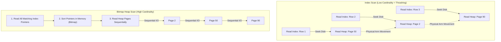

> **SQL Chapter 14/20** | [← Previous](13_Transactions_ACID.md) | [Index](../00_MASTER_INDEX.md) | [Next →](15_Analytics_Warehousing_ETL.md)

---

## Chapter 16: Query Optimization & Execution Plans

### Query Optimization Strategies

```
┌─────────────────────────────────────────────────────────────────────────────────┐
│                    QUERY OPTIMIZATION CHECKLIST                                 │
├─────────────────────────────────────────────────────────────────────────────────┤
│                                                                                 │
│  1. SELECT ONLY WHAT YOU NEED                                                   │
│  ┌────────────────────────────────────────────────────────────────────────────┐ │
│  │  BAD:  SELECT * FROM large_table WHERE id = 1;                             │ │
│  │  GOOD: SELECT id, name, email FROM large_table WHERE id = 1;               │ │
│  │                                                                            │ │
│  │  Why: Less data transfer, possible covering index usage                    │ │
│  └────────────────────────────────────────────────────────────────────────────┘ │
│                                                                                 │
│  2. USE PROPER INDEXES                                                          │
│  ┌────────────────────────────────────────────────────────────────────────────┐ │
│  │  • Index columns in WHERE, JOIN, ORDER BY                                  │ │
│  │  • Composite indexes for multi-column filters                              │ │
│  │  • Covering indexes to avoid table lookups                                 │ │
│  │  • But don't over-index (hurts writes)                                     │ │
│  └────────────────────────────────────────────────────────────────────────────┘ │
│                                                                                 │
│  3. AVOID FUNCTIONS ON INDEXED COLUMNS                                          │
│  ┌────────────────────────────────────────────────────────────────────────────┐ │
│  │  BAD:  WHERE YEAR(created_at) = 2024                                       │ │
│  │  GOOD: WHERE created_at >= '2024-01-01' AND created_at < '2025-01-01'      │ │
│  │                                                                            │ │
│  │  BAD:  WHERE LOWER(email) = 'test@example.com'                             │ │
│  │  GOOD: Create functional index or store lowercase version                  │ │
│  └────────────────────────────────────────────────────────────────────────────┘ │
│                                                                                 │
│  4. USE JOINS INSTEAD OF SUBQUERIES (when possible)                             │
│  ┌────────────────────────────────────────────────────────────────────────────┐ │
│  │  BAD:  WHERE id IN (SELECT id FROM other_table WHERE ...)                  │ │
│  │  GOOD: JOIN other_table ON ... WHERE ...                                   │ │
│  │                                                                            │ │
│  │  (Modern optimizers often rewrite, but explicit JOINs are clearer)         │ │
│  └────────────────────────────────────────────────────────────────────────────┘ │
│                                                                                 │
│  5. LIMIT EARLY                                                                 │
│  ┌────────────────────────────────────────────────────────────────────────────┐ │
│  │  • Use LIMIT to reduce result set                                          │ │
│  │  • Filter in subqueries before joins                                       │ │
│  │  • Use EXISTS instead of COUNT(*) for existence checks                     │ │
│  └────────────────────────────────────────────────────────────────────────────┘ │
│                                                                                 │
│  6. BATCH OPERATIONS                                                            │
│  ┌────────────────────────────────────────────────────────────────────────────┐ │
│  │  • INSERT multiple rows in single statement                                │ │
│  │  • DELETE/UPDATE in batches with LIMIT                                     │ │
│  │  • Use transactions for related operations                                 │ │
│  └────────────────────────────────────────────────────────────────────────────┘ │
│                                                                                 │
└─────────────────────────────────────────────────────────────────────────────────┘
```

```sql
-- ═══════════════════════════════════════════════════════════════════════════════
-- QUERY OPTIMIZATION EXAMPLES
-- ═══════════════════════════════════════════════════════════════════════════════

-- EXAMPLE 1: Avoid SELECT *
-- BAD
SELECT * FROM orders o
JOIN order_items oi ON o.order_id = oi.order_id
WHERE o.customer_id = 123;

-- GOOD
SELECT o.order_id, o.order_date, o.total, oi.product_id, oi.quantity
FROM orders o
JOIN order_items oi ON o.order_id = oi.order_id
WHERE o.customer_id = 123;


-- EXAMPLE 2: Optimize EXISTS vs IN vs JOIN
-- For checking existence (best)
SELECT c.* FROM customers c
WHERE EXISTS (SELECT 1 FROM orders o WHERE o.customer_id = c.customer_id);

-- For getting matching records
SELECT DISTINCT c.* FROM customers c
JOIN orders o ON o.customer_id = c.customer_id;

-- IN works well for small lists
SELECT * FROM products WHERE category_id IN (1, 2, 3);


-- EXAMPLE 3: Optimize COUNT
-- BAD - counts all rows then compares
SELECT * FROM orders WHERE (SELECT COUNT(*) FROM order_items WHERE order_id = orders.order_id) > 5;

-- GOOD - stops at 6
SELECT * FROM orders o
WHERE EXISTS (
    SELECT 1 FROM order_items oi
    WHERE oi.order_id = o.order_id
    GROUP BY oi.order_id
    HAVING COUNT(*) > 5
);


-- EXAMPLE 4: Optimize OR conditions
-- BAD (may not use index efficiently)
SELECT * FROM products WHERE category_id = 1 OR category_id = 2 OR price < 100;

-- GOOD (can use indexes)
SELECT * FROM products WHERE category_id IN (1, 2)
UNION ALL
SELECT * FROM products WHERE category_id NOT IN (1, 2) AND price < 100;


-- EXAMPLE 5: Pre-filter before JOIN
-- BAD
SELECT c.name, o.order_date, o.total
FROM customers c
JOIN orders o ON c.customer_id = o.customer_id
WHERE o.order_date >= '2024-01-01' AND c.country = 'India';

-- GOOD (filter first, then join)
SELECT c.name, o.order_date, o.total
FROM (SELECT * FROM customers WHERE country = 'India') c
JOIN (SELECT * FROM orders WHERE order_date >= '2024-01-01') o
ON c.customer_id = o.customer_id;


-- EXAMPLE 6: Pagination optimization
-- BAD for large offsets
SELECT * FROM products ORDER BY product_id LIMIT 10 OFFSET 100000;  -- Slow!

-- GOOD - use keyset pagination
SELECT * FROM products
WHERE product_id > 100000  -- Last seen ID
ORDER BY product_id
LIMIT 10;


-- EXAMPLE 7: Batch inserts
-- BAD (100 separate inserts)
INSERT INTO logs (message) VALUES ('Log 1');
INSERT INTO logs (message) VALUES ('Log 2');
-- ... 98 more

-- GOOD (single insert)
INSERT INTO logs (message) VALUES
    ('Log 1'), ('Log 2'), ('Log 3'), ... , ('Log 100');


-- EXAMPLE 8: Batch deletes
-- BAD (locks table for long time)
DELETE FROM old_logs WHERE created_at < '2023-01-01';  -- Millions of rows!

-- GOOD (delete in batches)
-- REPEAT/UNTIL is a MySQL *procedural* construct -- only legal inside a stored
-- routine body, not as standalone SQL. In practice, batch deletes are driven
-- by an external loop (cron job, script) that re-runs this same statement:
DELETE FROM old_logs
WHERE created_at < '2023-01-01'
LIMIT 10000;
-- ...repeat from application code until affected-row count returns 0.
-- Each batch is its own short transaction, so no single DELETE holds a lock
-- long enough to block concurrent reads/writes for more than a moment.


-- ═══════════════════════════════════════════════════════════════════════════════
-- READING EXECUTION PLANS
-- ═══════════════════════════════════════════════════════════════════════════════

-- Get execution plan
EXPLAIN ANALYZE
SELECT e.*, d.dept_name
FROM employees e
JOIN departments d ON e.dept_id = d.dept_id
WHERE e.salary > 80000;

/*
EXPLAIN Output Interpretation:

┌─────────────────────────────────────────────────────────────────────────────┐
│ id │ select_type │ table │ type   │ key          │ rows │ Extra             │
├────┼─────────────┼───────┼────────┼──────────────┼──────┼───────────────────┤
│ 1  │ SIMPLE      │ e     │ range  │ idx_salary   │ 50   │ Using where       │
│ 1  │ SIMPLE      │ d     │ eq_ref │ PRIMARY      │ 1    │ NULL              │
└─────────────────────────────────────────────────────────────────────────────┘

Reading this:
1. Query ID 1, simple query (no subqueries)
2. Table 'e' (employees):
   - type=range: Using index range scan (good!)
   - key=idx_salary: Using our salary index
   - rows=50: Estimated 50 rows to examine
   - Extra=Using where: Additional filtering
3. Table 'd' (departments):
   - type=eq_ref: Unique index lookup (best for joins!)
   - key=PRIMARY: Using primary key
   - rows=1: One lookup per employee (as expected)

Key Metrics:
- Total rows examined: 50 * 1 = 50 (good!)
- Access types (best to worst):
  const > eq_ref > ref > range > index > ALL
*/

-- PostgreSQL: More detailed output
EXPLAIN (ANALYZE, BUFFERS, FORMAT TEXT)
SELECT * FROM employees WHERE dept_id = 1;
```

### The Cost-Based Optimizer (CBO) Math

```text
The PostgreSQL optimizer doesn't guess; it calculates the exact mathematical COST of different execution paths based on disk I/O physics.

DEFAULT COST CONSTANTS:
- seq_page_cost = 1.0    (Cost of sequential disk read)
- random_page_cost = 4.0 (Cost of random disk read/seek)
- cpu_tuple_cost = 0.01  (Cost to process one row)

SCENARIO: Table with 100,000 rows (1,000 pages, 100 rows per page).
Query: SELECT * FROM users WHERE status = 'active'; (Returns 20,000 rows)

PLAN A: Sequential Scan
Cost = (1,000 pages × 1.0) + (100,000 rows × 0.01)
     = 1,000 + 1,000
     = Total Cost: 2,000

PLAN B: Index Scan (Random I/O)
Cost = (20,000 random reads × 4.0) + (20,000 rows × 0.01)
     = 80,000 + 200
     = Total Cost: 80,200

DECISION: 2,000 < 80,200. The optimizer will IGNORE the index and do a Seq Scan, because reading the entire table sequentially is 40x cheaper than seeking the disk head 20,000 times!
```

### Index Scan vs. Bitmap Heap Scan Physics



**Why Bitmap Heap Scans Exist:**
If the optimizer realizes an Index Scan will jump around the disk too much (thrashing the physical arm or saturating random I/O IOPS on an SSD), it switches to a **Bitmap Heap Scan**. It reads the index first, builds a memory bitmap of all the heap pages it needs, **sorts them by physical disk location**, and then visits each page exactly once in a smooth, sequential sweep.

### Historical Evolution

**Predecessors (with years):**
- **IBM System R Optimizer** (1974-1979): First cost-based optimizer using heuristics and statistics to select execution plans
- **Selinger et al.** (1979): Published seminal paper on access path selection in a relational database system, founding the cost-based optimizer approach
- **PostgreSQL Planner** (1986): Open-source inheritance of System R optimizer concepts, extensible with custom data types and operators
- **MySQL 8.0** (2018): Added Hash Join algorithm and improved cost model, closing gap with enterprise databases
- **SQLite Query Planner** (2000): Demonstrated that lightweight optimizers can still be highly effective for embedded use cases

**Evolution narrative:**
Early databases used rule-based optimizers that applied fixed rules (e.g., "use index if available"), which failed when data distributions varied widely. Selinger's System R optimizer revolutionized the field by computing estimated costs for multiple execution plans using statistics about table sizes, index selectivity, and I/O costs. This cost-based approach spread to Oracle, SQL Server, and PostgreSQL. The 2010s saw hybrid approaches combining rule-based hints with cost-based decisions, and modern optimizers like MySQL 8.0 now support Hash Join and Window Functions natively, matching capabilities that Oracle had for decades.

**Modern practice anchor:**
Understanding EXPLAIN ANALYZE output is critical for solving LeetCode performance problems and debugging slow queries in production systems like PostgreSQL and MySQL.

### Production Reality

**Failure modes:**
1. **Stale statistics causing row estimate errors**: pg_statistic table not updated after 10M row bulk load — planner chooses nested loop instead of hash join, query takes 45s instead of 800ms
2. **Parameter sniffing producing suboptimal plans**: Stored procedure compiled with first invocation's parameter values (e.g., date range 2024-01-01 to 2024-01-31) — subsequent calls with larger ranges use same small-result plan
3. **Missing index on foreign key**: Fact table with 500M rows has FK to dimension but no index — JOIN causes sequential scan on dimension table, blocks for 30s under concurrent load

**Debug workflow:**
1. Run `EXPLAIN (ANALYZE, BUFFERS, FORMAT TEXT)` on the slow query — check estimated vs actual rows, identify which node consumes most time
2. Query `pg_stat_user_indexes` and `pg_stat_user_tables` to verify index usage and table stats freshness (`SELECT relname, n_live_tup, n_dead_tup, last_analyze FROM pg_stat_user_tables`)
3. Compare with `pg_stat_statements` top queries by total_time — normalize by calls to find per-execution cost

**Modern practice anchor:**
Production query optimization is an iterative cycle of EXPLAIN ANALYZE, index additions, and statistics refresh — not a one-time fix.


---

## Reality Check

**"Rewriting a query differently always changes performance"** → The query planner normalises many logically equivalent queries to the same execution plan. `WHERE a = 1 AND b = 2` and `WHERE b = 2 AND a = 1` produce identical plans. But some rewrites DO matter: `NOT IN` vs `NOT EXISTS` (NOT EXISTS is often faster with NULLs involved), correlated subquery vs JOIN (JOIN usually faster), `DISTINCT` vs `GROUP BY` (often same plan but not always). Measure with EXPLAIN ANALYZE before assuming a rewrite helps.

**"Adding more indexes always makes queries faster"** → The optimizer can use at most one index per table per query (in most databases, though PostgreSQL can combine via bitmap scan). Adding a redundant index on a column already covered by a composite index wastes disk and write performance. Run `pg_stat_user_indexes` (PostgreSQL) to find unused indexes and drop them.

**"ORM-generated queries are equivalent to hand-written SQL in performance"** → ORMs can generate cartesian products, correlated subqueries instead of joins, missing LIMIT clauses, or redundant round-trips. Enable SQL logging in development and examine every query. Key red flags: `SELECT *`, repeated similar queries (N+1), queries without LIMIT on large tables, missing WHERE clauses.

**"Query hints (USE INDEX, FORCE INDEX) are the right fix for bad plans"** → Query hints lock the planner into a choice that may become wrong as data changes. Better fixes: update statistics (`ANALYZE`), create a better index, rewrite the query, or adjust planner cost parameters. Hints are a last resort for cases where the planner consistently makes the wrong choice despite accurate statistics.

**"Materialized views automatically stay up to date"** → Materialized views store a snapshot of query results. They do NOT update automatically on base table changes. In PostgreSQL: `REFRESH MATERIALIZED VIEW` is a manual operation (or scheduled). `REFRESH MATERIALIZED VIEW CONCURRENTLY` allows reads during refresh but requires a unique index. Views (non-materialized) always show live data but re-run the query on every access. Choose based on staleness tolerance vs access speed.
