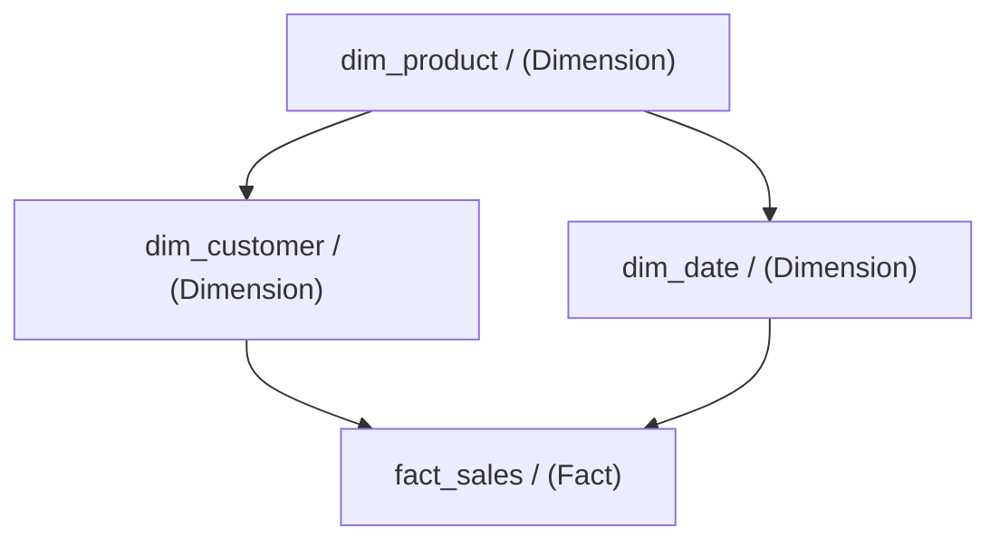

> **SQL Chapter 15/20** | [← Previous](14_Query_Optimization.md) | [Index](../00_MASTER_INDEX.md) | [Next →](16_RealWorld_CaseStudies.md)

---

## Chapter 17: Analytics & Reporting Patterns

```sql
-- ═══════════════════════════════════════════════════════════════════════════════
-- COMMON ANALYTICS PATTERNS
-- ═══════════════════════════════════════════════════════════════════════════════

-- ═══════════════════════════════════════════════════════════════════════════════
-- 1. TIME-SERIES ANALYSIS
-- ═══════════════════════════════════════════════════════════════════════════════

-- Daily sales
SELECT
    DATE(order_date) AS date,
    COUNT(*) AS order_count,
    SUM(total) AS revenue
FROM orders
WHERE order_date >= CURDATE() - INTERVAL 30 DAY
GROUP BY DATE(order_date)
ORDER BY date;

-- Weekly aggregation
SELECT
    YEARWEEK(order_date, 1) AS year_week,
    COUNT(*) AS orders,
    SUM(total) AS revenue
FROM orders
GROUP BY YEARWEEK(order_date, 1);

-- Monthly with year-over-year comparison
WITH monthly_revenue AS (
    SELECT
        DATE_FORMAT(order_date, '%Y-%m') AS month,
        SUM(total) AS revenue
    FROM orders
    WHERE status = 'delivered'
    GROUP BY DATE_FORMAT(order_date, '%Y-%m')
)
SELECT
    m1.month,
    m1.revenue AS current_revenue,
    m2.revenue AS last_year_revenue,
    ROUND((m1.revenue - m2.revenue) / m2.revenue * 100, 2) AS yoy_growth_pct
FROM monthly_revenue m1
LEFT JOIN monthly_revenue m2
    ON DATE_ADD(STR_TO_DATE(CONCAT(m2.month, '-01'), '%Y-%m-%d'), INTERVAL 1 YEAR) =
       STR_TO_DATE(CONCAT(m1.month, '-01'), '%Y-%m-%d')
ORDER BY m1.month DESC;

-- Fill missing dates (calendar table approach)
WITH RECURSIVE date_range AS (
    SELECT DATE('2024-01-01') AS date
    UNION ALL
    SELECT DATE_ADD(date, INTERVAL 1 DAY)
    FROM date_range
    WHERE date < '2024-12-31'
)
SELECT
    dr.date,
    COALESCE(COUNT(o.order_id), 0) AS order_count,
    COALESCE(SUM(o.total), 0) AS revenue
FROM date_range dr
LEFT JOIN orders o ON DATE(o.order_date) = dr.date
GROUP BY dr.date
ORDER BY dr.date;


-- ═══════════════════════════════════════════════════════════════════════════════
-- 2. COHORT ANALYSIS
-- ═══════════════════════════════════════════════════════════════════════════════

-- Customer retention by signup cohort
WITH customer_cohorts AS (
    SELECT
        customer_id,
        DATE_FORMAT(MIN(order_date), '%Y-%m') AS cohort_month
    FROM orders
    GROUP BY customer_id
),
customer_activity AS (
    SELECT
        cc.cohort_month,
        DATE_FORMAT(o.order_date, '%Y-%m') AS activity_month,
        COUNT(DISTINCT o.customer_id) AS active_customers
    FROM customer_cohorts cc
    JOIN orders o ON cc.customer_id = o.customer_id
    GROUP BY cc.cohort_month, DATE_FORMAT(o.order_date, '%Y-%m')
)
SELECT
    cohort_month,
    activity_month,
    TIMESTAMPDIFF(MONTH,
        STR_TO_DATE(CONCAT(cohort_month, '-01'), '%Y-%m-%d'),
        STR_TO_DATE(CONCAT(activity_month, '-01'), '%Y-%m-%d')
    ) AS months_since_cohort,
    active_customers
FROM customer_activity
ORDER BY cohort_month, activity_month;


-- ═══════════════════════════════════════════════════════════════════════════════
-- 3. FUNNEL ANALYSIS
-- ═══════════════════════════════════════════════════════════════════════════════

-- E-commerce conversion funnel
SELECT
    'Visitors' AS stage,
    COUNT(DISTINCT session_id) AS count,
    100.0 AS percentage
FROM sessions
WHERE date >= '2024-01-01'

UNION ALL

SELECT
    'Product Views' AS stage,
    COUNT(DISTINCT session_id),
    ROUND(COUNT(DISTINCT session_id) * 100.0 /
          (SELECT COUNT(DISTINCT session_id) FROM sessions WHERE date >= '2024-01-01'), 2)
FROM product_views
WHERE date >= '2024-01-01'

UNION ALL

SELECT
    'Add to Cart' AS stage,
    COUNT(DISTINCT session_id),
    ROUND(COUNT(DISTINCT session_id) * 100.0 /
          (SELECT COUNT(DISTINCT session_id) FROM sessions WHERE date >= '2024-01-01'), 2)
FROM cart_adds
WHERE date >= '2024-01-01'

UNION ALL

SELECT
    'Checkout Started' AS stage,
    COUNT(DISTINCT session_id),
    ROUND(COUNT(DISTINCT session_id) * 100.0 /
          (SELECT COUNT(DISTINCT session_id) FROM sessions WHERE date >= '2024-01-01'), 2)
FROM checkout_starts
WHERE date >= '2024-01-01'

UNION ALL

SELECT
    'Purchase Completed' AS stage,
    COUNT(DISTINCT session_id),
    ROUND(COUNT(DISTINCT session_id) * 100.0 /
          (SELECT COUNT(DISTINCT session_id) FROM sessions WHERE date >= '2024-01-01'), 2)
FROM orders
WHERE order_date >= '2024-01-01';


-- ═══════════════════════════════════════════════════════════════════════════════
-- 4. RFM ANALYSIS (Recency, Frequency, Monetary)
-- ═══════════════════════════════════════════════════════════════════════════════

WITH customer_rfm AS (
    SELECT
        customer_id,
        DATEDIFF(CURDATE(), MAX(order_date)) AS recency_days,
        COUNT(*) AS frequency,
        SUM(total) AS monetary
    FROM orders
    WHERE status = 'delivered'
    GROUP BY customer_id
),
rfm_scores AS (
    SELECT
        customer_id,
        recency_days,
        frequency,
        monetary,
        NTILE(5) OVER (ORDER BY recency_days DESC) AS r_score,  -- Lower recency = higher score
        NTILE(5) OVER (ORDER BY frequency) AS f_score,
        NTILE(5) OVER (ORDER BY monetary) AS m_score
    FROM customer_rfm
)
SELECT
    customer_id,
    recency_days,
    frequency,
    monetary,
    CONCAT(r_score, f_score, m_score) AS rfm_score,
    CASE
        WHEN r_score >= 4 AND f_score >= 4 AND m_score >= 4 THEN 'Champions'
        WHEN r_score >= 3 AND f_score >= 3 THEN 'Loyal Customers'
        WHEN r_score >= 4 AND f_score <= 2 THEN 'New Customers'
        WHEN r_score <= 2 AND f_score >= 3 THEN 'At Risk'
        WHEN r_score <= 2 AND f_score <= 2 THEN 'Lost'
        ELSE 'Others'
    END AS customer_segment
FROM rfm_scores;


-- ═══════════════════════════════════════════════════════════════════════════════
-- 5. MARKET BASKET ANALYSIS (Products bought together)
-- ═══════════════════════════════════════════════════════════════════════════════

-- Find products frequently bought together
SELECT
    oi1.product_id AS product_a,
    p1.name AS product_a_name,
    oi2.product_id AS product_b,
    p2.name AS product_b_name,
    COUNT(*) AS times_bought_together
FROM order_items oi1
JOIN order_items oi2 ON oi1.order_id = oi2.order_id AND oi1.product_id < oi2.product_id
JOIN products p1 ON oi1.product_id = p1.product_id
JOIN products p2 ON oi2.product_id = p2.product_id
GROUP BY oi1.product_id, oi2.product_id, p1.name, p2.name
HAVING COUNT(*) >= 10
ORDER BY times_bought_together DESC
LIMIT 20;


-- ═══════════════════════════════════════════════════════════════════════════════
-- 6. MOVING CALCULATIONS
-- ═══════════════════════════════════════════════════════════════════════════════

-- 7-day moving average
SELECT
    date,
    daily_revenue,
    AVG(daily_revenue) OVER (
        ORDER BY date
        ROWS BETWEEN 6 PRECEDING AND CURRENT ROW
    ) AS moving_avg_7day
FROM (
    SELECT
        DATE(order_date) AS date,
        SUM(total) AS daily_revenue
    FROM orders
    GROUP BY DATE(order_date)
) daily;

-- Cumulative sum (running total)
SELECT
    DATE(order_date) AS date,
    SUM(total) AS daily_revenue,
    SUM(SUM(total)) OVER (ORDER BY DATE(order_date)) AS cumulative_revenue
FROM orders
GROUP BY DATE(order_date);

-- Month-to-date (MTD) running total
SELECT
    order_date,
    total,
    SUM(total) OVER (
        PARTITION BY YEAR(order_date), MONTH(order_date)
        ORDER BY order_date
    ) AS mtd_revenue
FROM orders;


-- ═══════════════════════════════════════════════════════════════════════════════
-- 7. PERCENTILES & DISTRIBUTIONS
-- ═══════════════════════════════════════════════════════════════════════════════

-- Order value percentiles
SELECT
    PERCENTILE_CONT(0.25) WITHIN GROUP (ORDER BY total) AS p25,
    PERCENTILE_CONT(0.50) WITHIN GROUP (ORDER BY total) AS median,
    PERCENTILE_CONT(0.75) WITHIN GROUP (ORDER BY total) AS p75,
    PERCENTILE_CONT(0.90) WITHIN GROUP (ORDER BY total) AS p90,
    PERCENTILE_CONT(0.99) WITHIN GROUP (ORDER BY total) AS p99
FROM orders;

-- MySQL alternative (using variables)
SET @rowindex := -1;
SELECT AVG(total) AS median
FROM (
    SELECT @rowindex := @rowindex + 1 AS rowindex, total
    FROM orders
    ORDER BY total
) t
WHERE rowindex IN (FLOOR(@rowindex / 2), CEIL(@rowindex / 2));

-- Value distribution buckets
SELECT
    CASE
        WHEN total < 100 THEN '< ₹100'
        WHEN total < 500 THEN '₹100-500'
        WHEN total < 1000 THEN '₹500-1000'
        WHEN total < 5000 THEN '₹1000-5000'
        ELSE '₹5000+'
    END AS order_bucket,
    COUNT(*) AS order_count,
    ROUND(COUNT(*) * 100.0 / SUM(COUNT(*)) OVER (), 2) AS percentage
FROM orders
GROUP BY 1
ORDER BY MIN(total);
```

---


> 🔬 **Section Challenge — Chapter 17: Analytics & Reporting Patterns**

**Challenge 1 (Reasoning):** The time-series query uses a recursive CTE to generate a `date_range` and LEFT JOINs orders to it. Why can't you just `GROUP BY DATE(order_date)` directly? What does the LEFT JOIN against the calendar table solve?
<details><summary>Answer</summary>

`GROUP BY DATE(order_date)` only returns rows for dates that HAVE orders. If Tuesday had zero orders, Tuesday is completely absent from the results — the chart jumps from Monday to Wednesday. This breaks time-series visualizations (missing data points), moving averages (the window shifts incorrectly), and year-over-year comparisons (you compare the wrong days). The calendar table approach generates ALL dates first, then LEFT JOINs orders. Days with no orders get `COALESCE(COUNT(...), 0)` = 0 — an explicit zero, not a missing row. **Production pattern:** Most data warehouses maintain a pre-populated `dim_date` table (with columns for fiscal year, holidays, week numbers) rather than generating dates with recursive CTEs, because recursive CTEs have depth limits and performance overhead on large ranges.
</details>

## Chapter 18: Data Warehousing Concepts

```
┌─────────────────────────────────────────────────────────────────────────────────┐
│                    DATA WAREHOUSE vs OLTP DATABASE                              │
├─────────────────────────────────────────────────────────────────────────────────┤
│                                                                                 │
│  OLTP (Online Transaction Processing)    │  OLAP (Online Analytical Processing) │
│  ─────────────────────────────────────   │  ──────────────────────────────────  │
│  • Operational database                  │  • Data Warehouse / Data Mart        │
│  • Current data                          │  • Historical data                   │
│  • Normalized (3NF)                      │  • Denormalized (Star/Snowflake)     │
│  • Many small transactions               │  • Few large queries                 │
│  • INSERT, UPDATE, DELETE heavy          │  • SELECT heavy (read-mostly)        │
│  • Millisecond response                  │  • Seconds to minutes response       │
│  • GB to TB                              │  • TB to PB                          │
│  • MySQL, PostgreSQL, SQL Server         │  • Snowflake, Redshift, BigQuery     │
│                                                                                 │
│                                                                                 │
│  DIMENSIONAL MODELING:                                                          │
│  ┌────────────────────────────────────────────────────────────────────────────┐ │
│  │                                                                            │ │
│  │            ┌─────────────────┐                                             │ │
│  │            │   dim_product   │                                             │ │
│  │            │   (Dimension)   │                                             │ │
│  │            └────────┬────────┘                                             │ │
│  │                     │                                                      │ │
│  │  ┌─────────────┐    │    ┌─────────────┐                                  │  │
│  │  │ dim_customer│────┼────│  dim_date   │                                  │  │
│  │  │ (Dimension) │    │    │ (Dimension) │                                  │  │
│  │  └─────────────┘    │    └─────────────┘                                  │  │
│  │                     │                                                      │ │
│  │            ┌────────▼────────┐                                             │ │
│  │            │   fact_sales    │ ← Contains measures (amount, qty, etc.)    │  │
│  │            │    (Fact)       │   and foreign keys to dimensions            │ │
│  │            └─────────────────┘                                             │ │
│  │                                                                            │ │
│  │  STAR SCHEMA: Fact table in center, dimensions around it                   │ │
│  │  SNOWFLAKE SCHEMA: Dimensions normalized into sub-dimensions               │ │
│  │                                                                            │ │
│  └────────────────────────────────────────────────────────────────────────────┘ │
│                                                                                 │
└─────────────────────────────────────────────────────────────────────────────────┘
```

**Flow:**
1. dim_product / (Dimension)
2. dim_customer / (Dimension)
3. dim_product / (Dimension)
4. dim_date / (Dimension)
5. dim_customer / (Dimension)
6. fact_sales / (Fact)
7. dim_date / (Dimension)
8. fact_sales / (Fact)



```sql
-- ═══════════════════════════════════════════════════════════════════════════════
-- DIMENSIONAL MODELING - STAR SCHEMA EXAMPLE
-- ═══════════════════════════════════════════════════════════════════════════════

-- DIMENSION TABLES (Descriptive data)

-- Date dimension (pre-populated calendar table)
CREATE TABLE dim_date (
    date_key INT PRIMARY KEY,              -- YYYYMMDD format
    full_date DATE NOT NULL,
    day_of_week TINYINT,                   -- 1-7
    day_name VARCHAR(10),                  -- Monday, Tuesday...
    day_of_month TINYINT,
    day_of_year SMALLINT,
    week_of_year TINYINT,
    month_num TINYINT,
    month_name VARCHAR(10),
    quarter TINYINT,
    year SMALLINT,
    is_weekend BOOLEAN,
    is_holiday BOOLEAN,
    fiscal_year SMALLINT,
    fiscal_quarter TINYINT
);

-- Customer dimension
CREATE TABLE dim_customer (
    customer_key INT PRIMARY KEY AUTO_INCREMENT,
    customer_id INT,                        -- Natural key from source
    customer_name VARCHAR(200),
    email VARCHAR(255),
    phone VARCHAR(20),
    address VARCHAR(500),
    city VARCHAR(100),
    state VARCHAR(100),
    country VARCHAR(100),
    postal_code VARCHAR(20),
    segment VARCHAR(50),                    -- B2B, B2C, Enterprise
    -- SCD Type 2 fields
    effective_date DATE,
    expiry_date DATE,
    is_current BOOLEAN DEFAULT TRUE
);

-- Product dimension
CREATE TABLE dim_product (
    product_key INT PRIMARY KEY AUTO_INCREMENT,
    product_id INT,
    sku VARCHAR(50),
    product_name VARCHAR(255),
    description TEXT,
    category VARCHAR(100),
    subcategory VARCHAR(100),
    brand VARCHAR(100),
    supplier VARCHAR(200),
    unit_cost DECIMAL(10,2),
    unit_price DECIMAL(10,2),
    -- SCD Type 2 fields
    effective_date DATE,
    expiry_date DATE,
    is_current BOOLEAN DEFAULT TRUE
);

-- Store/Location dimension
CREATE TABLE dim_store (
    store_key INT PRIMARY KEY AUTO_INCREMENT,
    store_id INT,
    store_name VARCHAR(200),
    store_type VARCHAR(50),
    address VARCHAR(500),
    city VARCHAR(100),
    state VARCHAR(100),
    country VARCHAR(100),
    region VARCHAR(100),
    manager_name VARCHAR(200),
    open_date DATE,
    close_date DATE
);


-- FACT TABLE (Transactional data with measures)
CREATE TABLE fact_sales (
    sale_key BIGINT PRIMARY KEY AUTO_INCREMENT,

    -- Foreign keys to dimensions
    date_key INT,
    customer_key INT,
    product_key INT,
    store_key INT,

    -- Degenerate dimension (order number)
    order_number VARCHAR(50),

    -- Measures
    quantity INT,
    unit_price DECIMAL(10,2),
    discount_amount DECIMAL(10,2),
    tax_amount DECIMAL(10,2),
    shipping_amount DECIMAL(10,2),
    total_amount DECIMAL(12,2),
    cost_amount DECIMAL(10,2),
    profit_amount DECIMAL(10,2),

    -- Foreign key constraints
    FOREIGN KEY (date_key) REFERENCES dim_date(date_key),
    FOREIGN KEY (customer_key) REFERENCES dim_customer(customer_key),
    FOREIGN KEY (product_key) REFERENCES dim_product(product_key),
    FOREIGN KEY (store_key) REFERENCES dim_store(store_key),

    -- Indexes for common queries
    INDEX idx_date (date_key),
    INDEX idx_customer (customer_key),
    INDEX idx_product (product_key),
    INDEX idx_store (store_key)
);


-- ═══════════════════════════════════════════════════════════════════════════════
-- QUERYING THE STAR SCHEMA
-- ═══════════════════════════════════════════════════════════════════════════════

-- Sales by product category and month
SELECT
    dd.year,
    dd.month_name,
    dp.category,
    SUM(fs.quantity) AS total_units,
    SUM(fs.total_amount) AS total_revenue,
    SUM(fs.profit_amount) AS total_profit
FROM fact_sales fs
JOIN dim_date dd ON fs.date_key = dd.date_key
JOIN dim_product dp ON fs.product_key = dp.product_key
WHERE dd.year = 2024
GROUP BY dd.year, dd.month_num, dd.month_name, dp.category
ORDER BY dd.month_num, total_revenue DESC;

-- Customer segment analysis
SELECT
    dc.segment,
    dc.country,
    COUNT(DISTINCT dc.customer_key) AS customer_count,
    COUNT(*) AS transaction_count,
    SUM(fs.total_amount) AS total_revenue,
    AVG(fs.total_amount) AS avg_order_value
FROM fact_sales fs
JOIN dim_customer dc ON fs.customer_key = dc.customer_key
WHERE dc.is_current = TRUE
GROUP BY dc.segment, dc.country
ORDER BY total_revenue DESC;

-- Store performance comparison
SELECT
    ds.store_name,
    ds.city,
    ds.region,
    SUM(fs.total_amount) AS revenue,
    SUM(fs.profit_amount) AS profit,
    ROUND(SUM(fs.profit_amount) / NULLIF(SUM(fs.total_amount), 0) * 100, 2) AS profit_margin
FROM fact_sales fs
JOIN dim_store ds ON fs.store_key = ds.store_key
JOIN dim_date dd ON fs.date_key = dd.date_key
WHERE dd.year = 2024 AND dd.quarter = 1
GROUP BY ds.store_key, ds.store_name, ds.city, ds.region
ORDER BY revenue DESC;


-- ═══════════════════════════════════════════════════════════════════════════════
-- SLOWLY CHANGING DIMENSIONS (SCD)
-- ═══════════════════════════════════════════════════════════════════════════════

/*
SCD Type 0: Retain Original (no changes)
SCD Type 1: Overwrite (lose history)
SCD Type 2: Add new row (track history) ← Most common
SCD Type 3: Add new column (limited history)
*/

-- SCD Type 2 implementation
-- When customer address changes:

-- Step 1: Close the current record
UPDATE dim_customer
SET expiry_date = CURRENT_DATE - INTERVAL 1 DAY,
    is_current = FALSE
WHERE customer_id = 123 AND is_current = TRUE;

-- Step 2: Insert new record
INSERT INTO dim_customer (
    customer_id, customer_name, email, address, city, state, country,
    segment, effective_date, expiry_date, is_current
)
VALUES (
    123, 'John Doe', 'john@email.com', 'New Address', 'New City', 'State', 'Country',
    'B2C', CURRENT_DATE, '9999-12-31', TRUE
);


-- Query with SCD Type 2 - Get customer at specific point in time
SELECT dc.*, fs.total_amount
FROM fact_sales fs
JOIN dim_date dd ON fs.date_key = dd.date_key
JOIN dim_customer dc ON fs.customer_key = dc.customer_key
    AND dd.full_date BETWEEN dc.effective_date AND dc.expiry_date
WHERE dd.full_date = '2024-06-15';
```

---


> 🔬 **Section Challenge — Chapter 18: Data Warehousing Concepts**

**Challenge 1 (Reasoning):** The SCD section shows Type 2 (add new row, track history). Why not just use Type 1 (overwrite the old value)? What specific business question becomes IMPOSSIBLE to answer with Type 1?
<details><summary>Answer</summary>

With Type 1, when a customer moves from Mumbai to Bangalore, you overwrite `city = 'Bangalore'`. Now ALL historical orders — including ones placed when the customer was in Mumbai — appear as "Bangalore" orders. The question **"How much revenue did we generate from Mumbai customers in Q1?"** becomes impossible to answer correctly, because the customer's history was destroyed. Type 2 keeps BOTH rows: Row 1 (`city='Mumbai', effective='2020-01-01', expiry='2024-03-14'`) and Row 2 (`city='Bangalore', effective='2024-03-15', expiry='9999-12-31'`). When you join `fact_sales` to `dim_customer` using `dd.full_date BETWEEN dc.effective_date AND dc.expiry_date`, Q1 2024 orders correctly associate with Mumbai (the address at the time of purchase). **Trade-off:** Type 2 grows the dimension table (one customer may have 5+ rows over time), making joins slower. Type 1 keeps the table small but loses history. Most production warehouses use Type 2 for customer/product dimensions and Type 1 for rarely-changing attributes like country codes.
</details>

## Chapter 19: ETL Patterns in SQL

```sql
-- ═══════════════════════════════════════════════════════════════════════════════
-- ETL (Extract, Transform, Load) PATTERNS
-- ═══════════════════════════════════════════════════════════════════════════════

-- ═══════════════════════════════════════════════════════════════════════════════
-- 1. EXTRACT - Getting data from source
-- ═══════════════════════════════════════════════════════════════════════════════

-- Incremental extract (only new/changed records)
-- Using timestamp
SELECT * FROM source_orders
WHERE modified_at > @last_extract_timestamp;

-- Using CDC (Change Data Capture) - conceptual
SELECT * FROM source_orders_cdc
WHERE operation IN ('INSERT', 'UPDATE')
  AND capture_time > @last_extract_time;

-- Full extract with delta detection
SELECT s.*
FROM source_products s
LEFT JOIN staging_products t ON s.product_id = t.product_id
WHERE t.product_id IS NULL  -- New records
   OR s.checksum != t.checksum;  -- Changed records


-- ═══════════════════════════════════════════════════════════════════════════════
-- 2. TRANSFORM - Cleaning and transforming data
-- ═══════════════════════════════════════════════════════════════════════════════

-- Data cleaning in staging area
CREATE TABLE staging_customers AS
SELECT
    customer_id,
    -- Trim whitespace
    TRIM(first_name) AS first_name,
    TRIM(last_name) AS last_name,
    -- Standardize email
    LOWER(TRIM(email)) AS email,
    -- Standardize phone (remove non-digits)
    REGEXP_REPLACE(phone, '[^0-9]', '') AS phone,
    -- Handle nulls
    COALESCE(country, 'Unknown') AS country,
    -- Parse dates
    STR_TO_DATE(birth_date, '%d/%m/%Y') AS birth_date,
    -- Derive fields
    TIMESTAMPDIFF(YEAR, STR_TO_DATE(birth_date, '%d/%m/%Y'), CURDATE()) AS age,
    -- Create surrogate key
    MD5(CONCAT(customer_id, '-', source_system)) AS customer_hash
FROM raw_customers
WHERE email IS NOT NULL AND email != '';

-- Data validation queries
-- Find invalid emails
SELECT * FROM staging_customers
WHERE email NOT REGEXP '^[A-Za-z0-9._%+-]+@[A-Za-z0-9.-]+\.[A-Za-z]{2,}$';

-- Find duplicates
SELECT email, COUNT(*)
FROM staging_customers
GROUP BY email
HAVING COUNT(*) > 1;

-- Data deduplication
WITH ranked AS (
    SELECT *,
        ROW_NUMBER() OVER (PARTITION BY email ORDER BY modified_at DESC) AS rn
    FROM staging_customers
)
DELETE FROM staging_customers
WHERE customer_id IN (SELECT customer_id FROM ranked WHERE rn > 1);


-- ═══════════════════════════════════════════════════════════════════════════════
-- 3. LOAD - Loading into target tables
-- ═══════════════════════════════════════════════════════════════════════════════

-- UPSERT pattern (MySQL)
INSERT INTO dim_customer (customer_id, customer_name, email, segment, effective_date)
SELECT customer_id, CONCAT(first_name, ' ', last_name), email, segment, CURRENT_DATE
FROM staging_customers s
ON DUPLICATE KEY UPDATE
    customer_name = VALUES(customer_name),
    email = VALUES(email),
    segment = VALUES(segment);

-- MERGE (PostgreSQL, SQL Server)
MERGE INTO dim_customer AS target
USING staging_customers AS source
ON target.customer_id = source.customer_id
WHEN MATCHED THEN
    UPDATE SET
        customer_name = source.customer_name,
        email = source.email,
        modified_at = CURRENT_TIMESTAMP
WHEN NOT MATCHED THEN
    INSERT (customer_id, customer_name, email, created_at)
    VALUES (source.customer_id, source.customer_name, source.email, CURRENT_TIMESTAMP);


-- ═══════════════════════════════════════════════════════════════════════════════
-- 4. COMPLETE ETL PIPELINE EXAMPLE
-- ═══════════════════════════════════════════════════════════════════════════════

DELIMITER //
CREATE PROCEDURE run_daily_etl()
BEGIN
    DECLARE v_batch_id INT;
    DECLARE v_start_time TIMESTAMP DEFAULT CURRENT_TIMESTAMP;
    DECLARE v_records_processed INT DEFAULT 0;

    -- Error handling
    DECLARE EXIT HANDLER FOR SQLEXCEPTION
    BEGIN
        ROLLBACK;
        UPDATE etl_log SET status = 'FAILED', error_message = 'ETL failed'
        WHERE batch_id = v_batch_id;
        RESIGNAL;
    END;

    -- Log start
    INSERT INTO etl_log (start_time, status) VALUES (v_start_time, 'RUNNING');
    SET v_batch_id = LAST_INSERT_ID();

    START TRANSACTION;

    -- EXTRACT: Load to staging
    TRUNCATE TABLE staging_orders;
    INSERT INTO staging_orders
    SELECT * FROM source_orders
    WHERE order_date >= DATE_SUB(CURDATE(), INTERVAL 1 DAY);

    SET v_records_processed = ROW_COUNT();

    -- TRANSFORM: Clean data
    UPDATE staging_orders
    SET customer_name = TRIM(customer_name),
        email = LOWER(email),
        total = ROUND(total, 2);

    -- Validate
    DELETE FROM staging_orders WHERE email IS NULL OR total <= 0;

    -- LOAD: Fact table
    INSERT INTO fact_daily_orders (date_key, customer_key, product_key, quantity, amount)
    SELECT
        CAST(DATE_FORMAT(so.order_date, '%Y%m%d') AS UNSIGNED),
        dc.customer_key,
        dp.product_key,
        so.quantity,
        so.total
    FROM staging_orders so
    JOIN dim_customer dc ON so.email = dc.email AND dc.is_current = TRUE
    JOIN dim_product dp ON so.product_id = dp.product_id AND dp.is_current = TRUE;

    COMMIT;

    -- Log completion
    UPDATE etl_log
    SET end_time = CURRENT_TIMESTAMP,
        status = 'SUCCESS',
        records_processed = v_records_processed
    WHERE batch_id = v_batch_id;

END //
DELIMITER ;

-- Schedule ETL (MySQL Event)
CREATE EVENT daily_etl_job
ON SCHEDULE EVERY 1 DAY
STARTS '2024-01-01 02:00:00'
DO CALL run_daily_etl();
```

---

> **Navigation**: [< Previous](14_Query_Optimization.md) | [Back to Index](../00_MASTER_INDEX.md) | [Next >](16_RealWorld_CaseStudies.md)


> 🔬 **Section Challenge — Chapter 19: ETL Patterns in SQL**

**Challenge 1 (Reasoning):** Your daily ETL pipeline crashes halfway through the LOAD phase — 500K of 1M rows were already inserted into `fact_sales`. The pipeline is restarted. Now `fact_sales` has 500K duplicate rows. What design principle was violated, and how do you make ETL pipelines **crash-safe**?
<details><summary>Answer</summary>

The violated principle is **idempotency** — running the same operation multiple times should produce the same result as running it once. The pipeline did a raw `INSERT INTO fact_sales SELECT ...` without checking for existing records, so re-running it after a crash inserts the same 500K rows again. **Fix with three patterns:** (1) **UPSERT/MERGE**: Replace `INSERT` with `INSERT ... ON DUPLICATE KEY UPDATE` (MySQL) or `MERGE` (PostgreSQL/SQL Server). This requires a natural key or composite unique key on the fact table to detect duplicates. (2) **Staging + Swap**: TRUNCATE a staging table → Load ALL data into staging → Validate → In a single transaction: TRUNCATE target + INSERT INTO target SELECT FROM staging. If the pipeline crashes, the staging table has the data but the target is untouched. (3) **Batch ID tracking**: Each ETL run gets a `batch_id`. Before loading, delete any rows with the current `batch_id` from the target (`DELETE FROM fact_sales WHERE batch_id = @current_batch`), then insert. Re-running deletes the partial load first. **Key insight:** Every production ETL step must be re-runnable without side effects. This is the #1 data engineering interview question.
</details>

