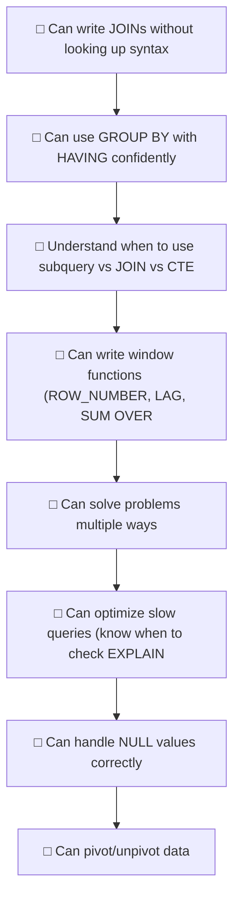
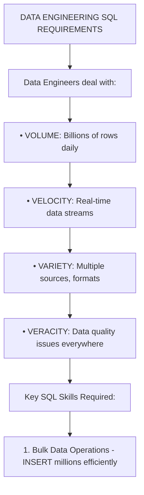
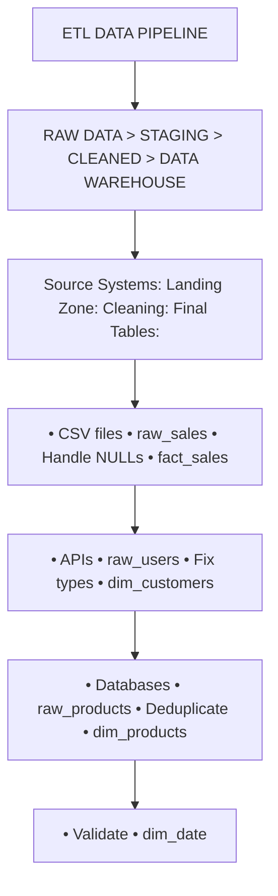
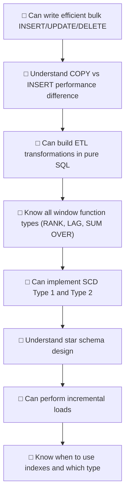

**Navigation**: [< Previous Chapter](18a_SQL_Projects_Beginner.md) | [Back to Index](../00_MASTER_INDEX.md)

---

# PROJECT 4: Interview-Style Challenges

## Challenge 1: Second Highest Salary

```sql
-- Multiple solutions:

-- Solution 1: OFFSET
SELECT DISTINCT salary
FROM employees
ORDER BY salary DESC
LIMIT 1 OFFSET 1;

-- Solution 2: Subquery
SELECT MAX(salary)
FROM employees
WHERE salary < (SELECT MAX(salary) FROM employees);

-- Solution 3: DENSE_RANK (handles ties)
WITH ranked AS (
    SELECT salary, DENSE_RANK() OVER (ORDER BY salary DESC) as rank
    FROM employees
)
SELECT DISTINCT salary FROM ranked WHERE rank = 2;
```

## Challenge 2: Employees Earning More Than Their Manager

```sql
SELECT
    e.employee_id,
    e.first_name || ' ' || e.last_name as employee_name,
    e.salary as employee_salary,
    m.first_name || ' ' || m.last_name as manager_name,
    m.salary as manager_salary
FROM employees e
JOIN employees m ON e.manager_id = m.employee_id
WHERE e.salary > m.salary;
```

## Challenge 3: Consecutive Login Days

```sql
-- Find users with 3+ consecutive login days
WITH login_days AS (
    SELECT DISTINCT
        user_id,
        DATE(login_time) as login_date
    FROM user_logins
),
with_groups AS (
    SELECT
        user_id,
        login_date,
        login_date - INTERVAL '1 day' * ROW_NUMBER() OVER (
            PARTITION BY user_id ORDER BY login_date
        ) as grp
    FROM login_days
)
SELECT
    user_id,
    MIN(login_date) as streak_start,
    MAX(login_date) as streak_end,
    COUNT(*) as consecutive_days
FROM with_groups
GROUP BY user_id, grp
HAVING COUNT(*) >= 3
ORDER BY consecutive_days DESC;
```

## Challenge 4: Median (Without Built-in Function)

```sql
-- Calculate median salary
WITH ordered AS (
    SELECT
        salary,
        ROW_NUMBER() OVER (ORDER BY salary) as row_num,
        COUNT(*) OVER () as total_count
    FROM employees
    WHERE salary IS NOT NULL
)
SELECT AVG(salary) as median_salary
FROM ordered
WHERE row_num IN (
    (total_count + 1) / 2,
    (total_count + 2) / 2
);
```

## Challenge 5: Department with Highest Average Salary

```sql
-- Without using LIMIT
SELECT department_id, avg_salary
FROM (
    SELECT
        department_id,
        AVG(salary) as avg_salary,
        RANK() OVER (ORDER BY AVG(salary) DESC) as rnk
    FROM employees
    GROUP BY department_id
) ranked
WHERE rnk = 1;
```

## Challenge 6: Pivoting Data

```sql
-- Convert rows to columns (sales by quarter)
SELECT
    product_id,
    SUM(CASE WHEN quarter = 'Q1' THEN sales ELSE 0 END) as Q1,
    SUM(CASE WHEN quarter = 'Q2' THEN sales ELSE 0 END) as Q2,
    SUM(CASE WHEN quarter = 'Q3' THEN sales ELSE 0 END) as Q3,
    SUM(CASE WHEN quarter = 'Q4' THEN sales ELSE 0 END) as Q4,
    SUM(sales) as total
FROM quarterly_sales
GROUP BY product_id;
```

## Challenge 7: Gap Detection

```sql
-- Find missing order IDs
WITH id_range AS (
    SELECT generate_series(MIN(order_id), MAX(order_id)) as expected_id
    FROM orders
)
SELECT expected_id as missing_order_id
FROM id_range
WHERE expected_id NOT IN (SELECT order_id FROM orders);
```

## Challenge 8: Year-over-Year Comparison

```sql
-- Compare each month to same month last year
WITH monthly_sales AS (
    SELECT
        DATE_TRUNC('month', sale_date) as month,
        SUM(amount) as total_sales
    FROM sales
    GROUP BY DATE_TRUNC('month', sale_date)
)
SELECT
    this_year.month,
    this_year.total_sales as current_year,
    last_year.total_sales as previous_year,
    this_year.total_sales - last_year.total_sales as yoy_change,
    ROUND(
        (this_year.total_sales - last_year.total_sales) * 100.0 /
        NULLIF(last_year.total_sales, 0),
        2
    ) as yoy_percent
FROM monthly_sales this_year
LEFT JOIN monthly_sales last_year
    ON this_year.month = last_year.month + INTERVAL '1 year'
WHERE this_year.month >= DATE_TRUNC('year', CURRENT_DATE)
ORDER BY this_year.month;
```

---

# 🎯 Practice Tips

## How to Practice Effectively

1. **Type it yourself** - Don't copy-paste. Muscle memory matters.
2. **Predict results** - Before running, guess what you'll get.
3. **Break down complex queries** - Use CTEs to think step by step.
4. **Explain your approach** - Practice talking through your logic.

## Practice Platforms

- **HackerRank SQL** - Good for basics
- **LeetCode Database** - Interview-style questions
- **StrataScratch** - Real company interview questions
- **SQLZoo** - Interactive tutorials
- **Mode Analytics SQL Tutorial** - Free with real datasets

## Self-Assessment Checklist

```
□ Can write JOINs without looking up syntax
□ Can use GROUP BY with HAVING confidently
□ Understand when to use subquery vs JOIN vs CTE
□ Can write window functions (ROW_NUMBER, LAG, SUM OVER)
□ Can solve problems multiple ways
□ Can optimize slow queries (know when to check EXPLAIN)
□ Can handle NULL values correctly
□ Can pivot/unpivot data
□ Can calculate running totals and moving averages
□ Can detect gaps and islands in data
```

**Flow:**
1. □ Can write JOINs without looking up syntax
2. □ Can use GROUP BY with HAVING confidently
3. □ Understand when to use subquery vs JOIN vs CTE
4. □ Can write window functions (ROW_NUMBER, LAG, SUM OVER
5. □ Can solve problems multiple ways
6. □ Can optimize slow queries (know when to check EXPLAIN
7. □ Can handle NULL values correctly



---

_Practice consistently. Aim for 2-3 problems daily. Review solutions even for problems you solved._

---

# 📊 PART 5: DATA ANALYTICS & ENGINEERING ESSENTIALS

Everything you need to master SQL for Data Analytics and Data Engineering roles

---

## 🔵 WHY Data Engineers Need SQL Mastery

```
┌─────────────────────────────────────────────────────────────────────────────────┐
│                    DATA ENGINEERING SQL REQUIREMENTS                            │
├─────────────────────────────────────────────────────────────────────────────────┤
│                                                                                 │
│  Data Engineers deal with:                                                      │
│  • VOLUME: Billions of rows daily                                               │
│  • VELOCITY: Real-time data streams                                             │
│  • VARIETY: Multiple sources, formats                                           │
│  • VERACITY: Data quality issues everywhere                                     │
│                                                                                 │
│  Key SQL Skills Required:                                                       │
│  1. Bulk Data Operations - INSERT millions efficiently                          │
│  2. ETL Transformations - Clean, transform, load                                │
│  3. Query Optimization - Make queries 100x faster                               │
│  4. Window Functions - Analytics without aggregation loss                       │
│  5. CTEs & Recursive Queries - Complex data hierarchies                         │
│  6. Data Quality Checks - Validate before insert                                │
│                                                                                 │
└─────────────────────────────────────────────────────────────────────────────────┘
```

**Flow:**
1. DATA ENGINEERING SQL REQUIREMENTS
2. Data Engineers deal with:
3. • VOLUME: Billions of rows daily
4. • VELOCITY: Real-time data streams
5. • VARIETY: Multiple sources, formats
6. • VERACITY: Data quality issues everywhere
7. Key SQL Skills Required:



---


# 📌 Section 1: Bulk Data Operations

## 🔵 WHY Bulk Operations Matter

```
Single INSERT: 1 million rows = 1 million round trips = 30+ minutes
Bulk INSERT: 1 million rows = 1 operation = 10 seconds

That's 180x faster!
```

## 1.1 Bulk INSERT Techniques

### Method 1: Multi-Value INSERT

```sql
-- SLOW: One insert per row
INSERT INTO products VALUES (1, 'Item A', 10.00);
INSERT INTO products VALUES (2, 'Item B', 20.00);
INSERT INTO products VALUES (3, 'Item C', 30.00);

-- FAST: Multi-value insert (100x faster)
INSERT INTO products (id, name, price) VALUES
(1, 'Item A', 10.00),
(2, 'Item B', 20.00),
(3, 'Item C', 30.00),
(4, 'Item D', 40.00),
(5, 'Item E', 50.00);
-- Can include up to 1000 rows per statement
```

### Method 2: INSERT...SELECT (Data Migration)

```sql
-- Copy data between tables
INSERT INTO products_archive (id, name, price, archived_date)
SELECT id, name, price, CURRENT_TIMESTAMP
FROM products
WHERE created_at < '2023-01-01';

-- Transform while inserting
INSERT INTO daily_sales_summary (sale_date, total_revenue, order_count, avg_order_value)
SELECT
    DATE(order_date) as sale_date,
    SUM(total_amount) as total_revenue,
    COUNT(*) as order_count,
    AVG(total_amount) as avg_order_value
FROM orders
WHERE order_date >= CURRENT_DATE - INTERVAL '30 days'
GROUP BY DATE(order_date);
```

### Method 3: COPY Command (PostgreSQL - Fastest)

```sql
-- Import from CSV (FASTEST method - 10 million rows in seconds)
COPY products (id, name, category, price)
FROM '/data/products.csv'
WITH (FORMAT csv, HEADER true, DELIMITER ',');

-- Export to CSV
COPY (SELECT * FROM products WHERE category = 'Electronics')
TO '/exports/electronics.csv'
WITH (FORMAT csv, HEADER true);

-- From stdin (for programmatic loading)
COPY products FROM STDIN WITH (FORMAT csv);
```

### Method 4: BULK INSERT (SQL Server)

```sql
-- SQL Server specific
BULK INSERT products
FROM 'C:\data\products.csv'
WITH (
    FIELDTERMINATOR = ',',
    ROWTERMINATOR = '\n',
    FIRSTROW = 2,  -- Skip header
    BATCHSIZE = 50000,
    TABLOCK
);
```

### Method 5: Generate Test Data

```sql
-- PostgreSQL: Generate 1 million rows
INSERT INTO test_data (id, random_value, created_at)
SELECT
    generate_series(1, 1000000) as id,
    random() * 10000 as random_value,
    TIMESTAMP '2020-01-01' + random() * (TIMESTAMP '2024-12-31' - TIMESTAMP '2020-01-01') as created_at;

-- Generate random names
INSERT INTO customers (name, email, signup_date)
SELECT
    'Customer_' || i as name,
    'customer' || i || '@example.com' as email,
    CURRENT_DATE - (random() * 365)::int as signup_date
FROM generate_series(1, 100000) as i;
```

---


## 1.2 Bulk UPDATE Operations

### Update with JOINs

```sql
-- Update prices based on another table
UPDATE products p
SET price = p.price * (1 + pc.markup_percentage/100)
FROM product_categories pc
WHERE p.category_id = pc.id
  AND pc.category_name = 'Electronics';

-- SQL Server syntax
UPDATE p
SET p.price = p.price * 1.10
FROM products p
INNER JOIN product_categories pc ON p.category_id = pc.id
WHERE pc.category_name = 'Electronics';
```

### Conditional Bulk Update (CASE)

```sql
-- Update multiple conditions in single query
UPDATE products
SET status = CASE
    WHEN stock_quantity = 0 THEN 'out_of_stock'
    WHEN stock_quantity < 10 THEN 'low_stock'
    WHEN stock_quantity < 50 THEN 'medium_stock'
    ELSE 'in_stock'
END,
updated_at = CURRENT_TIMESTAMP;
```

### Update with Subquery

```sql
-- Update based on aggregated data
UPDATE products p
SET total_sold = (
    SELECT COALESCE(SUM(quantity), 0)
    FROM order_items oi
    WHERE oi.product_id = p.id
);
```

---

## 1.3 Bulk DELETE Operations

### Delete with JOIN

```sql
-- Delete orders from inactive customers
DELETE FROM orders o
USING customers c
WHERE o.customer_id = c.id
  AND c.status = 'inactive'
  AND c.last_activity < CURRENT_DATE - INTERVAL '2 years';
```

### Delete in Batches (Prevent Lock Issues)

```sql
-- Delete million rows in 10k batches to avoid locking
DO $$
DECLARE
    rows_deleted INT;
BEGIN
    LOOP
        DELETE FROM old_logs
        WHERE id IN (
            SELECT id FROM old_logs
            WHERE created_at < '2020-01-01'
            LIMIT 10000
        );

        GET DIAGNOSTICS rows_deleted = ROW_COUNT;

        IF rows_deleted = 0 THEN
            EXIT;
        END IF;

        COMMIT;
        PERFORM pg_sleep(0.1);  -- Small pause
    END LOOP;
END $$;
```

### TRUNCATE vs DELETE

```sql
-- DELETE: Logs each row, can be rolled back, triggers fire
DELETE FROM large_table;  -- SLOW for millions of rows

-- TRUNCATE: Instant, minimal logging, cannot filter
TRUNCATE TABLE large_table;  -- FAST
TRUNCATE TABLE large_table RESTART IDENTITY CASCADE;  -- Reset sequences, cascade
```

---

# 🗃️ Section 2: ETL Transformations in SQL

## 🔵 WHY: ETL = Extract, Transform, Load

```
┌─────────────────────────────────────────────────────────────────────────────────┐
│                    ETL DATA PIPELINE                                            │
├─────────────────────────────────────────────────────────────────────────────────┤
│                                                                                 │
│  RAW DATA ──────> STAGING ──────> CLEANED ──────> DATA WAREHOUSE                │
│  (messy)          (as-is)        (validated)     (analytics-ready)              │
│                                                                                 │
│  Source Systems:    Landing Zone:    Cleaning:        Final Tables:             │
│  • CSV files        • raw_sales      • Handle NULLs   • fact_sales              │
│  • APIs             • raw_users      • Fix types      • dim_customers           │
│  • Databases        • raw_products   • Deduplicate    • dim_products            │
│                                      • Validate       • dim_date                │
│                                                                                 │
└─────────────────────────────────────────────────────────────────────────────────┘
```

**Flow:**
1. ETL DATA PIPELINE
2. RAW DATA > STAGING > CLEANED > DATA WAREHOUSE
3. Source Systems: Landing Zone: Cleaning: Final Tables:
4. • CSV files • raw_sales • Handle NULLs • fact_sales
5. • APIs • raw_users • Fix types • dim_customers
6. • Databases • raw_products • Deduplicate • dim_products
7. • Validate • dim_date




🔬 **Section Challenge — 🔵 WHY: ETL = Extract, Transform, Load**

**Challenge 1 (Reasoning):** Round-robin load balancing sends requests to servers 1,2,3,1,2,3. Why does this fail for stateful sessions?
<details><summary>Answer</summary>

Session data (shopping cart, auth state) is stored on ONE server. Round-robin sends the NEXT request to a different server which has NO session data → user is logged out, cart is empty. Solutions: (1) Sticky sessions (session affinity) — LB routes user to the same server based on cookie. Single point of failure risk. (2) Externalize session to Redis — all servers share one session store. (3) Stateless auth (JWT) — no server-side session needed. Modern preference: stateless design + JWT.
</details>


## 2.1 Data Cleaning Transformations

### Handle NULL Values

```sql
-- Replace NULLs with defaults
SELECT
    id,
    COALESCE(name, 'Unknown') as name,
    COALESCE(email, 'no-email@default.com') as email,
    COALESCE(phone, 'N/A') as phone,
    COALESCE(country, (SELECT mode() WITHIN GROUP (ORDER BY country) FROM customers)) as country
FROM raw_customers;

-- NULLIF: Convert empty strings to NULL
SELECT
    NULLIF(TRIM(name), '') as name,  -- '' becomes NULL
    NULLIF(phone, '000-000-0000') as phone  -- Placeholder becomes NULL
FROM raw_data;
```

### Data Type Conversions

```sql
-- Safe casting with error handling
SELECT
    id,
    CASE
        WHEN raw_price ~ '^[0-9]+\.?[0-9]*$' THEN raw_price::DECIMAL(10,2)
        ELSE 0.00
    END as price,
    CASE
        WHEN raw_date ~ '^\d{4}-\d{2}-\d{2}$' THEN raw_date::DATE
        ELSE NULL
    END as order_date,
    CASE
        WHEN raw_quantity ~ '^[0-9]+$' THEN raw_quantity::INT
        ELSE 0
    END as quantity
FROM raw_orders;
```

### String Cleaning

```sql
SELECT
    -- Remove leading/trailing spaces
    TRIM(name) as name,

    -- Standardize case
    UPPER(country_code) as country_code,
    INITCAP(city) as city,  -- 'new york' -> 'New York'
    LOWER(email) as email,

    -- Remove special characters
    REGEXP_REPLACE(phone, '[^0-9]', '', 'g') as phone_digits,

    -- Extract parts
    SPLIT_PART(email, '@', 2) as email_domain,
    SUBSTRING(order_id FROM 1 FOR 3) as order_prefix,

    -- Replace patterns
    REPLACE(description, '  ', ' ') as description,  -- Double space to single
    REGEXP_REPLACE(text, '\s+', ' ', 'g') as normalized_text  -- Any whitespace to single space
FROM raw_data;
```

### Date Transformations

```sql
SELECT
    -- Parse various date formats
    TO_DATE(date_str, 'MM/DD/YYYY') as date_us,
    TO_DATE(date_str, 'DD-Mon-YYYY') as date_uk,
    TO_TIMESTAMP(datetime_str, 'YYYY-MM-DD HH24:MI:SS') as datetime,

    -- Extract components
    EXTRACT(YEAR FROM order_date) as year,
    EXTRACT(MONTH FROM order_date) as month,
    EXTRACT(DOW FROM order_date) as day_of_week,  -- 0=Sunday
    EXTRACT(QUARTER FROM order_date) as quarter,

    -- Date arithmetic
    order_date + INTERVAL '30 days' as due_date,
    AGE(CURRENT_DATE, birth_date) as age,
    DATE_TRUNC('month', order_date) as month_start,

    -- Fiscal year (if fiscal year starts April)
    CASE
        WHEN EXTRACT(MONTH FROM order_date) >= 4
        THEN EXTRACT(YEAR FROM order_date)
        ELSE EXTRACT(YEAR FROM order_date) - 1
    END as fiscal_year
FROM orders;
```


## 2.2 Deduplication Strategies

### Find Duplicates

```sql
-- Identify duplicate records
SELECT email, COUNT(*) as count
FROM customers
GROUP BY email
HAVING COUNT(*) > 1;

-- See all duplicate rows with details
WITH duplicates AS (
    SELECT *,
           ROW_NUMBER() OVER (PARTITION BY email ORDER BY created_at DESC) as rn
    FROM customers
)
SELECT * FROM duplicates WHERE rn > 1;
```

### Remove Duplicates

```sql
-- Method 1: Keep latest record using CTE
WITH ranked AS (
    SELECT *,
           ROW_NUMBER() OVER (
               PARTITION BY email
               ORDER BY created_at DESC
           ) as rn
    FROM customers
)
DELETE FROM customers
WHERE id IN (SELECT id FROM ranked WHERE rn > 1);

-- Method 2: Using DISTINCT ON (PostgreSQL)
INSERT INTO clean_customers
SELECT DISTINCT ON (email) *
FROM raw_customers
ORDER BY email, created_at DESC;

-- Method 3: Create new table (safest for large data)
CREATE TABLE customers_clean AS
SELECT * FROM (
    SELECT *,
           ROW_NUMBER() OVER (PARTITION BY email ORDER BY id) as rn
    FROM customers
) t WHERE rn = 1;
```

## 2.3 Data Validation Queries

```sql
-- Comprehensive data quality check
SELECT
    'Total Rows' as check_name, COUNT(*)::TEXT as result FROM customers
UNION ALL
SELECT 'NULL Emails', COUNT(*)::TEXT FROM customers WHERE email IS NULL
UNION ALL
SELECT 'Invalid Emails', COUNT(*)::TEXT FROM customers
    WHERE email NOT LIKE '%@%.%'
UNION ALL
SELECT 'Duplicate Emails', COUNT(*)::TEXT FROM (
    SELECT email FROM customers GROUP BY email HAVING COUNT(*) > 1
) d
UNION ALL
SELECT 'Future Dates', COUNT(*)::TEXT FROM customers
    WHERE registration_date > CURRENT_DATE
UNION ALL
SELECT 'Negative Values', COUNT(*)::TEXT FROM orders
    WHERE total_amount < 0;
```

---

# 🚀 Section 3: Advanced Analytics Queries

## 3.1 Cohort Analysis

```sql
-- Customer cohort retention analysis
WITH cohort AS (
    SELECT
        customer_id,
        DATE_TRUNC('month', MIN(order_date)) as cohort_month
    FROM orders
    GROUP BY customer_id
),
activities AS (
    SELECT
        o.customer_id,
        c.cohort_month,
        DATE_TRUNC('month', o.order_date) as activity_month
    FROM orders o
    JOIN cohort c ON o.customer_id = c.customer_id
)
SELECT
    cohort_month,
    activity_month,
    (EXTRACT(YEAR FROM activity_month) - EXTRACT(YEAR FROM cohort_month)) * 12 +
    (EXTRACT(MONTH FROM activity_month) - EXTRACT(MONTH FROM cohort_month)) as months_since_first,
    COUNT(DISTINCT customer_id) as customers
FROM activities
GROUP BY cohort_month, activity_month
ORDER BY cohort_month, months_since_first;
```

## 3.2 Funnel Analysis

```sql
-- E-commerce conversion funnel
WITH funnel AS (
    SELECT
        session_id,
        MAX(CASE WHEN page_type = 'home' THEN 1 ELSE 0 END) as visited_home,
        MAX(CASE WHEN page_type = 'product' THEN 1 ELSE 0 END) as viewed_product,
        MAX(CASE WHEN page_type = 'cart' THEN 1 ELSE 0 END) as added_to_cart,
        MAX(CASE WHEN page_type = 'checkout' THEN 1 ELSE 0 END) as started_checkout,
        MAX(CASE WHEN page_type = 'thankyou' THEN 1 ELSE 0 END) as completed_purchase
    FROM page_views
    WHERE viewed_at >= CURRENT_DATE - INTERVAL '30 days'
    GROUP BY session_id
)
SELECT
    SUM(visited_home) as step1_home,
    SUM(viewed_product) as step2_product,
    SUM(added_to_cart) as step3_cart,
    SUM(started_checkout) as step4_checkout,
    SUM(completed_purchase) as step5_purchase,
    ROUND(SUM(viewed_product)::DECIMAL / NULLIF(SUM(visited_home), 0) * 100, 2) as home_to_product_pct,
    ROUND(SUM(added_to_cart)::DECIMAL / NULLIF(SUM(viewed_product), 0) * 100, 2) as product_to_cart_pct,
    ROUND(SUM(started_checkout)::DECIMAL / NULLIF(SUM(added_to_cart), 0) * 100, 2) as cart_to_checkout_pct,
    ROUND(SUM(completed_purchase)::DECIMAL / NULLIF(SUM(started_checkout), 0) * 100, 2) as checkout_to_purchase_pct
FROM funnel;
```

## 3.3 RFM Analysis (Recency, Frequency, Monetary)

```sql
-- Customer segmentation using RFM
WITH rfm_calc AS (
    SELECT
        customer_id,
        CURRENT_DATE - MAX(order_date)::DATE as recency_days,
        COUNT(*) as frequency,
        SUM(total_amount) as monetary
    FROM orders
    WHERE status = 'completed'
    GROUP BY customer_id
),
rfm_scores AS (
    SELECT
        customer_id,
        recency_days,
        frequency,
        monetary,
        NTILE(5) OVER (ORDER BY recency_days DESC) as r_score,  -- Lower recency = higher score
        NTILE(5) OVER (ORDER BY frequency) as f_score,
        NTILE(5) OVER (ORDER BY monetary) as m_score
    FROM rfm_calc
)
SELECT
    customer_id,
    r_score, f_score, m_score,
    r_score + f_score + m_score as rfm_total,
    CASE
        WHEN r_score >= 4 AND f_score >= 4 AND m_score >= 4 THEN 'Champions'
        WHEN r_score >= 4 AND f_score >= 3 THEN 'Loyal Customers'
        WHEN r_score >= 3 AND f_score <= 2 THEN 'Potential Loyalists'
        WHEN r_score <= 2 AND f_score >= 4 THEN 'At Risk'
        WHEN r_score <= 2 AND f_score <= 2 THEN 'Lost'
        ELSE 'Others'
    END as segment
FROM rfm_scores;
```

## 3.4 Moving Averages & Trends

```sql
-- 7-day and 30-day moving averages
SELECT
    sale_date,
    daily_revenue,
    AVG(daily_revenue) OVER (
        ORDER BY sale_date
        ROWS BETWEEN 6 PRECEDING AND CURRENT ROW
    ) as ma_7day,
    AVG(daily_revenue) OVER (
        ORDER BY sale_date
        ROWS BETWEEN 29 PRECEDING AND CURRENT ROW
    ) as ma_30day,
    -- Compare to previous period
    daily_revenue - LAG(daily_revenue, 7) OVER (ORDER BY sale_date) as wow_change,
    daily_revenue - LAG(daily_revenue, 30) OVER (ORDER BY sale_date) as mom_change
FROM (
    SELECT
        DATE(order_date) as sale_date,
        SUM(total_amount) as daily_revenue
    FROM orders
    GROUP BY DATE(order_date)
) daily
ORDER BY sale_date;
```


## 3.5 Customer Lifetime Value (CLV)

```sql
-- Calculate CLV with survival analysis
WITH customer_stats AS (
    SELECT
        customer_id,
        MIN(order_date) as first_order,
        MAX(order_date) as last_order,
        COUNT(*) as total_orders,
        SUM(total_amount) as total_revenue,
        AVG(total_amount) as avg_order_value,
        EXTRACT(DAYS FROM MAX(order_date) - MIN(order_date)) / NULLIF(COUNT(*) - 1, 0) as avg_days_between_orders
    FROM orders
    WHERE status = 'completed'
    GROUP BY customer_id
)
SELECT
    customer_id,
    total_revenue as historical_clv,
    avg_order_value,
    CASE
        WHEN avg_days_between_orders > 0
        THEN avg_order_value * (365.0 / avg_days_between_orders) * 3  -- 3 year projection
        ELSE avg_order_value
    END as projected_clv_3yr,
    CASE
        WHEN CURRENT_DATE - last_order::DATE > 180 THEN 'Churned'
        WHEN CURRENT_DATE - last_order::DATE > 90 THEN 'At Risk'
        ELSE 'Active'
    END as status
FROM customer_stats;
```

---


🔬 **Section Challenge — 3.5 Customer Lifetime Value (CLV)**

**Challenge 1 (Design):** Design a custom exception hierarchy for a payment system. What should the base class extend and what fields must it have?
<details><summary>Answer</summary>

```java
public class PaymentException extends RuntimeException { // unchecked!
    private final String errorCode;
    private final String transactionId;
    public PaymentException(String code, String txId, String msg, Throwable cause) {
        super(msg, cause); this.errorCode=code; this.transactionId=txId;
    }
}
public class InsufficientFundsException extends PaymentException { ... }
public class PaymentGatewayException extends PaymentException { ... }
```
Always chain the original cause. Include domain-relevant context (errorCode, transactionId) for logging/debugging.
</details>


# 🔬 Section 4: Window Functions Deep Dive

## 4.1 Ranking Functions Comparison

```sql
-- All ranking functions side by side
SELECT
    department,
    name,
    salary,
    ROW_NUMBER() OVER (PARTITION BY department ORDER BY salary DESC) as row_num,    -- 1,2,3,4,5
    RANK() OVER (PARTITION BY department ORDER BY salary DESC) as rank,             -- 1,2,2,4,5 (gaps)
    DENSE_RANK() OVER (PARTITION BY department ORDER BY salary DESC) as dense_rank, -- 1,2,2,3,4 (no gaps)
    NTILE(4) OVER (PARTITION BY department ORDER BY salary DESC) as quartile,       -- Divide into 4 groups
    PERCENT_RANK() OVER (PARTITION BY department ORDER BY salary DESC) as pct_rank, -- 0 to 1
    CUME_DIST() OVER (PARTITION BY department ORDER BY salary DESC) as cume_dist    -- Cumulative distribution
FROM employees;
```


## 4.2 Value Functions

```sql
SELECT
    order_date,
    customer_id,
    total_amount,
    -- Previous and next values
    LAG(total_amount, 1, 0) OVER (PARTITION BY customer_id ORDER BY order_date) as prev_order,
    LEAD(total_amount, 1, 0) OVER (PARTITION BY customer_id ORDER BY order_date) as next_order,
    -- First and last in partition
    FIRST_VALUE(total_amount) OVER (PARTITION BY customer_id ORDER BY order_date) as first_order,
    LAST_VALUE(total_amount) OVER (
        PARTITION BY customer_id ORDER BY order_date
        ROWS BETWEEN UNBOUNDED PRECEDING AND UNBOUNDED FOLLOWING
    ) as last_order,
    -- Nth value
    NTH_VALUE(total_amount, 2) OVER (PARTITION BY customer_id ORDER BY order_date) as second_order
FROM orders;
```


🔬 **Section Challenge — 4.2 Value Functions**

**Challenge 1 (Reasoning):** Why can't you use a window function in a WHERE clause? How do you filter on window function results?
<details><summary>Answer</summary>

Window functions run in a logical step AFTER WHERE filtering. The WHERE clause operates on base rows; window functions are computed on the result set. Solution: wrap in a subquery/CTE. `WITH ranked AS (SELECT *, ROW_NUMBER() OVER(...) rn FROM t) SELECT * FROM ranked WHERE rn = 1`. This is 'standard' pattern for top-N-per-group.
</details>

**Challenge 2 (Design):** `ROW_NUMBER()` vs `RANK()` vs `DENSE_RANK()` — show with an example where they produce different results.
<details><summary>Answer</summary>

Scores: [100, 90, 90, 80]. ROW_NUMBER: 1,2,3,4 (always unique, arbitrary for ties). RANK: 1,2,2,4 (gives same rank to ties, SKIPS the next rank). DENSE_RANK: 1,2,2,3 (same rank to ties, NO skipping). Use: ROW_NUMBER for pagination (must be unique). RANK when you want 'no 3rd place if two tied for 2nd'. DENSE_RANK when you want consecutive ranks despite ties.
</details>


## 4.3 Aggregate Window Functions

```sql
SELECT
    order_date,
    amount,
    -- Running totals
    SUM(amount) OVER (ORDER BY order_date) as running_total,
    SUM(amount) OVER (ORDER BY order_date ROWS UNBOUNDED PRECEDING) as running_total_explicit,

    -- Running average
    AVG(amount) OVER (ORDER BY order_date ROWS BETWEEN 6 PRECEDING AND CURRENT ROW) as ma_7,

    -- Running count
    COUNT(*) OVER (ORDER BY order_date) as running_count,

    -- Percentage of total
    amount / SUM(amount) OVER () * 100 as pct_of_total,

    -- Percentage within partition
    amount / SUM(amount) OVER (PARTITION BY customer_id) * 100 as pct_of_customer_total
FROM orders;
```

---


🔬 **Section Challenge — 4.3 Aggregate Window Functions**

**Challenge 1 (Reasoning):** Why can't you use a window function in a WHERE clause? How do you filter on window function results?
<details><summary>Answer</summary>

Window functions run in a logical step AFTER WHERE filtering. The WHERE clause operates on base rows; window functions are computed on the result set. Solution: wrap in a subquery/CTE. `WITH ranked AS (SELECT *, ROW_NUMBER() OVER(...) rn FROM t) SELECT * FROM ranked WHERE rn = 1`. This is 'standard' pattern for top-N-per-group.
</details>

**Challenge 2 (Design):** `ROW_NUMBER()` vs `RANK()` vs `DENSE_RANK()` — show with an example where they produce different results.
<details><summary>Answer</summary>

Scores: [100, 90, 90, 80]. ROW_NUMBER: 1,2,3,4 (always unique, arbitrary for ties). RANK: 1,2,2,4 (gives same rank to ties, SKIPS the next rank). DENSE_RANK: 1,2,2,3 (same rank to ties, NO skipping). Use: ROW_NUMBER for pagination (must be unique). RANK when you want 'no 3rd place if two tied for 2nd'. DENSE_RANK when you want consecutive ranks despite ties.
</details>


# 🎤 Section 5: More Interview Questions

## Questions Set 1: Data Cleaning

```sql
-- Q1: Find and count all data quality issues in one query
SELECT
    'Missing email' as issue_type, COUNT(*) as count
    FROM users WHERE email IS NULL OR email = ''
UNION ALL
SELECT 'Invalid phone', COUNT(*)
    FROM users WHERE phone NOT SIMILAR TO '[0-9]{10}'
UNION ALL
SELECT 'Duplicate records', COUNT(*) - COUNT(DISTINCT email)
    FROM users
UNION ALL
SELECT 'Future birth dates', COUNT(*)
    FROM users WHERE birth_date > CURRENT_DATE
UNION ALL
SELECT 'Negative values', COUNT(*)
    FROM transactions WHERE amount < 0;

-- Q2: Standardize inconsistent data
UPDATE users
SET country = CASE UPPER(TRIM(country))
    WHEN 'US' THEN 'USA'
    WHEN 'U.S.' THEN 'USA'
    WHEN 'U.S.A.' THEN 'USA'
    WHEN 'UNITED STATES' THEN 'USA'
    WHEN 'AMERICA' THEN 'USA'
    WHEN 'UK' THEN 'United Kingdom'
    WHEN 'ENGLAND' THEN 'United Kingdom'
    WHEN 'BRITAIN' THEN 'United Kingdom'
    ELSE country
END;
```


## Questions Set 2: Time Series

```sql
-- Q3: Fill gaps in time series data
WITH date_range AS (
    SELECT generate_series(
        (SELECT MIN(sale_date) FROM sales),
        (SELECT MAX(sale_date) FROM sales),
        '1 day'::interval
    )::DATE as date
),
daily_sales AS (
    SELECT DATE(sale_date) as date, SUM(amount) as revenue
    FROM sales
    GROUP BY DATE(sale_date)
)
SELECT
    d.date,
    COALESCE(s.revenue, 0) as revenue,
    COALESCE(s.revenue, LAG(s.revenue) OVER (ORDER BY d.date)) as revenue_filled_forward
FROM date_range d
LEFT JOIN daily_sales s ON d.date = s.date;

-- Q4: Find consecutive days with sales above threshold
WITH daily_stats AS (
    SELECT
        sale_date,
        SUM(amount) as daily_total,
        CASE WHEN SUM(amount) > 10000 THEN 1 ELSE 0 END as above_threshold
    FROM sales
    GROUP BY sale_date
),
grouped AS (
    SELECT *,
           sale_date - (ROW_NUMBER() OVER (ORDER BY sale_date) || ' days')::INTERVAL as grp
    FROM daily_stats
    WHERE above_threshold = 1
)
SELECT
    MIN(sale_date) as streak_start,
    MAX(sale_date) as streak_end,
    COUNT(*) as consecutive_days
FROM grouped
GROUP BY grp
HAVING COUNT(*) >= 3
ORDER BY streak_start;
```

## Questions Set 3: Complex JOINs

```sql
-- Q5: Self-join to find manager hierarchy
WITH RECURSIVE org_chart AS (
    -- Base case: CEO (no manager)
    SELECT id, name, manager_id, name as path, 1 as level
    FROM employees
    WHERE manager_id IS NULL

    UNION ALL

    -- Recursive case
    SELECT e.id, e.name, e.manager_id,
           oc.path || ' -> ' || e.name,
           oc.level + 1
    FROM employees e
    JOIN org_chart oc ON e.manager_id = oc.id
)
SELECT * FROM org_chart ORDER BY path;

-- Q6: Find products never ordered together
SELECT
    p1.name as product1,
    p2.name as product2
FROM products p1
CROSS JOIN products p2
WHERE p1.id < p2.id
  AND NOT EXISTS (
      SELECT 1 FROM order_items oi1
      JOIN order_items oi2 ON oi1.order_id = oi2.order_id
      WHERE oi1.product_id = p1.id
        AND oi2.product_id = p2.id
  );
```


🔬 **Section Challenge — Questions Set 3: Complex JOINs**

**Challenge 1 (Reasoning):** `LEFT JOIN` returns all rows from the left table. When does it return MORE rows than the left table?
<details><summary>Answer</summary>

When the right table has MULTIPLE matching rows for one left-table row. Example: Orders LEFT JOIN OrderItems — one order with 5 items = 5 result rows for that one order. Analogy: `1 order × 5 items = 5 rows`. Always check your join multiplicity. Use `SELECT COUNT(*) vs COUNT(DISTINCT left.id)` to detect row explosion.
</details>

**Challenge 2 (Bug Hunt):** `SELECT * FROM A, B WHERE A.id = B.a_id` — what join type is this and is it equivalent to `A JOIN B ON A.id = B.a_id`?
<details><summary>Answer</summary>

It's an old-style INNER JOIN. Functionally equivalent to `A INNER JOIN B ON A.id = B.a_id` — only returns rows where both sides match. BUT: the comma syntax is dangerous. Forgetting the WHERE clause on a multi-table comma join → CROSS JOIN (cartesian product). Explicit JOIN syntax with ON makes intent clear and prevents the accidental cross join.
</details>


## Questions Set 4: Performance Optimization

```sql
-- Q7: Explain these index decisions
-- Index for: SELECT * FROM orders WHERE customer_id = ? AND order_date > ?
CREATE INDEX idx_orders_customer_date ON orders(customer_id, order_date);

-- Index for: SELECT * FROM orders WHERE status = 'pending' (only 1% are pending)
CREATE INDEX idx_orders_pending ON orders(status) WHERE status = 'pending';  -- Partial index

-- Index for: SELECT customer_id, SUM(amount) FROM orders GROUP BY customer_id
CREATE INDEX idx_orders_customer_amount ON orders(customer_id) INCLUDE (amount);  -- Covering index

-- Q8: Rewrite correlated subquery as JOIN
-- SLOW: Correlated subquery (runs for each row)
SELECT o.*
FROM orders o
WHERE o.total_amount > (
    SELECT AVG(total_amount)
    FROM orders
    WHERE customer_id = o.customer_id
);

-- FAST: Rewritten with JOIN
SELECT o.*
FROM orders o
JOIN (
    SELECT customer_id, AVG(total_amount) as avg_amount
    FROM orders
    GROUP BY customer_id
) ca ON o.customer_id = ca.customer_id
WHERE o.total_amount > ca.avg_amount;
```

---

# 📌 Section 6: Data Engineering Specific

## 6.1 Slowly Changing Dimensions (SCD)

```sql
-- SCD Type 2: Track historical changes
CREATE TABLE dim_customer (
    customer_key SERIAL PRIMARY KEY,
    customer_id INT,
    name VARCHAR(100),
    email VARCHAR(100),
    address TEXT,
    valid_from DATE,
    valid_to DATE,
    is_current BOOLEAN
);

-- Insert new version when customer changes
WITH changed AS (
    SELECT * FROM staging_customers s
    WHERE EXISTS (
        SELECT 1 FROM dim_customer d
        WHERE d.customer_id = s.customer_id
          AND d.is_current = true
          AND (d.name != s.name OR d.address != s.address)
    )
)
-- End old record
UPDATE dim_customer d
SET valid_to = CURRENT_DATE - 1, is_current = false
FROM changed c
WHERE d.customer_id = c.customer_id AND d.is_current = true;

-- Insert new record
INSERT INTO dim_customer (customer_id, name, email, address, valid_from, valid_to, is_current)
SELECT customer_id, name, email, address, CURRENT_DATE, '9999-12-31', true
FROM staging_customers s
WHERE EXISTS (SELECT 1 FROM changed c WHERE c.customer_id = s.customer_id);
```


## 6.2 Data Warehouse Star Schema

```sql
-- Fact table
CREATE TABLE fact_sales (
    sale_key SERIAL PRIMARY KEY,
    date_key INT REFERENCES dim_date(date_key),
    product_key INT REFERENCES dim_product(product_key),
    customer_key INT REFERENCES dim_customer(customer_key),
    store_key INT REFERENCES dim_store(store_key),
    quantity INT,
    unit_price DECIMAL(10,2),
    total_amount DECIMAL(10,2),
    discount_amount DECIMAL(10,2)
);

-- Dimension tables
CREATE TABLE dim_date (
    date_key INT PRIMARY KEY,  -- YYYYMMDD format
    full_date DATE,
    day_of_week INT,
    day_name VARCHAR(10),
    week_of_year INT,
    month_num INT,
    month_name VARCHAR(10),
    quarter INT,
    year INT,
    is_weekend BOOLEAN,
    is_holiday BOOLEAN
);

-- Populate date dimension (10 years)
INSERT INTO dim_date
SELECT
    TO_CHAR(d, 'YYYYMMDD')::INT as date_key,
    d as full_date,
    EXTRACT(DOW FROM d) as day_of_week,
    TO_CHAR(d, 'Day') as day_name,
    EXTRACT(WEEK FROM d) as week_of_year,
    EXTRACT(MONTH FROM d) as month_num,
    TO_CHAR(d, 'Month') as month_name,
    EXTRACT(QUARTER FROM d) as quarter,
    EXTRACT(YEAR FROM d) as year,
    EXTRACT(DOW FROM d) IN (0, 6) as is_weekend,
    false as is_holiday
FROM generate_series('2020-01-01'::DATE, '2030-12-31'::DATE, '1 day') as d;
```

## 6.3 Incremental Loading

```sql
-- Load only new/changed records since last run
INSERT INTO fact_sales (date_key, product_key, customer_key, quantity, total_amount)
SELECT
    TO_CHAR(o.order_date, 'YYYYMMDD')::INT,
    dp.product_key,
    dc.customer_key,
    oi.quantity,
    oi.quantity * oi.unit_price
FROM staging_orders o
JOIN staging_order_items oi ON o.order_id = oi.order_id
JOIN dim_product dp ON oi.product_id = dp.product_id
JOIN dim_customer dc ON o.customer_id = dc.customer_id AND dc.is_current = true
WHERE o.updated_at > (SELECT COALESCE(MAX(load_timestamp), '1900-01-01') FROM etl_log WHERE table_name = 'fact_sales')
ON CONFLICT (order_id, product_id)
DO UPDATE SET
    quantity = EXCLUDED.quantity,
    total_amount = EXCLUDED.total_amount;

-- Track ETL runs
INSERT INTO etl_log (table_name, rows_loaded, load_timestamp)
VALUES ('fact_sales', @@ROWCOUNT, CURRENT_TIMESTAMP);
```

---


# 📋 SQL Data Engineering Checklist

```
□ Can write efficient bulk INSERT/UPDATE/DELETE
□ Understand COPY vs INSERT performance difference
□ Can build ETL transformations in pure SQL
□ Know all window function types (RANK, LAG, SUM OVER)
□ Can implement SCD Type 1 and Type 2
□ Understand star schema design
□ Can perform incremental loads
□ Know when to use indexes and which type
□ Can optimize slow queries using EXPLAIN
□ Can handle data quality issues in SQL
□ Can perform cohort, funnel, and RFM analysis
□ Can work with time series data (gaps, islands)
□ Understand partitioning for large tables
□ Can write recursive CTEs for hierarchies
```

**Flow:**
1. □ Can write efficient bulk INSERT/UPDATE/DELETE
2. □ Understand COPY vs INSERT performance difference
3. □ Can build ETL transformations in pure SQL
4. □ Know all window function types (RANK, LAG, SUM OVER)
5. □ Can implement SCD Type 1 and Type 2
6. □ Understand star schema design
7. □ Can perform incremental loads



---

_Data Engineering is 80% SQL. Master these patterns and you'll excel in any DE interview!_


---


---

## 🏋️ Practice & Interview Questions — SQL

### Predict / Trace
**Q1.** What's the difference between WHERE and HAVING?
<details><summary>Answer</summary>

`WHERE` filters rows **before** grouping. `HAVING` filters groups **after** `GROUP BY`. You can't use aggregate functions in WHERE. `HAVING COUNT(*) > 5` works, `WHERE COUNT(*) > 5` does not.
</details>

**Q2.** What does this return? `SELECT 1 FROM dual WHERE NULL = NULL`
<details><summary>Answer</summary>

**No rows returned.** NULL is not equal to NULL — use `IS NULL` or `IS NOT NULL`. `NULL = NULL` evaluates to UNKNOWN, not TRUE.
</details>

### Coding Problems
**Q3.** ⭐ Second highest salary — handle the case where it doesn't exist (return NULL).
<details><summary>Solution</summary>

```sql
SELECT MAX(salary) AS SecondHighestSalary
FROM Employee
WHERE salary < (SELECT MAX(salary) FROM Employee);
-- or
SELECT IFNULL((SELECT DISTINCT salary FROM Employee ORDER BY salary DESC LIMIT 1 OFFSET 1), NULL)
```
</details>

**Q4.** ⭐ Find employees earning more than their manager.
<details><summary>Solution</summary>

```sql
SELECT e.name FROM Employee e
JOIN Employee m ON e.managerId = m.id
WHERE e.salary > m.salary;
```
</details>

**Q5.** ⭐ Find duplicate emails.
<details><summary>Solution</summary>

```sql
SELECT email FROM Person GROUP BY email HAVING COUNT(*) > 1;
```
</details>

**Q6.** ⭐⭐ Rank scores without RANK() function.
<details><summary>Solution</summary>

```sql
SELECT s.score,
  (SELECT COUNT(DISTINCT s2.score) FROM Scores s2 WHERE s2.score >= s.score) AS rank
FROM Scores s ORDER BY score DESC;
```
</details>

**Q7.** ⭐⭐ Consecutive numbers — find numbers that appear 3+ times consecutively.
<details><summary>Solution</summary>

```sql
SELECT DISTINCT l1.Num AS ConsecutiveNums
FROM Logs l1, Logs l2, Logs l3
WHERE l1.Id=l2.Id-1 AND l2.Id=l3.Id-1
AND l1.Num=l2.Num AND l2.Num=l3.Num;
-- or use LAG/LEAD window functions
```
</details>

**Q8.** ⭐⭐ Department top 3 salaries (dense rank).
<details><summary>Solution</summary>

```sql
SELECT d.name AS Department, e.name AS Employee, e.salary AS Salary
FROM Employee e JOIN Department d ON e.departmentId = d.id
WHERE (SELECT COUNT(DISTINCT e2.salary) FROM Employee e2
       WHERE e2.departmentId=e.departmentId AND e2.salary>e.salary) < 3;
```
</details>

**Q9.** ⭐⭐ Running total with window function.
<details><summary>Solution</summary>

```sql
SELECT date, amount,
  SUM(amount) OVER (ORDER BY date ROWS BETWEEN UNBOUNDED PRECEDING AND CURRENT ROW) AS running_total
FROM transactions;
```
</details>

**Q10.** ⭐⭐ Pivot rows to columns (conditional aggregation).
<details><summary>Solution</summary>

```sql
SELECT year,
  SUM(CASE WHEN quarter=1 THEN revenue END) AS Q1,
  SUM(CASE WHEN quarter=2 THEN revenue END) AS Q2,
  SUM(CASE WHEN quarter=3 THEN revenue END) AS Q3,
  SUM(CASE WHEN quarter=4 THEN revenue END) AS Q4
FROM sales GROUP BY year;
```
</details>

**Q11.** ⭐⭐⭐ Find the median salary — without MEDIAN() function.
<details><summary>Solution</summary>

```sql
SELECT AVG(salary) AS median
FROM (SELECT salary, ROW_NUMBER() OVER(ORDER BY salary) AS rn, COUNT(*) OVER() AS cnt FROM Employee) t
WHERE rn IN (FLOOR((cnt+1)/2), CEIL((cnt+1)/2));
```
</details>

### Interview Questions
**Q12.** INNER JOIN vs LEFT JOIN — when does LEFT produce more rows?
<details><summary>Answer</summary>

LEFT JOIN includes ALL rows from the left table even if no match in right table (fills NULLs). INNER JOIN only includes rows where both sides have a match. If left table has rows with no match in right: LEFT produces more rows.
</details>

**Q13.** What is a covering index?
<details><summary>Answer</summary>

An index that contains ALL columns needed by a query — the DB can answer from the index alone without touching the table ("index-only scan"). Faster because it avoids the extra heap fetch.
</details>

**Q14.** EXPLAIN shows "Full Table Scan" — how do you fix it?
<details><summary>Answer</summary>

Add an index on the WHERE/JOIN/ORDER BY column. Check if the column has low cardinality (boolean — index may not help). Ensure the query isn't wrapping the column in a function (`WHERE YEAR(date) = 2024` prevents index use — rewrite as `WHERE date BETWEEN '2024-01-01' AND '2024-12-31'`).
</details>

### MCQ Rapid Fire
| # | Question | Answer |
|---|---|---|
| 1 | NULL = NULL evaluates to? | UNKNOWN (use IS NULL) |
| 2 | COUNT(*) vs COUNT(col) | COUNT(*) counts all rows, COUNT(col) skips NULLs |
| 3 | RANK() vs DENSE_RANK() | RANK() skips numbers after ties, DENSE_RANK() doesn't |
| 4 | CROSS JOIN produces | Cartesian product (m × n rows) |
| 5 | Can you ORDER BY in a subquery? | Only when using TOP/LIMIT |
| 6 | TRUNCATE vs DELETE | TRUNCATE: no WHERE, no undo, faster. DELETE: filterable, transactional |
| 7 | What does COALESCE do? | Returns first non-NULL value from its arguments |
| 8 | Index on VARCHAR — what to watch out for? | Case sensitivity, collation, function-based searches bypass index |


---

## 🧠 Deep Conceptual Questions — SQL Internals & Reasoning

**C1. How does a SQL database execute a SELECT query internally?**
<details><summary>Deep Answer</summary>

1. **Parse**: SQL text → AST (syntax tree)
2. **Bind**: resolve table names, column names, types
3. **Optimize**: query planner generates candidate execution plans, estimates costs (based on statistics: row counts, column cardinality, index existence), picks cheapest
4. **Execute**: follow the plan — scan tables, apply filters, join, sort, project

The optimizer transforms: `SELECT ... WHERE ... JOIN ... ORDER BY` into an operator tree (Volcano model): TableScan → Filter → HashJoin → Sort → Project. Each operator is an iterator: `next()` pulls one row from its child. This pull-based model (lazy evaluation) avoids materializing intermediate results.
</details>

**C2. B-Tree index: why is it the default index structure in databases?**
<details><summary>Deep Answer</summary>

B-Tree (not binary tree — B stands for Balanced, not Binary): a self-balancing tree where each node can hold many keys. Properties: (1) height O(log_m N) where m=fan-out (typically 100-1000) → very short tree for millions of rows, (2) all leaf nodes at same depth → guaranteed O(log N) worst case, (3) range scans efficient — leaves linked in sequence, (4) supports equality AND range queries. Hash index: only equality (no range). Sequential scan: no index at all. B+Tree (variant): internal nodes only store keys (no values), leaves store data. All row pointers in leaves → better range scan (follow linked list of leaves).
</details>

**C3. Why does adding an index sometimes SLOW DOWN a query?**
<details><summary>Deep Answer</summary>

1. **Low cardinality**: index on a boolean column — if 50% rows have `active=true`, index gives you 50% of rows. Database may choose full table scan (cheaper: sequential I/O) over index (random I/O for 50% of rows). 
2. **Function on column**: `WHERE YEAR(created_at) = 2024` — index on `created_at` unused. Rewrite: `WHERE created_at >= '2024-01-01' AND created_at < '2025-01-01'`.
3. **Write overhead**: every INSERT/UPDATE/DELETE must update ALL indexes. 5 indexes × N rows = 5× write amplification.
4. **Index not covering**: index exists but the SELECT columns aren't in the index → each index match → separate heap fetch → many random I/O. Solution: covering index (include all needed columns in index).
</details>

**C4. EXPLAIN / query execution plan: what are the key things to look for?**
<details><summary>Deep Answer</summary>

Red flags: (1) **"Full Table Scan" / "Seq Scan"** on a large table → missing index, (2) **high "rows" estimate** in join conditions → cartesian product risk, (3) **"Using filesort"** → ORDER BY can't use index, (4) **"Using temporary"** → intermediate table materialization, (5) **nested loops on large tables** → should be hash join or merge join. Green flags: "Using index" (covering index), "ref" or "eq_ref" access type (index used). Start fixing: add or fix index on WHERE/JOIN/ORDER BY columns, rewrite function-wrapped columns.
</details>

**C5. Window functions vs GROUP BY — when must you use window functions?**
<details><summary>Deep Answer</summary>

`GROUP BY` collapses rows to one per group — individual row data is lost. Window functions compute aggregates but **keep all rows**. Use window when: (1) you need both the aggregate AND the individual row (rank each employee and show their salary), (2) running totals (each row needs sum of all prior rows — GROUP BY can't do this), (3) lag/lead access (compare each row to previous/next — GROUP BY has no row ordering concept), (4) top-N per group (ROW_NUMBER partition — classic GROUP BY can't do this cleanly). Window functions = aggregation without collapsing.
</details>

**C6. Transaction isolation levels — what anomaly does each prevent?**
<details><summary>Deep Answer</summary>

| Level | Dirty Read | Non-repeatable Read | Phantom Read |
|---|---|---|---|
| READ UNCOMMITTED | Possible | Possible | Possible |
| READ COMMITTED | ✅ Prevented | Possible | Possible |
| REPEATABLE READ | ✅ | ✅ | Possible (MySQL InnoDB: prevented!) |
| SERIALIZABLE | ✅ | ✅ | ✅ |

**Dirty read**: read uncommitted data from another transaction (which may rollback). **Non-repeatable**: same query in same transaction returns different row values (another transaction committed update). **Phantom**: same query returns different row COUNT (another transaction inserted/deleted rows). Higher isolation = fewer anomalies but more lock contention. Most production databases use READ COMMITTED or REPEATABLE READ.
</details>

**C7. N+1 query problem: what is it, why does it happen, and how to fix?**
<details><summary>Deep Answer</summary>

**What**: fetching N orders, then for each order making a separate query for the customer = 1 + N queries total. Scales terribly: 1000 orders = 1001 queries. **Why**: ORMs (Hibernate, JPA) with lazy loading — accessing a relationship triggers a new query. **Fix 1**: Eager loading — `JOIN FETCH` or `.fetch()` — load everything in one query. **Fix 2**: Batch loading — fetch all order IDs, then `WHERE customer_id IN (id1, id2, ...)` — 2 queries. **Fix 3**: Projection/DTO query — `SELECT o.id, c.name FROM orders o JOIN customers c` — 1 query. **Detection**: count DB queries in tests (Spring: `@QueryCount`), log slow query warnings.
</details>


> **Navigation**: [< Previous](18a_SQL_Projects_Beginner.md) | [Back to Index](../00_MASTER_INDEX.md) | [Next >](19_Interview_Top50.md)