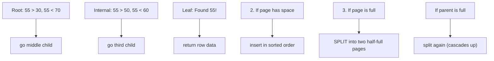
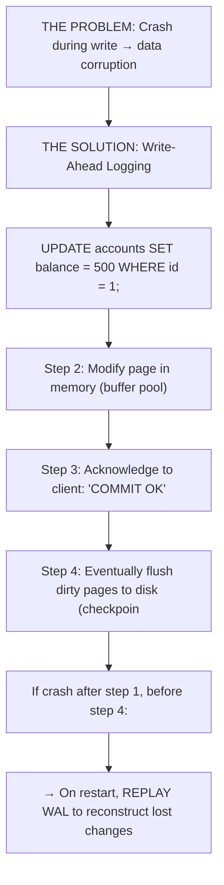
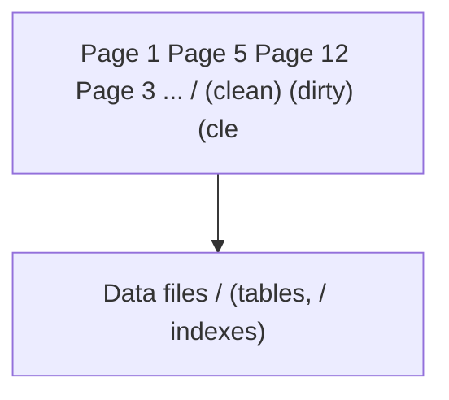
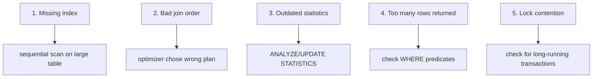

> **Navigation**: [Back to Index](../00_MASTER_INDEX.md) | [SQL Guide](01_Foundations_Database_Basics.md)
> 🧠 **Mental Model**: See [System Design Thinking](../14_Mental_Models/15_System_Design_Thinking.md)

---

# ⚙️ Database Internals — How Databases Actually Work

> Know what happens beneath your SQL queries — B-Trees, WAL, MVCC, Buffer Pool, Query Plans

---

## Part 1: Storage Engines — The Heart of a Database


## B-Tree   │  Lsm-Tree

| Read speed  |   Fast    |   Slower  | (may check multiple SSTables) |
| Write speed |   Slower  |   Fast    | (sequential writes, no random I/O) |
| Space amp.  |   Lower   |   Higher  | (old versions in SSTables) |
| Write amp.  |   Lower   |   Higher  | (compaction rewrites data) |

---

## Part 2: B-Tree Deep Dive

```
  B-Tree of order 4 (max 3 keys per node):

              [     30     |     70     ]             ← Root
             /             |             \
    [10 | 20]          [40 | 50 | 60]      [80 | 90]  ← Internal
    / |  \            / |  |    \         / |  \
  [5][15][25]      [35][45][55][65]   [75][85][95]       ← Leaf (data pages)

  LOOKUP "55":
  Root: 55 > 30, 55 < 70 → go middle child
  Internal: 55 > 50, 55 < 60 → go third child
  Leaf: Found 55! → return row data

  TIME: O(log N) — tree height is typically 3-4 for millions of rows
  Height 4 B-Tree with branching factor 500:
  → 500^4 = 62.5 BILLION rows accessible in 4 disk reads!

  HOW INSERTS WORK:
  1. Find correct leaf page
  2. If page has space → insert in sorted order
  3. If page is full → SPLIT into two half-full pages
     → Propagate new key up to parent
     → If parent is full → split again (cascades up)
```

**Flow:**
- Root: 55 > 30, 55 < 70
- ↓
- go middle child
- ↓
- Internal: 55 > 50, 55 < 60
- ↓
- go third child
- ↓
- Leaf: Found 55!
- ↓
- return row data
- ↓
- 2. If page has space
- ↓
- insert in sorted order
- ↓
- 3. If page is full
- ↓
- SPLIT into two half-full pages
- ↓
- If parent is full
- ↓
- split again (cascades up)



### Clustered vs Non-Clustered Index

> CLUSTERED INDEX (Primary Key):
> → Table data is PHYSICALLY sorted by this key on disk
> → Only ONE per table (you can only sort data one way)
> → Leaf pages contain the ACTUAL ROW data
>
> NON-CLUSTERED INDEX (Secondary):
> → Separate B-Tree with its own leaf pages
> → Leaf pages contain: index key + pointer to actual row
> → Lookup: find key in index B-Tree → follow pointer to row
> → Extra hop = slightly slower than clustered
>
> COVERING INDEX:
> → Index contains ALL columns needed by query
> → No need to visit actual table row! (index-only scan)
> → CREATE INDEX idx ON orders(customer_id) INCLUDE (total, status)


---

## Part 3: Write-Ahead Log (WAL)

```
┌─────────────────────────────────────────────────────────────────────────────────┐
│  THE PROBLEM: Crash during write → data corruption                              │
│                                                                                 │
│  THE SOLUTION: Write-Ahead Logging                                              │
│                                                                                 │
│  RULE: BEFORE modifying any data page, write the change to a log file           │
│                                                                                 │
│  UPDATE accounts SET balance = 500 WHERE id = 1;                                │
│                                                                                 │
│  Step 1: Write to WAL:  "Page 42, offset 100: change 300 → 500"                 │
│  Step 2: Modify page in memory (buffer pool)                                    │
│  Step 3: Acknowledge to client: "COMMIT OK"                                     │
│  Step 4: Eventually flush dirty pages to disk (checkpoint)                      │
│                                                                                 │
│  If crash after step 1, before step 4:                                          │
│  → On restart, REPLAY WAL to reconstruct lost changes                           │
│  → Data is safe because WAL was written to disk first                           │
│                                                                                 │
│  WAL is sequential writes (fast!) vs random writes to data pages (slow)         │
│                                                                                 │
│  PostgreSQL: pg_wal/ directory                                                  │
│  MySQL InnoDB: ib_logfile0, ib_logfile1 (redo log)                              │
│  Also called: redo log, transaction log, journal                                │
└─────────────────────────────────────────────────────────────────────────────────┘
```

**Flow:**
- THE PROBLEM: Crash during write
- ↓
- data corruption
- ↓
- THE SOLUTION: Write-Ahead Logging
- ↓
- UPDATE accounts SET balance = 500 WHERE id = 1;
- ↓
- Step 2: Modify page in memory (buffer pool)
- ↓
- Step 3: Acknowledge to client: 'COMMIT OK'
- ↓
- Step 4: Eventually flush dirty pages to disk (checkpoin
- ↓
- If crash after step 1, before step 4:



---

## Part 4: MVCC (Multi-Version Concurrency Control)

## Version  │ Balance │ Created   │ Expired

| v1       | $100    | txn 10    | txn 20 |
| v2       | $150    | txn 20    | txn 35 |
| v3       | $200    | txn 35    | —         | ← current |

---

## Part 5: Buffer Pool & Memory Management

```
┌─────────────────────────────────────────────────────────────────────────────────┐
│  Database doesn't read disk for every query — pages cached in memory            │
│                                                                                 │
│  ┌─────────── Buffer Pool (RAM) ──────────┐       ┌─── Disk ───┐                │
│  │  Page 1  Page 5  Page 12  Page 3  ...  │       │  Data files │               │
│  │  (clean) (dirty) (clean)  (dirty)      │       │  (tables,   │               │
│  └────────────────────────────────────────┘       │   indexes)  │               │
│                                                    └─────────────┘              │
│                                                                                 │
│  DIRTY PAGE: Modified in memory but not yet written to disk                     │
│  CLEAN PAGE: Same as on-disk version                                            │
│                                                                                 │
│  EVICTION: When buffer pool is full and new page needed:                        │
│  → LRU (Least Recently Used) or Clock algorithm                                 │
│  → If evicting dirty page → write to disk first, then evict                     │
│                                                                                 │
│  CHECKPOINT: Periodically write ALL dirty pages to disk                         │
│  → Reduces WAL replay needed on crash recovery                                  │
│  → Trade-off: more frequent checkpoints = faster recovery but more I/O          │
│                                                                                 │
│  TUNING: Buffer pool size is THE most important DB tuning parameter             │
│  → PostgreSQL: shared_buffers (25% of RAM typical)                              │
│  → MySQL: innodb_buffer_pool_size (80% of RAM for dedicated DB server)          │
│  → Goal: keep working set in memory → minimize disk I/O                         │
└─────────────────────────────────────────────────────────────────────────────────┘
```

**Flow:**
- Page 1 Page 5 Page 12 Page 3 ... / (clean) (dirty) (cle
- ↓
- Data files / (tables, / indexes)



---


> 🔬 **Section Challenge — Part 5: Buffer Pool & Memory Management**
>
> **Challenge 1 (Reasoning):** `String a = "hello"; String b = "hello"; a == b` — true or false? What about `new String("hello") == "hello"`?
> <details><summary>Answer</summary>
>
> First: `true` — string literals are interned in the string pool; same literal = same reference. Second: `false` — `new String(...)` always creates a new object on the heap, bypassing the pool. Always use `.equals()` for string comparison. `String.intern()` can explicitly add a string to the pool.
> </details>
>
> **Challenge 2 (Design):** Why is `String` immutable in Java and what problems would mutable strings cause?
> <details><summary>Answer</summary>
>
> Security: strings are used as HashMap keys, class names, file paths. If mutable, a key could change after insertion, corrupting the HashMap. Thread safety: immutable objects are inherently thread-safe (no synchronization needed). String pool: only possible because strings don't change — two vars safely share the same interned object. Caching hashCode: `String` caches its hashCode (first call computes, subsequent calls return cached) — only safe because the string never changes.
> </details>
>

## Part 6: Query Execution — How SELECT Actually Works

## Algorithm        │ Complexity  │ When Used

| Nested Loop      | O(N × M)   | Small tables, or inner has index |
| Hash Join        | O(N + M)   | Large tables, no useful index |
| Merge Join       | O(N + M)   | Both inputs already sorted |

---

## Part 6.1: Query Optimizer Cost Models

```
When you run a SELECT, the database must decide HOW to execute it.
It does this by calculating a "Cost" for every possible execution plan.

Cost is calculated based on:
1. Disk I/O cost (fetching pages from disk is slow)
2. CPU cost (evaluating conditions, sorting, hashing)
3. Memory cost

HOW IT WORKS:
1. Parser: SQL → Parse Tree (Validates syntax)
2. Analyzer: Resolves table/column names, checks permissions
3. Rewriter: Flattens views, simplifies expressions (e.g., 1=1 is removed)
4. OPTIMIZER: Generates plans.
   - Should it use Index A or Index B?
   - Should it do a Hash Join or Nested Loop Join?
   - In what order should it join 5 tables? (5! = 120 possible orders)

STATISTICS ARE EVERYTHING:
The optimizer relies on table statistics:
- Number of rows
- Number of distinct values in a column (Cardinality)
- Data distribution (Histograms)

If statistics are wrong (e.g., you just inserted 10 million rows but didn't run ANALYZE),
the optimizer might choose a terrible plan (like doing a full table scan instead of using an index).
```

---

## Part 6.2: Deep Dive into LSM-Trees & Compaction

```
B-Trees are terrible for pure write workloads (every insert requires random disk I/O to update a specific leaf page).
NoSQL databases (Cassandra, RocksDB, LevelDB) and some SQL engines use LSM-Trees:

1. THE MEMTABLE (In-Memory)
All writes go to an in-memory Red-Black tree or Skip List. Very fast!
Writes are also appended to a WAL for durability.

2. FLUSH TO SSTABLE (Disk)
When MemTable is full (e.g., 64MB), it is written to disk as a sorted file called an SSTable.
Once written, SSTables are IMMUTABLE. Never modified again.

3. HOW DO YOU READ?
Search MemTable first.
If not found, search the newest SSTable, then the next newest, etc.
Wait, reading 100 SSTables on disk is slow!
→ SOLUTION: BLOOM FILTERS. A tiny bitset in RAM that tells us "100% NOT in this file" or "Maybe in this file".
We only check files where the Bloom Filter says "Maybe".

4. COMPACTION
Over time, you get thousands of SSTables. Reads get slow.
Background threads run COMPACTION: take 10 old SSTables, merge-sort them together into 1 new, larger SSTable,
and delete the old ones. This reclaims space from updated/deleted rows (tombstones).
```

---


## Part 6.3: Buffer Pool Advanced Architecture

```
A database isn't just an array of cached pages. The Buffer Pool has complex internal lists:

1. FREE LIST: Empty pages ready to be used.
2. LRU LIST (Least Recently Used): 
   - Tracks which pages are hot (frequently accessed) vs cold.
   - When Free List is empty, evict the coldest page from LRU.
3. FLUSH LIST: Dirty pages (modified in memory, not yet on disk), sorted by oldest modification.

THE DATABASE CHECKPOINT:
If the system crashes, we have to replay the WAL. But replaying a 100GB WAL takes hours.
A Checkpoint is a background thread that wakes up and says:
"Write all dirty pages from the Flush List to actual disk files."
Once written, it writes a "Checkpoint Record" to the WAL.
If a crash happens, we only replay the WAL starting from the LAST CHECKPOINT!

THE DOUBLEWRITE BUFFER (MySQL InnoDB):
Disk pages are usually 16KB. OS file systems write in 4KB chunks.
If power fails exactly halfway through writing a 16KB page, the page is CORRUPTED.
Solution: InnoDB writes the 16KB page to a sequential "Doublewrite Buffer" on disk first.
Then it writes it to the actual `.ibd` data file. 
If corruption happens during the data file write, it recovers the clean copy from the doublewrite buffer.
```

---


> 🔬 **Section Challenge — Part 6.3: Buffer Pool Advanced Architecture**
>
> **Challenge 1 (Reasoning):** `String a = "hello"; String b = "hello"; a == b` — true or false? What about `new String("hello") == "hello"`?
> <details><summary>Answer</summary>
>
> First: `true` — string literals are interned in the string pool; same literal = same reference. Second: `false` — `new String(...)` always creates a new object on the heap, bypassing the pool. Always use `.equals()` for string comparison. `String.intern()` can explicitly add a string to the pool.
> </details>
>
> **Challenge 2 (Design):** Why is `String` immutable in Java and what problems would mutable strings cause?
> <details><summary>Answer</summary>
>
> Security: strings are used as HashMap keys, class names, file paths. If mutable, a key could change after insertion, corrupting the HashMap. Thread safety: immutable objects are inherently thread-safe (no synchronization needed). String pool: only possible because strings don't change — two vars safely share the same interned object. Caching hashCode: `String` caches its hashCode (first call computes, subsequent calls return cached) — only safe because the string never changes.
> </details>
>

## Part 7: Interview Quick-Fire

```
Q: "What is a B-Tree and why do databases use it?"
A: Self-balancing tree where each node holds multiple keys and pointers.
   Minimizes disk I/O — height 3-4 covers billions of rows.
   O(log N) lookup, insert, delete.

Q: "What is WAL?"
A: Write-Ahead Log — changes written to log before data pages.
   Ensures durability: if crash, replay log to recover.
   Sequential writes to log are fast; random writes to pages deferred.

Q: "Explain MVCC."
A: Keep old row versions. Readers see snapshot, writers create new version.
   No reader-writer blocking. Garbage collector cleans old versions.
   Basis for isolation levels: Read Committed vs Repeatable Read.

Q: "Why is my query slow?"
A: Run EXPLAIN ANALYZE. Common causes:
   1. Missing index → sequential scan on large table
   2. Bad join order → optimizer chose wrong plan
   3. Outdated statistics → ANALYZE/UPDATE STATISTICS
   4. Too many rows returned → check WHERE predicates
   5. Lock contention → check for long-running transactions
```

**Flow:**
- 1. Missing index
- ↓
- sequential scan on large table
- ↓
- 2. Bad join order
- ↓
- optimizer chose wrong plan
- ↓
- 3. Outdated statistics
- ↓
- ANALYZE/UPDATE STATISTICS
- ↓
- 4. Too many rows returned
- ↓
- check WHERE predicates
- ↓
- 5. Lock contention
- ↓
- check for long-running transactions



---


---

## 🏋️ Practice & Interview Questions — SQL

### Predict / Trace
**Q1.** What's the difference between WHERE and HAVING?
<details><summary>Answer</summary>

`WHERE` filters rows **before** grouping. `HAVING` filters groups **after** `GROUP BY`. You can't use aggregate functions in WHERE. `HAVING COUNT(*) > 5` works, `WHERE COUNT(*) > 5` does not.
</details>

**Q2.** What does this return? `SELECT 1 FROM dual WHERE NULL = NULL`
<details><summary>Answer</summary>

**No rows returned.** NULL is not equal to NULL — use `IS NULL` or `IS NOT NULL`. `NULL = NULL` evaluates to UNKNOWN, not TRUE.
</details>

### Coding Problems
**Q3.** ⭐ Second highest salary — handle the case where it doesn't exist (return NULL).
<details><summary>Solution</summary>

```sql
SELECT MAX(salary) AS SecondHighestSalary
FROM Employee
WHERE salary < (SELECT MAX(salary) FROM Employee);
-- or
SELECT IFNULL((SELECT DISTINCT salary FROM Employee ORDER BY salary DESC LIMIT 1 OFFSET 1), NULL)
```
</details>

**Q4.** ⭐ Find employees earning more than their manager.
<details><summary>Solution</summary>

```sql
SELECT e.name FROM Employee e
JOIN Employee m ON e.managerId = m.id
WHERE e.salary > m.salary;
```
</details>

**Q5.** ⭐ Find duplicate emails.
<details><summary>Solution</summary>

```sql
SELECT email FROM Person GROUP BY email HAVING COUNT(*) > 1;
```
</details>

**Q6.** ⭐⭐ Rank scores without RANK() function.
<details><summary>Solution</summary>

```sql
SELECT s.score,
  (SELECT COUNT(DISTINCT s2.score) FROM Scores s2 WHERE s2.score >= s.score) AS rank
FROM Scores s ORDER BY score DESC;
```
</details>

**Q7.** ⭐⭐ Consecutive numbers — find numbers that appear 3+ times consecutively.
<details><summary>Solution</summary>

```sql
SELECT DISTINCT l1.Num AS ConsecutiveNums
FROM Logs l1, Logs l2, Logs l3
WHERE l1.Id=l2.Id-1 AND l2.Id=l3.Id-1
AND l1.Num=l2.Num AND l2.Num=l3.Num;
-- or use LAG/LEAD window functions
```
</details>

**Q8.** ⭐⭐ Department top 3 salaries (dense rank).
<details><summary>Solution</summary>

```sql
SELECT d.name AS Department, e.name AS Employee, e.salary AS Salary
FROM Employee e JOIN Department d ON e.departmentId = d.id
WHERE (SELECT COUNT(DISTINCT e2.salary) FROM Employee e2
       WHERE e2.departmentId=e.departmentId AND e2.salary>e.salary) < 3;
```
</details>

**Q9.** ⭐⭐ Running total with window function.
<details><summary>Solution</summary>

```sql
SELECT date, amount,
  SUM(amount) OVER (ORDER BY date ROWS BETWEEN UNBOUNDED PRECEDING AND CURRENT ROW) AS running_total
FROM transactions;
```
</details>

**Q10.** ⭐⭐ Pivot rows to columns (conditional aggregation).
<details><summary>Solution</summary>

```sql
SELECT year,
  SUM(CASE WHEN quarter=1 THEN revenue END) AS Q1,
  SUM(CASE WHEN quarter=2 THEN revenue END) AS Q2,
  SUM(CASE WHEN quarter=3 THEN revenue END) AS Q3,
  SUM(CASE WHEN quarter=4 THEN revenue END) AS Q4
FROM sales GROUP BY year;
```
</details>

**Q11.** ⭐⭐⭐ Find the median salary — without MEDIAN() function.
<details><summary>Solution</summary>

```sql
SELECT AVG(salary) AS median
FROM (SELECT salary, ROW_NUMBER() OVER(ORDER BY salary) AS rn, COUNT(*) OVER() AS cnt FROM Employee) t
WHERE rn IN (FLOOR((cnt+1)/2), CEIL((cnt+1)/2));
```
</details>

### Interview Questions
**Q12.** INNER JOIN vs LEFT JOIN — when does LEFT produce more rows?
<details><summary>Answer</summary>

LEFT JOIN includes ALL rows from the left table even if no match in right table (fills NULLs). INNER JOIN only includes rows where both sides have a match. If left table has rows with no match in right: LEFT produces more rows.
</details>

**Q13.** What is a covering index?
<details><summary>Answer</summary>

An index that contains ALL columns needed by a query — the DB can answer from the index alone without touching the table ("index-only scan"). Faster because it avoids the extra heap fetch.
</details>

**Q14.** EXPLAIN shows "Full Table Scan" — how do you fix it?
<details><summary>Answer</summary>

Add an index on the WHERE/JOIN/ORDER BY column. Check if the column has low cardinality (boolean — index may not help). Ensure the query isn't wrapping the column in a function (`WHERE YEAR(date) = 2024` prevents index use — rewrite as `WHERE date BETWEEN '2024-01-01' AND '2024-12-31'`).
</details>

### MCQ Rapid Fire
| # | Question | Answer |
|---|---|---|
| 1 | NULL = NULL evaluates to? | UNKNOWN (use IS NULL) |
| 2 | COUNT(*) vs COUNT(col) | COUNT(*) counts all rows, COUNT(col) skips NULLs |
| 3 | RANK() vs DENSE_RANK() | RANK() skips numbers after ties, DENSE_RANK() doesn't |
| 4 | CROSS JOIN produces | Cartesian product (m × n rows) |
| 5 | Can you ORDER BY in a subquery? | Only when using TOP/LIMIT |
| 6 | TRUNCATE vs DELETE | TRUNCATE: no WHERE, no undo, faster. DELETE: filterable, transactional |
| 7 | What does COALESCE do? | Returns first non-NULL value from its arguments |
| 8 | Index on VARCHAR — what to watch out for? | Case sensitivity, collation, function-based searches bypass index |


---

## 🧠 Deep Conceptual Questions — SQL Internals & Reasoning

**C1. How does a SQL database execute a SELECT query internally?**
<details><summary>Deep Answer</summary>

1. **Parse**: SQL text → AST (syntax tree)
2. **Bind**: resolve table names, column names, types
3. **Optimize**: query planner generates candidate execution plans, estimates costs (based on statistics: row counts, column cardinality, index existence), picks cheapest
4. **Execute**: follow the plan — scan tables, apply filters, join, sort, project

The optimizer transforms: `SELECT ... WHERE ... JOIN ... ORDER BY` into an operator tree (Volcano model): TableScan → Filter → HashJoin → Sort → Project. Each operator is an iterator: `next()` pulls one row from its child. This pull-based model (lazy evaluation) avoids materializing intermediate results.
</details>

**C2. B-Tree index: why is it the default index structure in databases?**
<details><summary>Deep Answer</summary>

B-Tree (not binary tree — B stands for Balanced, not Binary): a self-balancing tree where each node can hold many keys. Properties: (1) height O(log_m N) where m=fan-out (typically 100-1000) → very short tree for millions of rows, (2) all leaf nodes at same depth → guaranteed O(log N) worst case, (3) range scans efficient — leaves linked in sequence, (4) supports equality AND range queries. Hash index: only equality (no range). Sequential scan: no index at all. B+Tree (variant): internal nodes only store keys (no values), leaves store data. All row pointers in leaves → better range scan (follow linked list of leaves).
</details>

**C3. Why does adding an index sometimes SLOW DOWN a query?**
<details><summary>Deep Answer</summary>

1. **Low cardinality**: index on a boolean column — if 50% rows have `active=true`, index gives you 50% of rows. Database may choose full table scan (cheaper: sequential I/O) over index (random I/O for 50% of rows). 
2. **Function on column**: `WHERE YEAR(created_at) = 2024` — index on `created_at` unused. Rewrite: `WHERE created_at >= '2024-01-01' AND created_at < '2025-01-01'`.
3. **Write overhead**: every INSERT/UPDATE/DELETE must update ALL indexes. 5 indexes × N rows = 5× write amplification.
4. **Index not covering**: index exists but the SELECT columns aren't in the index → each index match → separate heap fetch → many random I/O. Solution: covering index (include all needed columns in index).
</details>

**C4. EXPLAIN / query execution plan: what are the key things to look for?**
<details><summary>Deep Answer</summary>

Red flags: (1) **"Full Table Scan" / "Seq Scan"** on a large table → missing index, (2) **high "rows" estimate** in join conditions → cartesian product risk, (3) **"Using filesort"** → ORDER BY can't use index, (4) **"Using temporary"** → intermediate table materialization, (5) **nested loops on large tables** → should be hash join or merge join. Green flags: "Using index" (covering index), "ref" or "eq_ref" access type (index used). Start fixing: add or fix index on WHERE/JOIN/ORDER BY columns, rewrite function-wrapped columns.
</details>

**C5. Window functions vs GROUP BY — when must you use window functions?**
<details><summary>Deep Answer</summary>

`GROUP BY` collapses rows to one per group — individual row data is lost. Window functions compute aggregates but **keep all rows**. Use window when: (1) you need both the aggregate AND the individual row (rank each employee and show their salary), (2) running totals (each row needs sum of all prior rows — GROUP BY can't do this), (3) lag/lead access (compare each row to previous/next — GROUP BY has no row ordering concept), (4) top-N per group (ROW_NUMBER partition — classic GROUP BY can't do this cleanly). Window functions = aggregation without collapsing.
</details>

**C6. Transaction isolation levels — what anomaly does each prevent?**
<details><summary>Deep Answer</summary>

| Level | Dirty Read | Non-repeatable Read | Phantom Read |
|---|---|---|---|
| READ UNCOMMITTED | Possible | Possible | Possible |
| READ COMMITTED | ✅ Prevented | Possible | Possible |
| REPEATABLE READ | ✅ | ✅ | Possible (MySQL InnoDB: prevented!) |
| SERIALIZABLE | ✅ | ✅ | ✅ |

**Dirty read**: read uncommitted data from another transaction (which may rollback). **Non-repeatable**: same query in same transaction returns different row values (another transaction committed update). **Phantom**: same query returns different row COUNT (another transaction inserted/deleted rows). Higher isolation = fewer anomalies but more lock contention. Most production databases use READ COMMITTED or REPEATABLE READ.
</details>

**C7. N+1 query problem: what is it, why does it happen, and how to fix?**
<details><summary>Deep Answer</summary>

**What**: fetching N orders, then for each order making a separate query for the customer = 1 + N queries total. Scales terribly: 1000 orders = 1001 queries. **Why**: ORMs (Hibernate, JPA) with lazy loading — accessing a relationship triggers a new query. **Fix 1**: Eager loading — `JOIN FETCH` or `.fetch()` — load everything in one query. **Fix 2**: Batch loading — fetch all order IDs, then `WHERE customer_id IN (id1, id2, ...)` — 2 queries. **Fix 3**: Projection/DTO query — `SELECT o.id, c.name FROM orders o JOIN customers c` — 1 query. **Detection**: count DB queries in tests (Spring: `@QueryCount`), log slow query warnings.
</details>


> **Navigation**: [< Previous](19_Interview_Top50.md) | [Back to Index](../00_MASTER_INDEX.md) | [Next >](22_NoSQL_MongoDB.md)