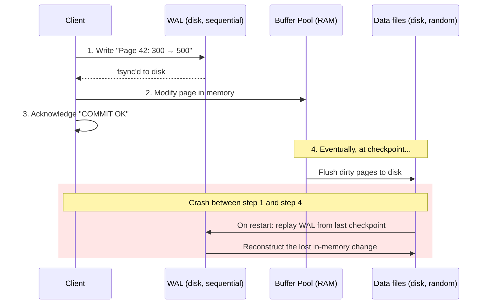

**Navigation**: [Back to Index](../00_MASTER_INDEX.md) | [SQL Guide](01_Foundations_Database_Basics.md)
🧠 **Mental Model**: See [System Design Thinking](../14_Mental_Models/15_System_Design_Thinking.md)

---

# ⚙️ Database Internals — How Databases Actually Work

Know what happens beneath your SQL queries — B-Trees, WAL, MVCC, Buffer Pool, Query Plans

---

## Part 1: Storage Engines — The Heart of a Database

### B-Tree vs LSM-Tree

| Metric | B-Tree | LSM-Tree | Why |
| --- | --- | --- | --- |
| Read speed | Fast | Slower | LSM may have to check multiple SSTables |
| Write speed | Slower | Fast | LSM writes sequentially — no random I/O |
| Space amplification | Lower | Higher | LSM keeps old versions across SSTables until compaction runs |
| Write amplification | Lower | Higher | LSM compaction rewrites the same data multiple times |

---

## Part 2: B-Tree Deep Dive

```
  B-Tree of order 4 (max 3 keys per node):

              [     30     |     70     ]             ← Root
             /             |             \
    [10 | 20]          [40 | 50 | 60]      [80 | 90]  ← Internal
    / |  \            / |  |    \         / |  \
  [5][15][25]      [35][45][55][65]   [75][85][95]       ← Leaf (data pages)

  LOOKUP "55":
  Root: 55 > 30, 55 < 70 → go middle child
  Internal: 55 > 50, 55 < 60 → go third child
  Leaf: Found 55! → return row data

  TIME: O(log N) — tree height is typically 3-4 for millions of rows
  Height 4 B-Tree with branching factor 500:
  → 500^4 = 62.5 BILLION rows accessible in 4 disk reads!

  HOW INSERTS WORK:
  1. Find correct leaf page
  2. If page has space → insert in sorted order
  3. If page is full → SPLIT into two half-full pages
     → Propagate new key up to parent
     → If parent is full → split again (cascades up)
```

### Clustered vs Non-Clustered Index

- CLUSTERED INDEX (Primary Key):
  - → Table data is PHYSICALLY sorted by this key on disk
  - → Only ONE per table (you can only sort data one way)
  - → Leaf pages contain the ACTUAL ROW data

- NON-CLUSTERED INDEX (Secondary):
  - → Separate B-Tree with its own leaf pages
  - → Leaf pages contain: index key + pointer to actual row
  - → Lookup: find key in index B-Tree → follow pointer to row
  - → Extra hop = slightly slower than clustered

- COVERING INDEX:
  - → Index contains ALL columns needed by query
  - → No need to visit actual table row! (index-only scan)
  - → CREATE INDEX idx ON orders(customer_id) INCLUDE (total, status)

---

## Part 3: Write-Ahead Log (WAL)

```
┌─────────────────────────────────────────────────────────────────────────────────┐
│  THE PROBLEM: Crash during write → data corruption                              │
│                                                                                 │
│  THE SOLUTION: Write-Ahead Logging                                              │
│                                                                                 │
│  RULE: BEFORE modifying any data page, write the change to a log file           │
│                                                                                 │
│  UPDATE accounts SET balance = 500 WHERE id = 1;                                │
│                                                                                 │
│  Step 1: Write to WAL:  "Page 42, offset 100: change 300 → 500"                 │
│  Step 2: Modify page in memory (buffer pool)                                    │
│  Step 3: Acknowledge to client: "COMMIT OK"                                     │
│  Step 4: Eventually flush dirty pages to disk (checkpoint)                      │
│                                                                                 │
│  If crash after step 1, before step 4:                                          │
│  → On restart, REPLAY WAL to reconstruct lost changes                           │
│  → Data is safe because WAL was written to disk first                           │
│                                                                                 │
│  WAL is sequential writes (fast!) vs random writes to data pages (slow)         │
│                                                                                 │
│  PostgreSQL: pg_wal/ directory                                                  │
│  MySQL InnoDB: ib_logfile0, ib_logfile1 (redo log)                              │
│  Also called: redo log, transaction log, journal                                │
└─────────────────────────────────────────────────────────────────────────────────┘
```

The same four steps, traced as a sequence — and what happens on crash depending on exactly where it lands:



**How to read this diagram.** Read top to bottom: the client first writes the change to the WAL on disk and gets the fsync back, then the page is modified in the buffer pool in memory and the client is told COMMIT OK; only later, at a checkpoint, are the dirty pages flushed to the data files. The red band shows a crash: on restart the WAL is replayed from the last checkpoint to rebuild the lost in-memory change. Notice that COMMIT OK arrives before the data-file flush.

Step 3 is why WAL makes commits durable *without* waiting for the (slow, random-I/O) data-page write: the client is told "COMMIT OK" as soon as the change is safely on disk in the WAL, not once the actual data page has been updated. Step 4 can happen whenever it's convenient — if the server crashes before it does, replaying the WAL reconstructs exactly what step 4 would have written.

---

## Part 4: MVCC (Multi-Version Concurrency Control)

### Example: One Row's Version Chain

| Version | Balance | Created by txn | Expired by txn |
| --- | --- | --- | --- |
| v1 | $100 | 10 | 20 |
| v2 | $150 | 20 | 35 |
| v3 | $200 | 35 | — (current) |

---

## Part 5: Buffer Pool & Memory Management

```
┌─────────────────────────────────────────────────────────────────────────────────┐
│  Database doesn't read disk for every query — pages cached in memory            │
│                                                                                 │
│  ┌─────────── Buffer Pool (RAM) ──────────┐       ┌─── Disk ───┐                │
│  │  Page 1  Page 5  Page 12  Page 3  ...  │       │  Data files │               │
│  │  (clean) (dirty) (clean)  (dirty)      │       │  (tables,   │               │
│  └────────────────────────────────────────┘       │   indexes)  │               │
│                                                    └─────────────┘              │
│                                                                                 │
│  DIRTY PAGE: Modified in memory but not yet written to disk                     │
│  CLEAN PAGE: Same as on-disk version                                            │
│                                                                                 │
│  EVICTION: When buffer pool is full and new page needed:                        │
│  → LRU (Least Recently Used) or Clock algorithm                                 │
│  → If evicting dirty page → write to disk first, then evict                     │
│                                                                                 │
│  CHECKPOINT: Periodically write ALL dirty pages to disk                         │
│  → Reduces WAL replay needed on crash recovery                                  │
│  → Trade-off: more frequent checkpoints = faster recovery but more I/O          │
│                                                                                 │
│  TUNING: Buffer pool size is THE most important DB tuning parameter             │
│  → PostgreSQL: shared_buffers (25% of RAM typical)                              │
│  → MySQL: innodb_buffer_pool_size (80% of RAM for dedicated DB server)          │
│  → Goal: keep working set in memory → minimize disk I/O                         │
└─────────────────────────────────────────────────────────────────────────────────┘
```

---

🔬 **Section Challenge — Part 5: Buffer Pool & Memory Management**

**Challenge 1 (Reasoning):** Your database shows buffer cache hit ratio dropping from 99% to 82% after a new dashboard launches. What does that imply about the working set, and what two fixes would you test first?

<details><summary>Answer</summary>

The working set no longer fits comfortably in the buffer pool, or the dashboard is scanning pages that evict hotter OLTP pages. First inspect the dashboard queries with `EXPLAIN` and add/select better indexes so it reads fewer pages. Second separate workload pressure: cache/materialize dashboard results, move analytics to a replica, or increase buffer memory if the host has headroom. The invariant is simple: the buffer pool helps only when reused pages stay resident long enough to be reused.

</details>

**Challenge 2 (Design):** Dirty pages improve write throughput, but they create recovery risk. Why does checkpoint frequency trade off normal latency against crash recovery time?

<details><summary>Answer</summary>

Frequent checkpoints flush dirty pages sooner, so crash recovery replays less WAL. The cost is more background I/O during normal operation, which can compete with foreground reads/writes and create latency spikes. Infrequent checkpoints reduce steady-state flushing pressure, but a crash must replay a longer WAL range. The design goal is not "checkpoint always" or "checkpoint never"; it is to smooth writeback while bounding recovery time.

</details>

## Part 6: Query Execution — How SELECT Actually Works

### Join Algorithm Complexity

| Algorithm | Complexity | When Used |
| --- | --- | --- |
| Nested Loop | O(N × M) | Small tables, or the inner side has a usable index |
| Hash Join | O(N + M) | Large tables, no useful index |
| Merge Join | O(N + M) | Both inputs already sorted |

---

## Part 6.1: Query Optimizer Cost Models

```
When you run a SELECT, the database must decide HOW to execute it.
It does this by calculating a "Cost" for every possible execution plan.

Cost is calculated based on:
1. Disk I/O cost (fetching pages from disk is slow)
2. CPU cost (evaluating conditions, sorting, hashing)
3. Memory cost

HOW IT WORKS:
1. Parser: SQL → Parse Tree (Validates syntax)
2. Analyzer: Resolves table/column names, checks permissions
3. Rewriter: Flattens views, simplifies expressions (e.g., 1=1 is removed)
4. OPTIMIZER: Generates plans.
   - Should it use Index A or Index B?
   - Should it do a Hash Join or Nested Loop Join?
   - In what order should it join 5 tables? (5! = 120 possible orders)

STATISTICS ARE EVERYTHING:
The optimizer relies on table statistics:
- Number of rows
- Number of distinct values in a column (Cardinality)
- Data distribution (Histograms)

If statistics are wrong (e.g., you just inserted 10 million rows but didn't run ANALYZE),
the optimizer might choose a terrible plan (like doing a full table scan instead of using an index).
```

---

## Part 6.2: Deep Dive into LSM-Trees & Compaction

```
B-Trees are terrible for pure write workloads (every insert requires random disk I/O to update a specific leaf page).
NoSQL databases (Cassandra, RocksDB, LevelDB) and some SQL engines use LSM-Trees:

1. THE MEMTABLE (In-Memory)
All writes go to an in-memory Red-Black tree or Skip List. Very fast!
Writes are also appended to a WAL for durability.

2. FLUSH TO SSTABLE (Disk)
When MemTable is full (e.g., 64MB), it is written to disk as a sorted file called an SSTable.
Once written, SSTables are IMMUTABLE. Never modified again.

3. HOW DO YOU READ?
Search MemTable first.
If not found, search the newest SSTable, then the next newest, etc.
Wait, reading 100 SSTables on disk is slow!
→ SOLUTION: BLOOM FILTERS. A tiny bitset in RAM that tells us "100% NOT in this file" or "Maybe in this file".
We only check files where the Bloom Filter says "Maybe".

4. COMPACTION
Over time, you get thousands of SSTables. Reads get slow.
Background threads run COMPACTION: take 10 old SSTables, merge-sort them together into 1 new, larger SSTable,
and delete the old ones. This reclaims space from updated/deleted rows (tombstones).
```

---

## Part 6.3: Buffer Pool Advanced Architecture

```
A database isn't just an array of cached pages. The Buffer Pool has complex internal lists:

1. FREE LIST: Empty pages ready to be used.
2. LRU LIST (Least Recently Used):
   - Tracks which pages are hot (frequently accessed) vs cold.
   - When Free List is empty, evict the coldest page from LRU.
3. FLUSH LIST: Dirty pages (modified in memory, not yet on disk), sorted by oldest modification.

THE DATABASE CHECKPOINT:
If the system crashes, we have to replay the WAL. But replaying a 100GB WAL takes hours.
A Checkpoint is a background thread that wakes up and says:
"Write all dirty pages from the Flush List to actual disk files."
Once written, it writes a "Checkpoint Record" to the WAL.
If a crash happens, we only replay the WAL starting from the LAST CHECKPOINT!

THE DOUBLEWRITE BUFFER (MySQL InnoDB):
Disk pages are usually 16KB. OS file systems write in 4KB chunks.
If power fails exactly halfway through writing a 16KB page, the page is CORRUPTED.
Solution: InnoDB writes the 16KB page to a sequential "Doublewrite Buffer" on disk first.
Then it writes it to the actual `.ibd` data file.
If corruption happens during the data file write, it recovers the clean copy from the doublewrite buffer.
```

---

🔬 **Section Challenge — Part 6.3: Buffer Pool Advanced Architecture**

**Challenge 1 (Reasoning):** InnoDB tracks free pages, recently used pages, and dirty pages separately. Why is one single LRU list not enough for a production buffer pool?

<details><summary>Answer</summary>

Different page states need different decisions. Free pages can be reused immediately. Clean cold pages can be evicted cheaply. Dirty pages cannot be evicted until flushed, because memory contains changes not yet durable in data files. A single LRU list would hide whether the eviction candidate is cheap or expensive. Separate lists let the engine choose victims, schedule background flushes, and avoid blocking a foreground query on a surprise dirty-page write.

</details>

**Challenge 2 (Design):** Why does InnoDB use a doublewrite buffer even though it already has WAL?

<details><summary>Answer</summary>

WAL records logical/redo changes, but it does not by itself guarantee that a partially written database page is physically readable. If a 16KB page is torn during a power failure, the page image can be corrupt. The doublewrite buffer writes a clean full-page copy to a safe sequential area first, then writes the real page. On recovery, InnoDB can restore the clean page image and then apply WAL. WAL solves lost changes; doublewrite solves torn pages.

</details>

## Part 7: Interview Quick-Fire

```
Q: "What is a B-Tree and why do databases use it?"
A: Self-balancing tree where each node holds multiple keys and pointers.
   Minimizes disk I/O — height 3-4 covers billions of rows.
   O(log N) lookup, insert, delete.

Q: "What is WAL?"
A: Write-Ahead Log — changes written to log before data pages.
   Ensures durability: if crash, replay log to recover.
   Sequential writes to log are fast; random writes to pages deferred.

Q: "Explain MVCC."
A: Keep old row versions. Readers see snapshot, writers create new version.
   No reader-writer blocking. Garbage collector cleans old versions.
   Basis for isolation levels: Read Committed vs Repeatable Read.

Q: "Why is my query slow?"
A: Run EXPLAIN ANALYZE. Common causes:
   1. Missing index → sequential scan on large table
   2. Bad join order → optimizer chose wrong plan
   3. Outdated statistics → ANALYZE/UPDATE STATISTICS
   4. Too many rows returned → check WHERE predicates
   5. Lock contention → check for long-running transactions
```

### Historical Evolution

**Predecessors (with years):**
- **Bayer & McCreight** (1972): Invented the B-tree data structure, which remains the dominant index structure in all major databases 50+ years later
- **Gray** (1978): Proposed Write-Ahead Logging (WAL) as the foundation for crash recovery, now called the ARIES protocol
- **System R Storage Engine** (1974-1979): IBM's pioneering work on buffer management, locking, and crash recovery that influenced every subsequent database
- **Stonebraker** (1986): Created PostgreSQL (originally Postgres) with multi-version concurrency and extensibility as core design goals
- **InnoDB** (1995): Heikki Tuuri's storage engine introduced clustered indexes, row-level locking, and MVCC to MySQL, transforming it into an enterprise database

**Evolution narrative:**
Database internals evolved from research prototypes (System R, Ingres) to production systems solving real reliability problems. The B-tree (1972) replaced earlier hash-based and tree structures because it minimized disk I/O for range queries—a critical insight for databases that couldn't fit entirely in memory. Gray's WAL (1978) solved the crash recovery problem by ensuring durability without expensive synchronous disk writes. InnoDB's row-level locking (1995) finally made high-concurrency OLTP feasible on a single MySQL instance, replacing table-level locks that serialized all writes.

**Modern practice anchor:**
Understanding B-tree index mechanics, MVCC snapshot isolation, WAL durability, and buffer pool LRU is essential for debugging MySQL and PostgreSQL performance in production at scale.


---

## Reality Check

**"A page/block is the fundamental unit of I/O"** → Databases never read individual rows from disk — they read entire pages (PostgreSQL default: 8KB, MySQL InnoDB: 16KB). Even if you read one column of one row, the whole 8KB page loads into the buffer pool. This is why column-oriented storage (Parquet, columnar databases) is faster for analytics — reading one column means reading only that column's pages, not loading rows that mix all columns.

**"The buffer pool is just a cache"** → The buffer pool is a database-managed memory area that mirrors disk pages. "Dirty pages" (modified but not yet written to disk) stay in the buffer pool for performance — if the database crashes, the WAL (Write-Ahead Log) is used to replay changes. The buffer pool replacement policy (LRU variants with clock sweep in PostgreSQL, LRU-K in MySQL) determines which pages survive in memory. The buffer pool size is one of the most important tuning parameters for database performance.

**"B-tree and B+ tree are the same thing"** → B-tree: data records can be stored at internal nodes AND leaf nodes. B+ tree: all data at leaf nodes, internal nodes contain only routing keys, leaf nodes are linked in a doubly-linked list. All relational database indexes (PostgreSQL, MySQL InnoDB, SQL Server) use B+ trees. The linked leaf list enables efficient range scans — after finding the start key, you walk the leaf list. B-trees are used in filesystems; B+ trees in database indexes.

**"WAL (Write-Ahead Log) is just for crash recovery"** → WAL enables: crash recovery (replay log on startup), point-in-time recovery (PITR — replay log to any timestamp), replication (stream WAL to replicas — PostgreSQL streaming replication, MySQL binlog), backup (take a base backup + WAL for consistent snapshots without locking). WAL writes are sequential I/O (fast on spinning disks) vs random I/O for the data pages — this is why WAL improves write performance.

**"Vacuum (PostgreSQL) / purge (MySQL) are maintenance tasks, not query-critical"** → PostgreSQL's MVCC retains old row versions for concurrent readers — dead tuples accumulate until VACUUM reclaims space. Without regular VACUUM, tables bloat and query scans slow down. The XID (transaction ID) wraparound problem: PostgreSQL uses 32-bit XIDs that wrap around after ~2 billion transactions — this causes visible data corruption. PostgreSQL will force shutdown to prevent this; autovacuum prevents it by keeping the XID horizon fresh.
