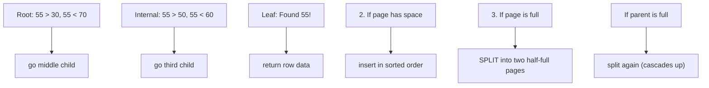
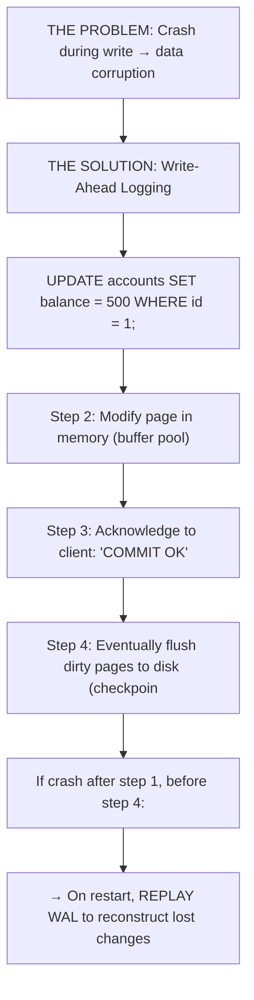
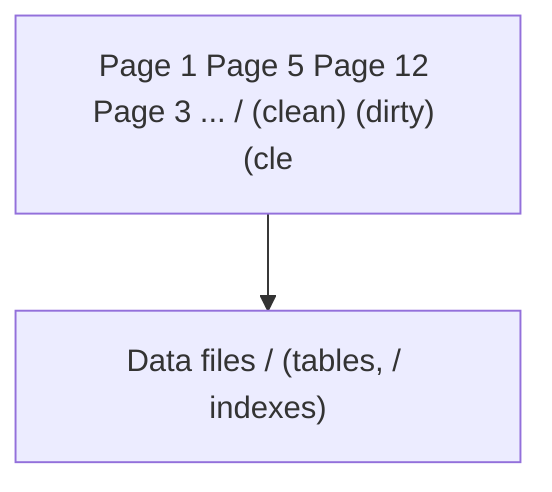
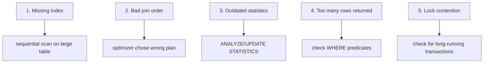

> **Navigation**: [Back to Index](../00_MASTER_INDEX.md) | [SQL Guide](01_SQL_Complete_Guide.md)
> 🧠 **Mental Model**: See [System Design Thinking](../14_Mental_Models/15_System_Design_Thinking.md)

---

# ⚙️ Database Internals — How Databases Actually Work

> Know what happens beneath your SQL queries — B-Trees, WAL, MVCC, Buffer Pool, Query Plans

---

## Part 1: Storage Engines — The Heart of a Database

## B-Tree   │  Lsm-Tree

| Read speed  |   Fast    |   Slower  | (may check multiple SSTables) |
| Write speed |   Slower  |   Fast    | (sequential writes, no random I/O) |
| Space amp.  |   Lower   |   Higher  | (old versions in SSTables) |
| Write amp.  |   Lower   |   Higher  | (compaction rewrites data) |

---

## Part 2: B-Tree Deep Dive

```
  B-Tree of order 4 (max 3 keys per node):

              [     30     |     70     ]             ← Root
             /              |             \
    [10 | 20]          [40 | 50 | 60]      [80 | 90]  ← Internal
    / |  \            / |   |    \         / |  \
  [5][15][25]   [35][45][55][65]   [75][85][95]       ← Leaf (data pages)

  LOOKUP "55":
  Root: 55 > 30, 55 < 70 → go middle child
  Internal: 55 > 50, 55 < 60 → go third child
  Leaf: Found 55! → return row data

  TIME: O(log N) — tree height is typically 3-4 for millions of rows
  Height 4 B-Tree with branching factor 500:
  → 500^4 = 62.5 BILLION rows accessible in 4 disk reads!

  HOW INSERTS WORK:
  1. Find correct leaf page
  2. If page has space → insert in sorted order
  3. If page is full → SPLIT into two half-full pages
     → Propagate new key up to parent
     → If parent is full → split again (cascades up)
```

> **Flow**: Root: 55 &gt; 30, 55 &lt; 70 → go middle child | Internal: 55 &gt; 50, 55 &lt; 60 → go third child | Leaf: Found 55! → return row data | 2. If page has space → insert in sorted order | 3. If page is full → SPLIT into two half-full pages | If parent is full → split again (cascades up)



### Clustered vs Non-Clustered Index

> CLUSTERED INDEX (Primary Key):
> → Table data is PHYSICALLY sorted by this key on disk
> → Only ONE per table (you can only sort data one way)
> → Leaf pages contain the ACTUAL ROW data
>
> NON-CLUSTERED INDEX (Secondary):
> → Separate B-Tree with its own leaf pages
> → Leaf pages contain: index key + pointer to actual row
> → Lookup: find key in index B-Tree → follow pointer to row
> → Extra hop = slightly slower than clustered
>
> COVERING INDEX:
> → Index contains ALL columns needed by query
> → No need to visit actual table row! (index-only scan)
> → CREATE INDEX idx ON orders(customer_id) INCLUDE (total, status)


---

## Part 3: Write-Ahead Log (WAL)

```
┌─────────────────────────────────────────────────────────────────────────────────┐
│  THE PROBLEM: Crash during write → data corruption                              │
│                                                                                 │
│  THE SOLUTION: Write-Ahead Logging                                              │
│                                                                                 │
│  RULE: BEFORE modifying any data page, write the change to a log file           │
│                                                                                 │
│  UPDATE accounts SET balance = 500 WHERE id = 1;                                │
│                                                                                 │
│  Step 1: Write to WAL:  "Page 42, offset 100: change 300 → 500"                 │
│  Step 2: Modify page in memory (buffer pool)                                    │
│  Step 3: Acknowledge to client: "COMMIT OK"                                     │
│  Step 4: Eventually flush dirty pages to disk (checkpoint)                      │
│                                                                                 │
│  If crash after step 1, before step 4:                                          │
│  → On restart, REPLAY WAL to reconstruct lost changes                           │
│  → Data is safe because WAL was written to disk first                           │
│                                                                                 │
│  WAL is sequential writes (fast!) vs random writes to data pages (slow)         │
│                                                                                 │
│  PostgreSQL: pg_wal/ directory                                                  │
│  MySQL InnoDB: ib_logfile0, ib_logfile1 (redo log)                              │
│  Also called: redo log, transaction log, journal                                │
└─────────────────────────────────────────────────────────────────────────────────┘
```

> **Flow**: THE PROBLEM: Crash during write → data corruption → THE SOLUTION: Write-Ahead Logging | THE SOLUTION: Write-Ahead Logging → UPDATE accounts SET balance = 500 WHERE id = 1; | UPDATE accounts SET balance = 500 WHERE id = 1; → Step 2: Modify page in memory (buffer pool) | Step 2: Modify page in memory (buffer pool) → Step 3: Acknowledge to client: 'COMMIT OK' | Step 3: Acknowledge to client: 'COMMIT OK' → Step 4: Eventually flush dirty pages to disk (checkpoin | Step 4: Eventually flush dirty pages to disk (checkpoin → If crash after step 1, before step 4: | ...+1 more



---

## Part 4: MVCC (Multi-Version Concurrency Control)

## Version  │ Balance │ Created   │ Expired

| v1       | $100    | txn 10    | txn 20 |
| v2       | $150    | txn 20    | txn 35 |
| v3       | $200    | txn 35    | —         | ← current |

---

## Part 5: Buffer Pool & Memory Management

```
┌─────────────────────────────────────────────────────────────────────────────────┐
│  Database doesn't read disk for every query — pages cached in memory            │
│                                                                                 │
│  ┌─────────── Buffer Pool (RAM) ──────────┐       ┌─── Disk ───┐                │
│  │  Page 1  Page 5  Page 12  Page 3  ...  │       │  Data files │               │
│  │  (clean) (dirty) (clean)  (dirty)      │       │  (tables,   │               │
│  └────────────────────────────────────────┘       │   indexes)  │               │
│                                                    └─────────────┘              │
│                                                                                 │
│  DIRTY PAGE: Modified in memory but not yet written to disk                     │
│  CLEAN PAGE: Same as on-disk version                                            │
│                                                                                 │
│  EVICTION: When buffer pool is full and new page needed:                        │
│  → LRU (Least Recently Used) or Clock algorithm                                 │
│  → If evicting dirty page → write to disk first, then evict                     │
│                                                                                 │
│  CHECKPOINT: Periodically write ALL dirty pages to disk                         │
│  → Reduces WAL replay needed on crash recovery                                  │
│  → Trade-off: more frequent checkpoints = faster recovery but more I/O          │
│                                                                                 │
│  TUNING: Buffer pool size is THE most important DB tuning parameter             │
│  → PostgreSQL: shared_buffers (25% of RAM typical)                              │
│  → MySQL: innodb_buffer_pool_size (80% of RAM for dedicated DB server)          │
│  → Goal: keep working set in memory → minimize disk I/O                         │
└─────────────────────────────────────────────────────────────────────────────────┘
```

> **Flow**: Page 1 Page 5 Page 12 Page 3 ... / (clean) (dirty) (cle → Data files / (tables, / indexes)



---

## Part 6: Query Execution — How SELECT Actually Works

## Algorithm        │ Complexity  │ When Used

| Nested Loop      | O(N × M)   | Small tables, or inner has index |
| Hash Join        | O(N + M)   | Large tables, no useful index |
| Merge Join       | O(N + M)   | Both inputs already sorted |

---

## Part 7: Interview Quick-Fire

```
Q: "What is a B-Tree and why do databases use it?"
A: Self-balancing tree where each node holds multiple keys and pointers.
   Minimizes disk I/O — height 3-4 covers billions of rows.
   O(log N) lookup, insert, delete.

Q: "What is WAL?"
A: Write-Ahead Log — changes written to log before data pages.
   Ensures durability: if crash, replay log to recover.
   Sequential writes to log are fast; random writes to pages deferred.

Q: "Explain MVCC."
A: Keep old row versions. Readers see snapshot, writers create new version.
   No reader-writer blocking. Garbage collector cleans old versions.
   Basis for isolation levels: Read Committed vs Repeatable Read.

Q: "Why is my query slow?"
A: Run EXPLAIN ANALYZE. Common causes:
   1. Missing index → sequential scan on large table
   2. Bad join order → optimizer chose wrong plan
   3. Outdated statistics → ANALYZE/UPDATE STATISTICS
   4. Too many rows returned → check WHERE predicates
   5. Lock contention → check for long-running transactions
```

> **Flow**: 1. Missing index → sequential scan on large table | 2. Bad join order → optimizer chose wrong plan | 3. Outdated statistics → ANALYZE/UPDATE STATISTICS | 4. Too many rows returned → check WHERE predicates | 5. Lock contention → check for long-running transactions



---

> **Navigation**: [< Previous](19_Interview_Top50.md) | [Back to Index](../00_MASTER_INDEX.md) | [Next >](22_NoSQL_MongoDB.md)