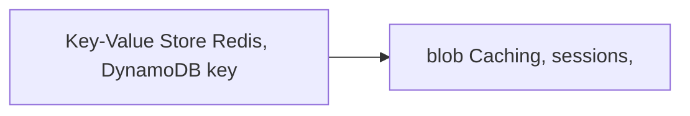
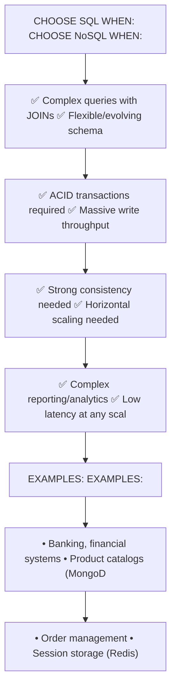
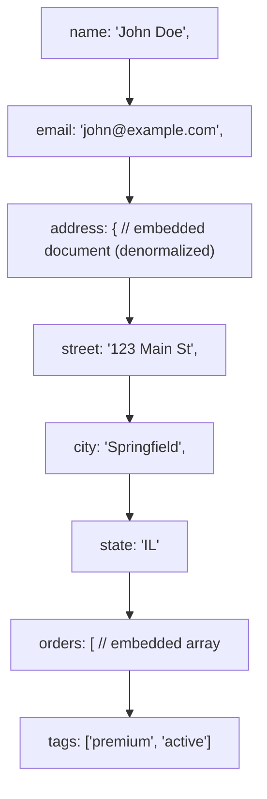
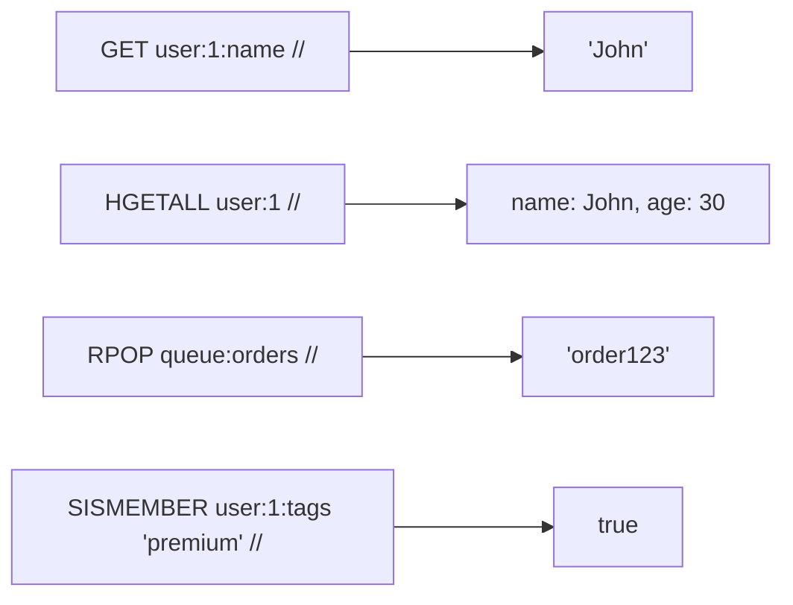

> **Navigation**: [Back to Index](../00_MASTER_INDEX.md) | [Database Internals](../08_SQL/21_Database_Internals.md)
> 🧠 **Mental Model**: See [System Design Thinking](../14_Mental_Models/15_System_Design_Thinking.md)

---

# 🗄️ NoSQL & MongoDB — When SQL Isn't Enough

> Document, Key-Value, Column-Family, Graph — know when to use what

---

## Part 1: NoSQL Categories

```
TYPE              │ EXAMPLES          │ DATA MODEL     │ BEST FOR
────────────────────┼───────────────────┼────────────────┼────────────────────
Document Store    │ MongoDB, CouchDB  │ JSON documents │ Flexible schema,
                  │ Firestore         │ (nested)       │ content mgmt, catalogs
────────────────────┼───────────────────┼────────────────┼────────────────────
Key-Value Store   │ Redis, DynamoDB   │ key → blob     │ Caching, sessions,
                  │ Memcached         │                │ real-time counters
────────────────────┼───────────────────┼────────────────┼────────────────────
Column-Family     │ Cassandra, HBase  │ Wide columns,  │ Time-series, IoT,
                  │ ScyllaDB          │ row key        │ write-heavy workloads
────────────────────┼───────────────────┼────────────────┼────────────────────
Graph Database    │ Neo4j, Amazon     │ Nodes + edges  │ Social networks,
                  │ Neptune           │ + properties   │ recommendations,
                  │                   │                │ fraud detection
```

**Flow:**
1. Key-Value Store Redis, DynamoDB key
2. blob Caching, sessions,



---

## Part 2: SQL vs NoSQL Decision Framework

```
┌─────────────────────────────────────────────────────────────────────────────────┐
│  CHOOSE SQL WHEN:                          CHOOSE NoSQL WHEN:                   │
│  ✅ Complex queries with JOINs             ✅ Flexible/evolving schema            │
│  ✅ ACID transactions required             ✅ Massive write throughput            │
│  ✅ Strong consistency needed              ✅ Horizontal scaling needed           │
│  ✅ Well-defined, stable schema            ✅ Data naturally nested/denorm.       │
│  ✅ Complex reporting/analytics            ✅ Low latency at any scale            │
│                                                                                 │
│  EXAMPLES:                                  EXAMPLES:                           │
│  • Banking, financial systems              • Product catalogs (MongoDB)         │
│  • Order management                        • Session storage (Redis)            │
│  • User accounts with roles                • Chat messages (Cassandra)          │
│  • Anything needing ad-hoc queries         • Social graphs (Neo4j)              │
│                                                                                 │
│  COMMON PATTERN: Polyglot persistence — use BOTH                                │
│  → PostgreSQL for orders (ACID)                                                 │
│  → Redis for caching/sessions                                                   │
│  → Elasticsearch for search                                                     │
│  → MongoDB for product catalog                                                  │
└─────────────────────────────────────────────────────────────────────────────────┘
```

**Flow:**
1. CHOOSE SQL WHEN: CHOOSE NoSQL WHEN:
2. ✅ Complex queries with JOINs ✅ Flexible/evolving schema
3. ✅ ACID transactions required ✅ Massive write throughput
4. ✅ Strong consistency needed ✅ Horizontal scaling needed
5. ✅ Complex reporting/analytics ✅ Low latency at any scal
6. EXAMPLES: EXAMPLES:
7. • Banking, financial systems • Product catalogs (MongoD



---

## Part 3: MongoDB Deep Dive

```
// ── Document Structure (BSON = Binary JSON) ──
{
  _id: ObjectId("507f1f77bcf86cd799439011"),  // auto-generated unique ID
  name: "John Doe",
  email: "john@example.com",
  address: {                    // embedded document (denormalized)
    street: "123 Main St",
    city: "Springfield",
    state: "IL"
  },
  orders: [                     // embedded array
    { orderId: "ORD001", total: 99.99, date: ISODate("2024-01-15") },
    { orderId: "ORD002", total: 149.50, date: ISODate("2024-02-20") }
  ],
  tags: ["premium", "active"]
}

// ── CRUD Operations ──
db.users.insertOne({ name: "Alice", email: "alice@example.com" })
db.users.find({ "address.city": "Springfield" })           // dot notation for nested
db.users.find({ orders: { $elemMatch: { total: { $gt: 100 } } } })  // array query
db.users.updateOne({ _id: id }, { $set: { name: "Alice Smith" } })
db.users.updateOne({ _id: id }, { $push: { tags: "vip" } })  // add to array
db.users.deleteOne({ _id: id })

// ── Aggregation Pipeline ──
db.orders.aggregate([
  { $match: { status: "completed" } },             // filter
  { $group: { _id: "$customerId",                  // group by customer
              totalSpent: { $sum: "$amount" },
              orderCount: { $sum: 1 } } },
  { $sort: { totalSpent: -1 } },                   // sort descending
  { $limit: 10 }                                    // top 10
])

// ── Indexes ──
db.users.createIndex({ email: 1 }, { unique: true })          // unique index
db.users.createIndex({ "address.city": 1, name: 1 })          // compound index
db.users.createIndex({ name: "text", bio: "text" })            // text search index
db.events.createIndex({ createdAt: 1 }, { expireAfterSeconds: 86400 }) // TTL index
```

**Flow:**
1. name: 'John Doe',
2. email: 'john@example.com',
3. address: { // embedded document (denormalized)
4. street: '123 Main St',
5. city: 'Springfield',
6. state: 'IL'
7. orders: [ // embedded array



### Data Modeling: Embed vs Reference


> EMBED (Denormalize):                      REFERENCE (Normalize):
> Store related data in same document       Store ID, look up separately
>
> // Embedded                               // Referenced
> { name: "John",                           { name: "John",
> address: { city: "NYC" } }                addressId: ObjectId("...") }
>
> ✅ Single read (fast)                     ✅ Data not duplicated
> ✅ Atomic updates                         ✅ Many-to-many relationships
> ❌ Document size limit (16MB)             ❌ Requires $lookup (JOIN)
> ❌ Data duplication                       ❌ Multiple reads
>
> RULE OF THUMB:
> → 1:1 or 1:Few → EMBED (address in user)
> → 1:Many (bounded) → EMBED (orders in user, if < 100)
> → 1:Many (unbounded) → REFERENCE (comments on a viral post)
> → Many:Many → REFERENCE (students ↔ courses)


---

## Part 4: Redis Quick Reference

```
// ── Data Structures ──
SET user:1:name "John"            // String
GET user:1:name                   // → "John"

HSET user:1 name "John" age 30   // Hash (like a mini document)
HGETALL user:1                    // → name: John, age: 30

LPUSH queue:orders "order123"     // List (queue/stack)
RPOP queue:orders                 // → "order123"

SADD user:1:tags "premium" "vip"  // Set (unique values)
SISMEMBER user:1:tags "premium"   // → true

ZADD leaderboard 100 "Alice" 85 "Bob"  // Sorted Set (ranked data)
ZREVRANGE leaderboard 0 9              // Top 10 by score

// ── Common Use Cases ──
// Caching: SET + TTL
SET api:response:key "{json}" EX 300    // cache for 5 minutes

// Rate Limiting
INCR rate:user:123:minute
EXPIRE rate:user:123:minute 60

// Session Storage
HSET session:abc userId "123" role "admin" expiry "1700000000"

// Distributed Lock (Redlock)
SET lock:order:456 "owner-id" NX EX 30  // acquire lock for 30s
// NX = only if not exists (atomic)
```

**Flow:**
1. GET user:1:name //
2. 'John'
3. HGETALL user:1 //
4. name: John, age: 30
5. RPOP queue:orders //
6. 'order123'
7. SISMEMBER user:1:tags 'premium' //
8. true



---

## Part 4: Advanced Aggregation Framework

```javascript
/* MongoDB's Aggregation Framework is equivalent to SQL's GROUP BY, 
   JOIN, and Window Functions all rolled into one massive pipeline. 
   Data passes through stages sequentially: Stage 1 → Stage 2 → Stage 3 */

// ── 1. The $lookup Stage (MongoDB's LEFT JOIN) ──
// Though NoSQL discourages joins, sometimes they are unavoidable.
db.orders.aggregate([
  {
    $lookup: {
      from: "customers",           // Target collection
      localField: "customerId",    // Field in 'orders'
      foreignField: "_id",         // Field in 'customers'
      as: "customerData"           // Output array field name
    }
  },
  // $lookup returns an array. Often we want an object, so we $unwind it:
  {
    $unwind: "$customerData"
  },
  // Now we can project (SELECT) the exact fields we want:
  {
    $project: {
      orderTotal: 1,
      "customerData.name": 1,
      "customerData.email": 1
    }
  }
])

// ── 2. Complex Grouping metrics ($facet) ──
// $facet allows you to run multiple aggregation pipelines in parallel 
// within a single stage (e.g., building filters/facets for an e-commerce sidebar)
db.products.aggregate([
  {
    $facet: {
      "categories": [
        { $group: { _id: "$category", count: { $sum: 1 } } }
      ],
      "priceRanges": [
        { $bucket: {          // Bucketing! Perfect for price filters
            groupBy: "$price",
            boundaries: [0, 50, 100, 500],
            default: "Other"
        }}
      ]
    }
  }
])
```

---

## Part 5: Indexing Mastery — The ESR Rule

```javascript
/* Creating indexes in MongoDB isn't random. If you query multiple fields, 
   the ORDER of fields in your compound index MATTERS IMMENSELY.
   Use the ESR Rule: Equality, Sort, Range. */

// We want to query: "Find active users, sorted by age, whose score is > 50"
db.users.find({ status: "active", score: { $gt: 50 } }).sort({ age: 1 })

// ❌ BAD INDEX 1: { score: 1, status: 1, age: 1 }
// Why? Range field comes first. MongoDB stops using the rest of the index
// for sorting/equality after hitting a range. It will do an in-memory sort.

// ❌ BAD INDEX 2: { status: 1, score: 1, age: 1 }
// Why? Range comes before Sort. It will filter quickly, but still sort in memory.

// ✅ GOOD INDEX (The ESR Rule): { status: 1, age: 1, score: 1 }
db.users.createIndex({ status: 1, age: 1, score: 1 })
// Why this works:
// 1. (E) Quality field 'status' instantly narrows down the tree.
// 2. (S) Sort field 'age' means the results are ALREADY naturally sorted in the B-Tree.
// 3. (R) Range field 'score' filters the remaining documents perfectly.

// COVERED QUERIES
// If you only project fields that exist IN THE INDEX, MongoDB never touches the disk!
db.users.find(
  { status: "active", age: 30 },
  { status: 1, age: 1, score: 1, _id: 0 } // Projecting only indexed fields
) // → Time: 0ms. It found everything in RAM!
```

---

## Part 6: Distributed Architecture (High Availability)

```
┌─────────────────────────────────────────────────────────────────────────────────┐
│  MongoDB scales through two mechanisms: Replica Sets and Sharding.              │
│                                                                                 │
│  1. REPLICA SETS (High Availability & Redundancy)                               │
│  → A cluster of at least 3 nodes containing the exact same data.                │
│  → Uses consensus (Raft-like algorithm) to elect a PRIMARY node.                │
│                                                                                 │
│      [Primary] ← (Writes go here, syncs to Oplog)                               │
│        ↙   ↘                                                                    │
│  [Secondary] [Secondary] ← (Reads can go here if eventual consistency is okay)  │
│                                                                                 │
│  What happens if the Primary crashes?                                           │
│  The Secondaries hold an election. The node with the most up-to-date Oplog      │
│  is elected the new Primary within milliseconds. Zero downtime.                 │
│                                                                                 │
│  2. SHARDING (Horizontal Scaling)                                               │
│  → What happens when your collection hits 5 Terabytes? 1 server isn't enough.   │
│  → Sharding splits data across multiple servers based on a Shard Key.           │
│                                                                                 │
│  If Shard Key = "zipcode":                                                      │
│  Shard 1 Server holding: Zip 10000 - 30000                                      │
│  Shard 2 Server holding: Zip 30001 - 60000                                      │
│  Shard 3 Server holding: Zip 60001 - 99999                                      │
│                                                                                 │
│  THE DANGER OF BAD SHARD KEYS:                                                  │
│  If you use "timestamp" as your shard key, all new inserts (current time)       │
│  will slam ONE server (the newest shard) while older servers do nothing!        │
│  This is a "Hot Shard" anti-pattern. Pick a key with high cardinality           │
│  (e.g., UserId) that distributes writes evenly across the cluster.               │
└─────────────────────────────────────────────────────────────────────────────────┘
```

---

## Part 7: Redis Quick Reference

```
// ── Data Structures ──
SET user:1:name "John"            // String
GET user:1:name                   // → "John"

HSET user:1 name "John" age 30   // Hash (like a mini document)
HGETALL user:1                    // → name: John, age: 30

LPUSH queue:orders "order123"     // List (queue/stack)
RPOP queue:orders                 // → "order123"

SADD user:1:tags "premium" "vip"  // Set (unique values)
SISMEMBER user:1:tags "premium"   // → true

ZADD leaderboard 100 "Alice" 85 "Bob"  // Sorted Set (ranked data)
ZREVRANGE leaderboard 0 9              // Top 10 by score

// ── Common Use Cases ──
// Caching: SET + TTL
SET api:response:key "{json}" EX 300    // cache for 5 minutes

// Rate Limiting
INCR rate:user:123:minute
EXPIRE rate:user:123:minute 60

// Session Storage
HSET session:abc userId "123" role "admin" expiry "1700000000"

// Distributed Lock (Redlock)
SET lock:order:456 "owner-id" NX EX 30  // acquire lock for 30s
// NX = only if not exists (atomic)
```

---

## Part 8: Interview Questions

```
Q: "When would you choose MongoDB over PostgreSQL?"
A: When schema changes frequently (e.g., product catalog with varying attributes),
   when data is naturally document-shaped, when horizontal scaling is priority,
   and when you don't need complex multi-collection JOINs or ACID across documents.

Q: "How does MongoDB handle transactions?"
A: Since v4.0: multi-document ACID transactions (like SQL).
   But they're expensive — design your schema to minimize their need.
   Embed related data so single-document operations are atomic by default.

Q: "Redis vs Memcached?"
A: Redis: data structures (hashes, lists, sets, sorted sets), persistence,
   pub/sub, Lua scripting, clustering. Full-featured.
   Memcached: simpler, multi-threaded, pure key-value cache.
   Redis wins for most use cases unless you need raw multi-threaded speed.
```

