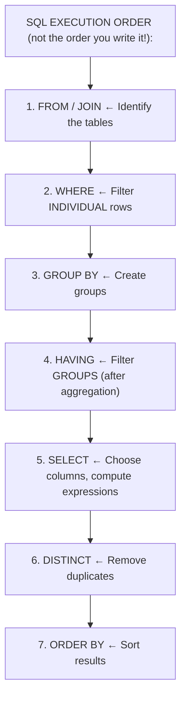
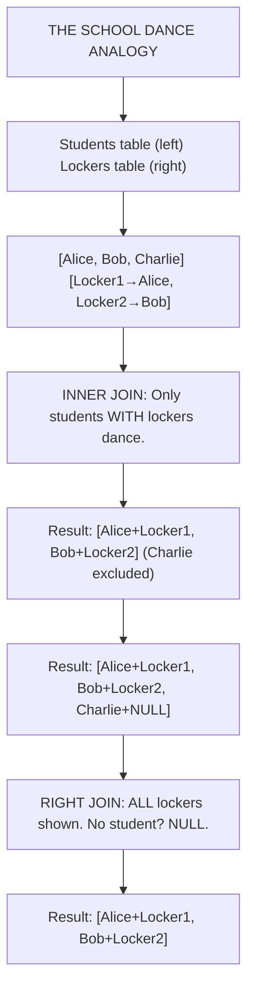
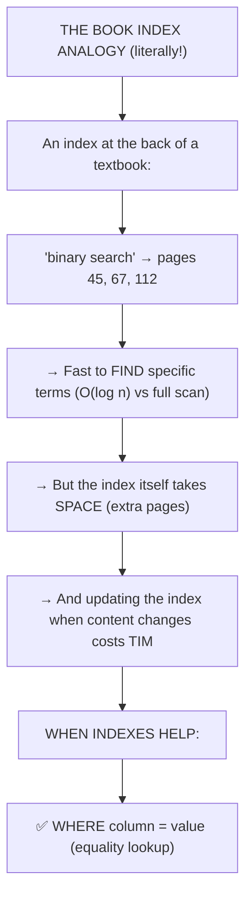
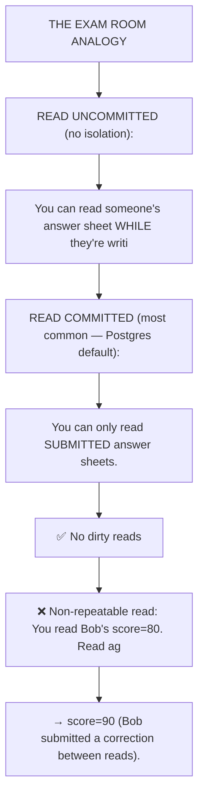
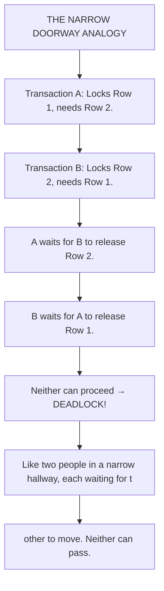
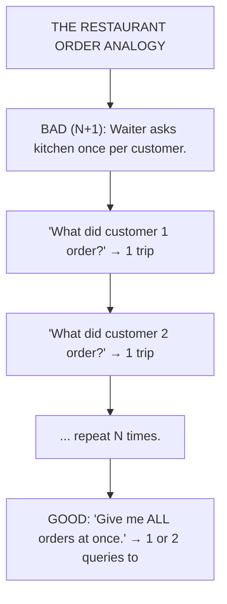
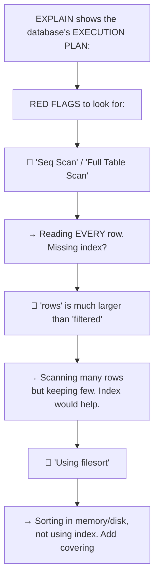
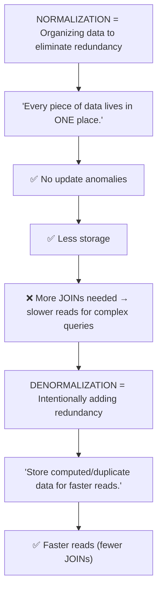
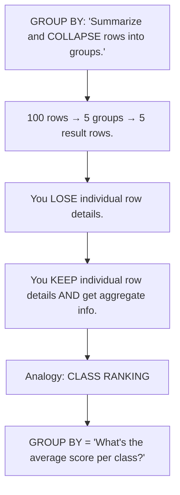

> **Navigation**: [< Previous](22_NoSQL_MongoDB.md) | [Back to Index](../00_MASTER_INDEX.md) | [Next >](24_SQL_Data_Analyst_RealWorld.md)

# Chapter 23 — SQL Deep Reasoning: The Questions That Freeze People

> **"Anyone can write SELECT * FROM users. The senior engineer explains WHY NULL breaks everything, WHEN indexes make queries SLOWER, and HOW transaction isolation levels cause phantom reads."**

---

## Table of Contents

1. [NULL: The Value That Isn't a Value](#1-null-the-value-that-isnt-a-value)
2. [WHERE vs HAVING: Not Just "One Is For Groups"](#2-where-vs-having-not-just-one-is-for-groups)
3. [JOIN Execution: What Actually Happens Under The Hood](#3-join-execution-what-actually-happens-under-the-hood)
4. [Indexes: When They Help AND When They Hurt](#4-indexes-when-they-help-and-when-they-hurt)
5. [Transaction Isolation Levels: The Four Levels Explained With Analogies](#5-transaction-isolation-levels-the-four-levels-explained-with-analogies)
6. [Deadlocks: Why Two Transactions Can Freeze Each Other](#6-deadlocks-why-two-transactions-can-freeze-each-other)
7. [N+1 Query Problem: The Silent Performance Killer](#7-n1-query-problem-the-silent-performance-killer)
8. [EXPLAIN Plan: Reading It Like A Senior](#8-explain-plan-reading-it-like-a-senior)
9. [Normalization vs Denormalization: When To Break The Rules](#9-normalization-vs-denormalization-when-to-break-the-rules)
10. [Window Functions: Not Just "Fancy GROUP BY"](#10-window-functions-not-just-fancy-group-by)

---

## 1. NULL: The Value That Isn't a Value

### The Freeze Question
> "What does `NULL = NULL` return? Is it true?"

### Deep Reasoning


> NULL = "I don't know" — The Unknown Analogy
>
> NULL doesn't mean zero. NULL doesn't mean empty string.
> NULL means "UNKNOWN" or "NOT APPLICABLE."
>
> "Is an unknown value equal to another unknown value?"
> Answer: "I don't know!" → NULL (not true, not false)
>
> SQL uses THREE-VALUED LOGIC: TRUE, FALSE, NULL
>
> NULL = NULL     → NULL (not TRUE!)
> NULL <> NULL    → NULL (not TRUE!)
> NULL > 5        → NULL
> NULL + 10       → NULL (anything + NULL = NULL)
> NULL AND TRUE   → NULL
> NULL OR TRUE    → TRUE (TRUE wins over unknown)
> NULL OR FALSE   → NULL
> NOT NULL        → NULL
>
> To check for NULL: Use IS NULL / IS NOT NULL
> NOT: = NULL or <> NULL (these always return NULL, never TRUE)


```sql
-- The traps:
SELECT * FROM users WHERE age = NULL;     -- Returns NOTHING (NULL = NULL → NULL)
SELECT * FROM users WHERE age IS NULL;    -- ✅ Correct way

SELECT * FROM users WHERE age <> 25;
-- ⚠️ Does NOT return rows where age IS NULL!
-- NULL <> 25 → NULL → row excluded. You need:
SELECT * FROM users WHERE age <> 25 OR age IS NULL;

-- NULL in aggregates:
SELECT AVG(salary) FROM employees;
-- NULL salaries are IGNORED in aggregates (not counted as 0)
-- COUNT(*) counts rows, COUNT(salary) skips NULLs

-- NULL in UNIQUE constraints:
-- Most databases allow MULTIPLE NULLs in a UNIQUE column
-- Because NULL ≠ NULL, so they're all "different"

-- COALESCE: Replace NULL with a default
SELECT COALESCE(phone, email, 'No contact') AS contact FROM users;
```

---

## 2. WHERE vs HAVING: Not Just "One Is For Groups"

### The Freeze Question
> "Why can't I use WHERE with aggregate functions?"

```
╔══════════════════════════════════════════════════════════════════╗
║  SQL EXECUTION ORDER (not the order you write it!):              ║
║                                                                  ║
║  1. FROM / JOIN       ← Identify the tables                      ║
║  2. WHERE             ← Filter INDIVIDUAL rows                   ║
║  3. GROUP BY          ← Create groups                            ║
║  4. HAVING            ← Filter GROUPS (after aggregation)        ║
║  5. SELECT            ← Choose columns, compute expressions      ║
║  6. DISTINCT          ← Remove duplicates                        ║
║  7. ORDER BY          ← Sort results                             ║
║  8. LIMIT/OFFSET      ← Pagination                               ║
║                                                                  ║
║  WHERE runs at step 2 — groups don't exist yet!                  ║
║  HAVING runs at step 4 — groups have been created.               ║
║                                                                  ║
║  "WHERE filters rows. HAVING filters groups."                    ║
║  "WHERE is the bouncer at the door (before you sit).             ║
║   HAVING is the waiter who removes empty tables (after grouping)"║
╚══════════════════════════════════════════════════════════════════╝
```

**Flow:**
- SQL EXECUTION ORDER (not the order you write it!):
- ↓
- 1. FROM / JOIN ← Identify the tables
- ↓
- 2. WHERE ← Filter INDIVIDUAL rows
- ↓
- 3. GROUP BY ← Create groups
- ↓
- 4. HAVING ← Filter GROUPS (after aggregation)
- ↓
- 5. SELECT ← Choose columns, compute expressions
- ↓
- 6. DISTINCT ← Remove duplicates



```sql
-- ❌ WRONG: WHERE can't use aggregate
SELECT department, COUNT(*)
FROM employees
WHERE COUNT(*) > 5  -- Error! COUNT doesn't exist yet at step 2
GROUP BY department;

-- ✅ CORRECT: HAVING filters after grouping
SELECT department, COUNT(*)
FROM employees
GROUP BY department
HAVING COUNT(*) > 5;  -- ✅ Groups exist at step 4

-- OPTIMIZATION: Filter with WHERE first (fewer rows to group)
SELECT department, COUNT(*)
FROM employees
WHERE salary > 50000      -- Filter rows FIRST (fast)
GROUP BY department
HAVING COUNT(*) > 5;      -- Then filter groups
-- This is faster than doing everything in HAVING
```

---


## 3. JOIN Execution: What Actually Happens Under The Hood

### The Freeze Question
> "What's the difference between INNER JOIN and LEFT JOIN? What about execution?"

```
╔══════════════════════════════════════════════════════════════════╗
║  THE SCHOOL DANCE ANALOGY                                        ║
║                                                                  ║
║  Students table (left)        Lockers table (right)              ║
║  [Alice, Bob, Charlie]        [Locker1→Alice, Locker2→Bob]       ║
║                                                                  ║
║  INNER JOIN: Only students WITH lockers dance.                   ║
║  Result: [Alice+Locker1, Bob+Locker2]  (Charlie excluded)        ║
║                                                                  ║
║  LEFT JOIN: ALL students dance. No locker? Dance alone (NULL).   ║
║  Result: [Alice+Locker1, Bob+Locker2, Charlie+NULL]              ║
║                                                                  ║
║  RIGHT JOIN: ALL lockers shown. No student? NULL.                ║
║  Result: [Alice+Locker1, Bob+Locker2]                            ║
║  (Same as INNER here since all lockers have students)            ║
║                                                                  ║
║  FULL OUTER JOIN: Everyone, even if no match. NULLs fill gaps.   ║
║  Result: [Alice+Locker1, Bob+Locker2, Charlie+NULL]              ║
║                                                                  ║
║  CROSS JOIN: Every student × every locker (Cartesian product).   ║
║  3 students × 2 lockers = 6 rows. Rarely useful intentionally.   ║
╚══════════════════════════════════════════════════════════════════╝
```

**Flow:**
- THE SCHOOL DANCE ANALOGY
- ↓
- Students table (left) Lockers table (right)
- ↓
- [Alice, Bob, Charlie] [Locker1
- ↓
- Alice, Locker2
- ↓
- Bob]
- ↓
- [Alice, Bob, Charlie] [Locker1
- ↓
- Alice, Locker2
- ↓
- Bob]
- ↓
- INNER JOIN: Only students WITH lockers dance.
- ↓
- Result: [Alice+Locker1, Bob+Locker2] (Charlie excluded)
- ↓
- Result: [Alice+Locker1, Bob+Locker2, Charlie+NULL]
- ↓
- RIGHT JOIN: ALL lockers shown. No student? NULL.



```sql
-- THE TRAP: LEFT JOIN + WHERE on right table = INNER JOIN!
SELECT * FROM orders o
LEFT JOIN customers c ON o.customer_id = c.id
WHERE c.country = 'US';  -- ❌ This removes NULLs, making it an INNER JOIN!

-- FIX: Put condition in ON clause
SELECT * FROM orders o
LEFT JOIN customers c ON o.customer_id = c.id AND c.country = 'US';
-- ✅ Keeps orders without customers, only matches US customers
```

---


> 🔬 **Section Challenge — 3. JOIN Execution: What Actually Happens Under The Hood**
>
> **Challenge 1 (Reasoning):** `LEFT JOIN` returns all rows from the left table. When does it return MORE rows than the left table?
> <details><summary>Answer</summary>
>
> When the right table has MULTIPLE matching rows for one left-table row. Example: Orders LEFT JOIN OrderItems — one order with 5 items = 5 result rows for that one order. Analogy: `1 order × 5 items = 5 rows`. Always check your join multiplicity. Use `SELECT COUNT(*) vs COUNT(DISTINCT left.id)` to detect row explosion.
> </details>
>
> **Challenge 2 (Bug Hunt):** `SELECT * FROM A, B WHERE A.id = B.a_id` — what join type is this and is it equivalent to `A JOIN B ON A.id = B.a_id`?
> <details><summary>Answer</summary>
>
> It's an old-style INNER JOIN. Functionally equivalent to `A INNER JOIN B ON A.id = B.a_id` — only returns rows where both sides match. BUT: the comma syntax is dangerous. Forgetting the WHERE clause on a multi-table comma join → CROSS JOIN (cartesian product). Explicit JOIN syntax with ON makes intent clear and prevents the accidental cross join.
> </details>
>

## 4. Indexes: When They Help AND When They Hurt

### The Freeze Question
> "Should I just add indexes to every column?"

```
╔══════════════════════════════════════════════════════════════════╗
║  THE BOOK INDEX ANALOGY (literally!)                             ║
║                                                                  ║
║  An index at the back of a textbook:                             ║
║  "binary search" → pages 45, 67, 112                             ║
║  → Fast to FIND specific terms (O(log n) vs full scan)           ║
║  → But the index itself takes SPACE (extra pages)                ║
║  → And updating the index when content changes costs TIME        ║
║                                                                  ║
║  WHEN INDEXES HELP:                                              ║
║  ✅ WHERE column = value (equality lookup)                        ║
║  ✅ WHERE column > value (range queries)                          ║
║  ✅ JOIN conditions (matching foreign keys)                       ║
║  ✅ ORDER BY / GROUP BY (already sorted in index)                 ║
║  ✅ Columns with HIGH cardinality (many unique values)            ║
║                                                                  ║
║  WHEN INDEXES HURT:                                              ║
║  ❌ Write-heavy tables (every INSERT/UPDATE modifies index)       ║
║  ❌ Low cardinality columns (boolean "active" → 50% match         ║
║     → index doesn't help, full scan is faster)                   ║
║  ❌ Small tables (full scan of 100 rows < index lookup overhead)  ║
║  ❌ Columns rarely used in WHERE/JOIN                             ║
║  ❌ Wide indexes (indexing large TEXT columns)                    ║
║                                                                  ║
║  COMPOSITE INDEX ORDER MATTERS:                                  ║
║  INDEX(a, b, c) helps: WHERE a=1, WHERE a=1 AND b=2,             ║
║                         WHERE a=1 AND b=2 AND c=3                ║
║  Does NOT help: WHERE b=2 (leftmost column not used!)            ║
║  Think: Phone book sorted by (Last, First, Middle)               ║
║  Can find all "Smith" → "Smith, John" → "Smith, John, A."        ║
║  Cannot use it to find all "John" (first names not sorted first) ║
╚══════════════════════════════════════════════════════════════════╝
```

**Flow:**
- THE BOOK INDEX ANALOGY (literally!)
- ↓
- An index at the back of a textbook:
- ↓
- 'binary search'
- ↓
- pages 45, 67, 112
- ↓
- 'binary search'
- ↓
- pages 45, 67, 112
- ↓
- Fast to FIND specific terms (O(log n) vs full scan)
- ↓
- But the index itself takes SPACE (extra pages)
- ↓
- And updating the index when content changes costs TIM
- ↓
- WHEN INDEXES HELP:



---

## 5. Transaction Isolation Levels: The Four Levels Explained

### The Freeze Question
> "What's the difference between Read Committed and Repeatable Read?"

```
THE EXAM ROOM ANALOGY

READ UNCOMMITTED (no isolation):
You can read someone's answer sheet WHILE they're writing.
They might erase it → you copied a wrong answer (dirty read).

READ COMMITTED (most common — Postgres default):
You can only read SUBMITTED answer sheets.
✅ No dirty reads
❌ Non-repeatable read: You read Bob's score=80. Read again
   → score=90 (Bob submitted a correction between reads).

REPEATABLE READ (MySQL InnoDB default):
Once you read Bob's score, it's FROZEN for your transaction.
✅ No dirty reads, no non-repeatable reads
❌ Phantom read: You count "students with score > 80" = 10.
   Count again → 11! (New student appeared — a phantom.)

SERIALIZABLE (strictest):
Everyone takes the exam ONE AT A TIME.
✅ No problems at all
❌ Extremely slow — transactions queue up

┌─────────────────┬───────┬──────────────┬─────────┐
│ Level           │ Dirty │ Non-Repeat   │ Phantom │
│                 │ Read  │ Read         │ Read    │
├─────────────────┼───────┼──────────────┼─────────┤
│ Read Uncommitted│ YES   │ YES          │ YES     │
│ Read Committed  │ NO    │ YES          │ YES     │
│ Repeatable Read │ NO    │ NO           │ YES*    │
│ Serializable    │ NO    │ NO           │ NO      │
└─────────────────┴───────┴──────────────┴─────────┘
*MySQL InnoDB prevents phantoms at Repeatable Read (gap locks)
```

**Flow:**
- THE EXAM ROOM ANALOGY
- ↓
- READ UNCOMMITTED (no isolation):
- ↓
- You can read someone's answer sheet WHILE they're writi
- ↓
- READ COMMITTED (most common — Postgres default):
- ↓
- You can only read SUBMITTED answer sheets.
- ↓
- ✅ No dirty reads
- ↓
- ❌ Non-repeatable read: You read Bob's score=80. Read ag



---


> 🔬 **Section Challenge — 5. Transaction Isolation Levels: The Four Levels Explained**
>
> **Challenge 1 (Reasoning):** Two transactions T1 and T2 both run `SELECT balance WHERE id=1; UPDATE balance=balance-100 WHERE id=1`. What anomaly occurs at READ COMMITTED and how does REPEATABLE READ fix it?
> <details><summary>Answer</summary>
>
> READ COMMITTED: both T1 and T2 read balance=1000. Both compute 900. Both write 900. Final balance: 900 (expected: 800). Lost update! REPEATABLE READ (with locking SELECT FOR UPDATE): first SELECT acquires a read lock. T2's SELECT blocks until T1 commits. After T1 commits (balance=900), T2 reads 900, writes 800. Correct! Alternatively: use `UPDATE ... WHERE balance=1000` (optimistic locking with version check).
> </details>
>

## 6. Deadlocks: Why Two Transactions Can Freeze Each Other

### The Freeze Question
> "What is a deadlock and how do you prevent it?"

```
╔══════════════════════════════════════════════════════════════════╗
║  THE NARROW DOORWAY ANALOGY                                      ║
║                                                                  ║
║  Transaction A: Locks Row 1, needs Row 2.                        ║
║  Transaction B: Locks Row 2, needs Row 1.                        ║
║                                                                  ║
║  A waits for B to release Row 2.                                 ║
║  B waits for A to release Row 1.                                 ║
║  Neither can proceed → DEADLOCK!                                 ║
║                                                                  ║
║  Like two people in a narrow hallway, each waiting for the       ║
║  other to move. Neither can pass.                                ║
║                                                                  ║
║  DETECTION: Database detects cycle in wait graph → kills one.    ║
║                                                                  ║
║  PREVENTION:                                                     ║
║  1. Always lock resources in THE SAME ORDER                      ║
║     (Both A and B lock Row 1 first, then Row 2)                  ║
║  2. Keep transactions SHORT (less time holding locks)            ║
║  3. Use appropriate isolation level (don't over-isolate)         ║
║  4. Use row-level locks, not table locks                         ║
║  5. Set lock timeout (don't wait forever)                        ║
╚══════════════════════════════════════════════════════════════════╝
```

**Flow:**
- THE NARROW DOORWAY ANALOGY
- ↓
- Transaction A: Locks Row 1, needs Row 2.
- ↓
- Transaction B: Locks Row 2, needs Row 1.
- ↓
- A waits for B to release Row 2.
- ↓
- B waits for A to release Row 1.
- ↓
- Neither can proceed
- ↓
- DEADLOCK!
- ↓
- Neither can proceed
- ↓
- DEADLOCK!
- ↓
- Like two people in a narrow hallway, each waiting for t



---


> 🔬 **Section Challenge — 6. Deadlocks: Why Two Transactions Can Freeze Each Other**
>
> **Challenge 1 (Reasoning):** Two transactions T1 and T2 both run `SELECT balance WHERE id=1; UPDATE balance=balance-100 WHERE id=1`. What anomaly occurs at READ COMMITTED and how does REPEATABLE READ fix it?
> <details><summary>Answer</summary>
>
> READ COMMITTED: both T1 and T2 read balance=1000. Both compute 900. Both write 900. Final balance: 900 (expected: 800). Lost update! REPEATABLE READ (with locking SELECT FOR UPDATE): first SELECT acquires a read lock. T2's SELECT blocks until T1 commits. After T1 commits (balance=900), T2 reads 900, writes 800. Correct! Alternatively: use `UPDATE ... WHERE balance=1000` (optimistic locking with version check).
> </details>
>

## 7. N+1 Query Problem: The Silent Performance Killer

### The Freeze Question
> "What's the N+1 problem?"

```
╔══════════════════════════════════════════════════════════════════╗
║  THE RESTAURANT ORDER ANALOGY                                    ║
║                                                                  ║
║  BAD (N+1): Waiter asks kitchen once per customer.               ║
║  "What did customer 1 order?" → 1 trip                           ║
║  "What did customer 2 order?" → 1 trip                           ║
║  ... repeat N times.                                             ║
║  Total: 1 (get customers) + N (get each order) = N+1 queries!    ║
║                                                                  ║
║  GOOD: "Give me ALL orders at once." → 1 or 2 queries total.     ║
╚══════════════════════════════════════════════════════════════════╝
```

**Flow:**
- THE RESTAURANT ORDER ANALOGY
- ↓
- BAD (N+1): Waiter asks kitchen once per customer.
- ↓
- 'What did customer 1 order?'
- ↓
- 1 trip
- ↓
- 'What did customer 1 order?'
- ↓
- 1 trip
- ↓
- 'What did customer 2 order?'
- ↓
- 1 trip
- ↓
- 'What did customer 2 order?'
- ↓
- 1 trip
- ↓
- ... repeat N times.
- ↓
- GOOD: 'Give me ALL orders at once.'
- ↓
- 1 or 2 queries to



```sql
-- N+1 PROBLEM (in ORM):
-- Query 1: SELECT * FROM departments;       (returns 100 departments)
-- Query 2-101: For EACH department:
--   SELECT * FROM employees WHERE dept_id = ?;  (×100!)
-- Total: 101 queries!

-- FIX 1: JOIN (1 query)
SELECT d.*, e.* FROM departments d
JOIN employees e ON e.dept_id = d.id;

-- FIX 2: Eager loading (JPA)
@EntityGraph(attributePaths = "employees")
List<Department> findAll();

-- FIX 3: Batch loading (Hibernate)
@BatchSize(size = 25)  -- Loads 25 departments' employees at a time
private Set<Employee> employees;
-- 1 + 4 = 5 queries instead of 101
```

---

## 8. EXPLAIN Plan: Reading It Like A Senior

### The Freeze Question
> "How do you know if a query is slow?"

```
╔══════════════════════════════════════════════════════════════════╗
║  EXPLAIN shows the database's EXECUTION PLAN:                    ║
║                                                                  ║
║  RED FLAGS to look for:                                          ║
║                                                                  ║
║  🔴 "Seq Scan" / "Full Table Scan"                                ║
║     → Reading EVERY row. Missing index?                          ║
║                                                                  ║
║  🔴 "rows" is much larger than "filtered"                         ║
║     → Scanning many rows but keeping few. Index would help.      ║
║                                                                  ║
║  🔴 "Using filesort"                                              ║
║     → Sorting in memory/disk, not using index. Add covering      ║
║       index with ORDER BY columns.                               ║
║                                                                  ║
║  🔴 "Using temporary"                                             ║
║     → Creating temp table. Usually GROUP BY or DISTINCT.         ║
║                                                                  ║
║  🟢 "Using index" (covering index)                                ║
║     → Reading only from index, not touching table. FAST!         ║
║                                                                  ║
║  🟢 "Index range scan"                                            ║
║     → Using index to scan a range. Good for WHERE col > 50.      ║
╚══════════════════════════════════════════════════════════════════╝
```

**Flow:**
- EXPLAIN shows the database's EXECUTION PLAN:
- ↓
- RED FLAGS to look for:
- ↓
- 🔴 'Seq Scan' / 'Full Table Scan'
- ↓
- Reading EVERY row. Missing index?
- ↓
- 🔴 'rows' is much larger than 'filtered'
- ↓
- Scanning many rows but keeping few. Index would help.
- ↓
- 🔴 'Using filesort'



```sql
-- MySQL
EXPLAIN SELECT * FROM orders WHERE customer_id = 42;

-- PostgreSQL (more detailed)
EXPLAIN ANALYZE SELECT * FROM orders WHERE customer_id = 42;
-- ANALYZE actually runs the query and shows real execution times
```

---


## 9. Normalization vs Denormalization: When To Break The Rules

### The Freeze Question
> "Should the database always be normalized?"

```
╔══════════════════════════════════════════════════════════════════╗
║  NORMALIZATION = Organizing data to eliminate redundancy         ║
║  "Every piece of data lives in ONE place."                       ║
║  ✅ No update anomalies                                           ║
║  ✅ Less storage                                                  ║
║  ❌ More JOINs needed → slower reads for complex queries          ║
║                                                                  ║
║  DENORMALIZATION = Intentionally adding redundancy               ║
║  "Store computed/duplicate data for faster reads."               ║
║  ✅ Faster reads (fewer JOINs)                                    ║
║  ❌ Update anomalies (must update in multiple places)             ║
║  ❌ More storage                                                  ║
║                                                                  ║
║  WHEN TO DENORMALIZE:                                            ║
║  • Read-heavy systems (10:1 read-to-write ratio)                 ║
║  • Reporting/analytics databases                                 ║
║  • Caching frequently joined data                                ║
║  • After profiling shows JOINs are the bottleneck                ║
║                                                                  ║
║  RULE: Normalize first (3NF). Denormalize only when              ║
║  performance demands it AND you understand the cost.             ║
╚══════════════════════════════════════════════════════════════════╝
```

**Flow:**
- NORMALIZATION = Organizing data to eliminate redundancy
- ↓
- 'Every piece of data lives in ONE place.'
- ↓
- ✅ No update anomalies
- ↓
- ✅ Less storage
- ↓
- ❌ More JOINs needed
- ↓
- slower reads for complex queries
- ↓
- ❌ More JOINs needed
- ↓
- slower reads for complex queries
- ↓
- DENORMALIZATION = Intentionally adding redundancy
- ↓
- 'Store computed/duplicate data for faster reads.'



---

## 10. Window Functions: Not Just "Fancy GROUP BY"

### The Freeze Question
> "What's the difference between GROUP BY and window functions?"

```
╔══════════════════════════════════════════════════════════════════╗
║  GROUP BY: "Summarize and COLLAPSE rows into groups."            ║
║  100 rows → 5 groups → 5 result rows.                            ║
║  You LOSE individual row details.                                ║
║                                                                  ║
║  Window Function: "Calculate across a set BUT KEEP every row."   ║
║  100 rows → calculation → 100 result rows (with new columns).    ║
║  You KEEP individual row details AND get aggregate info.         ║
║                                                                  ║
║  Analogy: CLASS RANKING                                          ║
║  GROUP BY = "What's the average score per class?"                ║
║  Window fn = "What's each student's rank WITHIN their class?"    ║
╚══════════════════════════════════════════════════════════════════╝
```

**Flow:**
- GROUP BY: 'Summarize and COLLAPSE rows into groups.'
- ↓
- 100 rows
- ↓
- 5 groups
- ↓
- 5 result rows.
- ↓
- 100 rows
- ↓
- 5 groups
- ↓
- 5 result rows.
- ↓
- You LOSE individual row details.
- ↓
- You KEEP individual row details AND get aggregate info.
- ↓
- Analogy: CLASS RANKING
- ↓
- GROUP BY = 'What's the average score per class?'



```sql
-- GROUP BY: One row per department
SELECT department, AVG(salary)
FROM employees GROUP BY department;
-- Result: 5 rows (one per department)

-- Window Function: Every employee + their department average
SELECT name, department, salary,
       AVG(salary) OVER (PARTITION BY department) AS dept_avg,
       RANK() OVER (PARTITION BY department ORDER BY salary DESC) AS rank
FROM employees;
-- Result: ALL rows, with department context added

-- Common window functions:
-- ROW_NUMBER() — unique sequential number
-- RANK()       — rank with gaps (1,2,2,4)
-- DENSE_RANK() — rank without gaps (1,2,2,3)
-- LAG(col, n)  — value from N rows BEFORE
-- LEAD(col, n) — value from N rows AFTER
-- SUM() OVER() — running total
```

---


> 🔬 **Section Challenge — 10. Window Functions: Not Just "Fancy GROUP BY"**
>
> **Challenge 1 (Reasoning):** Why can't you use a window function in a WHERE clause? How do you filter on window function results?
> <details><summary>Answer</summary>
>
> Window functions run in a logical step AFTER WHERE filtering. The WHERE clause operates on base rows; window functions are computed on the result set. Solution: wrap in a subquery/CTE. `WITH ranked AS (SELECT *, ROW_NUMBER() OVER(...) rn FROM t) SELECT * FROM ranked WHERE rn = 1`. This is 'standard' pattern for top-N-per-group.
> </details>
>
> **Challenge 2 (Design):** `ROW_NUMBER()` vs `RANK()` vs `DENSE_RANK()` — show with an example where they produce different results.
> <details><summary>Answer</summary>
>
> Scores: [100, 90, 90, 80]. ROW_NUMBER: 1,2,3,4 (always unique, arbitrary for ties). RANK: 1,2,2,4 (gives same rank to ties, SKIPS the next rank). DENSE_RANK: 1,2,2,3 (same rank to ties, NO skipping). Use: ROW_NUMBER for pagination (must be unique). RANK when you want 'no 3rd place if two tied for 2nd'. DENSE_RANK when you want consecutive ranks despite ties.
> </details>
>

## Interview Quick-Fire: SQL Freeze Busters

| Freeze Question | Senior-Level Answer |
|----------------|-------------------|
| "DELETE vs TRUNCATE vs DROP?" | DELETE: removes rows with WHERE, logged, triggers fire, rollback-able. TRUNCATE: removes ALL rows, minimal logging, resets auto-increment, no triggers. DROP: removes the entire table structure. |
| "What's a view?" | A saved SELECT query. Virtual table — doesn't store data. Accessed like a table. Use for: security (hide columns), simplicity (simplify complex joins), abstraction (change underlying query without changing app). |
| "Primary Key vs Unique Key?" | PK: ONE per table, NOT NULL, clustered index (usually). Unique: MULTIPLE per table, allows one NULL (varies by DB), non-clustered. Both enforce uniqueness. |
| "What's a stored procedure?" | Pre-compiled SQL code stored in the database. Advantages: reduced network trips, reusable, security (EXECUTE permission). Disadvantages: vendor lock-in, hard to version control, hard to test. |
| "UNION vs UNION ALL?" | UNION: combines results and REMOVES duplicates (needs sorting → slower). UNION ALL: combines results and KEEPS duplicates (faster). Use UNION ALL unless you explicitly need dedup. |

---

← Previous: [Chapter 22 — NoSQL MongoDB](22_NoSQL_MongoDB.md)
| [📚 Index](../00_MASTER_INDEX.md)
| Next: [Coroutines & Concurrency Models →](../13_Developer_Essentials/19_Concurrency_Models_Coroutines.md)


---


---

## 🏋️ Practice & Interview Questions — SQL

### Predict / Trace
**Q1.** What's the difference between WHERE and HAVING?
<details><summary>Answer</summary>

`WHERE` filters rows **before** grouping. `HAVING` filters groups **after** `GROUP BY`. You can't use aggregate functions in WHERE. `HAVING COUNT(*) > 5` works, `WHERE COUNT(*) > 5` does not.
</details>

**Q2.** What does this return? `SELECT 1 FROM dual WHERE NULL = NULL`
<details><summary>Answer</summary>

**No rows returned.** NULL is not equal to NULL — use `IS NULL` or `IS NOT NULL`. `NULL = NULL` evaluates to UNKNOWN, not TRUE.
</details>

### Coding Problems
**Q3.** ⭐ Second highest salary — handle the case where it doesn't exist (return NULL).
<details><summary>Solution</summary>

```sql
SELECT MAX(salary) AS SecondHighestSalary
FROM Employee
WHERE salary < (SELECT MAX(salary) FROM Employee);
-- or
SELECT IFNULL((SELECT DISTINCT salary FROM Employee ORDER BY salary DESC LIMIT 1 OFFSET 1), NULL)
```
</details>

**Q4.** ⭐ Find employees earning more than their manager.
<details><summary>Solution</summary>

```sql
SELECT e.name FROM Employee e
JOIN Employee m ON e.managerId = m.id
WHERE e.salary > m.salary;
```
</details>

**Q5.** ⭐ Find duplicate emails.
<details><summary>Solution</summary>

```sql
SELECT email FROM Person GROUP BY email HAVING COUNT(*) > 1;
```
</details>

**Q6.** ⭐⭐ Rank scores without RANK() function.
<details><summary>Solution</summary>

```sql
SELECT s.score,
  (SELECT COUNT(DISTINCT s2.score) FROM Scores s2 WHERE s2.score >= s.score) AS rank
FROM Scores s ORDER BY score DESC;
```
</details>

**Q7.** ⭐⭐ Consecutive numbers — find numbers that appear 3+ times consecutively.
<details><summary>Solution</summary>

```sql
SELECT DISTINCT l1.Num AS ConsecutiveNums
FROM Logs l1, Logs l2, Logs l3
WHERE l1.Id=l2.Id-1 AND l2.Id=l3.Id-1
AND l1.Num=l2.Num AND l2.Num=l3.Num;
-- or use LAG/LEAD window functions
```
</details>

**Q8.** ⭐⭐ Department top 3 salaries (dense rank).
<details><summary>Solution</summary>

```sql
SELECT d.name AS Department, e.name AS Employee, e.salary AS Salary
FROM Employee e JOIN Department d ON e.departmentId = d.id
WHERE (SELECT COUNT(DISTINCT e2.salary) FROM Employee e2
       WHERE e2.departmentId=e.departmentId AND e2.salary>e.salary) < 3;
```
</details>

**Q9.** ⭐⭐ Running total with window function.
<details><summary>Solution</summary>

```sql
SELECT date, amount,
  SUM(amount) OVER (ORDER BY date ROWS BETWEEN UNBOUNDED PRECEDING AND CURRENT ROW) AS running_total
FROM transactions;
```
</details>

**Q10.** ⭐⭐ Pivot rows to columns (conditional aggregation).
<details><summary>Solution</summary>

```sql
SELECT year,
  SUM(CASE WHEN quarter=1 THEN revenue END) AS Q1,
  SUM(CASE WHEN quarter=2 THEN revenue END) AS Q2,
  SUM(CASE WHEN quarter=3 THEN revenue END) AS Q3,
  SUM(CASE WHEN quarter=4 THEN revenue END) AS Q4
FROM sales GROUP BY year;
```
</details>

**Q11.** ⭐⭐⭐ Find the median salary — without MEDIAN() function.
<details><summary>Solution</summary>

```sql
SELECT AVG(salary) AS median
FROM (SELECT salary, ROW_NUMBER() OVER(ORDER BY salary) AS rn, COUNT(*) OVER() AS cnt FROM Employee) t
WHERE rn IN (FLOOR((cnt+1)/2), CEIL((cnt+1)/2));
```
</details>

### Interview Questions
**Q12.** INNER JOIN vs LEFT JOIN — when does LEFT produce more rows?
<details><summary>Answer</summary>

LEFT JOIN includes ALL rows from the left table even if no match in right table (fills NULLs). INNER JOIN only includes rows where both sides have a match. If left table has rows with no match in right: LEFT produces more rows.
</details>

**Q13.** What is a covering index?
<details><summary>Answer</summary>

An index that contains ALL columns needed by a query — the DB can answer from the index alone without touching the table ("index-only scan"). Faster because it avoids the extra heap fetch.
</details>

**Q14.** EXPLAIN shows "Full Table Scan" — how do you fix it?
<details><summary>Answer</summary>

Add an index on the WHERE/JOIN/ORDER BY column. Check if the column has low cardinality (boolean — index may not help). Ensure the query isn't wrapping the column in a function (`WHERE YEAR(date) = 2024` prevents index use — rewrite as `WHERE date BETWEEN '2024-01-01' AND '2024-12-31'`).
</details>

### MCQ Rapid Fire
| # | Question | Answer |
|---|---|---|
| 1 | NULL = NULL evaluates to? | UNKNOWN (use IS NULL) |
| 2 | COUNT(*) vs COUNT(col) | COUNT(*) counts all rows, COUNT(col) skips NULLs |
| 3 | RANK() vs DENSE_RANK() | RANK() skips numbers after ties, DENSE_RANK() doesn't |
| 4 | CROSS JOIN produces | Cartesian product (m × n rows) |
| 5 | Can you ORDER BY in a subquery? | Only when using TOP/LIMIT |
| 6 | TRUNCATE vs DELETE | TRUNCATE: no WHERE, no undo, faster. DELETE: filterable, transactional |
| 7 | What does COALESCE do? | Returns first non-NULL value from its arguments |
| 8 | Index on VARCHAR — what to watch out for? | Case sensitivity, collation, function-based searches bypass index |


---

## 🧠 Deep Conceptual Questions — SQL Internals & Reasoning

**C1. How does a SQL database execute a SELECT query internally?**
<details><summary>Deep Answer</summary>

1. **Parse**: SQL text → AST (syntax tree)
2. **Bind**: resolve table names, column names, types
3. **Optimize**: query planner generates candidate execution plans, estimates costs (based on statistics: row counts, column cardinality, index existence), picks cheapest
4. **Execute**: follow the plan — scan tables, apply filters, join, sort, project

The optimizer transforms: `SELECT ... WHERE ... JOIN ... ORDER BY` into an operator tree (Volcano model): TableScan → Filter → HashJoin → Sort → Project. Each operator is an iterator: `next()` pulls one row from its child. This pull-based model (lazy evaluation) avoids materializing intermediate results.
</details>

**C2. B-Tree index: why is it the default index structure in databases?**
<details><summary>Deep Answer</summary>

B-Tree (not binary tree — B stands for Balanced, not Binary): a self-balancing tree where each node can hold many keys. Properties: (1) height O(log_m N) where m=fan-out (typically 100-1000) → very short tree for millions of rows, (2) all leaf nodes at same depth → guaranteed O(log N) worst case, (3) range scans efficient — leaves linked in sequence, (4) supports equality AND range queries. Hash index: only equality (no range). Sequential scan: no index at all. B+Tree (variant): internal nodes only store keys (no values), leaves store data. All row pointers in leaves → better range scan (follow linked list of leaves).
</details>

**C3. Why does adding an index sometimes SLOW DOWN a query?**
<details><summary>Deep Answer</summary>

1. **Low cardinality**: index on a boolean column — if 50% rows have `active=true`, index gives you 50% of rows. Database may choose full table scan (cheaper: sequential I/O) over index (random I/O for 50% of rows). 
2. **Function on column**: `WHERE YEAR(created_at) = 2024` — index on `created_at` unused. Rewrite: `WHERE created_at >= '2024-01-01' AND created_at < '2025-01-01'`.
3. **Write overhead**: every INSERT/UPDATE/DELETE must update ALL indexes. 5 indexes × N rows = 5× write amplification.
4. **Index not covering**: index exists but the SELECT columns aren't in the index → each index match → separate heap fetch → many random I/O. Solution: covering index (include all needed columns in index).
</details>

**C4. EXPLAIN / query execution plan: what are the key things to look for?**
<details><summary>Deep Answer</summary>

Red flags: (1) **"Full Table Scan" / "Seq Scan"** on a large table → missing index, (2) **high "rows" estimate** in join conditions → cartesian product risk, (3) **"Using filesort"** → ORDER BY can't use index, (4) **"Using temporary"** → intermediate table materialization, (5) **nested loops on large tables** → should be hash join or merge join. Green flags: "Using index" (covering index), "ref" or "eq_ref" access type (index used). Start fixing: add or fix index on WHERE/JOIN/ORDER BY columns, rewrite function-wrapped columns.
</details>

**C5. Window functions vs GROUP BY — when must you use window functions?**
<details><summary>Deep Answer</summary>

`GROUP BY` collapses rows to one per group — individual row data is lost. Window functions compute aggregates but **keep all rows**. Use window when: (1) you need both the aggregate AND the individual row (rank each employee and show their salary), (2) running totals (each row needs sum of all prior rows — GROUP BY can't do this), (3) lag/lead access (compare each row to previous/next — GROUP BY has no row ordering concept), (4) top-N per group (ROW_NUMBER partition — classic GROUP BY can't do this cleanly). Window functions = aggregation without collapsing.
</details>

**C6. Transaction isolation levels — what anomaly does each prevent?**
<details><summary>Deep Answer</summary>

| Level | Dirty Read | Non-repeatable Read | Phantom Read |
|---|---|---|---|
| READ UNCOMMITTED | Possible | Possible | Possible |
| READ COMMITTED | ✅ Prevented | Possible | Possible |
| REPEATABLE READ | ✅ | ✅ | Possible (MySQL InnoDB: prevented!) |
| SERIALIZABLE | ✅ | ✅ | ✅ |

**Dirty read**: read uncommitted data from another transaction (which may rollback). **Non-repeatable**: same query in same transaction returns different row values (another transaction committed update). **Phantom**: same query returns different row COUNT (another transaction inserted/deleted rows). Higher isolation = fewer anomalies but more lock contention. Most production databases use READ COMMITTED or REPEATABLE READ.
</details>

**C7. N+1 query problem: what is it, why does it happen, and how to fix?**
<details><summary>Deep Answer</summary>

**What**: fetching N orders, then for each order making a separate query for the customer = 1 + N queries total. Scales terribly: 1000 orders = 1001 queries. **Why**: ORMs (Hibernate, JPA) with lazy loading — accessing a relationship triggers a new query. **Fix 1**: Eager loading — `JOIN FETCH` or `.fetch()` — load everything in one query. **Fix 2**: Batch loading — fetch all order IDs, then `WHERE customer_id IN (id1, id2, ...)` — 2 queries. **Fix 3**: Projection/DTO query — `SELECT o.id, c.name FROM orders o JOIN customers c` — 1 query. **Detection**: count DB queries in tests (Spring: `@QueryCount`), log slow query warnings.
</details>


> **Navigation**: [< Previous](22_NoSQL_MongoDB.md) | [Back to Index](../00_MASTER_INDEX.md) | [Next >](24_SQL_Data_Analyst_RealWorld.md)