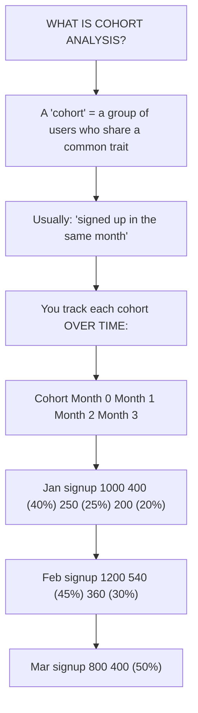
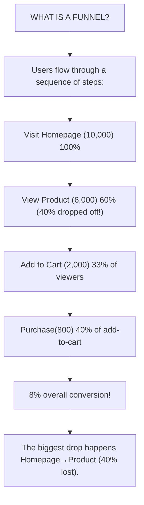
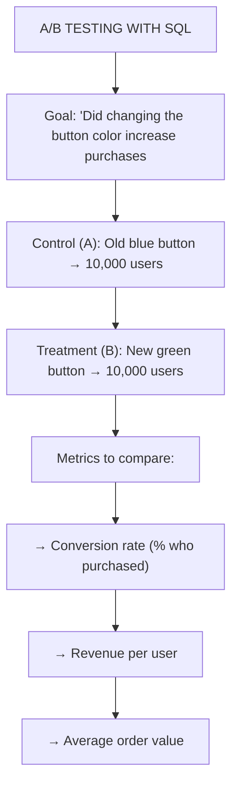
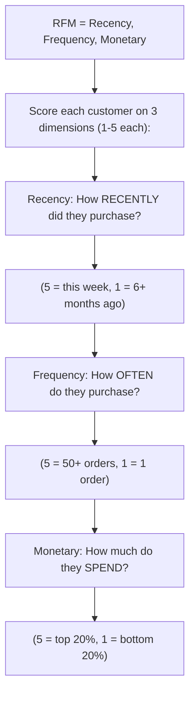
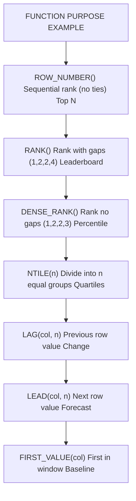

**Navigation**: [< Previous](23_SQL_Deep_Reasoning.md) | [Back to Index](../00_MASTER_INDEX.md)

# Chapter 24 — SQL for Data Analysts: Real-World Patterns That Get You Hired

**"Knowing SELECT and JOIN makes you a developer who queries databases. Knowing cohort analysis, funnel queries, retention curves, and A/B testing SQL makes you a DATA ANALYST. This chapter bridges the gap."**

---

## Table of Contents

1. [The Data Analyst SQL Mindset](#1-data-analyst-mindset)
2. [Cohort Analysis: User Retention by Signup Month](#2-cohort-analysis)
3. [Funnel Analysis: Where Users Drop Off](#3-funnel-analysis)
4. [Retention Analysis: Are Users Coming Back?](#4-retention-analysis)
5. [A/B Testing SQL: Measuring Experiment Results](#5-ab-testing-sql)
6. [Customer Segmentation & RFM Analysis](#6-customer-segmentation-rfm)
7. [KPI Dashboards: Business Metrics from SQL](#7-kpi-dashboards)
8. [Time Series Analysis: Trends, Moving Averages, YoY](#8-time-series-analysis)
9. [Advanced Window Functions for Analytics](#9-advanced-window-functions)
10. [Session Analysis & User Journey](#10-session-analysis)
11. [Real Interview Questions: Data Analyst SQL](#11-real-interview-questions)
12. [Quick Reference: Analyst SQL Cheat Sheet](#12-quick-reference)

---

## 1. The Data Analyst SQL Mindset


DEVELOPER SQL vs ANALYST SQL

Developer: "Get me user #42's orders"
Analyst:   "Show me Week-1 retention for users who signed
up in January vs February, segmented by plan type"

Developer: SELECT → WHERE → JOIN → done
Analyst:   WITH → WINDOW → CASE → GROUP BY → HAVING → layers

Developer thinks in ROWS (fetch this record)
Analyst thinks in GROUPS and TRENDS (what's the pattern?)

KEY TOOLS FOR ANALYSTS:
→ CTEs (WITH clause) — readable multi-step queries
→ Window functions — calculations across related rows
→ CASE WHEN — pivoting and conditional aggregation
→ Date functions — time-based grouping and comparison
→ Self-joins — comparing current vs historical data


### Sample Schema (used throughout this chapter)

```sql
-- Users table
CREATE TABLE users (
    user_id     INT PRIMARY KEY,
    signup_date DATE,
    plan_type   VARCHAR(20),  -- 'free', 'basic', 'premium'
    country     VARCHAR(50),
    utm_source  VARCHAR(50)
);

-- Events table (user actions)
CREATE TABLE events (
    event_id    BIGINT PRIMARY KEY,
    user_id     INT,
    event_type  VARCHAR(50),   -- 'page_view', 'add_to_cart', 'purchase', 'login'
    event_date  TIMESTAMP,
    properties  JSONB           -- metadata
);

-- Orders table
CREATE TABLE orders (
    order_id    INT PRIMARY KEY,
    user_id     INT,
    order_date  DATE,
    amount      DECIMAL(10,2),
    status      VARCHAR(20)     -- 'completed', 'refunded', 'cancelled'
);

-- Experiments table
CREATE TABLE experiments (
    user_id       INT,
    experiment_id VARCHAR(50),
    variant       VARCHAR(20),   -- 'control', 'treatment_a', 'treatment_b'
    assigned_date DATE
);
```

---


## 2. Cohort Analysis: User Retention by Signup Month

### The Freeze Question
"Show me what percentage of users who signed up each month are still active in subsequent months."

### Deep Reasoning

```
╔══════════════════════════════════════════════════════════════════╗
║  WHAT IS COHORT ANALYSIS?                                        ║
║                                                                  ║
║  A "cohort" = a group of users who share a common trait          ║
║  Usually: "signed up in the same month"                          ║
║                                                                  ║
║  You track each cohort OVER TIME:                                ║
║                                                                  ║
║  Cohort      │ Month 0  │ Month 1  │ Month 2  │ Month 3  │       ║
║  ────────────┼──────────┼──────────┼──────────┼──────────┤       ║
║  Jan signup  │ 1000     │ 400 (40%)│ 250 (25%)│ 200 (20%)│       ║
║  Feb signup  │ 1200     │ 540 (45%)│ 360 (30%)│          │       ║
║  Mar signup  │ 800      │ 400 (50%)│          │          │       ║
║                                                                  ║
║  WHAT THIS TELLS YOU:                                            ║
║  → "Users signing up later months have BETTER retention"         ║
║  → "We lose 50-60% of users in first month — fix onboarding!"    ║
║  → "Month-3 retention stabilizes around 20% — our core users"    ║
╚══════════════════════════════════════════════════════════════════╝
```

**Flow:**
1. WHAT IS COHORT ANALYSIS?
2. A 'cohort' = a group of users who share a common trait
3. Usually: 'signed up in the same month'
4. You track each cohort OVER TIME:
5. Cohort Month 0 Month 1 Month 2 Month 3
6. Jan signup 1000 400 (40%) 250 (25%) 200 (20%)
7. Feb signup 1200 540 (45%) 360 (30%)



### The SQL

```sql
WITH cohorts AS (
    -- Step 1: Assign each user to their signup cohort (month)
    SELECT
        user_id,
        DATE_TRUNC('month', signup_date) AS cohort_month
    FROM users
),
user_activity AS (
    -- Step 2: Find which months each user was active
    SELECT DISTINCT
        e.user_id,
        DATE_TRUNC('month', e.event_date) AS activity_month
    FROM events e
    WHERE e.event_type = 'login'  -- Define "active" as logging in
),
cohort_data AS (
    -- Step 3: Calculate months since signup for each activity
    SELECT
        c.cohort_month,
        -- Months between signup month and activity month
        EXTRACT(YEAR FROM age(ua.activity_month, c.cohort_month)) * 12 +
        EXTRACT(MONTH FROM age(ua.activity_month, c.cohort_month)) AS months_since_signup,
        COUNT(DISTINCT c.user_id) AS active_users
    FROM cohorts c
    JOIN user_activity ua ON c.user_id = ua.user_id
    WHERE ua.activity_month >= c.cohort_month
    GROUP BY c.cohort_month, months_since_signup
),
cohort_sizes AS (
    -- Step 4: Get total users per cohort
    SELECT cohort_month, COUNT(DISTINCT user_id) AS cohort_size
    FROM cohorts
    GROUP BY cohort_month
)
-- Step 5: Calculate retention percentages
SELECT
    cd.cohort_month,
    cs.cohort_size,
    cd.months_since_signup,
    cd.active_users,
    ROUND(100.0 * cd.active_users / cs.cohort_size, 1) AS retention_pct
FROM cohort_data cd
JOIN cohort_sizes cs ON cd.cohort_month = cs.cohort_month
ORDER BY cd.cohort_month, cd.months_since_signup;
```

### Pivot to a Heatmap Table

```sql
-- Pivoted cohort table (for visualization):
SELECT
    cohort_month,
    cohort_size,
    ROUND(100.0 * SUM(CASE WHEN months_since_signup = 0 THEN active_users END) / cohort_size, 1) AS "Month 0",
    ROUND(100.0 * SUM(CASE WHEN months_since_signup = 1 THEN active_users END) / cohort_size, 1) AS "Month 1",
    ROUND(100.0 * SUM(CASE WHEN months_since_signup = 2 THEN active_users END) / cohort_size, 1) AS "Month 2",
    ROUND(100.0 * SUM(CASE WHEN months_since_signup = 3 THEN active_users END) / cohort_size, 1) AS "Month 3",
    ROUND(100.0 * SUM(CASE WHEN months_since_signup = 6 THEN active_users END) / cohort_size, 1) AS "Month 6"
FROM cohort_retention_base  -- from the CTE above
GROUP BY cohort_month, cohort_size
ORDER BY cohort_month;
```

---

## 3. Funnel Analysis: Where Users Drop Off

### Deep Reasoning

```
WHAT IS A FUNNEL?

Users flow through a sequence of steps:

┌────────────────────────────────┐
│    Visit Homepage (10,000)     │  100%
│  ┌──────────────────────────┐  │
│  │  View Product (6,000)    │  │  60% (40% dropped off!)
│  │  ┌────────────────────┐  │  │
│  │  │ Add to Cart (2,000)│  │  │  33% of viewers
│  │  │  ┌──────────────┐  │  │  │
│  │  │  │ Purchase(800)│  │  │  │  40% of add-to-cart
│  │  │  └──────────────┘  │  │  │  8% overall conversion!
│  │  └────────────────────┘  │  │
│  └──────────────────────────┘  │
└────────────────────────────────┘

The biggest drop happens Homepage→Product (40% lost).
Fix THAT step for maximum impact!
```

**Flow:**
1. WHAT IS A FUNNEL?
2. Users flow through a sequence of steps:
3. Visit Homepage (10,000) 100%
4. View Product (6,000) 60% (40% dropped off!)
5. Add to Cart (2,000) 33% of viewers
6. Purchase(800) 40% of add-to-cart
7. 8% overall conversion!



### The SQL

```sql
WITH funnel_steps AS (
    SELECT
        user_id,
        -- Did user reach each step? (1 = yes, 0 = no)
        MAX(CASE WHEN event_type = 'page_view'     THEN 1 ELSE 0 END) AS visited,
        MAX(CASE WHEN event_type = 'view_product'   THEN 1 ELSE 0 END) AS viewed_product,
        MAX(CASE WHEN event_type = 'add_to_cart'    THEN 1 ELSE 0 END) AS added_to_cart,
        MAX(CASE WHEN event_type = 'purchase'       THEN 1 ELSE 0 END) AS purchased
    FROM events
    WHERE event_date >= '2024-01-01' AND event_date < '2024-02-01'
    GROUP BY user_id
)
SELECT
    COUNT(*)                                               AS total_users,
    SUM(visited)                                           AS step1_visited,
    SUM(viewed_product)                                    AS step2_viewed,
    SUM(added_to_cart)                                     AS step3_cart,
    SUM(purchased)                                         AS step4_purchased,
    -- Conversion rates
    ROUND(100.0 * SUM(viewed_product) / NULLIF(SUM(visited), 0), 1)      AS visit_to_view_pct,
    ROUND(100.0 * SUM(added_to_cart) / NULLIF(SUM(viewed_product), 0), 1) AS view_to_cart_pct,
    ROUND(100.0 * SUM(purchased) / NULLIF(SUM(added_to_cart), 0), 1)      AS cart_to_purchase_pct,
    ROUND(100.0 * SUM(purchased) / NULLIF(SUM(visited), 0), 1)            AS overall_conversion_pct
FROM funnel_steps;
```

### Time-Ordered Funnel (users must do steps IN ORDER)

```sql
-- Strict funnel: user must complete step N before step N+1
WITH user_steps AS (
    SELECT
        user_id,
        MIN(CASE WHEN event_type = 'page_view'   THEN event_date END) AS step1_time,
        MIN(CASE WHEN event_type = 'view_product' THEN event_date END) AS step2_time,
        MIN(CASE WHEN event_type = 'add_to_cart'  THEN event_date END) AS step3_time,
        MIN(CASE WHEN event_type = 'purchase'     THEN event_date END) AS step4_time
    FROM events
    WHERE event_date >= '2024-01-01' AND event_date < '2024-02-01'
    GROUP BY user_id
)
SELECT
    COUNT(*)                                                          AS total_users,
    COUNT(step1_time)                                                 AS reached_step1,
    COUNT(CASE WHEN step2_time > step1_time THEN 1 END)              AS reached_step2,
    COUNT(CASE WHEN step3_time > step2_time AND step2_time > step1_time THEN 1 END) AS reached_step3,
    COUNT(CASE WHEN step4_time > step3_time AND step3_time > step2_time
               AND step2_time > step1_time THEN 1 END)              AS reached_step4
FROM user_steps;
```

---

## 4. Retention Analysis: Are Users Coming Back?

### Day-N Retention

```sql
-- "What % of users who signed up on day X are active on day X+1, X+7, X+30?"
WITH user_first_day AS (
    SELECT
        user_id,
        DATE(signup_date) AS signup_day
    FROM users
),
daily_activity AS (
    SELECT DISTINCT
        user_id,
        DATE(event_date) AS active_day
    FROM events
)
SELECT
    u.signup_day,
    COUNT(DISTINCT u.user_id) AS cohort_size,
    -- Day 1 retention
    COUNT(DISTINCT CASE WHEN da.active_day = u.signup_day + INTERVAL '1 day'
                        THEN da.user_id END) AS day1_retained,
    ROUND(100.0 * COUNT(DISTINCT CASE WHEN da.active_day = u.signup_day + INTERVAL '1 day'
                        THEN da.user_id END) / COUNT(DISTINCT u.user_id), 1) AS day1_pct,
    -- Day 7 retention
    COUNT(DISTINCT CASE WHEN da.active_day = u.signup_day + INTERVAL '7 days'
                        THEN da.user_id END) AS day7_retained,
    ROUND(100.0 * COUNT(DISTINCT CASE WHEN da.active_day = u.signup_day + INTERVAL '7 days'
                        THEN da.user_id END) / COUNT(DISTINCT u.user_id), 1) AS day7_pct,
    -- Day 30 retention
    COUNT(DISTINCT CASE WHEN da.active_day = u.signup_day + INTERVAL '30 days'
                        THEN da.user_id END) AS day30_retained,
    ROUND(100.0 * COUNT(DISTINCT CASE WHEN da.active_day = u.signup_day + INTERVAL '30 days'
                        THEN da.user_id END) / COUNT(DISTINCT u.user_id), 1) AS day30_pct
FROM user_first_day u
LEFT JOIN daily_activity da ON u.user_id = da.user_id
GROUP BY u.signup_day
ORDER BY u.signup_day;
```

### Rolling Retention (Unbounded)

```sql
-- "What % of users from this cohort were active AT ANY POINT on or after day N?"
-- This is more forgiving than exact-day retention
SELECT
    c.cohort_month,
    cs.cohort_size,
    COUNT(DISTINCT CASE WHEN ua.activity_month >= c.cohort_month + INTERVAL '1 month'
                        THEN c.user_id END) AS retained_after_month1,
    ROUND(100.0 * COUNT(DISTINCT CASE WHEN ua.activity_month >= c.cohort_month + INTERVAL '1 month'
                        THEN c.user_id END) / cs.cohort_size, 1) AS rolling_retention_pct
FROM cohorts c
LEFT JOIN user_activity ua ON c.user_id = ua.user_id
JOIN cohort_sizes cs ON c.cohort_month = cs.cohort_month
GROUP BY c.cohort_month, cs.cohort_size;
```

---


## 5. A/B Testing SQL: Measuring Experiment Results

### Deep Reasoning

```
╔══════════════════════════════════════════════════════════════════╗
║  A/B TESTING WITH SQL                                            ║
║                                                                  ║
║  Goal: "Did changing the button color increase purchases?"       ║
║                                                                  ║
║  Control (A):   Old blue button → 10,000 users                   ║
║  Treatment (B): New green button → 10,000 users                  ║
║                                                                  ║
║  Metrics to compare:                                             ║
║  → Conversion rate (% who purchased)                             ║
║  → Revenue per user                                              ║
║  → Average order value                                           ║
║                                                                  ║
║  STATISTICAL RIGOR:                                              ║
║  → Sample size: enough users to detect meaningful difference     ║
║  → Significance: p-value or confidence interval                  ║
║  → Segment analysis: does the effect hold across all groups?     ║
╚══════════════════════════════════════════════════════════════════╝
```

**Flow:**
1. A/B TESTING WITH SQL
2. Goal: 'Did changing the button color increase purchases
3. Control (A): Old blue button
4. 10,000 users
5. Control (A): Old blue button
6. 10,000 users
7. Treatment (B): New green button
8. 10,000 users
9. Treatment (B): New green button
10. 10,000 users
11. Metrics to compare:
12. Conversion rate (% who purchased)
13. Revenue per user



### The SQL

```sql
WITH experiment_metrics AS (
    SELECT
        e.variant,
        COUNT(DISTINCT e.user_id)                              AS total_users,
        COUNT(DISTINCT o.user_id)                              AS converters,
        SUM(COALESCE(o.amount, 0))                             AS total_revenue,
        COUNT(o.order_id)                                       AS total_orders
    FROM experiments e
    LEFT JOIN orders o ON e.user_id = o.user_id
        AND o.order_date >= e.assigned_date              -- Only count post-assignment orders
        AND o.order_date < e.assigned_date + INTERVAL '14 days'  -- Within experiment window
        AND o.status = 'completed'
    WHERE e.experiment_id = 'green_button_test'
    GROUP BY e.variant
)
SELECT
    variant,
    total_users,
    converters,
    ROUND(100.0 * converters / total_users, 2)             AS conversion_rate_pct,
    ROUND(total_revenue / total_users, 2)                   AS revenue_per_user,
    ROUND(total_revenue / NULLIF(converters, 0), 2)         AS avg_order_value,
    total_orders,
    ROUND(1.0 * total_orders / NULLIF(converters, 0), 2)   AS orders_per_converter
FROM experiment_metrics
ORDER BY variant;

-- Output:
-- variant    | users  | converters | conv_rate | rev/user | AOV   | orders
-- control    | 10000  | 800        | 8.00%     | $12.50   | $156  | 900
-- treatment  | 10000  | 960        | 9.60%     | $15.20   | $158  | 1080
-- → Treatment has 20% higher conversion! But is it statistically significant?
```

### Segmented A/B Analysis

```sql
-- Check if effect holds across segments (don't be fooled by Simpson's Paradox!)
SELECT
    e.variant,
    u.plan_type,
    COUNT(DISTINCT e.user_id)                              AS users,
    COUNT(DISTINCT o.user_id)                              AS converters,
    ROUND(100.0 * COUNT(DISTINCT o.user_id) / COUNT(DISTINCT e.user_id), 2) AS conv_rate
FROM experiments e
JOIN users u ON e.user_id = u.user_id
LEFT JOIN orders o ON e.user_id = o.user_id
    AND o.order_date >= e.assigned_date
    AND o.status = 'completed'
WHERE e.experiment_id = 'green_button_test'
GROUP BY e.variant, u.plan_type
ORDER BY u.plan_type, e.variant;

-- Might reveal: treatment helps free users (+30%)
-- but HURTS premium users (-5%)
-- → Decision: roll out only for free users
```

---


## 6. Customer Segmentation & RFM Analysis

### Deep Reasoning

```
╔══════════════════════════════════════════════════════════════════╗
║  RFM = Recency, Frequency, Monetary                              ║
║                                                                  ║
║  Score each customer on 3 dimensions (1-5 each):                 ║
║                                                                  ║
║  Recency:   How RECENTLY did they purchase?                      ║
║             (5 = this week, 1 = 6+ months ago)                   ║
║                                                                  ║
║  Frequency:  How OFTEN do they purchase?                         ║
║             (5 = 50+ orders, 1 = 1 order)                        ║
║                                                                  ║
║  Monetary:   How much do they SPEND?                             ║
║             (5 = top 20%, 1 = bottom 20%)                        ║
║                                                                  ║
║  SEGMENTS:                                                       ║
║  RFM = 555  → Champions (best customers — reward them!)          ║
║  RFM = 511  → New customers (high recency, low frequency)        ║
║  RFM = 155  → At risk (were big spenders, haven't been back)     ║
║  RFM = 111  → Lost (haven't bought recently, rarely, cheaply)    ║
╚══════════════════════════════════════════════════════════════════╝
```

**Flow:**
1. RFM = Recency, Frequency, Monetary
2. Score each customer on 3 dimensions (1-5 each):
3. Recency: How RECENTLY did they purchase?
4. (5 = this week, 1 = 6+ months ago)
5. Frequency: How OFTEN do they purchase?
6. (5 = 50+ orders, 1 = 1 order)
7. Monetary: How much do they SPEND?



### The SQL

```sql
WITH rfm_base AS (
    SELECT
        user_id,
        -- Recency: days since last order
        CURRENT_DATE - MAX(order_date) AS days_since_last_order,
        -- Frequency: total orders
        COUNT(DISTINCT order_id) AS total_orders,
        -- Monetary: total spend
        SUM(amount) AS total_spend
    FROM orders
    WHERE status = 'completed'
    GROUP BY user_id
),
rfm_scores AS (
    SELECT
        user_id,
        days_since_last_order,
        total_orders,
        total_spend,
        -- Score 1-5 using quintiles (NTILE)
        NTILE(5) OVER (ORDER BY days_since_last_order DESC) AS recency_score,   -- DESC: fewer days = higher score
        NTILE(5) OVER (ORDER BY total_orders ASC)           AS frequency_score,
        NTILE(5) OVER (ORDER BY total_spend ASC)            AS monetary_score
    FROM rfm_base
)
SELECT
    user_id,
    recency_score,
    frequency_score,
    monetary_score,
    recency_score || frequency_score || monetary_score AS rfm_segment,
    CASE
        WHEN recency_score >= 4 AND frequency_score >= 4 AND monetary_score >= 4
            THEN 'Champions'
        WHEN recency_score >= 4 AND frequency_score <= 2
            THEN 'New Customers'
        WHEN recency_score <= 2 AND frequency_score >= 4
            THEN 'At Risk'
        WHEN recency_score <= 2 AND frequency_score <= 2
            THEN 'Lost'
        WHEN recency_score >= 3 AND monetary_score >= 4
            THEN 'Big Spenders'
        ELSE 'Regular'
    END AS customer_segment,
    total_orders,
    total_spend
FROM rfm_scores
ORDER BY total_spend DESC;
```

---


🔬 **Section Challenge — 6. Customer Segmentation & RFM Analysis**

**Challenge 1 (Design):** Design a custom exception hierarchy for a payment system. What should the base class extend and what fields must it have?
<details><summary>Answer</summary>

```java
public class PaymentException extends RuntimeException { // unchecked!
    private final String errorCode;
    private final String transactionId;
    public PaymentException(String code, String txId, String msg, Throwable cause) {
        super(msg, cause); this.errorCode=code; this.transactionId=txId;
    }
}
public class InsufficientFundsException extends PaymentException { ... }
public class PaymentGatewayException extends PaymentException { ... }
```
Always chain the original cause. Include domain-relevant context (errorCode, transactionId) for logging/debugging.
</details>


## 7. KPI Dashboards: Business Metrics from SQL

### Monthly Business Report

```sql
WITH monthly_metrics AS (
    SELECT
        DATE_TRUNC('month', order_date) AS month,
        COUNT(DISTINCT user_id)         AS active_customers,
        COUNT(order_id)                 AS total_orders,
        SUM(amount)                     AS gross_revenue,
        SUM(CASE WHEN status = 'refunded' THEN amount ELSE 0 END) AS refunds,
        AVG(amount)                     AS avg_order_value
    FROM orders
    WHERE order_date >= DATE_TRUNC('year', CURRENT_DATE)
    GROUP BY DATE_TRUNC('month', order_date)
),
with_growth AS (
    SELECT
        *,
        -- Net revenue
        gross_revenue - refunds AS net_revenue,
        -- Month-over-month growth
        ROUND(100.0 * (gross_revenue - LAG(gross_revenue) OVER (ORDER BY month))
              / NULLIF(LAG(gross_revenue) OVER (ORDER BY month), 0), 1) AS revenue_growth_pct,
        -- New vs returning customers
        LAG(active_customers) OVER (ORDER BY month) AS prev_customers
    FROM monthly_metrics
)
SELECT
    month,
    active_customers,
    total_orders,
    ROUND(net_revenue, 2) AS net_revenue,
    ROUND(avg_order_value, 2) AS aov,
    revenue_growth_pct AS mom_growth_pct,
    ROUND(100.0 * refunds / NULLIF(gross_revenue, 0), 1) AS refund_rate_pct
FROM with_growth
ORDER BY month;
```

### Daily Active Users (DAU) / Monthly Active Users (MAU)

```sql
-- DAU/MAU Ratio = "stickiness" (how often monthly users come back daily)
-- Good: >20% (social apps), >50% (messaging apps)
WITH dau AS (
    SELECT
        DATE(event_date) AS day,
        COUNT(DISTINCT user_id) AS daily_active
    FROM events
    WHERE event_type = 'login'
    AND event_date >= CURRENT_DATE - INTERVAL '30 days'
    GROUP BY DATE(event_date)
),
mau AS (
    SELECT COUNT(DISTINCT user_id) AS monthly_active
    FROM events
    WHERE event_type = 'login'
    AND event_date >= CURRENT_DATE - INTERVAL '30 days'
)
SELECT
    d.day,
    d.daily_active AS dau,
    m.monthly_active AS mau,
    ROUND(100.0 * d.daily_active / m.monthly_active, 1) AS stickiness_pct
FROM dau d, mau m
ORDER BY d.day;
```

---


## 8. Time Series Analysis: Trends, Moving Averages, YoY

### 7-Day Moving Average (Smoothing Daily Noise)

```sql
SELECT
    order_date,
    daily_revenue,
    -- 7-day moving average
    ROUND(AVG(daily_revenue) OVER (
        ORDER BY order_date
        ROWS BETWEEN 6 PRECEDING AND CURRENT ROW
    ), 2) AS ma_7day,
    -- 28-day moving average
    ROUND(AVG(daily_revenue) OVER (
        ORDER BY order_date
        ROWS BETWEEN 27 PRECEDING AND CURRENT ROW
    ), 2) AS ma_28day
FROM (
    SELECT
        order_date,
        SUM(amount) AS daily_revenue
    FROM orders
    WHERE status = 'completed'
    GROUP BY order_date
) daily
ORDER BY order_date;
```

### Year-over-Year (YoY) Comparison

```sql
WITH monthly_revenue AS (
    SELECT
        DATE_TRUNC('month', order_date) AS month,
        EXTRACT(YEAR FROM order_date) AS year,
        EXTRACT(MONTH FROM order_date) AS month_num,
        SUM(amount) AS revenue
    FROM orders
    WHERE status = 'completed'
    GROUP BY DATE_TRUNC('month', order_date),
             EXTRACT(YEAR FROM order_date),
             EXTRACT(MONTH FROM order_date)
)
SELECT
    curr.month AS current_month,
    curr.revenue AS current_revenue,
    prev.revenue AS prev_year_revenue,
    ROUND(100.0 * (curr.revenue - prev.revenue) / NULLIF(prev.revenue, 0), 1) AS yoy_growth_pct
FROM monthly_revenue curr
LEFT JOIN monthly_revenue prev
    ON curr.month_num = prev.month_num
    AND curr.year = prev.year + 1
WHERE curr.year = EXTRACT(YEAR FROM CURRENT_DATE)
ORDER BY curr.month;
```

### Cumulative Sum (Running Total)

```sql
SELECT
    order_date,
    daily_revenue,
    SUM(daily_revenue) OVER (
        PARTITION BY DATE_TRUNC('month', order_date)
        ORDER BY order_date
    ) AS mtd_revenue  -- Month-to-date running total
FROM (
    SELECT order_date, SUM(amount) AS daily_revenue
    FROM orders WHERE status = 'completed'
    GROUP BY order_date
) daily
ORDER BY order_date;
```

---


## 9. Advanced Window Functions for Analytics

### Window Functions Cheat Sheet for Analysts

```
┌─────────────────────────────────────────────────────────────────────┐
│  FUNCTION              │  PURPOSE                    │  EXAMPLE     │
│ ───────────────────────┼─────────────────────────────┼────────      │
│  ROW_NUMBER()          │  Sequential rank (no ties)  │  Top N       │
│  RANK()                │  Rank with gaps (1,2,2,4)   │  Leaderboard │
│  DENSE_RANK()          │  Rank no gaps (1,2,2,3)     │  Percentile  │
│  NTILE(n)              │  Divide into n equal groups  │  Quartiles  │
│  LAG(col, n)           │  Previous row value          │  Change     │
│  LEAD(col, n)          │  Next row value              │  Forecast   │
│  FIRST_VALUE(col)      │  First in window             │  Baseline   │
│  LAST_VALUE(col)       │  Last in window              │  Latest     │
│  SUM() OVER()          │  Running total              │  Cumulative  │
│  AVG() OVER(ROWS...)   │  Moving average             │  Smoothing   │
│  PERCENT_RANK()        │  Percentile (0-1 range)     │  Distribution│
│  CUME_DIST()           │  Cumulative distribution    │  Percentile  │
└─────────────────────────────────────────────────────────────────────┘
```

**Flow:**
1. FUNCTION PURPOSE EXAMPLE
2. ROW_NUMBER() Sequential rank (no ties) Top N
3. RANK() Rank with gaps (1,2,2,4) Leaderboard
4. DENSE_RANK() Rank no gaps (1,2,2,3) Percentile
5. NTILE(n) Divide into n equal groups Quartiles
6. LAG(col, n) Previous row value Change
7. LEAD(col, n) Next row value Forecast



### Top N Per Group (Analyst's Best Friend)

```sql
-- Top 3 spending customers per country
WITH ranked AS (
    SELECT
        u.country,
        u.user_id,
        SUM(o.amount) AS total_spend,
        ROW_NUMBER() OVER (
            PARTITION BY u.country
            ORDER BY SUM(o.amount) DESC
        ) AS rank_in_country
    FROM users u
    JOIN orders o ON u.user_id = o.user_id
    WHERE o.status = 'completed'
    GROUP BY u.country, u.user_id
)
SELECT country, user_id, total_spend, rank_in_country
FROM ranked
WHERE rank_in_country <= 3
ORDER BY country, rank_in_country;
```

### Gap Analysis (Finding Missing Data)

```sql
-- Find dates with NO orders (gaps in time series)
WITH date_series AS (
    SELECT generate_series(
        '2024-01-01'::date,
        '2024-12-31'::date,
        '1 day'::interval
    )::date AS day
),
daily_orders AS (
    SELECT order_date, COUNT(*) AS order_count
    FROM orders GROUP BY order_date
)
SELECT
    ds.day,
    COALESCE(do.order_count, 0) AS orders,
    CASE WHEN do.order_count IS NULL THEN 'NO ORDERS!' ELSE 'OK' END AS status
FROM date_series ds
LEFT JOIN daily_orders do ON ds.day = do.order_date
WHERE do.order_count IS NULL
ORDER BY ds.day;
```

---


🔬 **Section Challenge — 9. Advanced Window Functions for Analytics**

**Challenge 1 (Reasoning):** Why can't you use a window function in a WHERE clause? How do you filter on window function results?
<details><summary>Answer</summary>

Window functions run in a logical step AFTER WHERE filtering. The WHERE clause operates on base rows; window functions are computed on the result set. Solution: wrap in a subquery/CTE. `WITH ranked AS (SELECT *, ROW_NUMBER() OVER(...) rn FROM t) SELECT * FROM ranked WHERE rn = 1`. This is 'standard' pattern for top-N-per-group.
</details>

**Challenge 2 (Design):** `ROW_NUMBER()` vs `RANK()` vs `DENSE_RANK()` — show with an example where they produce different results.
<details><summary>Answer</summary>

Scores: [100, 90, 90, 80]. ROW_NUMBER: 1,2,3,4 (always unique, arbitrary for ties). RANK: 1,2,2,4 (gives same rank to ties, SKIPS the next rank). DENSE_RANK: 1,2,2,3 (same rank to ties, NO skipping). Use: ROW_NUMBER for pagination (must be unique). RANK when you want 'no 3rd place if two tied for 2nd'. DENSE_RANK when you want consecutive ranks despite ties.
</details>


## 10. Session Analysis & User Journey

### Define Sessions from Events

```sql
-- A "session" = events within 30 minutes of each other
WITH events_with_gap AS (
    SELECT
        user_id,
        event_type,
        event_date,
        -- Time since previous event for this user
        EXTRACT(EPOCH FROM (event_date -
            LAG(event_date) OVER (PARTITION BY user_id ORDER BY event_date)
        )) / 60.0 AS minutes_since_prev
    FROM events
),
session_boundaries AS (
    SELECT
        *,
        -- New session if gap > 30 minutes or first event
        CASE WHEN minutes_since_prev > 30 OR minutes_since_prev IS NULL
             THEN 1 ELSE 0 END AS is_new_session
    FROM events_with_gap
),
sessions AS (
    SELECT
        *,
        SUM(is_new_session) OVER (
            PARTITION BY user_id
            ORDER BY event_date
        ) AS session_id
    FROM session_boundaries
)
-- Session metrics:
SELECT
    user_id,
    session_id,
    MIN(event_date) AS session_start,
    MAX(event_date) AS session_end,
    COUNT(*) AS events_in_session,
    EXTRACT(EPOCH FROM (MAX(event_date) - MIN(event_date))) / 60.0 AS session_duration_min,
    -- Did this session lead to a purchase?
    MAX(CASE WHEN event_type = 'purchase' THEN 1 ELSE 0 END) AS had_purchase
FROM sessions
GROUP BY user_id, session_id
ORDER BY user_id, session_start;
```

---

## 11. Real Interview Questions: Data Analyst SQL

### Q1: "Find the first purchase date for each user and their total lifetime value"

```sql
SELECT
    user_id,
    MIN(order_date) AS first_purchase_date,
    MAX(order_date) AS last_purchase_date,
    COUNT(order_id) AS lifetime_orders,
    SUM(amount) AS lifetime_value,
    ROUND(SUM(amount) / COUNT(order_id), 2) AS avg_order_value,
    MAX(order_date) - MIN(order_date) AS customer_lifetime_days
FROM orders
WHERE status = 'completed'
GROUP BY user_id
ORDER BY lifetime_value DESC;
```

### Q2: "Find users who purchased in January but NOT in February"

```sql
-- Analyst approach: set operations
SELECT user_id FROM orders WHERE DATE_TRUNC('month', order_date) = '2024-01-01'
EXCEPT
SELECT user_id FROM orders WHERE DATE_TRUNC('month', order_date) = '2024-02-01';

-- Or with LEFT JOIN (shows WHY they didn't purchase):
SELECT DISTINCT j.user_id
FROM orders j
LEFT JOIN orders f ON j.user_id = f.user_id
    AND DATE_TRUNC('month', f.order_date) = '2024-02-01'
WHERE DATE_TRUNC('month', j.order_date) = '2024-01-01'
AND f.user_id IS NULL;
```

### Q3: "Calculate the median order amount (not the average)"

```sql
-- Method 1: PERCENTILE_CONT (PostgreSQL)
SELECT PERCENTILE_CONT(0.5) WITHIN GROUP (ORDER BY amount) AS median_amount
FROM orders WHERE status = 'completed';

-- Method 2: Universal (works everywhere)
SELECT AVG(amount) AS median_amount
FROM (
    SELECT amount,
        ROW_NUMBER() OVER (ORDER BY amount) AS rn,
        COUNT(*) OVER () AS total
    FROM orders WHERE status = 'completed'
) sub
WHERE rn IN (FLOOR((total + 1) / 2.0), CEIL((total + 1) / 2.0));
```

### Q4: "Find the longest streak of consecutive days a user logged in"

```sql
WITH daily_logins AS (
    SELECT DISTINCT user_id, DATE(event_date) AS login_date
    FROM events WHERE event_type = 'login'
),
with_groups AS (
    SELECT
        user_id,
        login_date,
        -- Subtract row_number (in days) from login_date
        -- Consecutive days will have the SAME group value
        login_date - (ROW_NUMBER() OVER (
            PARTITION BY user_id ORDER BY login_date
        ))::int AS streak_group
    FROM daily_logins
)
SELECT
    user_id,
    MIN(login_date) AS streak_start,
    MAX(login_date) AS streak_end,
    COUNT(*) AS streak_length
FROM with_groups
GROUP BY user_id, streak_group
ORDER BY streak_length DESC
LIMIT 10;
```

---

## 12. Quick Reference: Analyst SQL Cheat Sheet

| Analysis Type | Key SQL Techniques | Business Question |
|---|---|---|
| **Cohort Analysis** | DATE_TRUNC, age calculation, CASE WHEN pivot | "Are newer signups retaining better?" |
| **Funnel Analysis** | CASE WHEN flags, conditional COUNT DISTINCT | "Where do users drop off?" |
| **Retention** | Self-join on user activity, date arithmetic | "What % come back after day 7?" |
| **A/B Testing** | LEFT JOIN experiment to outcome, GROUP BY variant | "Did the change improve conversion?" |
| **RFM Segmentation** | NTILE(), multi-column scoring, CASE WHEN | "Who are our best customers?" |
| **Time Series** | LAG/LEAD, moving AVG, generate_series | "What's the trend over time?" |
| **Session Analysis** | LAG for gaps, SUM() OVER for session IDs | "How long are user sessions?" |
| **Top-N per Group** | ROW_NUMBER() OVER (PARTITION BY ... ORDER BY) | "Top 3 products per category?" |
| **YoY Comparison** | Self-join on month/year, % change calculation | "How does this January compare to last?" |
| **Streak Detection** | date - ROW_NUMBER trick, GROUP BY streak | "Longest consecutive active days?" |
| **Gap Detection** | generate_series + LEFT JOIN + IS NULL | "Which dates had no data?" |
| **Distribution** | NTILE, PERCENTILE_CONT, PERCENT_RANK | "What's the median? 90th percentile?" |

---


---

## 🏋️ Practice & Interview Questions — SQL

### Predict / Trace
**Q1.** What's the difference between WHERE and HAVING?
<details><summary>Answer</summary>

`WHERE` filters rows **before** grouping. `HAVING` filters groups **after** `GROUP BY`. You can't use aggregate functions in WHERE. `HAVING COUNT(*) > 5` works, `WHERE COUNT(*) > 5` does not.
</details>

**Q2.** What does this return? `SELECT 1 FROM dual WHERE NULL = NULL`
<details><summary>Answer</summary>

**No rows returned.** NULL is not equal to NULL — use `IS NULL` or `IS NOT NULL`. `NULL = NULL` evaluates to UNKNOWN, not TRUE.
</details>

### Coding Problems
**Q3.** ⭐ Second highest salary — handle the case where it doesn't exist (return NULL).
<details><summary>Solution</summary>

```sql
SELECT MAX(salary) AS SecondHighestSalary
FROM Employee
WHERE salary < (SELECT MAX(salary) FROM Employee);
-- or
SELECT IFNULL((SELECT DISTINCT salary FROM Employee ORDER BY salary DESC LIMIT 1 OFFSET 1), NULL)
```
</details>

**Q4.** ⭐ Find employees earning more than their manager.
<details><summary>Solution</summary>

```sql
SELECT e.name FROM Employee e
JOIN Employee m ON e.managerId = m.id
WHERE e.salary > m.salary;
```
</details>

**Q5.** ⭐ Find duplicate emails.
<details><summary>Solution</summary>

```sql
SELECT email FROM Person GROUP BY email HAVING COUNT(*) > 1;
```
</details>

**Q6.** ⭐⭐ Rank scores without RANK() function.
<details><summary>Solution</summary>

```sql
SELECT s.score,
  (SELECT COUNT(DISTINCT s2.score) FROM Scores s2 WHERE s2.score >= s.score) AS rank
FROM Scores s ORDER BY score DESC;
```
</details>

**Q7.** ⭐⭐ Consecutive numbers — find numbers that appear 3+ times consecutively.
<details><summary>Solution</summary>

```sql
SELECT DISTINCT l1.Num AS ConsecutiveNums
FROM Logs l1, Logs l2, Logs l3
WHERE l1.Id=l2.Id-1 AND l2.Id=l3.Id-1
AND l1.Num=l2.Num AND l2.Num=l3.Num;
-- or use LAG/LEAD window functions
```
</details>

**Q8.** ⭐⭐ Department top 3 salaries (dense rank).
<details><summary>Solution</summary>

```sql
SELECT d.name AS Department, e.name AS Employee, e.salary AS Salary
FROM Employee e JOIN Department d ON e.departmentId = d.id
WHERE (SELECT COUNT(DISTINCT e2.salary) FROM Employee e2
       WHERE e2.departmentId=e.departmentId AND e2.salary>e.salary) < 3;
```
</details>

**Q9.** ⭐⭐ Running total with window function.
<details><summary>Solution</summary>

```sql
SELECT date, amount,
  SUM(amount) OVER (ORDER BY date ROWS BETWEEN UNBOUNDED PRECEDING AND CURRENT ROW) AS running_total
FROM transactions;
```
</details>

**Q10.** ⭐⭐ Pivot rows to columns (conditional aggregation).
<details><summary>Solution</summary>

```sql
SELECT year,
  SUM(CASE WHEN quarter=1 THEN revenue END) AS Q1,
  SUM(CASE WHEN quarter=2 THEN revenue END) AS Q2,
  SUM(CASE WHEN quarter=3 THEN revenue END) AS Q3,
  SUM(CASE WHEN quarter=4 THEN revenue END) AS Q4
FROM sales GROUP BY year;
```
</details>

**Q11.** ⭐⭐⭐ Find the median salary — without MEDIAN() function.
<details><summary>Solution</summary>

```sql
SELECT AVG(salary) AS median
FROM (SELECT salary, ROW_NUMBER() OVER(ORDER BY salary) AS rn, COUNT(*) OVER() AS cnt FROM Employee) t
WHERE rn IN (FLOOR((cnt+1)/2), CEIL((cnt+1)/2));
```
</details>

### Interview Questions
**Q12.** INNER JOIN vs LEFT JOIN — when does LEFT produce more rows?
<details><summary>Answer</summary>

LEFT JOIN includes ALL rows from the left table even if no match in right table (fills NULLs). INNER JOIN only includes rows where both sides have a match. If left table has rows with no match in right: LEFT produces more rows.
</details>

**Q13.** What is a covering index?
<details><summary>Answer</summary>

An index that contains ALL columns needed by a query — the DB can answer from the index alone without touching the table ("index-only scan"). Faster because it avoids the extra heap fetch.
</details>

**Q14.** EXPLAIN shows "Full Table Scan" — how do you fix it?
<details><summary>Answer</summary>

Add an index on the WHERE/JOIN/ORDER BY column. Check if the column has low cardinality (boolean — index may not help). Ensure the query isn't wrapping the column in a function (`WHERE YEAR(date) = 2024` prevents index use — rewrite as `WHERE date BETWEEN '2024-01-01' AND '2024-12-31'`).
</details>

### MCQ Rapid Fire
| # | Question | Answer |
|---|---|---|
| 1 | NULL = NULL evaluates to? | UNKNOWN (use IS NULL) |
| 2 | COUNT(*) vs COUNT(col) | COUNT(*) counts all rows, COUNT(col) skips NULLs |
| 3 | RANK() vs DENSE_RANK() | RANK() skips numbers after ties, DENSE_RANK() doesn't |
| 4 | CROSS JOIN produces | Cartesian product (m × n rows) |
| 5 | Can you ORDER BY in a subquery? | Only when using TOP/LIMIT |
| 6 | TRUNCATE vs DELETE | TRUNCATE: no WHERE, no undo, faster. DELETE: filterable, transactional |
| 7 | What does COALESCE do? | Returns first non-NULL value from its arguments |
| 8 | Index on VARCHAR — what to watch out for? | Case sensitivity, collation, function-based searches bypass index |


---

## 🧠 Deep Conceptual Questions — SQL Internals & Reasoning

**C1. How does a SQL database execute a SELECT query internally?**
<details><summary>Deep Answer</summary>

1. **Parse**: SQL text → AST (syntax tree)
2. **Bind**: resolve table names, column names, types
3. **Optimize**: query planner generates candidate execution plans, estimates costs (based on statistics: row counts, column cardinality, index existence), picks cheapest
4. **Execute**: follow the plan — scan tables, apply filters, join, sort, project

The optimizer transforms: `SELECT ... WHERE ... JOIN ... ORDER BY` into an operator tree (Volcano model): TableScan → Filter → HashJoin → Sort → Project. Each operator is an iterator: `next()` pulls one row from its child. This pull-based model (lazy evaluation) avoids materializing intermediate results.
</details>

**C2. B-Tree index: why is it the default index structure in databases?**
<details><summary>Deep Answer</summary>

B-Tree (not binary tree — B stands for Balanced, not Binary): a self-balancing tree where each node can hold many keys. Properties: (1) height O(log_m N) where m=fan-out (typically 100-1000) → very short tree for millions of rows, (2) all leaf nodes at same depth → guaranteed O(log N) worst case, (3) range scans efficient — leaves linked in sequence, (4) supports equality AND range queries. Hash index: only equality (no range). Sequential scan: no index at all. B+Tree (variant): internal nodes only store keys (no values), leaves store data. All row pointers in leaves → better range scan (follow linked list of leaves).
</details>

**C3. Why does adding an index sometimes SLOW DOWN a query?**
<details><summary>Deep Answer</summary>

1. **Low cardinality**: index on a boolean column — if 50% rows have `active=true`, index gives you 50% of rows. Database may choose full table scan (cheaper: sequential I/O) over index (random I/O for 50% of rows). 
2. **Function on column**: `WHERE YEAR(created_at) = 2024` — index on `created_at` unused. Rewrite: `WHERE created_at >= '2024-01-01' AND created_at < '2025-01-01'`.
3. **Write overhead**: every INSERT/UPDATE/DELETE must update ALL indexes. 5 indexes × N rows = 5× write amplification.
4. **Index not covering**: index exists but the SELECT columns aren't in the index → each index match → separate heap fetch → many random I/O. Solution: covering index (include all needed columns in index).
</details>

**C4. EXPLAIN / query execution plan: what are the key things to look for?**
<details><summary>Deep Answer</summary>

Red flags: (1) **"Full Table Scan" / "Seq Scan"** on a large table → missing index, (2) **high "rows" estimate** in join conditions → cartesian product risk, (3) **"Using filesort"** → ORDER BY can't use index, (4) **"Using temporary"** → intermediate table materialization, (5) **nested loops on large tables** → should be hash join or merge join. Green flags: "Using index" (covering index), "ref" or "eq_ref" access type (index used). Start fixing: add or fix index on WHERE/JOIN/ORDER BY columns, rewrite function-wrapped columns.
</details>

**C5. Window functions vs GROUP BY — when must you use window functions?**
<details><summary>Deep Answer</summary>

`GROUP BY` collapses rows to one per group — individual row data is lost. Window functions compute aggregates but **keep all rows**. Use window when: (1) you need both the aggregate AND the individual row (rank each employee and show their salary), (2) running totals (each row needs sum of all prior rows — GROUP BY can't do this), (3) lag/lead access (compare each row to previous/next — GROUP BY has no row ordering concept), (4) top-N per group (ROW_NUMBER partition — classic GROUP BY can't do this cleanly). Window functions = aggregation without collapsing.
</details>

**C6. Transaction isolation levels — what anomaly does each prevent?**
<details><summary>Deep Answer</summary>

| Level | Dirty Read | Non-repeatable Read | Phantom Read |
|---|---|---|---|
| READ UNCOMMITTED | Possible | Possible | Possible |
| READ COMMITTED | ✅ Prevented | Possible | Possible |
| REPEATABLE READ | ✅ | ✅ | Possible (MySQL InnoDB: prevented!) |
| SERIALIZABLE | ✅ | ✅ | ✅ |

**Dirty read**: read uncommitted data from another transaction (which may rollback). **Non-repeatable**: same query in same transaction returns different row values (another transaction committed update). **Phantom**: same query returns different row COUNT (another transaction inserted/deleted rows). Higher isolation = fewer anomalies but more lock contention. Most production databases use READ COMMITTED or REPEATABLE READ.
</details>

**C7. N+1 query problem: what is it, why does it happen, and how to fix?**
<details><summary>Deep Answer</summary>

**What**: fetching N orders, then for each order making a separate query for the customer = 1 + N queries total. Scales terribly: 1000 orders = 1001 queries. **Why**: ORMs (Hibernate, JPA) with lazy loading — accessing a relationship triggers a new query. **Fix 1**: Eager loading — `JOIN FETCH` or `.fetch()` — load everything in one query. **Fix 2**: Batch loading — fetch all order IDs, then `WHERE customer_id IN (id1, id2, ...)` — 2 queries. **Fix 3**: Projection/DTO query — `SELECT o.id, c.name FROM orders o JOIN customers c` — 1 query. **Detection**: count DB queries in tests (Spring: `@QueryCount`), log slow query warnings.
</details>


**Navigation**: [< SQL Deep Reasoning](23_SQL_Deep_Reasoning.md) | [Back to Index](../00_MASTER_INDEX.md) | [DSA Java Mastery >](../03_Algorithms/17_DSA_Java_Implementation_Mastery.md)
