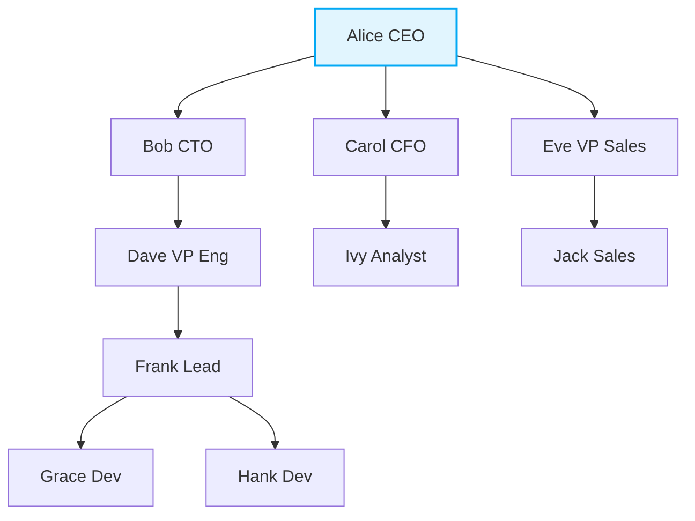

**Navigation**: [Back to Index](00_INDEX.md) | [< Prev](29_Data_Analytics_Advanced.md) | [Next >](31_JSON_XML_Modern_SQL.md)

# Chapter 30 — Recursive Queries & Hierarchical Data

## 5W-H Framework

- **WHO** needs this? → Backend devs, DBAs, anyone modeling trees (orgs, categories, menus, file systems)
- **WHAT** is it? → Recursive CTEs (WITH RECURSIVE) that let SQL traverse tree/graph structures
- **WHEN** to use? → Org charts, category trees, bill of materials, folder paths, social networks
- **WHERE** is it used? → HR systems, e-commerce (categories), manufacturing (BOM), CMS (menus)
- **WHY** learn it? → Without recursion, you need application code for trees — slower, error-prone
- **HOW** does it work? → Base case + recursive step, SQL engine iterates until no new rows

---

## Part 1 — Recursive CTE Fundamentals

### 1.1 The Anatomy of a Recursive CTE

```
WITH RECURSIVE cte_name AS (
    -- ANCHOR: The base case (starting rows)
    SELECT ... FROM table WHERE parent_id IS NULL

    UNION ALL

    -- RECURSIVE: Join back to itself (find children)
    SELECT ... FROM table
    JOIN cte_name ON table.parent_id = cte_name.id
)
SELECT * FROM cte_name;

How it works (step by step):
┌──────────────────────────────────────────────────┐
│ Iteration 0: Run ANCHOR → get root rows           │
│ Iteration 1: Run RECURSIVE with Iter-0 rows       │
│ Iteration 2: Run RECURSIVE with Iter-1 rows       │
│ ...                                               │
│ Iteration N: RECURSIVE returns 0 rows → STOP      │
│                                                   │
│ Final result = UNION ALL of ALL iterations          │
└──────────────────────────────────────────────────┘
```

### 1.2 Simple Number Sequence (Warm-up)

```sql
-- Generate numbers 1 to 10
WITH RECURSIVE nums AS (
    SELECT 1 AS n           -- Anchor: start at 1
    UNION ALL
    SELECT n + 1 FROM nums  -- Recursive: add 1
    WHERE n < 10            -- Termination: stop at 10
)
SELECT n FROM nums;
```

### 1.3 Fibonacci Sequence

```sql
WITH RECURSIVE fib AS (
    SELECT 1 AS n, 0::bigint AS fib_prev, 1::bigint AS fib_curr
    UNION ALL
    SELECT n + 1, fib_curr, fib_prev + fib_curr
    FROM fib
    WHERE n < 20
)
SELECT n, fib_curr AS fibonacci_number FROM fib;
```

---

## Part 2 — Organizational Hierarchy

### 2.1 Schema

```sql
CREATE TABLE employees (
    emp_id      INT PRIMARY KEY,
    name        VARCHAR(100),
    title       VARCHAR(100),
    manager_id  INT REFERENCES employees(emp_id),
    salary      DECIMAL(10,2),
    department  VARCHAR(50)
);

-- Sample data
INSERT INTO employees VALUES
(1, 'Alice CEO',      'CEO',           NULL, 250000, 'Executive'),
(2, 'Bob CTO',        'CTO',           1,    200000, 'Engineering'),
(3, 'Carol CFO',      'CFO',           1,    200000, 'Finance'),
(4, 'Dave VP Eng',    'VP Engineering', 2,   160000, 'Engineering'),
(5, 'Eve VP Sales',   'VP Sales',      1,    160000, 'Sales'),
(6, 'Frank Lead',     'Tech Lead',     4,    130000, 'Engineering'),
(7, 'Grace Dev',      'Developer',     6,    100000, 'Engineering'),
(8, 'Hank Dev',       'Developer',     6,    100000, 'Engineering'),
(9, 'Ivy Analyst',    'Analyst',       3,     90000, 'Finance'),
(10,'Jack Sales',     'Sales Rep',     5,     80000, 'Sales');
```

### 2.2 Full Org Tree

```sql
WITH RECURSIVE org_tree AS (
    -- Anchor: CEO (no manager)
    SELECT
        emp_id, name, title, manager_id,
        0 AS depth,
        name::text AS path,
        ARRAY[emp_id] AS breadcrumb
    FROM employees
    WHERE manager_id IS NULL

    UNION ALL

    -- Recursive: find direct reports
    SELECT
        e.emp_id, e.name, e.title, e.manager_id,
        ot.depth + 1,
        ot.path || ' → ' || e.name,
        ot.breadcrumb || e.emp_id
    FROM employees e
    JOIN org_tree ot ON e.manager_id = ot.emp_id
)
SELECT
    REPEAT('  ', depth) || '├── ' || name AS org_chart,
    title,
    depth,
    path
FROM org_tree
ORDER BY breadcrumb;  -- Maintains tree order!
```

Output:

```
├── Alice CEO               | CEO              | 0 | Alice CEO
  ├── Bob CTO               | CTO              | 1 | Alice CEO → Bob CTO
    ├── Dave VP Eng          | VP Engineering   | 2 | Alice CEO → Bob CTO → Dave VP Eng
      ├── Frank Lead         | Tech Lead        | 3 | Alice CEO → Bob CTO → Dave VP Eng → Frank Lead
        ├── Grace Dev        | Developer        | 4 | ...
        ├── Hank Dev         | Developer        | 4 | ...
  ├── Carol CFO             | CFO              | 1 | Alice CEO → Carol CFO
    ├── Ivy Analyst          | Analyst          | 2 | ...
  ├── Eve VP Sales          | VP Sales         | 1 | Alice CEO → Eve VP Sales
    ├── Jack Sales           | Sales Rep        | 2 | ...
```

The same tree, as a tree — this is the shape the recursive CTE is actually walking, one `manager_id = ot.emp_id` join per level of depth:



**How to read this diagram.** Read it as the org chart the recursive CTE walks: Alice (CEO) is at the top, her direct reports Bob, Carol and Eve are below her, and each of their reports sits below them in turn (for example Bob, Dave, Frank, then Grace and Hank). Notice that each level of depth corresponds to one join of the recursive step, as the sentence above says.

### 2.3 Find All Subordinates of a Manager

```sql
WITH RECURSIVE subordinates AS (
    SELECT emp_id, name, title, manager_id, 1 AS level
    FROM employees
    WHERE manager_id = 2  -- Bob CTO's direct reports

    UNION ALL

    SELECT e.emp_id, e.name, e.title, e.manager_id, s.level + 1
    FROM employees e
    JOIN subordinates s ON e.manager_id = s.emp_id
)
SELECT
    level,
    name,
    title,
    (SELECT name FROM employees WHERE emp_id = subordinates.manager_id) AS reports_to
FROM subordinates
ORDER BY level, name;
```

### 2.4 Cost Roll-Up (Salary Budget per Manager)

```sql
WITH RECURSIVE team_costs AS (
    SELECT emp_id, name, manager_id, salary,
           emp_id AS root_manager
    FROM employees

    UNION ALL

    SELECT e.emp_id, e.name, e.manager_id, e.salary,
           tc.root_manager
    FROM employees e
    JOIN team_costs tc ON e.manager_id = tc.emp_id
    WHERE tc.root_manager != e.emp_id  -- Avoid counting self
)
SELECT
    e.name AS manager,
    e.salary AS own_salary,
    SUM(tc.salary) AS team_salary,
    e.salary + SUM(tc.salary) AS total_budget,
    COUNT(*) AS team_size
FROM employees e
JOIN team_costs tc ON tc.root_manager = e.emp_id AND tc.emp_id != e.emp_id
GROUP BY e.emp_id, e.name, e.salary
ORDER BY total_budget DESC;
```

---

🔬 **Section Challenge — Part 2 — Organizational Hierarchy**

**Challenge 1 (Reasoning):** In an employee hierarchy query, why does a recursive CTE need both an anchor query and a recursive member?

<details><summary>Trace, Reasoning & Debug</summary>

The anchor picks the starting manager/root. The recursive member repeatedly joins children to the rows already discovered. Without the anchor, there is no initial frontier; without the recursive member, the query returns only the root. Think of it as BFS/DFS expressed in SQL: seed rows first, expand rows next, stop when no new child rows appear.

</details>

**Challenge 2 (Bug Hunt):** A recursive hierarchy query uses `UNION ALL` and has no cycle guard. What can go wrong, and how do you protect it?

<details><summary>Trace, Reasoning & Debug</summary>

Bad data like `A -> B -> C -> A` can recurse forever or until the database recursion limit fails the query. Add a visited path, depth limit, cycle detection clause where supported, and validation constraints at write time. `UNION` may hide some duplicates, but it is not a full substitute for modeling and guarding against cycles.

</details>

## Part 3 — Category Trees (E-commerce)

### 3.1 Schema

```sql
CREATE TABLE categories (
    category_id   INT PRIMARY KEY,
    name          VARCHAR(100),
    parent_id     INT REFERENCES categories(category_id),
    slug          VARCHAR(100)
);

INSERT INTO categories VALUES
(1, 'Electronics', NULL, 'electronics'),
(2, 'Computers', 1, 'computers'),
(3, 'Laptops', 2, 'laptops'),
(4, 'Gaming Laptops', 3, 'gaming-laptops'),
(5, 'Phones', 1, 'phones'),
(6, 'Smartphones', 5, 'smartphones'),
(7, 'Clothing', NULL, 'clothing'),
(8, 'Men', 7, 'men'),
(9, 'Shirts', 8, 'shirts');
```

### 3.2 Breadcrumb Navigation

```sql
-- Given "Gaming Laptops", build: Electronics > Computers > Laptops > Gaming Laptops
WITH RECURSIVE breadcrumb AS (
    SELECT category_id, name, parent_id,
           ARRAY[name] AS crumb_path,
           ARRAY[slug] AS slug_path
    FROM categories
    WHERE category_id = 4  -- Starting from Gaming Laptops

    UNION ALL

    SELECT c.category_id, c.name, c.parent_id,
           c.name || b.crumb_path,
           c.slug || b.slug_path
    FROM categories c
    JOIN breadcrumb b ON c.category_id = b.parent_id
)
SELECT
    array_to_string(crumb_path, ' > ') AS breadcrumb,
    '/' || array_to_string(slug_path, '/') AS url_path
FROM breadcrumb
WHERE parent_id IS NULL;  -- Only return when we've reached the root
-- Result: Electronics > Computers > Laptops > Gaming Laptops
-- URL:    /electronics/computers/laptops/gaming-laptops
```

### 3.3 Count Products Per Category (Including Subcategories)

```sql
WITH RECURSIVE cat_tree AS (
    SELECT category_id, name, category_id AS root_id, name AS root_name
    FROM categories

    UNION ALL

    SELECT c.category_id, c.name, ct.root_id, ct.root_name
    FROM categories c
    JOIN cat_tree ct ON c.parent_id = ct.category_id
)
SELECT
    ct.root_name AS category,
    COUNT(DISTINCT p.product_id) AS total_products
FROM cat_tree ct
LEFT JOIN products p ON p.category_id = ct.category_id
GROUP BY ct.root_id, ct.root_name
ORDER BY total_products DESC;
```

---

## Part 4 — Bill of Materials (Manufacturing)

### 4.1 Schema

```sql
CREATE TABLE parts (
    part_id    INT PRIMARY KEY,
    name       VARCHAR(100),
    unit_cost  DECIMAL(10,2)
);

CREATE TABLE bill_of_materials (
    parent_part_id  INT REFERENCES parts(part_id),
    child_part_id   INT REFERENCES parts(part_id),
    quantity        INT,
    PRIMARY KEY (parent_part_id, child_part_id)
);

-- A bicycle
INSERT INTO parts VALUES
(1, 'Bicycle', 0),
(2, 'Frame Assembly', 0),
(3, 'Wheel Assembly', 0),
(4, 'Frame', 50.00),
(5, 'Seat', 25.00),
(6, 'Handlebars', 30.00),
(7, 'Rim', 15.00),
(8, 'Tire', 10.00),
(9, 'Spokes', 5.00);

INSERT INTO bill_of_materials VALUES
(1, 2, 1),  -- Bicycle needs 1 Frame Assembly
(1, 3, 2),  -- Bicycle needs 2 Wheel Assemblies
(2, 4, 1),  -- Frame Assembly needs 1 Frame
(2, 5, 1),  -- ... 1 Seat
(2, 6, 1),  -- ... 1 Handlebars
(3, 7, 1),  -- Wheel Assembly needs 1 Rim
(3, 8, 1),  -- ... 1 Tire
(3, 9, 36); -- ... 36 Spokes
```

### 4.2 Explode BOM (Total Cost Calculation)

```sql
WITH RECURSIVE bom_explode AS (
    -- Start with top-level product
    SELECT
        b.child_part_id AS part_id,
        p.name,
        b.quantity,
        1 AS depth,
        ARRAY[b.parent_part_id, b.child_part_id] AS path
    FROM bill_of_materials b
    JOIN parts p ON b.child_part_id = p.part_id
    WHERE b.parent_part_id = 1  -- Bicycle

    UNION ALL

    SELECT
        b.child_part_id,
        p.name,
        b.quantity * be.quantity,  -- Multiply quantities down
        be.depth + 1,
        be.path || b.child_part_id
    FROM bill_of_materials b
    JOIN parts p ON b.child_part_id = p.part_id
    JOIN bom_explode be ON b.parent_part_id = be.part_id
)
SELECT
    REPEAT('  ', depth - 1) || be.name AS component,  -- must qualify: both bom_explode and parts have a `name` column
    quantity AS total_needed,
    p.unit_cost,
    quantity * p.unit_cost AS total_cost
FROM bom_explode be
JOIN parts p ON be.part_id = p.part_id
ORDER BY path;
```

Expected output:

```
Frame Assembly     1    $0     $0
  Frame            1    $50    $50
  Seat             1    $25    $25
  Handlebars       1    $30    $30
Wheel Assembly     2    $0     $0
  Rim              2    $15    $30
  Tire             2    $10    $20
  Spokes          72    $5    $360
─────────────────────────────────
TOTAL BICYCLE COST:         $515
```

---

## Part 5 — Graph Traversal in SQL

### 5.1 Social Network: Friend-of-Friend

```sql
CREATE TABLE friendships (
    user_a INT,
    user_b INT,
    PRIMARY KEY (user_a, user_b)
);

-- Find friends up to 3 degrees away
WITH RECURSIVE friend_network AS (
    SELECT
        user_b AS friend_id,
        1 AS degree,
        ARRAY[1, user_b] AS path  -- Start from user 1
    FROM friendships
    WHERE user_a = 1

    UNION ALL

    SELECT
        f.user_b,
        fn.degree + 1,
        fn.path || f.user_b
    FROM friendships f
    JOIN friend_network fn ON f.user_a = fn.friend_id
    WHERE fn.degree < 3
    AND f.user_b != ALL(fn.path)  -- Prevent cycles!
)
SELECT DISTINCT ON (friend_id)
    friend_id,
    degree,
    array_to_string(path, ' → ') AS connection_path
FROM friend_network
WHERE friend_id != 1
ORDER BY friend_id, degree;  -- Keep shortest path
```

### 5.2 Shortest Path (Unweighted Graph)

```sql
CREATE TABLE routes (
    city_from VARCHAR(50),
    city_to   VARCHAR(50),
    distance  INT
);

-- BFS shortest path from 'Delhi' to 'Chennai'
WITH RECURSIVE bfs AS (
    SELECT
        city_to,
        1 AS hops,
        distance AS total_distance,
        ARRAY['Delhi', city_to] AS path
    FROM routes
    WHERE city_from = 'Delhi'

    UNION ALL

    SELECT
        r.city_to,
        b.hops + 1,
        b.total_distance + r.distance,
        b.path || r.city_to
    FROM routes r
    JOIN bfs b ON r.city_from = b.city_to
    WHERE r.city_to != ALL(b.path)  -- No revisiting
    AND b.hops < 10                 -- Safety limit
)
SELECT
    path,
    hops,
    total_distance
FROM bfs
WHERE city_to = 'Chennai'
ORDER BY total_distance
LIMIT 1;
```

---

🔬 **Section Challenge — Part 5 — Graph Traversal in SQL**

**Challenge (Reasoning):** The friend-network query filters `WHERE f.user_b != ALL(fn.path)`. What breaks if that condition is removed, given that friendships can naturally form cycles (A knows B, B knows C, C knows A)?

<details><summary>Answer</summary>

Without the cycle guard, the recursive member keeps rejoining `friendships` to whatever it just found, and a real social graph is full of cycles by nature — A→B→C→A is a completely normal friendship triangle, not corrupt data (unlike the org-chart case, where a manager cycle is *always* a data-integrity bug). Once the recursion reaches C and looks for C's connections, it finds A again — and since A → B → C → A doesn't violate any degree limit on its own, the engine would keep re-discovering the same triangle at ever-increasing `degree` values, forever, only stopping when `WHERE fn.degree < 3` eventually cuts it off (or not, if the depth guard were also missing). `f.user_b != ALL(fn.path)` prevents this by rejecting any candidate that's already been visited on *this specific path* — so the recursion can still explore A→B→C legitimately, it just refuses to walk back to a node already on the current chain. This is why graph traversal needs a visited-set check that plain tree traversal (Part 2-4) doesn't: trees are acyclic by construction, but graphs generally aren't.

</details>

## Part 6 — Python Visualization of Hierarchies

```python
import pandas as pd
import matplotlib.pyplot as plt
import networkx as nx

# Load org chart from SQL
df = pd.read_sql("""
    SELECT emp_id, name, title, manager_id, salary
    FROM employees
""", conn)

# Build graph
G = nx.DiGraph()
for _, row in df.iterrows():
    G.add_node(row['emp_id'], label=row['name'], title=row['title'])
    if pd.notna(row['manager_id']):
        G.add_edge(int(row['manager_id']), row['emp_id'])

# Draw hierarchical layout
pos = nx.drawing.nx_agraph.graphviz_layout(G, prog='dot') if False else {}
# Manual hierarchical layout
from collections import deque
root = df[df['manager_id'].isna()]['emp_id'].values[0]
levels = {}
queue = deque([(root, 0)])
while queue:
    node, level = queue.popleft()
    levels.setdefault(level, []).append(node)
    for child in G.successors(node):
        queue.append((child, level + 1))

for level, nodes in levels.items():
    for i, node in enumerate(nodes):
        pos[node] = (i - len(nodes)/2, -level)

fig, ax = plt.subplots(1, 1, figsize=(14, 8))
labels = {row['emp_id']: f"{row['name']}\n{row['title']}" for _, row in df.iterrows()}
sizes = [df[df['emp_id']==n]['salary'].values[0] / 50 for n in G.nodes()]

nx.draw(G, pos, labels=labels, node_size=sizes, node_color='lightblue',
        font_size=7, arrows=True, edge_color='gray', ax=ax)
ax.set_title("Organization Chart", fontsize=16)
plt.tight_layout()
plt.show()
```

---

## Recursion Safety Checklist

```
✅ Always have a termination condition (WHERE depth < N or WHERE NOT IN path)
✅ Use ARRAY to track visited nodes → prevent infinite loops in graphs
✅ Set max depth/iterations as safety net
✅ Use UNION ALL (not UNION) for performance — dedup manually if needed
✅ Test with small data first — recursive bugs = infinite loops = crashed DB
⚠️ PostgreSQL: no dedicated recursion-depth GUC exists — use the CYCLE clause (PG 14+) or a manual depth counter + WHERE guard, backstopped by statement_timeout
⚠️ MySQL: SET SESSION cte_max_recursion_depth = 1000;
⚠️ SQL Server: OPTION (MAXRECURSION 100)
```

---

**Navigation**: [Back to Index](00_INDEX.md) | [< Prev](29_Data_Analytics_Advanced.md) | [Next >](31_JSON_XML_Modern_SQL.md)

🔬 **Section Challenge — Recursion Safety Checklist**

**Challenge 1 (Bug Hunt):** A recursive CTE works in staging but crashes in production after a bad import creates a cycle. What should you add before trusting it?

<details><summary>Trace, Reasoning & Debug</summary>

Add a cycle guard, a maximum depth, and a visited-path check. For example, carry a path column and reject rows already in the path, then add a database-specific recursion cap such as `MAXRECURSION` or `cte_max_recursion_depth`. Production hierarchy data is never perfectly tree-shaped forever, so recursive SQL must defend against graph behavior.

</details>

### Historical Evolution

**Predecessors (with years):**
- **Hierarchical databases (IMS)** (1966): IBM's Information Management System pioneered tree-structured data storage for Apollo program moon missions
- **Network model (CODASYL)** (1969): Conference on Data Systems Languages formalized graph-based database navigation
- **Bill of Materials (BOM)** (1960s): Manufacturing industries developed hierarchical product structure representations that influenced database modeling
- **Recursive CTE (SQL:1999)** (1999): SQL standard finally introduced recursive query capability after decades of needing proprietary extensions for hierarchies

**Evolution narrative:**
Before SQL supported recursion, hierarchical data like org charts and BOM structures required specialized databases (IMS 1966) or complex workarounds using self-joins with unknown depth. The CODASYL network model (1969) allowed graph traversal but required navigational access patterns, not declarative queries. Manufacturing industries drove demand for recursive Bill of Materials queries, forcing vendors to implement proprietary extensions. SQL:1999 standardized recursive CTEs using the clean `WITH RECURSIVE` syntax, enabling declarative traversal of trees and graphs within standard SQL.

**Modern practice anchor:**
Today's SQL applications use recursive CTEs for organizational hierarchies, graph traversal (friend networks), multi-level BOM explosion/implosion, and path-finding algorithms—all declaratively in pure SQL.
### Production Reality

**Failure modes:**
1. **Recursive CTE runaway iteration**: Complex org chart with 50K employees contains a cycle from two employees mutually referencing each other as manager — `max_recursion_depth` of 1000 reached, query aborted after 45 seconds of CPU
2. **BOM calculation precision loss on deep hierarchies**: Manufacturing BOM with 15 levels of components — floating point aggregation at each level compounds rounding errors, final cost differs from expected by 0.3%
3. **Cycle creating infinite loop in graph traversal**: Social network query finds bidirectional friend-of-friend relationships — without CYCLE clause, query runs until `work_mem` exhausted and process killed

**Debug workflow:**
1. Add CYCLE clause to recursive CTE (PostgreSQL 14+): `CYCLE employee_id SET is_cycle USING cycle_path` to detect and terminate cycles early
2. On PostgreSQL versions without CYCLE support, there's no dedicated recursion-depth setting to fall back on — add an explicit depth counter to the recursive member and `WHERE depth < N`, and set a `statement_timeout` as a blunt backstop so a runaway query fails fast instead of running indefinitely
3. Verify hierarchy depth first: `SELECT MAX(level) FROM (WITH RECURSIVE ... SELECT level + 1 FROM ...) t` to establish expected depth bounds before production queries

**Modern practice anchor:**
Production recursive queries always include cycle detection and recursion depth limits — infinite loops are not theoretical edge cases.


---

## Reality Check

**"Recursive CTEs are slow for deep hierarchies"** → Recursive CTEs can be slow for: very deep trees (thousands of levels — stack pressure), very wide trees (millions of nodes — if each level fetches all children via a JOIN on the whole table). Optimizations: ensure the hierarchy key (parent_id) has an index, use `MAXRECURSION` (SQL Server) or add a depth counter with early termination to prevent infinite loops (cyclic data). For very large hierarchies, consider: Nested Sets (precompute left/right bounds for each node — O(1) subtree queries), or Materialized Path (store full path string like `/1/3/7/` — easy prefix queries, hard to update).

**"Hierarchical data must be stored as adjacency lists (parent_id)"** → Four models: Adjacency List (parent_id column — easy to modify, hard to query subtrees without recursion), Nested Sets (left/right values — fast read, slow writes), Materialized Path (path string — fast reads, easy to understand, path length limits), Closure Table (all ancestor-descendant pairs in a separate table — fast reads and writes at the cost of more storage). The right model depends on read/write ratio and hierarchy depth. Adjacency list + recursive CTE is the modern default with good database support.

**"Cycle detection in recursive CTEs is automatic"** → It's NOT automatic. A recursive CTE on data with cycles (A is parent of B, B is parent of A) will recurse infinitely. SQL Server: `OPTION (MAXRECURSION n)` limits depth and throws an error when exceeded. PostgreSQL: no built-in limit — you must add an explicit depth counter or a visited-path array: `WHERE path_array NOT @> ARRAY[child_id]` (check if child_id is already in the path). Always test recursive CTEs against data with cycles — they will hang or error without cycle detection.

**"The CONNECT BY syntax (Oracle) and recursive CTEs do the same thing"** → Both express hierarchical queries. CONNECT BY: Oracle-specific (`START WITH parent_id IS NULL CONNECT BY PRIOR id = parent_id`). Recursive CTEs: SQL standard, supported in PostgreSQL, SQL Server, MySQL 8+, SQLite. CONNECT BY adds Oracle-specific features: `LEVEL` pseudocolumn (depth), `SYS_CONNECT_BY_PATH` (materialized path string), `CONNECT_BY_ISLEAF` (is this a leaf node?). These must be replicated manually in recursive CTEs. If you're migrating from Oracle, recursive CTEs are the portable replacement.

**"Self-joins and recursive CTEs solve different problems"** → Self-join: join a table to itself — finds relationships AT A FIXED DEPTH. `employees e1 JOIN employees e2 ON e2.id = e1.manager_id` finds immediate manager-employee pairs (depth 1). For grandparents: add another self-join (depth 2, 3, ... — each requires a new join, complexity grows). Recursive CTE: handles arbitrary depth in one query. Use self-join when depth is fixed and small (1 or 2 levels). Use recursive CTE when depth is unknown or varies.
