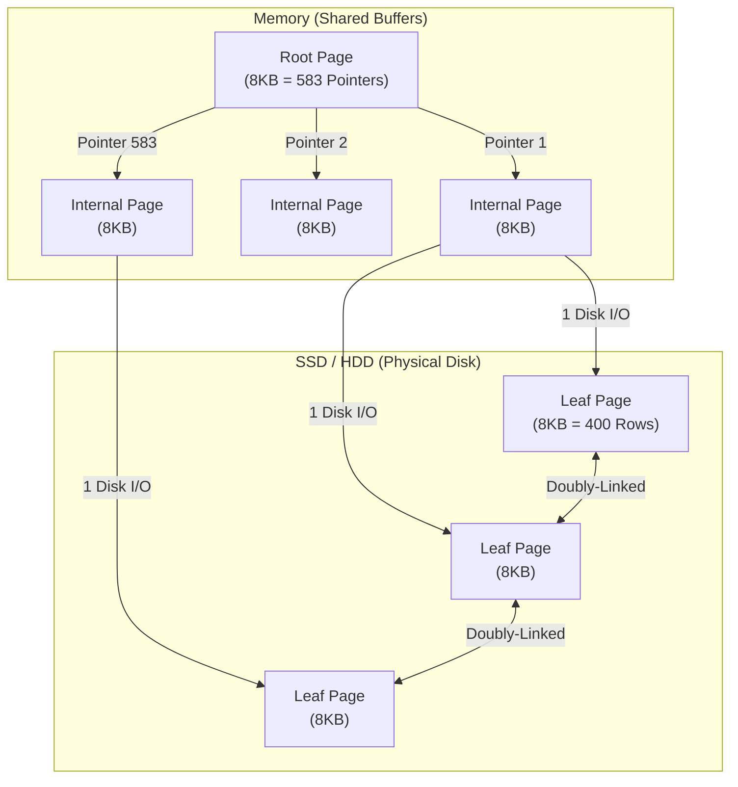
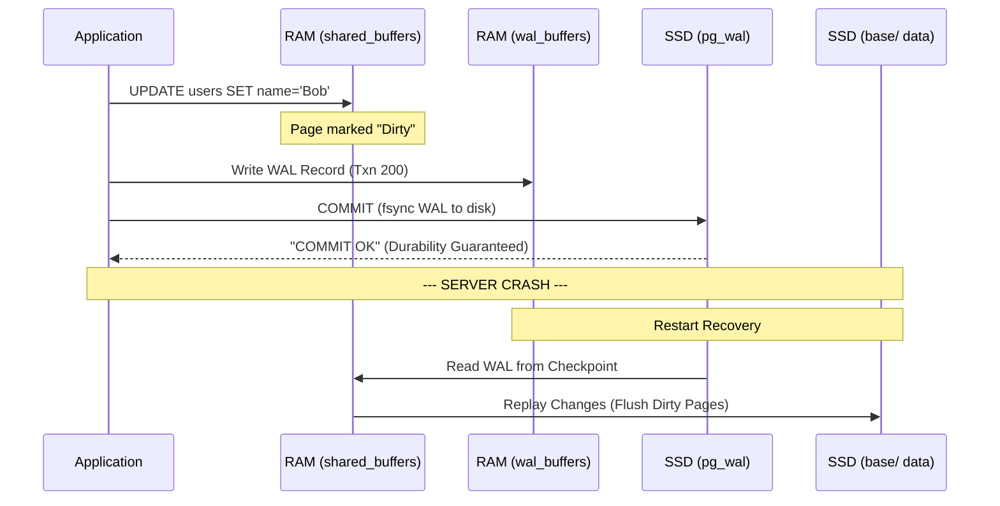
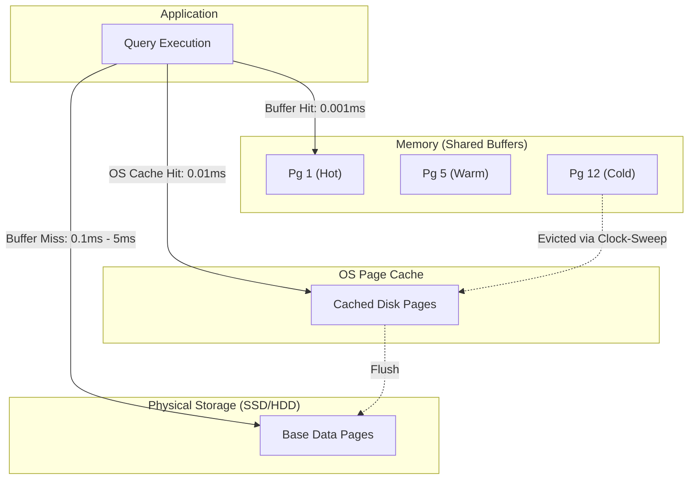

# Chapter 47 — Theory Deep Dive: Database Internals for Interviews

**What:** The core database theory that senior engineers ACTUALLY know — not textbook definitions, but the internals that explain WHY things work the way they do
**Why:** When an interviewer asks "why is this slow?", the person who understands B-Tree page splits, MVCC snapshots, and lock escalation gives a fundamentally better answer than the person who says "just add an index"

---

## 📋 Theory Topics

| #   | Topic                                      | Why It Matters                                                   |
| --- | ------------------------------------------ | ---------------------------------------------------------------- |
| T1  | B-Tree Internals & Math                    | Explains index design, fragmentation, covering indexes           |
| T2  | MVCC: How PostgreSQL Reads Without Locking | Explains snapshot isolation, VACUUM, bloat                       |
| T3  | Lock Hierarchy & Escalation                | Explains deadlocks, ALTER TABLE blocks, lock timeouts            |
| T4  | Query Optimizer Decision Making            | Explains why the DB sometimes ignores your index                 |
| T5  | WAL (Write-Ahead Log)                      | Explains crash recovery, replication, why commits are durable    |
| T6  | Buffer Pool & Memory                       | Explains cache hits, cold starts, why SSDs transformed databases |
| T7  | Transaction Log & Undo/Redo                | How atomicity and durability actually work under the hood        |
| T8  | Hash Join vs Nested Loop vs Merge Join     | Read execution plans like a senior engineer                      |

---

## T1: B-Tree Internals & Math

### How a B-Tree Actually Works

```
A B-Tree is a balanced tree where each node is a DISK PAGE (typically 8KB).
Every page can hold hundreds of keys → very shallow tree → very fast lookups.

Example: Index on id (BIGINT = 8 bytes) for 100 million rows

Page size: 8,192 bytes
Key size: 8 bytes (BIGINT) + 6 bytes (tuple pointer) = 14 bytes
Page overhead: ~24 bytes header
Keys per page: (8192 - 24) / 14 ≈ 583 keys per internal page
                                  ≈ 400 keys per leaf page (more overhead)

Tree depth calculation:
- Level 0 (root): 1 page → 583 child pointers
- Level 1: 583 pages → 583 × 583 = 339,889 child pointers
- Level 2: 339,889 pages → 339,889 × 583 = 198M pointers
- Level 3: Only needed if > 198M rows

100M rows → DEPTH = 3 levels!
Lookup: 3 page reads to find ANY row out of 100M.
If root and level-1 are cached in memory (they always are): 1 disk read!

B-TREE VISUAL (simplified, 3 keys per node for illustration):

              [30 | 70]                    ← Root (level 0)
             /    |    \
      [10|20]  [40|50|60]  [80|90]        ← Internal (level 1)
      / | \    / | | \     / | \
   [1..9][11..19]...[71..79][81..89][91..100]  ← Leaf pages (level 2)
            ↕          ↕          ↕
   Leaf pages are doubly-linked for range scans →

```



### Why Sequential IDs Are Faster Than Random UUIDs

```
SEQUENTIAL INSERTS (auto-increment):
   [1,2,3,4,5]→[6,7,8,9,10]→...→[991,992,993,994,995]→[996,997,998,999,1000]
   Inserts always go to the RIGHTMOST leaf page.
   One page in buffer → write when full → perfectly sequential disk I/O.
   Write amplification: 1x (each row written once)

RANDOM INSERTS (UUID v4):
   [3f2a..,8b1c..,a42f..,d91e..,f5b8..]  ← entries in random pages
   Insert lands on a RANDOM leaf → might not be in memory → disk read FIRST
   Then write → page split if full → more disk writes
   Write amplification: 3-5x (read page + split + write 2 pages)

MEASURED IMPACT:
- Sequential IDs:  50,000 inserts/second on SSD
- UUID v4:         15,000 inserts/second on SSD (3.3x slower)
- UUID v7:         45,000 inserts/second (time-ordered → mostly sequential)
- On HDD: difference is 10-20x (random seek = 5ms vs sequential = 0.05ms)
```

### Composite Index: Why Column Order Matters (With B-Tree)

```
Index: (country, city, zipcode)

B-Tree structure:
                         [Germany | USA]
                        /       |       \
              [Berlin|Munich] [NYC|SF] [Chicago|Dallas]
              / | \           / | \
         [10115][10117]  [10001][10002] [94016][94017]

Query: WHERE country = 'USA' AND city = 'NYC' → FAST
  → Root: USA → Level 1: NYC → Leaf: scan zipcodes → 2 page reads

Query: WHERE city = 'NYC'  → SLOW (no leading column)
  → Must scan ALL countries to find 'NYC' in each → can't use index efficiently

Query: WHERE country = 'USA' AND zipcode = '10001' → PARTIAL
  → Root: USA → Level 1: scan ALL cities → look for zipcode in each
  → Skips zipcode column because city (middle) is missing

RULE: B-Tree can use columns left-to-right until it hits a gap or range condition.
  (country = 'USA' AND city = 'NYC' AND zipcode > '10000')
   ↑ used             ↑ used            ↑ used (rightmost, range)

  (country = 'USA' AND zipcode = '10001')
   ↑ used             ↑ NOT used (city gap!)
```

---

## T2: MVCC — How PostgreSQL Reads Without Locking

### The Snapshot Mechanism

```
MVCC = Multi-Version Concurrency Control
Core idea: Readers never block writers, writers never block readers.
Each transaction sees a SNAPSHOT of the database at a specific point in time.

HOW IT WORKS (PostgreSQL):
Every row has hidden columns:
  xmin = transaction ID that CREATED this row
  xmax = transaction ID that DELETED/UPDATED this row (0 if alive)

When you UPDATE a row:
1. Old row gets xmax = your transaction ID (marks it as "deleted by you")
2. New row gets xmin = your transaction ID (marks it as "created by you")
3. BOTH versions exist on disk simultaneously

Example:
  Transaction 100: INSERT INTO users VALUES (1, 'Alice');
  → Row: {xmin=100, xmax=0, id=1, name='Alice'}

  Transaction 200: UPDATE users SET name = 'Bob' WHERE id = 1;
  → Old row: {xmin=100, xmax=200, id=1, name='Alice'}  ← still exists!
  → New row: {xmin=200, xmax=0, id=1, name='Bob'}

  Transaction 150 (started before 200):
  → Sees OLD row because 200 hasn't committed from 150's perspective
  → Snapshot rule: only see rows where xmin < my_snapshot AND xmax = 0 or xmax > my_snapshot
```

### Why VACUUM Exists

```
Problem: Old row versions accumulate → "dead tuples" → table bloat

Timeline:
1. Table has 1M rows (100MB)
2. After 6 months of updates: 1M live rows + 5M dead rows (600MB!)
3. Queries scan through dead rows too → slower
4. Index entries point to dead rows → index bloat

VACUUM does:
1. Scans table for dead tuples (where xmax < oldest active transaction)
2. Marks that space as reusable
3. Does NOT return space to OS (use VACUUM FULL for that — but it locks table!)

VACUUM FULL:
- Rewrites entire table → compacts → returns space to disk
- Requires AccessExclusiveLock → blocks ALL reads and writes
- Only use during maintenance windows

autovacuum (default in PostgreSQL):
- Runs automatically when dead tuple ratio exceeds threshold
- Default: triggers when dead tuples > 20% of table
- Running too rarely → bloat. Running too aggressively → CPU spike.
- TUNE: autovacuum_vacuum_scale_factor, autovacuum_vacuum_threshold
```

### MVCC vs Locking (MySQL InnoDB Comparison)

```
PostgreSQL (MVCC, no read locks):
- SELECT never blocks
- UPDATE creates new version, marks old as dead
- Readers on old snapshot still see old version
- Dead versions cleaned by VACUUM

MySQL InnoDB (MVCC with undo log):
- Also uses MVCC for consistent reads
- BUT: undo log stores old versions (not inline with table)
- Purge thread cleans undo log (equivalent to VACUUM)
- FOR UPDATE uses row locks (X-locks), not just MVCC

Key difference:
- PostgreSQL stores old versions IN the table → table bloats → VACUUM needed
- MySQL stores old versions IN undo log → undo log grows → purge needed
- Both achieve the same goal: consistent snapshots without read locks
```

---

## T3: Lock Hierarchy & Escalation

### PostgreSQL Lock Types (Simplified)

```
Lock strength (weakest to strongest):
1. AccessShareLock      → SELECT (reading)
2. RowShareLock         → SELECT FOR UPDATE
3. RowExclusiveLock     → INSERT/UPDATE/DELETE
4. ShareLock            → CREATE INDEX (not CONCURRENTLY)
5. AccessExclusiveLock  → ALTER TABLE, DROP TABLE, VACUUM FULL

COMPATIBILITY MATRIX (simplified):
                   | AccessShare | RowExclusive | AccessExclusive |
AccessShareLock    |     ✅      |      ✅      |       ❌        |
RowExclusiveLock   |     ✅      |      ✅      |       ❌        |
AccessExclusiveLock|     ❌      |      ❌      |       ❌        |

WHAT THIS MEANS:
- SELECT and INSERT/UPDATE can run simultaneously ✅
- ALTER TABLE blocks EVERYTHING  ❌
- Two UPDATEs on DIFFERENT rows: no conflict (row-level) ✅
- Two UPDATEs on SAME row: second waits for first to commit

WHY ALTER TABLE IS DANGEROUS:
1. ALTER needs AccessExclusiveLock → waits for ALL current locks to release
2. While waiting, it BLOCKS all new locks (lock queue is FIFO)
3. One slow query + one ALTER = entire table frozen

Solution: SET lock_timeout = '3s'; ALTER TABLE...;
→ If can't acquire lock in 3s, abort instead of queueing
```

### Row-Level Lock Behavior

```
UPDATE accounts SET balance = 100 WHERE id = 42;
→ Locks ONLY row 42 (RowExclusiveLock on the row)
→ Other transactions can freely update rows 1-41 and 43+

But:
UPDATE accounts SET balance = balance * 1.01;
→ Locks ALL rows one by one as it processes them
→ Long-running → holds many row locks → blocks many other updates

For large updates, batch:
UPDATE accounts SET balance = balance * 1.01 WHERE id BETWEEN 1 AND 10000;
COMMIT;
UPDATE accounts SET balance = balance * 1.01 WHERE id BETWEEN 10001 AND 20000;
COMMIT;
-- Each batch holds locks briefly, releases, then next batch
```

---

🔬 **Section Challenge — T3: Lock Hierarchy & Escalation**

**Challenge 1 (Reasoning):** Why can one huge `UPDATE` hold far more locks, block more sessions, and create worse rollback risk than the same work in small committed batches?

<details><summary>Trace, Reasoning & Debug</summary>

Locks live until the transaction commits or rolls back. A large update expands the lock footprint, increases undo/redo pressure, and can trigger escalation or long waits. Batching shortens lock lifetime, limits rollback size, and gives other transactions chances to progress between commits.

</details>

**Challenge 2 (Bug Hunt):** A nightly job updates millions of rows during peak traffic in one transaction. Users report timeouts. Name the likely lock problem and two fixes.

<details><summary>Trace, Reasoning & Debug</summary>

The job is probably holding many row/page/table locks for too long, blocking interactive writes and sometimes reads depending on isolation level. Fix by batching by primary-key ranges, running off-peak, narrowing predicates with usable indexes, and committing between chunks. For critical systems, also add progress checkpoints and retry-safe idempotency.

</details>

## T4: Query Optimizer — Why It Sometimes Ignores Your Index

### Cost-Based Optimization

```
The optimizer doesn't always use your index. It estimates the COST of each plan
and picks the cheapest one.

COST FACTORS:
- Sequential page read: cost = 1.0  (fast, predictable)
- Random page read:     cost = 4.0  (SSD) or 100 (HDD) — seek penalty
- CPU per row:          cost = 0.01
- CPU per operator:     cost = 0.0025

EXAMPLE: Table with 1M rows, query returns 200K rows (20%)

Plan A: Sequential Scan
  = 1M rows × 1.0 seq_page_cost / rows_per_page
  = ~120,000 page reads × 1.0 = cost 120,000

Plan B: Index Scan
  = Index traversal: ~4 pages × 4.0 = 16
  + Heap lookups: 200,000 × random_page_cost = 200,000 × 4.0 = 800,000
  = Total cost: 800,016

The optimizer CORRECTLY chooses Seq Scan because reading 20% of rows
via random I/O is MORE expensive than reading the entire table sequentially.

RULE OF THUMB:
- < 5% selectivity  → Index Scan (worth random I/O for few rows)
- 5-20% selectivity → Bitmap Index Scan (batch random I/O)
- > 20% selectivity → Seq Scan (sequential is faster)

THIS IS WHY: Adding an index doesn't always help.
If your query returns too many rows, the optimizer correctly ignores the index.
```

### Common Optimizer Mistakes

```
1. STALE STATISTICS:
   Optimizer estimates based on pg_statistics table.
   If not recently ANALYZEd, estimates are wrong → bad plan.
   Fix: ANALYZE table_name; (or ensure autovacuum runs ANALYZE)

2. CORRELATED COLUMNS:
   WHERE country = 'Japan' AND language = 'Japanese'
   Optimizer assumes: P(Japan) × P(Japanese) = 1% × 5% = 0.05%
   Reality: P(Japan AND Japanese) ≈ 0.95% (these are correlated!)
   Underestimates rows → chooses index scan → actually reads many rows
   Fix: CREATE STATISTICS japan_lang ON country, language FROM users;

3. PARAMETERIZED QUERIES (prepared statements):
   First execution with WHERE status = 'rare_status' → index scan plan
   Plan cached. Next call with WHERE status = 'active' (50% of table) → same plan
   But should have been seq scan for 'active'!
   PostgreSQL 12+: Adaptive plan caching (switches after 5 bad generic plans)

4. IMPLICIT TYPE CASTS:
   WHERE varchar_column = 123  -- 123 is integer
   Database can't use index on varchar_column because it must cast each row
   Fix: WHERE varchar_column = '123'
```

---

## T5: WAL (Write-Ahead Log) — How Crash Recovery Works

### The Core Idea

```
PROBLEM: What if the server crashes mid-transaction?
- Some pages written to disk, some not → CORRUPTED DATA

SOLUTION: Write-Ahead Logging
RULE: Before modifying ANY data page, first write the change to a sequential log.

COMMIT SEQUENCE:
1. Write changes to WAL buffer (in memory)
2. fsync WAL to disk (DURABLE — survives crash)
3. Return "COMMIT OK" to application
4. Write actual data pages to disk (sometime later — asynchronous)

If crash happens between step 2 and 4:
→ Data pages might be inconsistent
→ On restart: replay WAL from last checkpoint → data pages restored
→ ZERO data loss (for committed transactions)


```



```text
WHY WAL IS FAST:
- WAL = sequential writes (append-only log file)
- Data pages = random writes (scattered across disk)
- Sequential writes are 100x faster than random writes on HDD, 10x on SSD
- So: writing to WAL first is actually FASTER than writing data directly
```

### WAL and Replication

```
WAL is also how replication works:

PRIMARY                              REPLICA
  │                                    │
  ├─ Write WAL ──── send WAL ────────→ Apply WAL
  ├─ Write WAL ──── send WAL ────────→ Apply WAL
  │                                    │

Synchronous replication:
  Primary waits until replica confirms WAL received → zero data loss
  Trade-off: higher latency (network round-trip per commit)

Asynchronous replication:
  Primary doesn't wait for replica → lower latency
  Trade-off: replica can be behind → data loss if primary dies

Replication lag = time between primary commit and replica apply
```

---

## T6: Buffer Pool & Memory

### How Database Caching Works

```
The buffer pool is shared memory where the database caches disk pages.


DATABASE MEMORY ARCHITECTURE:
┌──────────────────────────────────────────┐
│            SHARED BUFFERS (RAM)          │
│  ┌────┐ ┌────┐ ┌────┐ ┌────┐ ┌────┐      │
│  │Pg 1│ │Pg 5│ │Pg 12│ │Pg 8│ │... │     │
│  │hot │ │warm│ │cold │ │warm│ │    │     │
│  └────┘ └────┘ └────┘ └────┘ └────┘      │
│                                          │
│  buffer_hit = page found in memory ✅    │
│  buffer_miss = must read from disk ❌    │
└──────────────────────────────────────────┘
              ↕ (read/write)
┌──────────────────────────────────────────┐
│  OS PAGE CACHE (additional caching)      │
└──────────────────────────────────────────┘
              ↕ (read/write)
┌──────────────────────────────────────────┐
│             SSD / HDD                     │
└──────────────────────────────────────────┘


```



```text
PERFORMANCE DIFFERENCE:
- Buffer hit (RAM):     ~0.001ms (1 microsecond)
- OS cache hit:         ~0.01ms
- SSD read:             ~0.1ms
- HDD random read:      ~5ms (5000x slower than RAM!)

Page Replacement: Clock-sweep algorithm (PostgreSQL) or LRU (MySQL)
- Hot pages (index root nodes, frequently accessed) stay in memory
- Cold pages (rarely accessed old data) get evicted
- Larger shared_buffers → more pages cached → fewer disk reads

SIZING:
- PostgreSQL: shared_buffers = 25% of total RAM (start here)
- MySQL: innodb_buffer_pool_size = 70-80% of total RAM
- Monitor: buffer cache hit ratio should be > 99%
  SELECT sum(heap_blks_hit) / sum(heap_blks_hit + heap_blks_read) * 100
  FROM pg_statio_user_tables;
```

---

🔬 **Section Challenge — T6: Buffer Pool & Memory**

**Challenge 1 (Reasoning):** Buffer cache hit ratio is 99.5%, but p95 latency is still high. Why can a high hit ratio be misleading?

<details><summary>Answer</summary>

A high hit ratio means most page reads are served from memory, but it says nothing about CPU-heavy plans, lock waits, sort/hash spill, connection pool waits, or a small number of expensive disk reads on critical requests. It can also hide that one endpoint scans many cached pages and burns CPU. Pair hit ratio with `EXPLAIN ANALYZE`, wait events, temp file/spill metrics, lock metrics, and query latency percentiles.

</details>

**Challenge 2 (Design):** Why is "increase shared_buffers" not always the best answer when disk reads are high?

<details><summary>Answer</summary>

More buffer memory helps only if the workload has reusable pages and the host has memory headroom. If the real issue is missing indexes, bad join order, sequential scans, or one-time analytics queries, a larger cache just stores waste. It may also starve the OS page cache or increase checkpoint pressure. First reduce pages read per query; then size memory for the remaining working set.

</details>

## T7: Transaction Internals — Undo/Redo

### How ACID Actually Works

```
ATOMICITY: "All or nothing"
Implementation: Undo log
- Before modifying a row, save the original value in undo log
- If transaction ROLLS BACK: restore original values from undo log
- If transaction COMMITS: undo log can be discarded (eventually)

DURABILITY: "Committed = permanent"
Implementation: WAL (redo log)
- All changes written to WAL before data files
- If crash occurs: replay WAL to recover all committed changes
- WAL is fsync'd to disk on COMMIT → survives power loss

ISOLATION: "Transactions don't interfere"
Implementation: MVCC snapshots (see T2 above)
- Each transaction reads from its own consistent snapshot
- No need for read locks → high concurrency

CONSISTENCY: "Data always valid"
Implementation: Constraints + triggers
- CHECK, NOT NULL, UNIQUE, FOREIGN KEY
- Verified at statement end (or transaction end for DEFERRED constraints)

THE COMMIT DANCE:
1. BEGIN
2. Modify data (stored in buffer pool, not yet on disk)
3. Write undo log entries (for rollback capability)
4. COMMIT requested
5. Write WAL entries for all changes
6. fsync WAL to disk ← THIS is the "commit point"
7. Return "COMMIT OK" to client
8. (Background) Write dirty pages to disk eventually
9. (Background) Create checkpoint (mark WAL position where all pages are flushed)
```

---

🔬 **Section Challenge — T7: Transaction Internals — Undo/Redo**

**Challenge 1 (Reasoning):** Two transactions T1 and T2 both run `SELECT balance WHERE id=1; UPDATE balance=balance-100 WHERE id=1`. What anomaly occurs at READ COMMITTED and how does REPEATABLE READ fix it?

<details><summary>Answer</summary>

READ COMMITTED: both T1 and T2 read balance=1000. Both compute 900. Both write 900. Final balance: 900 (expected: 800). Lost update! REPEATABLE READ (with locking SELECT FOR UPDATE): first SELECT acquires a read lock. T2's SELECT blocks until T1 commits. After T1 commits (balance=900), T2 reads 900, writes 800. Correct! Alternatively: use `UPDATE ... WHERE balance=1000` (optimistic locking with version check).

</details>

## T8: Join Algorithms — Reading Execution Plans Like a Senior

### Three Join Algorithms

```
The database optimizer chooses between three join strategies:

1. NESTED LOOP JOIN
   for each row in table A:        ← outer table
       for each row in table B:    ← inner table
           if A.key = B.key: output

   Complexity: O(n × m)  (but with index on inner table: O(n × log m))
   Best for: Small outer table + indexed inner table
   Example: Customer (1 row) JOIN Orders (indexed by customer_id)

   EXPLAIN output:
   Nested Loop
     → Index Scan on customers  (1 row)
     → Index Scan on orders using idx_customer_id  (fetched per outer row)

2. HASH JOIN
   Step 1: Build hash table from smaller table
   Step 2: Probe hash table for each row of larger table

   Complexity: O(n + m)  — linear!
   Best for: Large tables without useful indexes
   Memory: Needs hash table in memory (work_mem setting)

   EXPLAIN output:
   Hash Join
     → Hash (build side: customers, 10K rows)
     → Seq Scan on orders (probe side: 1M rows)

   WARNING: If hash table doesn't fit in work_mem → spills to disk → SLOW

3. MERGE JOIN (Sort-Merge Join)
   Step 1: Sort both tables by join key
   Step 2: Walk through both sorted lists in parallel

   Complexity: O(n log n + m log m) for sort, then O(n + m) for merge
   Best for: Both tables already sorted (by index) + large result

   EXPLAIN output:
   Merge Join
     → Index Scan on customers (already sorted by id)
     → Index Scan on orders (already sorted by customer_id)

DECISION MATRIX:
| Condition                          | Optimizer Chooses |
|-----------------------------------|-------------------|
| Small outer + index on inner      | Nested Loop       |
| Large tables, no useful index     | Hash Join         |
| Both sides sorted + large result  | Merge Join        |
| Very small lookup table           | Nested Loop       |
| Equi-join, medium tables          | Hash Join         |
```

### Reading an Execution Plan

```sql
EXPLAIN (ANALYZE, BUFFERS, FORMAT TEXT)
SELECT c.name, o.total
FROM customers c
JOIN orders o ON c.id = o.customer_id
WHERE c.country = 'Japan'
  AND o.created_at > '2025-01-01';

-- RESULT:
Nested Loop  (cost=0.87..125.34 rows=15 width=52) (actual time=0.055..0.234 rows=12 loops=1)
  Buffers: shared hit=48
  ->  Index Scan using idx_customers_country on customers c  (cost=0.43..8.45 rows=3 width=36)
                                                              (actual time=0.023..0.028 rows=3 loops=1)
        Index Cond: (country = 'Japan')
        Buffers: shared hit=4
  ->  Index Scan using idx_orders_customer_date on orders o  (cost=0.44..38.92 rows=5 width=24)
                                                              (actual time=0.008..0.062 rows=4 loops=3)
        Index Cond: ((customer_id = c.id) AND (created_at > '2025-01-01'))
        Buffers: shared hit=44

HOW TO READ THIS:
1. Innermost indented items execute first (bottom-up)
2. "loops=3" means this step ran 3 times (once per customer from Japan)
3. "actual rows=4" per loop × 3 loops = 12 total rows (matches top level)
4. "Buffers: shared hit=48" = 48 pages read from RAM (0 from disk = great!)
5. Total time: 0.234ms = excellent performance

RED FLAGS in execution plans:
❌ Seq Scan on large table (> 100K rows) with low actual rows = missing index
❌ Rows Removed by Filter: 500000 = bad selectivity, need better index
❌ Sort + external merge = sort spilled to disk, increase work_mem
❌ Hash Batch > 1 = hash join spilled to disk
❌ loops=100000 = N+1 through nested loop with large outer table
```

---

🔬 **Section Challenge — T8: Join Algorithms — Reading Execution Plans Like a Senior**

**Challenge 1 (Debug — Who/When/What):** You see `Hash Join (cost=45000 rows=5M)` in EXPLAIN. At 2AM, the query starts returning a disk spill warning. **Who** is spilling? **When** does a Hash Join fall back to disk? **What** are the tuning knobs?

<details><summary>Answer</summary>

**Who is spilling?** The hash table — the Hash Join algorithm builds an in-memory hash table from the smaller (build) side. If the build side exceeds available memory, it spills to disk using a grace hash join (partition the data into chunks, hash each chunk to disk, then join chunk by chunk). **When does it happen?** When the `work_mem` (PostgreSQL) or `join_buffer_size` (MySQL) is too small to hold the build side. At 2AM: possibly a spike in data volume (month-end batch), or concurrent queries consuming memory. **Tuning knobs:** (1) `SET work_mem = '256MB'` (PostgreSQL) for this session only — increases the hash table memory limit. (2) Add an index on the join column — optimizer may switch to Nested Loop (no memory pressure). (3) `ANALYZE tablename` — refresh statistics so optimizer gets accurate row estimates. (4) Consider partitioning the table if the join column has clear partition boundaries. Always check `pg_stat_statements` or `performance_schema` for the 5 most expensive queries.

</details>

## 🎓 Theory Quick-Reference Card for Interviews

| Concept         | One-Line Explanation                             | Impress With                                                         |
| --------------- | ------------------------------------------------ | -------------------------------------------------------------------- |
| B-Tree depth    | 100M rows = 3-4 levels = 3-4 page reads          | "Fan-out of ~500 per page keeps trees shallow"                       |
| MVCC            | Old row versions, each txn sees its own snapshot | "Readers never block writers — that's why we need VACUUM"            |
| WAL             | Sequential log written before data pages         | "Durability with sequential I/O — 100x faster than random writes"    |
| Buffer pool     | RAM cache of disk pages, 99%+ hit rate goal      | "If hit ratio drops below 99%, we're I/O bound"                      |
| Lock queue      | FIFO — ALTER TABLE blocks everyone behind it     | "That's why we set lock_timeout before DDL statements"               |
| Hash join       | Build hash table on small side, probe with large | "O(n+m) but needs work_mem for the hash table"                       |
| Composite index | Left-to-right until gap or range                 | "Equality columns first, range last — the ERS rule"                  |
| Statistics      | Optimizer decisions based on pg_statistics       | "Stale stats → bad plans. ANALYZE refreshes them"                    |
| Checkpoint      | Flushes dirty pages, advances WAL recovery point | "Spacing checkpoints reduces I/O spikes but increases recovery time" |

---

[⬅ Previous: 46_Interview_Scenarios_Part3](46_Interview_Scenarios_Explained_Part3.md) | [📚 Index](00_INDEX.md) | [Next: 48_Problem_Variants_Bank ➡](48_Problem_Variants_Bank.md)

### Historical Evolution (Extended)

**Additional predecessors:**
- **Rudolf Bayer & Ed McCreight (1972)**: Invented the B-tree at Boeing — optimized for disk I/O with high fan-out (hundreds of keys per node), enabling shallow trees even for billions of rows
- **David Reed (1978)**: MIT paper introducing MVCC — the insight that maintaining multiple row versions eliminates read locks entirely, enabling PostgreSQL's concurrent-read/writing architecture
- **Edgar F. Codd (1985)**: "Is Your DBMS Really Relational?" and the 12 Rules — formal definition of what a relational database must do; rule 0: all data represented as tables
- **Michael Stonebraker (1986)**:POSTGRES project at UC Berkeley — introduced user-defined types, triggers, and rules; the ancestor of modern PostgreSQL (1996 open-source fork)

**Brief evolution note:**
Database theory crystallized in the 1970s-1980s around the relational model (Codd), SQL language (Chamberlin & Boyce at IBM 1974), B-tree storage (Bayer & McCreight), and MVCC concurrency (Reed). Stonebraker's Postgres added extensibility. Gray's transaction work (1981) formalized ACID. These foundational papers are why modern databases behave as they do — the trade-offs in MVCC (dead tuple bloat needing VACUUM), B-tree page splits (fillfactor tuning), and WAL sequential writes (durability with minimal random I/O) are all direct consequences of these 1970s design decisions.

### Production Reality

**Failure modes:**
1. **VACUUM bloat causing 10x table size**: Table with 100M rows has 80M dead tuples — table size inflates from 10GB to 85GB, index scans slow 5x as more pages loaded, disk I/O spikes to 80%
2. **WAL disk full**: Heavy UPDATE workload fills WAL volume (500GB allocated) — Postgres stalls at checkpoint, database goes read-only, writes halt until WAL is recycled
3. **B-Tree fragmentation from random inserts**: High-concurrency insert workload on indexed column — page fillfactor 70% causes 30% of inserts to split pages, index size 40% larger, query latency doubles

**Debug workflow:**
1. Run `VACUUM VERBOSE` on affected table — check for "found 0 removable row versions" indicating table was not vacuumed recently
2. Query dead tuple accumulation: `SELECT relname, n_dead_tup, n_live_tup, last_autovacuum FROM pg_stat_user_tables WHERE n_dead_tup > 10000 ORDER BY n_dead_tup DESC`
3. Check WAL usage: `SELECT pg_wal_lsn_diff(pg_current_wal_lsn(), replay_lsn) AS replication_lag, pg_wal_location_name(pg_current_wal_lsn()) AS current_lsn`

**Modern practice anchor:**
Database internals knowledge translates directly to production debugging — understanding VACUUM, WAL, and B-Tree behavior separates operations engineers from application developers.


---

## Reality Check

**"B-tree is the only index structure that matters"** → B-tree handles equality and range queries. Hash indexes handle only equality (faster than B-tree for exact match but no range support). GIN indexes handle full-text search and JSONB containment. GiST indexes handle geometric and geographic queries. BRIN indexes handle very large tables with naturally ordered data (10000x smaller than B-tree). Choosing the wrong index type is as bad as having no index.

**"MVCC means readers never block writers"** → In PostgreSQL MVCC, readers see a snapshot and do not block writers — true. But writers CAN block writers: two transactions updating the same row results in one waiting for the other to commit. Also, long-running transactions prevent VACUUM from reclaiming dead tuples, causing table bloat. MVCC is not free — it trades lock contention for storage overhead (dead rows) and maintenance requirements (VACUUM).

**"Write-ahead log (WAL) is just for crash recovery"** → WAL serves three purposes: crash recovery (replay committed transactions after crash), replication (stream WAL to replicas for data synchronization), and point-in-time recovery (apply WAL from a base backup to reach any point in time). Understanding WAL explains: why fsync matters for durability, why synchronous_commit=off risks data loss, and why WAL archiving is essential for backup strategy.

**"Query optimizer always chooses the best plan"** → The optimizer estimates costs based on statistics (row counts, value distributions, correlation). Stale statistics cause wrong estimates — the optimizer thinks a table has 1000 rows when it has 1 million. Skewed data distributions confuse histogram-based estimation — if 99 percent of rows have status='active', the optimizer may choose a table scan for WHERE status='active' but an index scan for WHERE status='inactive'. Run ANALYZE after large data changes.

**"Database normalization reduces storage"** → Normalization reduces DATA redundancy but increases STRUCTURAL overhead: more tables, more foreign keys, more joins, more indexes. A denormalized table storing customer_name directly in orders uses more storage for customer_name (repeated per order) but eliminates the JOIN between orders and customers for the most common query. Storage is cheap; latency is expensive. Optimize for access patterns, not storage.
