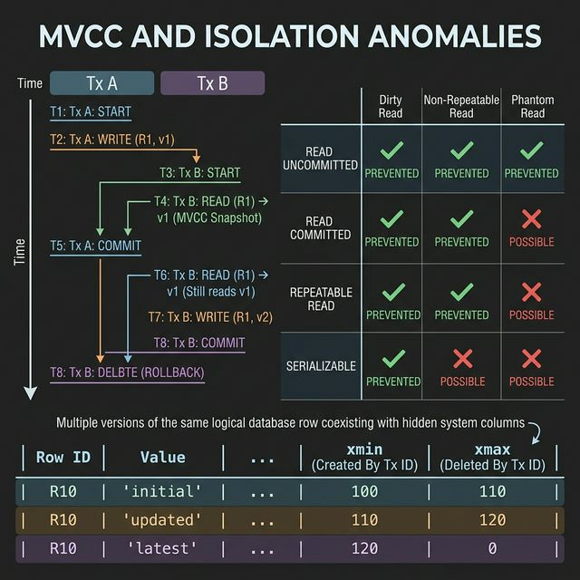

> **Navigation**: [← Database Internals](21_Database_Internals.md) | [Back to Index](../00_MASTER_INDEX.md) | [Next → NoSQL](22_NoSQL_MongoDB.md)

# 🔬 SQL Deep Internals — MVCC, Query Optimizer & EXPLAIN

> _"You can write SQL for years without knowing any of this. But the day a query runs in 0.001s in dev and 45s in prod — THIS is what saves you."_

---

# PART 0: The 5W+H Framework

| Question | SQL Internals Context |
| :--- | :--- |
| **WHAT** | The machinery BENEATH your SQL: how rows are versioned, how the query optimizer chooses a plan, how indexes work at the byte level. |
| **WHY** | SQL is a declaration: "Give me users where age > 30." The database figures out HOW. Understanding the how = knowing why queries are slow and how to fix them. |
| **WHEN** | When queries are slow. When concurrency bugs appear. When you need to design for high-traffic reads/writes. |
| **WHERE** | Every production system. A query on 100 rows works ANY way. On 100M rows, only the right plan survives. |
| **WHO** | Gray (1981, transactions), Stonebraker (PostgreSQL founder), Chamberlin & Boyce (SQL inventors, IBM 1974). |
| **HOW** | Through MVCC (multi-version data), the optimizer (statistics + cost model), and physical operators (index scans, hash joins). |

---



---

# PART 1: MVCC — Multi-Version Concurrency Control, Complete

---

```
THE PROBLEM MVCC SOLVES:
  Classic databases used LOCKING for isolation:
  Reader grabs a SHARED LOCK on a row.
  Writer grabs an EXCLUSIVE LOCK.
  → Reader blocks writer. Writer blocks reader.
  → High-traffic systems: deadlocks, timeouts, queue backs up.
  
  TWITTER 2009 scenario without MVCC:
  Millions of users reading tweet timelines (readers)
  Someone posts a tweet (writer)
  → Every reader BLOCKS the writer → 1-second delay per tweet post
  → Catastrophic at scale.
  
  MVCC INSIGHT (coined by David Reed, 1978):
  "Instead of blocking readers when a writer modifies a row,
   keep MULTIPLE VERSIONS of the row — an old one for readers,
   a new one for the writer."
  
  Result: READERS NEVER BLOCK WRITERS. WRITERS NEVER BLOCK READERS.
  This single idea enables modern databases to handle millions of concurrent connections.

ANALOGY: Google Docs vs a shared Word document on a USB drive.
  USB Word doc (old locking): Only one person can edit. Others wait.
  Google Docs (MVCC): Everyone sees the document. Writer makes a change.
  While the change is in progress, others still see the old version.
  When it's saved, everyone gets the new version.
```

## How PostgreSQL Implements MVCC — Step by Step

```
EACH ROW in PostgreSQL has HIDDEN SYSTEM COLUMNS:
  
  xmin:  Transaction ID (XID) that CREATED this row version
  xmax:  Transaction ID that DELETED/UPDATED this row (0 if still live)
  
  Example — accounts table:
  
  id │ balance │ xmin │ xmax
  ───┼─────────┼──────┼─────
   1 │  1000   │  100 │  0      ← created by txn 100, not deleted yet
   1 │   900   │  150 │  0      ← UPDATE created new version in txn 150
   
  Wait — ROW ID 1 appears TWICE?
  Yes! That's MVCC. Both versions exist on disk.
  The old version (xmin=100) is invisible to new transactions.
  The new version (xmin=150) is visible to transactions started after xmin=150 committed.

STEP-BY-STEP MVCC WALKTHROUGH:

  ┌────────────────────────────────────────────────────────────────────┐
  │  Timeline                                                          │
  │                                                                    │
  │  t=1:  Txn A starts (Transaction ID = 200)                         │
  │  t=2:  Txn B starts (Transaction ID = 201)                         │
  │  t=3:  Txn A reads account 1 → sees balance=1000 (xmin=100<200)    │
  │  t=4:  Txn B UPDATES account 1: balance=1000→900                   │
  │         → Old row: xmin=100, xmax=201 (marked deleted by txn 201)  │
  │         → New row: xmin=201, xmax=0   (new version by txn 201)     │
  │  t=5:  Txn B COMMITS                                               │
  │  t=6:  Txn A reads account 1 AGAIN                                 │
  │         → Sees balance=1000! (not 900)                             │
  │         Why? Txn A's snapshot was taken at t=1 (ID=200).           │
  │         The new row (xmin=201 > 200) is INVISIBLE to Txn A.        │
  │         The old row (xmin=100, xmax=201) IS visible because:       │
  │         xmin=100 < 200 (created before A's snapshot) ✓             │
  │         xmax=201 > 200 (B hadn't committed when A started) ✓       │
  │  t=7:  Txn A COMMITS                                               │
  │  t=8:  New Txn C starts → reads balance=900 (newest committed)     │
  └────────────────────────────────────────────────────────────────────┘
  
  This is REPEATABLE READ isolation: A sees the same value twice (1000).
  Under READ COMMITTED: A would see 900 at t=6 (re-snapshot each query).

VISIBILITY RULE (simplified):
  A row version is visible to transaction T if:
  1. xmin transaction COMMITTED and xmin <= T's snapshot XID
  2. xmax is 0 (row not deleted), OR xmax transaction had NOT committed
     when T's snapshot was taken (meaning: the delete is "in the future")

GARBAGE COLLECTION (VACUUM in PostgreSQL):
  Dead row versions accumulate! (old xmax'd versions nobody needs)
  VACUUM scans the table, finds versions no transaction can ever see,
  and marks that space as reusable.
  
  Table bloat = too many dead versions → table grows endlessly!
  autovacuum runs periodically to prevent this.
  In high-update tables, tune: autovacuum_vacuum_scale_factor = 0.01
```

## Isolation Anomalies — The Complete Chart With Examples

```
FOUR ISOLATION LEVELS × THREE ANOMALIES:

╔══════════════════════════╦═══════════════╦═══════════════╦════════════════╗
║  Isolation Level         ║  Dirty Read   ║  Non-Repeat.  ║  Phantom Read  ║
║                          ║               ║  Read         ║                ║
╠══════════════════════════╬═══════════════╬═══════════════╬════════════════╣
║  READ UNCOMMITTED        ║     YES ❌    ║    YES ❌    ║    YES ❌      ║
║  (almost never used)     ║               ║               ║                ║
╠══════════════════════════╬═══════════════╬═══════════════╬════════════════╣
║  READ COMMITTED          ║      No ✓    ║    YES ❌     ║    YES ❌      ║
║  (PostgreSQL default)    ║               ║               ║                ║
╠══════════════════════════╬═══════════════╬═══════════════╬════════════════╣
║  REPEATABLE READ         ║      No ✓     ║     No ✓     ║    YES ❌      ║
║  (MySQL InnoDB default)  ║               ║               ║  (MySQL: No ✓)  ║
╠══════════════════════════╬═══════════════╬═══════════════╬════════════════╣
║  SERIALIZABLE            ║      No ✓    ║     No ✓     ║     No ✓      ║
║  (strictest, slowest)    ║               ║               ║                ║
╚══════════════════════════╩═══════════════╩═══════════════╩════════════════╝
```

```sql
-- ── ANOMALY 1: DIRTY READ ──────────────────────────────────────────────────
-- Definition: Transaction A reads data that Transaction B modified
-- but has NOT yet committed. If B rolls back, A read data that never existed!

-- TIME →
-- Session A:                              Session B:
BEGIN;                                  -- [starts]
SET SESSION TRANSACTION ISOLATION LEVEL
  READ UNCOMMITTED;                     -- [Tx B starts too]
                                        BEGIN;
                                        UPDATE accounts
                                          SET balance = 999999
                                          WHERE id = 1;
                                        -- NOT YET COMMITTED
SELECT balance FROM accounts WHERE id = 1;
-- DIRTY READ: Returns 999999! (unwanted -- B didn't commit yet!)
                                        ROLLBACK; -- B rolls back!
-- A read 999999 which never "really" existed
-- FIX: Use READ COMMITTED or higher.

-- ── ANOMALY 2: NON-REPEATABLE READ ─────────────────────────────────────────
-- Definition: Within ONE transaction, reading the same row twice
-- gives DIFFERENT results because another transaction committed a change.

-- Session A (READ COMMITTED):         Session B:
BEGIN;                                  BEGIN;
SELECT balance FROM accounts
  WHERE id = 1;
-- Returns: 1000
                                        UPDATE accounts
                                          SET balance = 900
                                          WHERE id = 1;
                                        COMMIT;
SELECT balance FROM accounts
  WHERE id = 1;
-- Returns: 900  ← DIFFERENT! Non-repeatable read!
-- FIX: Use REPEATABLE READ or higher.

-- ── ANOMALY 3: PHANTOM READ ────────────────────────────────────────────────
-- Definition: Within ONE transaction, the same WHERE clause returns
-- DIFFERENT ROWS because another transaction inserted/deleted rows.

-- Session A (REPEATABLE READ):        Session B:
BEGIN;
SELECT COUNT(*) FROM orders
  WHERE amount > 100;
-- Returns: 50 orders
                                        INSERT INTO orders
                                          (customer_id, amount)
                                          VALUES (5, 200);
                                        COMMIT;
SELECT COUNT(*) FROM orders
  WHERE amount > 100;
-- Returns: 51 orders ← PHANTOM! New row appeared.
-- REPEATABLE READ prevents changes to SEEN rows, not NEW rows.
-- FIX: Use SERIALIZABLE isolation.

-- ── SERIALIZABLE: Prevents ALL anomalies ───────────────────────────────────
-- How? PostgreSQL uses Serializable Snapshot Isolation (SSI):
-- Track read/write dependencies between transactions.
-- If committing would create a non-serializable cycle → ABORT one transaction.
-- Retry on abort: client retries the transaction.

-- ── WRITE SKEW: The subtle anomaly even REPEATABLE READ won't catch ────────
-- Both transactions read the same condition, decide an action,
-- but COMBINED their actions violate the invariant:

-- Invariant: At least one doctor must always be on call.
-- Session A (Dr. Alice): SELECT COUNT(*) FROM on_call WHERE status='active' → 2
--                        UPDATE on_call SET status='off' WHERE doctor='Alice'; COMMIT;
-- Session B (Dr. Bob):   SELECT COUNT(*) FROM on_call WHERE status='active' → 2
--                        UPDATE on_call SET status='off' WHERE doctor='Bob';  COMMIT;
-- Result: 0 doctors on call! Both reads saw 2, both decided "safe to leave."
-- FIX: SERIALIZABLE (detects the dependency cycle) or SELECT FOR UPDATE.
```

---

# PART 2: The Query Optimizer — From SQL Text to Execution Plan

---

```
THE PIPELINE: Your SQL text → Execution result

  Your SQL
     │
     ▼
  PARSER: SQL text → Parse tree (syntax check)
     │   "SELECT * FROM users WHERE age > 30 ORDER BY name"
     │   → {SELECT: *, FROM: users, WHERE: age>30, ORDER: name}
     │
     ▼
  BINDER / ANALYZER: Resolve names (semantic check)
     │   "users" → table_id=42, schema=public
     │   "age" → column_id=7, type=integer
     │   "name" → column_id=3, type=varchar
     │
     ▼
  OPTIMIZER: The brain — WHERE is all the magic
     │   1. Enumerate candidate plans (different join orders, index choices)
     │   2. Estimate cost of each plan using STATISTICS
     │   3. Choose the plan with LOWEST ESTIMATED COST
     │
     ▼
  EXECUTION ENGINE: Run the chosen plan
     │   Physical operators: Seq Scan, Index Scan, Hash Join, Nested Loop...
     │
     ▼
  Results to client

THE OPTIMIZER IS NOT ALWAYS RIGHT:
  It estimates based on statistics (not exact data).
  Old statistics → wrong estimates → bad plan.
  Solution: ANALYZE (PostgreSQL) / UPDATE STATISTICS (SQL Server).
```

## Cost Model — How the Optimizer Estimates

```
STATISTICS postgresql collects (via ANALYZE):
  For each column:
  • n_distinct: approximate number of distinct values
  • histogram_bounds: distribution of values
  • null_frac: fraction of nulls
  For each table:
  • reltuples: estimated row count
  • relpages: number of disk pages (8KB each in PostgreSQL)
  
COST FORMULA (simplified):
  Total Cost = (disk_pages_read × seq_page_cost)
             + (rows_processed × cpu_tuple_cost)
             + (function_calls × cpu_operator_cost)
  
  Default costs (PostgreSQL):
  seq_page_cost = 1.0      (baseline: one sequential disk read)
  random_page_cost = 4.0   (random reads are 4× more expensive)
  cpu_tuple_cost = 0.01    (cheap)
  
  INDEX SCAN vs TABLE SCAN decision:
  If selectivity < 5-10%: index scan likely chosen (few rows → few random reads)
  If selectivity > 20-30%: seq scan likely chosen (many rows → random I/O > seq I/O)
  
  ANALOGY: Page-by-page (seq scan) vs table of contents (index scan).
  If you need 80% of a book's content, skimming every page is faster
  than looking up each section in the index and flipping back.
  But for 1 specific concept? Use the index!

JOIN ORDER OPTIMIZATION:
  For N tables in a JOIN, there are N!/2 possible join orderings.
  N=3: 3 orders. N=5: 60 orders. N=10: ~1.8 million orders!
  PostgreSQL uses dynamic programming for small N, genetic algorithm for large N.
  
  KEY INSIGHT: The optimizer places the SMALLER table on the "inner" (build) side
  of each join, and processes joins in order of lowest estimated output rows.
```

## Reading EXPLAIN ANALYZE — The Diagnostic Tool

```sql
-- ── EXPLAIN: shows the PLAN (without executing) ────────────────────────────
EXPLAIN
  SELECT u.name, COUNT(o.id) as order_count
  FROM users u
  LEFT JOIN orders o ON u.id = o.user_id
  WHERE u.created_at > '2024-01-01'
  GROUP BY u.name
  ORDER BY order_count DESC;

-- Sample EXPLAIN output:
-- Sort  (cost=1234.56..1239.56 rows=2000 width=72) (rows=1847)
--   Sort Key: (count(o.id)) DESC
--   -> Hash Left Join  (cost=500.00..1100.00 rows=2000 width=64)
--         Hash Cond: (o.user_id = u.id)
--         -> Seq Scan on orders o  (cost=0.00..400.00 rows=25000 width=8)
--         -> Hash  (cost=350.00..350.00 rows=2000 width=64)
--               -> Index Scan using idx_users_created on users u
--                    (cost=0.00..350.00 rows=2000 width=64)
--                    Index Cond: (created_at > '2024-01-01')

-- ── EXPLAIN ANALYZE: actually EXECUTES and shows actual vs estimated ────────
EXPLAIN (ANALYZE, BUFFERS, FORMAT TEXT)
  SELECT u.name, COUNT(o.id) as order_count
  FROM users u
  LEFT JOIN orders o ON u.id = o.user_id
  WHERE u.created_at > '2024-01-01'
  GROUP BY u.name
  ORDER BY order_count DESC;

-- With ANALYZE output:
-- Sort  (cost=1234.56..1239.56 rows=2000 width=72)
--       (actual time=145.2..146.8 rows=1847 loops=1)   ← ACTUAL data!
--   Sort Key: (count(o.id)) DESC
--   Buffers: shared hit=2341 read=892                   ← cache hits vs disk reads
--   -> Hash Left Join  (cost=500.00..1100.00 rows=2000 width=64)
--                      (actual time=45.1..140.2 rows=1847 loops=1)
-- ...
-- Planning Time: 2.3 ms
-- Execution Time: 148.9 ms
```

```
READING AN EXPLAIN PLAN — KEY THINGS TO LOOK FOR:

1. ACTUAL vs ESTIMATED ROWS:
   (cost=X rows=2000) vs (actual rows=50000)
   Big mismatch → optimizer chose a BAD plan based on stale statistics.
   FIX: ANALYZE the table to refresh statistics.

2. SEQ SCAN on a large table:
   "Seq Scan on orders (actual rows=5000000)"
   5M rows scanned for a query that returns 100 rows = problem!
   FIX: Add an index on the WHERE/JOIN columns.

3. NESTED LOOP with large outer table:
   "Nested Loop (actual rows=1000000)"
   O(N×M) complexity → can be extremely slow.
   FIX: Hash Join might be better → check if statistics are stale.

4. HIGH BUFFER READS (disk I/O):
   "Buffers: shared hit=100 read=50000"
   50000 reads from disk (not cache) → huge I/O.
   FIX: Increase shared_buffers (more RAM to cache), add covering index.

5. SORT with expensive Sort Method:
   "Sort Method: external merge  Disk: 25431kB"
   Sort spilled to disk (didn't fit in work_mem)!
   FIX: Increase work_mem for session or add index for ORDER BY column.
```

```sql
-- ── COMPLETE INDEX DIAGNOSIS WORKFLOW ──────────────────────────────────────

-- Step 1: Find slow queries (PostgreSQL — pg_stat_statements extension)
SELECT query, calls, total_exec_time, mean_exec_time, rows
FROM pg_stat_statements
ORDER BY mean_exec_time DESC
LIMIT 10;

-- Step 2: Find tables missing indexes (sequential scans on large tables)
SELECT schemaname, tablename, seq_scan, seq_tup_read,
       idx_scan, idx_tup_fetch,
       n_live_tup,
       ROUND(seq_scan::numeric / NULLIF(seq_scan + idx_scan, 0) * 100, 1) AS seq_scan_pct
FROM pg_stat_user_tables
WHERE n_live_tup > 100000    -- only large tables
ORDER BY seq_scan_pct DESC;  -- most sequential-scan-heavy first

-- Step 3: Find unused indexes (wasting write overhead)
SELECT schemaname, tablename, indexname, idx_scan
FROM pg_stat_user_indexes
WHERE idx_scan = 0             -- never used!
AND indexname NOT LIKE '%pkey' -- exclude primary keys
ORDER BY pg_relation_size(indexrelid) DESC;

-- Step 4: Find index bloat (dead tuples in indexes)
SELECT tablename, indexname,
       pg_size_pretty(pg_relation_size(indexrelid)) AS index_size,
       idx_scan, idx_tup_read, idx_tup_fetch
FROM pg_stat_user_indexes
ORDER BY pg_relation_size(indexrelid) DESC
LIMIT 20;
```

---


> 🔬 **Section Challenge — Reading EXPLAIN ANALYZE — The Diagnostic Tool**

# PART 3: Physical Operators — How Joins Actually Execute

---

```
THREE JOIN ALGORITHMS:

1. NESTED LOOP JOIN (O(N × M)):
   for each row in Outer:
       for each row in Inner:
           if join_condition:
               output row
   
   BEST WHEN:
   • Outer is very small (few rows)
   • Inner has an INDEX on the join key
   
   When inner has index: O(N × log M) — much better!
   Index Nested Loop = the bread-and-butter for OLTP.
   
   EXAMPLE: Join 10 orders to the customers table (indexed on id).
   10 × log(10M customers) ≈ 10 × 23 = 230 comparisons. Fast!
   
   BAD WHEN:
   • Both tables are large with no index → O(N × M) painful.

2. HASH JOIN (O(N + M)):
   PHASE 1 (Build): Hash entire smaller table into a hash map.
     for each row in Build (smaller) table:
         hash_map[hash(join_key)] = row
   
   PHASE 2 (Probe): Scan larger table, probe hash map.
     for each row in Probe (larger) table:
         if hash_map[hash(join_key)] exists:
             output joined row
   
   BEST WHEN:
   • Both tables are large, no useful index
   • Hash map fits in memory (work_mem)
   
   WORST WHEN:
   • Hash map doesn't fit in memory → spills to disk → slow!
   
   ANALOGY: Build a phone book (hash the smaller table).
   Then look up each phone number from the bigger list.
   Much faster than comparing every pair (nested loop).

3. MERGE JOIN (O(N log N + M log M) for sort, then O(N + M)):
   REQUIRES: Both inputs sorted by join key.
   
   If already sorted (or have sorted indexes) → O(N + M) — fastest possible!
   
   left_ptr, right_ptr = 0, 0
   while left_ptr < N and right_ptr < M:
       if L[left_ptr].key == R[right_ptr].key: output, advance both
       elif L[left_ptr].key < R[right_ptr].key: advance left_ptr
       else: advance right_ptr
   
   ANALOGY: Merging two sorted stacks of employee files.
   Both stacks are in alphabetical order → scan together linearly.
   No lookup table needed, no backtracking.
   
   BEST WHEN:
   • Both inputs already sorted (e.g., via indexes on join columns)
   • Large, non-indexed tables where hash would spill to disk

CHOOSING AMONG THEM:
  The optimizer picks automatically based on cost estimates.
  But if it picks wrong:
  • SET enable_hashjoin = off;  (PostgreSQL — disable to force other)
  • Add indexes to help Nested Loop
  • Increase work_mem to help Hash Join fit in memory
  • CREATE INDEX on join column to help both Index NL and Merge Join
```

---

# PART 4: Index Types Beyond B-Tree

---

```
B-TREE (default, 95% of use cases):
  Best for: equality (=), range (>, <, BETWEEN), ORDER BY, most queries
  Not great for: LIKE '%suffix%' (prefix scans only), full-text, geo

HASH INDEX:
  Structure: Hash table mapping hash(key) → row pointer
  Best for: ONLY equality lookups (=). Faster than B-Tree for =.
  Not for: range queries, ORDER BY, LIKE
  PostgreSQL: CREATE INDEX idx ON users USING hash (email);
  Note: Not crash-safe until PostgreSQL 10!

GIN (Generalized Inverted Index):
  Best for: full-text search, JSONB containment, arrays
  Structure: inverted index: term → list of row IDs
  
  -- Full-text search:
  CREATE INDEX idx_fts ON articles USING gin(to_tsvector('english', content));
  SELECT * FROM articles
  WHERE to_tsvector('english', content) @@ plainto_tsquery('machine learning');
  
  -- JSONB containment:
  CREATE INDEX idx_metadata ON events USING gin(metadata);
  SELECT * FROM events WHERE metadata @> '{"type": "click"}';

GIST (Generalized Search Tree):
  Best for: geometric data, geographic data, range types, nearest-neighbor
  
  -- PostGIS geographic queries:
  CREATE INDEX idx_location ON restaurants USING gist(location);
  SELECT name FROM restaurants
  ORDER BY location <-> ST_MakePoint(-73.98, 40.75)   -- nearest-neighbor!
  LIMIT 10;

BRIN (Block Range Index):
  Best for: very large tables with naturally-ordered data (timestamps, IDs)
  Structure: stores min/max per BLOCK (not per row) → tiny index!
  
  -- Good for: time-series, audit tables with created_at auto-ordering
  CREATE INDEX idx_created ON events USING brin(created_at);
  -- 100M row table: B-Tree index = ~2GB. BRIN index = ~128KB!

PARTIAL INDEX — Index on a subset of rows:
  # Only index active users (not archived thousands)
  CREATE INDEX idx_active_users ON users (email)
  WHERE status = 'active';
  
  -- Query must match the WHERE condition to use this index:
  SELECT * FROM users WHERE email = 'x@y.com' AND status = 'active';
  → Uses partial index (only active users indexed → much smaller/faster)
  
  SELECT * FROM users WHERE email = 'x@y.com';
  → Can't use partial index (condition doesn't include status='active')

EXPRESSION INDEX — Index on computed expression:
  -- Won't use index: WHERE UPPER(email) = 'USER@EXAMPLE.COM'
  -- (function call prevents index use on email column)
  
  -- CREATE the index on the expression itself:
  CREATE INDEX idx_email_upper ON users (UPPER(email));
  
  -- Now this query WILL use the index:
  SELECT * FROM users WHERE UPPER(email) = 'USER@EXAMPLE.COM'; ✓

COMPOSITE INDEX — Order matters!
  CREATE INDEX idx_composite ON orders (customer_id, status, created_at);
  
  -- ✓ Uses index:
  WHERE customer_id = 5
  WHERE customer_id = 5 AND status = 'paid'
  WHERE customer_id = 5 AND status = 'paid' AND created_at > '2024-01-01'
  
  -- ✗ CANNOT use index (skipped leading column):
  WHERE status = 'paid'
  WHERE created_at > '2024-01-01'
  
  RULE: The "leftmost prefix rule." Leading columns must be in WHERE clause.
```

```sql
-- ── COMPLETE PRACTICAL DEBUGGING SESSION ───────────────────────────────────

-- Scenario: "This query ran in 2ms yesterday, now it takes 8 seconds"

-- Step 1: Run EXPLAIN ANALYZE
EXPLAIN (ANALYZE, BUFFERS, VERBOSE)
SELECT o.id, o.total, u.name
FROM orders o
JOIN users u ON o.user_id = u.id
WHERE o.status = 'pending'
  AND o.created_at > NOW() - INTERVAL '7 days';

-- If you see:
-- Seq Scan on orders (actual rows=5000000)  ← BAD
-- FIX: Add an index
CREATE INDEX CONCURRENTLY idx_orders_status_created
  ON orders (status, created_at)
  WHERE status = 'pending';    -- partial index! only pending orders

-- After adding index, re-run EXPLAIN ANALYZE:
-- Index Scan using idx_orders_status_created on orders ← GOOD
-- (actual rows=150 width=24) (actual time=0.052..1.234 rows=150 loops=1)

-- Step 2: Check if statistics are stale
SELECT relname, last_analyze, last_autoanalyze, n_live_tup, n_dead_tup
FROM pg_stat_user_tables
WHERE relname = 'orders';

-- If last_analyze was a week ago and n_dead_tup is huge → VACUUM ANALYZE
VACUUM ANALYZE orders;

-- Step 3: Force re-planning (sometimes planner caches old plan)
DISCARD PLANS;

-- Step 4: Check lock contention
SELECT pid, wait_event_type, wait_event, query
FROM pg_stat_activity
WHERE wait_event IS NOT NULL;
-- If queries are waiting on lock events → long-running transaction blocking table
-- Kill it: SELECT pg_terminate_backend(pid);
```

---

## 🔗 Cross-References

| Topic | Related Content |
|---|---|
| **ACID / Transactions** | [Transactions ACID](13_Transactions_ACID.md) — syntax and practice |
| **B-Tree in data structures** | [Trees & Heaps](../02_Data_Structures/01f_Trees_Heaps.md) |
| **Hash Join → Hash Tables** | [HashTable DS](../02_Data_Structures/01e_HashTable.md) |
| **Query optimization → System Design** | [DB Internals](21_Database_Internals.md) — B-Tree, WAL, Buffer Pool |
| **Distributed transactions** | [Enterprise Systems](../10_Enterprise_Systems/01_ERP_Architecture.md) — Saga pattern |

