**Navigation**: [Back to Index](../00_MASTER_INDEX.md) | [Next >](03_Career_Guide_Part1B.md)

**Career Guide** | See also: [04_Career_Projects_Part1.md](04_Career_Projects_Part1.md) | [05_Career_Projects_Part2.md](05_Career_Projects_Part2.md) | [Index](../00_MASTER_INDEX.md)

---

# 🚀 Complete Career & Techno-Functional Expert Guide

**Goal**: Transform from a "coder" to a "Problem-Solving Partner" with deep technical skills + domain expertise

---

## 📋 Table of Contents

1. [The Techno-Functional Framework](#the-techno-functional-framework)
2. [Technical Skills Deep Dive](#technical-skills-deep-dive)
3. [System Design Mastery](#system-design-mastery)
4. [Cloud Architecture Excellence](#cloud-architecture-excellence)
5. [Domain Knowledge - Banking](#domain-knowledge---banking)
6. [Domain Knowledge - Healthcare](#domain-knowledge---healthcare)
7. [Domain Knowledge - Telecom](#domain-knowledge---telecom)
8. [Product Mindset Development](#product-mindset-development)
9. [Communication & Articulation](#communication--articulation)
10. [Project Ideas with Complete Guides](#project-ideas-with-complete-guides)
11. [Learning Resources & Roadmaps](#learning-resources--roadmaps)

---

## The Techno-Functional Framework

### What is a Techno-Functional Expert?

```
Traditional Developer:
Code → Deploy → Done

Techno-Functional Expert:
Business Problem → Technical Solution → Business Impact → Continuous Improvement
```

**Flow:**
1. Code
2. Deploy
3. Done
4. Business Problem
5. Technical Solution
6. Business Impact
7. Continuous Improvement

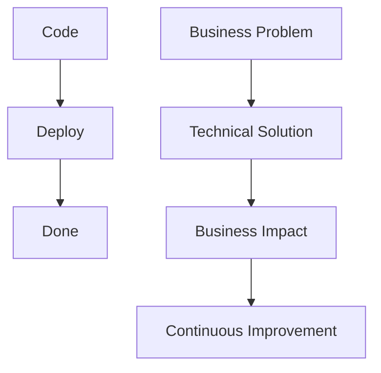

### The Three Pillars

```
┌─────────────────────────────────────────────────────────────────┐
│                    TECHNO-FUNCTIONAL EXPERT                     │
├─────────────────┬─────────────────┬─────────────────────────────┤
│   TECHNICAL     │    DOMAIN       │     SOFT SKILLS             │
│   EXCELLENCE    │    EXPERTISE    │     MASTERY                 │
├─────────────────┼─────────────────┼─────────────────────────────┤
│ • DSA           │ • Banking       │ • Product Mindset           │
│ • System Design │ • Healthcare    │ • Solution Articulation     │
│ • Cloud (AWS/   │ • Telecom       │ • Client Communication      │
│   Azure)        │ • Insurance     │ • Problem Ownership         │
│ • Optimization  │ • E-commerce    │ • Business Acumen           │
└─────────────────┴─────────────────┴─────────────────────────────┘
```

**Flow:**
1. TECHNO-FUNCTIONAL EXPERT
2. TECHNICAL DOMAIN SOFT SKILLS
3. EXCELLENCE EXPERTISE MASTERY
4. • DSA • Banking • Product Mindset
5. • System Design • Healthcare • Solution Articulation
6. • Cloud (AWS/ • Telecom • Client Communication
7. Azure) • Insurance • Problem Ownership

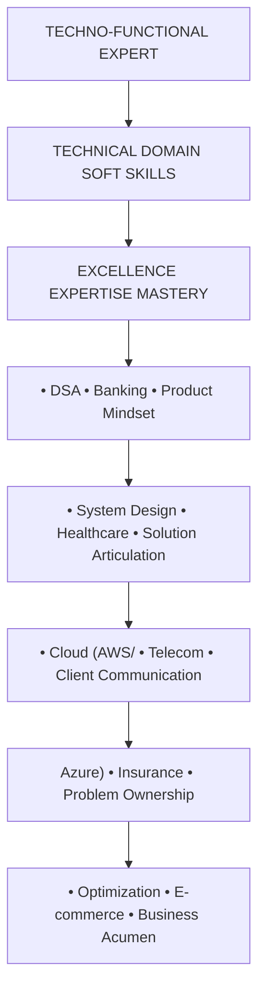

### Why This Matters (India Context)

India's IT industry is evolving:

- **Phase 1 (Past)**: Body shopping - just writing code
- **Phase 2 (Present)**: Product development - building solutions
- **Phase 3 (Future)**: Strategic partners - driving business outcomes

Companies pay premium for people who understand BOTH technology AND business.

---


🔬 **Section Challenge — The Techno-Functional Framework**
>
**Challenge 2 (Design):** `ROW_NUMBER()` vs `RANK()` vs `DENSE_RANK()` — show with an example where they produce different results.
<details><summary>Answer</summary>

Scores: [100, 90, 90, 80]. ROW_NUMBER: 1,2,3,4 (always unique, arbitrary for ties). RANK: 1,2,2,4 (gives same rank to ties, SKIPS the next rank). DENSE_RANK: 1,2,2,3 (same rank to ties, NO skipping). Use: ROW_NUMBER for pagination (must be unique). RANK when you want 'no 3rd place if two tied for 2nd'. DENSE_RANK when you want consecutive ranks despite ties.
</details>


## Technical Skills Deep Dive

### Beyond Basic Coding - The Optimization Mindset

**Wrong Approach**: "I know how to create an EC2 instance"
**Right Approach**: "I know how to optimize EC2 costs by 60% using Reserved Instances, Spot Instances, and right-sizing"

### The Technical Excellence Stack

```
Level 5: Architecture & Strategy
         └── Design systems that scale to millions

Level 4: Optimization & Performance
         └── Make existing systems 10x faster/cheaper

Level 3: System Integration
         └── Connect multiple services seamlessly

Level 2: Implementation
         └── Write clean, maintainable code

Level 1: Fundamentals
         └── DSA, Programming basics
```

**Flow:**
1. Level 5: Architecture & Strategy
2. Design systems that scale to millions
3. Level 4: Optimization & Performance
4. Make existing systems 10x faster/cheaper
5. Level 3: System Integration
6. Connect multiple services seamlessly
7. Level 2: Implementation
8. Write clean, maintainable code
9. Level 1: Fundamentals
10. DSA, Programming basics

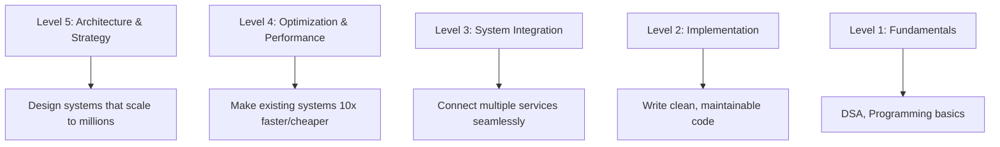

### Key Technical Areas to Master

| Area                | What to Learn                                  | Why It Matters             |
| ------------------- | ---------------------------------------------- | -------------------------- |
| **Data Structures** | All variants, trade-offs, real implementations | Foundation of everything   |
| **Algorithms**      | Optimization techniques, complexity analysis   | Solve problems efficiently |
| **System Design**   | Distributed systems, scalability patterns      | Build real products        |
| **Cloud**           | AWS/Azure services, cost optimization          | Modern deployment          |
| **Databases**       | SQL, NoSQL, time-series, graph                 | Data is everything         |
| **Security**        | OWASP, encryption, auth patterns               | Non-negotiable             |

---

## System Design Mastery

### Why System Design (Not Just Coding)

```
Scenario: Build a payment system

Junior Developer thinks:
"I'll write a function to transfer money"

System Designer thinks:
"How do we handle:
 - 1 million concurrent transactions?
 - Network failures mid-transaction?
 - Fraud detection in real-time?
 - Compliance with banking regulations?
 - Disaster recovery?
 - Cost optimization at scale?"
```

### Core System Design Concepts

#### 1. Scalability Patterns

```
┌─────────────────────────────────────────────────────────────┐
│                    SCALING STRATEGIES                       │
├─────────────────────────────────────────────────────────────┤
│                                                             │
│  VERTICAL SCALING          HORIZONTAL SCALING               │
│  (Scale Up)                (Scale Out)                      │
│                                                             │
│  ┌─────────┐               ┌───┐ ┌───┐ ┌───┐                │
│  │ BIGGER  │               │ S │ │ S │ │ S │                │
│  │ SERVER  │      vs       │ 1 │ │ 2 │ │ 3 │                │
│  │         │               └───┘ └───┘ └───┘                │
│  └─────────┘                                                │
│                                                             │
│  Pros: Simple              Pros: Unlimited scale            │
│  Cons: Has limits          Cons: Complexity                 │
└─────────────────────────────────────────────────────────────┘
```

**Flow:**
1. BIGGER / SERVER
2. S / 1
3. S / 2
4. S / 3

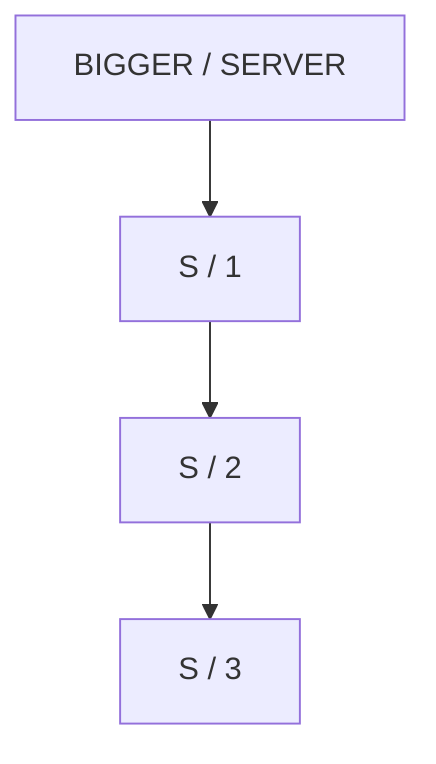

#### 2. Database Scaling

```
                    ┌──────────────────┐
                    │   APPLICATION    │
                    └────────┬─────────┘
                             │
              ┌──────────────┼──────────────┐
              │              │              │
              ▼              ▼              ▼
        ┌──────────┐  ┌──────────┐  ┌──────────┐
        │  SHARD   │  │  SHARD   │  │  SHARD   │
        │  A-H     │  │  I-P     │  │  Q-Z     │
        └──────────┘  └──────────┘  └──────────┘

        SHARDING: Split data across multiple databases
```

**Flow:**
1. APPLICATION
2. SHARD / I-P
3. APPLICATION
4. SHARD / Q-Z

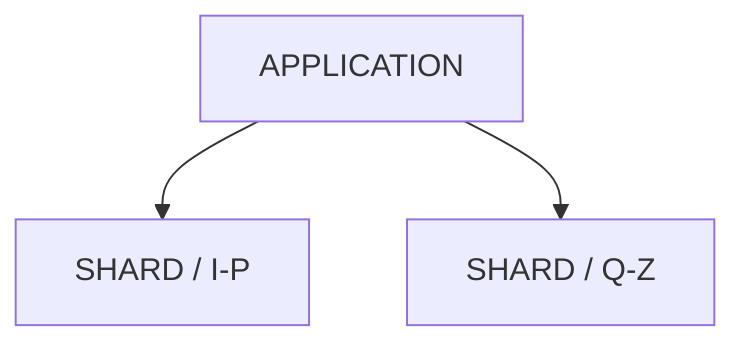

#### 3. Caching Strategies

```
┌──────────────────────────────────────────────────────────────┐
│                    CACHING LAYERS                            │
├──────────────────────────────────────────────────────────────┤
│                                                              │
│  CLIENT ─────► CDN ─────► APP CACHE ─────► DB CACHE ─────► DB│
│                                                              │
│  Browser      Cloudflare   Redis         Query Cache   MySQL │
│  LocalStorage Akamai       Memcached     Buffer Pool         │
│                                                              │
│  Cache Hit Rate Target: > 95%                                │
│  Latency: 1ms (cache) vs 50-200ms (DB)                       │
└──────────────────────────────────────────────────────────────┘
```

**Flow:**
1. CACHING LAYERS
2. CLIENT CDN APP CACHE DB CACHE DB
3. Browser Cloudflare Redis Query Cache MySQL
4. LocalStorage Akamai Memcached Buffer Pool
5. Cache Hit Rate Target: > 95%
6. Latency: 1ms (cache) vs 50-200ms (DB)

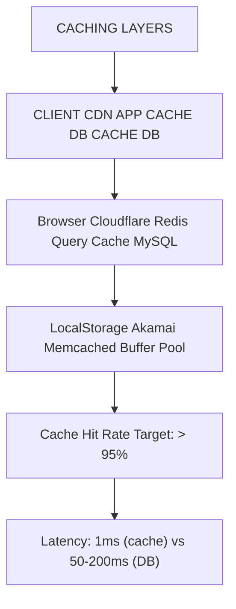

#### 4. Load Balancing

```
                         ┌────────────────┐
                         │ LOAD BALANCER  │
                         │ (NGINX/HAProxy)│
                         └───────┬────────┘
                                 │
           ┌─────────────────────┼─────────────────────┐
           │                     │                     │
           ▼                     ▼                     ▼
    ┌────────────┐        ┌────────────┐        ┌────────────┐
    │  Server 1  │        │  Server 2  │        │  Server 3  │
    │  (Active)  │        │  (Active)  │        │  (Standby) │
    └────────────┘        └────────────┘        └────────────┘

    Algorithms:
    • Round Robin - Simple rotation
    • Least Connections - Send to least busy
    • IP Hash - Same client → same server
    • Weighted - Based on server capacity
```

**Flow:**
1. LOAD BALANCER / (NGINX/HAProxy)
2. Server 2 / (Active)

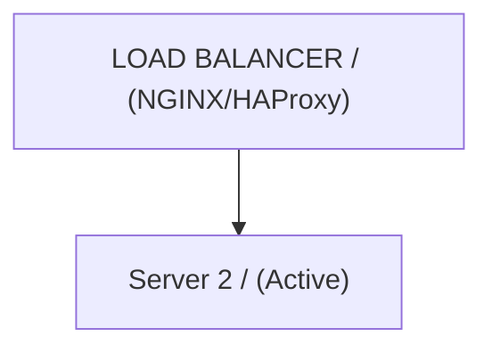

### System Design Interview Framework

```
Step 1: CLARIFY (5 min)
├── Functional requirements
├── Non-functional requirements (scale, latency, availability)
├── Constraints and assumptions
└── Core use cases

Step 2: ESTIMATE (5 min)
├── Daily active users
├── Read/Write ratio
├── Storage requirements
├── Bandwidth needs
└── QPS (Queries per second)

Step 3: HIGH-LEVEL DESIGN (10 min)
├── Core components
├── Data flow
├── API design
└── Database schema

Step 4: DEEP DIVE (15 min)
├── Scaling strategies
├── Database design
├── Caching approach
├── Trade-offs discussion
└── Edge cases

Step 5: WRAP UP (5 min)
├── Bottlenecks
├── Future improvements
└── Monitoring & alerts
```

**Flow:**
1. Step 1: CLARIFY (5 min)
2. Functional requirements
3. Step 1: CLARIFY (5 min)
4. Non-functional requirements (scale, latency, availabili
5. Step 1: CLARIFY (5 min)
6. Constraints and assumptions
7. Step 1: CLARIFY (5 min)
8. Core use cases
9. Step 2: ESTIMATE (5 min)
10. Daily active users
11. Step 2: ESTIMATE (5 min)
12. Read/Write ratio

```mermaid
flowchart TD
    N1["Step 1: CLARIFY (5 min)"]
    N2["Functional requirements"]
    N3["Non-functional requirements (scale, latency, availabili"]
    N4["Constraints and assumptions"]
    N5["Core use cases"]
    N6["Step 2: ESTIMATE (5 min)"]
    N7["Daily active users"]
    N8["Read/Write ratio"]
    N9["Storage requirements"]
    N10["Bandwidth needs"]
    N11["QPS (Queries per second)"]
    N12["Step 3: HIGH-LEVEL DESIGN (10 min)"]
    N13["Core components"]
    N14["Data flow"]
    N15["API design"]
    N16["Database schema"]
    N17["Step 4: DEEP DIVE (15 min)"]
    N18["Scaling strategies"]
    N19["Database design"]
    N20["Caching approach"]
    N21["Trade-offs discussion"]
    N22["Edge cases"]
    N23["Step 5: WRAP UP (5 min)"]
    N24["Bottlenecks"]
    N25["Future improvements"]
    N26["Monitoring & alerts"]
    N1 --> N2
    N1 --> N3
    N1 --> N4
    N1 --> N5
    N6 --> N7
    N6 --> N8
    N6 --> N9
    N6 --> N10
    N6 --> N11
    N12 --> N13
    N12 --> N14
    N12 --> N15
    N12 --> N16
    N17 --> N18
    N17 --> N19
    N17 --> N20
    N17 --> N21
    N17 --> N22
    N23 --> N24
    N23 --> N25
    N23 --> N26
```

### Practice System Design Problems

| Problem               | Key Concepts                                     | Difficulty |
| --------------------- | ------------------------------------------------ | ---------- |
| Design URL Shortener  | Hashing, Database design, Caching                | Easy       |
| Design Rate Limiter   | Token bucket, Sliding window, Redis              | Easy       |
| Design Twitter Feed   | Fan-out, Caching, Timeline generation            | Medium     |
| Design WhatsApp       | WebSocket, Message queuing, E2E encryption       | Medium     |
| Design YouTube        | CDN, Video processing, Recommendations           | Hard       |
| Design Uber           | Location services, Matching algorithm, Real-time | Hard       |
| Design Stock Exchange | Low latency, Order matching, ACID                | Expert     |

### Learning Resources - System Design

| Resource                              | Type          | Link                                                |
| ------------------------------------- | ------------- | --------------------------------------------------- |
| System Design Primer                  | GitHub        | https://github.com/donnemartin/system-design-primer |
| Designing Data-Intensive Applications | Book          | Martin Kleppmann                                    |
| ByteByteGo                            | YouTube       | https://www.youtube.com/c/ByteByteGo                |
| Gaurav Sen                            | YouTube       | https://www.youtube.com/c/GauravSensei              |
| High Scalability Blog                 | Blog          | http://highscalability.com/                         |
| AWS Architecture Center               | Documentation | https://aws.amazon.com/architecture/                |

---


## Cloud Architecture Excellence

### The Optimization-First Mindset

**Key Insight**: Companies don't want people who can just "spin up instances". They want people who can:

1. Reduce cloud costs by 30-50%
2. Improve performance while reducing spend
3. Design for reliability AND cost-efficiency

### AWS Core Services Deep Dive

```
┌─────────────────────────────────────────────────────────────┐
│                    AWS SERVICE MAP                          │
├─────────────────────────────────────────────────────────────┤
│                                                             │
│  COMPUTE          STORAGE           DATABASE                │
│  ┌─────────┐      ┌─────────┐       ┌─────────┐             │
│  │ EC2     │      │ S3      │       │ RDS     │             │
│  │ Lambda  │      │ EBS     │       │ DynamoDB│             │
│  │ ECS/EKS │      │ EFS     │       │ Aurora  │             │
│  │ Fargate │      │ Glacier │       │ ElastiC │             │
│  └─────────┘      └─────────┘       └─────────┘             │
│                                                             │
│  NETWORKING       SECURITY          MONITORING              │
│  ┌─────────┐      ┌─────────┐       ┌─────────┐             │
│  │ VPC     │      │ IAM     │       │CloudWatch│            │
│  │ Route53 │      │ KMS     │       │ X-Ray   │             │
│  │ CloudFr │      │ WAF     │       │CloudTrail│            │
│  │ API GW  │      │ Shield  │       │ Config  │             │
│  └─────────┘      └─────────┘       └─────────┘             │
└─────────────────────────────────────────────────────────────┘
```

**Flow:**
1. EC2 / Lambda / ECS/EKS / Fargate
2. S3 / EBS / EFS / Glacier
3. RDS / DynamoDB / Aurora / ElastiC
4. VPC / Route53 / CloudFr / API GW
5. IAM / KMS / WAF / Shield
6. CloudWatch / X-Ray / CloudTrail / Config

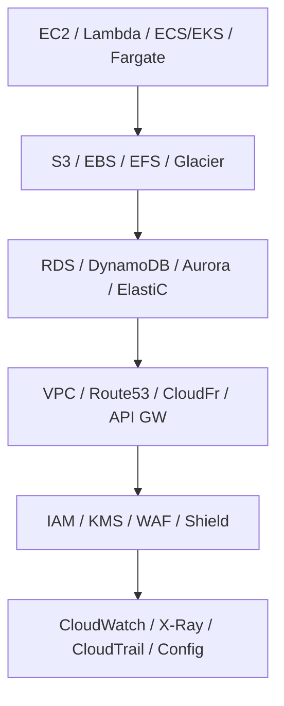

### Cost Optimization Strategies

#### 1. EC2 Optimization

```
┌─────────────────────────────────────────────────────────────┐
│                EC2 PRICING MODELS                           │
├──────────────┬──────────────┬──────────────┬────────────────┤
│ ON-DEMAND    │ RESERVED     │ SPOT         │ SAVINGS PLAN   │
├──────────────┼──────────────┼──────────────┼────────────────┤
│ Full price   │ 30-75% off   │ Up to 90%    │ Flexible       │
│              │ 1-3 year     │ off          │ commitment     │
│              │ commitment   │              │                │
├──────────────┼──────────────┼──────────────┼────────────────┤
│ Use for:     │ Use for:     │ Use for:     │ Use for:       │
│ Testing,     │ Production   │ Batch jobs,  │ Variable       │
│ Dev, Spiky   │ Steady-state │ CI/CD,       │ workloads      │
│ workloads    │ workloads    │ Data proc.   │                │
└──────────────┴──────────────┴──────────────┴────────────────┘
```

**Flow:**
1. EC2 PRICING MODELS
2. ON-DEMAND RESERVED SPOT SAVINGS PLAN
3. Full price 30-75% off Up to 90% Flexible
4. 1-3 year off commitment
5. commitment
6. Use for: Use for: Use for: Use for:
7. Testing, Production Batch jobs, Variable

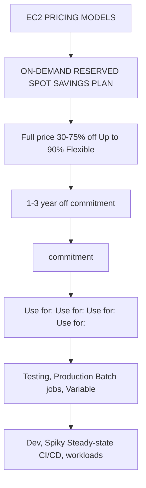

#### 2. Right-Sizing Strategy

```python
# Optimization Process
1. ANALYZE
   └── Use AWS Cost Explorer, CloudWatch metrics
   └── Identify underutilized resources (CPU < 40%, Memory < 60%)

2. RECOMMEND
   └── Downsize oversized instances
   └── Use Graviton (ARM) for 40% better price-performance
   └── Consider burstable instances (T3) for variable workloads

3. IMPLEMENT
   └── Test in staging
   └── Gradual rollout with monitoring
   └── Rollback plan ready

4. MONITOR
   └── Set up cost alerts
   └── Monthly review cycle
   └── Continuous optimization
```

#### 3. S3 Cost Optimization

```
┌─────────────────────────────────────────────────────────────┐
│                  S3 STORAGE CLASSES                         │
├─────────────────┬─────────────┬─────────────────────────────┤
│ STORAGE CLASS   │ COST/GB     │ USE CASE                    │
├─────────────────┼─────────────┼─────────────────────────────┤
│ S3 Standard     │ $0.023      │ Frequent access             │
│ S3 IA           │ $0.0125     │ Infrequent, quick retrieval │
│ S3 Glacier IR   │ $0.004      │ Rarely accessed archives    │
│ S3 Glacier DA   │ $0.00099    │ Long-term archives          │
└─────────────────┴─────────────┴─────────────────────────────┘

Lifecycle Policies:
Day 0-30:    S3 Standard
Day 30-90:   S3 IA (save 45%)
Day 90-365:  Glacier IR (save 83%)
Day 365+:    Glacier Deep Archive (save 96%)
```

**Flow:**
1. S3 STORAGE CLASSES
2. STORAGE CLASS COST/GB USE CASE
3. S3 Standard $0.023 Frequent access
4. S3 IA $0.0125 Infrequent, quick retrieval
5. S3 Glacier IR $0.004 Rarely accessed archives
6. S3 Glacier DA $0.00099 Long-term archives
7. Lifecycle Policies:

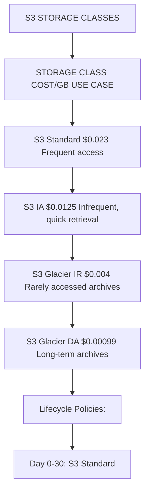

### Azure Core Services

```
┌─────────────────────────────────────────────────────────────┐
│                    AZURE SERVICE MAP                        │
├─────────────────────────────────────────────────────────────┤
│                                                             │
│  AWS                    AZURE                               │
│  ───                    ─────                               │
│  EC2          ────►     Virtual Machines                    │
│  Lambda       ────►     Azure Functions                     │
│  S3           ────►     Blob Storage                        │
│  RDS          ────►     Azure SQL Database                  │
│  DynamoDB     ────►     Cosmos DB                           │
│  CloudWatch   ────►     Azure Monitor                       │
│  VPC          ────►     Virtual Network                     │
│  IAM          ────►     Azure AD / RBAC                     │
│  EKS          ────►     AKS (Azure Kubernetes Service)      │
│  SQS/SNS      ────►     Service Bus                         │
└─────────────────────────────────────────────────────────────┘
```

**Flow:**
1. AZURE SERVICE MAP
2. AWS AZURE
3. EC2 Virtual Machines
4. Lambda Azure Functions
5. S3 Blob Storage
6. RDS Azure SQL Database
7. DynamoDB Cosmos DB

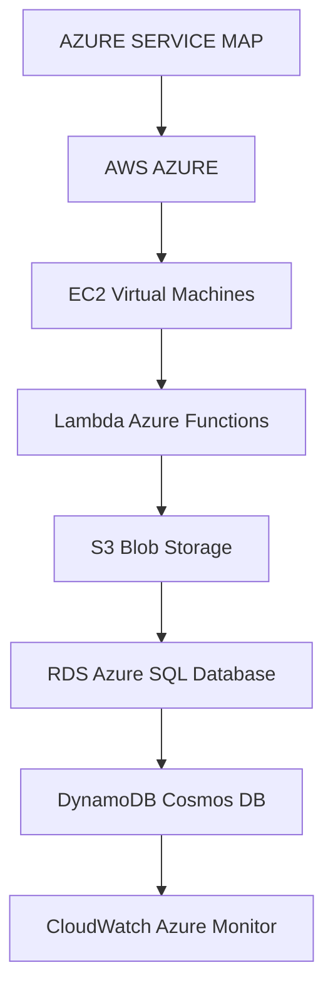

### Cloud Architecture Patterns

#### 1. Microservices Architecture

```
┌─────────────────────────────────────────────────────────────┐
│                    MICROSERVICES                            │
├─────────────────────────────────────────────────────────────┤
│                                                             │
│         ┌──────────────────────────────┐                    │
│         │       API GATEWAY            │                    │
│         │    (Authentication, Routing) │                    │
│         └──────────────┬───────────────┘                    │
│                        │                                    │
│    ┌───────────────────┼───────────────────┐                │
│    │                   │                   │                │
│    ▼                   ▼                   ▼                │
│ ┌──────┐          ┌──────┐          ┌──────┐                │
│ │User  │          │Order │          │Payment│               │
│ │Svc   │          │Svc   │          │Svc    │               │
│ └──┬───┘          └──┬───┘          └──┬────┘               │
│    │                 │                 │                    │
│    ▼                 ▼                 ▼                    │
│ ┌──────┐          ┌──────┐          ┌──────┐                │
│ │User  │          │Order │          │Payment│               │
│ │DB    │          │DB    │          │DB     │               │
│ └──────┘          └──────┘          └──────┘                │
│                                                             │
│  Each service: Own database, Independent deployment         │
└─────────────────────────────────────────────────────────────┘
```

**Flow:**
1. API GATEWAY / (Authentication, Routing)
2. Order / Svc
3. User / Svc
4. User / DB
5. Order / Svc
6. Order / DB
7. Payment / Svc
8. Payment / DB

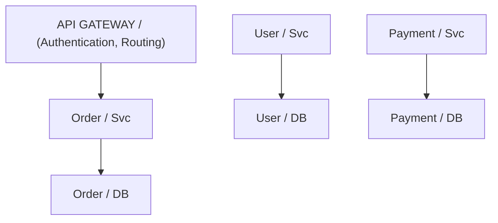

#### 2. Event-Driven Architecture

```
┌─────────────────────────────────────────────────────────────┐
│                  EVENT-DRIVEN PATTERN                       │
├─────────────────────────────────────────────────────────────┤
│                                                             │
│  Producer ────► Event Bus ────► Consumers                   │
│                 (Kafka/SQS)                                 │
│                                                             │
│  ┌──────────┐    ┌─────────┐    ┌──────────────┐            │
│  │Order     │───►│ ORDER   │───►│ Inventory    │            │
│  │Service   │    │ CREATED │    │ Service      │            │
│  └──────────┘    │ EVENT   │    ├──────────────┤            │
│                  └─────────┘───►│ Notification │            │
│                              │  │ Service      │            │
│                              │  ├──────────────┤            │
│                              └─►│ Analytics    │            │
│                                 │ Service      │            │
│                                 └──────────────┘            │
│                                                             │
│  Benefits: Loose coupling, Scalability, Resilience          │
└─────────────────────────────────────────────────────────────┘
```

**Flow:**
1. Order / Service
2. ORDER / CREATED / EVENT
3. Inventory / Service / Notification / Service / Analytic

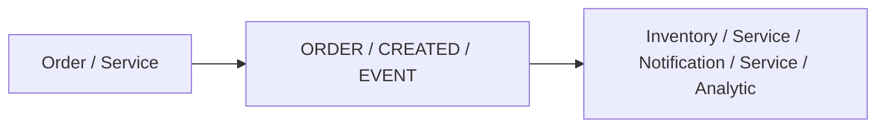

#### 3. Serverless Architecture

```
┌─────────────────────────────────────────────────────────────┐
│                    SERVERLESS PATTERN                       │
├─────────────────────────────────────────────────────────────┤
│                                                             │
│  Client ──► API Gateway ──► Lambda ──► DynamoDB             │
│                   │                                         │
│                   └──► Lambda ──► S3                        │
│                                                             │
│  Pricing: Pay only for execution time                       │
│  Scaling: Automatic (0 to millions)                         │
│  Management: Zero server maintenance                        │
│                                                             │
│  Use Cases:                                                 │
│  • REST APIs                                                │
│  • File processing                                          │
│  • Scheduled tasks                                          │
│  • Event processing                                         │
└─────────────────────────────────────────────────────────────┘
```

**Flow:**
1. SERVERLESS PATTERN
2. Client API Gateway Lambda DynamoDB
3. Lambda S3
4. Pricing: Pay only for execution time
5. Scaling: Automatic (0 to millions)
6. Management: Zero server maintenance
7. Use Cases:

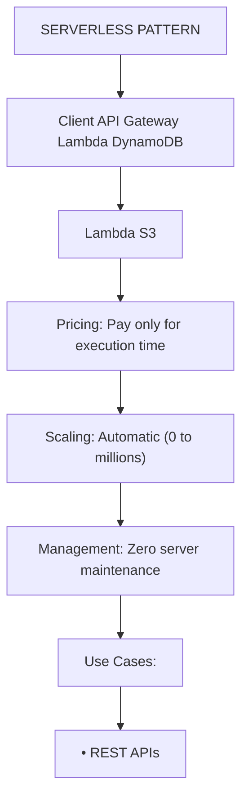

### Cloud Certifications Roadmap

```
BEGINNER
├── AWS Cloud Practitioner (CLF-C02)
├── Azure Fundamentals (AZ-900)
└── Google Cloud Digital Leader

INTERMEDIATE
├── AWS Solutions Architect Associate (SAA-C03)
├── Azure Administrator (AZ-104)
└── AWS Developer Associate (DVA-C02)

ADVANCED
├── AWS Solutions Architect Professional
├── Azure Solutions Architect Expert
└── AWS DevOps Engineer Professional

SPECIALTY
├── AWS Security Specialty
├── AWS Database Specialty
└── Azure Security Engineer
```

**Flow:**
1. BEGINNER
2. AWS Cloud Practitioner (CLF-C02)
3. BEGINNER
4. Azure Fundamentals (AZ-900)
5. BEGINNER
6. Google Cloud Digital Leader
7. INTERMEDIATE
8. AWS Solutions Architect Associate (SAA-C03)
9. INTERMEDIATE
10. Azure Administrator (AZ-104)
11. INTERMEDIATE
12. AWS Developer Associate (DVA-C02)

```mermaid
flowchart TD
    N1["BEGINNER"]
    N2["AWS Cloud Practitioner (CLF-C02)"]
    N3["Azure Fundamentals (AZ-900)"]
    N4["Google Cloud Digital Leader"]
    N5["INTERMEDIATE"]
    N6["AWS Solutions Architect Associate (SAA-C03)"]
    N7["Azure Administrator (AZ-104)"]
    N8["AWS Developer Associate (DVA-C02)"]
    N9["ADVANCED"]
    N10["AWS Solutions Architect Professional"]
    N11["Azure Solutions Architect Expert"]
    N12["AWS DevOps Engineer Professional"]
    N13["SPECIALTY"]
    N14["AWS Security Specialty"]
    N15["AWS Database Specialty"]
    N16["Azure Security Engineer"]
    N1 --> N2
    N1 --> N3
    N1 --> N4
    N5 --> N6
    N5 --> N7
    N5 --> N8
    N9 --> N10
    N9 --> N11
    N9 --> N12
    N13 --> N14
    N13 --> N15
    N13 --> N16
```

### Learning Resources - Cloud

| Resource                  | Type              | Link                              |
| ------------------------- | ----------------- | --------------------------------- |
| AWS Skill Builder         | Official Training | https://skillbuilder.aws/         |
| Microsoft Learn           | Official Training | https://learn.microsoft.com/      |
| A Cloud Guru              | Course Platform   | https://acloudguru.com/           |
| Adrian Cantrill           | AWS Courses       | https://learn.cantrill.io/        |
| AWS Well-Architected Labs | Hands-on          | https://wellarchitectedlabs.com/  |
| Cloud Resume Challenge    | Project           | https://cloudresumechallenge.dev/ |

---

## Domain Knowledge - Banking

### Why Banking Domain?

- India's fintech market: $150 billion by 2025
- Digital payments growing 50%+ annually
- Banks spending heavily on modernization
- High demand for techno-functional experts

### Banking Domain Concepts

#### Core Banking System

```
┌─────────────────────────────────────────────────────────────┐
│                  CORE BANKING ARCHITECTURE                  │
├─────────────────────────────────────────────────────────────┤
│                                                             │
│  ┌─────────────┐    ┌─────────────┐    ┌─────────────┐      │
│  │ CHANNELS    │    │ MIDDLEWARE  │    │ CORE SYSTEM │      │
│  ├─────────────┤    ├─────────────┤    ├─────────────┤      │
│  │ Mobile App  │───►│ API Gateway │───►│ Account     │      │
│  │ Web Banking │    │ ESB         │    │ Management  │      │
│  │ ATM         │    │ Integration │    │             │      │
│  │ Branch      │    │ Layer       │    │ Transaction │      │
│  │ USSD        │    │             │    │ Processing  │      │
│  └─────────────┘    └─────────────┘    │             │      │
│                                         │ GL Posting  │     │
│                                         └──────┬──────┘     │
│                                                │            │
│                                         ┌──────▼──────┐     │
│                                         │  DATABASE   │     │
│                                         │  (Oracle)   │     │
│                                         └─────────────┘     │
└─────────────────────────────────────────────────────────────┘
```

**Flow:**
1. CHANNELS / Mobile App / Web Banking / ATM / Branch / US
2. MIDDLEWARE / API Gateway / ESB / Integration / Layer
3. CORE SYSTEM / Account / Management / Transaction / Proc
4. DATABASE / (Oracle)

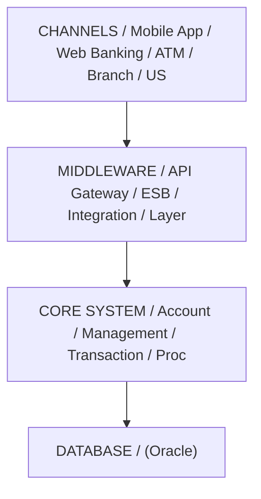

#### Key Banking Terms

| Term                    | Definition                           | Technical Relevance                     |
| ----------------------- | ------------------------------------ | --------------------------------------- |
| **GL (General Ledger)** | Record of all financial transactions | Double-entry system, ACID compliance    |
| **T+1, T+2 Settlement** | Transaction settlement timeline      | Batch processing, reconciliation        |
| **KYC**                 | Know Your Customer                   | Identity verification, ML for fraud     |
| **AML**                 | Anti-Money Laundering                | Pattern detection, regulatory reporting |
| **SWIFT**               | International transfer network       | Message formats, MT103, ISO20022        |
| **IMPS/NEFT/RTGS**      | Indian payment systems               | Real-time processing, batch processing  |
| **UPI**                 | Unified Payments Interface           | API integration, instant settlement     |
| **PCI-DSS**             | Payment Card Industry Security       | Encryption, tokenization, audit trails  |

#### Payment Processing Flow

```
┌───────────────────────────────────────────────────────────────┐
│                 UPI PAYMENT FLOW                              │
├───────────────────────────────────────────────────────────────┤
│                                                               │
│  PAYER           PSP            NPCI            PAYEE         │
│  (You)        (PhonePe)      (Switch)         (Merchant)      │
│    │              │              │               │            │
│    │──Pay Req────►│              │               │            │
│    │              │──Validate───►│               │            │
│    │              │              │──Check Acct──►│            │
│    │              │              │◄──Confirm────│             │
│    │              │◄──Route──────│               │            │
│    │◄──PIN Req───│              │               │             │
│    │──PIN────────►│              │               │            │
│    │              │──Debit Req──►│               │            │
│    │              │              │──Debit───────►│            │
│    │              │              │──Credit──────►│(Payee Bank)│
│    │              │◄──Success───│               │             │
│    │◄──Success───│              │               │             │
│    │              │               │               │           │
│  ◄──────────── ~2-3 seconds ────────────────────►             │
└───────────────────────────────────────────────────────────────┘
```

**Flow:**
1. UPI PAYMENT FLOW
2. PAYER PSP NPCI PAYEE
3. Pay Req
4. Validate
5. Check Acct
6. Confirm
7. Route

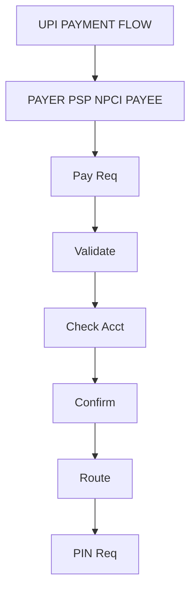

### Banking Data Structures

```java
// Account Entity
public class Account {
    private String accountNumber;      // 12-16 digits, check digit validated
    private AccountType type;          // SAVINGS, CURRENT, FIXED_DEPOSIT
    private BigDecimal balance;        // Never use float for money!
    private Currency currency;
    private AccountStatus status;
    private LocalDateTime lastActivity;
    private List<AccountHolder> holders; // Joint accounts
    private List<Nominee> nominees;
}

// Transaction with Double-Entry Accounting
public class Transaction {
    private String txnId;              // UUID
    private Account debitAccount;      // Money from
    private Account creditAccount;     // Money to
    private BigDecimal amount;
    private TransactionType type;
    private TransactionStatus status;
    private LocalDateTime timestamp;
    private String narration;

    // Audit fields
    private String initiatedBy;
    private String approvedBy;
    private String ipAddress;
    private String deviceId;
}
```

### Banking Projects (Beginner to Advanced)

#### Project 1: Personal Finance Tracker (Beginner)

**Objective**: Build a basic expense tracking application

```
Features:
├── User registration/login
├── Add income/expense transactions
├── Categorize transactions
├── Monthly/yearly reports
├── Budget alerts
└── Export to CSV/PDF

Tech Stack:
├── Backend: Java Spring Boot
├── Database: PostgreSQL
├── Frontend: React
└── Charts: Chart.js

Data Structures Used:
├── HashMap for category-wise aggregation
├── TreeMap for date-sorted transactions
├── PriorityQueue for budget alerts
└── Trie for autocomplete categories
```

**Flow:**
1. Features:
2. User registration/login
3. Features:
4. Add income/expense transactions
5. Features:
6. Categorize transactions
7. Features:
8. Monthly/yearly reports
9. Features:
10. Budget alerts
11. Features:
12. Export to CSV/PDF

```mermaid
flowchart TD
    N1["Features:"]
    N2["User registration/login"]
    N3["Add income/expense transactions"]
    N4["Categorize transactions"]
    N5["Monthly/yearly reports"]
    N6["Budget alerts"]
    N7["Export to CSV/PDF"]
    N8["Tech Stack:"]
    N9["Backend: Java Spring Boot"]
    N10["Database: PostgreSQL"]
    N11["Frontend: React"]
    N12["Charts: Chart.js"]
    N13["Data Structures Used:"]
    N14["HashMap for category-wise aggregation"]
    N15["TreeMap for date-sorted transactions"]
    N16["PriorityQueue for budget alerts"]
    N17["Trie for autocomplete categories"]
    N1 --> N2
    N1 --> N3
    N1 --> N4
    N1 --> N5
    N1 --> N6
    N1 --> N7
    N8 --> N9
    N8 --> N10
    N8 --> N11
    N8 --> N12
    N13 --> N14
    N13 --> N15
    N13 --> N16
    N13 --> N17
```

**Learning Resources**:

- Java Spring Boot: https://spring.io/guides
- PostgreSQL: https://www.postgresqltutorial.com/
- Financial APIs: https://plaid.com/docs/

#### Project 2: Payment Gateway Integration (Intermediate)

**Objective**: Build a payment processing system

```
Features:
├── Multiple payment methods (Card, UPI, Net Banking)
├── Secure tokenization
├── Webhook handling
├── Refund processing
├── Transaction reconciliation
├── Retry mechanism for failures
└── Dashboard with analytics

Tech Stack:
├── Backend: Java/Node.js
├── Message Queue: RabbitMQ/Kafka
├── Database: PostgreSQL + Redis
├── Payment APIs: Razorpay/Stripe
└── Monitoring: Prometheus + Grafana

System Design Concepts:
├── Idempotency keys
├── Distributed transactions
├── Event sourcing
├── Circuit breaker pattern
└── Rate limiting
```

**Flow:**
1. Features:
2. Multiple payment methods (Card, UPI, Net Banking)
3. Features:
4. Secure tokenization
5. Features:
6. Webhook handling
7. Features:
8. Refund processing
9. Features:
10. Transaction reconciliation
11. Features:
12. Retry mechanism for failures

```mermaid
flowchart TD
    N1["Features:"]
    N2["Multiple payment methods (Card, UPI, Net Banking)"]
    N3["Secure tokenization"]
    N4["Webhook handling"]
    N5["Refund processing"]
    N6["Transaction reconciliation"]
    N7["Retry mechanism for failures"]
    N8["Dashboard with analytics"]
    N9["Tech Stack:"]
    N10["Backend: Java/Node.js"]
    N11["Message Queue: RabbitMQ/Kafka"]
    N12["Database: PostgreSQL + Redis"]
    N13["Payment APIs: Razorpay/Stripe"]
    N14["Monitoring: Prometheus + Grafana"]
    N15["System Design Concepts:"]
    N16["Idempotency keys"]
    N17["Distributed transactions"]
    N18["Event sourcing"]
    N19["Circuit breaker pattern"]
    N20["Rate limiting"]
    N1 --> N2
    N1 --> N3
    N1 --> N4
    N1 --> N5
    N1 --> N6
    N1 --> N7
    N1 --> N8
    N9 --> N10
    N9 --> N11
    N9 --> N12
    N9 --> N13
    N9 --> N14
    N15 --> N16
    N15 --> N17
    N15 --> N18
    N15 --> N19
    N15 --> N20
```

**Learning Resources**:

- Razorpay Docs: https://razorpay.com/docs/
- Stripe Docs: https://stripe.com/docs
- Event Sourcing: https://martinfowler.com/eaaDev/EventSourcing.html

#### Project 3: Fraud Detection System (Advanced)

**Objective**: Build real-time fraud detection for transactions

```
Features:
├── Real-time transaction scoring
├── ML-based anomaly detection
├── Rule engine for known patterns
├── Velocity checks
├── Device fingerprinting
├── Geographic analysis
└── Alert generation

Architecture:
┌─────────────────────────────────────────────────────────────┐
│  Transaction ──► Kafka ──► Flink ──► ML Model ──► Decision  │
│       │                       │                      │      │
│       │                       ▼                      ▼      │
│       └────────────────► Rules Engine ─────────► Alert      │
│                                                     │       │
│                                               ┌─────▼─────┐ │
│                                               │ Dashboard │ │
│                                               └───────────┘ │
└─────────────────────────────────────────────────────────────┘

ML Features:
├── Transaction amount deviation
├── Time between transactions
├── Geographic velocity
├── Device/IP reputation
├── Merchant category risk
└── Historical spending patterns
```

**Flow:**
1. Features: / Real-time transaction scoring / ML-based an
2. Rules Engine Alert
3. Dashboard / ML Features: / Transaction amount deviation

```mermaid
flowchart TD
    N1["Features: / Real-time transaction scoring / ML-based an"]
    N2["Rules Engine Alert"]
    N3["Dashboard / ML Features: / Transaction amount deviation"]
    N1 --> N2
    N2 --> N3
```

**Learning Resources**:

- Apache Kafka: https://kafka.apache.org/documentation/
- Apache Flink: https://flink.apache.org/
- Fraud Detection ML: https://www.kaggle.com/datasets/mlg-ulb/creditcardfraud
- Feature Engineering for Finance: https://feature-engine.readthedocs.io/

#### Project 4: Core Banking System (Expert)

**Objective**: Build a simplified core banking system

```
Modules:
├── Customer Management (KYC, CIF)
├── Account Management (Open, Close, Dormant)
├── Transaction Processing (Credit, Debit, Transfer)
├── Interest Calculation (Daily, Monthly)
├── Statement Generation
├── GL Posting (Double-entry)
├── Regulatory Reporting
└── Audit Trail

Key Challenges:
├── ACID compliance across distributed systems
├── End-of-day batch processing
├── Interest accrual algorithms
├── Multi-currency support
├── Regulatory compliance
└── High availability (99.99%)

Tech Stack:
├── Backend: Java Spring Boot + Microservices
├── Database: Oracle/PostgreSQL
├── Caching: Redis
├── Messaging: Kafka
├── Batch: Spring Batch
├── Orchestration: Kubernetes
└── Monitoring: ELK Stack
```

**Flow:**
1. Modules:
2. Customer Management (KYC, CIF)
3. Modules:
4. Account Management (Open, Close, Dormant)
5. Modules:
6. Transaction Processing (Credit, Debit, Transfer)
7. Modules:
8. Interest Calculation (Daily, Monthly)
9. Modules:
10. Statement Generation
11. Modules:
12. GL Posting (Double-entry)

```mermaid
flowchart TD
    N1["Modules:"]
    N2["Customer Management (KYC, CIF)"]
    N3["Account Management (Open, Close, Dormant)"]
    N4["Transaction Processing (Credit, Debit, Transfer)"]
    N5["Interest Calculation (Daily, Monthly)"]
    N6["Statement Generation"]
    N7["GL Posting (Double-entry)"]
    N8["Regulatory Reporting"]
    N9["Audit Trail"]
    N10["Key Challenges:"]
    N11["ACID compliance across distributed systems"]
    N12["End-of-day batch processing"]
    N13["Interest accrual algorithms"]
    N14["Multi-currency support"]
    N15["Regulatory compliance"]
    N16["High availability (99.99%)"]
    N17["Tech Stack:"]
    N18["Backend: Java Spring Boot + Microservices"]
    N19["Database: Oracle/PostgreSQL"]
    N20["Caching: Redis"]
    N21["Messaging: Kafka"]
    N22["Batch: Spring Batch"]
    N23["Orchestration: Kubernetes"]
    N24["Monitoring: ELK Stack"]
    N1 --> N2
    N1 --> N3
    N1 --> N4
    N1 --> N5
    N1 --> N6
    N1 --> N7
    N1 --> N8
    N1 --> N9
    N10 --> N11
    N10 --> N12
    N10 --> N13
    N10 --> N14
    N10 --> N15
    N10 --> N16
    N17 --> N18
    N17 --> N19
    N17 --> N20
    N17 --> N21
    N17 --> N22
    N17 --> N23
    N17 --> N24
```

---


## Domain Knowledge - Healthcare

### Why Healthcare Domain?

- Global digital health market: $650 billion by 2025
- Post-COVID acceleration of telemedicine
- Health data regulations (HIPAA, GDPR)
- Integration challenges (HL7, FHIR)

### Healthcare Domain Concepts

#### Healthcare System Architecture

```
┌─────────────────────────────────────────────────────────────┐
│                  HEALTHCARE IT ECOSYSTEM                    │
├─────────────────────────────────────────────────────────────┤
│                                                             │
│  ┌─────────────┐    ┌─────────────┐    ┌─────────────┐      │
│  │  CLINICAL   │    │   ADMIN     │    │  ANALYTICS  │      │
│  │  SYSTEMS    │    │  SYSTEMS    │    │  PLATFORM   │      │
│  ├─────────────┤    ├─────────────┤    ├─────────────┤      │
│  │ EHR/EMR     │    │ Billing     │    │ Population  │      │
│  │ Lab Systems │◄──►│ Scheduling  │◄──►│ Health      │      │
│  │ Imaging     │    │ Insurance   │    │ AI/ML       │      │
│  │ Pharmacy    │    │ Claims      │    │ Reporting   │      │
│  └─────────────┘    └─────────────┘    └─────────────┘      │
│         │                  │                  │             │
│         └──────────────────┼──────────────────┘             │
│                            │                                │
│                   ┌────────▼────────┐                       │
│                   │  INTEGRATION    │                       │
│                   │  ENGINE         │                       │
│                   │  (HL7/FHIR)     │                       │
│                   └─────────────────┘                       │
└─────────────────────────────────────────────────────────────┘
```

**Flow:**
1. ADMIN / SYSTEMS / Billing / Scheduling / Insurance / Cl
2. CLINICAL / SYSTEMS / EHR/EMR / Lab Systems / Imaging /
3. ANALYTICS / PLATFORM / Population / Health / AI/ML / Re
4. ADMIN / SYSTEMS / Billing / Scheduling / Insurance / Cl
5. INTEGRATION / ENGINE / (HL7/FHIR)

```mermaid
flowchart TD
    N1["CLINICAL / SYSTEMS / EHR/EMR / Lab Systems / Imaging / "]
    N2["ADMIN / SYSTEMS / Billing / Scheduling / Insurance / Cl"]
    N3["ANALYTICS / PLATFORM / Population / Health / AI/ML / Re"]
    N4["INTEGRATION / ENGINE / (HL7/FHIR)"]
    N2 --> N1
    N3 --> N2
    N2 --> N4
```

#### Key Healthcare Terms

| Term        | Definition                       | Technical Relevance             |
| ----------- | -------------------------------- | ------------------------------- |
| **EHR/EMR** | Electronic Health Records        | Data modeling, interoperability |
| **HL7**     | Health Level 7 messaging         | Message parsing, transformation |
| **FHIR**    | Fast Healthcare Interoperability | REST APIs, JSON/XML resources   |
| **ICD-10**  | Disease classification codes     | Validation, mapping             |
| **CPT**     | Procedure codes                  | Billing integration             |
| **HIPAA**   | US health data privacy law       | Encryption, audit trails        |
| **PHI**     | Protected Health Information     | Data masking, access control    |
| **DICOM**   | Medical imaging standard         | Image processing, storage       |

#### FHIR Resource Example

```json
{
    "resourceType": "Patient",
    "id": "example",
    "identifier": [
        {
            "system": "http://hospital.com/patients",
            "value": "12345"
        }
    ],
    "name": [
        {
            "use": "official",
            "family": "Smith",
            "given": ["John"]
        }
    ],
    "gender": "male",
    "birthDate": "1990-01-15",
    "address": [
        {
            "use": "home",
            "city": "Mumbai",
            "country": "India"
        }
    ]
}
```

### Healthcare Projects

#### Project 1: Patient Management System (Beginner)

**Objective**: Basic patient registration and appointment system

```
Features:
├── Patient registration
├── Doctor profiles
├── Appointment scheduling
├── Medical history tracking
├── Prescription management
└── Basic reporting

Tech Stack:
├── Backend: Python Django/Java Spring
├── Database: PostgreSQL
├── Frontend: React
└── PDF Generation: ReportLab/iText

Data Models:
├── Patient (demographics, insurance)
├── Provider (doctors, specialists)
├── Appointment (scheduling, status)
├── MedicalRecord (diagnoses, notes)
└── Prescription (medications, dosage)
```

**Flow:**
1. Features:
2. Patient registration
3. Features:
4. Doctor profiles
5. Features:
6. Appointment scheduling
7. Features:
8. Medical history tracking
9. Features:
10. Prescription management
11. Features:
12. Basic reporting

```mermaid
flowchart TD
    N1["Features:"]
    N2["Patient registration"]
    N3["Doctor profiles"]
    N4["Appointment scheduling"]
    N5["Medical history tracking"]
    N6["Prescription management"]
    N7["Basic reporting"]
    N8["Tech Stack:"]
    N9["Backend: Python Django/Java Spring"]
    N10["Database: PostgreSQL"]
    N11["Frontend: React"]
    N12["PDF Generation: ReportLab/iText"]
    N13["Data Models:"]
    N14["Patient (demographics, insurance)"]
    N15["Provider (doctors, specialists)"]
    N16["Appointment (scheduling, status)"]
    N17["MedicalRecord (diagnoses, notes)"]
    N18["Prescription (medications, dosage)"]
    N1 --> N2
    N1 --> N3
    N1 --> N4
    N1 --> N5
    N1 --> N6
    N1 --> N7
    N8 --> N9
    N8 --> N10
    N8 --> N11
    N8 --> N12
    N13 --> N14
    N13 --> N15
    N13 --> N16
    N13 --> N17
    N13 --> N18
```

#### Project 2: Telemedicine Platform (Intermediate)

**Objective**: Video consultation platform with scheduling

```
Features:
├── Video/audio consultation
├── Appointment booking
├── Digital prescriptions
├── Payment integration
├── Medical records access
├── Chat functionality
└── Follow-up reminders

Tech Stack:
├── Backend: Node.js/Python
├── Video: WebRTC/Twilio
├── Database: MongoDB + PostgreSQL
├── Storage: AWS S3 (HIPAA compliant)
└── Notifications: Firebase

Security Considerations:
├── End-to-end encryption
├── HIPAA compliance
├── Access control (RBAC)
├── Audit logging
└── Data anonymization
```

**Flow:**
1. Features:
2. Video/audio consultation
3. Features:
4. Appointment booking
5. Features:
6. Digital prescriptions
7. Features:
8. Payment integration
9. Features:
10. Medical records access
11. Features:
12. Chat functionality

```mermaid
flowchart TD
    N1["Features:"]
    N2["Video/audio consultation"]
    N3["Appointment booking"]
    N4["Digital prescriptions"]
    N5["Payment integration"]
    N6["Medical records access"]
    N7["Chat functionality"]
    N8["Follow-up reminders"]
    N9["Tech Stack:"]
    N10["Backend: Node.js/Python"]
    N11["Video: WebRTC/Twilio"]
    N12["Database: MongoDB + PostgreSQL"]
    N13["Storage: AWS S3 (HIPAA compliant)"]
    N14["Notifications: Firebase"]
    N15["Security Considerations:"]
    N16["End-to-end encryption"]
    N17["HIPAA compliance"]
    N18["Access control (RBAC)"]
    N19["Audit logging"]
    N20["Data anonymization"]
    N1 --> N2
    N1 --> N3
    N1 --> N4
    N1 --> N5
    N1 --> N6
    N1 --> N7
    N1 --> N8
    N9 --> N10
    N9 --> N11
    N9 --> N12
    N9 --> N13
    N9 --> N14
    N15 --> N16
    N15 --> N17
    N15 --> N18
    N15 --> N19
    N15 --> N20
```

**Learning Resources**:

- WebRTC: https://webrtc.org/getting-started/overview
- Twilio Video: https://www.twilio.com/docs/video
- HIPAA for Developers: https://www.hhs.gov/hipaa/for-professionals/

#### Project 3: Medical Imaging Analysis (Advanced)

**Objective**: AI-powered X-ray/CT scan analysis

```
Features:
├── DICOM image upload/viewing
├── AI-based anomaly detection
├── Report generation
├── Radiologist review workflow
├── Integration with PACS
└── Model explainability

Architecture:
┌─────────────────────────────────────────────────────────────┐
│                                                             │
│  Upload ──► Preprocessing ──► AI Model ──► Results          │
│    │              │              │            │             │
│    ▼              ▼              ▼            ▼             │
│  DICOM        Normalize      ResNet/       Heatmap          │
│  Parser       Resize         VGG/Custom    Generation       │
│               Augment                       + Report        │
│                                                             │
└─────────────────────────────────────────────────────────────┘

ML Approach:
├── Transfer learning from ImageNet
├── Fine-tuning on medical datasets
├── Grad-CAM for explainability
├── Ensemble methods for accuracy
└── Continuous learning pipeline
```

**Flow:**
1. Features:
2. DICOM image upload/viewing
3. AI-based anomaly detection
4. Report generation
5. Radiologist review workflow
6. Integration with PACS
7. Model explainability

```mermaid
flowchart TD
    N1["Features:"]
    N2["DICOM image upload/viewing"]
    N3["AI-based anomaly detection"]
    N4["Report generation"]
    N5["Radiologist review workflow"]
    N6["Integration with PACS"]
    N7["Model explainability"]
    N8["Architecture:"]
    N1 --> N2
    N2 --> N3
    N3 --> N4
    N4 --> N5
    N5 --> N6
    N6 --> N7
    N7 --> N8
```

**Learning Resources**:

- PyDicom: https://pydicom.github.io/
- Medical Imaging Datasets: https://www.kaggle.com/datasets/nih-chest-xrays
- Deep Learning for Medical Imaging: https://github.com/BMEII-AI/RadImageNet

---


## Domain Knowledge - Telecom

### Why Telecom Domain?

- 5G rollout creating massive opportunities
- IoT explosion (billions of connected devices)
- Network virtualization (NFV/SDN)
- India's telecom market: $50+ billion

### Telecom Domain Concepts

#### Telecom Architecture

```
┌─────────────────────────────────────────────────────────────┐
│                  TELECOM NETWORK ARCHITECTURE               │
├─────────────────────────────────────────────────────────────┤
│                                                             │
│  ┌─────────────┐    ┌─────────────┐    ┌─────────────┐      │
│  │  ACCESS     │    │   CORE      │    │  SERVICES   │      │
│  │  NETWORK    │    │   NETWORK   │    │  LAYER      │      │
│  ├─────────────┤    ├─────────────┤    ├─────────────┤      │
│  │ Cell Towers │───►│ Routing     │───►│ Billing     │      │
│  │ Wi-Fi       │    │ Switching   │    │ CRM         │      │
│  │ Fiber       │    │ Core (EPC)  │    │ VAS         │      │
│  │ 5G NR       │    │ IMS         │    │ OTT         │      │
│  └─────────────┘    └─────────────┘    └─────────────┘      │
│         │                  │                  │             │
│         └──────────────────┴──────────────────┘             │
│                            │                                │
│                   ┌────────▼────────┐                       │
│                   │      OSS/BSS    │                       │
│                   │  (Operations &  │                       │
│                   │   Business      │                       │
│                   │   Support)      │                       │
│                   └─────────────────┘                       │
└─────────────────────────────────────────────────────────────┘
```

**Flow:**
1. ACCESS / NETWORK / Cell Towers / Wi-Fi / Fiber / 5G NR
2. CORE / NETWORK / Routing / Switching / Core (EPC) / IMS
3. SERVICES / LAYER / Billing / CRM / VAS / OTT
4. CORE / NETWORK / Routing / Switching / Core (EPC) / IMS
5. OSS/BSS / (Operations & / Business / Support)

```mermaid
flowchart TD
    N1["ACCESS / NETWORK / Cell Towers / Wi-Fi / Fiber / 5G NR"]
    N2["CORE / NETWORK / Routing / Switching / Core (EPC) / IMS"]
    N3["SERVICES / LAYER / Billing / CRM / VAS / OTT"]
    N4["OSS/BSS / (Operations & / Business / Support)"]
    N1 --> N2
    N2 --> N3
    N2 --> N4
```

#### Key Telecom Terms

| Term      | Definition                      | Technical Relevance                |
| --------- | ------------------------------- | ---------------------------------- |
| **OSS**   | Operations Support System       | Network management, fault handling |
| **BSS**   | Business Support System         | Billing, CRM, order management     |
| **CDR**   | Call Detail Records             | Big data processing, analytics     |
| **VoLTE** | Voice over LTE                  | Real-time communication            |
| **IMS**   | IP Multimedia Subsystem         | SIP protocol, session management   |
| **NFV**   | Network Function Virtualization | Cloud-native network functions     |
| **SDN**   | Software Defined Networking     | Programmable networks              |
| **MVNO**  | Mobile Virtual Network Operator | API integrations                   |

#### CDR Processing

```
CDR (Call Detail Record):
┌─────────────────────────────────────────────────────────────┐
│  Calling Number: +91-9876543210                             │
│  Called Number:  +91-9123456789                             │
│  Start Time:     2024-01-15 14:30:00                        │
│  Duration:       180 seconds                                │
│  Call Type:      Voice                                      │
│  Cell Tower:     MH-MUM-123                                 │
│  Cost:           ₹3.00                                      │
│  Quality Score:  4.5/5                                      │
└─────────────────────────────────────────────────────────────┘

Processing Pipeline:
Raw CDR ──► Parser ──► Validation ──► Rating ──► Billing ──► Analytics
                           │
                           └──► Fraud Detection
                           └──► Network Optimization
                           └──► Customer Insights
```

**Flow:**
1. CDR (Call Detail Record):
2. Calling Number: +91-9876543210
3. Called Number: +91-9123456789
4. Start Time: 2024-01-15 14:30:00
5. Duration: 180 seconds
6. Call Type: Voice
7. Cell Tower: MH-MUM-123

```mermaid
flowchart TD
    N1["CDR (Call Detail Record):"]
    N2["Calling Number: +91-9876543210"]
    N3["Called Number: +91-9123456789"]
    N4["Start Time: 2024-01-15 14:30:00"]
    N5["Duration: 180 seconds"]
    N6["Call Type: Voice"]
    N7["Cell Tower: MH-MUM-123"]
    N8["Cost: ₹3.00"]
    N1 --> N2
    N2 --> N3
    N3 --> N4
    N4 --> N5
    N5 --> N6
    N6 --> N7
    N7 --> N8
```

### Telecom Projects

#### Project 1: Prepaid Recharge System (Beginner)

**Objective**: Basic mobile recharge application

```
Features:
├── User registration with mobile verification
├── Recharge plan display
├── Payment integration
├── Balance tracking
├── Transaction history
├── Plan recommendations
└── Notifications (SMS/Push)

Tech Stack:
├── Backend: Java Spring Boot
├── Database: MySQL + Redis
├── Payment: Razorpay/Paytm
├── SMS: Twilio/MSG91
└── Frontend: React Native

Key Data Structures:
├── HashMap for plan caching
├── Queue for async processing
├── Trie for mobile number validation
└── LRU Cache for popular plans
```

**Flow:**
1. Features:
2. User registration with mobile verification
3. Features:
4. Recharge plan display
5. Features:
6. Payment integration
7. Features:
8. Balance tracking
9. Features:
10. Transaction history
11. Features:
12. Plan recommendations

```mermaid
flowchart TD
    N1["Features:"]
    N2["User registration with mobile verification"]
    N3["Recharge plan display"]
    N4["Payment integration"]
    N5["Balance tracking"]
    N6["Transaction history"]
    N7["Plan recommendations"]
    N8["Notifications (SMS/Push)"]
    N9["Tech Stack:"]
    N10["Backend: Java Spring Boot"]
    N11["Database: MySQL + Redis"]
    N12["Payment: Razorpay/Paytm"]
    N13["SMS: Twilio/MSG91"]
    N14["Frontend: React Native"]
    N15["Key Data Structures:"]
    N16["HashMap for plan caching"]
    N17["Queue for async processing"]
    N18["Trie for mobile number validation"]
    N19["LRU Cache for popular plans"]
    N1 --> N2
    N1 --> N3
    N1 --> N4
    N1 --> N5
    N1 --> N6
    N1 --> N7
    N1 --> N8
    N9 --> N10
    N9 --> N11
    N9 --> N12
    N9 --> N13
    N9 --> N14
    N15 --> N16
    N15 --> N17
    N15 --> N18
    N15 --> N19
```

#### Project 2: Network Monitoring Dashboard (Intermediate)

**Objective**: Real-time network health monitoring

```
Features:
├── Real-time network metrics
├── Alert generation
├── Historical analysis
├── Topology visualization
├── Threshold configuration
├── Report generation
└── Incident management

Architecture:
┌─────────────────────────────────────────────────────────────┐
│                                                             │
│  Network ──► Collectors ──► Time-Series DB ──► Dashboard    │
│  Devices     (SNMP/gRPC)    (InfluxDB/        (Grafana)     │
│                              Prometheus)                    │
│                                 │                           │
│                                 ▼                           │
│                           Alert Manager                     │
│                           (PagerDuty/                       │
│                            Custom)                          │
└─────────────────────────────────────────────────────────────┘

Metrics to Track:
├── Network latency
├── Packet loss
├── Bandwidth utilization
├── Error rates
├── Device health
└── SLA compliance
```

**Flow:**
1. Features:
2. Real-time network metrics
3. Alert generation
4. Historical analysis
5. Topology visualization
6. Threshold configuration
7. Report generation

```mermaid
flowchart TD
    N1["Features:"]
    N2["Real-time network metrics"]
    N3["Alert generation"]
    N4["Historical analysis"]
    N5["Topology visualization"]
    N6["Threshold configuration"]
    N7["Report generation"]
    N8["Incident management"]
    N1 --> N2
    N2 --> N3
    N3 --> N4
    N4 --> N5
    N5 --> N6
    N6 --> N7
    N7 --> N8
```

**Learning Resources**:

- SNMP Protocol: https://www.snmp.com/
- Prometheus: https://prometheus.io/docs/
- Grafana: https://grafana.com/docs/

#### Project 3: Billing & Rating Engine (Advanced)

**Objective**: Real-time usage rating and billing system

```
Features:
├── Real-time usage rating
├── Multiple pricing plans
├── Proration support
├── Invoice generation
├── Usage alerts
├── Revenue assurance
└── Fraud detection

Rating Engine Design:
┌─────────────────────────────────────────────────────────────┐
│                                                             │
│  CDR Input ──► Validation ──► Rating ──► Charging           │
│       │            │            │           │               │
│       │            ▼            ▼           ▼               │
│       │        Schema       Rate Tables  Balance            │
│       │        Check        Lookup       Update             │
│       │                                                     │
│       └───► Mediation ──► Aggregation ──► Invoice           │
│                                                             │
└─────────────────────────────────────────────────────────────┘

Technical Challenges:
├── High throughput (millions of CDRs/hour)
├── Complex rating rules
├── Real-time balance updates
├── Multi-currency support
├── Revenue leakage prevention
└── Regulatory compliance
```

**Flow:**
1. Features:
2. Real-time usage rating
3. Multiple pricing plans
4. Proration support
5. Invoice generation
6. Usage alerts
7. Revenue assurance

```mermaid
flowchart TD
    N1["Features:"]
    N2["Real-time usage rating"]
    N3["Multiple pricing plans"]
    N4["Proration support"]
    N5["Invoice generation"]
    N6["Usage alerts"]
    N7["Revenue assurance"]
    N8["Fraud detection"]
    N1 --> N2
    N2 --> N3
    N3 --> N4
    N4 --> N5
    N5 --> N6
    N6 --> N7
    N7 --> N8
```

---


## Product Mindset Development

### From Coder to Product Thinker

```
┌─────────────────────────────────────────────────────────────┐
│              MINDSET TRANSFORMATION                         │
├─────────────────────────────────────────────────────────────┤
│                                                             │
│  EMPLOYEE MINDSET          PRODUCT MINDSET                  │
│  ─────────────────         ───────────────                  │
│  "Tell me what to do"      "Let me solve this problem"      │
│  "It's not my job"         "How can I help?"                │
│  "Requirements are unclear" "Let me clarify and propose"    │
│  "It's working"            "Is it valuable to users?"       │
│  "Feature is done"         "Let's measure the impact"       │
│                                                             │
└─────────────────────────────────────────────────────────────┘
```

**Flow:**
1. MINDSET TRANSFORMATION
2. EMPLOYEE MINDSET PRODUCT MINDSET
3. 'Tell me what to do' 'Let me solve this problem'
4. 'It's not my job' 'How can I help?'
5. 'Requirements are unclear' 'Let me clarify and propose'
6. 'It's working' 'Is it valuable to users?'
7. 'Feature is done' 'Let's measure the impact'

```mermaid
flowchart TD
    N1["MINDSET TRANSFORMATION"]
    N2["EMPLOYEE MINDSET PRODUCT MINDSET"]
    N3["'Tell me what to do' 'Let me solve this problem'"]
    N4["'It's not my job' 'How can I help?'"]
    N5["'Requirements are unclear' 'Let me clarify and propose'"]
    N6["'It's working' 'Is it valuable to users?'"]
    N7["'Feature is done' 'Let's measure the impact'"]
    N1 --> N2
    N2 --> N3
    N3 --> N4
    N4 --> N5
    N5 --> N6
    N6 --> N7
```

### Product Thinking Framework

#### 1. Problem First, Solution Later

```
BAD:
"We should use Kafka because it's cool"

GOOD:
"We have 10M events/day with 100ms latency requirement.
 Kafka's partition-based architecture gives us:
 - Horizontal scalability
 - Built-in durability
 - Exactly-once semantics
 Let me show the trade-offs vs alternatives..."
```

#### 2. User-Centric Approach

```
For every feature, ask:
┌─────────────────────────────────────────┐
│ WHO is the user?                        │
│ WHAT problem are they facing?           │
│ WHY is this problem important?          │
│ HOW will we measure success?            │
│ WHAT's the simplest solution?           │
└─────────────────────────────────────────┘
```

**Flow:**
1. For every feature, ask:
2. WHO is the user?
3. WHAT problem are they facing?
4. WHY is this problem important?
5. HOW will we measure success?
6. WHAT's the simplest solution?

```mermaid
flowchart TD
    N1["For every feature, ask:"]
    N2["WHO is the user?"]
    N3["WHAT problem are they facing?"]
    N4["WHY is this problem important?"]
    N5["HOW will we measure success?"]
    N6["WHAT's the simplest solution?"]
    N1 --> N2
    N2 --> N3
    N3 --> N4
    N4 --> N5
    N5 --> N6
```

#### 3. Impact-Driven Development

```
Prioritization Matrix:

                    HIGH IMPACT
                         │
        ┌────────────────┼────────────────┐
        │                │                │
        │   QUICK WINS   │   BIG BETS     │
        │   (Do First)   │   (Plan Well)  │
LOW ────┼────────────────┼────────────────┼──── HIGH
EFFORT  │                │                │    EFFORT
        │   FILL-INS     │   MONEY PITS   │
        │   (Do Later)   │   (Avoid)      │
        │                │                │
        └────────────────┼────────────────┘
                         │
                    LOW IMPACT
```

**Flow:**
1. Prioritization Matrix:
2. HIGH IMPACT
3. QUICK WINS BIG BETS
4. (Do First) (Plan Well)
5. LOW HIGH
6. EFFORT EFFORT
7. FILL-INS MONEY PITS

```mermaid
flowchart TD
    N1["Prioritization Matrix:"]
    N2["HIGH IMPACT"]
    N3["QUICK WINS BIG BETS"]
    N4["(Do First) (Plan Well)"]
    N5["LOW HIGH"]
    N6["EFFORT EFFORT"]
    N7["FILL-INS MONEY PITS"]
    N8["(Do Later) (Avoid)"]
    N1 --> N2
    N2 --> N3
    N3 --> N4
    N4 --> N5
    N5 --> N6
    N6 --> N7
    N7 --> N8
```

#### 4. Metrics That Matter

```
Business Metrics (North Stars):
├── Revenue impact
├── Customer acquisition cost (CAC)
├── Customer lifetime value (LTV)
├── Net Promoter Score (NPS)
└── Monthly recurring revenue (MRR)

Product Metrics:
├── Daily/Monthly Active Users (DAU/MAU)
├── Feature adoption rate
├── Time to value
├── User retention
└── Task completion rate

Technical Metrics:
├── System availability (99.9% SLA)
├── Response time (P50, P95, P99)
├── Error rate
├── Deployment frequency
└── Mean time to recovery (MTTR)
```

**Flow:**
1. Business Metrics (North Stars):
2. Revenue impact
3. Business Metrics (North Stars):
4. Customer acquisition cost (CAC)
5. Business Metrics (North Stars):
6. Customer lifetime value (LTV)
7. Business Metrics (North Stars):
8. Net Promoter Score (NPS)
9. Business Metrics (North Stars):
10. Monthly recurring revenue (MRR)
11. Product Metrics:
12. Daily/Monthly Active Users (DAU/MAU)

```mermaid
flowchart TD
    N1["Business Metrics (North Stars):"]
    N2["Revenue impact"]
    N3["Customer acquisition cost (CAC)"]
    N4["Customer lifetime value (LTV)"]
    N5["Net Promoter Score (NPS)"]
    N6["Monthly recurring revenue (MRR)"]
    N7["Product Metrics:"]
    N8["Daily/Monthly Active Users (DAU/MAU)"]
    N9["Feature adoption rate"]
    N10["Time to value"]
    N11["User retention"]
    N12["Task completion rate"]
    N13["Technical Metrics:"]
    N14["System availability (99.9% SLA)"]
    N15["Response time (P50, P95, P99)"]
    N16["Error rate"]
    N17["Deployment frequency"]
    N18["Mean time to recovery (MTTR)"]
    N1 --> N2
    N1 --> N3
    N1 --> N4
    N1 --> N5
    N1 --> N6
    N7 --> N8
    N7 --> N9
    N7 --> N10
    N7 --> N11
    N7 --> N12
    N13 --> N14
    N13 --> N15
    N13 --> N16
    N13 --> N17
    N13 --> N18
```

### Becoming a Strategic Partner

```
LEVEL 1: Executor
"I'll build what you asked"

LEVEL 2: Advisor
"Here's a better way to build it"

LEVEL 3: Partner
"Let me understand your business goal.
 Here's how technology can help achieve it,
 along with trade-offs and recommendations."

LEVEL 4: Leader
"Based on market trends and technical capabilities,
 here's a product strategy that could transform
 your business. Let me show you the roadmap."
```

---


## Communication & Articulation

### The STAR Framework for Technical Communication

```
SITUATION: Set the context
"Our payment system was experiencing 5% transaction failures
 during peak hours, causing ₹10L daily revenue loss."

TASK: Explain your responsibility
"I was tasked with identifying the root cause and
 implementing a solution within 2 weeks."

ACTION: Describe what you did
"I analyzed the logs and found database connection pooling
 was the bottleneck. I implemented:
 - Connection pool optimization
 - Read replica setup for read-heavy queries
 - Caching layer for frequent lookups"

RESULT: Quantify the outcome
"Transaction failures dropped to 0.1%, recovering
 ₹9.5L daily revenue. System now handles 3x more load."
```

### Technical Presentation Structure

```
1. HOOK (30 seconds)
   └── Start with the problem impact
   └── "We're losing $X / Users are frustrated by Y"

2. CONTEXT (2 minutes)
   └── Current situation
   └── Why it matters
   └── Scope and constraints

3. SOLUTION (5 minutes)
   └── High-level approach
   └── Key design decisions
   └── Trade-offs considered

4. DEMO/EVIDENCE (3 minutes)
   └── Show, don't just tell
   └── Metrics and results

5. NEXT STEPS (1 minute)
   └── Clear action items
   └── Timeline and owners

6. Q&A
   └── Anticipate questions
   └── Have backup slides ready
```

**Flow:**
1. 1. HOOK (30 seconds)
2. Start with the problem impact
3. 1. HOOK (30 seconds)
4. 'We're losing $X / Users are frustrated by Y'
5. 2. CONTEXT (2 minutes)
6. Current situation
7. 2. CONTEXT (2 minutes)
8. Why it matters
9. 2. CONTEXT (2 minutes)
10. Scope and constraints
11. 3. SOLUTION (5 minutes)
12. High-level approach

```mermaid
flowchart TD
    N1["1. HOOK (30 seconds)"]
    N2["Start with the problem impact"]
    N3["'We're losing $X / Users are frustrated by Y'"]
    N4["2. CONTEXT (2 minutes)"]
    N5["Current situation"]
    N6["Why it matters"]
    N7["Scope and constraints"]
    N8["3. SOLUTION (5 minutes)"]
    N9["High-level approach"]
    N10["Key design decisions"]
    N11["Trade-offs considered"]
    N12["4. DEMO/EVIDENCE (3 minutes)"]
    N13["Show, don't just tell"]
    N14["Metrics and results"]
    N15["5. NEXT STEPS (1 minute)"]
    N16["Clear action items"]
    N17["Timeline and owners"]
    N18["Anticipate questions"]
    N19["Have backup slides ready"]
    N1 --> N2
    N1 --> N3
    N4 --> N5
    N4 --> N6
    N4 --> N7
    N8 --> N9
    N8 --> N10
    N8 --> N11
    N12 --> N13
    N12 --> N14
    N15 --> N16
    N15 --> N17
    N15 --> N18
    N15 --> N19
```

### Writing Effective Technical Documents

```
GOOD TECHNICAL WRITING:
┌─────────────────────────────────────────────────────────────┐
│                                                             │
│  ✓ Executive summary first (TL;DR)                          │
│  ✓ Clear problem statement                                  │
│  ✓ Visual diagrams > walls of text                          │
│  ✓ Numbered steps for processes                             │
│  ✓ Code examples for implementation                         │
│  ✓ Trade-offs explicitly stated                             │
│  ✓ Risks and mitigations                                    │
│  ✓ Timeline and milestones                                  │
│                                                             │
└─────────────────────────────────────────────────────────────┘
```

**Flow:**
1. GOOD TECHNICAL WRITING:
2. ✓ Executive summary first (TL;DR)
3. ✓ Clear problem statement
4. ✓ Visual diagrams > walls of text
5. ✓ Numbered steps for processes
6. ✓ Code examples for implementation
7. ✓ Trade-offs explicitly stated

```mermaid
flowchart TD
    N1["GOOD TECHNICAL WRITING:"]
    N2["✓ Executive summary first (TL;DR)"]
    N3["✓ Clear problem statement"]
    N4["✓ Visual diagrams &gt; walls of text"]
    N5["✓ Numbered steps for processes"]
    N6["✓ Code examples for implementation"]
    N7["✓ Trade-offs explicitly stated"]
    N8["✓ Risks and mitigations"]
    N1 --> N2
    N2 --> N3
    N3 --> N4
    N4 --> N5
    N5 --> N6
    N6 --> N7
    N7 --> N8
```

### Handling Difficult Conversations

```
When pushed back on technical decisions:

DON'T:
"You don't understand the technology"
"That won't work" (without explanation)
"We've always done it this way"

DO:
"I understand your concern about X.
 Here's why I recommend Y:
 1. Technical reason with evidence
 2. Business impact
 3. Risk mitigation

 However, if you prefer Z, here are the trade-offs:
 1. Impact A
 2. Impact B

 What matters most for this decision?"
```

---

## Project Ideas with Complete Guides

### Cross-Domain Project: Smart City Platform

**Combines: IoT, Cloud, Analytics, All Domains**

```
┌─────────────────────────────────────────────────────────────┐
│                  SMART CITY PLATFORM                        │
├─────────────────────────────────────────────────────────────┤
│                                                             │
│  ┌─────────────┐    ┌─────────────┐    ┌─────────────┐      │
│  │  SENSORS    │    │  DATA       │    │ APPLICATIONS│      │
│  │  & DEVICES  │    │  PLATFORM   │    │             │      │
│  ├─────────────┤    ├─────────────┤    ├─────────────┤      │
│  │ Traffic     │───►│ IoT Hub     │───►│ Traffic Mgmt│      │
│  │ Air Quality │    │ Stream Proc │    │ Health Alert│      │
│  │ Water Meters│    │ Data Lake   │    │ Utility Bill│      │
│  │ Health      │    │ ML Platform │    │ Citizen App │      │
│  └─────────────┘    └─────────────┘    └─────────────┘      │
│                                                             │
│  Domains Covered:                                           │
│  • Telecom: IoT connectivity, network management            │
│  • Healthcare: Health monitoring, emergency response        │
│  • Banking: Utility payments, citizen transactions          │
│  • Government: Citizen services, data governance            │
│                                                             │
└─────────────────────────────────────────────────────────────┘
```

**Flow:**
1. SENSORS / & DEVICES / Traffic / Air Quality / Water Met
2. DATA / PLATFORM / IoT Hub / Stream Proc / Data Lake / M
3. APPLICATIONS / Traffic Mgmt / Health Alert / Utility Bi

```mermaid
flowchart LR
    N1["SENSORS / & DEVICES / Traffic / Air Quality / Water Met"]
    N2["DATA / PLATFORM / IoT Hub / Stream Proc / Data Lake / M"]
    N3["APPLICATIONS / Traffic Mgmt / Health Alert / Utility Bi"]
    N1 --> N2
    N2 --> N3
```

### Project Portfolio Progression

```
MONTH 1-2: Foundation Projects
├── Personal Finance Tracker (Banking)
├── Patient Registration System (Healthcare)
├── Prepaid Recharge System (Telecom)
└── Focus: CRUD, APIs, Database design

MONTH 3-4: Intermediate Projects
├── Payment Gateway Integration (Banking)
├── Telemedicine Platform (Healthcare)
├── Network Monitoring Dashboard (Telecom)
└── Focus: System design, Cloud deployment

MONTH 5-6: Advanced Projects
├── Fraud Detection System (Banking)
├── Medical Imaging Analysis (Healthcare)
├── Billing & Rating Engine (Telecom)
└── Focus: ML integration, Scale optimization

MONTH 7+: Expert Projects
├── Core Banking System (Banking)
├── Hospital Information System (Healthcare)
├── 5G Network Orchestration (Telecom)
└── Focus: Enterprise architecture, Leadership
```

**Flow:**
1. MONTH 1-2: Foundation Projects
2. Personal Finance Tracker (Banking)
3. MONTH 1-2: Foundation Projects
4. Patient Registration System (Healthcare)
5. MONTH 1-2: Foundation Projects
6. Prepaid Recharge System (Telecom)
7. MONTH 1-2: Foundation Projects
8. Focus: CRUD, APIs, Database design
9. MONTH 3-4: Intermediate Projects
10. Payment Gateway Integration (Banking)
11. MONTH 3-4: Intermediate Projects
12. Telemedicine Platform (Healthcare)

```mermaid
flowchart TD
    N1["MONTH 1-2: Foundation Projects"]
    N2["Personal Finance Tracker (Banking)"]
    N3["Patient Registration System (Healthcare)"]
    N4["Prepaid Recharge System (Telecom)"]
    N5["Focus: CRUD, APIs, Database design"]
    N6["MONTH 3-4: Intermediate Projects"]
    N7["Payment Gateway Integration (Banking)"]
    N8["Telemedicine Platform (Healthcare)"]
    N9["Network Monitoring Dashboard (Telecom)"]
    N10["Focus: System design, Cloud deployment"]
    N11["MONTH 5-6: Advanced Projects"]
    N12["Fraud Detection System (Banking)"]
    N13["Medical Imaging Analysis (Healthcare)"]
    N14["Billing & Rating Engine (Telecom)"]
    N15["Focus: ML integration, Scale optimization"]
    N16["MONTH 7+: Expert Projects"]
    N17["Core Banking System (Banking)"]
    N18["Hospital Information System (Healthcare)"]
    N19["5G Network Orchestration (Telecom)"]
    N20["Focus: Enterprise architecture, Leadership"]
    N1 --> N2
    N1 --> N3
    N1 --> N4
    N1 --> N5
    N6 --> N7
    N6 --> N8
    N6 --> N9
    N6 --> N10
    N11 --> N12
    N11 --> N13
    N11 --> N14
    N11 --> N15
    N16 --> N17
    N16 --> N18
    N16 --> N19
    N16 --> N20
```

---

## Learning Resources & Roadmaps

### Technical Learning Path

```
FOUNDATION (Month 1-2)
├── Data Structures & Algorithms
│   └── LeetCode, AlgoExpert
├── System Design Basics
│   └── Designing Data-Intensive Applications (Book)
├── One Programming Language (Deep)
│   └── Java/Python - Official docs + practice
└── Database Fundamentals
    └── SQL + NoSQL basics

INTERMEDIATE (Month 3-4)
├── Cloud Certification
│   └── AWS Solutions Architect Associate
├── Containerization
│   └── Docker, Kubernetes basics
├── CI/CD Pipelines
│   └── GitHub Actions, Jenkins
└── Domain Introduction
    └── Choose one domain, learn basics

ADVANCED (Month 5-6)
├── Advanced System Design
│   └── Practice with real architectures
├── Performance Optimization
│   └── Profiling, caching, query optimization
├── Security Fundamentals
│   └── OWASP Top 10, secure coding
└── Domain Deep Dive
    └── Build domain-specific projects
```

**Flow:**
1. FOUNDATION (Month 1-2)
2. Data Structures & Algorithms
3. FOUNDATION (Month 1-2)
4. LeetCode, AlgoExpert
5. FOUNDATION (Month 1-2)
6. System Design Basics
7. FOUNDATION (Month 1-2)
8. Designing Data-Intensive Applications (Book)
9. FOUNDATION (Month 1-2)
10. One Programming Language (Deep)
11. FOUNDATION (Month 1-2)
12. Java/Python - Official docs + practice

```mermaid
flowchart TD
    N1["FOUNDATION (Month 1-2)"]
    N2["Data Structures & Algorithms"]
    N3["LeetCode, AlgoExpert"]
    N4["System Design Basics"]
    N5["Designing Data-Intensive Applications (Book)"]
    N6["One Programming Language (Deep)"]
    N7["Java/Python - Official docs + practice"]
    N8["Database Fundamentals"]
    N9["SQL + NoSQL basics"]
    N10["INTERMEDIATE (Month 3-4)"]
    N11["Cloud Certification"]
    N12["AWS Solutions Architect Associate"]
    N13["Containerization"]
    N14["Docker, Kubernetes basics"]
    N15["CI/CD Pipelines"]
    N16["GitHub Actions, Jenkins"]
    N17["Domain Introduction"]
    N18["Choose one domain, learn basics"]
    N19["ADVANCED (Month 5-6)"]
    N20["Advanced System Design"]
    N21["Practice with real architectures"]
    N22["Performance Optimization"]
    N23["Profiling, caching, query optimization"]
    N24["Security Fundamentals"]
    N25["OWASP Top 10, secure coding"]
    N26["Domain Deep Dive"]
    N27["Build domain-specific projects"]
    N1 --> N2
    N1 --> N3
    N1 --> N4
    N1 --> N5
    N1 --> N6
    N1 --> N7
    N1 --> N8
    N1 --> N9
    N10 --> N11
    N10 --> N12
    N10 --> N13
    N10 --> N14
    N10 --> N15
    N10 --> N16
    N10 --> N17
    N10 --> N18
    N19 --> N20
    N19 --> N21
    N19 --> N22
    N19 --> N23
    N19 --> N24
    N19 --> N25
    N19 --> N26
    N19 --> N27
```

### Recommended Resources

#### Books

| Title                                 | Author           | Topic                |
| ------------------------------------- | ---------------- | -------------------- |
| Designing Data-Intensive Applications | Martin Kleppmann | System Design        |
| Clean Code                            | Robert C. Martin | Code Quality         |
| The Pragmatic Programmer              | Hunt & Thomas    | Software Engineering |
| System Design Interview               | Alex Xu          | Interview Prep       |
| Fundamentals of Software Architecture | Richards & Ford  | Architecture         |

#### Online Platforms

| Platform             | Focus          | Link                                                |
| -------------------- | -------------- | --------------------------------------------------- |
| LeetCode             | DSA Practice   | https://leetcode.com                                |
| System Design Primer | System Design  | https://github.com/donnemartin/system-design-primer |
| AWS Skill Builder    | Cloud          | https://skillbuilder.aws                            |
| Coursera             | Domain Courses | https://coursera.org                                |
| Udemy                | Project-based  | https://udemy.com                                   |

#### YouTube Channels

| Channel             | Content                  |
| ------------------- | ------------------------ |
| ByteByteGo          | System Design animations |
| Gaurav Sen          | System Design deep dives |
| TechWorld with Nana | DevOps & Cloud           |
| Hussein Nasser      | Backend engineering      |
| Fireship            | Quick tech overviews     |

#### Domain-Specific Resources

| Domain     | Resource                                 |
| ---------- | ---------------------------------------- |
| Banking    | NPCI Developer Portal, Open Banking APIs |
| Healthcare | HL7 FHIR Documentation, HIPAA Training   |
| Telecom    | 3GPP Specifications, GSMA Resources      |

### Certification Roadmap

```
CLOUD
├── AWS Cloud Practitioner (Entry)
├── AWS Solutions Architect Associate (Core)
├── AWS Solutions Architect Professional (Advanced)
└── Specialty: Security, Database, ML

DEVELOPMENT
├── Oracle Certified Java Professional
├── Kubernetes Administrator (CKA)
├── HashiCorp Terraform Associate
└── MongoDB Developer Certification

DOMAIN-SPECIFIC
├── Banking: CISA, CRISC
├── Healthcare: HCISPP, HL7 Certification
├── Telecom: CCNA, CompTIA Network+
└── Security: CISSP, CEH

AGILE/MANAGEMENT
├── Certified ScrumMaster (CSM)
├── PMI-ACP
└── TOGAF (Enterprise Architecture)
```

**Flow:**
1. CLOUD
2. AWS Cloud Practitioner (Entry)
3. CLOUD
4. AWS Solutions Architect Associate (Core)
5. CLOUD
6. AWS Solutions Architect Professional (Advanced)
7. CLOUD
8. Specialty: Security, Database, ML
9. DEVELOPMENT
10. Oracle Certified Java Professional
11. DEVELOPMENT
12. Kubernetes Administrator (CKA)

```mermaid
flowchart TD
    N1["CLOUD"]
    N2["AWS Cloud Practitioner (Entry)"]
    N3["AWS Solutions Architect Associate (Core)"]
    N4["AWS Solutions Architect Professional (Advanced)"]
    N5["Specialty: Security, Database, ML"]
    N6["DEVELOPMENT"]
    N7["Oracle Certified Java Professional"]
    N8["Kubernetes Administrator (CKA)"]
    N9["HashiCorp Terraform Associate"]
    N10["MongoDB Developer Certification"]
    N11["DOMAIN-SPECIFIC"]
    N12["Banking: CISA, CRISC"]
    N13["Healthcare: HCISPP, HL7 Certification"]
    N14["Telecom: CCNA, CompTIA Network+"]
    N15["Security: CISSP, CEH"]
    N16["AGILE/MANAGEMENT"]
    N17["Certified ScrumMaster (CSM)"]
    N18["PMI-ACP"]
    N19["TOGAF (Enterprise Architecture)"]
    N1 --> N2
    N1 --> N3
    N1 --> N4
    N1 --> N5
    N6 --> N7
    N6 --> N8
    N6 --> N9
    N6 --> N10
    N11 --> N12
    N11 --> N13
    N11 --> N14
    N11 --> N15
    N16 --> N17
    N16 --> N18
    N16 --> N19
```

---


## Action Plan: Your 6-Month Transformation

### Month 1-2: Foundation Building

```
Week 1-4: Technical Foundation
├── Complete DSA fundamentals
├── System design basics
├── Start cloud certification prep
└── Deliverable: 50+ LeetCode problems

Week 5-8: Domain Introduction
├── Choose primary domain (Banking/Healthcare/Telecom)
├── Learn domain terminology
├── Build first basic project
└── Deliverable: Personal Finance Tracker

Daily Routine:
├── 2 hours: DSA practice
├── 1 hour: System design study
├── 1 hour: Domain learning
└── 1 hour: Project work
```

**Flow:**
1. Week 1-4: Technical Foundation
2. Complete DSA fundamentals
3. Week 1-4: Technical Foundation
4. System design basics
5. Week 1-4: Technical Foundation
6. Start cloud certification prep
7. Week 1-4: Technical Foundation
8. Deliverable: 50+ LeetCode problems
9. Week 5-8: Domain Introduction
10. Choose primary domain (Banking/Healthcare/Telecom)
11. Week 5-8: Domain Introduction
12. Learn domain terminology

```mermaid
flowchart TD
    N1["Week 1-4: Technical Foundation"]
    N2["Complete DSA fundamentals"]
    N3["System design basics"]
    N4["Start cloud certification prep"]
    N5["Deliverable: 50+ LeetCode problems"]
    N6["Week 5-8: Domain Introduction"]
    N7["Choose primary domain (Banking/Healthcare/Telecom)"]
    N8["Learn domain terminology"]
    N9["Build first basic project"]
    N10["Deliverable: Personal Finance Tracker"]
    N11["Daily Routine:"]
    N12["2 hours: DSA practice"]
    N13["1 hour: System design study"]
    N14["1 hour: Domain learning"]
    N15["1 hour: Project work"]
    N1 --> N2
    N1 --> N3
    N1 --> N4
    N1 --> N5
    N6 --> N7
    N6 --> N8
    N6 --> N9
    N6 --> N10
    N11 --> N12
    N11 --> N13
    N11 --> N14
    N11 --> N15
```

### Month 3-4: Skill Integration

```
Week 9-12: Cloud + Domain
├── Complete AWS/Azure certification
├── Deploy projects to cloud
├── Intermediate domain project
└── Deliverable: Payment Gateway OR Telemedicine Platform

Week 13-16: System Design + Product Thinking
├── Practice system design interviews
├── Start thinking in terms of business impact
├── Begin technical writing practice
└── Deliverable: Design document for a real system
```

**Flow:**
1. Week 9-12: Cloud + Domain
2. Complete AWS/Azure certification
3. Week 9-12: Cloud + Domain
4. Deploy projects to cloud
5. Week 9-12: Cloud + Domain
6. Intermediate domain project
7. Week 9-12: Cloud + Domain
8. Deliverable: Payment Gateway OR Telemedicine Platform
9. Week 13-16: System Design + Product Thinking
10. Practice system design interviews
11. Week 13-16: System Design + Product Thinking
12. Start thinking in terms of business impact

```mermaid
flowchart TD
    N1["Week 9-12: Cloud + Domain"]
    N2["Complete AWS/Azure certification"]
    N3["Deploy projects to cloud"]
    N4["Intermediate domain project"]
    N5["Deliverable: Payment Gateway OR Telemedicine Platform"]
    N6["Week 13-16: System Design + Product Thinking"]
    N7["Practice system design interviews"]
    N8["Start thinking in terms of business impact"]
    N9["Begin technical writing practice"]
    N10["Deliverable: Design document for a real system"]
    N1 --> N2
    N1 --> N3
    N1 --> N4
    N1 --> N5
    N6 --> N7
    N6 --> N8
    N6 --> N9
    N6 --> N10
```

### Month 5-6: Advanced Projects

```
Week 17-20: Advanced Implementation
├── Build advanced domain project
├── Focus on optimization
├── Contribute to open source
└── Deliverable: Fraud Detection OR Medical Imaging Analysis

Week 21-24: Portfolio & Presentation
├── Document all projects
├── Create portfolio website
├── Practice technical presentations
└── Deliverable: Complete portfolio + 3 case studies
```

**Flow:**
1. Week 17-20: Advanced Implementation
2. Build advanced domain project
3. Week 17-20: Advanced Implementation
4. Focus on optimization
5. Week 17-20: Advanced Implementation
6. Contribute to open source
7. Week 17-20: Advanced Implementation
8. Deliverable: Fraud Detection OR Medical Imaging Analysi
9. Week 21-24: Portfolio & Presentation
10. Document all projects
11. Week 21-24: Portfolio & Presentation
12. Create portfolio website

```mermaid
flowchart TD
    N1["Week 17-20: Advanced Implementation"]
    N2["Build advanced domain project"]
    N3["Focus on optimization"]
    N4["Contribute to open source"]
    N5["Deliverable: Fraud Detection OR Medical Imaging Analysi"]
    N6["Week 21-24: Portfolio & Presentation"]
    N7["Document all projects"]
    N8["Create portfolio website"]
    N9["Practice technical presentations"]
    N10["Deliverable: Complete portfolio + 3 case studies"]
    N1 --> N2
    N1 --> N3
    N1 --> N4
    N1 --> N5
    N6 --> N7
    N6 --> N8
    N6 --> N9
    N6 --> N10
```

---

## Key Takeaways

1. **Don't just code - solve business problems**
2. **Learn optimization, not just implementation**
3. **Combine technical skills with domain expertise**
4. **Think like a product owner, not just a developer**
5. **Articulate solutions, don't just have good ideas**
6. **Build projects that demonstrate real-world value**
7. **Continuous learning is non-negotiable**

---

## References

- YouTube Source: https://youtu.be/pJeu0B0uSh4?si=7nWJhhwxnvXBa-eq
- AWS Architecture Center: https://aws.amazon.com/architecture/
- System Design Primer: https://github.com/donnemartin/system-design-primer
- NPCI Developer: https://www.npci.org.in/what-we-do/upi/product-overview
- HL7 FHIR: https://www.hl7.org/fhir/

---

---

> **Navigation**: [Back to Index](../00_MASTER_INDEX.md) | [Next >](03_Career_Guide_Part1B.md)