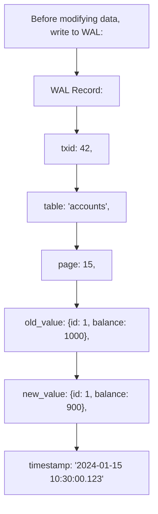
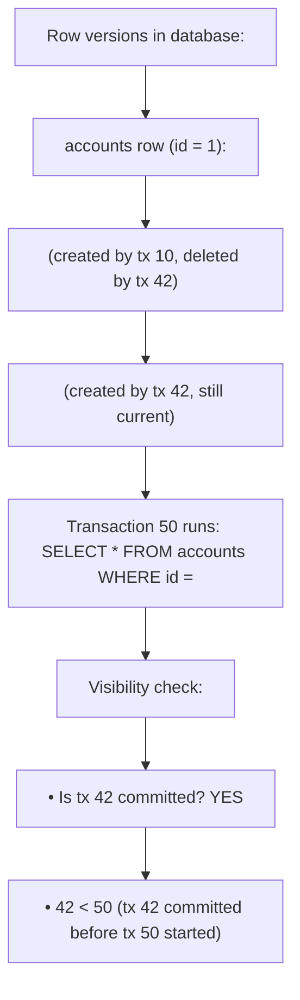
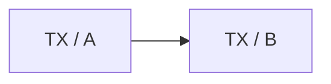
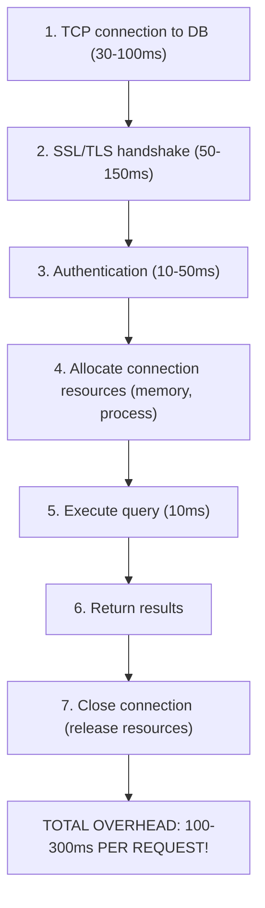
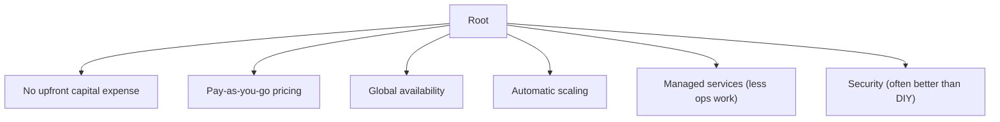
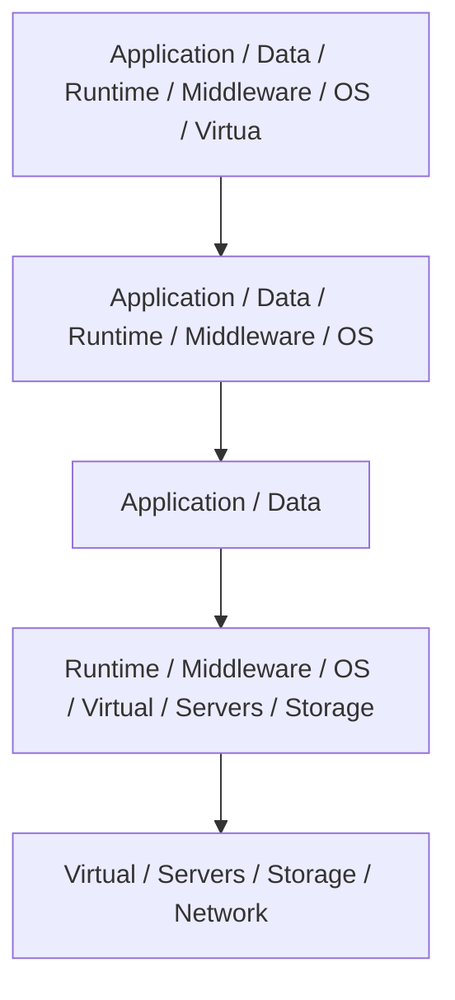
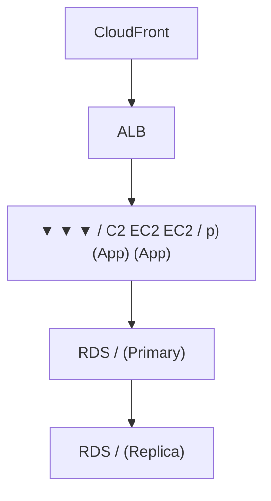
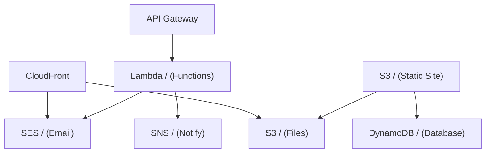
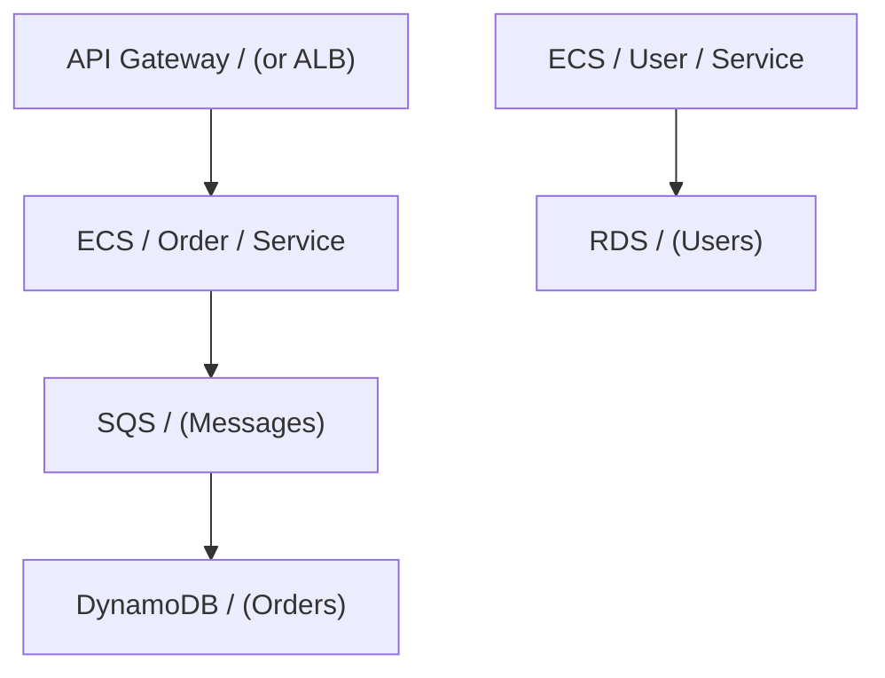
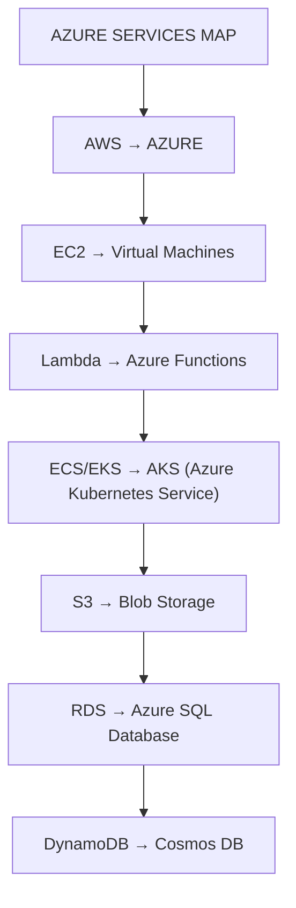

> **Navigation**: [< Previous Chapter](01b_Career_Guide_Part1A.md) | [Back to Index](../00_MASTER_INDEX.md)

---

```
│  Before modifying data, write to WAL:                          │
│                                                                  │
│  ┌───────────────────────────────────────────────────────┐     │
│  │ WAL Record:                                            │     │
│  │ {                                                      │     │
│  │   txid: 42,                                           │     │
│  │   table: 'accounts',                                  │     │
│  │   page: 15,                                           │     │
│  │   old_value: {id: 1, balance: 1000},                 │     │
│  │   new_value: {id: 1, balance: 900},                  │     │
│  │   timestamp: '2024-01-15 10:30:00.123'               │     │
│  │ }                                                      │     │
│  └───────────────────────────────────────────────────────┘     │
│                                                                  │
│  WHY WAL?                                                       │
│  • WAL is sequential write (fast)                              │
│  • Data pages are random access (slower)                       │
│  • If crash after WAL write, can replay to recover            │
│                                                                  │
│                                                                  │
│  3. MODIFY DATA IN MEMORY                                       │
│  ────────────────────────                                       │
│  • Change made in buffer pool (RAM)                            │
│  • Page marked as "dirty" (needs disk write)                   │
│                                                                  │
│                                                                  │
│  4. COMMIT                                                       │
│  ────────                                                       │
│  • WAL record marked as committed                              │
│  • fsync() to ensure WAL is on disk                            │
│  • Transaction complete!                                        │
│                                                                  │
│  Note: Dirty data pages written later (checkpoint)             │
│                                                                  │
│                                                                  │
│  5. BACKGROUND: CHECKPOINT                                      │
│  ─────────────────────────                                      │
│  Periodically:                                                  │
│  • Write all dirty pages to disk                               │
│  • Record checkpoint position in WAL                           │
│  • Can now discard old WAL records                             │
│                                                                  │
└─────────────────────────────────────────────────────────────────┘
```

> **Flow**: Before modifying data, write to WAL: → WAL Record: | WAL Record: → txid: 42, | txid: 42, → table: 'accounts', | table: 'accounts', → page: 15, | page: 15, → old_value: {id: 1, balance: 1000}, | old_value: {id: 1, balance: 1000}, → new_value: {id: 1, balance: 900}, | ...+1 more




MVCC (Multi-Version Concurrency Control):
```
────────────────────────────────────────
```


HOW MULTIPLE TRANSACTIONS SEE DIFFERENT DATA:

```
┌──────────────────────────────────────────────────────────────────┐
│                                                                  │
│  Row versions in database:                                       │
│                                                                  │
│  ┌─────────────────────────────────────────────────────────┐     │
│  │ accounts row (id = 1):                                   │    │
│  │                                                          │    │
│  │ Version 1: balance = 1000, xmin = 10, xmax = 42         │     │
│  │            (created by tx 10, deleted by tx 42)         │     │
│  │                                                          │    │
│  │ Version 2: balance = 900, xmin = 42, xmax = null        │     │
│  │            (created by tx 42, still current)            │     │
│  └─────────────────────────────────────────────────────────┘     │
│                                                                  │
│  Transaction 50 runs: SELECT * FROM accounts WHERE id = 1;       │
│                                                                  │
│  Visibility check:                                               │
│  • Is tx 42 committed? YES                                       │
│  • 42 < 50 (tx 42 committed before tx 50 started)                │
│  • Version 2 is visible to tx 50                                 │
│  • Returns: balance = 900                                        │
│                                                                  │
│                                                                  │
│  If tx 42 was still running when tx 50 started:                  │
│  • Version 2 would be invisible to tx 50                         │
│  • tx 50 would see Version 1: balance = 1000                     │
│  • This is "snapshot isolation"                                  │
│                                                                  │
└──────────────────────────────────────────────────────────────────┘
```

> **Flow**: Row versions in database: → accounts row (id = 1): | accounts row (id = 1): → (created by tx 10, deleted by tx 42) | (created by tx 10, deleted by tx 42) → (created by tx 42, still current) | (created by tx 42, still current) → Transaction 50 runs: SELECT * FROM accounts WHERE id = | Transaction 50 runs: SELECT * FROM accounts WHERE id = → Visibility check: | Visibility check: → • Is tx 42 committed? YES | ...+1 more




DEADLOCK DETECTION:
```
──────────────────

┌──────────────────────────────────────────────────────────────────┐
│                                                                  │
│  TX A: UPDATE accounts SET balance = 100 WHERE id = 1; (OK)      │
│  TX B: UPDATE accounts SET balance = 200 WHERE id = 2; (OK)      │
│  TX A: UPDATE accounts SET balance = 300 WHERE id = 2; (WAIT)    │
│  TX B: UPDATE accounts SET balance = 400 WHERE id = 1; (WAIT)    │
│                                                                  │
│  DEADLOCK!                                                       │
│                                                                  │
│  Wait-for graph:                                                 │
│  ┌────┐        ┌────┐                                            │
│  │ TX │───────►│ TX │                                            │
│  │ A  │        │ B  │                                            │
│  └────┘◄───────└────┘                                            │
│    ▲              │                                              │
│    │              │                                              │
│    └──────────────┘                                              │
│                                                                  │
│  Cycle detected! One transaction must be aborted.                │
│  PostgreSQL aborts the one with less work done.                  │
│                                                                  │
│  ERROR: deadlock detected                                        │
│  DETAIL: Process 1234 waits for ShareLock on transaction 567     │
│                                                                  │
└──────────────────────────────────────────────────────────────────┘
```

> **Flow**: TX / A → TX / B




### Connection Pooling Internals

DATABASE CONNECTION LIFECYCLE:
```
═════════════════════════════
```


WITHOUT CONNECTION POOLING:
```
──────────────────────────
```


Each request:
```
┌──────────────────────────────────────────────────────────────────┐
│                                                                  │
│  1. TCP connection to DB (30-100ms)                              │
│  2. SSL/TLS handshake (50-150ms)                                 │
│  3. Authentication (10-50ms)                                     │
│  4. Allocate connection resources (memory, process)              │
│  5. Execute query (10ms)                                         │
│  6. Return results                                               │
│  7. Close connection (release resources)                         │
│                                                                  │
│  TOTAL OVERHEAD: 100-300ms PER REQUEST!                          │
│                                                                  │
│  With 1000 requests/second:                                      │
│  • 1000 connection setups                                        │
│  • 1000 connection teardowns                                     │
│  • Database overwhelmed!                                         │
│                                                                  │
└──────────────────────────────────────────────────────────────────┘
```

> **Flow**: 1. TCP connection to DB (30-100ms) → 2. SSL/TLS handshake (50-150ms) | 2. SSL/TLS handshake (50-150ms) → 3. Authentication (10-50ms) | 3. Authentication (10-50ms) → 4. Allocate connection resources (memory, process) | 4. Allocate connection resources (memory, process) → 5. Execute query (10ms) | 5. Execute query (10ms) → 6. Return results | 6. Return results → 7. Close connection (release resources) | ...+1 more




WITH CONNECTION POOLING (e.g., HikariCP):
## Connection Pool

At startup, pool creates N connections:
POOL (20 connections)
┌──────┐ ┌──────┐ ┌──────┐ ┌──────┐       ┌──────┐
| |Conn 1| |Conn 2| |Conn 3| |Conn 4| ..... |Conn20| |
| | IDLE | | BUSY | | IDLE | | BUSY |       | IDLE | |
└──────┘ └──────┘ └──────┘ └──────┘       └──────┘
Request flow:
1. Request arrives
2. Pool.getConnection() → Returns Conn 1 (IDLE → BUSY)
3. Execute query (10ms)
4. Connection.close() → Actually returns to pool (BUSY→IDLE)

**Overhead**: ~0ms (connection already established!)
HikariCP Configuration:
spring.datasource.hikari.minimum-idle=10
spring.datasource.hikari.maximum-pool-size=20
spring.datasource.hikari.idle-timeout=600000
spring.datasource.hikari.max-lifetime=1800000
spring.datasource.hikari.connection-timeout=30000
Pool exhaustion:
If all 20 connections busy:
- New requests wait in queue
- If wait > connectionTimeout (30s) → Exception
- Monitor this! Could indicate need for more connections
or slow queries

```

---

_Stage 1 Complete! Ready for Stage 2: Cloud Fundamentals to Expertise_

---

## Phase 5: Cloud - From Fundamentals to Expert

### Cloud Computing - The WHY

```
BEFORE CLOUD:
```
─────────────
```

Buy Server → Wait 2-4 weeks → Setup → Configure → Hope it's enough
Cost: $50,000 upfront
Risk: Over-provision (waste) or Under-provision (crash)

WITH CLOUD:
```
───────────
```

Click → Server in 60 seconds → Scale up/down anytime
Cost: Pay only what you use
Risk: Minimal - add/remove resources instantly

CLOUD BENEFITS:
```
├── No upfront capital expense
├── Pay-as-you-go pricing
├── Global availability
├── Automatic scaling
├── Managed services (less ops work)
└── Security (often better than DIY)
```

> **Flow**: Root → No upfront capital expense | Root → Pay-as-you-go pricing | Root → Global availability | Root → Automatic scaling | Root → Managed services (less ops work) | Root → Security (often better than DIY)




### Cloud Service Models

```
┌──────────────────────────────────────────────────────────────────┐
│                  CLOUD SERVICE MODELS                            │
├──────────────────────────────────────────────────────────────────┤
│                                                                  │
│  ON-PREMISES        IaaS             PaaS             SaaS       │
│  ───────────        ────             ────             ────       │
│  You Manage:        You Manage:      You Manage:      You:       │
│  ┌──────────┐       ┌──────────┐     ┌──────────┐     Just       │
│  │Application│      │Application│    │Application│    Use It!    │
│  │Data       │      │Data       │    │Data       │               │
│  │Runtime    │      │Runtime    │    └──────────┘                │
│  │Middleware │      │Middleware │                                │
│  │OS         │      │OS         │    Provider:                   │
│  │Virtual    │      └──────────┘     ┌──────────┐                │
│  │Servers    │                       │Runtime    │               │
│  │Storage    │      Provider:        │Middleware │               │
│  │Network    │      ┌──────────┐     │OS         │               │
│  └──────────┘       │Virtual    │    │Virtual    │               │
│                     │Servers    │    │Servers    │               │
│                     │Storage    │    │Storage    │               │
│                     │Network    │    │Network    │               │
│                     └──────────┘     └──────────┘                │
│                                                                  │
│  Example:           Example:         Example:         Example:   │
│  Your Data Center   AWS EC2          Heroku           Gmail      │
│                     Azure VMs        AWS Elastic      Slack      │
│                     Google GCE       Beanstalk        Salesforce │
│                                                                  │
└──────────────────────────────────────────────────────────────────┘
```

> **Flow**: Application / Data / Runtime / Middleware / OS / Virtua → Application / Data / Runtime / Middleware / OS | Application / Data / Runtime / Middleware / OS → Application / Data | Application / Data → Runtime / Middleware / OS / Virtual / Servers / Storage | Runtime / Middleware / OS / Virtual / Servers / Storage → Virtual / Servers / Storage / Network




### AWS Services - Complete Map

## Aws Services Architecture

COMPUTE                    STORAGE
EC2 - Virtual Servers      S3 - Object Storage (files)
Lambda - Serverless        EBS - Block Storage (disk)
ECS/EKS - Containers       EFS - File System (shared)
Fargate - Serverless Cont. Glacier - Archive Storage
Lightsail - Simple VPS     Storage Gateway - Hybrid
DATABASE                   NETWORKING
RDS - Relational (MySQL,   VPC - Virtual Network
PostgreSQL, etc.)    Route 53 - DNS
DynamoDB - NoSQL           CloudFront - CDN
Aurora - High-perf SQL     API Gateway - REST/WebSocket
ElastiCache - Redis/Memc.  ELB - Load Balancer
DocumentDB - MongoDB       Direct Connect - Dedicated line
Neptune - Graph DB
SECURITY                   MONITORING
IAM - Identity & Access    CloudWatch - Metrics/Logs
KMS - Key Management       CloudTrail - API Audit
WAF - Web App Firewall     X-Ray - Distributed Tracing
Shield - DDoS Protection   Config - Resource Tracking
Secrets Manager - Secrets
Cognito - User Auth
MESSAGING                  AI/ML
SQS - Message Queue        SageMaker - ML Platform
SNS - Pub/Sub              Rekognition - Image Analysis
EventBridge - Event Bus    Comprehend - NLP
Kinesis - Streaming        Polly - Text to Speech
MQ - ActiveMQ/RabbitMQ     Transcribe - Speech to Text

```

### AWS Architecture - Real Examples

#### Example 1: Simple Web Application

```
```
┌──────────────────────────────────────────────────────────────────┐
│                    SIMPLE WEB APP ARCHITECTURE                   │
├──────────────────────────────────────────────────────────────────┤
│                                                                  │
│                         ┌─────────────┐                          │
│         Internet ──────►│ CloudFront  │ (CDN)                    │
│                         └──────┬──────┘                          │
│                                │                                 │
│                         ┌──────▼──────┐                          │
│                         │    ALB      │ (Load Balancer)          │
│                         └──────┬──────┘                          │
│                                │                                 │
│              ┌─────────────────┼─────────────────┐               │
│              │                 │                 │               │
│         ┌────▼────┐      ┌────▼────┐      ┌────▼────┐            │
│         │   EC2   │      │   EC2   │      │   EC2   │            │
│         │ (App)   │      │ (App)   │      │ (App)   │            │
│         └────┬────┘      └────┬────┘      └────┬────┘            │
│              │                 │                 │               │
│              └─────────────────┼─────────────────┘               │
│                                │                                 │
│                         ┌──────▼──────┐                          │
│                         │     RDS     │ (Database)               │
│                         │  (Primary)  │                          │
│                         └──────┬──────┘                          │
│                                │                                 │
│                         ┌──────▼──────┐                          │
│                         │     RDS     │ (Read Replica)           │
│                         │  (Replica)  │                          │
│                         └─────────────┘                          │
│                                                                  │
│  MONTHLY COST ESTIMATE:                                          │
│  ├── EC2 (3x t3.medium): $90                                     │
│  ├── RDS (db.t3.medium): $50                                     │
│  ├── ALB: $20                                                    │
│  ├── CloudFront: $10-50                                          │
│  └── Total: ~$170-210/month                                      │
│                                                                  │
└──────────────────────────────────────────────────────────────────┘
```

> **Flow**: CloudFront → ALB | ALB → ▼ ▼ ▼ / C2 EC2 EC2 / p) (App) (App) | ▼ ▼ ▼ / C2 EC2 EC2 / p) (App) (App) → RDS / (Primary) | RDS / (Primary) → RDS / (Replica)




#### Example 2: Serverless Architecture

```
┌──────────────────────────────────────────────────────────────────┐
│                    SERVERLESS ARCHITECTURE                       │
├──────────────────────────────────────────────────────────────────┤
│                                                                  │
│                         ┌─────────────┐                          │
│         Internet ──────►│ CloudFront  │                          │
│                         └──────┬──────┘                          │
│                                │                                 │
│              ┌─────────────────┼─────────────────┐               │
│              │                                   │               │
│              ▼                                   ▼               │
│       ┌─────────────┐                   ┌─────────────┐          │
│       │     S3      │                   │ API Gateway │          │
│       │(Static Site)│                   └──────┬──────┘          │
│       └─────────────┘                          │                 │
│                                                │                 │
│                                         ┌──────▼──────┐          │
│                                         │   Lambda    │          │
│                                         │ (Functions) │          │
│                                         └──────┬──────┘          │
│                                                │                 │
│              ┌─────────────┬─────────────┬─────┴─────┐           │
│              │             │             │           │           │
│              ▼             ▼             ▼           ▼           │
│       ┌──────────┐  ┌──────────┐  ┌──────────┐ ┌──────────┐      │
│       │ DynamoDB │  │    S3    │  │   SES    │ │   SNS    │      │
│       │(Database)│  │ (Files)  │  │ (Email)  │ │ (Notify) │      │
│       └──────────┘  └──────────┘  └──────────┘ └──────────┘      │
│                                                                  │
│  BENEFITS:                                                       │
│  ├── Zero servers to manage                                      │
│  ├── Auto-scaling (0 to millions)                                │
│  ├── Pay only for execution time                                 │
│  └── High availability built-in                                  │
│                                                                  │
│  MONTHLY COST (Low traffic):                                     │
│  ├── Lambda: $0-5 (free tier generous)                           │
│  ├── API Gateway: $5-20                                          │
│  ├── DynamoDB: $5-25                                             │
│  ├── S3: $1-5                                                    │
│  └── Total: ~$15-50/month                                        │
│                                                                  │
└──────────────────────────────────────────────────────────────────┘
```

> **Flow**: CloudFront → S3 / (Files) | CloudFront → SES / (Email) | S3 / (Static Site) → DynamoDB / (Database) | S3 / (Static Site) → S3 / (Files) | API Gateway → Lambda / (Functions) | Lambda / (Functions) → SES / (Email) | ...+1 more




#### Example 3: Microservices Architecture

```
┌──────────────────────────────────────────────────────────────────┐
│                    MICROSERVICES ON AWS                          │
├──────────────────────────────────────────────────────────────────┤
│                                                                  │
│                     ┌─────────────────┐                          │
│      Internet ─────►│  API Gateway    │                          │
│                     │  (or ALB)       │                          │
│                     └────────┬────────┘                          │
│                              │                                   │
│      ┌───────────────────────┼───────────────────────┐           │
│      │                       │                       │           │
│      ▼                       ▼                       ▼           │
│ ┌─────────┐            ┌─────────┐            ┌─────────┐        │
│ │  ECS    │            │  ECS    │            │  ECS    │        │
│ │ User    │            │ Order   │            │ Payment │        │
│ │ Service │            │ Service │            │ Service │        │
│ └────┬────┘            └────┬────┘            └────┬────┘        │
│      │                      │                      │             │
│      │                      ▼                      │             │
│      │               ┌─────────────┐               │             │
│      │               │    SQS      │◄──────────────┘             │
│      │               │ (Messages)  │                             │
│      │               └──────┬──────┘                             │
│      │                      │                                    │
│      ▼                      ▼                                    │
│ ┌─────────┐            ┌─────────┐                               │
│ │   RDS   │            │ DynamoDB│                               │
│ │ (Users) │            │ (Orders)│                               │
│ └─────────┘            └─────────┘                               │
│                                                                  │
│  SUPPORTING SERVICES:                                            │
│  ├── ECR: Container Registry                                     │
│  ├── Secrets Manager: API Keys, DB passwords                     │
│  ├── CloudWatch: Logging & Monitoring                            │
│  ├── X-Ray: Distributed Tracing                                  │
│  └── CodePipeline: CI/CD                                         │
│                                                                  │
└──────────────────────────────────────────────────────────────────┘
```

> **Flow**: API Gateway / (or ALB) → ECS / Order / Service | ECS / User / Service → RDS / (Users) | ECS / Order / Service → SQS / (Messages) | SQS / (Messages) → DynamoDB / (Orders)




### AWS Cost Optimization - Expert Level

COST OPTIMIZATION STRATEGIES:
```
─────────────────────────────
```


1. RIGHT-SIZING
   ├── Monitor CPU/Memory usage
   ├── Downsize underutilized instances
   ├── Use AWS Compute Optimizer recommendations
   └── Tools: CloudWatch, Cost Explorer

2. RESERVED INSTANCES / SAVINGS PLANS
   ┌──────────────────────────────────────────────────────────┐
   │ Instance Type    │ On-Demand  │ 1-Year RI  │ Savings    │
   ├──────────────────┼────────────┼────────────┼────────────┤
   │ t3.medium        │ $30/month  │ $19/month  │ 37%        │
   │ m5.large         │ $70/month  │ $44/month  │ 37%        │
   │ r5.xlarge        │ $180/month │ $113/month │ 37%        │
   └──────────────────────────────────────────────────────────┘

3. SPOT INSTANCES
   ├── Up to 90% discount
   ├── Can be terminated with 2-min notice
   ├── Good for: Batch processing, CI/CD, Dev/Test
   └── Not for: Production databases, Critical apps

4. S3 STORAGE TIERS
   ┌──────────────────────────────────────────────────────────┐
   │ Storage Class     │ Cost/GB   │ Use Case                │
   ├───────────────────┼───────────┼─────────────────────────┤
   │ S3 Standard       │ $0.023    │ Frequent access         │
   │ S3 IA             │ $0.0125   │ Infrequent access       │
   │ S3 Glacier IR     │ $0.004    │ Archive, mins retrieval │
   │ S3 Glacier DA     │ $0.00099  │ Archive, hours retrieve │
   └──────────────────────────────────────────────────────────┘

   Lifecycle Policy Example:
   Day 0-30:   S3 Standard
   Day 31-90:  S3 IA
   Day 91+:    Glacier

5. DATABASE OPTIMIZATION
   ├── Use Aurora Serverless for variable workloads
   ├── Read replicas for read-heavy apps
   ├── Reserved instances for steady workloads
   └── Delete unused snapshots

6. NETWORK COST REDUCTION
   ├── Use VPC endpoints (avoid NAT Gateway charges)
   ├── Same-AZ communication when possible
   ├── CloudFront for content delivery
   └── Compress data before transfer

### Azure Services - Complete Map

```
┌──────────────────────────────────────────────────────────────────┐
│                    AZURE SERVICES MAP                            │
├──────────────────────────────────────────────────────────────────┤
│                                                                  │
│  AWS                    →     AZURE                              │
│  ───                          ─────                              │
│  EC2                    →     Virtual Machines                   │
│  Lambda                 →     Azure Functions                    │
│  ECS/EKS               →     AKS (Azure Kubernetes Service)      │
│  S3                     →     Blob Storage                       │
│  RDS                    →     Azure SQL Database                 │
│  DynamoDB              →     Cosmos DB                           │
│  CloudFront            →     Azure CDN / Front Door              │
│  Route 53              →     Azure DNS                           │
│  VPC                    →     Virtual Network                    │
│  IAM                    →     Azure AD / RBAC                    │
│  CloudWatch            →     Azure Monitor                       │
│  SQS                    →     Azure Queue Storage / Service Bus  │
│  SNS                    →     Notification Hubs                  │
│  API Gateway           →     API Management                      │
│  Cognito               →     Azure AD B2C                        │
│  Secrets Manager       →     Key Vault                           │
│                                                                  │
│  AZURE UNIQUE SERVICES:                                          │
│  ├── Azure DevOps: Complete CI/CD platform                       │
│  ├── Power Platform: Low-code apps                               │
│  ├── Azure Active Directory: Enterprise identity                 │
│  ├── Azure Synapse: Data analytics                               │
│  └── Logic Apps: Workflow automation                             │
│                                                                  │
└──────────────────────────────────────────────────────────────────┘
```

> **Flow**: AZURE SERVICES MAP → AWS → AZURE | AWS → AZURE → EC2 → Virtual Machines | EC2 → Virtual Machines → Lambda → Azure Functions | Lambda → Azure Functions → ECS/EKS → AKS (Azure Kubernetes Service) | ECS/EKS → AKS (Azure Kubernetes Service) → S3 → Blob Storage | S3 → Blob Storage → RDS → Azure SQL Database | ...+1 more




### Cloud Security Best Practices

CLOUD SECURITY CHECKLIST:
```
─────────────────────────
```


1. IDENTITY & ACCESS
   □ Enable MFA for all users
   □ Use least privilege principle
   □ Regular access reviews
   □ Use roles, not access keys
   □ Rotate credentials regularly

2. NETWORK SECURITY
   □ Use private subnets for databases
   □ Configure security groups (allow only needed ports)
   □ Enable VPC Flow Logs
   □ Use WAF for web applications
   □ Enable DDoS protection

3. DATA PROTECTION
   □ Encrypt data at rest (S3, EBS, RDS)
   □ Encrypt data in transit (HTTPS, TLS)
   □ Use KMS for key management
   □ Enable versioning and backup
   □ Implement data classification

4. MONITORING & LOGGING
   □ Enable CloudTrail (audit logs)
   □ Set up CloudWatch alarms
   □ Configure GuardDuty (threat detection)
   □ Implement centralized logging
   □ Regular security assessments

5. COMPLIANCE
   □ Document security policies
   □ Regular penetration testing
   □ Compliance certifications (SOC2, ISO27001)
   □ Data retention policies
   □ Incident response plan

### Infrastructure as Code (IaC)


```hcl
# TERRAFORM EXAMPLE - Complete Web App Infrastructure

# Provider Configuration
provider "aws" {
  region = "ap-south-1"  # Mumbai
}

# VPC
resource "aws_vpc" "main" {
  cidr_block = "10.0.0.0/16"

  tags = {
    Name = "production-vpc"
  }
}

# Public Subnet
resource "aws_subnet" "public" {
  vpc_id                  = aws_vpc.main.id
  cidr_block              = "10.0.1.0/24"
  availability_zone       = "ap-south-1a"
  map_public_ip_on_launch = true
}

# Private Subnet
resource "aws_subnet" "private" {
  vpc_id            = aws_vpc.main.id
  cidr_block        = "10.0.2.0/24"
  availability_zone = "ap-south-1a"
}

# Security Group
resource "aws_security_group" "web" {
  name        = "web-sg"
  description = "Security group for web servers"
  vpc_id      = aws_vpc.main.id

  ingress {
    from_port   = 80
    to_port     = 80
    protocol    = "tcp"
    cidr_blocks = ["0.0.0.0/0"]
  }

  ingress {
    from_port   = 443
    to_port     = 443
    protocol    = "tcp"
    cidr_blocks = ["0.0.0.0/0"]
  }

  egress {
    from_port   = 0
    to_port     = 0
    protocol    = "-1"
    cidr_blocks = ["0.0.0.0/0"]
  }
}

# EC2 Instance
resource "aws_instance" "web" {
  ami           = "ami-0c55b159cbfafe1f0"  # Amazon Linux 2
  instance_type = "t3.medium"
  subnet_id     = aws_subnet.public.id

  vpc_security_group_ids = [aws_security_group.web.id]

  user_data = <<-EOF
              #!/bin/bash
              yum update -y
              yum install -y docker
              systemctl start docker
              docker run -d -p 80:80 nginx
              EOF

  tags = {
    Name = "web-server"
  }
}

# RDS Database
resource "aws_db_instance" "main" {
  identifier           = "production-db"
  engine               = "postgres"
  engine_version       = "14"
  instance_class       = "db.t3.medium"
  allocated_storage    = 20

  db_name              = "appdb"
  username             = "admin"
  password             = var.db_password  # From variables

  vpc_security_group_ids = [aws_security_group.db.id]
  db_subnet_group_name   = aws_db_subnet_group.main.name

  backup_retention_period = 7
  multi_az               = true

  skip_final_snapshot    = false
  final_snapshot_identifier = "production-db-final"
}

# Output
output "web_server_ip" {
  value = aws_instance.web.public_ip
}

output "database_endpoint" {
  value = aws_db_instance.main.endpoint
}
```

### CI/CD Pipeline - Complete Setup

```yaml
# GITHUB ACTIONS - Complete CI/CD Pipeline
# .github/workflows/deploy.yml

name: CI/CD Pipeline

on:
    push:
        branches: [main, develop]
    pull_request:
        branches: [main]

env:
    AWS_REGION: ap-south-1
    ECR_REPOSITORY: myapp
    ECS_SERVICE: myapp-service
    ECS_CLUSTER: production

jobs:
    # JOB 1: TEST
    test:
        runs-on: ubuntu-latest
        steps:
            - uses: actions/checkout@v3

            - name: Set up JDK 17
              uses: actions/setup-java@v3
              with:
                  java-version: "17"
                  distribution: "temurin"

            - name: Run Tests
              run: ./mvnw test

            - name: Upload Coverage
              uses: codecov/codecov-action@v3

    # JOB 2: BUILD & PUSH
    build:
        needs: test
        runs-on: ubuntu-latest
        if: github.ref == 'refs/heads/main'

        steps:
            - uses: actions/checkout@v3

            - name: Configure AWS credentials
              uses: aws-actions/configure-aws-credentials@v2
              with:
                  aws-access-key-id: ${{ secrets.AWS_ACCESS_KEY_ID }}
                  aws-secret-access-key: ${{ secrets.AWS_SECRET_ACCESS_KEY }}
                  aws-region: ${{ env.AWS_REGION }}

            - name: Login to Amazon ECR
              id: login-ecr
              uses: aws-actions/amazon-ecr-login@v1

            - name: Build and push Docker image
              env:
                  ECR_REGISTRY: ${{ steps.login-ecr.outputs.registry }}
                  IMAGE_TAG: ${{ github.sha }}
              run: |
                  docker build -t $ECR_REGISTRY/$ECR_REPOSITORY:$IMAGE_TAG .
                  docker push $ECR_REGISTRY/$ECR_REPOSITORY:$IMAGE_TAG
                  echo "image=$ECR_REGISTRY/$ECR_REPOSITORY:$IMAGE_TAG" >> $GITHUB_OUTPUT

    # JOB 3: DEPLOY
    deploy:
        needs: build
        runs-on: ubuntu-latest

        steps:
            - name: Configure AWS credentials
              uses: aws-actions/configure-aws-credentials@v2
              with:
                  aws-access-key-id: ${{ secrets.AWS_ACCESS_KEY_ID }}
                  aws-secret-access-key: ${{ secrets.AWS_SECRET_ACCESS_KEY }}
                  aws-region: ${{ env.AWS_REGION }}

            - name: Deploy to ECS
              run: |
                  aws ecs update-service \
                    --cluster ${{ env.ECS_CLUSTER }} \
                    --service ${{ env.ECS_SERVICE }} \
                    --force-new-deployment

            - name: Wait for deployment
              run: |
                  aws ecs wait services-stable \
                    --cluster ${{ env.ECS_CLUSTER }} \
                    --services ${{ env.ECS_SERVICE }}

    # JOB 4: NOTIFY
    notify:
        needs: [test, build, deploy]
        runs-on: ubuntu-latest
        if: always()

        steps:
            - name: Slack Notification
              uses: 8398a7/action-slack@v3
              with:
                  status: ${{ job.status }}
                  fields: repo,message,commit,author,action,workflow
              env:
                  SLACK_WEBHOOK_URL: ${{ secrets.SLACK_WEBHOOK }}
```

---

## 🔬 Cloud Deep Internals - How Cloud Services ACTUALLY Work

### Virtual Machines - The Foundation

```
HOW A VIRTUAL MACHINE WORKS:
═══════════════════════════

When you launch an EC2 instance...

┌──────────────────────────────────────────────────────────────────┐
│                    PHYSICAL HOST SERVER                          │
│                  (AWS Data Center)                               │
├──────────────────────────────────────────────────────────────────┤
│                                                                  │
│  Physical Hardware:                                              │
│  ┌─────────────────────────────────────────────────────────────┐ │
│  │ CPU: 96 cores (Intel Xeon / AMD EPYC)                       │ │
│  │ RAM: 768 GB                                                  ││
│  │ Storage: NVMe SSDs + Network Storage                        │ │
│  │ Network: 100 Gbps                                           │ │
│  └─────────────────────────────────────────────────────────────┘ │
│                                                                  │
│  HYPERVISOR (AWS Nitro System):                                  │
│  ┌─────────────────────────────────────────────────────────────┐ │
│  │                                                              ││
│  │  The hypervisor divides physical resources:                 │ │
│  │                                                              ││
│  │  ┌─────────────┐  ┌─────────────┐  ┌─────────────┐         │  │
│  │  │   VM 1      │  │   VM 2      │  │   VM 3      │         │  │
│  │  │ (Your EC2)  │  │ (Other user)│  │ (Other user)│         │  │
│  │  ├─────────────┤  ├─────────────┤  ├─────────────┤         │  │
│  │  │ 4 vCPUs     │  │ 16 vCPUs    │  │ 8 vCPUs     │         │  │
│  │  │ 16GB RAM    │  │ 64GB RAM    │  │ 32GB RAM    │         │  │
│  │  │ 100GB EBS   │  │ 500GB EBS   │  │ 200GB EBS   │         │  │
│  │  └─────────────┘  └─────────────┘  └─────────────┘         │  │
│  │                                                              ││
│  │  Isolation:                                                  ││
│  │  • Each VM thinks it has its own hardware                   │ │
│  │  • VMs can't access each other's memory                     │ │
│  │  • CPU time slicing (fair scheduling)                       │ │
│  │                                                              ││
│  └─────────────────────────────────────────────────────────────┘ │
│                                                                  │
│  NITRO CARDS (Hardware offload):                                 │
│  ┌─────────────────────────────────────────────────────────────┐ │
│  │ • Nitro Card for VPC (networking)                           │ │
│  │ • Nitro Card for EBS (storage I/O)                          │ │
│  │ • Nitro Security Chip (secure boot)                         │ │
│  │ • Nitro Controller (management)                             │ │
│  │                                                              ││
│  │ This frees CPU for YOUR workload, not virtualization        │ │
│  └─────────────────────────────────────────────────────────────┘ │
│                                                                  │
└──────────────────────────────────────────────────────────────────┘


EC2 LAUNCH PROCESS - INTERNAL FLOW:
──────────────────────────────────

You click "Launch Instance":

1. API Gateway receives request
       │
       ▼
2. Authenticate (IAM verification)
       │
       ▼
3. Placement algorithm:
   "Which physical host has capacity?"
   - Same availability zone
   - Enough CPU/RAM
   - Placement group constraints
       │
       ▼
4. Allocate resources on selected host:
   - Reserve vCPU shares
   - Allocate RAM
   - Create network interface
       │
       ▼
5. Attach EBS volume:
   - EBS is network-attached storage
   - Multi-attach from storage servers
   - Replication across AZs
       │
       ▼
6. Boot VM:
   - Load AMI (Amazon Machine Image)
   - Execute user-data script
   - Register with DNS (private IP)
       │
       ▼
7. Instance running!
   Time: ~30-60 seconds

### EBS Storage Internals

HOW EBS (Elastic Block Store) WORKS:
═══════════════════════════════════

Your EC2 instance's "disk" is actually network-attached!

┌──────────────────────────────────────────────────────────────────┐
│                   EBS ARCHITECTURE                               │
├──────────────────────────────────────────────────────────────────┤
│                                                                  │
│  YOUR EC2 INSTANCE           EBS STORAGE CLUSTER                 │
│  ┌──────────────┐           ┌──────────────────────────┐         │
│  │              │           │                          │         │
│  │    Your      │           │   EBS Volume             │         │
│  │  Application │           │   ┌────────────────┐     │         │
│  │      │       │           │   │ Block 1        │     │         │
│  │      ▼       │           │   │ Block 2        │     │         │
│  │   OS Disk    │◄─────────►│   │ Block 3        │     │         │
│  │   Driver     │  Network  │   │ ...            │     │         │
│  │              │  (NVMe)   │   │ Block N        │     │         │
│  └──────────────┘           │   └────────────────┘     │         │
│                             │                          │         │
│                             │   Replicated to:        │          │
│                             │   ┌────────────────┐     │         │
│                             │   │ Replica (same  │     │         │
│                             │   │ AZ)            │     │         │
│                             │   └────────────────┘     │         │
│                             │                          │         │
│                             └──────────────────────────┘         │
│                                                                  │
│  KEY INSIGHT:                                                    │
│  • EBS is NOT local disk                                         │
│  • Data travels over network                                     │
│  • But feels like local disk (NVMe interface)                    │
│  • Automatic replication within AZ                               │
│  • Can attach to different EC2 instances                         │
│  • Snapshots → backed up to S3                                   │
│                                                                  │
└──────────────────────────────────────────────────────────────────┘


EBS VOLUME TYPES - WHEN TO USE:
──────────────────────────────

┌───────────────┬─────────────┬────────────┬───────────────────────┐
│ Volume Type   │ IOPS        │ Throughput │ Use Case              │
├───────────────┼─────────────┼────────────┼───────────────────────┤
│ gp3           │ 3,000-16,000│ 125-1000   │ General purpose       │
│ (General)     │ MB/s        │            │ (most workloads)      │
├───────────────┼─────────────┼────────────┼───────────────────────┤
│ io2           │ Up to       │ Up to      │ Databases             │
│ (Provisioned) │ 256,000     │ 4,000 MB/s │ (high IOPS needed)    │
├───────────────┼─────────────┼────────────┼───────────────────────┤
│ st1           │ 500 IOPS    │ 500 MB/s   │ Big data, logs        │
│ (Throughput)  │ baseline    │            │ (sequential reads)    │
├───────────────┼─────────────┼────────────┼───────────────────────┤
│ sc1           │ 250 IOPS    │ 250 MB/s   │ Archive, cold data    │
│ (Cold)        │ baseline    │            │ (infrequent access)   │
└───────────────┴─────────────┴────────────┴───────────────────────┘

### Load Balancer Internals

HOW APPLICATION LOAD BALANCER (ALB) WORKS:
═════════════════════════════════════════

┌──────────────────────────────────────────────────────────────────┐
│                  ALB ARCHITECTURE                                │
├──────────────────────────────────────────────────────────────────┤
│                                                                  │
│  User Request → DNS → ALB IP                                     │
│                                                                  │
│  ┌─────────────────────────────────────────────────────────┐     │
│  │                APPLICATION LOAD BALANCER                 │    │
│  │                                                          │    │
│  │  ┌────────────────────────────────────────────────────┐ │     │
│  │  │              LISTENER (port 443)                    │ │    │
│  │  │                                                     │ │    │
│  │  │  Receives request:                                  │ │    │
│  │  │  GET /api/users HTTP/1.1                           │ │     │
│  │  │  Host: api.myapp.com                               │ │     │
│  │  │                                                     │ │    │
│  │  └────────────────────┬───────────────────────────────┘ │     │
│  │                       │                                  │    │
│  │                       ▼                                  │    │
│  │  ┌────────────────────────────────────────────────────┐ │     │
│  │  │                 RULES ENGINE                        │ │    │
│  │  │                                                     │ │    │
│  │  │  Rule 1: IF path = /api/* → Target Group: API      │ │     │
│  │  │  Rule 2: IF path = /static/* → Target Group: CDN   │ │     │
│  │  │  Rule 3: IF host = admin.* → Target Group: Admin   │ │     │
│  │  │  Default: Target Group: Web                        │ │     │
│  │  │                                                     │ │    │
│  │  │  Match: /api/users → API Target Group              │ │     │
│  │  │                                                     │ │    │
│  │  └────────────────────┬───────────────────────────────┘ │     │
│  │                       │                                  │    │
│  │                       ▼                                  │    │
│  │  ┌────────────────────────────────────────────────────┐ │     │
│  │  │              TARGET GROUP: API                      │ │    │
│  │  │                                                     │ │    │
│  │  │  Algorithm: Round Robin / Least Connections        │ │     │
│  │  │                                                     │ │    │
│  │  │  ┌─────────┐  ┌─────────┐  ┌─────────┐            │ │      │
│  │  │  │ EC2 #1  │  │ EC2 #2  │  │ EC2 #3  │            │ │      │
│  │  │  │Healthy ✓│  │Healthy ✓│  │Unhealthy✗│           │ │      │
│  │  │  └─────────┘  └─────────┘  └─────────┘            │ │      │
│  │  │        │            │                              │ │     │
│  │  │        └─────┬──────┘                              │ │     │
│  │  │              │                                     │ │     │
│  │  │              ▼                                     │ │     │
│  │  │       Forward to EC2 #1                           │ │      │
│  │  │       (EC2 #3 excluded - failed health check)     │ │      │
│  │  │                                                     │ │    │
│  │  └────────────────────────────────────────────────────┘ │     │
│  │                                                          │    │
│  └─────────────────────────────────────────────────────────┘     │
│                                                                  │
│  HEALTH CHECK PROCESS:                                           │
│  ────────────────────                                            │
│  Every 30 seconds, ALB sends:                                    │
│    GET /health HTTP/1.1                                          │
│                                                                  │
│  Expected: HTTP 200 within 5 seconds                             │
│  If 2 consecutive failures → Mark unhealthy                      │
│  If 3 consecutive successes → Mark healthy again                 │
│                                                                  │
└──────────────────────────────────────────────────────────────────┘


ALB vs NLB vs CLB:
─────────────────

┌──────────────┬────────────┬──────────────┬────────────────────────┐
│ Feature      │ ALB        │ NLB          │ Classic LB             │
│              │ (Layer 7)  │ (Layer 4)    │ (Legacy)               │
├──────────────┼────────────┼──────────────┼────────────────────────┤
│ Protocol     │ HTTP/HTTPS │ TCP/UDP      │ HTTP/HTTPS/TCP         │
├──────────────┼────────────┼──────────────┼────────────────────────┤
│ Latency      │ ~400μs     │ ~100μs       │ ~600μs                 │
├──────────────┼────────────┼──────────────┼────────────────────────┤
│ Path routing │ ✓          │ ✗            │ ✗                      │
├──────────────┼────────────┼──────────────┼────────────────────────┤
│ WebSocket    │ ✓          │ ✓            │ ✗                      │
├──────────────┼────────────┼──────────────┼────────────────────────┤
│ Static IP    │ ✗          │ ✓            │ ✗                      │
├──────────────┼────────────┼──────────────┼────────────────────────┤
│ Use Case     │ Web apps   │ Gaming, IoT  │ Don't use (legacy)     │
└──────────────┴────────────┴──────────────┴────────────────────────┘

### S3 Internals

HOW S3 STORES YOUR DATA:
═══════════════════════

S3 = Simple Storage Service, but internally very complex!

┌──────────────────────────────────────────────────────────────────┐
│                    S3 ARCHITECTURE                               │
├──────────────────────────────────────────────────────────────────┤
│                                                                  │
│  PUT s3://my-bucket/photos/vacation.jpg                          │
│                                                                  │
│  ┌─────────────────────────────────────────────────────────┐     │
│  │                    S3 FRONTEND                           │    │
│  │                                                          │    │
│  │  1. Authenticate (IAM / bucket policy)                  │     │
│  │  2. Validate bucket name                                │     │
│  │  3. Check object key format                             │     │
│  │  4. Route to correct partition                          │     │
│  └────────────────────────┬────────────────────────────────┘     │
│                           │                                      │
│                           ▼                                      │
│  ┌─────────────────────────────────────────────────────────┐     │
│  │                  INDEX SERVICE                           │    │
│  │                                                          │    │
│  │  Key: "my-bucket/photos/vacation.jpg"                   │     │
│  │       │                                                  │    │
│  │       ▼                                                  │    │
│  │  Hash → Determine storage partition                     │     │
│  │       → Record metadata (size, timestamp, ETag)         │     │
│  │                                                          │    │
│  └────────────────────────┬────────────────────────────────┘     │
│                           │                                      │
│                           ▼                                      │
│  ┌─────────────────────────────────────────────────────────┐     │
│  │                  STORAGE NODES                           │    │
│  │                                                          │    │
│  │  File split into chunks:                                │     │
│  │                                                          │    │
│  │  vacation.jpg (5MB) → [Chunk1] [Chunk2] [Chunk3]       │      │
│  │                                                          │    │
│  │  Each chunk replicated to 3+ facilities:                │     │
│  │                                                          │    │
│  │  ┌──────────┐  ┌──────────┐  ┌──────────┐              │      │
│  │  │ AZ-1     │  │ AZ-2     │  │ AZ-3     │              │      │
│  │  │ Chunk1 ✓ │  │ Chunk1 ✓ │  │ Chunk1 ✓ │              │      │
│  │  │ Chunk2 ✓ │  │ Chunk2 ✓ │  │ Chunk2 ✓ │              │      │
│  │  │ Chunk3 ✓ │  │ Chunk3 ✓ │  │ Chunk3 ✓ │              │      │
│  │  └──────────┘  └──────────┘  └──────────┘              │      │
│  │                                                          │    │
│  │  PUT returns success only AFTER replication complete    │     │
│  │                                                          │    │
│  └─────────────────────────────────────────────────────────┘     │
│                                                                  │
│  S3 DURABILITY: 99.999999999% (11 9's)                           │
│  ──────────────────────────────────────                          │
│  If you store 10,000,000 objects:                                │
│  Expect to lose 1 object every 10,000 years!                     │
│                                                                  │
│  HOW? Multiple copies + continuous integrity checking            │
│                                                                  │
└──────────────────────────────────────────────────────────────────┘


S3 STORAGE CLASSES:
──────────────────

┌───────────────────┬──────────────┬─────────────┬──────────────────┐
│ Storage Class     │ Access       │ Cost/GB     │ Use Case         │
├───────────────────┼──────────────┼─────────────┼──────────────────┤
│ Standard          │ Instant      │ $0.023      │ Frequently used  │
├───────────────────┼──────────────┼─────────────┼──────────────────┤
│ Standard-IA       │ Instant      │ $0.0125     │ Monthly access   │
│ (Infrequent)      │              │ +retrieval  │                  │
├───────────────────┼──────────────┼─────────────┼──────────────────┤
│ Glacier Instant   │ Instant      │ $0.004      │ Quarterly access │
├───────────────────┼──────────────┼─────────────┼──────────────────┤
│ Glacier Flexible  │ 1-5 min to   │ $0.0036     │ Yearly access    │
│                   │ 12 hours     │             │                  │
├───────────────────┼──────────────┼─────────────┼──────────────────┤
│ Glacier Deep      │ 12-48 hours  │ $0.00099    │ 7-10 year archive│
│ Archive           │              │             │                  │
└───────────────────┴──────────────┴─────────────┴──────────────────┘

### Auto Scaling Internals

HOW AUTO SCALING WORKS:
══════════════════════

┌──────────────────────────────────────────────────────────────────┐
│                 AUTO SCALING ARCHITECTURE                        │
├──────────────────────────────────────────────────────────────────┤
│                                                                  │
│  ┌─────────────────────────────────────────────────────────┐     │
│  │               CLOUDWATCH METRICS                         │    │
│  │                                                          │    │
│  │  CPU Utilization: [45%] [68%] [72%] [85%] [91%]        │      │
│  │                                                          │    │
│  │  Time:            10:00  10:01  10:02  10:03  10:04     │     │
│  │                                                          │    │
│  └─────────────────────────────┬───────────────────────────┘     │
│                                │                                 │
│                                ▼                                 │
│  ┌─────────────────────────────────────────────────────────┐     │
│  │               CLOUDWATCH ALARM                           │    │
│  │                                                          │    │
│  │  Alarm: "HighCPU"                                       │     │
│  │  Condition: CPU > 80% for 2 consecutive periods         │     │
│  │                                                          │    │
│  │  Status: ALARM! (85% and 91% exceeded threshold)        │     │
│  │                                                          │    │
│  └─────────────────────────────┬───────────────────────────┘     │
│                                │                                 │
│                                ▼                                 │
│  ┌─────────────────────────────────────────────────────────┐     │
│  │               AUTO SCALING GROUP                         │    │
│  │                                                          │    │
│  │  Configuration:                                          │    │
│  │  • Min: 2 instances                                     │     │
│  │  • Max: 10 instances                                    │     │
│  │  • Desired: 3 instances (current)                       │     │
│  │                                                          │    │
│  │  Scaling Policy:                                         │    │
│  │  • Scale OUT: When CPU > 80%, add 2 instances           │     │
│  │  • Scale IN: When CPU < 30%, remove 1 instance          │     │
│  │  • Cooldown: 300 seconds (prevent thrashing)            │     │
│  │                                                          │    │
│  │  ACTION: Launch 2 new instances!                        │     │
│  │                                                          │    │
│  └─────────────────────────────┬───────────────────────────┘     │
│                                │                                 │
│                                ▼                                 │
│  ┌─────────────────────────────────────────────────────────┐     │
│  │               LAUNCH TEMPLATE                            │    │
│  │                                                          │    │
│  │  Template specifies:                                     │    │
│  │  • AMI: ami-0123456789                                  │     │
│  │  • Instance type: t3.medium                             │     │
│  │  • Security group: sg-web                               │     │
│  │  • User data: startup script                            │     │
│  │  • IAM role: web-server-role                            │     │
│  │                                                          │    │
│  └─────────────────────────────┬───────────────────────────┘     │
│                                │                                 │
│                                ▼                                 │
│  ┌─────────────────────────────────────────────────────────┐     │
│  │               EC2 SERVICE                                │    │
│  │                                                          │    │
│  │  Launch new instances:                                   │    │
│  │                                                          │    │
│  │  Before:  [EC2-1] [EC2-2] [EC2-3]                       │     │
│  │                                                          │    │
│  │  After:   [EC2-1] [EC2-2] [EC2-3] [EC2-4] [EC2-5]       │     │
│  │                                                          │    │
│  │  Register with ALB target group                         │     │
│  │  Wait for health check pass                              │    │
│  │  Start receiving traffic                                 │    │
│  │                                                          │    │
│  └─────────────────────────────────────────────────────────┘     │
│                                                                  │
│  TIMELINE:                                                       │
│  ─────────                                                       │
│  10:04 - Alarm triggers                                          │
│  10:04 - ASG decides to launch                                   │
│  10:05 - EC2 instances launching                                 │
│  10:06 - Instances running, health checks starting               │
│  10:08 - Health checks pass, traffic routing begins              │
│  10:09 - Load distributed, CPU drops to 60%                      │
│                                                                  │
│  TOTAL TIME: ~5 minutes to scale                                 │
│                                                                  │
└──────────────────────────────────────────────────────────────────┘
```

---

_Stage 2 Complete! Ready for Stage 3: Full-Stack Development Complete Guide_

---

> **Navigation**: [< Previous](01_Career_TechnoFunctional.md) | [Back to Index](../00_MASTER_INDEX.md) | [Next >](01b_Career_Guide_Part1A.md)