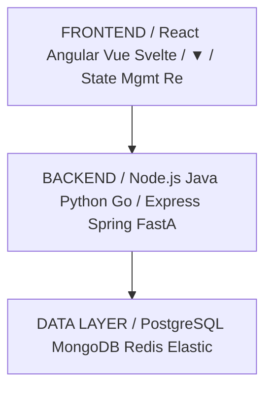
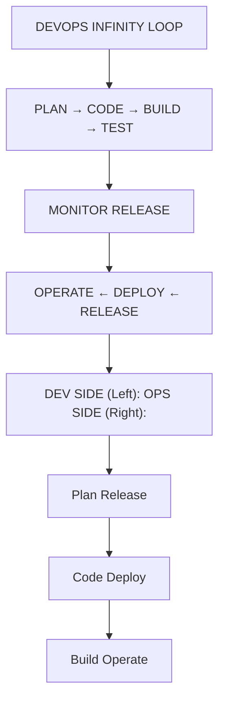
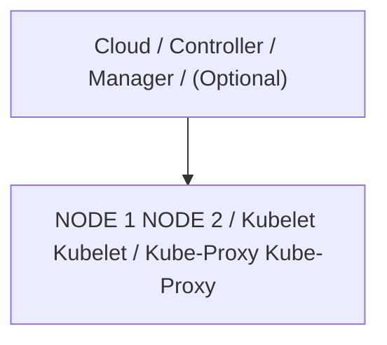

> **Navigation**: [Back to Index](../00_MASTER_INDEX.md) | [Next Chapter >](05_Career_Projects_Part2.md)

---

> **Career Guide** | See also: [01_Career_TechnoFunctional.md](01_Career_TechnoFunctional.md) | [04_Career_Projects_Part1.md](04_Career_Projects_Part1.md) | [Index](../00_MASTER_INDEX.md)

---

## Phase 6: Full-Stack Development - Complete Guide

### The Full-Stack Landscape

```
┌──────────────────────────────────────────────────────────────────┐
│                    FULL-STACK ARCHITECTURE                       │
├──────────────────────────────────────────────────────────────────┤
│                                                                  │
│  ┌─────────────────────────────────────────────────────────────┐ │
│  │                      FRONTEND                                ││
│  │  ┌─────────┐  ┌─────────┐  ┌─────────┐  ┌─────────┐        │  │
│  │  │  React  │  │ Angular │  │   Vue   │  │ Svelte  │        │  │
│  │  └─────────┘  └─────────┘  └─────────┘  └─────────┘        │  │
│  │                      │                                       ││
│  │              ┌───────▼───────┐                              │ │
│  │              │  State Mgmt   │ Redux/Zustand/Pinia          │ │
│  │              └───────────────┘                              │ │
│  └─────────────────────────────────────────────────────────────┘ │
│                            │                                     │
│                    HTTP/WebSocket/GraphQL                        │
│                            │                                     │
│  ┌─────────────────────────▼───────────────────────────────────┐ │
│  │                      BACKEND                                 ││
│  │  ┌─────────┐  ┌─────────┐  ┌─────────┐  ┌─────────┐        │  │
│  │  │ Node.js │  │  Java   │  │ Python  │  │   Go    │        │  │
│  │  │ Express │  │ Spring  │  │ FastAPI │  │   Gin   │        │  │
│  │  └─────────┘  └─────────┘  └─────────┘  └─────────┘        │  │
│  │                      │                                       ││
│  │              ┌───────▼───────┐                              │ │
│  │              │  API Layer    │ REST/GraphQL/gRPC            │ │
│  │              └───────────────┘                              │ │
│  └─────────────────────────────────────────────────────────────┘ │
│                            │                                     │
│  ┌─────────────────────────▼───────────────────────────────────┐ │
│  │                    DATA LAYER                                ││
│  │  ┌─────────┐  ┌─────────┐  ┌─────────┐  ┌─────────┐        │  │
│  │  │PostgreSQL│ │ MongoDB │  │  Redis  │  │ Elastic │        │  │
│  │  └─────────┘  └─────────┘  └─────────┘  └─────────┘        │  │
│  └─────────────────────────────────────────────────────────────┘ │
│                                                                  │
└──────────────────────────────────────────────────────────────────┘
```

> **Flow**: FRONTEND / React Angular Vue Svelte / ▼ / State Mgmt Re → BACKEND / Node.js Java Python Go / Express Spring FastA | BACKEND / Node.js Java Python Go / Express Spring FastA → DATA LAYER / PostgreSQL MongoDB Redis Elastic



### Frontend Development - React Complete

#### React Project Structure (Production Ready)

```
my-react-app/
├── public/
│   ├── index.html
│   ├── favicon.ico
│   └── assets/
├── src/
│   ├── components/           # Reusable UI components
│   │   ├── common/
│   │   │   ├── Button/
│   │   │   │   ├── Button.tsx
│   │   │   │   ├── Button.test.tsx
│   │   │   │   ├── Button.styles.ts
│   │   │   │   └── index.ts
│   │   │   ├── Input/
│   │   │   ├── Modal/
│   │   │   └── Table/
│   │   └── layout/
│   │       ├── Header/
│   │       ├── Footer/
│   │       └── Sidebar/
│   ├── pages/                # Page components (routes)
│   │   ├── Home/
│   │   ├── Dashboard/
│   │   ├── Profile/
│   │   └── Settings/
│   ├── features/             # Feature-based modules
│   │   ├── auth/
│   │   │   ├── components/
│   │   │   ├── hooks/
│   │   │   ├── services/
│   │   │   ├── store/
│   │   │   └── types/
│   │   ├── users/
│   │   └── orders/
│   ├── hooks/                # Custom React hooks
│   │   ├── useAuth.ts
│   │   ├── useFetch.ts
│   │   ├── useDebounce.ts
│   │   └── useLocalStorage.ts
│   ├── services/             # API services
│   │   ├── api.ts            # Axios instance
│   │   ├── authService.ts
│   │   └── userService.ts
│   ├── store/                # Global state (Redux/Zustand)
│   │   ├── index.ts
│   │   ├── slices/
│   │   └── middleware/
│   ├── utils/                # Utility functions
│   │   ├── formatters.ts
│   │   ├── validators.ts
│   │   └── constants.ts
│   ├── types/                # TypeScript types
│   │   ├── api.types.ts
│   │   ├── user.types.ts
│   │   └── common.types.ts
│   ├── styles/               # Global styles
│   │   ├── globals.css
│   │   ├── variables.css
│   │   └── theme.ts
│   ├── App.tsx
│   ├── main.tsx
│   └── routes.tsx
├── tests/
├── .env.example
├── .eslintrc.js
├── tsconfig.json
├── vite.config.ts
└── package.json
```

> **Flow**: my-react-app/ → public/ | my-react-app/ → index.html | my-react-app/ → favicon.ico | my-react-app/ → assets/ | my-react-app/ → src/ | my-react-app/ → components/ # Reusable UI components | ...+61 more


#### React Patterns - Production Code

```tsx
// ============================================
// 1. CUSTOM HOOK - useFetch with caching
// ============================================
import { useState, useEffect, useCallback } from "react";

interface FetchState<T> {
    data: T | null;
    loading: boolean;
    error: Error | null;
}

const cache = new Map<string, any>();

export function useFetch<T>(
    url: string,
    options?: RequestInit,
): FetchState<T> & { refetch: () => void } {
    const [state, setState] = useState<FetchState<T>>({
        data: cache.get(url) || null,
        loading: !cache.has(url),
        error: null,
    });

    const fetchData = useCallback(async () => {
        setState((prev) => ({ ...prev, loading: true, error: null }));

        try {
            const response = await fetch(url, options);
            if (!response.ok)
                throw new Error(`HTTP error! status: ${response.status}`);

            const data = await response.json();
            cache.set(url, data);
            setState({ data, loading: false, error: null });
        } catch (error) {
            setState({ data: null, loading: false, error: error as Error });
        }
    }, [url, options]);

    useEffect(() => {
        fetchData();
    }, [fetchData]);

    return { ...state, refetch: fetchData };
}

// ============================================
// 2. API SERVICE - Axios with interceptors
// ============================================
import axios, { AxiosInstance, AxiosError } from "axios";

const api: AxiosInstance = axios.create({
    baseURL: import.meta.env.VITE_API_URL,
    timeout: 10000,
    headers: {
        "Content-Type": "application/json",
    },
});

// Request interceptor - Add auth token
api.interceptors.request.use(
    (config) => {
        const token = localStorage.getItem("token");
        if (token) {
            config.headers.Authorization = `Bearer ${token}`;
        }
        return config;
    },
    (error) => Promise.reject(error),
);

// Response interceptor - Handle errors globally
api.interceptors.response.use(
    (response) => response,
    async (error: AxiosError) => {
        if (error.response?.status === 401) {
            // Token expired - try refresh or logout
            localStorage.removeItem("token");
            window.location.href = "/login";
        }
        return Promise.reject(error);
    },
);

export default api;

// ============================================
// 3. ZUSTAND STORE - Simple state management
// ============================================
import { create } from "zustand";
import { persist, devtools } from "zustand/middleware";

interface User {
    id: string;
    name: string;
    email: string;
    role: "admin" | "user";
}

interface AuthState {
    user: User | null;
    token: string | null;
    isAuthenticated: boolean;
    login: (user: User, token: string) => void;
    logout: () => void;
    updateUser: (updates: Partial<User>) => void;
}

export const useAuthStore = create<AuthState>()(
    devtools(
        persist(
            (set) => ({
                user: null,
                token: null,
                isAuthenticated: false,

                login: (user, token) =>
                    set({
                        user,
                        token,
                        isAuthenticated: true,
                    }),

                logout: () =>
                    set({
                        user: null,
                        token: null,
                        isAuthenticated: false,
                    }),

                updateUser: (updates) =>
                    set((state) => ({
                        user: state.user ? { ...state.user, ...updates } : null,
                    })),
            }),
            { name: "auth-storage" },
        ),
    ),
);

// ============================================
// 4. PROTECTED ROUTE - Auth guard
// ============================================
import { Navigate, useLocation } from "react-router-dom";
import { useAuthStore } from "@/store/authStore";

interface ProtectedRouteProps {
    children: React.ReactNode;
    requiredRole?: "admin" | "user";
}

export function ProtectedRoute({
    children,
    requiredRole,
}: ProtectedRouteProps) {
    const { isAuthenticated, user } = useAuthStore();
    const location = useLocation();

    if (!isAuthenticated) {
        return <Navigate to="/login" state={{ from: location }} replace />;
    }

    if (requiredRole && user?.role !== requiredRole) {
        return <Navigate to="/unauthorized" replace />;
    }

    return <>{children}</>;
}

// ============================================
// 5. FORM HANDLING - React Hook Form + Zod
// ============================================
import { useForm } from "react-hook-form";
import { zodResolver } from "@hookform/resolvers/zod";
import { z } from "zod";

// Define schema
const loginSchema = z.object({
    email: z.string().email("Invalid email address"),
    password: z
        .string()
        .min(8, "Password must be at least 8 characters")
        .regex(/[A-Z]/, "Password must contain uppercase letter")
        .regex(/[0-9]/, "Password must contain a number"),
    rememberMe: z.boolean().optional(),
});

type LoginFormData = z.infer<typeof loginSchema>;

// Form component
export function LoginForm() {
    const {
        register,
        handleSubmit,
        formState: { errors, isSubmitting },
    } = useForm<LoginFormData>({
        resolver: zodResolver(loginSchema),
    });

    const onSubmit = async (data: LoginFormData) => {
        try {
            const response = await api.post("/auth/login", data);
            useAuthStore
                .getState()
                .login(response.data.user, response.data.token);
        } catch (error) {
            console.error("Login failed:", error);
        }
    };

    return (
        <form onSubmit={handleSubmit(onSubmit)}>
            <div>
                <input {...register("email")} placeholder="Email" />
                {errors.email && <span>{errors.email.message}</span>}
            </div>

            <div>
                <input
                    {...register("password")}
                    type="password"
                    placeholder="Password"
                />
                {errors.password && <span>{errors.password.message}</span>}
            </div>

            <label>
                <input {...register("rememberMe")} type="checkbox" />
                Remember me
            </label>

            <button type="submit" disabled={isSubmitting}>
                {isSubmitting ? "Logging in..." : "Login"}
            </button>
        </form>
    );
}

// ============================================
// 6. DATA TABLE - Reusable component
// ============================================
interface Column<T> {
    key: keyof T;
    header: string;
    render?: (value: T[keyof T], row: T) => React.ReactNode;
    sortable?: boolean;
}

interface DataTableProps<T> {
    data: T[];
    columns: Column<T>[];
    loading?: boolean;
    onRowClick?: (row: T) => void;
}

export function DataTable<T extends { id: string | number }>({
    data,
    columns,
    loading,
    onRowClick,
}: DataTableProps<T>) {
    const [sortConfig, setSortConfig] = useState<{
        key: keyof T;
        direction: "asc" | "desc";
    } | null>(null);

    const sortedData = useMemo(() => {
        if (!sortConfig) return data;

        return [...data].sort((a, b) => {
            const aVal = a[sortConfig.key];
            const bVal = b[sortConfig.key];

            if (aVal < bVal) return sortConfig.direction === "asc" ? -1 : 1;
            if (aVal > bVal) return sortConfig.direction === "asc" ? 1 : -1;
            return 0;
        });
    }, [data, sortConfig]);

    if (loading) return <div>Loading...</div>;

    return (
        <table>
            <thead>
                <tr>
                    {columns.map((col) => (
                        <th
                            key={String(col.key)}
                            onClick={() =>
                                col.sortable &&
                                setSortConfig({
                                    key: col.key,
                                    direction:
                                        sortConfig?.direction === "asc"
                                            ? "desc"
                                            : "asc",
                                })
                            }
                        >
                            {col.header}
                            {col.sortable && sortConfig?.key === col.key && (
                                <span>
                                    {sortConfig.direction === "asc"
                                        ? " ↑"
                                        : " ↓"}
                                </span>
                            )}
                        </th>
                    ))}
                </tr>
            </thead>
            <tbody>
                {sortedData.map((row) => (
                    <tr key={row.id} onClick={() => onRowClick?.(row)}>
                        {columns.map((col) => (
                            <td key={String(col.key)}>
                                {col.render
                                    ? col.render(row[col.key], row)
                                    : String(row[col.key])}
                            </td>
                        ))}
                    </tr>
                ))}
            </tbody>
        </table>
    );
}
```

### Backend Development - Spring Boot Complete

#### Spring Boot Project Structure

```
my-spring-app/
├── src/
│   ├── main/
│   │   ├── java/com/example/app/
│   │   │   ├── config/              # Configuration classes
│   │   │   │   ├── SecurityConfig.java
│   │   │   │   ├── CorsConfig.java
│   │   │   │   └── SwaggerConfig.java
│   │   │   ├── controller/          # REST Controllers
│   │   │   │   ├── AuthController.java
│   │   │   │   ├── UserController.java
│   │   │   │   └── OrderController.java
│   │   │   ├── service/             # Business logic
│   │   │   │   ├── AuthService.java
│   │   │   │   ├── UserService.java
│   │   │   │   └── impl/
│   │   │   │       └── UserServiceImpl.java
│   │   │   ├── repository/          # Data access
│   │   │   │   ├── UserRepository.java
│   │   │   │   └── OrderRepository.java
│   │   │   ├── model/               # Entities
│   │   │   │   ├── User.java
│   │   │   │   ├── Order.java
│   │   │   │   └── AuditEntity.java
│   │   │   ├── dto/                 # Data Transfer Objects
│   │   │   │   ├── request/
│   │   │   │   │   ├── LoginRequest.java
│   │   │   │   │   └── CreateUserRequest.java
│   │   │   │   └── response/
│   │   │   │       ├── UserResponse.java
│   │   │   │       └── ApiResponse.java
│   │   │   ├── exception/           # Exception handling
│   │   │   │   ├── GlobalExceptionHandler.java
│   │   │   │   ├── ResourceNotFoundException.java
│   │   │   │   └── ValidationException.java
│   │   │   ├── security/            # Security components
│   │   │   │   ├── JwtTokenProvider.java
│   │   │   │   ├── JwtAuthFilter.java
│   │   │   │   └── UserDetailsServiceImpl.java
│   │   │   ├── mapper/              # Entity-DTO mappers
│   │   │   │   └── UserMapper.java
│   │   │   └── Application.java
│   │   └── resources/
│   │       ├── application.yml
│   │       ├── application-dev.yml
│   │       ├── application-prod.yml
│   │       └── db/migration/        # Flyway migrations
│   │           ├── V1__create_users_table.sql
│   │           └── V2__create_orders_table.sql
│   └── test/
│       └── java/com/example/app/
│           ├── controller/
│           ├── service/
│           └── repository/
├── pom.xml
└── Dockerfile
```

> **Flow**: my-spring-app/ → src/ | my-spring-app/ → main/ | my-spring-app/ → java/com/example/app/ | my-spring-app/ → config/ # Configuration classes | my-spring-app/ → SecurityConfig.java | my-spring-app/ → CorsConfig.java | ...+49 more


#### Spring Boot Production Code

```java
// ============================================
// 1. ENTITY - User with auditing
// ============================================
@Entity
@Table(name = "users")
@EntityListeners(AuditingEntityListener.class)
@Data
@NoArgsConstructor
@AllArgsConstructor
@Builder
public class User {

    @Id
    @GeneratedValue(strategy = GenerationType.UUID)
    private String id;

    @Column(nullable = false, unique = true)
    @Email
    private String email;

    @Column(nullable = false)
    @JsonIgnore
    private String password;

    @Column(nullable = false)
    private String firstName;

    @Column(nullable = false)
    private String lastName;

    @Enumerated(EnumType.STRING)
    @Column(nullable = false)
    private UserRole role = UserRole.USER;

    @Column(nullable = false)
    private boolean active = true;

    @CreatedDate
    @Column(nullable = false, updatable = false)
    private LocalDateTime createdAt;

    @LastModifiedDate
    private LocalDateTime updatedAt;

    @OneToMany(mappedBy = "user", cascade = CascadeType.ALL)
    private List<Order> orders = new ArrayList<>();
}

// ============================================
// 2. DTO - Request/Response objects
// ============================================
// Request DTO with validation
@Data
public class CreateUserRequest {
    @NotBlank(message = "Email is required")
    @Email(message = "Invalid email format")
    private String email;

    @NotBlank(message = "Password is required")
    @Size(min = 8, message = "Password must be at least 8 characters")
    @Pattern(
        regexp = "^(?=.*[A-Z])(?=.*[0-9]).*$",
        message = "Password must contain uppercase and number"
    )
    private String password;

    @NotBlank(message = "First name is required")
    private String firstName;

    @NotBlank(message = "Last name is required")
    private String lastName;
}

// Response DTO
@Data
@Builder
public class UserResponse {
    private String id;
    private String email;
    private String firstName;
    private String lastName;
    private String role;
    private boolean active;
    private LocalDateTime createdAt;

    public static UserResponse fromEntity(User user) {
        return UserResponse.builder()
            .id(user.getId())
            .email(user.getEmail())
            .firstName(user.getFirstName())
            .lastName(user.getLastName())
            .role(user.getRole().name())
            .active(user.isActive())
            .createdAt(user.getCreatedAt())
            .build();
    }
}

// Generic API Response wrapper
@Data
@Builder
public class ApiResponse<T> {
    private boolean success;
    private String message;
    private T data;
    private LocalDateTime timestamp;

    public static <T> ApiResponse<T> success(T data) {
        return ApiResponse.<T>builder()
            .success(true)
            .data(data)
            .timestamp(LocalDateTime.now())
            .build();
    }

    public static <T> ApiResponse<T> success(String message, T data) {
        return ApiResponse.<T>builder()
            .success(true)
            .message(message)
            .data(data)
            .timestamp(LocalDateTime.now())
            .build();
    }

    public static <T> ApiResponse<T> error(String message) {
        return ApiResponse.<T>builder()
            .success(false)
            .message(message)
            .timestamp(LocalDateTime.now())
            .build();
    }
}

// ============================================
// 3. REPOSITORY - Custom queries
// ============================================
@Repository
public interface UserRepository extends JpaRepository<User, String> {

    Optional<User> findByEmail(String email);

    boolean existsByEmail(String email);

    @Query("SELECT u FROM User u WHERE u.active = true AND u.role = :role")
    List<User> findActiveUsersByRole(@Param("role") UserRole role);

    @Query("SELECT u FROM User u WHERE " +
           "LOWER(u.firstName) LIKE LOWER(CONCAT('%', :search, '%')) OR " +
           "LOWER(u.lastName) LIKE LOWER(CONCAT('%', :search, '%')) OR " +
           "LOWER(u.email) LIKE LOWER(CONCAT('%', :search, '%'))")
    Page<User> searchUsers(@Param("search") String search, Pageable pageable);

    @Modifying
    @Query("UPDATE User u SET u.active = false WHERE u.id = :id")
    void softDelete(@Param("id") String id);
}

// ============================================
// 4. SERVICE - Business logic
// ============================================
public interface UserService {
    UserResponse createUser(CreateUserRequest request);
    UserResponse getUserById(String id);
    Page<UserResponse> getUsers(int page, int size, String search);
    UserResponse updateUser(String id, UpdateUserRequest request);
    void deleteUser(String id);
}

@Service
@RequiredArgsConstructor
@Slf4j
public class UserServiceImpl implements UserService {

    private final UserRepository userRepository;
    private final PasswordEncoder passwordEncoder;
    private final ApplicationEventPublisher eventPublisher;

    @Override
    @Transactional
    public UserResponse createUser(CreateUserRequest request) {
        log.info("Creating user with email: {}", request.getEmail());

        if (userRepository.existsByEmail(request.getEmail())) {
            throw new ValidationException("Email already exists");
        }

        User user = User.builder()
            .email(request.getEmail())
            .password(passwordEncoder.encode(request.getPassword()))
            .firstName(request.getFirstName())
            .lastName(request.getLastName())
            .role(UserRole.USER)
            .active(true)
            .build();

        User savedUser = userRepository.save(user);

        // Publish event for other services (e.g., send welcome email)
        eventPublisher.publishEvent(new UserCreatedEvent(savedUser));

        log.info("User created successfully with id: {}", savedUser.getId());
        return UserResponse.fromEntity(savedUser);
    }

    @Override
    @Transactional(readOnly = true)
    public UserResponse getUserById(String id) {
        return userRepository.findById(id)
            .map(UserResponse::fromEntity)
            .orElseThrow(() -> new ResourceNotFoundException("User", "id", id));
    }

    @Override
    @Transactional(readOnly = true)
    public Page<UserResponse> getUsers(int page, int size, String search) {
        Pageable pageable = PageRequest.of(page, size, Sort.by("createdAt").descending());

        Page<User> users = (search != null && !search.isBlank())
            ? userRepository.searchUsers(search, pageable)
            : userRepository.findAll(pageable);

        return users.map(UserResponse::fromEntity);
    }

    @Override
    @Transactional
    public void deleteUser(String id) {
        if (!userRepository.existsById(id)) {
            throw new ResourceNotFoundException("User", "id", id);
        }
        userRepository.softDelete(id);
        log.info("User soft-deleted: {}", id);
    }
}

// ============================================
// 5. CONTROLLER - REST endpoints
// ============================================
@RestController
@RequestMapping("/api/v1/users")
@RequiredArgsConstructor
@Tag(name = "Users", description = "User management APIs")
public class UserController {

    private final UserService userService;

    @PostMapping
    @ResponseStatus(HttpStatus.CREATED)
    @Operation(summary = "Create a new user")
    public ApiResponse<UserResponse> createUser(
            @Valid @RequestBody CreateUserRequest request) {
        return ApiResponse.success("User created successfully",
            userService.createUser(request));
    }

    @GetMapping("/{id}")
    @Operation(summary = "Get user by ID")
    public ApiResponse<UserResponse> getUserById(
            @PathVariable String id) {
        return ApiResponse.success(userService.getUserById(id));
    }

    @GetMapping
    @Operation(summary = "Get all users with pagination")
    public ApiResponse<Page<UserResponse>> getUsers(
            @RequestParam(defaultValue = "0") int page,
            @RequestParam(defaultValue = "10") int size,
            @RequestParam(required = false) String search) {
        return ApiResponse.success(userService.getUsers(page, size, search));
    }

    @PutMapping("/{id}")
    @Operation(summary = "Update user")
    public ApiResponse<UserResponse> updateUser(
            @PathVariable String id,
            @Valid @RequestBody UpdateUserRequest request) {
        return ApiResponse.success("User updated successfully",
            userService.updateUser(id, request));
    }

    @DeleteMapping("/{id}")
    @ResponseStatus(HttpStatus.NO_CONTENT)
    @Operation(summary = "Delete user")
    @PreAuthorize("hasRole('ADMIN')")
    public void deleteUser(@PathVariable String id) {
        userService.deleteUser(id);
    }
}

// ============================================
// 6. EXCEPTION HANDLING - Global handler
// ============================================
@RestControllerAdvice
@Slf4j
public class GlobalExceptionHandler {

    @ExceptionHandler(ResourceNotFoundException.class)
    @ResponseStatus(HttpStatus.NOT_FOUND)
    public ApiResponse<Void> handleNotFound(ResourceNotFoundException ex) {
        log.warn("Resource not found: {}", ex.getMessage());
        return ApiResponse.error(ex.getMessage());
    }

    @ExceptionHandler(ValidationException.class)
    @ResponseStatus(HttpStatus.BAD_REQUEST)
    public ApiResponse<Void> handleValidation(ValidationException ex) {
        log.warn("Validation error: {}", ex.getMessage());
        return ApiResponse.error(ex.getMessage());
    }

    @ExceptionHandler(MethodArgumentNotValidException.class)
    @ResponseStatus(HttpStatus.BAD_REQUEST)
    public ApiResponse<Map<String, String>> handleValidationErrors(
            MethodArgumentNotValidException ex) {
        Map<String, String> errors = new HashMap<>();
        ex.getBindingResult().getFieldErrors().forEach(error ->
            errors.put(error.getField(), error.getDefaultMessage()));

        return ApiResponse.<Map<String, String>>builder()
            .success(false)
            .message("Validation failed")
            .data(errors)
            .timestamp(LocalDateTime.now())
            .build();
    }

    @ExceptionHandler(Exception.class)
    @ResponseStatus(HttpStatus.INTERNAL_SERVER_ERROR)
    public ApiResponse<Void> handleAll(Exception ex) {
        log.error("Unexpected error", ex);
        return ApiResponse.error("An unexpected error occurred");
    }
}

// ============================================
// 7. SECURITY - JWT Authentication
// ============================================
@Component
@RequiredArgsConstructor
public class JwtTokenProvider {

    @Value("${app.jwt.secret}")
    private String jwtSecret;

    @Value("${app.jwt.expiration}")
    private long jwtExpiration;

    public String generateToken(Authentication authentication) {
        UserDetails userDetails = (UserDetails) authentication.getPrincipal();
        Date now = new Date();
        Date expiryDate = new Date(now.getTime() + jwtExpiration);

        return Jwts.builder()
            .setSubject(userDetails.getUsername())
            .setIssuedAt(now)
            .setExpiration(expiryDate)
            .signWith(getSigningKey(), SignatureAlgorithm.HS512)
            .compact();
    }

    public String getUsernameFromToken(String token) {
        return Jwts.parserBuilder()
            .setSigningKey(getSigningKey())
            .build()
            .parseClaimsJws(token)
            .getBody()
            .getSubject();
    }

    public boolean validateToken(String token) {
        try {
            Jwts.parserBuilder()
                .setSigningKey(getSigningKey())
                .build()
                .parseClaimsJws(token);
            return true;
        } catch (JwtException | IllegalArgumentException e) {
            return false;
        }
    }

    private Key getSigningKey() {
        byte[] keyBytes = Decoders.BASE64.decode(jwtSecret);
        return Keys.hmacShaKeyFor(keyBytes);
    }
}

@Component
@RequiredArgsConstructor
public class JwtAuthFilter extends OncePerRequestFilter {

    private final JwtTokenProvider tokenProvider;
    private final UserDetailsService userDetailsService;

    @Override
    protected void doFilterInternal(HttpServletRequest request,
                                    HttpServletResponse response,
                                    FilterChain filterChain)
            throws ServletException, IOException {

        String token = getTokenFromRequest(request);

        if (token != null && tokenProvider.validateToken(token)) {
            String username = tokenProvider.getUsernameFromToken(token);
            UserDetails userDetails = userDetailsService.loadUserByUsername(username);

            UsernamePasswordAuthenticationToken authentication =
                new UsernamePasswordAuthenticationToken(
                    userDetails, null, userDetails.getAuthorities());

            SecurityContextHolder.getContext().setAuthentication(authentication);
        }

        filterChain.doFilter(request, response);
    }

    private String getTokenFromRequest(HttpServletRequest request) {
        String bearerToken = request.getHeader("Authorization");
        if (bearerToken != null && bearerToken.startsWith("Bearer ")) {
            return bearerToken.substring(7);
        }
        return null;
    }
}

// Security Configuration
@Configuration
@EnableWebSecurity
@EnableMethodSecurity
@RequiredArgsConstructor
public class SecurityConfig {

    private final JwtAuthFilter jwtAuthFilter;

    @Bean
    public SecurityFilterChain securityFilterChain(HttpSecurity http) throws Exception {
        return http
            .csrf(AbstractHttpConfigurer::disable)
            .cors(Customizer.withDefaults())
            .sessionManagement(session ->
                session.sessionCreationPolicy(SessionCreationPolicy.STATELESS))
            .authorizeHttpRequests(auth -> auth
                .requestMatchers("/api/v1/auth/**").permitAll()
                .requestMatchers("/api/v1/public/**").permitAll()
                .requestMatchers("/swagger-ui/**", "/v3/api-docs/**").permitAll()
                .requestMatchers("/api/v1/admin/**").hasRole("ADMIN")
                .anyRequest().authenticated())
            .addFilterBefore(jwtAuthFilter, UsernamePasswordAuthenticationFilter.class)
            .build();
    }

    @Bean
    public PasswordEncoder passwordEncoder() {
        return new BCryptPasswordEncoder();
    }
}

### API Design - REST Best Practices

REST API DESIGN CHECKLIST:
──────────────────────────

1. URL STRUCTURE
   ✓ Use nouns, not verbs: /users NOT /getUsers
   ✓ Use plural: /users NOT /user
   ✓ Use kebab-case: /user-profiles NOT /userProfiles
   ✓ Hierarchical: /users/{id}/orders/{orderId}
   ✓ Filter via query params: /users?role=admin&active=true

2. HTTP METHODS
   ┌────────────────────────────────────────────────────────────┐
   │ Method   │ Action           │ Success Code  │ Example     │
   ├──────────┼──────────────────┼───────────────┼─────────────┤
   │ GET      │ Read             │ 200 OK        │ GET /users  │
   │ POST     │ Create           │ 201 Created   │ POST /users │
   │ PUT      │ Full Update      │ 200 OK        │ PUT /users/1│
   │ PATCH    │ Partial Update   │ 200 OK        │ PATCH /users/1│
   │ DELETE   │ Delete           │ 204 No Content│ DELETE /users/1│
   └────────────────────────────────────────────────────────────┘

3. STATUS CODES
   2xx - Success
       200 OK - General success
       201 Created - Resource created
       204 No Content - Success, no body (DELETE)

   4xx - Client Error
       400 Bad Request - Validation error
       401 Unauthorized - Not authenticated
       403 Forbidden - Not authorized
       404 Not Found - Resource doesn't exist
       409 Conflict - Duplicate resource
       422 Unprocessable Entity - Semantic error

   5xx - Server Error
       500 Internal Server Error - Unexpected error
       502 Bad Gateway - Upstream service error
       503 Service Unavailable - Maintenance

4. PAGINATION
   Request:  GET /users?page=0&size=20&sort=createdAt,desc
   Response:
   {
     "content": [...],
     "page": 0,
     "size": 20,
     "totalElements": 150,
     "totalPages": 8,
     "last": false
   }

5. VERSIONING
   URL Path:     /api/v1/users (Recommended)
   Header:       Accept: application/vnd.api.v1+json
   Query Param:  /api/users?version=1

6. ERROR RESPONSE FORMAT
   {
     "success": false,
     "error": {
       "code": "VALIDATION_ERROR",
       "message": "Validation failed",
       "details": [
         { "field": "email", "message": "Invalid email format" },
         { "field": "password", "message": "Too short" }
       ]
     },
     "timestamp": "2024-01-15T10:30:00Z",
     "path": "/api/v1/users"
   }
```

### WebSocket - Real-time Communication

```java
// Spring WebSocket Configuration
@Configuration
@EnableWebSocketMessageBroker
public class WebSocketConfig implements WebSocketMessageBrokerConfigurer {

    @Override
    public void configureMessageBroker(MessageBrokerRegistry registry) {
        // Enable simple broker for subscriptions
        registry.enableSimpleBroker("/topic", "/queue");
        // Prefix for messages from client to server
        registry.setApplicationDestinationPrefixes("/app");
        // Prefix for user-specific messages
        registry.setUserDestinationPrefix("/user");
    }

    @Override
    public void registerStompEndpoints(StompEndpointRegistry registry) {
        registry.addEndpoint("/ws")
            .setAllowedOrigins("http://localhost:3000")
            .withSockJS();
    }
}

// WebSocket Controller
@Controller
@RequiredArgsConstructor
public class ChatController {

    private final SimpMessagingTemplate messagingTemplate;

    // Broadcast to all subscribers
    @MessageMapping("/chat.send")
    @SendTo("/topic/messages")
    public ChatMessage sendMessage(ChatMessage message) {
        message.setTimestamp(LocalDateTime.now());
        return message;
    }

    // Send to specific user
    @MessageMapping("/chat.private")
    public void sendPrivateMessage(PrivateMessage message, Principal principal) {
        messagingTemplate.convertAndSendToUser(
            message.getRecipient(),
            "/queue/private",
            message
        );
    }

    // Notify user joined
    @MessageMapping("/chat.join")
    @SendTo("/topic/users")
    public UserJoinedEvent userJoined(UserJoinedEvent event) {
        return event;
    }
}

// React WebSocket Client
const useWebSocket = (url: string) => {
  const [messages, setMessages] = useState<Message[]>([]);
  const stompClient = useRef<Client | null>(null);

  useEffect(() => {
    const client = new Client({
      webSocketFactory: () => new SockJS(url),
      onConnect: () => {
        // Subscribe to public channel
        client.subscribe('/topic/messages', (message) => {
          const chatMessage = JSON.parse(message.body);
          setMessages(prev => [...prev, chatMessage]);
        });

        // Subscribe to private channel
        client.subscribe('/user/queue/private', (message) => {
          const privateMessage = JSON.parse(message.body);
          setMessages(prev => [...prev, privateMessage]);
        });
      },
    });

    client.activate();
    stompClient.current = client;

    return () => client.deactivate();
  }, [url]);

  const sendMessage = (content: string) => {
    stompClient.current?.publish({
      destination: '/app/chat.send',
      body: JSON.stringify({ content }),
    });
  };

  return { messages, sendMessage };
};
```

### Docker - Containerization

```dockerfile
# ============================================
# MULTI-STAGE DOCKERFILE - Spring Boot
# ============================================

# Stage 1: Build
FROM eclipse-temurin:17-jdk-alpine AS builder
WORKDIR /app

# Copy Maven wrapper and pom.xml
COPY mvnw pom.xml ./
COPY .mvn .mvn

# Download dependencies (cached if pom.xml unchanged)
RUN ./mvnw dependency:go-offline

# Copy source code
COPY src src

# Build application
RUN ./mvnw package -DskipTests

# Extract layers for better caching
RUN java -Djarmode=layertools -jar target/*.jar extract

# Stage 2: Runtime
FROM eclipse-temurin:17-jre-alpine
WORKDIR /app

# Create non-root user
RUN addgroup -S spring && adduser -S spring -G spring
USER spring:spring

# Copy layers from builder
COPY --from=builder /app/dependencies/ ./
COPY --from=builder /app/spring-boot-loader/ ./
COPY --from=builder /app/snapshot-dependencies/ ./
COPY --from=builder /app/application/ ./

# Health check
HEALTHCHECK --interval=30s --timeout=3s --start-period=30s \
  CMD wget --no-verbose --tries=1 --spider http://localhost:8080/actuator/health || exit 1

# Run application
ENTRYPOINT ["java", "org.springframework.boot.loader.JarLauncher"]


# ============================================
# DOCKER COMPOSE - Full Stack
# ============================================
# docker-compose.yml

version: '3.8'

services:
  # Frontend
  frontend:
    build:
      context: ./frontend
      dockerfile: Dockerfile
    ports:
      - "3000:3000"
    environment:
      - VITE_API_URL=http://localhost:8080
    depends_on:
      - backend

  # Backend
  backend:
    build:
      context: ./backend
      dockerfile: Dockerfile
    ports:
      - "8080:8080"
    environment:
      - SPRING_PROFILES_ACTIVE=docker
      - SPRING_DATASOURCE_URL=jdbc:postgresql://db:5432/appdb
      - SPRING_DATASOURCE_USERNAME=postgres
      - SPRING_DATASOURCE_PASSWORD=${DB_PASSWORD}
      - SPRING_REDIS_HOST=redis
      - JWT_SECRET=${JWT_SECRET}
    depends_on:
      db:
        condition: service_healthy
      redis:
        condition: service_started

  # Database
  db:
    image: postgres:15-alpine
    ports:
      - "5432:5432"
    environment:
      - POSTGRES_DB=appdb
      - POSTGRES_USER=postgres
      - POSTGRES_PASSWORD=${DB_PASSWORD}
    volumes:
      - postgres_data:/var/lib/postgresql/data
      - ./init-db.sql:/docker-entrypoint-initdb.d/init.sql
    healthcheck:
      test: ["CMD-SHELL", "pg_isready -U postgres"]
      interval: 10s
      timeout: 5s
      retries: 5

  # Redis Cache
  redis:
    image: redis:7-alpine
    ports:
      - "6379:6379"
    volumes:
      - redis_data:/data

  # Nginx Reverse Proxy (Production)
  nginx:
    image: nginx:alpine
    ports:
      - "80:80"
      - "443:443"
    volumes:
      - ./nginx/nginx.conf:/etc/nginx/nginx.conf
      - ./nginx/ssl:/etc/nginx/ssl
    depends_on:
      - frontend
      - backend

volumes:
  postgres_data:
  redis_data:
```

### Nginx Configuration

```nginx
# nginx/nginx.conf - Production Configuration

events {
    worker_connections 1024;
}

http {
    # Basic Settings
    sendfile on;
    tcp_nopush on;
    tcp_nodelay on;
    keepalive_timeout 65;
    types_hash_max_size 2048;

    include /etc/nginx/mime.types;
    default_type application/octet-stream;

    # Logging
    access_log /var/log/nginx/access.log;
    error_log /var/log/nginx/error.log;

    # Gzip Compression
    gzip on;
    gzip_vary on;
    gzip_proxied any;
    gzip_comp_level 6;
    gzip_types text/plain text/css text/xml application/json application/javascript
               application/xml application/rss+xml application/atom+xml image/svg+xml;

    # Rate Limiting
    limit_req_zone $binary_remote_addr zone=api:10m rate=10r/s;
    limit_conn_zone $binary_remote_addr zone=conn:10m;

    # Upstream servers
    upstream backend {
        server backend:8080;
        keepalive 32;
    }

    upstream frontend {
        server frontend:3000;
    }

    # HTTP to HTTPS redirect
    server {
        listen 80;
        server_name example.com www.example.com;
        return 301 https://$server_name$request_uri;
    }

    # HTTPS Server
    server {
        listen 443 ssl http2;
        server_name example.com www.example.com;

        # SSL Configuration
        ssl_certificate /etc/nginx/ssl/cert.pem;
        ssl_certificate_key /etc/nginx/ssl/key.pem;
        ssl_protocols TLSv1.2 TLSv1.3;
        ssl_ciphers ECDHE-ECDSA-AES128-GCM-SHA256:ECDHE-RSA-AES128-GCM-SHA256;
        ssl_prefer_server_ciphers off;

        # Security Headers
        add_header X-Frame-Options "SAMEORIGIN" always;
        add_header X-Content-Type-Options "nosniff" always;
        add_header X-XSS-Protection "1; mode=block" always;
        add_header Strict-Transport-Security "max-age=31536000; includeSubDomains" always;

        # Frontend (React app)
        location / {
            proxy_pass http://frontend;
            proxy_http_version 1.1;
            proxy_set_header Upgrade $http_upgrade;
            proxy_set_header Connection 'upgrade';
            proxy_set_header Host $host;
            proxy_cache_bypass $http_upgrade;
        }

        # API Backend
        location /api/ {
            limit_req zone=api burst=20 nodelay;
            limit_conn conn 10;

            proxy_pass http://backend;
            proxy_http_version 1.1;
            proxy_set_header Host $host;
            proxy_set_header X-Real-IP $remote_addr;
            proxy_set_header X-Forwarded-For $proxy_add_x_forwarded_for;
            proxy_set_header X-Forwarded-Proto $scheme;

            # Timeouts
            proxy_connect_timeout 60s;
            proxy_send_timeout 60s;
            proxy_read_timeout 60s;
        }

        # WebSocket
        location /ws {
            proxy_pass http://backend;
            proxy_http_version 1.1;
            proxy_set_header Upgrade $http_upgrade;
            proxy_set_header Connection "upgrade";
            proxy_set_header Host $host;
            proxy_read_timeout 3600s;
        }

        # Static files caching
        location ~* \.(js|css|png|jpg|jpeg|gif|ico|svg|woff|woff2)$ {
            expires 1y;
            add_header Cache-Control "public, immutable";
            proxy_pass http://frontend;
        }
    }
}
```

---

## 🔬 Spring Boot Deep Internals - How Your Code Runs

### Spring Boot Application Startup

```
WHAT HAPPENS WHEN YOU RUN SpringApplication.run():
═══════════════════════════════════════════════════

@SpringBootApplication
public class MyApp {
    public static void main(String[] args) {
        SpringApplication.run(MyApp.class, args);  // <-- What happens here?
    }
}

┌─────────────────────────────────────────────────────────────────┐
│              SPRING BOOT STARTUP SEQUENCE                       │
├─────────────────────────────────────────────────────────────────┤
│                                                                 │
│  1. CREATE SpringApplication OBJECT                             │
│  ─────────────────────────────────                              │
│  • Detect web application type (SERVLET, REACTIVE, NONE)        │
│  • Load ApplicationContextInitializers                          │
│  • Load ApplicationListeners                                    │
│  • Detect main application class                                │
│                                                                 │
│                                                                 │
│  2. RUN METHOD EXECUTION                                        │
│  ───────────────────────                                        │
│                                                                 │
│  ┌──────────────────────────────────────────────────────────┐   │
│  │ a) Create & Configure Environment                         │  │
│  │    • Load application.properties / application.yml       │   │
│  │    • Load environment variables                          │   │
│  │    • Load command line arguments                         │   │
│  │    • Profile activation (dev, prod, etc.)               │    │
│  └──────────────────────────────────────────────────────────┘   │
│                         │                                       │
│                         ▼                                       │
│  ┌──────────────────────────────────────────────────────────┐   │
│  │ b) Print Banner                                           │  │
│  │      ____          _            ____              _      │   │
│  │     / ___| _ __  _(_)_ __   __ | __ )  ___   ___ | |_    │   │
│  │     \___ \| '_ \| | | '_ \ / _`|  _ \ / _ \ / _ \| __|   │   │
│  │      ___) | |_) | | | | | | (_| | |_) | (_) | (_) | |_    │  │
│  │     |____/| .__/|_|_|_| |_|\__, |____/ \___/ \___/ \__|   │  │
│  │           |_|              |___/                          │  │
│  └──────────────────────────────────────────────────────────┘   │
│                         │                                       │
│                         ▼                                       │
│  ┌──────────────────────────────────────────────────────────┐   │
│  │ c) Create ApplicationContext                              │  │
│  │                                                           │  │
│  │    Web App → AnnotationConfigServletWebServerContext     │   │
│  │                                                           │  │
│  │    This is the IoC Container that will hold all beans    │   │
│  └──────────────────────────────────────────────────────────┘   │
│                         │                                       │
│                         ▼                                       │
│  ┌──────────────────────────────────────────────────────────┐   │
│  │ d) COMPONENT SCANNING (Most Important!)                   │  │
│  │                                                           │  │
│  │    @SpringBootApplication includes @ComponentScan        │   │
│  │                                                           │  │
│  │    Scans packages for:                                   │   │
│  │    • @Component                                          │   │
│  │    • @Service                                            │   │
│  │    • @Repository                                         │   │
│  │    • @Controller / @RestController                       │   │
│  │    • @Configuration                                      │   │
│  │                                                           │  │
│  │    For each found class:                                 │   │
│  │    → Create bean definition                              │   │
│  │    → Check @Autowired dependencies                       │   │
│  │    → Add to bean registry                                │   │
│  └──────────────────────────────────────────────────────────┘   │
│                         │                                       │
│                         ▼                                       │
│  ┌──────────────────────────────────────────────────────────┐   │
│  │ e) AUTO-CONFIGURATION                                     │  │
│  │                                                           │  │
│  │    Spring Boot reads: META-INF/spring.factories          │   │
│  │                                                           │  │
│  │    Conditional auto-configs:                             │   │
│  │    @ConditionalOnClass(DataSource.class)                │    │
│  │    → If H2/MySQL driver present → Configure DataSource   │   │
│  │                                                           │  │
│  │    @ConditionalOnMissingBean                             │   │
│  │    → Only create if user hasn't defined their own       │    │
│  │                                                           │  │
│  │    Examples:                                              │  │
│  │    • DataSourceAutoConfiguration                         │   │
│  │    • JpaAutoConfiguration                                │   │
│  │    • WebMvcAutoConfiguration                             │   │
│  │    • TomcatAutoConfiguration                             │   │
│  └──────────────────────────────────────────────────────────┘   │
│                         │                                       │
│                         ▼                                       │
│  ┌──────────────────────────────────────────────────────────┐   │
│  │ f) BEAN INSTANTIATION (Dependency Injection)              │  │
│  │                                                           │  │
│  │    Order:                                                │   │
│  │    1. Instantiate beans with no dependencies             │   │
│  │    2. Inject dependencies into beans that need them      │   │
│  │    3. Call @PostConstruct methods                        │   │
│  │    4. Call InitializingBean.afterPropertiesSet()        │    │
│  │                                                           │  │
│  │    Example:                                               │  │
│  │    @Service                                              │   │
│  │    public class UserService {                            │   │
│  │        @Autowired  // Spring injects this!              │    │
│  │        private UserRepository repo;                      │   │
│  │    }                                                      │  │
│  │                                                           │  │
│  │    Spring:                                                │  │
│  │    1. Create UserRepository instance                     │   │
│  │    2. Create UserService instance                        │   │
│  │    3. Inject repo into UserService                       │   │
│  └──────────────────────────────────────────────────────────┘   │
│                         │                                       │
│                         ▼                                       │
│  ┌──────────────────────────────────────────────────────────┐   │
│  │ g) START EMBEDDED SERVER                                  │  │
│  │                                                           │  │
│  │    TomcatWebServer:                                      │   │
│  │    • Create Tomcat instance                              │   │
│  │    • Configure connectors (port 8080)                    │   │
│  │    • Register DispatcherServlet                          │   │
│  │    • Start listening for connections                     │   │
│  │                                                           │  │
│  │    Log: Tomcat started on port(s): 8080 (http)          │    │
│  └──────────────────────────────────────────────────────────┘   │
│                         │                                       │
│                         ▼                                       │
│  ┌──────────────────────────────────────────────────────────┐   │
│  │ h) APPLICATION READY                                      │  │
│  │                                                           │  │
│  │    Publish ApplicationReadyEvent                         │   │
│  │    Log: Started MyApp in 2.345 seconds                   │   │
│  │                                                           │  │
│  │    Your app is now ready to receive requests!            │   │
│  └──────────────────────────────────────────────────────────┘   │
│                                                                 │
└─────────────────────────────────────────────────────────────────┘

### HTTP Request Flow Through Spring MVC

COMPLETE REQUEST LIFECYCLE IN SPRING BOOT:
═════════════════════════════════════════

Client sends: GET /api/users/123

┌─────────────────────────────────────────────────────────────────┐
│              HTTP REQUEST JOURNEY                               │
├─────────────────────────────────────────────────────────────────┤
│                                                                 │
│  STEP 1: TOMCAT RECEIVES REQUEST                                │
│  ───────────────────────────────                                │
│                                                                 │
│  ┌─────────────────────────────────────────────────────────┐    │
│  │                      TOMCAT                              │   │
│  │                                                          │   │
│  │  Thread Pool: [T1] [T2] [T3] ... [T200]                 │    │
│  │                                                          │   │
│  │  New request arrives:                                   │    │
│  │  → Assign thread T1 to handle it                        │    │
│  │  → T1 will process entire request                       │    │
│  │                                                          │   │
│  │  socket.read() → Parse HTTP:                            │    │
│  │  • Method: GET                                          │    │
│  │  • Path: /api/users/123                                 │    │
│  │  • Headers: Accept, Content-Type, Authorization...      │    │
│  │                                                          │   │
│  │  Create:                                                 │   │
│  │  • HttpServletRequest object                            │    │
│  │  • HttpServletResponse object                           │    │
│  │                                                          │   │
│  └──────────────────────────┬──────────────────────────────┘    │
│                             │                                   │
│                             ▼                                   │
│  STEP 2: FILTER CHAIN                                           │
│  ────────────────────                                           │
│                                                                 │
│  ┌─────────────────────────────────────────────────────────┐    │
│  │                   FILTER CHAIN                           │   │
│  │                                                          │   │
│  │  Request passes through filters (in order):             │    │
│  │                                                          │   │
│  │  1. CharacterEncodingFilter                             │    │
│  │     → Set UTF-8 encoding                                │    │
│  │                                                          │   │
│  │  2. CorsFilter (if configured)                          │    │
│  │     → Check CORS headers                                │    │
│  │                                                          │   │
│  │  3. SecurityFilterChain (Spring Security)               │    │
│  │     → Authentication                                    │    │
│  │     → Authorization                                      │   │
│  │     → CSRF check                                        │    │
│  │     → Session management                                │    │
│  │                                                          │   │
│  │  4. Custom filters...                                   │    │
│  │                                                          │   │
│  │  chain.doFilter(request, response);                     │    │
│  │                                                          │   │
│  └──────────────────────────┬──────────────────────────────┘    │
│                             │                                   │
│                             ▼                                   │
│  STEP 3: DISPATCHER SERVLET                                     │
│  ──────────────────────────                                     │
│                                                                 │
│  ┌─────────────────────────────────────────────────────────┐    │
│  │                DISPATCHER SERVLET                        │   │
│  │            (Front Controller Pattern)                    │   │
│  │                                                          │   │
│  │  a) HANDLER MAPPING                                     │    │
│  │     "Which controller handles /api/users/123?"          │    │
│  │                                                          │   │
│  │     Check RequestMappingHandlerMapping:                 │    │
│  │     • GET /api/users/{id} → UserController.getUser()    │    │
│  │                                                          │   │
│  │     Found: UserController, method getUser               │    │
│  │                                                          │   │
│  │  b) BUILD HANDLER EXECUTION CHAIN                       │    │
│  │     • HandlerMethod (the controller method)             │    │
│  │     • Interceptors (pre/post processing)                │    │
│  │                                                          │   │
│  └──────────────────────────┬──────────────────────────────┘    │
│                             │                                   │
│                             ▼                                   │
│  STEP 4: INTERCEPTORS (preHandle)                               │
│  ────────────────────────────────                               │
│                                                                 │
│  ┌─────────────────────────────────────────────────────────┐    │
│  │                  INTERCEPTORS                            │   │
│  │                                                          │   │
│  │  LoggingInterceptor.preHandle()                         │    │
│  │  → Log request details                                  │    │
│  │                                                          │   │
│  │  AuthInterceptor.preHandle()                            │    │
│  │  → Verify JWT token, set user in context                │    │
│  │                                                          │   │
│  │  RateLimitInterceptor.preHandle()                       │    │
│  │  → Check rate limit, reject if exceeded                 │    │
│  │                                                          │   │
│  │  return true; → Continue to controller                  │    │
│  │  return false; → Stop, send response                    │    │
│  │                                                          │   │
│  └──────────────────────────┬──────────────────────────────┘    │
│                             │                                   │
│                             ▼                                   │
│  STEP 5: HANDLER ADAPTER                                        │
│  ───────────────────────                                        │
│                                                                 │
│  ┌─────────────────────────────────────────────────────────┐    │
│  │             HANDLER ADAPTER                              │   │
│  │    (RequestMappingHandlerAdapter)                        │   │
│  │                                                          │   │
│  │  ARGUMENT RESOLUTION:                                   │    │
│  │  ─────────────────────                                  │    │
│  │                                                          │   │
│  │  @GetMapping("/api/users/{id}")                         │    │
│  │  public User getUser(@PathVariable Long id,             │    │
│  │                      @RequestHeader("Auth") String token│    │
│  │                      HttpServletRequest request) {...}  │    │
│  │                                                          │   │
│  │  ArgumentResolvers:                                     │    │
│  │  • PathVariableMethodArgumentResolver                   │    │
│  │    → Extract "123" from URL, convert to Long            │    │
│  │  • RequestHeaderMethodArgumentResolver                  │    │
│  │    → Extract "Auth" header value                        │    │
│  │  • ServletRequestMethodArgumentResolver                 │    │
│  │    → Inject HttpServletRequest                          │    │
│  │                                                          │   │
│  │  Now invoke: controller.getUser(123L, "token", request) │    │
│  │                                                          │   │
│  └──────────────────────────┬──────────────────────────────┘    │
│                             │                                   │
│                             ▼                                   │
│  STEP 6: YOUR CONTROLLER CODE RUNS                              │
│  ─────────────────────────────────                              │
│                                                                 │
│  ┌─────────────────────────────────────────────────────────┐    │
│  │                YOUR CONTROLLER                           │   │
│  │                                                          │   │
│  │  @RestController                                        │    │
│  │  @RequestMapping("/api/users")                          │    │
│  │  public class UserController {                          │    │
│  │                                                          │   │
│  │      @Autowired                                         │    │
│  │      private UserService userService;                   │    │
│  │                                                          │   │
│  │      @GetMapping("/{id}")                               │    │
│  │      public User getUser(@PathVariable Long id) {       │    │
│  │          return userService.findById(id);               │    │
│  │      }                                                   │   │
│  │  }                                                       │   │
│  │                                                          │   │
│  │  Executes:                                               │   │
│  │  1. Call userService.findById(123)                      │    │
│  │  2. Service calls userRepository.findById(123)          │    │
│  │  3. Repository generates SQL, queries database          │    │
│  │  4. Return User object                                   │   │
│  │                                                          │   │
│  └──────────────────────────┬──────────────────────────────┘    │
│                             │                                   │
│                             ▼                                   │
│  STEP 7: RETURN VALUE HANDLING                                  │
│  ─────────────────────────────                                  │
│                                                                 │
│  ┌─────────────────────────────────────────────────────────┐    │
│  │            RETURN VALUE HANDLERS                         │   │
│  │                                                          │   │
│  │  Controller returns: User object                        │    │
│  │                                                          │   │
│  │  @RestController includes @ResponseBody                 │    │
│  │  → Use HttpMessageConverter                             │    │
│  │                                                          │   │
│  │  Content negotiation (Accept header):                   │    │
│  │  • Accept: application/json → MappingJackson2Converter │     │
│  │  • Accept: application/xml → Jaxb2Converter            │     │
│  │                                                          │   │
│  │  Jackson serializes User to JSON:                       │    │
│  │  {                                                       │   │
│  │    "id": 123,                                           │    │
│  │    "name": "John",                                      │    │
│  │    "email": "john@example.com"                          │    │
│  │  }                                                       │   │
│  │                                                          │   │
│  └──────────────────────────┬──────────────────────────────┘    │
│                             │                                   │
│                             ▼                                   │
│  STEP 8: INTERCEPTORS (postHandle)                              │
│  ─────────────────────────────────                              │
│                                                                 │
│  ┌─────────────────────────────────────────────────────────┐    │
│  │                                                          │   │
│  │  LoggingInterceptor.postHandle()                        │    │
│  │  → Log response status, timing                          │    │
│  │                                                          │   │
│  └──────────────────────────┬──────────────────────────────┘    │
│                             │                                   │
│                             ▼                                   │
│  STEP 9: RESPONSE SENT                                          │
│  ─────────────────────                                          │
│                                                                 │
│  ┌─────────────────────────────────────────────────────────┐    │
│  │                                                          │   │
│  │  HTTP/1.1 200 OK                                        │    │
│  │  Content-Type: application/json                         │    │
│  │  Content-Length: 67                                     │    │
│  │                                                          │   │
│  │  {"id":123,"name":"John","email":"john@example.com"}    │    │
│  │                                                          │   │
│  │  → Written to socket                                    │    │
│  │  → Thread T1 released back to pool                      │    │
│  │                                                          │   │
│  └─────────────────────────────────────────────────────────┘    │
│                                                                 │
│  TOTAL TIME: ~50ms                                              │
│                                                                 │
└─────────────────────────────────────────────────────────────────┘

### JPA/Hibernate Query Execution

WHAT HAPPENS WHEN YOU CALL repository.findById():
═════════════════════════════════════════════════

Code: User user = userRepository.findById(123L);

┌─────────────────────────────────────────────────────────────────┐
│              JPA QUERY EXECUTION                                │
├─────────────────────────────────────────────────────────────────┤
│                                                                 │
│  1. SPRING DATA JPA                                             │
│  ───────────────────                                            │
│                                                                 │
│  UserRepository extends JpaRepository<User, Long>               │
│                                                                 │
│  Spring Data JPA creates proxy at startup:                      │
│  → Generates implementation for findById()                      │
│  → Uses JPA EntityManager internally                            │
│                                                                 │
│                                                                 │
│  2. ENTITY MANAGER                                              │
│  ────────────────                                               │
│                                                                 │
│  entityManager.find(User.class, 123L);                          │
│                                                                 │
│  First, check FIRST-LEVEL CACHE (Persistence Context):          │
│  ┌─────────────────────────────────────────────────────────┐    │
│  │              PERSISTENCE CONTEXT                         │   │
│  │                  (Session)                               │   │
│  │                                                          │   │
│  │  Cache: { User#123 → null } // Not found                │    │
│  │                                                          │   │
│  │  If found: return cached entity (no DB query!)          │    │
│  │  If not: continue to second-level cache or DB           │    │
│  │                                                          │   │
│  └─────────────────────────────────────────────────────────┘    │
│                                                                 │
│                                                                 │
│  3. SECOND-LEVEL CACHE (Optional, e.g., EhCache)                │
│  ───────────────────────────────────────────────                │
│                                                                 │
│  @Cacheable on entity:                                          │
│  ┌─────────────────────────────────────────────────────────┐    │
│  │              SECOND-LEVEL CACHE                          │   │
│  │                                                          │   │
│  │  Region: "users"                                        │    │
│  │  Key: 123                                                │   │
│  │  Value: null // Not cached                              │    │
│  │                                                          │   │
│  └─────────────────────────────────────────────────────────┘    │
│                                                                 │
│                                                                 │
│  4. HIBERNATE GENERATES SQL                                     │
│  ──────────────────────────                                     │
│                                                                 │
│  Hibernate: select u.id, u.name, u.email, u.created_at          │
│             from users u                                        │
│             where u.id = ?                                      │
│                                                                 │
│                                                                 │
│  5. JDBC LAYER                                                  │
│  ────────────                                                   │
│                                                                 │
│  ┌─────────────────────────────────────────────────────────┐    │
│  │                   HIKARI CP                              │   │
│  │              (Connection Pool)                           │   │
│  │                                                          │   │
│  │  pool.getConnection();                                  │    │
│  │  → Return available connection from pool                │    │
│  │                                                          │   │
│  │  PreparedStatement ps = conn.prepareStatement(sql);     │    │
│  │  ps.setLong(1, 123);                                    │    │
│  │  ResultSet rs = ps.executeQuery();                      │    │
│  │                                                          │   │
│  └──────────────────────────┬──────────────────────────────┘    │
│                             │                                   │
│                             ▼                                   │
│  6. DATABASE EXECUTION                                          │
│  ─────────────────────                                          │
│                                                                 │
│  (As explained in Database Internals section)                   │
│  → Parse → Optimize → Execute → Return rows                     │
│                                                                 │
│                                                                 │
│  7. RESULT MAPPING                                              │
│  ────────────────                                               │
│                                                                 │
│  ┌─────────────────────────────────────────────────────────┐    │
│  │                                                          │   │
│  │  ResultSet row:                                         │    │
│  │  | id  | name  | email            | created_at    |     │    │
│  │  | 123 | John  | john@example.com | 2024-01-15    |     │    │
│  │                                                          │   │
│  │  Hibernate creates User object:                         │    │
│  │  User user = new User();                                │    │
│  │  user.setId(rs.getLong("id"));                          │    │
│  │  user.setName(rs.getString("name"));                    │    │
│  │  user.setEmail(rs.getString("email"));                  │    │
│  │  ...                                                     │   │
│  │                                                          │   │
│  └─────────────────────────────────────────────────────────┘    │
│                                                                 │
│                                                                 │
│  8. CACHE POPULATION                                            │
│  ───────────────────                                            │
│                                                                 │
│  • Add to first-level cache (Persistence Context)               │
│  • Add to second-level cache (if enabled)                       │
│                                                                 │
│  Next call to findById(123) will return cached entity!          │
│                                                                 │
│                                                                 │
│  9. RETURN ENTITY                                               │
│  ───────────────                                                │
│                                                                 │
│  return user; // Managed entity in Persistence Context          │
│                                                                 │
└─────────────────────────────────────────────────────────────────┘


N+1 PROBLEM EXPLAINED:
─────────────────────

// BAD: N+1 queries
List<User> users = userRepository.findAll();  // 1 query
for (User user : users) {
    user.getOrders().size();  // N queries (one per user!)
}

Total queries: 1 + N (if 100 users = 101 queries!)

// GOOD: Eager fetch with JOIN
@Query("SELECT u FROM User u JOIN FETCH u.orders")
List<User> findAllWithOrders();  // 1 query only!

### Transaction Management Internals

@TRANSACTIONAL - HOW IT WORKS:
═════════════════════════════

@Service
public class UserService {

    @Transactional
    public void transferMoney(Long fromId, Long toId, BigDecimal amount) {
        Account from = accountRepo.findById(fromId);
        Account to = accountRepo.findById(toId);

        from.setBalance(from.getBalance().subtract(amount));
        to.setBalance(to.getBalance().add(amount));

        // No explicit save needed - dirty checking!
    }
}

┌─────────────────────────────────────────────────────────────────┐
│              @TRANSACTIONAL EXECUTION                           │
├─────────────────────────────────────────────────────────────────┤
│                                                                 │
│  SPRING AOP PROXY:                                              │
│  ─────────────────                                              │
│                                                                 │
│  At startup, Spring creates proxy around UserService:           │
│                                                                 │
│  ┌─────────────────────────────────────────────────────────┐    │
│  │                   PROXY                                  │   │
│  │                                                          │   │
│  │  public void transferMoney(...) {                       │    │
│  │      // Before advice                                   │    │
│  │      TransactionStatus tx = txManager.getTransaction(); │    │
│  │                                                          │   │
│  │      try {                                               │   │
│  │          // Call actual method                          │    │
│  │          target.transferMoney(fromId, toId, amount);    │    │
│  │                                                          │   │
│  │          // After returning advice                      │    │
│  │          txManager.commit(tx);                          │    │
│  │                                                          │   │
│  │      } catch (Exception e) {                            │    │
│  │          // After throwing advice                       │    │
│  │          txManager.rollback(tx);                        │    │
│  │          throw e;                                        │   │
│  │      }                                                   │   │
│  │  }                                                       │   │
│  │                                                          │   │
│  └─────────────────────────────────────────────────────────┘    │
│                                                                 │
│                                                                 │
│  DIRTY CHECKING (How save happens without save()):              │
│  ─────────────────────────────────────────────────              │
│                                                                 │
│  When transaction starts:                                       │
│  ┌─────────────────────────────────────────────────────────┐    │
│  │  Persistence Context tracks:                             │   │
│  │                                                          │   │
│  │  Entity        Original Values       Current Values     │    │
│  │  ────────────────────────────────────────────────────   │    │
│  │  Account#1     balance: 1000          balance: 900      │    │
│  │  Account#2     balance: 500           balance: 600      │    │
│  │                                                          │   │
│  └─────────────────────────────────────────────────────────┘    │
│                                                                 │
│  At commit time (flush):                                        │
│  • Compare original vs current                                  │
│  • Generate UPDATE statements for changed entities              │
│                                                                 │
│  UPDATE accounts SET balance = 900 WHERE id = 1;                │
│  UPDATE accounts SET balance = 600 WHERE id = 2;                │
│                                                                 │
│                                                                 │
│  PROPAGATION LEVELS:                                            │
│  ──────────────────                                             │
│                                                                 │
│  @Transactional(propagation = Propagation.REQUIRED)  // Default │
│  → Join existing tx or create new one                           │
│                                                                 │
│  @Transactional(propagation = Propagation.REQUIRES_NEW)         │
│  → Always create new tx, suspend existing                       │
│                                                                 │
│  @Transactional(propagation = Propagation.NESTED)               │
│  → Create savepoint within existing tx                          │
│                                                                 │
│                                                                 │
│  ISOLATION LEVELS:                                              │
│  ────────────────                                               │
│                                                                 │
│  @Transactional(isolation = Isolation.READ_COMMITTED)           │
│  → Can't read uncommitted changes from other tx                 │
│                                                                 │
│  @Transactional(isolation = Isolation.REPEATABLE_READ)          │
│  → Same query returns same results within tx                    │
│                                                                 │
│  @Transactional(isolation = Isolation.SERIALIZABLE)             │
│  → Fully isolated (slowest, safest)                             │
│                                                                 │
└─────────────────────────────────────────────────────────────────┘
```

---

_Stage 3 Complete! Ready for Stage 4: DevOps & Networking Deep Dive_

---

## Phase 7: DevOps - Complete Guide

### DevOps Culture & Principles

```
┌─────────────────────────────────────────────────────────────────┐
│                    DEVOPS INFINITY LOOP                         │
├─────────────────────────────────────────────────────────────────┤
│                                                                 │
│            PLAN → CODE → BUILD → TEST                           │
│           ↗                          ↘                          │
│       MONITOR                          RELEASE                  │
│           ↖                          ↙                          │
│            OPERATE ← DEPLOY ← RELEASE                           │
│                                                                 │
│  DEV SIDE (Left):              OPS SIDE (Right):                │
│  ├── Plan                      ├── Release                      │
│  ├── Code                      ├── Deploy                       │
│  ├── Build                     ├── Operate                      │
│  └── Test                      └── Monitor                      │
│                                                                 │
│  KEY PRACTICES:                                                 │
│  ├── Continuous Integration (CI)                                │
│  ├── Continuous Delivery/Deployment (CD)                        │
│  ├── Infrastructure as Code (IaC)                               │
│  ├── Monitoring & Observability                                 │
│  ├── Microservices Architecture                                 │
│  └── Automated Testing                                          │
│                                                                 │
└─────────────────────────────────────────────────────────────────┘
```

> **Flow**: DEVOPS INFINITY LOOP → PLAN → CODE → BUILD → TEST | PLAN → CODE → BUILD → TEST → MONITOR RELEASE | MONITOR RELEASE → OPERATE ← DEPLOY ← RELEASE | OPERATE ← DEPLOY ← RELEASE → DEV SIDE (Left): OPS SIDE (Right): | DEV SIDE (Left): OPS SIDE (Right): → Plan Release | Plan Release → Code Deploy | ...+1 more



### Kubernetes - Complete Guide

#### Kubernetes Architecture

```
┌─────────────────────────────────────────────────────────────────┐
│                 KUBERNETES ARCHITECTURE                         │
├─────────────────────────────────────────────────────────────────┤
│                                                                 │
│  ┌───────────────────── CONTROL PLANE ─────────────────────┐    │
│  │                                                          │   │
│  │  ┌──────────────┐  ┌──────────────┐  ┌──────────────┐  │     │
│  │  │ API Server   │  │  Scheduler   │  │  Controller  │  │     │
│  │  │              │  │              │  │  Manager     │  │     │
│  │  │ kubectl →    │  │ Pod to Node  │  │ Desired vs   │  │     │
│  │  │ REST API     │  │ Assignment   │  │ Actual State │  │     │
│  │  └──────────────┘  └──────────────┘  └──────────────┘  │     │
│  │                                                          │   │
│  │  ┌──────────────┐  ┌──────────────┐                    │     │
│  │  │    etcd      │  │ Cloud        │                    │     │
│  │  │              │  │ Controller   │                    │     │
│  │  │ Key-Value    │  │ Manager      │                    │     │
│  │  │ Store        │  │ (Optional)   │                    │     │
│  │  └──────────────┘  └──────────────┘                    │     │
│  └──────────────────────────────────────────────────────────┘   │
│                              │                                  │
│  ┌───────────────────────────┼───────────────────────────┐      │
│  │                    WORKER NODES                        │     │
│  │                           │                            │     │
│  │  ┌────────────────────────┼────────────────────────┐  │      │
│  │  │         NODE 1         │         NODE 2         │  │      │
│  │  │  ┌─────────────────┐   │   ┌─────────────────┐  │  │      │
│  │  │  │     Kubelet     │   │   │     Kubelet     │  │  │      │
│  │  │  └─────────────────┘   │   └─────────────────┘  │  │      │
│  │  │  ┌─────────────────┐   │   ┌─────────────────┐  │  │      │
│  │  │  │   Kube-Proxy    │   │   │   Kube-Proxy    │  │  │      │
│  │  │  └─────────────────┘   │   └─────────────────┘  │  │      │
│  │  │  ┌─────┐ ┌─────┐      │   ┌─────┐ ┌─────┐     │  │        │
│  │  │  │ Pod │ │ Pod │      │   │ Pod │ │ Pod │     │  │        │
│  │  │  └─────┘ └─────┘      │   └─────┘ └─────┘     │  │        │
│  │  └────────────────────────┴────────────────────────┘  │      │
│  └────────────────────────────────────────────────────────┘     │
│                                                                 │
└─────────────────────────────────────────────────────────────────┘
```

> **Flow**: Cloud / Controller / Manager / (Optional) → NODE 1 NODE 2 / Kubelet Kubelet / Kube-Proxy Kube-Proxy



#### Kubernetes Objects

```yaml
# ============================================
# 1. DEPLOYMENT - Manages ReplicaSets/Pods
# ============================================
apiVersion: apps/v1
kind: Deployment
metadata:
    name: backend-deployment
    namespace: production
    labels:
        app: backend
        version: v1
spec:
    replicas: 3
    selector:
        matchLabels:
            app: backend
    strategy:
        type: RollingUpdate
        rollingUpdate:
            maxSurge: 1 # Max pods above desired
            maxUnavailable: 0 # Zero downtime
    template:
        metadata:
            labels:
                app: backend
                version: v1
        spec:
            containers:
                - name: backend
                  image: myregistry/backend:v1.2.3
                  ports:
                      - containerPort: 8080

                  # Resource limits
                  resources:
                      requests:
                          memory: "256Mi"
                          cpu: "250m"
                      limits:
                          memory: "512Mi"
                          cpu: "500m"

                  # Environment variables
                  env:
                      - name: SPRING_PROFILES_ACTIVE
                        value: "production"
                      - name: DB_PASSWORD
                        valueFrom:
                            secretKeyRef:
                                name: db-secrets
                                key: password

                  # Health checks
                  livenessProbe:
                      httpGet:
                          path: /actuator/health/liveness
                          port: 8080
                      initialDelaySeconds: 30
                      periodSeconds: 10

                  readinessProbe:
                      httpGet:
                          path: /actuator/health/readiness
                          port: 8080
                      initialDelaySeconds: 10
                      periodSeconds: 5

                  # Volume mounts
                  volumeMounts:
                      - name: config-volume
                        mountPath: /app/config
                        readOnly: true

            volumes:
                - name: config-volume
                  configMap:
                      name: backend-config

---
# ============================================
# 2. SERVICE - Network access to Pods
# ============================================
apiVersion: v1
kind: Service
metadata:
    name: backend-service
    namespace: production
spec:
    type: ClusterIP # Internal only
    selector:
```


---

> **Navigation**: [< Previous](02_Career_Guide_Part1A.md) | [Back to Index](../00_MASTER_INDEX.md) | [Next >](05_Career_Projects_Part2.md)