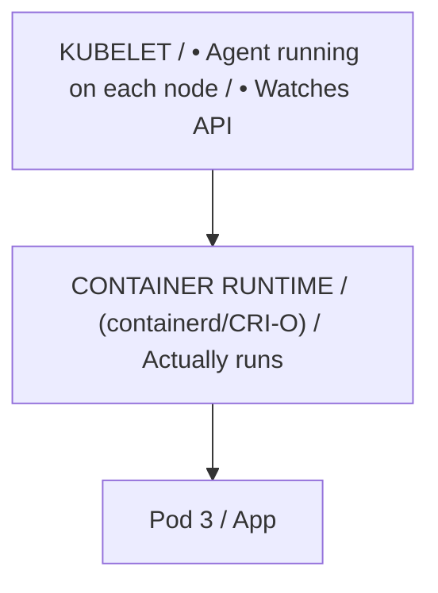
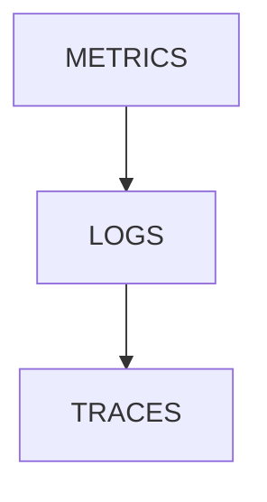
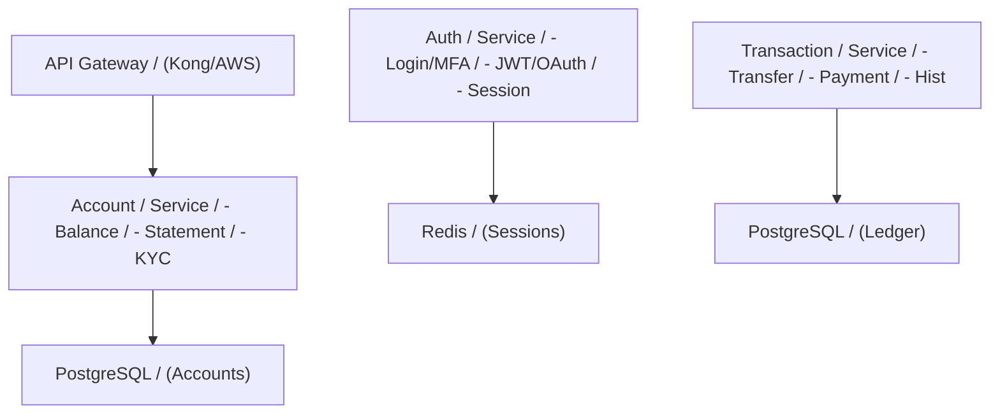
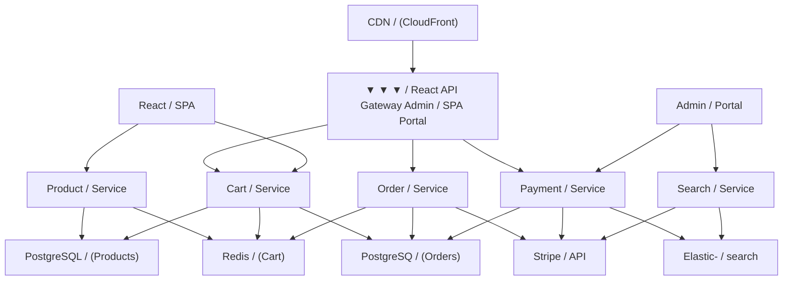
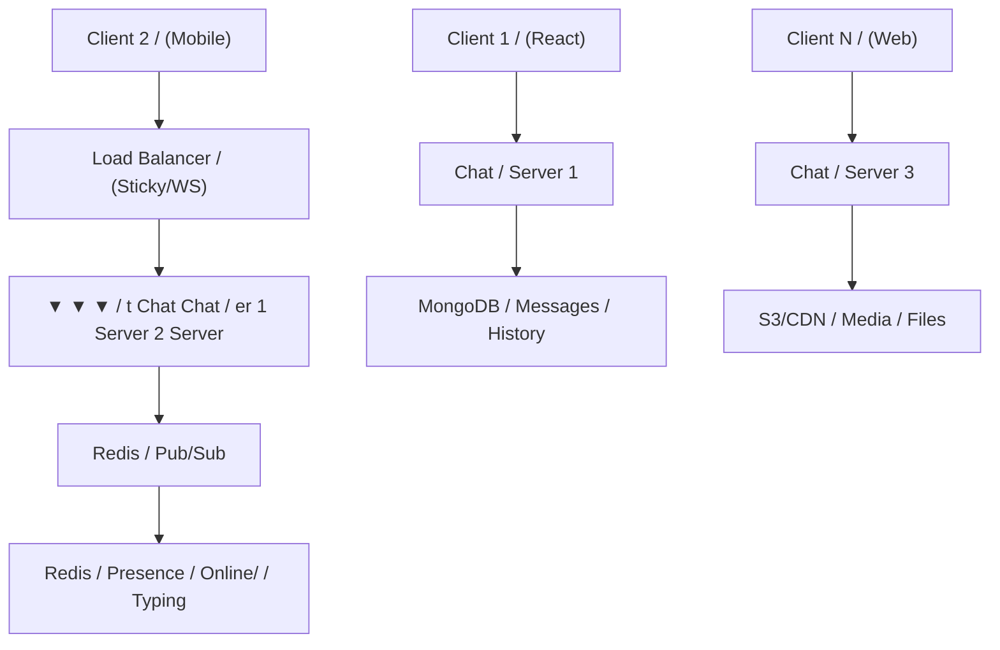
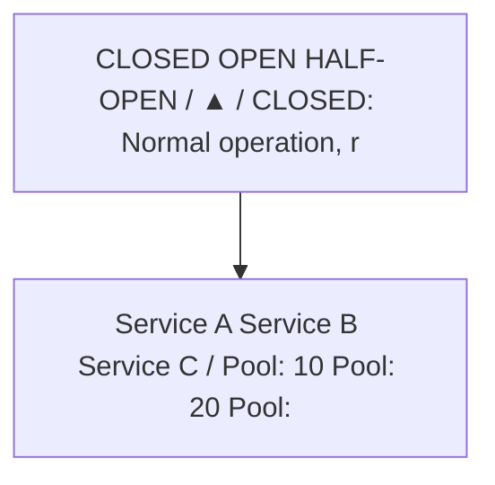
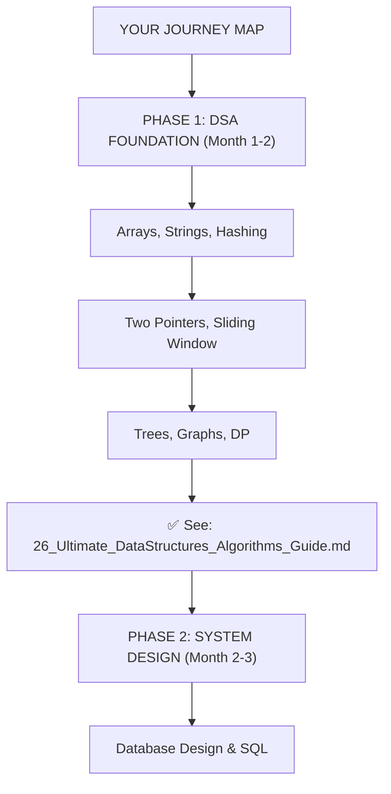
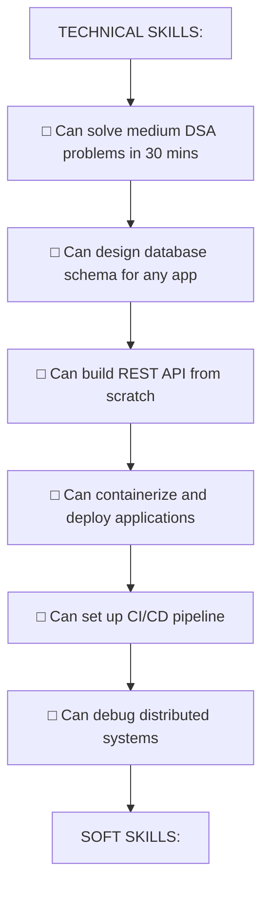

> **Navigation**: [< Previous Chapter](05_Career_Projects_Part2.md) | [Back to Index](../00_MASTER_INDEX.md)

---

```
│  │  │                      │  │  • Node          │        │   │
│  │  │                      │  │    Controller    │        │   │
│  │  └──────────────────────┘  └──────────────────┘        │   │
│  │                                      │                  │   │
│  │                          ┌───────────┴──────────┐      │   │
│  │                          │                      │      │   │
│  │              ┌───────────▼──────────┐           │      │   │
│  │              │     SCHEDULER        │           │      │   │
│  │              │                      │           │      │   │
│  │              │  • Watches for pods  │           │      │   │
│  │              │    without node      │           │      │   │
│  │              │  • Selects best node │           │      │   │
│  │              │    (resources,       │           │      │   │
│  │              │    affinity, taints) │           │      │   │
│  │              │                      │           │      │   │
│  │              └──────────────────────┘           │      │   │
│  │                                                          │   │
│  └─────────────────────────────────────────────────────────┘   │
│                                                                  │
│  ┌─────────────────────────────────────────────────────────┐   │
│  │                   WORKER NODES                           │   │
│  │                                                          │   │
│  │  ┌────────────────────────────────────────────────────┐ │   │
│  │  │                  NODE 1                             │ │   │
│  │  │                                                     │ │   │
│  │  │  ┌─────────────────────────────────────────────┐   │ │   │
│  │  │  │              KUBELET                         │   │ │   │
│  │  │  │                                              │   │ │   │
│  │  │  │  • Agent running on each node               │   │ │   │
│  │  │  │  • Watches API server for pod assignments   │   │ │   │
│  │  │  │  • Ensures containers are running           │   │ │   │
│  │  │  │  • Reports node status                      │   │ │   │
│  │  │  │                                              │   │ │   │
│  │  │  └─────────────────────────────────────────────┘   │ │   │
│  │  │                        │                           │ │   │
│  │  │  ┌─────────────────────▼───────────────────────┐   │ │   │
│  │  │  │         CONTAINER RUNTIME                    │   │ │   │
│  │  │  │       (containerd/CRI-O)                     │   │ │   │
│  │  │  │                                              │   │ │   │
│  │  │  │  Actually runs the containers               │   │ │   │
│  │  │  │                                              │   │ │   │
│  │  │  └─────────────────────────────────────────────┘   │ │   │
│  │  │                        │                           │ │   │
│  │  │  ┌──────────┐  ┌──────────┐  ┌──────────┐         │ │   │
│  │  │  │  Pod 1   │  │  Pod 2   │  │  Pod 3   │         │ │   │
│  │  │  │ ┌──────┐ │  │ ┌──────┐ │  │ ┌──────┐ │         │ │   │
│  │  │  │ │ App  │ │  │ │ App  │ │  │ │ App  │ │         │ │   │
│  │  │  │ └──────┘ │  │ │Sidecar││  │ └──────┘ │         │ │   │
│  │  │  └──────────┘  │ └──────┘ │  └──────────┘         │ │   │
│  │  │                └──────────┘                        │ │   │
│  │  │                                                     │ │   │
│  │  │  ┌─────────────────────────────────────────────┐   │ │   │
│  │  │  │              KUBE-PROXY                      │   │ │   │
│  │  │  │                                              │   │ │   │
│  │  │  │  • Network proxy on each node               │   │ │   │
│  │  │  │  • Implements Service abstraction           │   │ │   │
│  │  │  │  • iptables/ipvs rules for routing          │   │ │   │
│  │  │  │                                              │   │ │   │
│  │  │  └─────────────────────────────────────────────┘   │ │   │
│  │  │                                                     │ │   │
│  │  └────────────────────────────────────────────────────┘ │   │
│  │                                                          │   │
│  └─────────────────────────────────────────────────────────┘   │
│                                                                  │
└─────────────────────────────────────────────────────────────────┘
```

**Flow:**
- KUBELET / • Agent running on each node / • Watches API
- ↓
- CONTAINER RUNTIME / (containerd/CRI-O) / Actually runs
- ↓
- Pod 3 / App




### Pod Scheduling - How It Works

WHAT HAPPENS WHEN YOU CREATE A DEPLOYMENT:
```
═════════════════════════════════════════
```


kubectl apply -f deployment.yaml

## Pod Scheduling Flow

STEP 1: User submits deployment
kubectl → API Server → Validate → Store in etcd
etcd now has:
{
"kind": "Deployment",
"spec": { "replicas": 3, ... }
}
STEP 2: Deployment Controller creates ReplicaSet
Controller Manager watches for Deployment changes
→ Sees new Deployment
→ Creates ReplicaSet with same spec
STEP 3: ReplicaSet Controller creates Pods
ReplicaSet controller watches for ReplicaSet changes
→ Sees ReplicaSet needs 3 replicas
→ Current pods: 0
→ Creates 3 Pod objects in etcd
Pods in etcd:
{ "name": "myapp-abc12", "node": null, "status": "Pending" }
{ "name": "myapp-def34", "node": null, "status": "Pending" }
{ "name": "myapp-ghi56", "node": null, "status": "Pending" }
STEP 4: Scheduler assigns Pods to Nodes
Scheduler watches for Pods with node = null
→ Finds 3 unscheduled pods
For each pod, Scheduler:
a) FILTERING: Which nodes CAN run this pod?
Node 1: Has 4GB free RAM, pod needs 2GB → ✓ PASS
Node 2: Has 1GB free RAM, pod needs 2GB → ✗ FAIL
Node 3: Has taint "gpu=true", pod has no tolerance
→ ✗ FAIL
Node 4: Has 8GB free RAM → ✓ PASS
b) SCORING: Which passing node is BEST?
Node 1: Score = 60 (balanced resources)
Node 4: Score = 80 (more resources, same zone)
Winner: Node 4
c) BINDING: Update pod in etcd with node assignment
{ "name": "myapp-abc12", "node": "node-4" }
STEP 5: Kubelet creates the container
Kubelet on Node 4 watches for pods assigned to it
→ Sees myapp-abc12 assigned
→ Pulls image (if not cached)
→ Creates container via containerd
→ Sets up networking (CNI)
→ Mounts volumes
→ Starts container
→ Reports status: "Running"

**Total Time**: 2-30 seconds (depending on image pull)


### Kubernetes Service Networking

HOW SERVICES ROUTE TRAFFIC:
```
══════════════════════════
```


Service: myapp-service (ClusterIP: 10.96.45.123, Port: 80)
Pods: myapp-abc (10.244.1.5:8080), myapp-def (10.244.2.8:8080)


> 🔬 **Section Challenge — Pod Scheduling Flow**

## Service Networking

Client Pod sends request:
curl http://myapp-service:80/api/users
STEP 1: DNS RESOLUTION
CoreDNS (cluster DNS):
myapp-service.default.svc.cluster.local → 10.96.45.123
STEP 2: IPTABLES/IPVS RULES (kube-proxy)
IPTABLES RULES
(on every node)

**Rule**: If destination = 10.96.45.123:80
→ DNAT to one of:
- 10.244.1.5:8080 (50% probability)
- 10.244.2.8:8080 (50% probability)
This is random load balancing!
STEP 3: PACKET ROUTING
Client Pod ──► 10.96.45.123:80 (Service IP)
│
│ iptables DNAT
▼
10.244.2.8:8080 (Pod IP - selected randomly)
│
│ If pod on same node: direct delivery
│ If pod on different node: route via overlay
▼
myapp-def Pod receives request

**Service Types**:
ClusterIP (default):
- Internal cluster IP only
- Not accessible from outside
NodePort:
- Exposes on each node's IP at static port (30000-32767)
- curl http://node-ip:30123
LoadBalancer:
- Creates cloud load balancer (AWS ELB, GCP LB)
- Gets external IP
Ingress:
- HTTP/HTTPS routing
- Path-based routing (/api → service1, /web → service2)
- TLS termination

```

---


> 🔬 **Section Challenge — Service Networking**

## Phase 9: Monitoring & Observability

### The Three Pillars

```
```
┌──────────────────────────────────────────────────────────────────┐
│              OBSERVABILITY - THREE PILLARS                       │
├──────────────────────────────────────────────────────────────────┤
│                                                                  │
│  ┌─────────────┐    ┌─────────────┐    ┌─────────────┐           │
│  │   METRICS   │    │    LOGS     │    │   TRACES    │           │
│  └─────────────┘    └─────────────┘    └─────────────┘           │
│                                                                  │
│  WHAT happened?     WHY it happened?   WHERE it happened?        │
│                                                                  │
│  Numbers over time  Text events        Request journey           │
│  CPU, Memory, QPS   Errors, Debug      Across services           │
│  Aggregatable       Searchable         Distributed               │
│                                                                  │
│  Tools:             Tools:             Tools:                    │
│  Prometheus         ELK Stack          Jaeger                    │
│  Grafana            Loki               Zipkin                    │
│  Datadog            Splunk             AWS X-Ray                 │
│                                                                  │
│  Example:           Example:           Example:                  │
│  HTTP 500 rate      Stack trace        Request: UserSvc →        │
│  increased 50%      NullPointer        OrderSvc → PaymentSvc     │
│  at 3:45 PM         at UserService     latency breakdown         │
│                     line 127                                     │
│                                                                  │
└──────────────────────────────────────────────────────────────────┘
```

**Flow:**
- METRICS
- ↓
- LOGS
- ↓
- TRACES




### Prometheus + Grafana Setup


```yaml


> 🔬 **Section Challenge — Phase 9: Monitoring & Observability**

# prometheus.yml - Prometheus Configuration
global:
    scrape_interval: 15s
    evaluation_interval: 15s

alerting:
    alertmanagers:
        - static_configs:
              - targets: ["alertmanager:9093"]

rule_files:
    - /etc/prometheus/alerts/*.yml

scrape_configs:
    # Prometheus itself
    - job_name: "prometheus"
      static_configs:
          - targets: ["localhost:9090"]

    # Spring Boot apps (via Actuator)
    - job_name: "spring-boot"
      metrics_path: "/actuator/prometheus"
      static_configs:
          - targets: ["backend:8080"]
      relabel_configs:
          - source_labels: [__address__]
            target_label: instance

    # Node Exporter (OS metrics)
    - job_name: "node"
      static_configs:
          - targets: ["node-exporter:9100"]

    # Kubernetes pods (auto-discovery)
    - job_name: "kubernetes-pods"
      kubernetes_sd_configs:
          - role: pod
      relabel_configs:
          - source_labels:
                [__meta_kubernetes_pod_annotation_prometheus_io_scrape]
            action: keep
            regex: true
          - source_labels: [__meta_kubernetes_pod_annotation_prometheus_io_path]
            action: replace
            target_label: __metrics_path__
            regex: (.+)

---
# alerts.yml - Alert Rules
groups:
    - name: application
      rules:
          - alert: HighErrorRate
            expr: |
                sum(rate(http_server_requests_seconds_count{status=~"5.."}[5m])) 
                / sum(rate(http_server_requests_seconds_count[5m])) > 0.05
            for: 5m
            labels:
                severity: critical
            annotations:
                summary: "High error rate detected"
                description: "Error rate is {{ $value | humanizePercentage }}"

          - alert: HighLatency
            expr: |
                histogram_quantile(0.95, 
                  sum(rate(http_server_requests_seconds_bucket[5m])) by (le)
                ) > 2
            for: 5m
            labels:
                severity: warning
            annotations:
                summary: "High latency detected"
                description: "95th percentile latency is {{ $value }}s"

          - alert: PodCrashLooping
            expr: |
                increase(kube_pod_container_status_restarts_total[1h]) > 3
            for: 5m
            labels:
                severity: warning
            annotations:
                summary: "Pod is crash looping"
                description: "Pod {{ $labels.pod }} restarted {{ $value }} times"

          - alert: HighMemoryUsage
            expr: |
                (container_memory_usage_bytes / container_spec_memory_limit_bytes) > 0.9
            for: 5m
            labels:
                severity: warning
            annotations:
                summary: "High memory usage"
                description: "Container using {{ $value | humanizePercentage }} of memory limit"
```

```java
// Spring Boot Metrics Configuration
@Configuration
public class MetricsConfig {

    @Bean
    MeterRegistryCustomizer<MeterRegistry> commonTags() {
        return registry -> registry.config()
            .commonTags("application", "my-app")
            .commonTags("environment", System.getenv("ENV"));
    }
}

// Custom business metrics
@Service
@RequiredArgsConstructor
public class OrderService {

    private final MeterRegistry meterRegistry;
    private final Counter orderCounter;
    private final Timer orderProcessingTimer;

    @PostConstruct
    void initMetrics() {
        orderCounter = Counter.builder("orders.created")
            .description("Total orders created")
            .tag("type", "all")
            .register(meterRegistry);

        orderProcessingTimer = Timer.builder("orders.processing.time")
            .description("Order processing duration")
            .publishPercentiles(0.5, 0.95, 0.99)
            .register(meterRegistry);
    }

    public Order createOrder(OrderRequest request) {
        return orderProcessingTimer.record(() -> {
            // Process order
            Order order = processOrder(request);

            orderCounter.increment();

            // Track by payment method
            meterRegistry.counter("orders.created",
                "payment_method", request.getPaymentMethod()
            ).increment();

            return order;
        });
    }
}
```

### ELK Stack - Logging

```yaml
# docker-compose.yml - ELK Stack
version: '3.8'

services:
  elasticsearch:
    image: docker.elastic.co/elasticsearch/elasticsearch:8.11.0
    environment:
      - discovery.type=single-node
      - xpack.security.enabled=false
      - "ES_JAVA_OPTS=-Xms512m -Xmx512m"
    volumes:
      - elasticsearch_data:/usr/share/elasticsearch/data
    ports:
      - "9200:9200"

  logstash:
    image: docker.elastic.co/logstash/logstash:8.11.0
    volumes:
      - ./logstash/pipeline:/usr/share/logstash/pipeline
    ports:
      - "5044:5044"
    depends_on:
      - elasticsearch

  kibana:
    image: docker.elastic.co/kibana/kibana:8.11.0
    environment:
      - ELASTICSEARCH_HOSTS=http://elasticsearch:9200
    ports:
      - "5601:5601"
    depends_on:
      - elasticsearch

volumes:
  elasticsearch_data:

---
# logstash/pipeline/logstash.conf
input {
  beats {
    port => 5044
  }

  # Direct from application
  tcp {
    port => 5000
    codec => json_lines
  }
}

filter {
  if [message] =~ /^\{/ {
    json {
      source => "message"
    }
  }

  # Parse timestamp
  date {
    match => ["timestamp", "ISO8601", "yyyy-MM-dd HH:mm:ss.SSS"]
    target => "@timestamp"
  }

  # Add geo info from IP
  geoip {
    source => "client_ip"
  }

  # Parse user agent
  useragent {
    source => "user_agent"
    target => "user_agent_parsed"
  }
}

output {
  elasticsearch {
    hosts => ["elasticsearch:9200"]
    index => "logs-%{[application]}-%{+YYYY.MM.dd}"
  }
}
```

```xml
<!-- logback-spring.xml - Structured Logging -->
<?xml version="1.0" encoding="UTF-8"?>
<configuration>
    <include resource="org/springframework/boot/logging/logback/defaults.xml"/>

    <!-- Console output for development -->
    <springProfile name="dev">
        <appender name="CONSOLE" class="ch.qos.logback.core.ConsoleAppender">
            <encoder>
                <pattern>%d{HH:mm:ss.SSS} [%thread] %-5level %logger{36} - %msg%n</pattern>
            </encoder>
        </appender>
        <root level="DEBUG">
            <appender-ref ref="CONSOLE"/>
        </root>
    </springProfile>

    <!-- JSON output for production (ELK) -->
    <springProfile name="prod">
        <appender name="LOGSTASH" class="net.logstash.logback.appender.LogstashTcpSocketAppender">
            <destination>logstash:5000</destination>
            <encoder class="net.logstash.logback.encoder.LogstashEncoder">
                <customFields>{"application":"my-app","environment":"production"}</customFields>
                <includeMdcKeyName>traceId</includeMdcKeyName>
                <includeMdcKeyName>spanId</includeMdcKeyName>
                <includeMdcKeyName>userId</includeMdcKeyName>
            </encoder>
        </appender>
        <root level="INFO">
            <appender-ref ref="LOGSTASH"/>
        </root>
    </springProfile>
</configuration>
```

### Distributed Tracing with Jaeger

```java
// Spring Boot with Micrometer Tracing + Jaeger
// application.yml
management:
  tracing:
    sampling:
      probability: 1.0  # 100% sampling in dev, reduce in prod
  zipkin:
    tracing:
      endpoint: http://jaeger:9411/api/v2/spans

// Propagate trace context in REST calls
@Configuration
public class RestClientConfig {

    @Bean
    public RestTemplate restTemplate(RestTemplateBuilder builder) {
        return builder.build();
    }
}

// Trace context automatically propagated via headers:
// traceparent: 00-0af7651916cd43dd8448eb211c80319c-b7ad6b7169203331-01

// Custom spans for business operations
@Service
@RequiredArgsConstructor
public class PaymentService {

    private final Tracer tracer;

    public PaymentResult processPayment(PaymentRequest request) {
        Span span = tracer.nextSpan().name("process-payment").start();

        try (Tracer.SpanInScope ws = tracer.withSpan(span)) {
            // Add business context to span
            span.tag("payment.method", request.getMethod());
            span.tag("payment.amount", String.valueOf(request.getAmount()));

            // Process payment
            PaymentResult result = doProcess(request);

            span.tag("payment.status", result.getStatus());
            return result;

        } catch (Exception e) {
            span.error(e);
            throw e;
        } finally {
            span.end();
        }
    }
}
```

```
DISTRIBUTED TRACE EXAMPLE:
──────────────────────────

Request: POST /api/orders

Trace ID: abc123

├── API Gateway (2ms)
│   └── Auth check
│
├── Order Service (150ms)
│   ├── Validate request (5ms)
│   ├── Check inventory (50ms) ────────────────┐
│   │                                          │
│   │   Inventory Service (45ms)              │
│   │   └── Query database (40ms)             │
│   │                                          │
│   ├── Process payment (80ms) ────────────────┤
│   │                                          │
│   │   Payment Service (75ms)                │
│   │   ├── Fraud check (30ms)                │
│   │   └── Charge card (40ms)                │
│   │                                          │
│   └── Create order (15ms)                   │
│       └── Save to DB (10ms)                 │
│
└── Send confirmation email (async)
    └── Email Service (200ms)
```

**Flow:**
- Trace ID: abc123
- ↓
- API Gateway (2ms)
- ↓
- Trace ID: abc123
- ↓
- Auth check
- ↓
- Trace ID: abc123
- ↓
- Order Service (150ms)
- ↓
- Trace ID: abc123
- ↓
- Validate request (5ms)
- ↓
- Trace ID: abc123
- ↓
- Check inventory (50ms)
- ↓
- Inventory Service (45ms)
- ↓
- Query database (40ms)

```mermaid
flowchart TD
    N1["Trace ID: abc123"]
    N2["API Gateway (2ms)"]
    N3["Auth check"]
    N4["Order Service (150ms)"]
    N5["Validate request (5ms)"]
    N6["Check inventory (50ms)"]
    N7["Inventory Service (45ms)"]
    N8["Query database (40ms)"]
    N9["Process payment (80ms)"]
    N10["Payment Service (75ms)"]
    N11["Fraud check (30ms)"]
    N12["Charge card (40ms)"]
    N13["Create order (15ms)"]
    N14["Save to DB (10ms)"]
    N15["Send confirmation email (async)"]
    N16["Email Service (200ms)"]
    N1 --> N2
    N1 --> N3
    N1 --> N4
    N1 --> N5
    N1 --> N6
    N7 --> N8
    N7 --> N9
    N10 --> N11
    N10 --> N12
    N10 --> N13
    N10 --> N14
    N10 --> N15
    N10 --> N16
```



---

_Stage 4 Complete! Ready for Stage 5: Complete Application Scenarios_

---

## Phase 10: Complete Application Scenarios

### Scenario 1: Finance Application (Banking/Fintech)

```
┌──────────────────────────────────────────────────────────────────┐
│            BANKING APPLICATION - COMPLETE ARCHITECTURE           │
├──────────────────────────────────────────────────────────────────┤
│                                                                  │
│                     ┌─────────────────┐                          │
│   Mobile App ──────►│   API Gateway   │◄────── Web App           │
│                     │  (Kong/AWS)     │                          │
│                     └────────┬────────┘                          │
│                              │                                   │
│           ┌──────────────────┼──────────────────┐                │
│           │                  │                  │                │
│           ▼                  ▼                  ▼                │
│   ┌───────────────┐  ┌───────────────┐  ┌───────────────┐        │
│   │    Auth       │  │   Account     │  │  Transaction  │        │
│   │   Service     │  │   Service     │  │   Service     │        │
│   │               │  │               │  │               │        │
│   │ - Login/MFA   │  │ - Balance     │  │ - Transfer    │        │
│   │ - JWT/OAuth   │  │ - Statement   │  │ - Payment     │        │
│   │ - Session     │  │ - KYC         │  │ - History     │        │
│   └───────┬───────┘  └───────┬───────┘  └───────┬───────┘        │
│           │                  │                  │                │
│           ▼                  ▼                  ▼                │
│   ┌───────────────┐  ┌───────────────┐  ┌───────────────┐        │
│   │    Redis      │  │  PostgreSQL   │  │  PostgreSQL   │        │
│   │  (Sessions)   │  │  (Accounts)   │  │  (Ledger)     │        │
│   └───────────────┘  └───────────────┘  └───────────────┘        │
│                                                                  │
│   ADDITIONAL SERVICES:                                           │
│   ┌───────────────┐  ┌───────────────┐  ┌───────────────┐        │
│   │   Fraud       │  │ Notification  │  │   Reporting   │        │
│   │  Detection    │  │   Service     │  │   Service     │        │
│   │  (ML Model)   │  │ (Email/SMS)   │  │  (Analytics)  │        │
│   └───────────────┘  └───────────────┘  └───────────────┘        │
│                                                                  │
│   EVENT STREAMING:                                               │
│   ┌─────────────────────────────────────────────────────┐        │
│   │                    Apache Kafka                      │       │
│   │  Topics: transactions, audit-log, notifications     │        │
│   └─────────────────────────────────────────────────────┘        │
│                                                                  │
└──────────────────────────────────────────────────────────────────┘
```

**Flow:**
- API Gateway / (Kong/AWS)
- ↓
- Account / Service / - Balance / - Statement / - KYC
- ↓
- Auth / Service / - Login/MFA / - JWT/OAuth / - Session
- ↓
- Redis / (Sessions)
- ↓
- Account / Service / - Balance / - Statement / - KYC
- ↓
- PostgreSQL / (Accounts)
- ↓
- Transaction / Service / - Transfer / - Payment / - Hist
- ↓
- PostgreSQL / (Ledger)



#### Transaction Service - Double Entry Ledger

```java
// CRITICAL: Banking transactions use double-entry bookkeeping
// Every transaction has TWO entries: Debit and Credit

@Entity
@Table(name = "ledger_entries")
public class LedgerEntry {
    @Id
    @GeneratedValue(strategy = GenerationType.UUID)
    private String id;

    @Column(nullable = false)
    private String transactionId;  // Groups related entries

    @Column(nullable = false)
    private String accountId;

    @Enumerated(EnumType.STRING)
    @Column(nullable = false)
    private EntryType entryType;  // DEBIT or CREDIT

    @Column(nullable = false, precision = 19, scale = 4)
    private BigDecimal amount;

    @Column(nullable = false)
    private String currency;

    @Column(nullable = false)
    private LocalDateTime timestamp;

    private String description;
    private String referenceNumber;
}

@Service
@RequiredArgsConstructor
@Transactional
public class TransferService {

    private final AccountRepository accountRepository;
    private final LedgerRepository ledgerRepository;
    private final KafkaTemplate<String, TransactionEvent> kafkaTemplate;
    private final FraudDetectionService fraudService;

    public TransferResult transfer(TransferRequest request) {
        String transactionId = UUID.randomUUID().toString();

        // 1. Validate accounts exist
        Account fromAccount = accountRepository.findById(request.getFromAccountId())
            .orElseThrow(() -> new AccountNotFoundException(request.getFromAccountId()));
        Account toAccount = accountRepository.findById(request.getToAccountId())
            .orElseThrow(() -> new AccountNotFoundException(request.getToAccountId()));

        // 2. Check sufficient balance
        if (fromAccount.getBalance().compareTo(request.getAmount()) < 0) {
            throw new InsufficientFundsException(fromAccount.getId());
        }

        // 3. Fraud check (async but wait for critical transactions)
        FraudCheckResult fraudResult = fraudService.check(request);
        if (fraudResult.isBlocked()) {
            throw new TransactionBlockedException("Fraud detected: " + fraudResult.getReason());
        }

        // 4. Create ledger entries (DOUBLE ENTRY)
        LocalDateTime now = LocalDateTime.now();

        // Debit from source account
        LedgerEntry debitEntry = LedgerEntry.builder()
            .transactionId(transactionId)
            .accountId(fromAccount.getId())
            .entryType(EntryType.DEBIT)
            .amount(request.getAmount())
            .currency(request.getCurrency())
            .timestamp(now)
            .description("Transfer to " + toAccount.getAccountNumber())
            .build();

        // Credit to destination account
        LedgerEntry creditEntry = LedgerEntry.builder()
            .transactionId(transactionId)
            .accountId(toAccount.getId())
            .entryType(EntryType.CREDIT)
            .amount(request.getAmount())
            .currency(request.getCurrency())
            .timestamp(now)
            .description("Transfer from " + fromAccount.getAccountNumber())
            .build();

        // 5. Update account balances
        fromAccount.setBalance(fromAccount.getBalance().subtract(request.getAmount()));
        toAccount.setBalance(toAccount.getBalance().add(request.getAmount()));

        // 6. Save all (atomic transaction)
        ledgerRepository.saveAll(List.of(debitEntry, creditEntry));
        accountRepository.saveAll(List.of(fromAccount, toAccount));

        // 7. Publish event for audit and notifications
        kafkaTemplate.send("transactions", transactionId,
            new TransactionEvent(transactionId, request, TransactionStatus.COMPLETED));

        return new TransferResult(transactionId, TransactionStatus.COMPLETED);
    }
}

// Idempotency for payment APIs (prevent double-charge)
@RestController
@RequestMapping("/api/v1/payments")
public class PaymentController {

    private final PaymentService paymentService;
    private final RedisTemplate<String, String> redis;

    @PostMapping
    public ResponseEntity<PaymentResponse> processPayment(
            @RequestHeader("Idempotency-Key") String idempotencyKey,
            @Valid @RequestBody PaymentRequest request) {

        // Check if already processed
        String existingResult = redis.opsForValue().get("payment:" + idempotencyKey);
        if (existingResult != null) {
            return ResponseEntity.ok(parseResponse(existingResult));
        }

        // Process payment
        PaymentResponse response = paymentService.process(request);

        // Store result with TTL (24 hours)
        redis.opsForValue().set(
            "payment:" + idempotencyKey,
            serializeResponse(response),
            Duration.ofHours(24)
        );

        return ResponseEntity.ok(response);
    }
}
```

#### Financial Calculations - Precision Matters

```java
// NEVER use float/double for money! Use BigDecimal

public class FinancialCalculations {

    // Interest calculation
    public static BigDecimal calculateSimpleInterest(
            BigDecimal principal,
            BigDecimal annualRate,
            int days) {
        // Interest = P × R × T
        return principal
            .multiply(annualRate)
            .multiply(BigDecimal.valueOf(days))
            .divide(BigDecimal.valueOf(365), 4, RoundingMode.HALF_UP);
    }

    // Compound interest
    public static BigDecimal calculateCompoundInterest(
            BigDecimal principal,
            BigDecimal annualRate,
            int timesPerYear,
            int years) {
        // A = P(1 + r/n)^(nt)
        BigDecimal rate = annualRate.divide(BigDecimal.valueOf(timesPerYear), 10, RoundingMode.HALF_UP);
        BigDecimal base = BigDecimal.ONE.add(rate);
        int exponent = timesPerYear * years;

        BigDecimal multiplier = base.pow(exponent);
        return principal.multiply(multiplier).setScale(2, RoundingMode.HALF_UP);
    }

    // EMI (Equated Monthly Installment) calculation
    public static BigDecimal calculateEMI(
            BigDecimal principal,
            BigDecimal annualRate,
            int tenureMonths) {
        // EMI = [P × R × (1+R)^N] / [(1+R)^N – 1]
        BigDecimal monthlyRate = annualRate
            .divide(BigDecimal.valueOf(12), 10, RoundingMode.HALF_UP)
            .divide(BigDecimal.valueOf(100), 10, RoundingMode.HALF_UP);

        BigDecimal onePlusR = BigDecimal.ONE.add(monthlyRate);
        BigDecimal power = onePlusR.pow(tenureMonths);

        BigDecimal numerator = principal.multiply(monthlyRate).multiply(power);
        BigDecimal denominator = power.subtract(BigDecimal.ONE);

        return numerator.divide(denominator, 2, RoundingMode.HALF_UP);
    }

    // Currency conversion with rate
    public static BigDecimal convert(
            BigDecimal amount,
            BigDecimal exchangeRate,
            int targetScale) {
        return amount.multiply(exchangeRate)
            .setScale(targetScale, RoundingMode.HALF_UP);
    }
}
```

---

### Scenario 2: E-Commerce Platform

```
┌──────────────────────────────────────────────────────────────────┐
│              E-COMMERCE PLATFORM ARCHITECTURE                    │
├──────────────────────────────────────────────────────────────────┤
│                                                                  │
│                         ┌──────────────┐                         │
│                         │   CDN        │                         │
│                         │ (CloudFront) │                         │
│                         └──────┬───────┘                         │
│                                │                                 │
│   ┌────────────────────────────┼────────────────────────────┐    │
│   │                            │                            │    │
│   ▼                            ▼                            ▼    │
│ ┌──────────┐            ┌──────────────┐            ┌──────────┐ │
│ │  React   │            │  API Gateway │            │  Admin   │ │
│ │   SPA    │            │              │            │  Portal  │ │
│ └──────────┘            └──────┬───────┘            └──────────┘ │
│                                │                                 │
│        ┌───────────────────────┼───────────────────────┐         │
│        │           │           │           │           │         │
│        ▼           ▼           ▼           ▼           ▼         │
│   ┌─────────┐ ┌─────────┐ ┌─────────┐ ┌─────────┐ ┌─────────┐    │
│   │ Product │ │  Cart   │ │  Order  │ │ Payment │ │ Search  │    │
│   │ Service │ │ Service │ │ Service │ │ Service │ │ Service │    │
│   └────┬────┘ └────┬────┘ └────┬────┘ └────┬────┘ └────┬────┘    │
│        │           │           │           │           │         │
│        ▼           ▼           ▼           ▼           ▼         │
│   ┌─────────┐ ┌─────────┐ ┌─────────┐ ┌─────────┐ ┌─────────┐    │
│   │PostgreSQL│ │  Redis  │ │PostgreSQL│ │ Stripe │ │Elastic- │   │
│   │(Products)│ │ (Cart)  │ │(Orders) │ │  API   │ │ search  │    │
│   └─────────┘ └─────────┘ └─────────┘ └─────────┘ └─────────┘    │
│                                                                  │
│   ADDITIONAL:                                                    │
│   ┌─────────┐ ┌─────────┐ ┌─────────┐ ┌─────────┐                │
│   │Inventory│ │Shipping │ │  Email  │ │Analytics│                │
│   │ Service │ │ Service │ │ Service │ │ Service │                │
│   └─────────┘ └─────────┘ └─────────┘ └─────────┘                │
│                                                                  │
│   MESSAGE QUEUE (Async operations):                              │
│   ┌─────────────────────────────────────────────────────────┐    │
│   │                      RabbitMQ / SQS                      │   │
│   │  Queues: order-processing, inventory-updates, emails    │    │
│   └─────────────────────────────────────────────────────────┘    │
│                                                                  │
└──────────────────────────────────────────────────────────────────┘
```

**Flow:**
- CDN / (CloudFront)
- ↓
- ▼ ▼ ▼ / React API Gateway Admin / SPA Portal
- ↓
- Cart / Service
- ↓
- ▼ ▼ ▼ / React API Gateway Admin / SPA Portal
- ↓
- Order / Service
- ↓
- ▼ ▼ ▼ / React API Gateway Admin / SPA Portal
- ↓
- Payment / Service
- ↓
- React / SPA
- ↓
- Product / Service
- ↓
- React / SPA
- ↓
- Cart / Service



#### Cart Service with Redis

```java
// Cart stored in Redis for fast access and auto-expiry
@Service
@RequiredArgsConstructor
public class CartService {

    private final RedisTemplate<String, Cart> redisTemplate;
    private final ProductService productService;

    private static final String CART_PREFIX = "cart:";
    private static final Duration CART_TTL = Duration.ofDays(7);

    public Cart getCart(String userId) {
        Cart cart = redisTemplate.opsForValue().get(CART_PREFIX + userId);
        return cart != null ? cart : new Cart(userId);
    }

    public Cart addItem(String userId, AddToCartRequest request) {
        Cart cart = getCart(userId);

        // Validate product exists and has stock
        Product product = productService.getProduct(request.getProductId());
        if (product.getStock() < request.getQuantity()) {
            throw new InsufficientStockException(product.getId());
        }

        // Add or update item
        cart.addItem(CartItem.builder()
            .productId(product.getId())
            .productName(product.getName())
            .price(product.getPrice())
            .quantity(request.getQuantity())
            .imageUrl(product.getImageUrl())
            .build());

        // Recalculate totals
        cart.recalculate();

        // Save with TTL refresh
        redisTemplate.opsForValue().set(CART_PREFIX + userId, cart, CART_TTL);

        return cart;
    }

    public Cart removeItem(String userId, String productId) {
        Cart cart = getCart(userId);
        cart.removeItem(productId);
        cart.recalculate();
        redisTemplate.opsForValue().set(CART_PREFIX + userId, cart, CART_TTL);
        return cart;
    }

    public void clearCart(String userId) {
        redisTemplate.delete(CART_PREFIX + userId);
    }
}

@Data
@NoArgsConstructor
@AllArgsConstructor
public class Cart implements Serializable {
    private String userId;
    private List<CartItem> items = new ArrayList<>();
    private BigDecimal subtotal = BigDecimal.ZERO;
    private BigDecimal tax = BigDecimal.ZERO;
    private BigDecimal shipping = BigDecimal.ZERO;
    private BigDecimal total = BigDecimal.ZERO;
    private String couponCode;
    private BigDecimal discount = BigDecimal.ZERO;

    public Cart(String userId) {
        this.userId = userId;
    }

    public void addItem(CartItem newItem) {
        Optional<CartItem> existing = items.stream()
            .filter(item -> item.getProductId().equals(newItem.getProductId()))
            .findFirst();

        if (existing.isPresent()) {
            existing.get().setQuantity(
                existing.get().getQuantity() + newItem.getQuantity());
        } else {
            items.add(newItem);
        }
    }

    public void recalculate() {
        subtotal = items.stream()
            .map(item -> item.getPrice().multiply(BigDecimal.valueOf(item.getQuantity())))
            .reduce(BigDecimal.ZERO, BigDecimal::add);

        tax = subtotal.multiply(new BigDecimal("0.18")); // 18% GST
        shipping = subtotal.compareTo(new BigDecimal("500")) >= 0
            ? BigDecimal.ZERO
            : new BigDecimal("50");

        total = subtotal.add(tax).add(shipping).subtract(discount);
    }
}
```

#### Order Saga Pattern (Distributed Transaction)

```java
// Saga pattern for order processing across multiple services
// Each step has a compensating action for rollback

@Service
@RequiredArgsConstructor
@Slf4j
public class OrderSagaOrchestrator {

    private final InventoryService inventoryService;
    private final PaymentService paymentService;
    private final ShippingService shippingService;
    private final OrderRepository orderRepository;
    private final NotificationService notificationService;

    @Transactional
    public OrderResult createOrder(CreateOrderRequest request) {
        Order order = Order.builder()
            .userId(request.getUserId())
            .items(request.getItems())
            .status(OrderStatus.PENDING)
            .build();
        order = orderRepository.save(order);

        String orderId = order.getId();
        List<SagaStep> completedSteps = new ArrayList<>();

        try {
            // Step 1: Reserve inventory
            log.info("Order {}: Reserving inventory", orderId);
            inventoryService.reserve(orderId, request.getItems());
            completedSteps.add(SagaStep.INVENTORY_RESERVED);

            // Step 2: Process payment
            log.info("Order {}: Processing payment", orderId);
            PaymentResult payment = paymentService.charge(
                orderId, request.getPaymentMethod(), request.getTotal());
            completedSteps.add(SagaStep.PAYMENT_PROCESSED);

            // Step 3: Create shipment
            log.info("Order {}: Creating shipment", orderId);
            ShipmentResult shipment = shippingService.createShipment(
                orderId, request.getShippingAddress());
            completedSteps.add(SagaStep.SHIPMENT_CREATED);

            // All steps successful - update order
            order.setStatus(OrderStatus.CONFIRMED);
            order.setPaymentId(payment.getPaymentId());
            order.setTrackingNumber(shipment.getTrackingNumber());
            orderRepository.save(order);

            // Step 4: Send confirmation (async, non-critical)
            notificationService.sendOrderConfirmation(order);

            log.info("Order {} completed successfully", orderId);
            return new OrderResult(orderId, OrderStatus.CONFIRMED);

        } catch (Exception e) {
            log.error("Order {} failed, initiating compensation", orderId, e);
            compensate(orderId, completedSteps);

            order.setStatus(OrderStatus.FAILED);
            order.setFailureReason(e.getMessage());
            orderRepository.save(order);

            throw new OrderProcessingException("Order failed: " + e.getMessage(), e);
        }
    }

    private void compensate(String orderId, List<SagaStep> completedSteps) {
        // Reverse order - undo steps in reverse
        Collections.reverse(completedSteps);

        for (SagaStep step : completedSteps) {
            try {
                switch (step) {
                    case SHIPMENT_CREATED:
                        log.info("Compensating: Cancelling shipment for {}", orderId);
                        shippingService.cancelShipment(orderId);
                        break;
                    case PAYMENT_PROCESSED:
                        log.info("Compensating: Refunding payment for {}", orderId);
                        paymentService.refund(orderId);
                        break;
                    case INVENTORY_RESERVED:
                        log.info("Compensating: Releasing inventory for {}", orderId);
                        inventoryService.release(orderId);
                        break;
                }
            } catch (Exception e) {
                log.error("Compensation failed for step {} order {}", step, orderId, e);
                // Log for manual intervention
            }
        }
    }

    enum SagaStep {
        INVENTORY_RESERVED,
        PAYMENT_PROCESSED,
        SHIPMENT_CREATED
    }
}
```

#### Search with Elasticsearch

```java
// Product search using Elasticsearch
@Service
@RequiredArgsConstructor
public class ProductSearchService {

    private final ElasticsearchClient esClient;

    public SearchResult<Product> search(ProductSearchRequest request) {
        SearchResponse<Product> response = esClient.search(s -> s
            .index("products")
            .query(q -> q
                .bool(b -> {
                    // Full-text search on name and description
                    if (request.getQuery() != null) {
                        b.must(m -> m
                            .multiMatch(mm -> mm
                                .query(request.getQuery())
                                .fields("name^3", "description", "brand^2")
                                .fuzziness("AUTO")
                            )
                        );
                    }

                    // Category filter
                    if (request.getCategory() != null) {
                        b.filter(f -> f
                            .term(t -> t.field("category").value(request.getCategory()))
                        );
                    }

                    // Price range
                    if (request.getMinPrice() != null || request.getMaxPrice() != null) {
                        b.filter(f -> f
                            .range(r -> {
                                r.field("price");
                                if (request.getMinPrice() != null) {
                                    r.gte(JsonData.of(request.getMinPrice()));
                                }
                                if (request.getMaxPrice() != null) {
                                    r.lte(JsonData.of(request.getMaxPrice()));
                                }
                                return r;
                            })
                        );
                    }

                    // Only in-stock products
                    if (request.isInStockOnly()) {
                        b.filter(f -> f
                            .range(r -> r.field("stock").gt(JsonData.of(0)))
                        );
                    }

                    return b;
                })
            )
            .sort(getSortOptions(request.getSortBy()))
            .from(request.getPage() * request.getSize())
            .size(request.getSize())
            .aggregations("categories", a -> a
                .terms(t -> t.field("category").size(20))
            )
            .aggregations("price_ranges", a -> a
                .range(r -> r
                    .field("price")
                    .ranges(
                        range -> range.to(100.0).key("Under ₹100"),
                        range -> range.from(100.0).to(500.0).key("₹100 - ₹500"),
                        range -> range.from(500.0).to(1000.0).key("₹500 - ₹1000"),
                        range -> range.from(1000.0).key("Over ₹1000")
                    )
                )
            )
            .highlight(h -> h
                .fields("name", f -> f)
                .fields("description", f -> f)
            ),
            Product.class
        );

        return buildSearchResult(response, request);
    }

    // Autocomplete suggestions
    public List<String> suggest(String prefix) {
        SearchResponse<Void> response = esClient.search(s -> s
            .index("products")
            .suggest(su -> su
                .suggesters("product-suggest", sg -> sg
                    .prefix(prefix)
                    .completion(c -> c
                        .field("name.suggest")
                        .size(10)
                        .skipDuplicates(true)
                    )
                )
            ),
            Void.class
        );

        return response.suggest().get("product-suggest").stream()
            .flatMap(s -> s.completion().options().stream())
            .map(o -> o.text())
            .collect(Collectors.toList());
    }
}
```

---

### Scenario 3: Real-Time Chat Application

```
┌──────────────────────────────────────────────────────────────────┐
│               REAL-TIME CHAT ARCHITECTURE                        │
├──────────────────────────────────────────────────────────────────┤
│                                                                  │
│   ┌────────────┐     ┌────────────┐     ┌────────────┐           │
│   │  Client 1  │     │  Client 2  │     │  Client N  │           │
│   │  (React)   │     │  (Mobile)  │     │  (Web)     │           │
│   └─────┬──────┘     └─────┬──────┘     └─────┬──────┘           │
│         │                  │                  │                  │
│         └──────────────────┼──────────────────┘                  │
│                            │                                     │
│                    WebSocket Connection                          │
│                            │                                     │
│                    ┌───────▼───────┐                             │
│                    │ Load Balancer │                             │
│                    │ (Sticky/WS)   │                             │
│                    └───────┬───────┘                             │
│                            │                                     │
│         ┌──────────────────┼──────────────────┐                  │
│         │                  │                  │                  │
│         ▼                  ▼                  ▼                  │
│   ┌───────────┐     ┌───────────┐     ┌───────────┐              │
│   │  Chat     │     │  Chat     │     │  Chat     │              │
│   │ Server 1  │◄───►│ Server 2  │◄───►│ Server 3  │              │
│   └─────┬─────┘     └─────┬─────┘     └─────┬─────┘              │
│         │                 │                 │                    │
│         └─────────────────┼─────────────────┘                    │
│                           │                                      │
│                    ┌──────▼──────┐                               │
│                    │    Redis    │  Pub/Sub for cross-server     │
│                    │   Pub/Sub   │  message delivery             │
│                    └──────┬──────┘                               │
│                           │                                      │
│         ┌─────────────────┼─────────────────┐                    │
│         │                 │                 │                    │
│   ┌─────▼─────┐    ┌──────▼──────┐   ┌──────▼──────┐             │
│   │  MongoDB  │    │   Redis     │   │   S3/CDN   │              │
│   │ Messages  │    │  Presence   │   │  Media     │              │
│   │ History   │    │  Online/    │   │  Files     │              │
│   └───────────┘    │  Typing     │   └────────────┘              │
│                    └─────────────┘                               │
│                                                                  │
└──────────────────────────────────────────────────────────────────┘
```

**Flow:**
- Client 1 / (React)
- ↓
- Chat / Server 1
- ↓
- Client 2 / (Mobile)
- ↓
- Load Balancer / (Sticky/WS)
- ↓
- Client N / (Web)
- ↓
- Chat / Server 3
- ↓
- Load Balancer / (Sticky/WS)
- ↓
- ▼ ▼ ▼ / t Chat Chat / er 1 Server 2 Server
- ↓
- Redis / Pub/Sub
- ↓
- Chat / Server 1
- ↓
- MongoDB / Messages / History



#### WebSocket Chat Server (Node.js/Socket.io)

```typescript
// server.ts - Chat server with Socket.io
import express from "express";
import { createServer } from "http";
import { Server, Socket } from "socket.io";
import { createAdapter } from "@socket.io/redis-adapter";
import { createClient } from "redis";
import jwt from "jsonwebtoken";

const app = express();
const httpServer = createServer(app);
const io = new Server(httpServer, {
    cors: {
        origin: process.env.CLIENT_URL,
        credentials: true,
    },
});

// Redis adapter for multi-server support
const pubClient = createClient({ url: process.env.REDIS_URL });
const subClient = pubClient.duplicate();

Promise.all([pubClient.connect(), subClient.connect()]).then(() => {
    io.adapter(createAdapter(pubClient, subClient));
});

// Authentication middleware
io.use(async (socket, next) => {
    try {
        const token = socket.handshake.auth.token;
        const decoded = jwt.verify(
            token,
            process.env.JWT_SECRET!,
        ) as JwtPayload;
        socket.data.userId = decoded.userId;
        socket.data.username = decoded.username;
        next();
    } catch (err) {
        next(new Error("Authentication failed"));
    }
});

// Connection handler
io.on("connection", (socket: Socket) => {
    const userId = socket.data.userId;
    console.log(`User connected: ${userId}`);

    // Join user's personal room (for direct messages)
    socket.join(`user:${userId}`);

    // Update online status
    pubClient.hSet(
        "online_users",
        userId,
        JSON.stringify({
            socketId: socket.id,
            lastSeen: new Date().toISOString(),
        }),
    );

    // Notify friends user is online
    broadcastPresence(userId, "online");

    // Join chat room
    socket.on("join_room", async (roomId: string) => {
        // Verify user has access to room
        const hasAccess = await verifyRoomAccess(userId, roomId);
        if (!hasAccess) {
            socket.emit("error", { message: "Access denied" });
            return;
        }

        socket.join(`room:${roomId}`);

        // Load recent messages
        const messages = await loadRecentMessages(roomId, 50);
        socket.emit("room_history", { roomId, messages });

        // Notify room
        socket.to(`room:${roomId}`).emit("user_joined", {
            userId,
            username: socket.data.username,
            roomId,
        });
    });

    // Send message
    socket.on(
        "send_message",
        async (data: {
            roomId: string;
            content: string;
            type: "text" | "image" | "file";
            replyTo?: string;
        }) => {
            const message = {
                id: generateId(),
                roomId: data.roomId,
                senderId: userId,
                senderName: socket.data.username,
                content: data.content,
                type: data.type,
                replyTo: data.replyTo,
                timestamp: new Date().toISOString(),
                status: "sent",
            };

            // Save to database
            await saveMessage(message);

            // Broadcast to room (including sender for confirmation)
            io.to(`room:${data.roomId}`).emit("new_message", message);
        },
    );

    // Typing indicator
    socket.on("typing_start", (roomId: string) => {
        socket.to(`room:${roomId}`).emit("user_typing", {
            userId,
            username: socket.data.username,
            roomId,
        });
    });

    socket.on("typing_stop", (roomId: string) => {
        socket.to(`room:${roomId}`).emit("user_stopped_typing", {
            userId,
            roomId,
        });
    });

    // Direct message
    socket.on(
        "direct_message",
        async (data: { recipientId: string; content: string }) => {
            const message = {
                id: generateId(),
                senderId: userId,
                recipientId: data.recipientId,
                content: data.content,
                timestamp: new Date().toISOString(),
                read: false,
            };

            await saveDirectMessage(message);

            // Send to recipient (if online)
            io.to(`user:${data.recipientId}`).emit("direct_message", message);

            // Confirm to sender
            socket.emit("message_sent", { messageId: message.id });
        },
    );

    // Message read receipt
    socket.on(
        "message_read",
        async (data: { messageId: string; roomId: string }) => {
            await markMessageRead(data.messageId, userId);

            io.to(`room:${data.roomId}`).emit("message_read_receipt", {
                messageId: data.messageId,
                readBy: userId,
                readAt: new Date().toISOString(),
            });
        },
    );

    // Disconnect
    socket.on("disconnect", () => {
        console.log(`User disconnected: ${userId}`);

        // Update last seen
        pubClient.hSet(
            "online_users",
            userId,
            JSON.stringify({
                socketId: null,
                lastSeen: new Date().toISOString(),
            }),
        );

        broadcastPresence(userId, "offline");
    });
});

// React client hook
// useChat.ts
import { useEffect, useState, useCallback } from "react";
import { io, Socket } from "socket.io-client";

export function useChat(token: string) {
    const [socket, setSocket] = useState<Socket | null>(null);
    const [connected, setConnected] = useState(false);
    const [messages, setMessages] = useState<Message[]>([]);
    const [typingUsers, setTypingUsers] = useState<Map<string, string>>(
        new Map(),
    );

    useEffect(() => {
        const newSocket = io(process.env.NEXT_PUBLIC_WS_URL!, {
            auth: { token },
            transports: ["websocket"],
        });

        newSocket.on("connect", () => setConnected(true));
        newSocket.on("disconnect", () => setConnected(false));

        newSocket.on("new_message", (message: Message) => {
            setMessages((prev) => [...prev, message]);
        });

        newSocket.on("room_history", ({ messages }) => {
            setMessages(messages);
        });

        newSocket.on("user_typing", ({ userId, username }) => {
            setTypingUsers((prev) => new Map(prev).set(userId, username));
        });

        newSocket.on("user_stopped_typing", ({ userId }) => {
            setTypingUsers((prev) => {
                const next = new Map(prev);
                next.delete(userId);
                return next;
            });
        });

        setSocket(newSocket);
        return () => {
            newSocket.close();
        };
    }, [token]);

    const sendMessage = useCallback(
        (roomId: string, content: string) => {
            socket?.emit("send_message", { roomId, content, type: "text" });
        },
        [socket],
    );

    const joinRoom = useCallback(
        (roomId: string) => {
            socket?.emit("join_room", roomId);
        },
        [socket],
    );

    return { connected, messages, typingUsers, sendMessage, joinRoom };
}
```

---

### Scenario 4: Distributed System Patterns

```
┌──────────────────────────────────────────────────────────────────┐
│              DISTRIBUTED SYSTEM PATTERNS                         │
├──────────────────────────────────────────────────────────────────┤
│                                                                  │
│  1. CIRCUIT BREAKER PATTERN                                      │
│  ──────────────────────────                                      │
│                                                                  │
│   ┌─────────────────────────────────────────────────────────┐    │
│   │                                                          │   │
│   │    CLOSED ────────► OPEN ────────► HALF-OPEN            │    │
│   │      ▲                               │                   │   │
│   │      │                               │                   │   │
│   │      └───────────────────────────────┘                   │   │
│   │                                                          │   │
│   │  CLOSED: Normal operation, requests pass through        │    │
│   │  OPEN: Failures exceeded threshold, fail fast           │    │
│   │  HALF-OPEN: Test if service recovered                   │    │
│   │                                                          │   │
│   └─────────────────────────────────────────────────────────┘    │
│                                                                  │
│  2. RETRY PATTERN WITH EXPONENTIAL BACKOFF                       │
│  ─────────────────────────────────────────                       │
│                                                                  │
│   Attempt 1: Immediate                                           │
│   Attempt 2: Wait 1 second                                       │
│   Attempt 3: Wait 2 seconds                                      │
│   Attempt 4: Wait 4 seconds                                      │
│   Attempt 5: Wait 8 seconds (with jitter)                        │
│                                                                  │
│  3. BULKHEAD PATTERN                                             │
│  ───────────────────                                             │
│                                                                  │
│   ┌─────────────────────────────────────────────────────────┐    │
│   │  Service A         Service B         Service C          │    │
│   │  ┌─────────┐       ┌─────────┐       ┌─────────┐       │     │
│   │  │ Pool: 10│       │ Pool: 20│       │ Pool: 5 │       │     │
│   │  │ threads │       │ threads │       │ threads │       │     │
│   │  └─────────┘       └─────────┘       └─────────┘       │     │
│   │                                                          │   │
│   │  If Service A fails, B and C continue unaffected        │    │
│   └─────────────────────────────────────────────────────────┘    │
│                                                                  │
└──────────────────────────────────────────────────────────────────┘
```

**Flow:**
- CLOSED OPEN HALF-OPEN / ▲ / CLOSED: Normal operation, r
- ↓
- Service A Service B Service C / Pool: 10 Pool: 20 Pool:



#### Resilience4j Implementation

```java
// Circuit Breaker + Retry + Bulkhead + Rate Limiter
@Configuration
public class ResilienceConfig {

    @Bean
    public CircuitBreakerConfig circuitBreakerConfig() {
        return CircuitBreakerConfig.custom()
            .failureRateThreshold(50)                // Open after 50% failures
            .waitDurationInOpenState(Duration.ofSeconds(30))
            .permittedNumberOfCallsInHalfOpenState(5)
            .minimumNumberOfCalls(10)
            .slidingWindowType(SlidingWindowType.COUNT_BASED)
            .slidingWindowSize(20)
            .build();
    }

    @Bean
    public RetryConfig retryConfig() {
        return RetryConfig.custom()
            .maxAttempts(3)
            .waitDuration(Duration.ofMillis(500))
            .exponentialBackoffMultiplier(2)
            .retryExceptions(IOException.class, TimeoutException.class)
            .ignoreExceptions(BusinessException.class)
            .build();
    }

    @Bean
    public BulkheadConfig bulkheadConfig() {
        return BulkheadConfig.custom()
            .maxConcurrentCalls(25)
            .maxWaitDuration(Duration.ofMillis(500))
            .build();
    }

    @Bean
    public RateLimiterConfig rateLimiterConfig() {
        return RateLimiterConfig.custom()
            .limitForPeriod(100)
            .limitRefreshPeriod(Duration.ofSeconds(1))
            .timeoutDuration(Duration.ofMillis(100))
            .build();
    }
}

@Service
@RequiredArgsConstructor
public class ExternalApiService {

    private final RestTemplate restTemplate;
    private final CircuitBreaker circuitBreaker;
    private final Retry retry;
    private final Bulkhead bulkhead;
    private final RateLimiter rateLimiter;

    public ApiResponse callExternalApi(ApiRequest request) {
        // Compose resilience patterns
        Supplier<ApiResponse> decoratedSupplier = Decorators
            .ofSupplier(() -> doApiCall(request))
            .withCircuitBreaker(circuitBreaker)
            .withRetry(retry)
            .withBulkhead(bulkhead)
            .withRateLimiter(rateLimiter)
            .withFallback(Arrays.asList(
                CallNotPermittedException.class,
                BulkheadFullException.class,
                RequestNotPermitted.class
            ), this::fallbackResponse)
            .decorate();

        return Try.ofSupplier(decoratedSupplier)
            .recover(throwable -> fallbackResponse(throwable))
            .get();
    }

    private ApiResponse doApiCall(ApiRequest request) {
        return restTemplate.postForObject(
            "https://external-api.com/endpoint",
            request,
            ApiResponse.class
        );
    }

    private ApiResponse fallbackResponse(Throwable t) {
        log.warn("Falling back due to: {}", t.getMessage());
        return ApiResponse.cached(); // Return cached or default response
    }
}

// Using annotations (simpler)
@Service
public class PaymentGatewayService {

    @CircuitBreaker(name = "paymentGateway", fallbackMethod = "paymentFallback")
    @Retry(name = "paymentGateway")
    @Bulkhead(name = "paymentGateway")
    public PaymentResponse processPayment(PaymentRequest request) {
        return paymentClient.charge(request);
    }

    private PaymentResponse paymentFallback(PaymentRequest request, Exception e) {
        log.error("Payment gateway unavailable", e);
        // Queue for later processing
        paymentQueue.enqueue(request);
        return PaymentResponse.pending("Payment queued for processing");
    }
}
```

#### Distributed Caching Strategy

```java
// Multi-level caching: Local (Caffeine) + Distributed (Redis)
@Configuration
@EnableCaching
public class CacheConfig {

    @Bean
    public CacheManager cacheManager(RedisConnectionFactory redisConnectionFactory) {
        // L1 Cache: Local (fast, limited size)
        CaffeineCacheManager localCacheManager = new CaffeineCacheManager();
        localCacheManager.setCaffeine(Caffeine.newBuilder()
            .maximumSize(1000)
            .expireAfterWrite(Duration.ofMinutes(5)));

        // L2 Cache: Redis (shared, larger)
        RedisCacheConfiguration redisConfig = RedisCacheConfiguration.defaultCacheConfig()
            .entryTtl(Duration.ofMinutes(30))
            .serializeValuesWith(
                RedisSerializationContext.SerializationPair.fromSerializer(
                    new GenericJackson2JsonRedisSerializer()));

        RedisCacheManager redisCacheManager = RedisCacheManager.builder(redisConnectionFactory)
            .cacheDefaults(redisConfig)
            .withCacheConfiguration("products",
                redisConfig.entryTtl(Duration.ofHours(1)))
            .withCacheConfiguration("users",
                redisConfig.entryTtl(Duration.ofMinutes(15)))
            .build();

        // Composite cache manager
        return new CompositeCacheManager(localCacheManager, redisCacheManager);
    }
}

@Service
@RequiredArgsConstructor
public class ProductService {

    private final ProductRepository repository;
    private final CacheManager cacheManager;

    @Cacheable(value = "products", key = "#id")
    public Product getProduct(String id) {
        return repository.findById(id)
            .orElseThrow(() -> new ProductNotFoundException(id));
    }

    @CachePut(value = "products", key = "#product.id")
    public Product updateProduct(Product product) {
        return repository.save(product);
    }

    @CacheEvict(value = "products", key = "#id")
    public void deleteProduct(String id) {
        repository.deleteById(id);
    }

    // Cache aside pattern (manual control)
    public Product getProductWithCacheAside(String id) {
        Cache cache = cacheManager.getCache("products");

        // Try L1 cache first
        Product product = cache.get(id, Product.class);
        if (product != null) {
            return product;
        }

        // Cache miss - load from DB
        product = repository.findById(id)
            .orElseThrow(() -> new ProductNotFoundException(id));

        // Populate cache
        cache.put(id, product);

        return product;
    }
}
```

#### Event-Driven Architecture

```java
// Domain events with Spring + Kafka
public abstract class DomainEvent {
    private final String eventId = UUID.randomUUID().toString();
    private final Instant occurredOn = Instant.now();
    private final String aggregateId;

    public abstract String getEventType();
}

public class OrderCreatedEvent extends DomainEvent {
    private final String orderId;
    private final String userId;
    private final BigDecimal totalAmount;
    private final List<OrderItem> items;

    @Override
    public String getEventType() {
        return "ORDER_CREATED";
    }
}

// Event publisher
@Component
@RequiredArgsConstructor
public class DomainEventPublisher {

    private final KafkaTemplate<String, DomainEvent> kafkaTemplate;

    public void publish(DomainEvent event) {
        String topic = "domain-events." + event.getEventType().toLowerCase();

        kafkaTemplate.send(topic, event.getAggregateId(), event)
            .whenComplete((result, ex) -> {
                if (ex != null) {
                    log.error("Failed to publish event: {}", event.getEventId(), ex);
                    // Store in outbox for retry
                    outboxRepository.save(new OutboxEntry(event));
                }
            });
    }
}

// Event consumer (different microservice)
@Component
@RequiredArgsConstructor
public class OrderEventConsumer {

    private final InventoryService inventoryService;
    private final NotificationService notificationService;

    @KafkaListener(topics = "domain-events.order_created", groupId = "inventory-service")
    public void handleOrderCreated(OrderCreatedEvent event) {
        log.info("Processing OrderCreatedEvent: {}", event.getEventId());

        try {
            // Update inventory
            inventoryService.decrementStock(event.getItems());
            log.info("Inventory updated for order: {}", event.getOrderId());
        } catch (Exception e) {
            log.error("Failed to process order event", e);
            throw e; // Will trigger retry
        }
    }

    @KafkaListener(topics = "domain-events.order_created", groupId = "notification-service")
    public void sendOrderNotification(OrderCreatedEvent event) {
        // Each consumer group processes independently
        notificationService.sendOrderConfirmation(event.getUserId(), event.getOrderId());
    }
}

// Outbox pattern for reliable event publishing
@Entity
@Table(name = "outbox")
public class OutboxEntry {
    @Id
    private String id;
    private String eventType;
    private String aggregateId;

    @Column(columnDefinition = "jsonb")
    private String payload;

    private Instant createdAt;
    private Instant processedAt;
    private int retryCount;
    private String status; // PENDING, PROCESSED, FAILED
}

@Scheduled(fixedDelay = 5000)
@Transactional
public void processOutbox() {
    List<OutboxEntry> pending = outboxRepository
        .findByStatusAndRetryCountLessThan("PENDING", 5);

    for (OutboxEntry entry : pending) {
        try {
            kafkaTemplate.send(
                "domain-events." + entry.getEventType().toLowerCase(),
                entry.getAggregateId(),
                deserialize(entry.getPayload())
            ).get();

            entry.setStatus("PROCESSED");
            entry.setProcessedAt(Instant.now());
        } catch (Exception e) {
            entry.setRetryCount(entry.getRetryCount() + 1);
            if (entry.getRetryCount() >= 5) {
                entry.setStatus("FAILED");
            }
        }
        outboxRepository.save(entry);
    }
}
```

---

## 🔬 QUICK REFERENCE: Deep Internals Summary

```
┌──────────────────────────────────────────────────────────────────┐
│           ALL THE "HOW IT ACTUALLY WORKS" IN ONE PLACE           │
├──────────────────────────────────────────────────────────────────┤
│                                                                  │
│  🌐 NETWORKING - User Request Journey                             │
│  ───────────────────────────────────                             │
│  1. User types myapp.com                                         │
│  2. DNS Resolution → Get IP (54.23.167.89)                       │
│  3. TCP 3-way handshake (SYN → SYN-ACK → ACK)                    │
│  4. TLS Handshake (exchange keys, verify certificate)            │
│  5. HTTP Request sent (encrypted)                                │
│  6. Nginx (port 443) receives, decrypts                          │
│  7. Nginx reverse proxies to localhost:3000                      │
│  8. Your app processes request                                   │
│  9. Response travels back same path                              │
│                                                                  │
│  Key: Port 3000 not exposed! Nginx routes 443 → 3000             │
│                                                                  │
│                                                                  │
│  🖥️ OS - Process & Thread Internals                              │
│  ──────────────────────────────────                              │
│  Process = Running program with:                                 │
│  • Virtual address space (Stack, Heap, Code, Data)               │
│  • PID, File descriptors, Registers                              │
│                                                                  │
│  Thread = Lightweight, shares process memory                     │
│  • Own: Stack (~1-8MB), Registers, Thread ID                     │
│  • Shared: Heap, Code, Files                                     │
│                                                                  │
│  100 threads × 8MB stack = 800MB RAM just for stacks!            │
│  → Use Thread Pools (reuse threads)                              │
│  → Or Event Loop (Node.js single thread)                         │
│                                                                  │
│                                                                  │
│  💾 DATABASE - Query Execution                                    │
│  ────────────────────────────                                    │
│  1. Parser → Tokenize → AST                                      │
│  2. Optimizer → Choose best execution plan                       │
│     (Index scan vs Full table scan)                              │
│  3. Executor → Run the plan                                      │
│  4. Storage Engine → B+ Tree index lookup O(log n)               │
│  5. Buffer Pool → Check RAM cache before disk                    │
│  6. Return Result                                                │
│                                                                  │
│  Key: Index = O(log n), Full scan = O(n)                         │
│  Millions of rows? Index = 20 comparisons, Scan = millions!      │
│                                                                  │
│                                                                  │
│  ☁️ CLOUD - Virtual Machine Internals                            │
│  ──────────────────────────────────                              │
│  Physical Server (96 cores, 768GB RAM)                           │
│       │                                                          │
│       ▼                                                          │
│  Hypervisor (AWS Nitro) divides resources                        │
│       │                                                          │
│  ┌────┴────┬────────┬────────┐                                   │
│  VM1       VM2       VM3                                         │
│  (Your EC2)                                                      │
│                                                                  │
│  EBS = Network-attached storage (not local disk!)                │
│  Load Balancer = Routes to healthy instances                     │
│  Auto Scaling = Add instances when CPU > 80%                     │
│                                                                  │
│                                                                  │
│  🐳 DOCKER - Container Internals                                  │
│  ──────────────────────────────                                  │
│  Container ≠ VM                                                  │
│  Container = Process with isolation via:                         │
│  • Namespaces (what it sees)                                     │
│  • Cgroups (what it uses)                                        │
│                                                                  │
│  Image = Read-only layers (cached, reusable)                     │
│  Container Layer = Writable (deleted on stop)                    │
│                                                                  │
│  10 containers, same image = 1 copy of layers                    │
│                                                                  │
│                                                                  │
│  ⚙️ KUBERNETES - Pod Scheduling                                  │
│  ─────────────────────────────                                   │
│  1. kubectl apply → API Server → etcd                            │
│  2. Deployment Controller → Creates ReplicaSet                   │
│  3. ReplicaSet Controller → Creates Pods                         │
│  4. Scheduler → Assigns Pod to Node                              │
│     (Filter nodes, Score nodes, Bind)                            │
│  5. Kubelet on Node → Pulls image, Creates container             │
│                                                                  │
│  Service = Stable IP for dynamic Pods                            │
│  Ingress = HTTP routing (/api → svc1, /web → svc2)               │
│                                                                  │
│                                                                  │
│  🍃 SPRING BOOT - Request Lifecycle                               │
│  ──────────────────────────────────                              │
│  1. Tomcat thread picks up request                               │
│  2. Filter Chain (Security, CORS, etc.)                          │
│  3. DispatcherServlet → Handler Mapping                          │
│  4. Find Controller method                                       │
│  5. Argument Resolution (@PathVariable, @RequestBody)            │
│  6. YOUR CODE RUNS                                               │
│  7. Return Value Handling (JSON serialization)                   │
│  8. Response sent                                                │
│                                                                  │
│  @Transactional = Proxy wraps your method                        │
│  → BEGIN before, COMMIT/ROLLBACK after                           │
│                                                                  │
│                                                                  │
│  🎨 BROWSER - Rendering Pipeline                                  │
│  ──────────────────────────────                                  │
│  HTML → DOM Tree                                                 │
│  CSS  → CSSOM Tree                                               │
│  DOM + CSSOM → Render Tree                                       │
│  Layout → Calculate positions                                    │
│  Paint → Draw pixels                                             │
│  Composite → Send to GPU                                         │
│                                                                  │
│  transform animations = GPU only (fast)                          │
│  layout changes = Full pipeline (slow)                           │
│                                                                  │
└──────────────────────────────────────────────────────────────────┘
```

---


> 🔬 **Section Challenge — 🔬 QUICK REFERENCE: Deep Internals Summary**

## 🎯 Summary: Your Complete Learning Path

```
┌──────────────────────────────────────────────────────────────────┐
│                    YOUR JOURNEY MAP                              │
├──────────────────────────────────────────────────────────────────┤
│                                                                  │
│  PHASE 1: DSA FOUNDATION (Month 1-2)                             │
│  ├── Arrays, Strings, Hashing                                    │
│  ├── Two Pointers, Sliding Window                                │
│  ├── Trees, Graphs, DP                                           │
│  └── ✅ See: 26_Ultimate_DataStructures_Algorithms_Guide.md       │
│                                                                  │
│  PHASE 2: SYSTEM DESIGN (Month 2-3)                              │
│  ├── Database Design & SQL                                       │
│  ├── API Design (REST, GraphQL)                                  │
│  ├── Scalability Patterns                                        │
│  └── ✅ Covered in this guide                                     │
│                                                                  │
│  PHASE 3: FULL-STACK (Month 3-4)                                 │
│  ├── Frontend (React/Vue)                                        │
│  ├── Backend (Spring/Node)                                       │
│  ├── Database (SQL + NoSQL)                                      │
│  └── ✅ Covered in this guide                                     │
│                                                                  │
│  PHASE 4: CLOUD & DEVOPS (Month 4-5)                             │
│  ├── AWS/Azure Services                                          │
│  ├── Docker & Kubernetes                                         │
│  ├── CI/CD Pipelines                                             │
│  └── ✅ Covered in this guide                                     │
│                                                                  │
│  PHASE 5: DOMAIN EXPERTISE (Month 5-6)                           │
│  ├── Choose: Banking/Healthcare/E-commerce                       │
│  ├── Build complete projects                                     │
│  ├── Learn domain-specific patterns                              │
│  └── ✅ Scenarios covered in this guide                           │
│                                                                  │
│  PHASE 6: SOFT SKILLS (Ongoing)                                  │
│  ├── Communication                                               │
│  ├── Client Management                                           │
│  ├── Problem Solving                                             │
│  └── ✅ Covered in Part 2 (Freelancer Guide)                      │
│                                                                  │
└──────────────────────────────────────────────────────────────────┘

PROJECTS TO BUILD:
──────────────────
1. Finance App: Expense tracker with bank sync
2. E-commerce: Full shopping platform
3. Chat App: Real-time messaging
4. Dashboard: Analytics with charts
5. API Gateway: Rate limiting, auth

CERTIFICATIONS TO CONSIDER:
───────────────────────────
□ AWS Solutions Architect Associate
□ Kubernetes Administrator (CKA)
□ Spring Professional
□ MongoDB Developer

DAILY PRACTICE:
───────────────
□ 2 DSA problems (LeetCode)
□ 30 min system design reading
□ 1 hour project building
□ 30 min cloud hands-on
```

**Flow:**
- YOUR JOURNEY MAP
- ↓
- PHASE 1: DSA FOUNDATION (Month 1-2)
- ↓
- Arrays, Strings, Hashing
- ↓
- Two Pointers, Sliding Window
- ↓
- Trees, Graphs, DP
- ↓
- ✅ See: 26_Ultimate_DataStructures_Algorithms_Guide.md
- ↓
- PHASE 2: SYSTEM DESIGN (Month 2-3)



---


> 🔬 **Section Challenge — 🎯 Summary: Your Complete Learning Path**

## 🏁 Final Checklist: Are You Ready?

```
TECHNICAL SKILLS:
─────────────────
□ Can solve medium DSA problems in 30 mins
□ Can design database schema for any app
□ Can build REST API from scratch
□ Can containerize and deploy applications
□ Can set up CI/CD pipeline
□ Can debug distributed systems

SOFT SKILLS:
────────────
□ Can gather requirements from vague descriptions
□ Can estimate project timelines accurately
□ Can communicate technical concepts simply
□ Can handle client feedback professionally
□ Can prioritize tasks effectively

DOMAIN KNOWLEDGE:
─────────────────
□ Understand at least one domain deeply
□ Know compliance requirements (if applicable)
□ Familiar with industry-standard tools
□ Can speak the domain language

READY FOR:
──────────
□ Freelance projects
□ Senior developer interviews
□ Tech lead positions
□ System design interviews
□ Building your own products
```

**Flow:**
- TECHNICAL SKILLS:
- ↓
- □ Can solve medium DSA problems in 30 mins
- ↓
- □ Can design database schema for any app
- ↓
- □ Can build REST API from scratch
- ↓
- □ Can containerize and deploy applications
- ↓
- □ Can set up CI/CD pipeline
- ↓
- □ Can debug distributed systems



---

**🎉 CONGRATULATIONS!**

You now have a complete guide covering:

- **Client Discovery** → How to ask the right questions
- **Requirements** → Turning client needs into technical specs
- **UI/UX Design** → Even for APIs and CLI tools
- **Database Design** → Complete schema with SQL
- **Cloud** → AWS/Azure architecture and costs
- **Full-Stack** → React + Spring Boot production code
- **DevOps** → Kubernetes, Helm, ArgoCD, CI/CD
- **Networking** → DNS, TCP/IP, Load Balancing, TLS
- **Monitoring** → Prometheus, Grafana, ELK, Jaeger
- **Real Projects** → Finance, E-commerce, Chat, Distributed Systems
- **🔬 DEEP INTERNALS** → How EVERYTHING actually works under the hood!

**This guide is your roadmap from coder to Techno-Functional Expert!**

---

_"The goal is not to become a better coder. It's to become a better problem solver who happens to use code."_


---

> **Navigation**: [< Previous](05_Career_Projects_Part2.md) | [Back to Index](../00_MASTER_INDEX.md) | [Next >](07_DSA_Guide_Foundations.md)


> 🔬 **Section Challenge — 🏁 Final Checklist: Are You Ready?**

