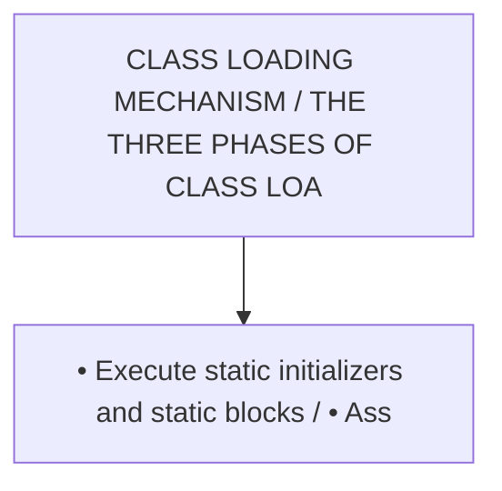
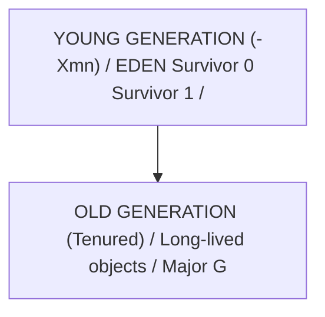
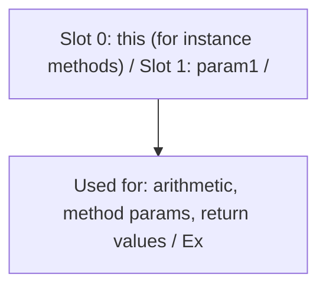
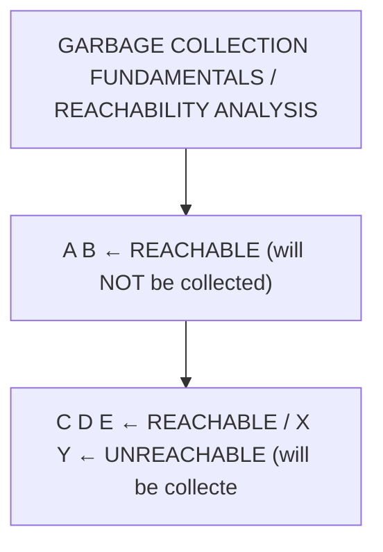
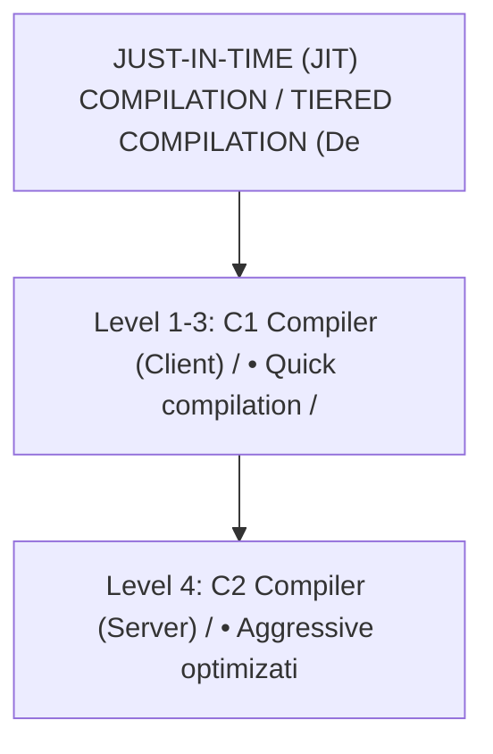
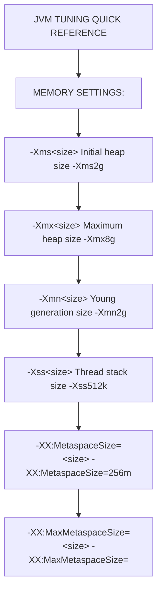
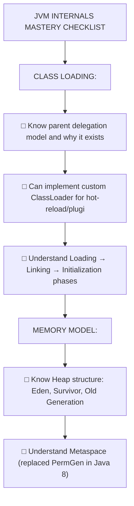

# JVM Internals Deep Dive

> **Part 3 of Ultimate DSA Guide**
> **Navigation**: [Part 1: Data Structures](07_DSA_Guide_Foundations.md) | [Part 2: Advanced](09_Ultimate_DSA_Advanced.md) | [Part 3: JVM Internals]

---

## 📚 JVM Architecture — the Complete Picture

```

┌─────────────────────────────────────────────────────────────────────────────────┐
│ JVM ARCHITECTURE OVERVIEW                                                       │
├─────────────────────────────────────────────────────────────────────────────────┤
│                                                                                 │
│ ┌──────────────────────────────────────────────────────────────────────────┐    │
│ │ JAVA SOURCE CODE (.java) │                                                    │
│ └────────────────────────────────┬─────────────────────────────────────────┘    │
│ │ javac (Java Compiler)                                                         │
│ ▼                                                                               │
│ ┌──────────────────────────────────────────────────────────────────────────┐    │
│ │ BYTECODE (.class files) │                                                     │
│ │ Platform-independent intermediate code │                                      │
│ └────────────────────────────────┬─────────────────────────────────────────┘    │
│ │                                                                               │
│ ▼                                                                               │
│ ╔══════════════════════════════════════════════════════════════════════════╗    │
│ ║ JAVA VIRTUAL MACHINE (JVM) ║                                                  │
│ ╠══════════════════════════════════════════════════════════════════════════╣    │
│ ║ ║                                                                             │
│ ║ ┌────────────────────────────────────────────────────────────────────┐ ║      │
│ ║ │ CLASS LOADER SUBSYSTEM │ ║                                                  │
│ ║ │ ┌────────────┐ ┌────────────┐ ┌────────────┐ ┌────────────────┐ │ ║         │
│ ║ │ │ Bootstrap │→│ Extension │→│Application │→│ Custom Loaders │ │ ║           │
│ ║ │ │ Loader │ │ Loader │ │ Loader │ │ (User-defined) │ │ ║                     │
│ ║ │ └────────────┘ └────────────┘ └────────────┘ └────────────────┘ │ ║         │
│ ║ │ │ ║                                                                         │
│ ║ │ Loading → Linking (Verify/Prepare/Resolve) → Initialization │ ║             │
│ ║ └────────────────────────────────────────────────────────────────────┘ ║      │
│ ║ │ ║                                                                           │
│ ║ ▼ ║                                                                           │
│ ║ ┌────────────────────────────────────────────────────────────────────┐ ║      │
│ ║ │ RUNTIME DATA AREAS │ ║                                                      │
│ ║ │ │ ║                                                                         │
│ ║ │ ┌─────────────────────────────────────────────────────────────┐ │ ║         │
│ ║ │ │ SHARED AMONG ALL THREADS │ │ ║                                            │
│ ║ │ │ ┌─────────────────────────┐ ┌──────────────────────────┐ │ │ ║            │
│ ║ │ │ │ HEAP │ │ METASPACE │ │ │ ║                                              │
│ ║ │ │ │ ┌──────────────────┐ │ │ • Class metadata │ │ │ ║                       │
│ ║ │ │ │ │ Young Generation │ │ │ • Method bytecode │ │ │ ║                      │
│ ║ │ │ │ │ ┌─────┐ ┌────┐ │ │ │ • Constant pool │ │ │ ║                          │
│ ║ │ │ │ │ │Eden │ │S0/1│ │ │ │ • Field/Method info │ │ │ ║                      │
│ ║ │ │ │ │ └─────┘ └────┘ │ │ │ │ │ │ ║                                          │
│ ║ │ │ │ ├──────────────────┤ │ │ (Native memory, not │ │ │ ║                    │
│ ║ │ │ │ │ Old Generation │ │ │ part of heap!) │ │ │ ║                           │
│ ║ │ │ │ │ (Tenured) │ │ │ │ │ │ ║                                               │
│ ║ │ │ │ └──────────────────┘ │ └──────────────────────────┘ │ │ ║               │
│ ║ │ │ └─────────────────────────┘ │ │ ║                                         │
│ ║ │ └─────────────────────────────────────────────────────────────┘ │ ║         │
│ ║ │ │ ║                                                                         │
│ ║ │ ┌─────────────────────────────────────────────────────────────┐ │ ║         │
│ ║ │ │ PER-THREAD DATA AREAS │ │ ║                                               │
│ ║ │ │ ┌───────────────┐ ┌───────────────┐ ┌────────────────┐ │ │ ║              │
│ ║ │ │ │ JVM STACK │ │ PC REGISTER │ │ NATIVE METHOD │ │ │ ║                     │
│ ║ │ │ │ • Frames │ │ • Current │ │ STACK │ │ │ ║                                │
│ ║ │ │ │ • Local vars │ │ instruction │ │ • For native │ │ │ ║                   │
│ ║ │ │ │ • Operand │ │ address │ │ (C/C++) code │ │ │ ║                          │
│ ║ │ │ │ stack │ │ │ │ │ │ │ ║                                                   │
│ ║ │ │ └───────────────┘ └───────────────┘ └────────────────┘ │ │ ║              │
│ ║ │ └─────────────────────────────────────────────────────────────┘ │ ║         │
│ ║ └────────────────────────────────────────────────────────────────────┘ ║      │
│ ║ │ ║                                                                           │
│ ║ ▼ ║                                                                           │
│ ║ ┌────────────────────────────────────────────────────────────────────┐ ║      │
│ ║ │ EXECUTION ENGINE │ ║                                                        │
│ ║ │ ┌────────────┐ ┌────────────────┐ ┌───────────────────────────┐ │ ║         │
│ ║ │ │Interpreter │ │ JIT Compiler │ │ Garbage Collector │ │ ║                   │
│ ║ │ │ │ │ ┌───────────┐ │ │ • Serial / Parallel │ │ ║                           │
│ ║ │ │ Line by │ │ │ C1 (Client)│ │ │ • CMS / G1 / ZGC / Shen. │ │ ║             │
│ ║ │ │ line exec │ │ │ C2 (Server)│ │ │ │ │ ║                                    │
│ ║ │ │ │ │ └───────────┘ │ │ Automatic memory mgmt │ │ ║                         │
│ ║ │ └────────────┘ └────────────────┘ └───────────────────────────┘ │ ║         │
│ ║ └────────────────────────────────────────────────────────────────────┘ ║      │
│ ║ │ ║                                                                           │
│ ║ ┌────────────────────────────────────────────────────────────────────┐ ║      │
│ ║ │ JAVA NATIVE INTERFACE (JNI) │ ║                                             │
│ ║ │ Connects JVM to native libraries (C/C++) │ ║                                │
│ ║ └────────────────────────────────────────────────────────────────────┘ ║      │
│ ╚══════════════════════════════════════════════════════════════════════════╝    │
│ │                                                                               │
│ ▼                                                                               │
│ ┌──────────────────────────────────────────────────────────────────────────┐    │
│ │ OPERATING SYSTEM / HARDWARE │                                                 │
│ └──────────────────────────────────────────────────────────────────────────┘    │
│                                                                                 │
└─────────────────────────────────────────────────────────────────────────────────┘

```

---

## ⚙️ Class Loader Subsystem — Deep Dive

```

┌─────────────────────────────────────────────────────────────────────────────────┐
│ CLASS LOADING MECHANISM                                                         │
├─────────────────────────────────────────────────────────────────────────────────┤
│                                                                                 │
│ THE THREE PHASES OF CLASS LOADING:                                              │
│ ══════════════════════════════════                                              │
│                                                                                 │
│ 1. LOADING                                                                      │
│ ┌────────────────────────────────────────────────────────────────────────────┐  │
│ │ • Read .class file binary data │                                              │
│ │ • Create java.lang.Class object in Metaspace │                                │
│ │ • Store class metadata (fields, methods, interfaces) │                        │
│ └────────────────────────────────────────────────────────────────────────────┘  │
│                                                                                 │
│ 2. LINKING (Three Sub-phases)                                                   │
│ ┌────────────────────────────────────────────────────────────────────────────┐  │
│ │ a) VERIFICATION: │                                                            │
│ │ • Check bytecode validity (magic number 0xCAFEBABE) │                         │
│ │ • Verify bytecode instructions are safe │                                     │
│ │ • Check class file structure │                                                │
│ │ • Ensure type safety │                                                        │
│ │ │                                                                             │
│ │ b) PREPARATION: │                                                             │
│ │ • Allocate memory for static variables │                                      │
│ │ • Initialize static fields to DEFAULT values (not assigned values!) │         │
│ │ • static int x = 10; → x = 0 (not 10 yet!) │                                  │
│ │ │                                                                             │
│ │ c) RESOLUTION: │                                                              │
│ │ • Replace symbolic references with direct references │                        │
│ │ • Class names → actual Class objects │                                        │
│ │ • Field/Method references → memory addresses │                                │
│ └────────────────────────────────────────────────────────────────────────────┘  │
│                                                                                 │
│ 3. INITIALIZATION                                                               │
│ ┌────────────────────────────────────────────────────────────────────────────┐  │
│ │ • Execute static initializers and static blocks │                             │
│ │ • Assign actual values to static variables │                                  │
│ │ • static int x = 10; → x = 10 (NOW it's 10!) │                                │
│ │ • Run static { } blocks in order of appearance │                              │
│ └────────────────────────────────────────────────────────────────────────────┘  │
│                                                                                 │
│                                                                                 │
│ CLASS LOADER HIERARCHY (Parent Delegation Model):                               │
│ ═══════════════════════════════════════════════                                 │
│                                                                                 │
│ ┌─────────────────────────────┐                                                 │
│ │ Bootstrap ClassLoader │ ← Written in C/C++                                    │
│ │ (Primordial ClassLoader) │ Loads: rt.jar, core                                │
│ │ java.lang._, java.util._ │ Java classes                                       │
│ └─────────────┬───────────────┘                                                 │
│ │ parent                                                                        │
│ ▼                                                                               │
│ ┌─────────────────────────────┐                                                 │
│ │ Platform/Extension Loader │ ← Java 9+: Platform                               │
│ │ (ExtClassLoader in Java 8) │ Loads: jre/lib/ext                               │
│ │ javax._, java.sql._, etc. │                                                   │
│ └─────────────┬───────────────┘                                                 │
│ │ parent                                                                        │
│ ▼                                                                               │
│ ┌─────────────────────────────┐                                                 │
│ │ Application ClassLoader │ ← Also: System ClassLoader                          │
│ │ (AppClassLoader) │ Loads: classpath                                           │
│ │ Your application classes │ -cp, CLASSPATH                                     │
│ └─────────────┬───────────────┘                                                 │
│ │ parent                                                                        │
│ ▼                                                                               │
│ ┌─────────────────────────────┐                                                 │
│ │ Custom ClassLoaders │ ← Your own loaders                                      │
│ │ (User-defined) │ For frameworks,                                              │
│ │ │ plugins, hot reload                                                         │
│ └─────────────────────────────┘                                                 │
│                                                                                 │
│                                                                                 │
│ PARENT DELEGATION ALGORITHM:                                                    │
│ ═══════════════════════════════                                                 │
│                                                                                 │
└─────────────────────────────────────────────────────────────────────────────────┘

```

**Flow:**
- CLASS LOADING MECHANISM / THE THREE PHASES OF CLASS LOA
- ↓
- • Execute static initializers and static blocks / • Ass



```java
// How loadClass() works (simplified)
protected Class<?> loadClass(String name, boolean resolve) {
    synchronized (getClassLoadingLock(name)) {
        // 1. Check if already loaded
        Class<?> c = findLoadedClass(name);

        if (c == null) {
            // 2. Delegate to parent FIRST (Parent Delegation!)
            try {
                if (parent != null) {
                    c = parent.loadClass(name, false);  // Ask parent
                } else {
                    c = findBootstrapClassOrNull(name); // Bootstrap
                }
            } catch (ClassNotFoundException e) {
                // Parent couldn't load - that's OK
            }

            // 3. Only if parent fails, try to load ourselves
            if (c == null) {
                c = findClass(name);  // Our own loading logic
            }
        }

        if (resolve) {
            resolveClass(c);
        }
        return c;
    }
}
```

**WHY PARENT DELEGATION?**

- **Security**: Prevents malicious java.lang.String replacement
- **Consistency**: Same class loaded once, same Class object everywhere
- **Avoids duplicates**: Core classes loaded only by Bootstrap

---

## 📌 Creating Custom Class Loaders

```java
/**
 * Custom ClassLoader for hot-reloading classes during development
 */
public class HotReloadClassLoader extends ClassLoader {

    private String classPath;
    private Map<String, Long> classLastModified = new HashMap<>();

    public HotReloadClassLoader(String classPath, ClassLoader parent) {
        super(parent);
        this.classPath = classPath;
    }

    @Override
    protected Class<?> findClass(String name) throws ClassNotFoundException {
        // Convert class name to file path
        String fileName = name.replace('.', '/') + ".class";
        Path classFile = Paths.get(classPath, fileName);

        try {
            // Read class bytes from file
            byte[] classBytes = Files.readAllBytes(classFile);

            // Track modification time for hot reload detection
            classLastModified.put(name, Files.getLastModifiedTime(classFile).toMillis());

            // defineClass converts bytes to Class object
            return defineClass(name, classBytes, 0, classBytes.length);

        } catch (IOException e) {
            throw new ClassNotFoundException("Could not load " + name, e);
        }
    }

    /**
     * Check if class has been modified since last load
     */
    public boolean isModified(String className) {
        String fileName = className.replace('.', '/') + ".class";
        Path classFile = Paths.get(classPath, fileName);

        try {
            long currentModified = Files.getLastModifiedTime(classFile).toMillis();
            Long lastLoaded = classLastModified.get(className);
            return lastLoaded == null || currentModified > lastLoaded;
        } catch (IOException e) {
            return false;
        }
    }

    /**
     * Reload a class if modified (requires new ClassLoader instance!)
     */
    public static Class<?> reloadClass(String className, String classPath)
            throws ClassNotFoundException {
        // IMPORTANT: Can't unload classes! Must create NEW ClassLoader
        HotReloadClassLoader newLoader = new HotReloadClassLoader(
            classPath,
            HotReloadClassLoader.class.getClassLoader()
        );
        return newLoader.loadClass(className);
    }
}
```

**USE CASES FOR CUSTOM CLASS LOADERS:**

- Hot code reloading (development servers like Tomcat)
- Plugin systems (IDE plugins, Minecraft mods)
- Bytecode manipulation (AspectJ, Mockito)
- Loading classes from network/database
- Application isolation (multi-tenant systems)
- Encryption/decryption of class files

---

## 🧠 JVM Memory Model — Complete Deep Dive

```
┌─────────────────────────────────────────────────────────────────────────────────┐
│                    JVM MEMORY AREAS - DETAILED BREAKDOWN                        │
├─────────────────────────────────────────────────────────────────────────────────┤
│                                                                                 │
│  ┌──────────────────────────────────────────────────────────────────────────┐   │
│  │                         JVM PROCESS MEMORY                               │   │
│  │                                                                          │   │
│  │  ┌─────────────────────────────────────────────────────────────────┐    │    │
│  │  │                    HEAP (Managed by GC)                         │    │    │
│  │  │                    -Xms (initial), -Xmx (max)                   │    │    │
│  │  │                                                                 │    │    │
│  │  │  ┌───────────────────────────────────────────────────────────┐ │    │     │
│  │  │  │              YOUNG GENERATION (-Xmn)                      │ │    │     │
│  │  │  │  ┌─────────────────────┬─────────────┬─────────────┐     │ │    │      │
│  │  │  │  │        EDEN         │ Survivor 0  │ Survivor 1  │     │ │    │      │
│  │  │  │  │   (New objects)     │    (S0)     │    (S1)     │     │ │    │      │
│  │  │  │  │                     │  (From)     │   (To)      │     │ │    │      │
│  │  │  │  │   ~80% of Young     │   ~10%      │   ~10%      │     │ │    │      │
│  │  │  │  └─────────────────────┴─────────────┴─────────────┘     │ │    │      │
│  │  │  │  Minor GC happens here frequently                        │ │    │      │
│  │  │  └───────────────────────────────────────────────────────────┘ │    │     │
│  │  │                              │                                  │    │    │
│  │  │                              │ Objects surviving multiple       │    │    │
│  │  │                              │ Minor GCs get promoted           │    │    │
│  │  │                              ▼                                  │    │    │
│  │  │  ┌───────────────────────────────────────────────────────────┐ │    │     │
│  │  │  │              OLD GENERATION (Tenured)                     │ │    │     │
│  │  │  │                                                           │ │    │     │
│  │  │  │    Long-lived objects                                     │ │    │     │
│  │  │  │    Major GC (Full GC) - expensive, stop-the-world        │ │    │      │
│  │  │  │                                                           │ │    │     │
│  │  │  └───────────────────────────────────────────────────────────┘ │    │     │
│  │  └─────────────────────────────────────────────────────────────────┘    │    │
│  │                                                                          │   │
│  │  ┌─────────────────────────────────────────────────────────────────┐    │    │
│  │  │                    METASPACE (Native Memory)                    │    │    │
│  │  │                    -XX:MetaspaceSize, -XX:MaxMetaspaceSize      │    │    │
│  │  │                                                                 │    │    │
│  │  │  • Class metadata (java.lang.Class objects)                    │    │     │
│  │  │  • Method bytecode                                              │    │    │
│  │  │  • Constant pools                                               │    │    │
│  │  │  • Annotations                                                  │    │    │
│  │  │  • REPLACED PermGen in Java 8                                  │    │     │
│  │  │  • Can grow dynamically (unlike PermGen)                       │    │     │
│  │  └─────────────────────────────────────────────────────────────────┘    │    │
│  │                                                                          │   │
│  │  ┌─────────────────────────────────────────────────────────────────┐    │    │
│  │  │                    CODE CACHE (Native Memory)                   │    │    │
│  │  │                    -XX:ReservedCodeCacheSize                    │    │    │
│  │  │                                                                 │    │    │
│  │  │  • JIT-compiled native code                                    │    │     │
│  │  │  • Hot methods compiled to machine code                        │    │     │
│  │  └─────────────────────────────────────────────────────────────────┘    │    │
│  │                                                                          │   │
│  │  ┌─────────────────────────────────────────────────────────────────┐    │    │
│  │  │              THREAD STACKS (Per Thread, Native Memory)          │    │    │
│  │  │              -Xss (stack size per thread)                       │    │    │
│  │  │                                                                 │    │    │
│  │  │  Thread 1 Stack    Thread 2 Stack    Thread N Stack            │    │     │
│  │  │  ┌───────────┐    ┌───────────┐     ┌───────────┐             │    │      │
│  │  │  │ Frame N   │    │ Frame M   │     │ Frame K   │             │    │      │
│  │  │  │ Frame N-1 │    │ Frame M-1 │     │ Frame K-1 │             │    │      │
│  │  │  │ ...       │    │ ...       │     │ ...       │             │    │      │
│  │  │  │ Frame 0   │    │ Frame 0   │     │ Frame 0   │             │    │      │
│  │  │  └───────────┘    └───────────┘     └───────────┘             │    │      │
│  │  └─────────────────────────────────────────────────────────────────┘    │    │
│  │                                                                          │   │
│  │  ┌─────────────────────────────────────────────────────────────────┐    │    │
│  │  │              DIRECT MEMORY (Off-Heap, Native Memory)            │    │    │
│  │  │              -XX:MaxDirectMemorySize                            │    │    │
│  │  │                                                                 │    │    │
│  │  │  • ByteBuffer.allocateDirect()                                 │    │     │
│  │  │  • Used by NIO for zero-copy I/O                               │    │     │
│  │  │  • Not managed by GC directly                                  │    │     │
│  │  └─────────────────────────────────────────────────────────────────┘    │    │
│  └──────────────────────────────────────────────────────────────────────────┘   │
│                                                                                 │
└─────────────────────────────────────────────────────────────────────────────────┘
```

**Flow:**
- YOUNG GENERATION (-Xmn) / EDEN Survivor 0 Survivor 1 /
- ↓
- OLD GENERATION (Tenured) / Long-lived objects / Major G



---

## 📚 Stack Frame Structure

```
┌─────────────────────────────────────────────────────────────────────────────────┐
│                         STACK FRAME LAYOUT                                      │
├─────────────────────────────────────────────────────────────────────────────────┤
│                                                                                 │
│  High Address                                                                   │
│  ┌─────────────────────────────────────────────────────────────────────────┐    │
│  │                    PREVIOUS FRAME                                        │   │
│  ├─────────────────────────────────────────────────────────────────────────┤    │
│  │                    RETURN ADDRESS                                        │   │
│  │                    (where to continue after return)                      │   │
│  ├─────────────────────────────────────────────────────────────────────────┤    │
│  │                    FRAME POINTER (FP)                                    │   │
│  │                    (points to caller's frame)                            │   │
│  ├─────────────────────────────────────────────────────────────────────────┤    │
│  │                    LOCAL VARIABLES ARRAY                                 │   │
│  │  ┌───────────────────────────────────────────────────────────────────┐  │    │
│  │  │ Slot 0: this (for instance methods)                               │  │    │
│  │  │ Slot 1: param1                                                    │  │    │
│  │  │ Slot 2: param2                                                    │  │    │
│  │  │ Slot 3: local var 1                                               │  │    │
│  │  │ Slot 4: local var 2                                               │  │    │
│  │  │ ...                                                               │  │    │
│  │  │ long/double occupy 2 slots (8 bytes)                              │  │    │
│  │  └───────────────────────────────────────────────────────────────────┘  │    │
│  ├─────────────────────────────────────────────────────────────────────────┤    │
│  │                    OPERAND STACK                                         │   │
│  │  ┌───────────────────────────────────────────────────────────────────┐  │    │
│  │  │ Used for: arithmetic, method params, return values                │  │    │
│  │  │                                                                   │  │    │
│  │  │ Example: int c = a + b;                                           │  │    │
│  │  │   iload_1  // push a → stack: [a]                                │  │     │
│  │  │   iload_2  // push b → stack: [a, b]                             │  │     │
│  │  │   iadd     // pop a,b, push a+b → stack: [a+b]                   │  │     │
│  │  │   istore_3 // pop to local var 3 → stack: []                     │  │     │
│  │  └───────────────────────────────────────────────────────────────────┘  │    │
│  ├─────────────────────────────────────────────────────────────────────────┤    │
│  │                    FRAME DATA                                            │   │
│  │  • Constant pool reference                                              │    │
│  │  • Exception table reference                                            │    │
│  │  • Method reference                                                     │    │
│  └─────────────────────────────────────────────────────────────────────────┘    │
│  Low Address (Stack Pointer)                                                    │
│                                                                                 │
└─────────────────────────────────────────────────────────────────────────────────┘
```

**Flow:**
- Slot 0: this (for instance methods) / Slot 1: param1 /
- ↓
- Used for: arithmetic, method params, return values / Ex



```java
// EXAMPLE: How this code maps to stack frame
public int calculate(int a, int b) {
    int sum = a + b;        // sum in local var slot 3
    int product = a * b;    // product in local var slot 4
    return sum + product;
}

// LOCAL VARIABLES ARRAY:
// Slot 0: this (reference to object)
// Slot 1: a (int parameter)
// Slot 2: b (int parameter)
// Slot 3: sum (local int)
// Slot 4: product (local int)

// BYTECODE:
// 0: iload_1         // push a
// 1: iload_2         // push b
// 2: iadd            // add
// 3: istore_3        // store in sum
// 4: iload_1         // push a
// 5: iload_2         // push b
// 6: imul            // multiply
// 7: istore 4        // store in product
// 9: iload_3         // push sum
// 10: iload 4        // push product
// 12: iadd           // add
// 13: ireturn        // return
```

---

## 📚 Garbage Collection — Complete Guide

```
┌─────────────────────────────────────────────────────────────────────────────────┐
│                    GARBAGE COLLECTION FUNDAMENTALS                              │
├─────────────────────────────────────────────────────────────────────────────────┤
│                                                                                 │
│  REACHABILITY ANALYSIS (Mark and Sweep):                                        │
│                                                                                 │
│  GC ROOTS (Starting points for reachability):                                   │
│  • Local variables on thread stacks                                             │
│  • Static variables in loaded classes                                           │
│  • JNI references                                                               │
│  • Active threads themselves                                                    │
│  • Objects waiting in synchronization monitors                                  │
│                                                                                 │
│           GC Roots                                                              │
│         ┌────┬────┬────┐                                                        │
│         │ R1 │ R2 │ R3 │                                                        │
│         └─┬──┴─┬──┴──┬─┘                                                        │
│           │    │     │                                                          │
│           ▼    │     ▼                                                          │
│         ┌──┐   │   ┌──┐                                                         │
│         │A │   │   │B │  ← REACHABLE (will NOT be collected)                    │
│         └┬─┘   │   └┬─┘                                                         │
│          │     │    │                                                           │
│          ▼     ▼    ▼                                                           │
│        ┌──┐  ┌──┐  ┌──┐                                                         │
│        │C │  │D │  │E │  ← REACHABLE                                            │
│        └──┘  └──┘  └──┘                                                         │
│                                                                                 │
│        ┌──┐      ┌──┐                                                           │
│        │X │ ───► │Y │  ← UNREACHABLE (will be collected!)                       │
│        └──┘      └──┘    No path from any GC root                               │
│          ▲         │                                                            │
│          └─────────┘  (even circular references get collected!)                 │
│                                                                                 │
│                                                                                 │
│  GENERATIONAL HYPOTHESIS:                                                       │
│  "Most objects die young" - typically 80-95% of objects are short-lived         │
│                                                                                 │
└─────────────────────────────────────────────────────────────────────────────────┘
```

**Flow:**
- GARBAGE COLLECTION FUNDAMENTALS / REACHABILITY ANALYSIS
- ↓
- A B ← REACHABLE (will NOT be collected)
- ↓
- C D E ← REACHABLE / X Y ← UNREACHABLE (will be collecte



## ⚖️ Gc Algorithms Comparison

| GC Algorithm                          | Best For                            | Pause Time       | Throughput | Memory |
| ------------------------------------- | ----------------------------------- | ---------------- | ---------- | ------ |
| **Serial GC** `-XX:+UseSerialGC`      | Small apps, Single CPU              | Long (STW)       | Good       | Low    |
| **Parallel GC** `-XX:+UseParallelGC`  | Batch apps, Throughput              | Medium (STW)     | Best       | Medium |
| **G1 GC** `-XX:+UseG1GC` (Default)    | Large heaps, Balanced               | Low, Predictable | Good       | Medium |
| **ZGC** `-XX:+UseZGC`                 | Ultra-low latency, Very large heaps | <10ms Concurrent | Good       | High   |
| **Shenandoah** `-XX:+UseShenandoahGC` | Ultra-low latency                   | <10ms Concurrent | Good       | High   |

```java
// GC MONITORING IN CODE:
public static void monitorGC() {
    List<GarbageCollectorMXBean> gcBeans =
        ManagementFactory.getGarbageCollectorMXBeans();

    for (GarbageCollectorMXBean gc : gcBeans) {
        System.out.println("GC Name: " + gc.getName());
        System.out.println("Collection Count: " + gc.getCollectionCount());
        System.out.println("Collection Time: " + gc.getCollectionTime() + " ms");
    }
}

// GET MEMORY USAGE:
public static void memoryInfo() {
    MemoryMXBean memory = ManagementFactory.getMemoryMXBean();
    MemoryUsage heap = memory.getHeapMemoryUsage();

    System.out.println("Heap Init: " + heap.getInit() / 1024 / 1024 + " MB");
    System.out.println("Heap Used: " + heap.getUsed() / 1024 / 1024 + " MB");
    System.out.println("Heap Max: " + heap.getMax() / 1024 / 1024 + " MB");
}
```

---

## 🔬 Jit Compilation — Deep Dive

```
┌─────────────────────────────────────────────────────────────────────────────────┐
│                    JUST-IN-TIME (JIT) COMPILATION                               │
├─────────────────────────────────────────────────────────────────────────────────┤
│                                                                                 │
│  TIERED COMPILATION (Default in modern JVM):                                    │
│                                                                                 │
│  Level 0: Interpreter                                                           │
│      │    (All code starts here)                                                │
│      │                                                                          │
│      │    Method invocation count > 2000                                        │
│      ▼                                                                          │
│  Level 1-3: C1 Compiler (Client)                                                │
│      │    • Quick compilation                                                   │
│      │    • Basic optimizations                                                 │
│      │    • Collects profiling data                                             │
│      │                                                                          │
│      │    Method invocation count > 15000                                       │
│      ▼    (and profiling shows it's worth it)                                   │
│  Level 4: C2 Compiler (Server)                                                  │
│           • Aggressive optimizations                                            │
│           • Loop unrolling, escape analysis                                     │
│           • Method inlining, dead code elimination                              │
│           • Takes longer but produces fastest code                              │
│                                                                                 │
└─────────────────────────────────────────────────────────────────────────────────┘
```

**Flow:**
- JUST-IN-TIME (JIT) COMPILATION / TIERED COMPILATION (De
- ↓
- Level 1-3: C1 Compiler (Client) / • Quick compilation /
- ↓
- Level 4: C2 Compiler (Server) / • Aggressive optimizati



**JIT OPTIMIZATIONS:**

```java
// 1. METHOD INLINING:
// Before inlining:                     // After inlining:
int result = helper(x);                 int result = x * 2 + 1;
                                        // No method call overhead!
int helper(int n) {
    return n * 2 + 1;
}

// 2. ESCAPE ANALYSIS:
// Object doesn't escape method → can be stack allocated!
public int sum() {
    Point p = new Point(1, 2);  // JIT may allocate on STACK, not heap!
    return p.x + p.y;           // No GC needed for this object!
}

// Object DOES escape → must be heap allocated
public Point getPoint() {
    Point p = new Point(1, 2);  // Escapes! Must be on heap
    return p;
}

// 3. LOOP UNROLLING:
// Before:                              // After:
for (int i = 0; i < 4; i++) {          sum += arr[0];
    sum += arr[i];                      sum += arr[1];
}                                       sum += arr[2];
                                        sum += arr[3];
                                        // No loop overhead!
```

---

## 🔬 Internal Classes — the Hidden Power

### REFLECTION API (`java.lang.reflect.*`)

```java
public class ReflectionDeepDive {

    // GET CLASS INFORMATION
    public static void inspectClass(Object obj) throws Exception {
        Class<?> clazz = obj.getClass();

        System.out.println("Class Name: " + clazz.getName());
        System.out.println("Simple Name: " + clazz.getSimpleName());
        System.out.println("Superclass: " + clazz.getSuperclass());

        // Get ALL fields (including private)
        for (Field field : clazz.getDeclaredFields()) {
            field.setAccessible(true);  // Bypass access control!
            System.out.println(field.getName() + " = " + field.get(obj));
        }

        // Get ALL methods
        for (Method method : clazz.getDeclaredMethods()) {
            System.out.println(method.getName() + "(" +
                Arrays.stream(method.getParameterTypes())
                      .map(Class::getSimpleName)
                      .collect(Collectors.joining(", ")) + ")");
        }
    }

    // CREATE INSTANCE DYNAMICALLY
    @SuppressWarnings("unchecked")
    public static <T> T createInstance(Class<T> clazz, Object... args) throws Exception {
        Class<?>[] paramTypes = Arrays.stream(args)
                                      .map(Object::getClass)
                                      .toArray(Class[]::new);

        Constructor<T> ctor = clazz.getDeclaredConstructor(paramTypes);
        ctor.setAccessible(true);
        return ctor.newInstance(args);
    }

    // INVOKE METHOD DYNAMICALLY
    public static Object invokeMethod(Object target, String methodName, Object... args)
            throws Exception {
        Class<?>[] paramTypes = Arrays.stream(args)
                                      .map(Object::getClass)
                                      .toArray(Class[]::new);

        Method method = target.getClass().getDeclaredMethod(methodName, paramTypes);
        method.setAccessible(true);
        return method.invoke(target, args);
    }
}
```

### DYNAMIC PROXY (`java.lang.reflect.Proxy`)

```java
// LOGGING PROXY - Add logging to ANY interface
public class LoggingProxy implements InvocationHandler {
    private final Object target;

    private LoggingProxy(Object target) {
        this.target = target;
    }

    @Override
    public Object invoke(Object proxy, Method method, Object[] args) throws Throwable {
        // BEFORE method
        System.out.println("→ Calling: " + method.getName());
        long start = System.nanoTime();

        try {
            // ACTUAL method call
            Object result = method.invoke(target, args);

            // AFTER method (success)
            long elapsed = System.nanoTime() - start;
            System.out.println("← Returned: " + result + " in " + elapsed/1_000_000 + "ms");
            return result;

        } catch (InvocationTargetException e) {
            System.out.println("✗ Exception: " + e.getCause());
            throw e.getCause();
        }
    }

    // Factory method
    @SuppressWarnings("unchecked")
    public static <T> T createProxy(T target, Class<T> interfaceType) {
        return (T) Proxy.newProxyInstance(
            interfaceType.getClassLoader(),
            new Class<?>[] { interfaceType },
            new LoggingProxy(target)
        );
    }
}

// USAGE:
UserService realService = new UserServiceImpl();
UserService proxied = LoggingProxy.createProxy(realService, UserService.class);
proxied.findUser(123);
// Output:
// → Calling: findUser
// ← Returned: User{id=123} in 5ms
```

### METHOD HANDLES (Java 7+, Faster than Reflection)

```java
public class MethodHandlesDemo {

    public static void main(String[] args) throws Throwable {
        MethodHandles.Lookup lookup = MethodHandles.lookup();

        // Get a method handle for String.length()
        MethodHandle lengthHandle = lookup.findVirtual(
            String.class,                    // Class
            "length",                        // Method name
            MethodType.methodType(int.class) // Return type
        );

        // Invoke the method
        int len = (int) lengthHandle.invoke("Hello");  // 5
    }
}
```

### VARHANDLES (Java 9+, Atomic Operations)

```java
public class VarHandlesDemo {
    private int counter = 0;

    private static final VarHandle COUNTER;
    static {
        try {
            COUNTER = MethodHandles.lookup()
                .findVarHandle(VarHandlesDemo.class, "counter", int.class);
        } catch (Exception e) {
            throw new ExceptionInInitializerError(e);
        }
    }

    public void increment() {
        // Atomic increment without AtomicInteger!
        COUNTER.getAndAdd(this, 1);
    }

    public boolean compareAndSet(int expected, int newValue) {
        return COUNTER.compareAndSet(this, expected, newValue);
    }
}
```

---

## 📌 Building a Mini — Framework

```java
// ═══════════════════════════════════════════════════════════════════════════════
// MINI SPRING-LIKE DEPENDENCY INJECTION FRAMEWORK
// ═══════════════════════════════════════════════════════════════════════════════

// ANNOTATIONS
@Retention(RetentionPolicy.RUNTIME)
@Target(ElementType.TYPE)
@interface Component {}

@Retention(RetentionPolicy.RUNTIME)
@Target(ElementType.FIELD)
@interface Autowired {}

@Retention(RetentionPolicy.RUNTIME)
@Target(ElementType.METHOD)
@interface Transactional {}

// MINI DI CONTAINER
public class MiniSpringContext {

    private Map<Class<?>, Object> beans = new ConcurrentHashMap<>();

    public MiniSpringContext(String basePackage) throws Exception {
        // 1. COMPONENT SCANNING - Find all annotated classes
        Set<Class<?>> componentClasses = scanComponents(basePackage);

        // 2. INSTANTIATION - Create bean instances
        for (Class<?> clazz : componentClasses) {
            Object instance = clazz.getDeclaredConstructor().newInstance();
            beans.put(clazz, instance);
        }

        // 3. DEPENDENCY INJECTION - Wire beans together
        for (Object bean : beans.values()) {
            injectDependencies(bean);
        }

        System.out.println("🚀 Context initialized with " + beans.size() + " beans");
    }

    private void injectDependencies(Object bean) throws Exception {
        for (Field field : bean.getClass().getDeclaredFields()) {
            if (field.isAnnotationPresent(Autowired.class)) {
                field.setAccessible(true);
                Object dependency = beans.get(field.getType());

                if (dependency == null) {
                    throw new RuntimeException("No bean found for: " + field.getType());
                }

                field.set(bean, dependency);
            }
        }
    }

    @SuppressWarnings("unchecked")
    public <T> T getBean(Class<T> type) {
        return (T) beans.get(type);
    }
}

// USAGE:
@Component
class UserRepository {
    public User findById(int id) { return new User(id, "John"); }
}

@Component
class UserService {
    @Autowired
    private UserRepository repository;  // Auto-injected!

    public User getUser(int id) {
        return repository.findById(id);
    }
}

// BOOTSTRAP:
MiniSpringContext context = new MiniSpringContext("com.myapp");
UserService service = context.getBean(UserService.class);
User user = service.getUser(123);
```

---

## 📋 JVM Tuning Cheat Sheet

```
┌─────────────────────────────────────────────────────────────────────────────────┐
│                    JVM TUNING QUICK REFERENCE                                   │
├─────────────────────────────────────────────────────────────────────────────────┤
│                                                                                 │
│  MEMORY SETTINGS:                                                               │
│  -Xms<size>        Initial heap size           -Xms2g                           │
│  -Xmx<size>        Maximum heap size           -Xmx8g                           │
│  -Xmn<size>        Young generation size       -Xmn2g                           │
│  -Xss<size>        Thread stack size           -Xss512k                         │
│  -XX:MetaspaceSize=<size>                      -XX:MetaspaceSize=256m           │
│  -XX:MaxMetaspaceSize=<size>                   -XX:MaxMetaspaceSize=512m        │
│                                                                                 │
│  GC SELECTION:                                                                  │
│  -XX:+UseSerialGC           Serial (single-threaded)                            │
│  -XX:+UseParallelGC         Parallel (throughput-focused)                       │
│  -XX:+UseG1GC               G1 (balanced, default Java 9+)                      │
│  -XX:+UseZGC                ZGC (ultra-low latency, Java 15+)                   │
│  -XX:+UseShenandoahGC       Shenandoah (low latency)                            │
│                                                                                 │
│  G1 TUNING:                                                                     │
│  -XX:MaxGCPauseMillis=200        Target pause time (ms)                         │
│  -XX:G1HeapRegionSize=16m        Region size (1-32 MB)                          │
│                                                                                 │
│  MONITORING & DEBUGGING:                                                        │
│  -Xlog:gc*:file=gc.log         GC logging (Java 9+)                             │
│  -XX:+HeapDumpOnOutOfMemoryError    Dump heap on OOM                            │
│  -XX:HeapDumpPath=/path/dump.hprof  Heap dump location                          │
│  -XX:+PrintCompilation         JIT compilation events                           │
│                                                                                 │
│  COMMON PRODUCTION SETTINGS:                                                    │
│                                                                                 │
│  # Web Application (8GB RAM server)                                             │
│  java -Xms4g -Xmx4g -XX:+UseG1GC -XX:MaxGCPauseMillis=200 \                     │
│       -XX:+HeapDumpOnOutOfMemoryError -Xlog:gc*:file=gc.log -jar app.jar        │
│                                                                                 │
│  # Batch Processing (High Throughput)                                           │
│  java -Xms8g -Xmx8g -XX:+UseParallelGC -XX:ParallelGCThreads=8 -jar app.jar     │
│                                                                                 │
│  # Low-Latency Trading System                                                   │
│  java -Xms16g -Xmx16g -XX:+UseZGC -XX:ConcGCThreads=4 -jar app.jar              │
│                                                                                 │
└─────────────────────────────────────────────────────────────────────────────────┘
```

**Flow:**
- JVM TUNING QUICK REFERENCE
- ↓
- MEMORY SETTINGS:
- ↓
- -Xms<size> Initial heap size -Xms2g
- ↓
- -Xmx<size> Maximum heap size -Xmx8g
- ↓
- -Xmn<size> Young generation size -Xmn2g
- ↓
- -Xss<size> Thread stack size -Xss512k
- ↓
- -XX:MetaspaceSize=<size> -XX:MetaspaceSize=256m



---

## 🔬 JVM Internals Mastery Checklist

```
╔══════════════════════════════════════════════════════════════════════════════════╗
║                    JVM INTERNALS MASTERY CHECKLIST                               ║
╠══════════════════════════════════════════════════════════════════════════════════╣
║                                                                                  ║
║ CLASS LOADING:                                                                   ║
║ □ Understand Bootstrap → Platform → Application loader hierarchy                 ║
║ □ Know parent delegation model and why it exists                                 ║
║ □ Can implement custom ClassLoader for hot-reload/plugins                        ║
║ □ Understand Loading → Linking → Initialization phases                           ║
║                                                                                  ║
║ MEMORY MODEL:                                                                    ║
║ □ Know Heap structure: Eden, Survivor, Old Generation                            ║
║ □ Understand Metaspace (replaced PermGen in Java 8)                              ║
║ □ Know Stack Frame structure: locals, operand stack, frame data                  ║
║ □ Understand Direct Memory (off-heap) usage                                      ║
║                                                                                  ║
║ GARBAGE COLLECTION:                                                              ║
║ □ Know GC roots and reachability analysis                                        ║
║ □ Understand generational hypothesis                                             ║
║ □ Can choose appropriate GC for workload (G1, ZGC, etc.)                         ║
║ □ Can tune GC parameters for production                                          ║
║                                                                                  ║
║ JIT COMPILATION:                                                                 ║
║ □ Understand Interpreter → C1 → C2 tiered compilation                            ║
║ □ Know JIT optimizations: inlining, escape analysis, loop unrolling              ║
║ □ Understand deoptimization scenarios                                            ║
║                                                                                  ║
║ INTERNAL APIS:                                                                   ║
║ □ Master Reflection API for dynamic class inspection                             ║
║ □ Can create Dynamic Proxies for AOP/logging/caching                             ║
║ □ Understand MethodHandles as faster alternative to reflection                   ║
║ □ Know when Unsafe is used (AtomicXXX, DirectByteBuffer)                         ║
║                                                                                  ║
║ FRAMEWORK BUILDING:                                                              ║
║ □ Can implement Dependency Injection container                                   ║
║ □ Can implement Transaction management using proxies                             ║
║ □ Understand bytecode manipulation basics (ByteBuddy/ASM)                        ║
║ □ Can implement custom annotations with runtime processing                       ║
║                                                                                  ║
║ PRODUCTION SKILLS:                                                               ║
║ □ Can diagnose memory leaks using heap dumps                                     ║
║ □ Can analyze GC logs for performance issues                                     ║
║ □ Can tune JVM for specific workloads                                            ║
║                                                                                  ║
╚══════════════════════════════════════════════════════════════════════════════════╝
```

**Flow:**
- JVM INTERNALS MASTERY CHECKLIST
- ↓
- CLASS LOADING:
- ↓
- □ Know parent delegation model and why it exists
- ↓
- □ Can implement custom ClassLoader for hot-reload/plugi
- ↓
- □ Understand Loading
- ↓
- Linking
- ↓
- Initialization phases
- ↓
- □ Understand Loading
- ↓
- Linking
- ↓
- Initialization phases
- ↓
- MEMORY MODEL:
- ↓
- □ Know Heap structure: Eden, Survivor, Old Generation



---

_"Understanding JVM internals separates junior developers from senior architects."_ 🔧

---

_"Data structures + Algorithms = Programs. Master both, master programming."_

```

```

---

> **Prev**: [Part 2: Advanced Algorithms](09_Ultimate_DSA_Advanced.md)


---

> **Navigation**: [< Previous](09_Ultimate_DSA_Advanced.md) | [Back to Index](../00_MASTER_INDEX.md) | [Next >](11_Quick_Reference.md)