> **Navigation**: [< Previous](13_Daily_Habits_Tracking.md) | [Back to Index](../00_MASTER_INDEX.md) | [Next >](15_Behavioral_Interview.md)

# 🎓 Top University CS Resources & Learning Links

## World's Best Algorithm & Data Structure Resources

---

# 🌟 TIER 1: GOLD STANDARD COURSES

## MIT (Massachusetts Institute of Technology)

### MIT 6.006 - Introduction to Algorithms

```
THE FOUNDATIONAL COURSE

Topics Covered:
├── Algorithmic Thinking, Peak Finding
├── Sorting (Merge, Heap, Counting, Radix)
├── Trees (BST, AVL, Hashing)
├── Graphs (BFS, DFS, Shortest Paths)
├── Dynamic Programming
└── Computational Complexity

LINKS:
📺 Video Lectures: https://ocw.mit.edu/courses/6-006-introduction-to-algorithms-spring-2020/
📚 Course Notes: https://ocw.mit.edu/courses/6-006-introduction-to-algorithms-spring-2020/pages/lecture-notes/
📝 Problem Sets: https://ocw.mit.edu/courses/6-006-introduction-to-algorithms-spring-2020/pages/assignments/

INSTRUCTORS: Erik Demaine, Jason Ku, Justin Solomon
LEVEL: Intermediate
LANGUAGE: Python

WHY THIS COURSE:
- Extremely clear explanations
- Visual demonstrations
- Problem sets build real skills
```

**Flow:**
1. Topics Covered:
2. Algorithmic Thinking, Peak Finding
3. Topics Covered:
4. Sorting (Merge, Heap, Counting, Radix)
5. Topics Covered:
6. Trees (BST, AVL, Hashing)
7. Topics Covered:
8. Graphs (BFS, DFS, Shortest Paths)
9. Topics Covered:
10. Dynamic Programming
11. Topics Covered:
12. Computational Complexity

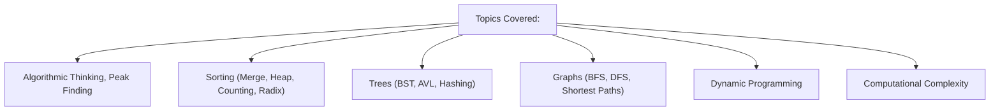

### MIT 6.046 - Design and Analysis of Algorithms

```
ADVANCED ALGORITHMS

Topics Covered:
├── Divide and Conquer (Advanced)
├── Dynamic Programming (Advanced)
├── Greedy Algorithms
├── Amortized Analysis
├── Randomized Algorithms
├── Network Flow
├── Linear Programming
├── Computational Geometry
└── NP-Completeness

LINKS:
📺 Video Lectures: https://ocw.mit.edu/courses/6-046j-design-and-analysis-of-algorithms-spring-2015/
📚 Course Notes: https://ocw.mit.edu/courses/6-046j-design-and-analysis-of-algorithms-spring-2015/pages/lecture-notes/

INSTRUCTORS: Erik Demaine, Srini Devadas
LEVEL: Advanced
PRE-REQ: MIT 6.006

WHY THIS COURSE:
- Deep theoretical foundation
- Proof techniques
- Research-level insights
```

**Flow:**
1. Topics Covered:
2. Divide and Conquer (Advanced)
3. Topics Covered:
4. Dynamic Programming (Advanced)
5. Topics Covered:
6. Greedy Algorithms
7. Topics Covered:
8. Amortized Analysis
9. Topics Covered:
10. Randomized Algorithms
11. Topics Covered:
12. Network Flow

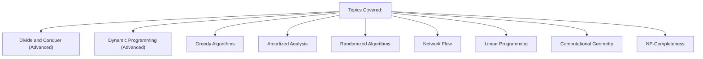

### MIT 6.851 - Advanced Data Structures

```
CUTTING-EDGE DATA STRUCTURES

Topics Covered:
├── Persistent Data Structures
├── Succinct Data Structures
├── Hashing (Cuckoo, Perfect)
├── Integer Data Structures
├── Geometric Data Structures
├── Cache-Oblivious Algorithms
└── Memory Hierarchy

LINKS:
📺 Video Lectures: https://ocw.mit.edu/courses/6-851-advanced-data-structures-spring-2012/
📚 Course Notes: https://ocw.mit.edu/courses/6-851-advanced-data-structures-spring-2012/pages/lecture-videos/

INSTRUCTOR: Erik Demaine
LEVEL: Graduate

WHY THIS COURSE:
- Beyond standard curriculum
- Research paper discussions
- Cutting-edge techniques
```

**Flow:**
1. Topics Covered:
2. Persistent Data Structures
3. Topics Covered:
4. Succinct Data Structures
5. Topics Covered:
6. Hashing (Cuckoo, Perfect)
7. Topics Covered:
8. Integer Data Structures
9. Topics Covered:
10. Geometric Data Structures
11. Topics Covered:
12. Cache-Oblivious Algorithms

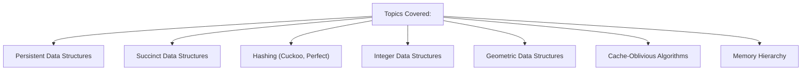

---


## Stanford University

### Stanford CS161 - Design and Analysis of Algorithms

```
STANFORD'S FLAGSHIP ALGORITHM COURSE

Topics Covered:
├── Asymptotic Analysis, Recurrences
├── Divide and Conquer
├── Sorting and Selection
├── Graph Algorithms
├── Greedy Algorithms
├── Dynamic Programming
├── NP-Completeness
└── Approximation Algorithms

LINKS:
📺 Coursera Course: https://www.coursera.org/specializations/algorithms
📚 Course Website: https://stanford-cs161.github.io/
📝 Tim Roughgarden's Notes: http://timroughgarden.org/notes.html

INSTRUCTOR: Tim Roughgarden
LEVEL: Intermediate

WHY THIS COURSE:
- Exceptionally clear teaching
- Great for interview prep
- Available on Coursera!
```

**Flow:**
1. Topics Covered:
2. Asymptotic Analysis, Recurrences
3. Topics Covered:
4. Divide and Conquer
5. Topics Covered:
6. Sorting and Selection
7. Topics Covered:
8. Graph Algorithms
9. Topics Covered:
10. Greedy Algorithms
11. Topics Covered:
12. Dynamic Programming

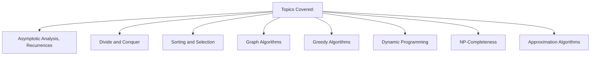

### Stanford CS166 - Data Structures

```
ADVANCED DATA STRUCTURES

Topics Covered:
├── Balanced Trees (Splay, Red-Black)
├── B-Trees and External Memory
├── Range Queries (Segment Trees, BIT)
├── Persistent Data Structures
├── String Data Structures (Suffix Arrays, Tries)
├── Hashing Techniques
└── Bloom Filters

LINKS:
📚 Course Website: http://web.stanford.edu/class/cs166/
📝 Lecture Slides: http://web.stanford.edu/class/cs166/handouts/

LEVEL: Advanced
PRE-REQ: CS161

WHY THIS COURSE:
- Very detailed slides
- Practical focus
- Modern techniques
```

**Flow:**
1. Topics Covered:
2. Balanced Trees (Splay, Red-Black)
3. Topics Covered:
4. B-Trees and External Memory
5. Topics Covered:
6. Range Queries (Segment Trees, BIT)
7. Topics Covered:
8. Persistent Data Structures
9. Topics Covered:
10. String Data Structures (Suffix Arrays, Tries)
11. Topics Covered:
12. Hashing Techniques

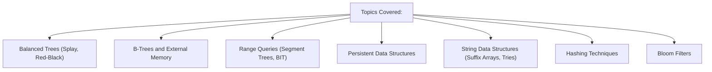

---

## UC Berkeley

### CS 61B - Data Structures

```
BERKELEY'S FAMOUS DS COURSE

Topics Covered:
├── Java and OOP
├── Lists, Trees, Hashing
├── Asymptotics
├── Disjoint Sets
├── BSTs, Balanced BSTs
├── Heaps, Priority Queues
├── Graphs (BFS, DFS, MST, Shortest Paths)
├── Sorting
├── Tries
└── Software Engineering Practices

LINKS:
📺 Video Lectures: https://www.youtube.com/playlist?list=PLfbB4BQZfMl8vYmtQb91bFxFZRH0aZk9q
📚 Course Website: https://sp21.datastructur.es/ (Spring 2021)
📺 Josh Hug's Channel: https://www.youtube.com/c/JoshHug

INSTRUCTOR: Josh Hug
LEVEL: Beginner-Intermediate
LANGUAGE: Java

WHY THIS COURSE:
- Project-based learning
- Excellent visualizations
- Great for Java learners
- Autograder available!
```

**Flow:**
1. Topics Covered:
2. Java and OOP
3. Topics Covered:
4. Lists, Trees, Hashing
5. Topics Covered:
6. Asymptotics
7. Topics Covered:
8. Disjoint Sets
9. Topics Covered:
10. BSTs, Balanced BSTs
11. Topics Covered:
12. Heaps, Priority Queues

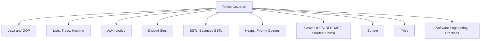

### CS 170 - Efficient Algorithms and Intractable Problems

```
BERKELEY'S ALGORITHM THEORY

Topics Covered:
├── Divide and Conquer, FFT
├── Graph Algorithms
├── Greedy Algorithms
├── Dynamic Programming
├── Linear Programming
├── Reductions and NP-Completeness
├── Approximation Algorithms
└── Randomized Algorithms

LINKS:
📚 Course Website: https://cs170.org/
📖 Textbook (FREE): https://people.eecs.berkeley.edu/~vazirani/algorithms/

TEXTBOOK: "Algorithms" by Dasgupta, Papadimitriou, Vazirani (FREE PDF!)
LEVEL: Advanced

WHY THIS COURSE:
- Free textbook is excellent!
- Rigorous but accessible
- Problem sets are challenging
```

**Flow:**
1. Topics Covered:
2. Divide and Conquer, FFT
3. Topics Covered:
4. Graph Algorithms
5. Topics Covered:
6. Greedy Algorithms
7. Topics Covered:
8. Dynamic Programming
9. Topics Covered:
10. Linear Programming
11. Topics Covered:
12. Reductions and NP-Completeness

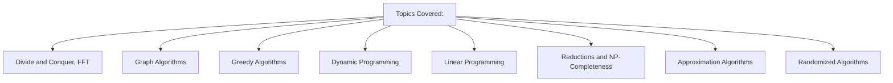

---

## KTH Royal Institute of Technology (Sweden)

### ID1018 - Programming I

```
FUNDAMENTALS OF PROGRAMMING

Topics Covered:
├── Basic Programming Concepts
├── Object-Oriented Programming
├── Data Types and Structures
├── Basic Algorithms
└── Problem Solving Techniques

LINKS:
📚 KTH Course Info: https://www.kth.se/student/kurser/kurs/ID1018

LANGUAGE: Java
LEVEL: Beginner

WHY KTH:
- Strong European CS tradition
- Industry connections
- Practical focus
```

**Flow:**
1. Topics Covered:
2. Basic Programming Concepts
3. Topics Covered:
4. Object-Oriented Programming
5. Topics Covered:
6. Data Types and Structures
7. Topics Covered:
8. Basic Algorithms
9. Topics Covered:
10. Problem Solving Techniques

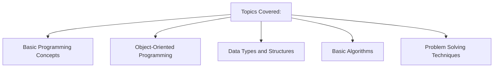

### ID1020 - Algorithms and Data Structures

```
KTH'S CORE ALGORITHM COURSE

Topics Covered:
├── Analysis of Algorithms
├── Fundamental Data Structures
├── Sorting and Searching
├── Graph Algorithms
├── String Algorithms
└── Algorithm Design Techniques

LINKS:
📚 Course Info: https://www.kth.se/student/kurser/kurs/ID1020
📖 Uses Sedgewick's "Algorithms" textbook

TEXTBOOK: "Algorithms, 4th Edition" by Sedgewick & Wayne
COMPANION SITE: https://algs4.cs.princeton.edu/home/

LEVEL: Intermediate
LANGUAGE: Java

WHY THIS COURSE:
- Sedgewick's book is exceptional
- Great visualizations on companion site
- Princeton collaboration
```

**Flow:**
1. Topics Covered:
2. Analysis of Algorithms
3. Topics Covered:
4. Fundamental Data Structures
5. Topics Covered:
6. Sorting and Searching
7. Topics Covered:
8. Graph Algorithms
9. Topics Covered:
10. String Algorithms
11. Topics Covered:
12. Algorithm Design Techniques

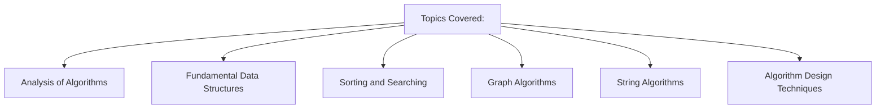

---


# 🌟 TIER 2: EXCELLENT COMPLEMENTARY RESOURCES

## Princeton University

### COS 226 - Algorithms and Data Structures

```
PRINCETON'S ALGORITHM COURSE

LINKS:
📺 Coursera Course: https://www.coursera.org/learn/algorithms-part1
📺 Coursera Part 2: https://www.coursera.org/learn/algorithms-part2
📚 Textbook Site: https://algs4.cs.princeton.edu/home/
📝 Visualizations: https://algs4.cs.princeton.edu/code/

INSTRUCTOR: Robert Sedgewick, Kevin Wayne
LEVEL: Intermediate
LANGUAGE: Java

WHY THIS COURSE:
- Beautiful visualizations
- Coursera version is FREE
- Industry standard textbook
```

---


## Carnegie Mellon University (CMU)

### 15-451 - Algorithm Design and Analysis

```
CMU'S FLAGSHIP ALGORITHM COURSE

Topics Covered:
├── Algorithm Analysis
├── Divide and Conquer
├── Dynamic Programming
├── Greedy Algorithms
├── Graph Algorithms
├── Network Flow
├── Linear Programming
├── Randomized Algorithms
├── Approximation Algorithms
└── Online Algorithms

LINKS:
📚 Course Website: https://www.cs.cmu.edu/~15451/
📝 Lecture Notes: Various faculty pages

LEVEL: Advanced

WHY THIS COURSE:
- Extremely rigorous
- Research-oriented
- Problem solving focus
```

**Flow:**
1. Topics Covered:
2. Algorithm Analysis
3. Topics Covered:
4. Divide and Conquer
5. Topics Covered:
6. Dynamic Programming
7. Topics Covered:
8. Greedy Algorithms
9. Topics Covered:
10. Graph Algorithms
11. Topics Covered:
12. Network Flow

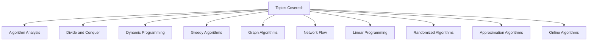

---

## Cornell University

### CS 4820 - Introduction to Analysis of Algorithms

```
CORNELL'S ALGORITHM ANALYSIS

LINKS:
📖 Textbook Used: "Algorithm Design" by Kleinberg & Tardos
📚 Author's Resources: https://www.cs.cornell.edu/home/kleinber/

TEXTBOOK: Considered one of the best algorithm books!
LEVEL: Intermediate-Advanced

WHY THIS:
- Kleinberg-Tardos book is exceptional
- Clear problem-solving approach
- Interview prep gold
```

---

# 🌟 TIER 3: SPECIALIZED RESOURCES

## Books (PDFs Available Legally)

```
FREE HIGH-QUALITY ALGORITHM BOOKS:

1. "Algorithms" by Dasgupta, Papadimitriou, Vazirani
   📖 Link: https://people.eecs.berkeley.edu/~vazirani/algorithms/all.pdf
   ⭐ Best for: Theory, proofs, understanding

2. "Competitive Programmer's Handbook" by Antti Laaksonen
   📖 Link: https://cses.fi/book/book.pdf
   ⭐ Best for: Competitive programming, interview prep

3. "Open Data Structures" by Pat Morin
   📖 Link: https://opendatastructures.org/
   ⭐ Best for: Implementation details

4. "Think Data Structures" by Allen Downey
   📖 Link: https://greenteapress.com/wp/think-data-structures/
   ⭐ Best for: Java implementation

5. "Algorithms" by Jeff Erickson
   📖 Link: http://jeffe.cs.illinois.edu/teaching/algorithms/
   ⭐ Best for: Comprehensive theory
```

## Visualization Tools

```
INTERACTIVE ALGORITHM VISUALIZATIONS:

1. VisuAlgo (Singapore)
   🔗 https://visualgo.net/
   ⭐ Covers almost everything!

2. Algorithm Visualizer
   🔗 https://algorithm-visualizer.org/
   ⭐ Community contributed

3. Data Structure Visualizations (USF)
   🔗 https://www.cs.usfca.edu/~galles/visualization/Algorithms.html
   ⭐ Simple and clear

4. Pathfinding Visualizer
   🔗 https://clementmihailescu.github.io/Pathfinding-Visualizer/
   ⭐ Graph algorithms

5. Sorting Algorithms Visualized
   🔗 https://www.toptal.com/developers/sorting-algorithms
   ⭐ Comparison of sorts
```

## Practice Platforms

```
RANKED BY USEFULNESS FOR LEARNING:

1. LeetCode (leetcode.com)
   ⭐ Best for: Interview prep
   🎯 Focus: Company-specific questions

2. Codeforces (codeforces.com)
   ⭐ Best for: Competitive programming
   🎯 Focus: Speed and efficiency

3. AtCoder (atcoder.jp)
   ⭐ Best for: Clean problem statements
   🎯 Focus: Mathematical thinking

4. CSES Problem Set (cses.fi/problemset)
   ⭐ Best for: Systematic learning
   🎯 Focus: One topic at a time

5. HackerRank (hackerrank.com)
   ⭐ Best for: Company hiring challenges
   🎯 Focus: Language proficiency
```

---

# 📋 RECOMMENDED LEARNING PATHS

## Path 1: Interview Preparation (2 months)

```
WEEK 1-2: Foundations
├── Berkeley CS61B (videos 1-15)
├── LeetCode Easy (Arrays, Strings)
└── Practice: 20 problems

WEEK 3-4: Core Data Structures
├── Berkeley CS61B (videos 16-30)
├── LeetCode (Linked Lists, Trees, Graphs)
└── Practice: 30 problems

WEEK 5-6: Algorithm Techniques
├── Stanford CS161 (Coursera Part 1)
├── LeetCode (Binary Search, Two Pointers, Sliding Window)
└── Practice: 40 problems

WEEK 7-8: Advanced Topics
├── Stanford CS161 (Coursera Part 2)
├── LeetCode (DP, Backtracking, Graphs)
├── Company-specific preparation
└── Practice: 50 problems

TOTAL: 140 problems, solid foundation
```

**Flow:**
1. WEEK 1-2: Foundations
2. Berkeley CS61B (videos 1-15)
3. WEEK 1-2: Foundations
4. LeetCode Easy (Arrays, Strings)
5. WEEK 1-2: Foundations
6. Practice: 20 problems
7. WEEK 3-4: Core Data Structures
8. Berkeley CS61B (videos 16-30)
9. WEEK 3-4: Core Data Structures
10. LeetCode (Linked Lists, Trees, Graphs)
11. WEEK 3-4: Core Data Structures
12. Practice: 30 problems

```mermaid
flowchart TD
    N1["WEEK 1-2: Foundations"]
    N2["Berkeley CS61B (videos 1-15)"]
    N3["LeetCode Easy (Arrays, Strings)"]
    N4["Practice: 20 problems"]
    N5["WEEK 3-4: Core Data Structures"]
    N6["Berkeley CS61B (videos 16-30)"]
    N7["LeetCode (Linked Lists, Trees, Graphs)"]
    N8["Practice: 30 problems"]
    N9["WEEK 5-6: Algorithm Techniques"]
    N10["Stanford CS161 (Coursera Part 1)"]
    N11["LeetCode (Binary Search, Two Pointers, Sliding Window)"]
    N12["Practice: 40 problems"]
    N13["WEEK 7-8: Advanced Topics"]
    N14["Stanford CS161 (Coursera Part 2)"]
    N15["LeetCode (DP, Backtracking, Graphs)"]
    N16["Company-specific preparation"]
    N17["Practice: 50 problems"]
    N1 --> N2
    N1 --> N3
    N1 --> N4
    N5 --> N6
    N5 --> N7
    N5 --> N8
    N9 --> N10
    N9 --> N11
    N9 --> N12
    N13 --> N14
    N13 --> N15
    N13 --> N16
    N13 --> N17
```

## Path 2: Deep Understanding (3 months)

```
MONTH 1: Theoretical Foundation
├── MIT 6.006 (Full course)
├── Dasgupta textbook (Chapters 1-6)
├── Implement every data structure yourself
└── Focus: Understanding WHY, not just HOW

MONTH 2: Advanced Techniques
├── MIT 6.046 (Selected lectures)
├── Kleinberg-Tardos textbook (Selected chapters)
├── Focus: Greedy proofs, DP optimization
└── Practice: Medium-Hard problems

MONTH 3: Specialization
├── Choose: Systems / Competitive / Research
├── Stanford CS166 (Data Structures) OR
├── Competitive Programmer's Handbook
└── Build a portfolio project
```

**Flow:**
1. MONTH 1: Theoretical Foundation
2. MIT 6.006 (Full course)
3. MONTH 1: Theoretical Foundation
4. Dasgupta textbook (Chapters 1-6)
5. MONTH 1: Theoretical Foundation
6. Implement every data structure yourself
7. MONTH 1: Theoretical Foundation
8. Focus: Understanding WHY, not just HOW
9. MONTH 2: Advanced Techniques
10. MIT 6.046 (Selected lectures)
11. MONTH 2: Advanced Techniques
12. Kleinberg-Tardos textbook (Selected chapters)

```mermaid
flowchart TD
    N1["MONTH 1: Theoretical Foundation"]
    N2["MIT 6.006 (Full course)"]
    N3["Dasgupta textbook (Chapters 1-6)"]
    N4["Implement every data structure yourself"]
    N5["Focus: Understanding WHY, not just HOW"]
    N6["MONTH 2: Advanced Techniques"]
    N7["MIT 6.046 (Selected lectures)"]
    N8["Kleinberg-Tardos textbook (Selected chapters)"]
    N9["Focus: Greedy proofs, DP optimization"]
    N10["Practice: Medium-Hard problems"]
    N11["MONTH 3: Specialization"]
    N12["Choose: Systems / Competitive / Research"]
    N13["Stanford CS166 (Data Structures) OR"]
    N14["Competitive Programmer's Handbook"]
    N15["Build a portfolio project"]
    N1 --> N2
    N1 --> N3
    N1 --> N4
    N1 --> N5
    N6 --> N7
    N6 --> N8
    N6 --> N9
    N6 --> N10
    N11 --> N12
    N11 --> N13
    N11 --> N14
    N11 --> N15
```


## Path 3: Competitive Programming (6 months)

```
PHASE 1 (Month 1-2): Fundamentals
├── CSES Problem Set (Introductory Problems)
├── Codeforces Div3/Div4 contests
└── Target: 100 problems

PHASE 2 (Month 3-4): Techniques
├── CSES Problem Set (All sections)
├── Codeforces Div2 contests
├── AtCoder Beginner Contests
└── Target: 200 problems

PHASE 3 (Month 5-6): Advanced
├── Competitive Programmer's Handbook
├── Codeforces Div1 problems
├── AtCoder Regular Contests
└── Target: 300 problems
```

**Flow:**
1. PHASE 1 (Month 1-2): Fundamentals
2. CSES Problem Set (Introductory Problems)
3. PHASE 1 (Month 1-2): Fundamentals
4. Codeforces Div3/Div4 contests
5. PHASE 1 (Month 1-2): Fundamentals
6. Target: 100 problems
7. PHASE 2 (Month 3-4): Techniques
8. CSES Problem Set (All sections)
9. PHASE 2 (Month 3-4): Techniques
10. Codeforces Div2 contests
11. PHASE 2 (Month 3-4): Techniques
12. AtCoder Beginner Contests

```mermaid
flowchart TD
    N1["PHASE 1 (Month 1-2): Fundamentals"]
    N2["CSES Problem Set (Introductory Problems)"]
    N3["Codeforces Div3/Div4 contests"]
    N4["Target: 100 problems"]
    N5["PHASE 2 (Month 3-4): Techniques"]
    N6["CSES Problem Set (All sections)"]
    N7["Codeforces Div2 contests"]
    N8["AtCoder Beginner Contests"]
    N9["Target: 200 problems"]
    N10["PHASE 3 (Month 5-6): Advanced"]
    N11["Competitive Programmer's Handbook"]
    N12["Codeforces Div1 problems"]
    N13["AtCoder Regular Contests"]
    N14["Target: 300 problems"]
    N1 --> N2
    N1 --> N3
    N1 --> N4
    N5 --> N6
    N5 --> N7
    N5 --> N8
    N5 --> N9
    N10 --> N11
    N10 --> N12
    N10 --> N13
    N10 --> N14
```

---


# 🔗 QUICK REFERENCE LINKS

```
MIT OPENCOURSEWARE:
├── 6.006: https://ocw.mit.edu/courses/6-006-introduction-to-algorithms-spring-2020/
├── 6.046: https://ocw.mit.edu/courses/6-046j-design-and-analysis-of-algorithms-spring-2015/
└── 6.851: https://ocw.mit.edu/courses/6-851-advanced-data-structures-spring-2012/

STANFORD:
├── CS161 (Coursera): https://www.coursera.org/specializations/algorithms
├── CS166: http://web.stanford.edu/class/cs166/
└── Tim Roughgarden: http://timroughgarden.org/

BERKELEY:
├── CS61B: https://sp21.datastructur.es/
├── CS170: https://cs170.org/
└── Free Textbook: https://people.eecs.berkeley.edu/~vazirani/algorithms/

PRINCETON (COURSERA):
├── Part 1: https://www.coursera.org/learn/algorithms-part1
├── Part 2: https://www.coursera.org/learn/algorithms-part2
└── Textbook: https://algs4.cs.princeton.edu/

VISUALIZATIONS:
├── VisuAlgo: https://visualgo.net/
├── USF: https://www.cs.usfca.edu/~galles/visualization/
└── Algorithm Visualizer: https://algorithm-visualizer.org/

FREE BOOKS:
├── Dasgupta: https://people.eecs.berkeley.edu/~vazirani/algorithms/all.pdf
├── CP Handbook: https://cses.fi/book/book.pdf
├── Jeff Erickson: http://jeffe.cs.illinois.edu/teaching/algorithms/
└── Open DS: https://opendatastructures.org/

PRACTICE:
├── LeetCode: https://leetcode.com/
├── Codeforces: https://codeforces.com/
├── CSES: https://cses.fi/problemset/
├── AtCoder: https://atcoder.jp/
└── HackerRank: https://hackerrank.com/
```

**Flow:**
1. MIT OPENCOURSEWARE:
2. 6.006: https://ocw.mit.edu/courses/6-006-introduction-t
3. MIT OPENCOURSEWARE:
4. 6.046: https://ocw.mit.edu/courses/6-046j-design-and-an
5. MIT OPENCOURSEWARE:
6. 6.851: https://ocw.mit.edu/courses/6-851-advanced-data-
7. STANFORD:
8. CS161 (Coursera): https://www.coursera.org/specializati
9. STANFORD:
10. CS166: http://web.stanford.edu/class/cs166/
11. STANFORD:
12. Tim Roughgarden: http://timroughgarden.org/

```mermaid
flowchart TD
    N1["MIT OPENCOURSEWARE:"]
    N2["6.006: https://ocw.mit.edu/courses/6-006-introduction-t"]
    N3["6.046: https://ocw.mit.edu/courses/6-046j-design-and-an"]
    N4["6.851: https://ocw.mit.edu/courses/6-851-advanced-data-"]
    N5["STANFORD:"]
    N6["CS161 (Coursera): https://www.coursera.org/specializati"]
    N7["CS166: http://web.stanford.edu/class/cs166/"]
    N8["Tim Roughgarden: http://timroughgarden.org/"]
    N9["BERKELEY:"]
    N10["CS61B: https://sp21.datastructur.es/"]
    N11["CS170: https://cs170.org/"]
    N12["Free Textbook: https://people.eecs.berkeley.edu/~vazira"]
    N13["PRINCETON (COURSERA):"]
    N14["Part 1: https://www.coursera.org/learn/algorithms-part1"]
    N15["Part 2: https://www.coursera.org/learn/algorithms-part2"]
    N16["Textbook: https://algs4.cs.princeton.edu/"]
    N17["VISUALIZATIONS:"]
    N18["VisuAlgo: https://visualgo.net/"]
    N19["USF: https://www.cs.usfca.edu/~galles/visualization/"]
    N20["Algorithm Visualizer: https://algorithm-visualizer.org/"]
    N21["FREE BOOKS:"]
    N22["Dasgupta: https://people.eecs.berkeley.edu/~vazirani/al"]
    N23["CP Handbook: https://cses.fi/book/book.pdf"]
    N24["Jeff Erickson: http://jeffe.cs.illinois.edu/teaching/al"]
    N25["Open DS: https://opendatastructures.org/"]
    N26["PRACTICE:"]
    N27["LeetCode: https://leetcode.com/"]
    N28["Codeforces: https://codeforces.com/"]
    N29["CSES: https://cses.fi/problemset/"]
    N30["AtCoder: https://atcoder.jp/"]
    N31["HackerRank: https://hackerrank.com/"]
    N1 --> N2
    N1 --> N3
    N1 --> N4
    N5 --> N6
    N5 --> N7
    N5 --> N8
    N9 --> N10
    N9 --> N11
    N9 --> N12
    N13 --> N14
    N13 --> N15
    N13 --> N16
    N17 --> N18
    N17 --> N19
    N17 --> N20
    N21 --> N22
    N21 --> N23
    N21 --> N24
    N21 --> N25
    N26 --> N27
    N26 --> N28
    N26 --> N29
    N26 --> N30
    N26 --> N31
```

---

# 💡 STUDY TIPS FROM TOP UNIVERSITIES

```
FROM MIT:
"Don't just watch lectures. PAUSE and solve along."
"Implement algorithms BEFORE seeing the solution."
"Prove correctness BEFORE optimizing."

FROM STANFORD:
"Master the fundamentals. Everything else builds on them."
"If you can't explain it simply, you don't understand it."
"Practice problems are where real learning happens."

FROM BERKELEY:
"Visualize data structure operations mentally."
"Draw diagrams for EVERY graph/tree problem."
"Test your code on edge cases FIRST."

FROM PRINCETON:
"Read the textbook. Videos alone aren't enough."
"Implement from scratch. Library functions hide complexity."
"Connect algorithms to real-world applications."
```

---

_The best resource is the one you actually use. Start today._ 🚀📚

---

# 🌟 TIER 4: SYSTEMS & DISTRIBUTED COMPUTING (ESSENTIAL!)

## MIT 6.824 - Distributed Systems

```
THE LEGENDARY DISTRIBUTED SYSTEMS COURSE

Topics Covered:
├── Fault Tolerance
├── Replication
├── Consistency
├── Transactions
├── Raft Consensus Algorithm
├── Spanner & Distributed Transactions
├── Spark & Big Data
└── Bitcoin & Blockchain

LINKS:
📺 Video Lectures: https://www.youtube.com/playlist?list=PLrw6a1wE39_tb2fErI4-WkMbsvGQk9_UB
📚 Course Website: https://pdos.csail.mit.edu/6.824/
📝 Lab Assignments: https://pdos.csail.mit.edu/6.824/labs/
📖 Schedule & Papers: https://pdos.csail.mit.edu/6.824/schedule.html

INSTRUCTOR: Robert Morris
LEVEL: Advanced
LANGUAGE: Go

WHY THIS COURSE:
- Build real distributed systems (MapReduce, Raft, KV Store)
- Read foundational papers (Paxos, Raft, Spanner)
- Understand why systems fail
- ESSENTIAL for senior engineering roles
```

**Flow:**
1. Topics Covered:
2. Fault Tolerance
3. Topics Covered:
4. Replication
5. Topics Covered:
6. Consistency
7. Topics Covered:
8. Transactions
9. Topics Covered:
10. Raft Consensus Algorithm
11. Topics Covered:
12. Spanner & Distributed Transactions

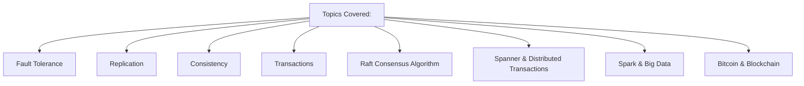

## Berkeley CS162 - Operating Systems

```
OPERATING SYSTEMS FUNDAMENTALS

Topics Covered:
├── Processes and Threads
├── Concurrency and Synchronization
├── Memory Management
├── File Systems
├── I/O Systems
├── Networking
├── Distributed Systems Basics
└── Virtual Machines

LINKS:
📺 Video Lectures: https://www.youtube.com/playlist?list=PLN_mP1uWIrL6zH09RlKp3LZxkyTvvVQ4M
📚 Course Website: https://cs162.org/
📝 Projects: https://cs162.org/

INSTRUCTORS: Ion Stoica, John Kubiatowicz
LEVEL: Intermediate-Advanced
LANGUAGE: C

WHY THIS COURSE:
- Understand what happens below your code
- Build parts of an OS (PintOS)
- Essential for systems programming
```

**Flow:**
1. Topics Covered:
2. Processes and Threads
3. Topics Covered:
4. Concurrency and Synchronization
5. Topics Covered:
6. Memory Management
7. Topics Covered:
8. File Systems
9. Topics Covered:
10. I/O Systems
11. Topics Covered:
12. Networking

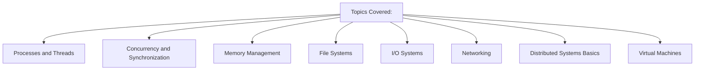


## Berkeley CS186 - Database Systems

```
DATABASE INTERNALS

Topics Covered:
├── SQL and Relational Algebra
├── Storage and Indexing (B+ Trees)
├── Query Processing and Optimization
├── Transactions and Concurrency
├── Recovery and Logging
├── Distributed Databases
└── NoSQL Systems

LINKS:
📺 Video Lectures: https://www.youtube.com/playlist?list=PLYp4IGUhNFmw8USiYMJvCUjZe79fvyYge
📚 Course Website: https://cs186berkeley.net/
📝 Projects: Build a database engine!

LEVEL: Intermediate
LANGUAGE: Java

WHY THIS COURSE:
- Understand database internals
- Know WHY indexes work
- Query optimization insights
```

**Flow:**
1. Topics Covered:
2. SQL and Relational Algebra
3. Topics Covered:
4. Storage and Indexing (B+ Trees)
5. Topics Covered:
6. Query Processing and Optimization
7. Topics Covered:
8. Transactions and Concurrency
9. Topics Covered:
10. Recovery and Logging
11. Topics Covered:
12. Distributed Databases

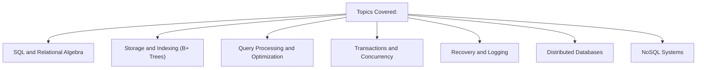

## CMU 15-445 - Database Systems

```
ANDY PAVLO'S FAMOUS DATABASE COURSE

Topics Covered:
├── Storage Engines
├── Buffer Pool Management
├── Hash Tables and Trees
├── Query Execution
├── Query Optimization
├── Concurrency Control
├── Logging and Recovery
└── Distributed Databases

LINKS:
📺 Video Lectures: https://www.youtube.com/playlist?list=PLSE8ODhjZXjYDBpQnSymaectKjxCy6BYq
📚 Course Website: https://15445.courses.cs.cmu.edu/
📖 Notes: https://15445.courses.cs.cmu.edu/fall2023/notes/

INSTRUCTOR: Andy Pavlo
LEVEL: Intermediate-Advanced
LANGUAGE: C++

WHY THIS COURSE:
- Most practical database course
- Build BusTub (teaching database)
- Andy Pavlo is legendary teacher
```

**Flow:**
1. Topics Covered:
2. Storage Engines
3. Topics Covered:
4. Buffer Pool Management
5. Topics Covered:
6. Hash Tables and Trees
7. Topics Covered:
8. Query Execution
9. Topics Covered:
10. Query Optimization
11. Topics Covered:
12. Concurrency Control

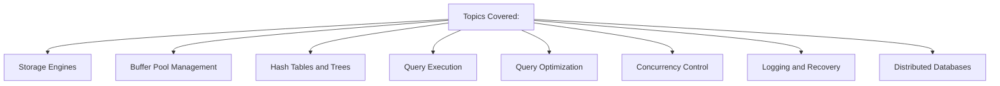

## CMU 15-721 - Advanced Database Systems

```
CUTTING-EDGE DATABASE RESEARCH

Topics Covered:
├── Modern OLAP Databases
├── Query Compilation
├── Vectorized Execution
├── Compression
├── In-Memory Databases
├── Self-Driving Databases
└── Machine Learning for Databases

LINKS:
📺 Video Lectures: https://www.youtube.com/playlist?list=PLSE8ODhjZXjYa_zX-KeMJui7pcN1rIaIJ
📚 Course Website: https://15721.courses.cs.cmu.edu/

INSTRUCTOR: Andy Pavlo
LEVEL: Graduate

WHY THIS COURSE:
- Cutting-edge database techniques
- Research paper discussions
- Future of databases
```

**Flow:**
1. Topics Covered:
2. Modern OLAP Databases
3. Topics Covered:
4. Query Compilation
5. Topics Covered:
6. Vectorized Execution
7. Topics Covered:
8. Compression
9. Topics Covered:
10. In-Memory Databases
11. Topics Covered:
12. Self-Driving Databases

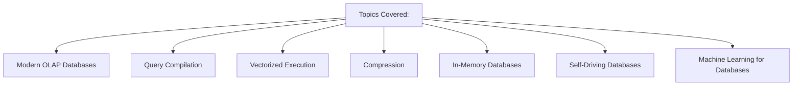

---

# 🌟 TIER 5: COMPUTER NETWORKING & SYSTEMS

## Stanford CS144 - Introduction to Computer Networking

```
NETWORKING FUNDAMENTALS

Topics Covered:
├── Internet Architecture
├── Transport Layer (TCP/UDP)
├── Network Layer (IP, Routing)
├── Link Layer
├── Wireless Networks
├── Network Security
└── Congestion Control

LINKS:
📺 Video Lectures: https://www.youtube.com/playlist?list=PLoCMsyE1cvdWKsLVyf6cPwCLDIZnOj0NS
📚 Course Website: https://cs144.github.io/
📝 Labs: Build a TCP/IP stack!

INSTRUCTORS: Keith Winstein, Phil Levis
LEVEL: Intermediate
LANGUAGE: C++

WHY THIS COURSE:
- Understand the Internet
- Build actual network protocols
- Essential for backend engineers
```

**Flow:**
1. Topics Covered:
2. Internet Architecture
3. Topics Covered:
4. Transport Layer (TCP/UDP)
5. Topics Covered:
6. Network Layer (IP, Routing)
7. Topics Covered:
8. Link Layer
9. Topics Covered:
10. Wireless Networks
11. Topics Covered:
12. Network Security

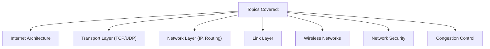


## MIT 6.033 - Computer System Engineering

```
SYSTEMS THINKING

Topics Covered:
├── Operating Systems
├── Networking
├── Distributed Systems
├── Security
├── Fault Tolerance
└── System Design Principles

LINKS:
📚 Course Website: https://web.mit.edu/6.033/www/
📖 System Design Textbook: http://web.mit.edu/6.033/www/papers/

LEVEL: Intermediate

WHY THIS COURSE:
- Holistic systems understanding
- Design principles that last
- How to think about complexity
```

**Flow:**
1. Topics Covered:
2. Operating Systems
3. Topics Covered:
4. Networking
5. Topics Covered:
6. Distributed Systems
7. Topics Covered:
8. Security
9. Topics Covered:
10. Fault Tolerance
11. Topics Covered:
12. System Design Principles

```mermaid
flowchart TD
    N1["Topics Covered:"]
    N2["Operating Systems"]
    N3["Networking"]
    N4["Distributed Systems"]
    N5["Security"]
    N6["Fault Tolerance"]
    N7["System Design Principles"]
    N1 --> N2
    N1 --> N3
    N1 --> N4
    N1 --> N5
    N1 --> N6
    N1 --> N7
```

---


# 🌟 TIER 6: SPECIALIZED ADVANCED TOPICS

## Stanford CS229 - Machine Learning

```
FOUNDATIONAL ML COURSE

LINKS:
📺 Video Lectures: https://www.youtube.com/playlist?list=PLoROMvodv4rMiGQp3WXShtMGgzqpfVfbU
📚 Course Website: https://cs229.stanford.edu/
📝 Notes: https://cs229.stanford.edu/main_notes.pdf

INSTRUCTOR: Andrew Ng
LEVEL: Advanced

WHY THIS COURSE:
- ML from first principles
- Mathematical foundations
- The OG ML course
```


## MIT 6.172 - Performance Engineering

```
MAKING CODE FAST

Topics Covered:
├── Computer Architecture Review
├── Caching and Memory
├── Bit Hacks
├── Assembly and Compilers
├── Parallel Programming
├── Race Conditions and Locks
└── Performance Analysis

LINKS:
📺 Video Lectures: https://ocw.mit.edu/courses/6-172-performance-engineering-of-software-systems-fall-2018/
📚 Course Materials: https://ocw.mit.edu/courses/6-172-performance-engineering-of-software-systems-fall-2018/pages/lecture-slides-and-code/

LEVEL: Advanced
LANGUAGE: C

WHY THIS COURSE:
- Make code 100x faster
- Understand hardware
- Performance debugging
```

**Flow:**
1. Topics Covered:
2. Computer Architecture Review
3. Topics Covered:
4. Caching and Memory
5. Topics Covered:
6. Bit Hacks
7. Topics Covered:
8. Assembly and Compilers
9. Topics Covered:
10. Parallel Programming
11. Topics Covered:
12. Race Conditions and Locks

```mermaid
flowchart TD
    N1["Topics Covered:"]
    N2["Computer Architecture Review"]
    N3["Caching and Memory"]
    N4["Bit Hacks"]
    N5["Assembly and Compilers"]
    N6["Parallel Programming"]
    N7["Race Conditions and Locks"]
    N8["Performance Analysis"]
    N1 --> N2
    N1 --> N3
    N1 --> N4
    N1 --> N5
    N1 --> N6
    N1 --> N7
    N1 --> N8
```


## UIUC CS 425 - Distributed Systems

```
ANOTHER GREAT DISTRIBUTED SYSTEMS COURSE

LINKS:
📺 Video Lectures: https://www.youtube.com/playlist?list=PLLXdhg_r2hKA7DPDsunoDZ-Z769jWn4R8
📚 Course Website: https://courses.engr.illinois.edu/cs425/

Topics:
├── Gossip Protocols
├── P2P Systems
├── Consensus
├── Stream Processing
└── Cloud Computing

WHY THIS COURSE:
- Different perspective from MIT 6.824
- More practical focus
- Cloud computing emphasis
```

**Flow:**
1. Topics:
2. Gossip Protocols
3. Topics:
4. P2P Systems
5. Topics:
6. Consensus
7. Topics:
8. Stream Processing
9. Topics:
10. Cloud Computing

```mermaid
flowchart TD
    N1["Topics:"]
    N2["Gossip Protocols"]
    N3["P2P Systems"]
    N4["Consensus"]
    N5["Stream Processing"]
    N6["Cloud Computing"]
    N1 --> N2
    N1 --> N3
    N1 --> N4
    N1 --> N5
    N1 --> N6
```

---

# 🌟 TIER 7: INDUSTRY ENGINEERING BLOGS & RESOURCES

## Engineering Blogs (Learn from Production)

```
MUST-READ ENGINEERING BLOGS:

FAANG/Big Tech:
├── Google: https://developers.googleblog.com/
├── Meta: https://engineering.fb.com/
├── Netflix: https://netflixtechblog.com/
├── Amazon/AWS: https://aws.amazon.com/blogs/architecture/
├── Microsoft: https://devblogs.microsoft.com/
├── LinkedIn: https://engineering.linkedin.com/blog
├── Twitter: https://blog.twitter.com/engineering
├── Uber: https://www.uber.com/blog/engineering/
├── Airbnb: https://medium.com/airbnb-engineering
└── Spotify: https://engineering.atspotify.com/

Unicorns & Scale-ups:
├── Stripe: https://stripe.com/blog/engineering
├── Shopify: https://shopify.engineering/
├── Discord: https://discord.com/blog/engineering
├── Slack: https://slack.engineering/
├── Pinterest: https://medium.com/pinterest-engineering
├── Dropbox: https://dropbox.tech/
├── Figma: https://www.figma.com/blog/engineering/
└── Notion: https://www.notion.so/blog/topic/tech

Database & Infrastructure:
├── Cloudflare: https://blog.cloudflare.com/
├── DigitalOcean: https://www.digitalocean.com/blog/tag/engineering
├── MongoDB: https://www.mongodb.com/blog
├── PostgreSQL: https://www.postgresql.org/docs/current/
└── Redis: https://redis.io/blog/

WHY READ THESE:
- Real production problems
- Scale challenges
- How theory meets practice
- Interview gold mine
```

**Flow:**
1. FAANG/Big Tech:
2. Google: https://developers.googleblog.com/
3. FAANG/Big Tech:
4. Meta: https://engineering.fb.com/
5. FAANG/Big Tech:
6. Netflix: https://netflixtechblog.com/
7. FAANG/Big Tech:
8. Amazon/AWS: https://aws.amazon.com/blogs/architecture/
9. FAANG/Big Tech:
10. Microsoft: https://devblogs.microsoft.com/
11. FAANG/Big Tech:
12. LinkedIn: https://engineering.linkedin.com/blog

```mermaid
flowchart TD
    N1["FAANG/Big Tech:"]
    N2["Google: https://developers.googleblog.com/"]
    N3["Meta: https://engineering.fb.com/"]
    N4["Netflix: https://netflixtechblog.com/"]
    N5["Amazon/AWS: https://aws.amazon.com/blogs/architecture/"]
    N6["Microsoft: https://devblogs.microsoft.com/"]
    N7["LinkedIn: https://engineering.linkedin.com/blog"]
    N8["Twitter: https://blog.twitter.com/engineering"]
    N9["Uber: https://www.uber.com/blog/engineering/"]
    N10["Airbnb: https://medium.com/airbnb-engineering"]
    N11["Spotify: https://engineering.atspotify.com/"]
    N12["Unicorns & Scale-ups:"]
    N13["Stripe: https://stripe.com/blog/engineering"]
    N14["Shopify: https://shopify.engineering/"]
    N15["Discord: https://discord.com/blog/engineering"]
    N16["Slack: https://slack.engineering/"]
    N17["Pinterest: https://medium.com/pinterest-engineering"]
    N18["Dropbox: https://dropbox.tech/"]
    N19["Figma: https://www.figma.com/blog/engineering/"]
    N20["Notion: https://www.notion.so/blog/topic/tech"]
    N21["Database & Infrastructure:"]
    N22["Cloudflare: https://blog.cloudflare.com/"]
    N23["DigitalOcean: https://www.digitalocean.com/blog/tag/eng"]
    N24["MongoDB: https://www.mongodb.com/blog"]
    N25["PostgreSQL: https://www.postgresql.org/docs/current/"]
    N26["Redis: https://redis.io/blog/"]
    N1 --> N2
    N1 --> N3
    N1 --> N4
    N1 --> N5
    N1 --> N6
    N1 --> N7
    N1 --> N8
    N1 --> N9
    N1 --> N10
    N1 --> N11
    N12 --> N13
    N12 --> N14
    N12 --> N15
    N12 --> N16
    N12 --> N17
    N12 --> N18
    N12 --> N19
    N12 --> N20
    N21 --> N22
    N21 --> N23
    N21 --> N24
    N21 --> N25
    N21 --> N26
```


## System Design Resources

```
SYSTEM DESIGN LEARNING:

Books:
├── "Designing Data-Intensive Applications" by Martin Kleppmann
│   🔗 THE BIBLE of distributed systems
│
├── "System Design Interview" by Alex Xu
│   🔗 Great for interview prep
│
└── "Web Scalability for Startup Engineers" by Artur Ejsmont
    🔗 Practical scaling patterns

Online Resources:
├── High Scalability: http://highscalability.com/
├── System Design Primer: https://github.com/donnemartin/system-design-primer
├── ByteByteGo: https://bytebytego.com/
├── Grokking System Design: https://www.educative.io/courses/grokking-the-system-design-interview
└── Architecture Notes: https://architecturenotes.co/
```

**Flow:**
1. Books:
2. 'Designing Data-Intensive Applications' by Martin Klepp
3. 🔗 THE BIBLE of distributed systems
4. 'System Design Interview' by Alex Xu
5. 🔗 Great for interview prep
6. 'Web Scalability for Startup Engineers' by Artur Ejsmon
7. Online Resources:
8. High Scalability: http://highscalability.com/
9. Online Resources:
10. System Design Primer: https://github.com/donnemartin/sy
11. Online Resources:
12. ByteByteGo: https://bytebytego.com/

```mermaid
flowchart TD
    N1["Books:"]
    N2["'Designing Data-Intensive Applications' by Martin Klepp"]
    N3["🔗 THE BIBLE of distributed systems"]
    N4["'System Design Interview' by Alex Xu"]
    N5["🔗 Great for interview prep"]
    N6["'Web Scalability for Startup Engineers' by Artur Ejsmon"]
    N7["Online Resources:"]
    N8["High Scalability: http://highscalability.com/"]
    N9["System Design Primer: https://github.com/donnemartin/sy"]
    N10["ByteByteGo: https://bytebytego.com/"]
    N11["Grokking System Design: https://www.educative.io/course"]
    N12["Architecture Notes: https://architecturenotes.co/"]
    N1 --> N2
    N3 --> N4
    N5 --> N6
    N7 --> N8
    N7 --> N9
    N7 --> N10
    N7 --> N11
    N7 --> N12
```

---


# 🌟 TIER 8: RESEARCH PAPERS (FOR DEEP UNDERSTANDING)

## Must-Read Papers

```
FOUNDATIONAL PAPERS EVERY ENGINEER SHOULD READ:

DISTRIBUTED SYSTEMS:
├── "MapReduce" (Google, 2004)
│   🔗 https://research.google/pubs/pub62/
│
├── "Dynamo" (Amazon, 2007)
│   🔗 https://www.allthingsdistributed.com/files/amazon-dynamo-sosp2007.pdf
│
├── "Raft Consensus" (Stanford, 2014)
│   🔗 https://raft.github.io/raft.pdf
│
├── "Spanner" (Google, 2012)
│   🔗 https://research.google/pubs/pub39966/
│
└── "Kafka" (LinkedIn, 2011)
    🔗 https://www.microsoft.com/en-us/research/publication/kafka-a-distributed-messaging-system-for-log-processing/

DATABASES:
├── "B-Tree" (Bayer, 1970)
├── "LSM-Tree" (1996)
│   🔗 https://www.cs.umb.edu/~poneil/lsmtree.pdf
│
└── "Bigtable" (Google, 2006)
    🔗 https://research.google/pubs/pub27898/

ALGORITHMS:
├── "Skip Lists" (Pugh, 1990)
├── "Bloom Filters" (Bloom, 1970)
└── "HyperLogLog" (2007)

HOW TO READ PAPERS:
1. Read abstract and conclusion first
2. Skim figures and diagrams
3. Read introduction
4. Deep dive into sections you need
5. Don't try to understand everything first time
```

**Flow:**
1. DISTRIBUTED SYSTEMS:
2. 'MapReduce' (Google, 2004)
3. 🔗 https://research.google/pubs/pub62/
4. 'Dynamo' (Amazon, 2007)
5. 🔗 https://www.allthingsdistributed.com/files/amazo
6. 'Raft Consensus' (Stanford, 2014)
7. 🔗 https://raft.github.io/raft.pdf
8. 'Spanner' (Google, 2012)
9. 🔗 https://research.google/pubs/pub39966/
10. 'Kafka' (LinkedIn, 2011)
11. DATABASES:
12. 'B-Tree' (Bayer, 1970)

```mermaid
flowchart TD
    N1["DISTRIBUTED SYSTEMS:"]
    N2["'MapReduce' (Google, 2004)"]
    N3["🔗 https://research.google/pubs/pub62/"]
    N4["'Dynamo' (Amazon, 2007)"]
    N5["🔗 https://www.allthingsdistributed.com/files/amazo"]
    N6["'Raft Consensus' (Stanford, 2014)"]
    N7["🔗 https://raft.github.io/raft.pdf"]
    N8["'Spanner' (Google, 2012)"]
    N9["🔗 https://research.google/pubs/pub39966/"]
    N10["'Kafka' (LinkedIn, 2011)"]
    N11["DATABASES:"]
    N12["'B-Tree' (Bayer, 1970)"]
    N13["'LSM-Tree' (1996)"]
    N14["🔗 https://www.cs.umb.edu/~poneil/lsmtree.pdf"]
    N15["'Bigtable' (Google, 2006)"]
    N16["ALGORITHMS:"]
    N17["'Skip Lists' (Pugh, 1990)"]
    N18["'Bloom Filters' (Bloom, 1970)"]
    N19["'HyperLogLog' (2007)"]
    N1 --> N2
    N3 --> N4
    N5 --> N6
    N7 --> N8
    N9 --> N10
    N11 --> N12
    N11 --> N13
    N14 --> N15
    N16 --> N17
    N16 --> N18
    N16 --> N19
```

---

# 🌟 TIER 9: EUROPEAN EXCELLENCE

## ETH Zürich (Switzerland)

```
WORLD'S TOP SYSTEMS RESEARCH

LINKS:
📚 Systems Group: https://systems.ethz.ch/
📚 Course Catalog: https://www.vorlesungen.ethz.ch/

Notable Courses:
├── Data Management Systems
├── Advanced Systems Lab
├── Distributed Systems
└── Big Data

WHY ETH:
- World-class systems research
- Industry connections
- Rigorous European education
```

**Flow:**
1. Notable Courses:
2. Data Management Systems
3. Notable Courses:
4. Advanced Systems Lab
5. Notable Courses:
6. Distributed Systems
7. Notable Courses:
8. Big Data

```mermaid
flowchart TD
    N1["Notable Courses:"]
    N2["Data Management Systems"]
    N3["Advanced Systems Lab"]
    N4["Distributed Systems"]
    N5["Big Data"]
    N1 --> N2
    N1 --> N3
    N1 --> N4
    N1 --> N5
```

## EPFL (Switzerland)

```
PARALLEL & DISTRIBUTED COMPUTING

LINKS:
📚 IC School: https://www.epfl.ch/schools/ic/
📚 Courses: https://edu.epfl.ch/

Notable:
├── Distributed Algorithms
├── Concurrent Computing
└── Database Systems

WHY EPFL:
- Strong theory foundation
- Scala and functional programming
- Research excellence
```

**Flow:**
1. Notable:
2. Distributed Algorithms
3. Notable:
4. Concurrent Computing
5. Notable:
6. Database Systems

```mermaid
flowchart TD
    N1["Notable:"]
    N2["Distributed Algorithms"]
    N3["Concurrent Computing"]
    N4["Database Systems"]
    N1 --> N2
    N1 --> N3
    N1 --> N4
```

## TU Munich (Germany)

```
GERMAN ENGINEERING EXCELLENCE

LINKS:
📚 Informatics: https://www.in.tum.de/
📚 Courses: https://www.in.tum.de/en/research/

Focus Areas:
├── Database Systems
├── Distributed Systems
├── Algorithms Engineering
└── Machine Learning

WHY TUM:
- Industry partnerships
- Practical engineering focus
- Strong in databases
```

**Flow:**
1. Focus Areas:
2. Database Systems
3. Focus Areas:
4. Distributed Systems
5. Focus Areas:
6. Algorithms Engineering
7. Focus Areas:
8. Machine Learning

```mermaid
flowchart TD
    N1["Focus Areas:"]
    N2["Database Systems"]
    N3["Distributed Systems"]
    N4["Algorithms Engineering"]
    N5["Machine Learning"]
    N1 --> N2
    N1 --> N3
    N1 --> N4
    N1 --> N5
```

---

# 🔗 MEGA QUICK REFERENCE (ALL LINKS)

```
═══════════════════════════════════════════════════════════════════════
                         ALGORITHMS
═══════════════════════════════════════════════════════════════════════

MIT 6.006: https://ocw.mit.edu/courses/6-006-introduction-to-algorithms-spring-2020/
MIT 6.046: https://ocw.mit.edu/courses/6-046j-design-and-analysis-of-algorithms-spring-2015/
MIT 6.851: https://ocw.mit.edu/courses/6-851-advanced-data-structures-spring-2012/
Stanford CS161: https://www.coursera.org/specializations/algorithms
Stanford CS166: http://web.stanford.edu/class/cs166/
Berkeley CS61B: https://sp21.datastructur.es/
Berkeley CS170: https://cs170.org/
Princeton: https://www.coursera.org/learn/algorithms-part1

═══════════════════════════════════════════════════════════════════════
                      DISTRIBUTED SYSTEMS
═══════════════════════════════════════════════════════════════════════

MIT 6.824: https://pdos.csail.mit.edu/6.824/
UIUC CS425: https://courses.engr.illinois.edu/cs425/

═══════════════════════════════════════════════════════════════════════
                       OPERATING SYSTEMS
═══════════════════════════════════════════════════════════════════════

Berkeley CS162: https://cs162.org/
MIT 6.033: https://web.mit.edu/6.033/www/

═══════════════════════════════════════════════════════════════════════
                         DATABASES
═══════════════════════════════════════════════════════════════════════

Berkeley CS186: https://cs186berkeley.net/
CMU 15-445: https://15445.courses.cs.cmu.edu/
CMU 15-721: https://15721.courses.cs.cmu.edu/

═══════════════════════════════════════════════════════════════════════
                         NETWORKING
═══════════════════════════════════════════════════════════════════════

Stanford CS144: https://cs144.github.io/

═══════════════════════════════════════════════════════════════════════
                        PERFORMANCE
═══════════════════════════════════════════════════════════════════════

MIT 6.172: https://ocw.mit.edu/courses/6-172-performance-engineering-of-software-systems-fall-2018/

═══════════════════════════════════════════════════════════════════════
                        FREE TEXTBOOKS
═══════════════════════════════════════════════════════════════════════

Dasgupta Algorithms: https://people.eecs.berkeley.edu/~vazirani/algorithms/all.pdf
CP Handbook: https://cses.fi/book/book.pdf
Jeff Erickson: http://jeffe.cs.illinois.edu/teaching/algorithms/
Open DS: https://opendatastructures.org/
Sedgewick: https://algs4.cs.princeton.edu/

═══════════════════════════════════════════════════════════════════════
                        VISUALIZATIONS
═══════════════════════════════════════════════════════════════════════

VisuAlgo: https://visualgo.net/
USF: https://www.cs.usfca.edu/~galles/visualization/
Algorithm Visualizer: https://algorithm-visualizer.org/
Pathfinding: https://clementmihailescu.github.io/Pathfinding-Visualizer/

═══════════════════════════════════════════════════════════════════════
                      SYSTEM DESIGN
═══════════════════════════════════════════════════════════════════════

System Design Primer: https://github.com/donnemartin/system-design-primer
High Scalability: http://highscalability.com/
ByteByteGo: https://bytebytego.com/

═══════════════════════════════════════════════════════════════════════
                         PRACTICE
═══════════════════════════════════════════════════════════════════════

LeetCode: https://leetcode.com/
Codeforces: https://codeforces.com/
CSES: https://cses.fi/problemset/
AtCoder: https://atcoder.jp/
NeetCode: https://neetcode.io/
```

---

# 💡 THE ELITE LEARNING PATH

```
                  THE 4-STAGE MASTERY PATH
──────────────────────────────────────────────────

STAGE 1: FOUNDATIONS (Month 1-2)
├── Berkeley CS61B (Data Structures)
├── MIT 6.006 (Algorithms)
└── 100 LeetCode problems

STAGE 2: DEPTH (Month 3-4)
├── Stanford CS161 (Algorithm Design)
├── Berkeley CS186 or CMU 15-445 (Databases)
└── 150 LeetCode problems + System Design Primer

STAGE 3: SYSTEMS (Month 5-6)
├── MIT 6.824 (Distributed Systems)
├── Berkeley CS162 (Operating Systems)
└── Read engineering blogs + design systems

STAGE 4: MASTERY (Ongoing)
├── Read research papers
├── Build production systems
├── Contribute to open source
└── Never stop learning

```

**Flow:**
1. STAGE 1: FOUNDATIONS (Month 1-2)
2. Berkeley CS61B (Data Structures)
3. STAGE 1: FOUNDATIONS (Month 1-2)
4. MIT 6.006 (Algorithms)
5. STAGE 1: FOUNDATIONS (Month 1-2)
6. 100 LeetCode problems
7. STAGE 2: DEPTH (Month 3-4)
8. Stanford CS161 (Algorithm Design)
9. STAGE 2: DEPTH (Month 3-4)
10. Berkeley CS186 or CMU 15-445 (Databases)
11. STAGE 2: DEPTH (Month 3-4)
12. 150 LeetCode problems + System Design Primer

```mermaid
flowchart TD
    N1["STAGE 1: FOUNDATIONS (Month 1-2)"]
    N2["Berkeley CS61B (Data Structures)"]
    N3["MIT 6.006 (Algorithms)"]
    N4["100 LeetCode problems"]
    N5["STAGE 2: DEPTH (Month 3-4)"]
    N6["Stanford CS161 (Algorithm Design)"]
    N7["Berkeley CS186 or CMU 15-445 (Databases)"]
    N8["150 LeetCode problems + System Design Primer"]
    N9["STAGE 3: SYSTEMS (Month 5-6)"]
    N10["MIT 6.824 (Distributed Systems)"]
    N11["Berkeley CS162 (Operating Systems)"]
    N12["Read engineering blogs + design systems"]
    N13["STAGE 4: MASTERY (Ongoing)"]
    N14["Read research papers"]
    N15["Build production systems"]
    N16["Contribute to open source"]
    N17["Never stop learning"]
    N1 --> N2
    N1 --> N3
    N1 --> N4
    N5 --> N6
    N5 --> N7
    N5 --> N8
    N9 --> N10
    N9 --> N11
    N9 --> N12
    N13 --> N14
    N13 --> N15
    N13 --> N16
    N13 --> N17
```

---

_"The goal is not to consume courses. The goal is to see systems everywhere."_ 🌟


---

> **Navigation**: [< Previous](13_Daily_Habits_Tracking.md) | [Back to Index](../00_MASTER_INDEX.md) | [Next >](15_Behavioral_Interview.md)