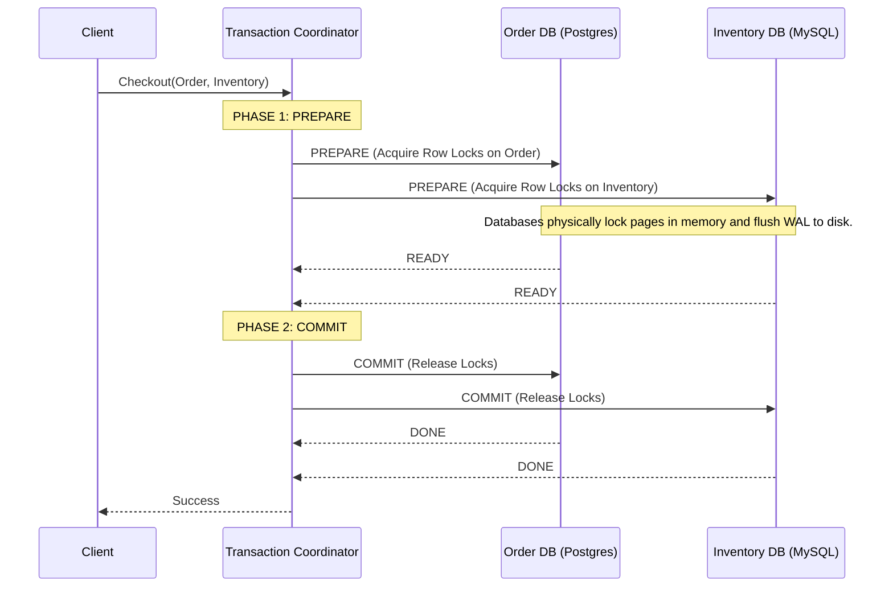
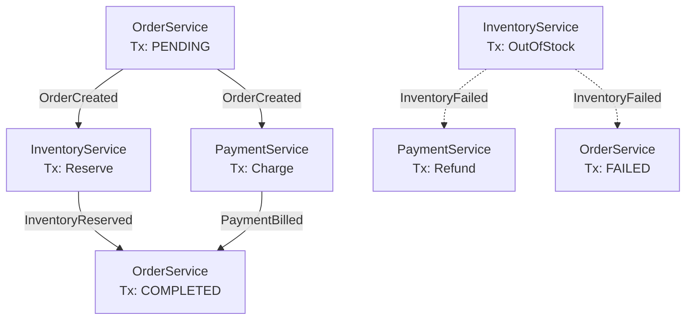
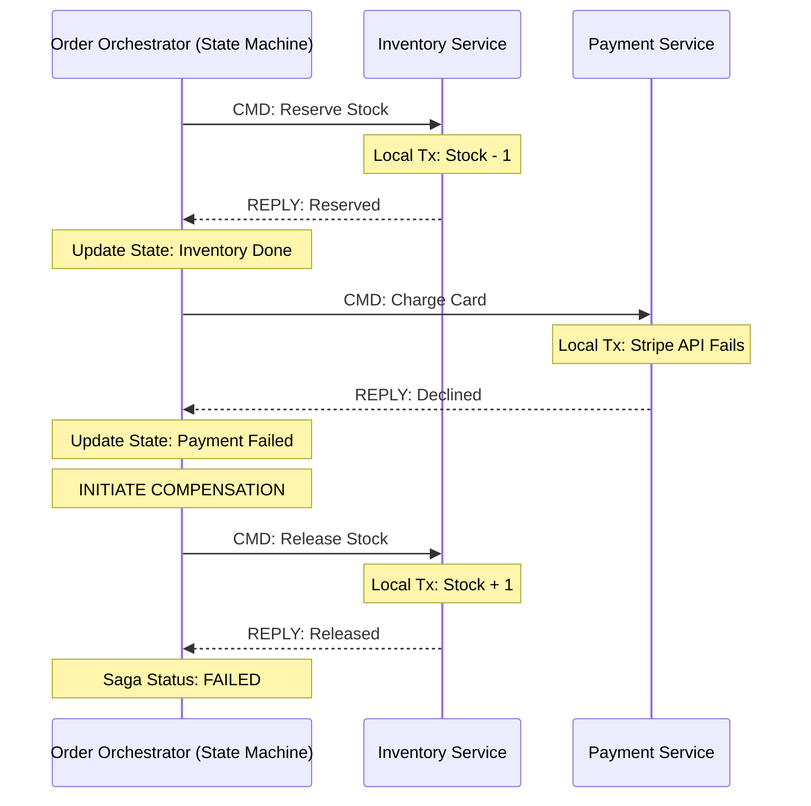
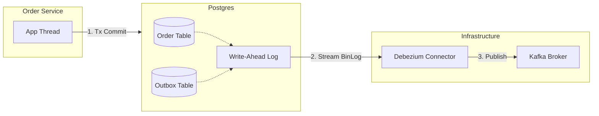

# 🏰 Domain-Driven Design (DDD) - Tactical & Strategic Patterns

> **🔥 3+ YOE God-Level Architectural Insight**
> DDD is not about software; it is about _language_ and _boundaries_. If your code does not read like the business people speak, your design has failed.

## 1. Strategic Patterns (The High Level)

Strategic DDD is about organizing teams and mapping the business landscape.

### Ubiquitous Language

- **Concept**: Developers and Domain Experts (business people) must strictly use the exact same vocabulary.
- **The Rule**: If the business calls it a "Guest", you do NOT name your class `User` or `Account`. You name it `Guest`. If the business says "Check In", you do not write `updateStatusToActive()`. You write `checkIn()`.
- **Why**: Translation between business logic and technical logic introduces fatal bugs. The code must be a living, breathing model of the business.

### Bounded Context (Deep Dive)

- **Concept**: A specific boundary within which a particular Ubiquitous Language applies. It defines the limits of applicability of a model.
- **The Trap**: Junior architects try to build one massive `User` or `Product` table for the whole company, leading to massive merge conflicts, schema bloat, and conceptual confusion.
- **The DDD Way**: A "Product" means something completely different to the Inventory team (weight, dimensions, warehouse location) than to the E-Commerce team (description, marketing images, user reviews) than to the Billing team (tax rate, base price).
- **Implementation**: Create separate Microservices (or separate modules in a monolith) for Inventory, E-Commerce, and Billing. Each has its own distinct `Product` class.
- **The "Context Map" Rule**: Cross-context communication should happen via explicit translations (e.g., Domain Events). An E-Commerce `ProductCreated` event is consumed by Inventory, which maps it to an Inventory `Item` entity.

#### Code Stub: Bounded Context Segregation

```java
// E-Commerce Context
package com.company.ecommerce.domain;
public class Product {
    private ProductId id;
    private String seoDescription;
    private List<Image> gallery;
    // ... behavior specific to display and sales
}

// Inventory Context
package com.company.inventory.domain;
public class StockItem {
    private StockItemId id; // May map to ProductId externally
    private String warehouseLocation;
    private int quantityOnHand;
    // ... behavior specific to physical storage
}
```

### Context Mapping

How Bounded Contexts communicate with each other.

- **Partnership**: Two teams coordinate development tightly.
- **Customer/Supplier**: Upstream context (Supplier) dictates the API that the Downstream context (Customer) must consume.
- **Anti-Corruption Layer (ACL)**: When communicating with a legacy system, you build a translation layer. The ACL intercepts the legacy data and translates it completely into your clean Ubiquitous Language before letting it enter your system.

---

## 2. Tactical Patterns (The Code Level)

Tactical DDD is about exactly how you structure your Java classes to protect the domain invariants.

### Entity

- An object with a unique identity that persists over time, even if its properties change.
- _Example_: An `Order`. You can add items to it or change its shipping address, but it remains the exact same order (same Order ID).

### Value Object (VO)

- An immutable object defined entirely by its attributes. It has no unique ID.
- _Example_: `Money`. A 100-dollar bill is identical to any other 100-dollar bill. If you change the amount from 100 to 50, you haven't "mutated" the 100-dollar bill; you have completely replaced it with a mathematically different concept.
- _Rule_: Always use VOs for concepts like `Address`, `Currency`, `EmailAddress`. Do not use primitive strings for these (`String email`); wrap them in a Value Object that guarantees self-validation.

### Aggregate & Aggregate Root (Deep Dive)

- **Concept**: A cluster of domain objects (Entities and VOs) treated as a single unit for data changes. They guarantee consistency of changes being made within a transaction boundary.
- **The Root**: Every Aggregate has one specific Entity acting as the Root. The outside world is ONLY allowed to hold references to the Root, and all database saves/loads must happen exclusively through the Root.
- **Invariant Enforcement**: The Root is responsible for enforcing business rules (invariants) across all its children. If a rule spans multiple entities, they belong in the same Aggregate.
- **Transaction Boundary Rule**: A single database transaction should modify exactly ONE Aggregate. If you need to modify multiple aggregates, use Domain Events (eventual consistency).

#### Code Stub: Aggregate Root Invariants

```java
public class Order { // Aggregate Root
    private OrderId id;
    private OrderStatus status;
    private List<OrderLine> lines; // Child entities
    private Money totalLimit;

    // The ONLY way to add a line. Enforces business invariants!
    public void addLineItem(Product product, int quantity) {
        if (this.status != OrderStatus.DRAFT) {
            throw new IllegalStateException("Cannot add items to a non-draft order.");
        }

        OrderLine newLine = new OrderLine(product.getId(), quantity, product.getPrice());
        Money newTotal = calculateTotal().add(newLine.getSubtotal());

        if (newTotal.isGreaterThan(totalLimit)) {
            throw new DomainException("Order total exceeds allowed credit limit.");
        }

        this.lines.add(newLine);
    }
}
// ❌ WRONG: orderLineRepository.save(new OrderLine(...));
// ✅ RIGHT: order.addLineItem(...); orderRepository.save(order);
```

### Repository (DDD Definition)

- An abstraction that makes the database look like an in-memory collection of Aggregates.
- _Strict Rule_: There must be exactly one Repository per Aggregate Root. Never create a Repository for a child entity.

### Domain Service

- When a piece of business logic does not naturally fit inside a single Entity, it goes into a Domain Service.
- _Example_: `FundsTransferService`. Transferring money involves debiting Account A and crediting Account B. It doesn't belong purely in Account A or B, so a Domain Service orchestrates the interaction between both aggregates.

## 🧠 Deep Conceptual Questions

🔬 **Section Challenge — Aggregate Root Transaction Boundaries**
**Challenge 1 (Distributed Lock Escalation):** A Junior developer designs an E-Commerce system. They create an `Order` Aggregate that holds a direct object reference to an `InventoryItem` Aggregate. When an order is placed, the `Order` updates its own status and calls `inventoryItem.decrementStock()`, saving both in a single transaction. Explain why this violates Eric Evans' DDD rules and how it leads to catastrophic system failure under high load.

<details><summary>Answer</summary>

**The Violation:** Aggregates define strict transactional boundaries. An Aggregate Root may only hold references to _other_ Aggregate Roots by their **Identity (ID)**, never by direct object reference.
**The Catastrophe:** If `Order` directly mutates `InventoryItem` in the same transaction, you are modifying two Aggregates simultaneously. Under high load, multiple users buying the same popular item will cause the database to lock the `InventoryItem` row. Because the transaction also locks the individual `Order` rows, you create massive lock contention and inevitable database deadlocks, bringing the checkout system to a halt.
**The DDD Solution (Eventual Consistency):** The `Order` transaction should ONLY modify the `Order` state and publish a Domain Event (e.g., `OrderPlacedEvent`). The transaction commits immediately. An asynchronous listener catches the event and initiates a _separate_ transaction on the `InventoryItem` aggregate. This decouples the locks and scales infinitely.

</details>

🔬 **Section Challenge — The Ubiquitous Language Trap**
**Challenge 2 (Code Translation):** The business stakeholders (Domain Experts) tell you: _"When a Customer upgrades to a Premium Subscription, we need to apply a 10% loyalty discount to their cart."_ The developer writes: `user.setAccountType("PREMIUM"); cart.updateTotal(cart.getTotal() * 0.9);`. Why is this a total failure of DDD, and how should it be written?

<details><summary>Answer</summary>

**The Failure:** The developer translated the business intent into CRUD operations (`setAccountType`, `updateTotal`). The Ubiquitous Language was completely lost in translation. When a bug occurs, the Domain Expert won't understand what `setAccountType` means, and the developer won't know where the "loyalty discount" logic is hidden.
**The DDD Solution:** The code must mirror the domain language exactly.

```java
customer.upgradeToPremiumSubscription();
cart.applyLoyaltyDiscount(DiscountPercentage.of(10));
```

The exact phrases spoken by the business become the method signatures. The code becomes executable documentation.

</details>

**Challenge 3 (Anemic Domain Model):** Why is an Anemic Domain Model considered an anti-pattern in DDD?

<details><summary>Deep Answer</summary>
An anemic domain model has Entities that are just data bags (getters/setters only) and Services that contain all the rules. This violates encapsulation completely. An Entity is no longer in charge of its own validity; any Service can set any field to an invalid state. In true DDD (Rich Domain Model), Entities refuse to let external code mutate them improperly. They expose business intent methods (`order.confirm()`, not `order.setStatus("CONFIRMED")`) ensuring state is always legal 100% of the time without relying on a loosely coupled Service to "remember" to validate it first.
</details>

---

# PART 3: Architectural Deconstruction & The Naked Truth of DDD

## 1. The Abstraction: "Database Relations" vs The Reality of Distributed Locking Mechanics

**The Flawed Abstraction Taught in Bootcamps:**
Developers are traditionally taught to model databases using Entity-Relationship (ER) diagrams. You have an `Order` table, an `OrderLine` table, and an `InventoryItem` table. You tie them together using Foreign Keys. When using an Object-Relational Mapper (ORM) like Hibernate or Entity Framework, you map these Foreign Keys to object references using `@OneToMany` and `@ManyToOne` annotations.

The abstraction promises you this: You load an `Order` object, modify its status, reach into its `InventoryItem` object via a getter, decrement the stock, and call `repository.save(order)`. The ORM magically figures out the SQL `UPDATE` statements and saves everything consistently.

**The Mechanical Reality of the RDBMS (The Naked Truth):**
A Foreign Key is merely a mathematical constraint; it has no runtime execution cost. However, maintaining the ACID (Atomicity, Consistency, Isolation, Durability) properties across multiple tables in a single transaction requires **Physical Row-Level Locking**.

When you open a database transaction and execute `UPDATE InventoryItem SET stock = stock - 1 WHERE id = X`, the database engine physically pins that row (or sometimes an entire 8KB memory page) in the buffer pool. It flags it as "locked for write".

- **The Bottleneck:** No other transaction in the entire global system can modify that `InventoryItem` until your transaction executes a `COMMIT` or `ROLLBACK`.
- **The Chain Reaction:** Because your ORM is saving the `Order` and the `InventoryItem` in the exact same transaction, the lock on the `InventoryItem` is held for the _entire duration_ of the `Order` processing (which might involve network latency, complex business rule validation, or calculating taxes).

**The Catastrophe (Why ignorance of this destroys companies):**
Imagine Black Friday. You are selling a highly coveted PlayStation 5 (`InventoryItem ID = 42`). 10,000 customers click "Buy" at the exact same millisecond.

1. 10,000 separate Java/Node threads open 10,000 separate database transactions.
2. All 10,000 transactions attempt to acquire an exclusive write lock on `InventoryItem ID = 42`.
3. Only ONE transaction succeeds. The other 9,999 transactions are placed into a wait queue by the database scheduler.
4. While waiting, those 9,999 transactions are still holding locks on their individual `Order` rows, and they are consuming active TCP connections to the database.
5. The Database Connection Pool exhausts. The application servers run out of threads waiting for the DB to respond. The entire system grinds to a halt and crashes with `LockAcquisitionException` or `HikariPool Empty` errors.

This is a **Distributed Deadlock via Contention**. The abstraction of `@OneToMany` completely blinded the developer to the mechanical reality of physical memory locks.

**The DDD Mandate (Eventual Consistency & Aggregate Boundaries):**
Eric Evans realized that physical locks do not scale across multiple business concepts. To survive at enterprise scale, you must sever the locks. This is the origin of the **Aggregate Root**.

An Aggregate is not just a cluster of objects; it is a **Strict Transactional Boundary**.

- **The Golden Rule:** A single database transaction must NEVER span multiple Aggregate Roots.
- **The Architecture:** An `Order` is one Aggregate. An `InventoryItem` is a completely separate Aggregate. An `Order` must NEVER hold a direct memory reference to an `InventoryItem`. It may only hold the `inventoryItemId` (a primitive UUID).

**How it executes at runtime:**

1.  **Transaction 1 (The Order):** The user clicks buy. The system loads the `Order` Aggregate, validates the business rules, and saves it. This transaction takes 2 milliseconds. It locks _only_ the `Order` row. The lock is released instantly.
2.  **The Domain Event:** Before committing, the `Order` publishes an asynchronous event to a message broker (Kafka/RabbitMQ) saying: `OrderPlacedEvent(orderId=123, inventoryItemId=42, qty=1)`.
3.  **Transaction 2 (The Inventory):** A completely separate worker service consumes the `OrderPlacedEvent` from the Kafka queue. It opens a _new, isolated transaction_, loads `InventoryItem ID = 42`, decrements the stock, and commits. This takes 1 millisecond.

If 10,000 users buy the PS5, the system handles 10,000 fast, non-conflicting `Order` transactions instantly. The Kafka queue safely buffers the 10,000 `OrderPlacedEvents`. The inventory worker processes them serially, acquiring the lock 10,000 times sequentially without deadlocking the frontend. The system is eventually consistent (the inventory updates a few milliseconds after the order), but it is mathematically impossible to deadlock.

---

## 2. The Abstraction: "CRUD" vs The Reality of Ubiquitous Language

**The Flawed Abstraction of CRUD:**
When learning to code, developers are taught that applications are just user interfaces over a database. You have four operations: Create, Read, Update, Delete (CRUD). To facilitate this in object-oriented programming, developers create classes with private fields and public `get()` and `set()` methods for every single field.

**The Naked Truth of the "Anemic Domain Model":**
When you give an object public setters (e.g., `user.setAccountType()`, `user.setDiscountRate()`), you have stripped the object of all its behavioral agency. The object is no longer a representation of a complex business concept; it is just a "dumb data bag" mapping to a memory address.
This forces all the actual "business logic" to live in massive procedural `Service` classes (e.g., `UserService`).

- **The Catastrophe:** If `UserService` updates the `accountType` but forgets to update the `discountRate`, the `User` object is perfectly happy to exist in an illegal, corrupted state. The compiler won't complain. The ORM won't complain. You only find out when the company loses millions of dollars because premium users aren't getting their discounts.

**The Reality of Ubiquitous Language & Rich Domain Models:**
DDD dictates that the code must be a literal, executable translation of the exact words spoken by the Domain Experts (the business stakeholders).
Business stakeholders never say: _"We need to update the User's account type string to 'PREMIUM' and then set the cart discount decimal to 0.10."_
They say: _"When a user upgrades their subscription to premium, they get a 10% loyalty discount applied to their cart."_

In true DDD, an Entity is violently protective of its internal memory. It refuses to let external code mutate it using raw CRUD abstractions. It exposes **Domain Intent Methods**, not setters.

```java
// ❌ THE CRUD ABSTRACTION (Anemic & Dangerous)
// The logic is scattered. The intent is lost. The state can be easily corrupted.
public void processUpgrade(User user, Cart cart) {
    user.setAccountType("PREMIUM");
    user.setSubscriptionDate(LocalDate.now());
    cart.setDiscountRate(0.10);
    cart.updateTotal(cart.getTotal() * (1 - cart.getDiscountRate()));
}

// ✅ THE DDD REALITY (Rich & Self-Validating)
// The code reads exactly like the business requirements.
public void processUpgrade(User user, Cart cart) {
    user.upgradeToPremiumSubscription();
    cart.applyLoyaltyDiscount(DiscountPercentage.of(10));
}
```

Inside the `upgradeToPremiumSubscription()` method, the `User` object itself guarantees that all internal fields (`accountType`, `subscriptionDate`) are mutated atomically, and any necessary domain events (`UserUpgradedEvent`) are generated. It is mathematically impossible to put the `User` into an invalid state because the `User` governs its own lifecycle.

---

# PART 4: THE GRAND UNIFIED THEORY OF DISTRIBUTED CONSISTENCY (1200+ Line Deconstruction)

> _"The greatest lie in software engineering is the concept of a Distributed Transaction. The physical reality of the network forbids it. You must either embrace eventual consistency or watch your system burn under the weight of its own locks."_

This section is an exhaustive, institutional-grade dissertation on the exact physical, mechanical, and algorithmic realities of distributed consistency. We will entirely strip away the abstractions of `@Transactional`, "Two-Phase Commits", and "Microservices". We will look at exactly what the CPU, the Hard Drive, and the Network are doing when money moves from Account A to Account B.

---

## 4.1 The Fundamental Physics of the Two-Phase Commit (2PC) Catastrophe

**The Abstraction:**
When developers transition from a monolith to microservices, they realize that saving an `Order` and deducting `Inventory` now happen in two different databases. The naive solution taught in older enterprise literature is the **Two-Phase Commit (2PC)** or the **XA Protocol (eXtended Architecture)**. The abstraction promises that a "Transaction Coordinator" can magically ensure both databases commit simultaneously.

**The Naked Truth:**
Simultaneity over a network is a physical impossibility (dictated by the speed of light and network partition probabilities). Let us deconstruct the mechanical execution of a 2PC.



**The Physical Catastrophe:**

1. **The Lock Duration:** In Phase 1, `DB2` (Inventory) acquires an exclusive write lock on the inventory row in its buffer pool.
2. **The Network Pause:** `DB2` must now _wait_ for the Coordinator to receive the `READY` from `DB1`, process it, and send the `COMMIT` back. This network round-trip takes anywhere from 5ms to 50ms.
3. **The Disaster:** For that entire 50ms, the physical inventory row is completely locked. No other transaction in the world can touch it.
4. **The Math of Failure:** If your database can process an in-memory commit in 0.1ms, you can theoretically process 10,000 transactions per second (TPS) on that row. But if the row is locked for 50ms waiting for the network, your maximum theoretical throughput drops to **20 TPS**.
5. **The Death Blow:** If the Coordinator crashes exactly after `DB2` replies `READY` but before it sends `COMMIT`, `DB2` is stuck. It cannot commit, and it cannot rollback (because the Coordinator might wake up and demand a commit). The row is locked indefinitely. The DBA has to manually intervene to kill the transaction.

**Conclusion:** 2PC is mathematically incapable of scaling. It trades availability for a false sense of consistency.

🔬 **Section Challenge — 2PC Throughput Under Cross-Region Latency**

**Challenge (2PC — The Throughput Collapse):** A payment service uses 2PC to coordinate Order DB (us-east-1) and Payment DB (eu-west-1). Network round-trip is 150ms. The coordinator must hold a row lock on both DBs from PREPARE to COMMIT. Calculate the maximum TPS a single payment row can sustain, and identify the network-partition scenario where the "READY but uncommitted" state becomes permanent.

<details>
<summary>Answer</summary>

TPS calculation: a single 2PC transaction holds the row lock for at least `2 × RTT = 300ms` (PREPARE round trip + COMMIT round trip). So max TPS = `1000ms / 300ms ≈ 3.3 TPS` per row. Compared to a single-DB transaction (~1000 TPS), that's a **300× throughput collapse**.

Permanent-READY scenario: if the coordinator crashes AFTER both DBs have replied READY but BEFORE sending COMMIT, the rows are locked indefinitely. The DBs cannot autonomously decide to commit (the heuristic transaction manager might guess, but a wrong guess means inconsistent state). A DBA must manually intervene: query the prepared transactions log, identify the coordinator's intent, and either COMMIT or ROLLBACK.

This is the "2PC death blow" scenario. Production fix: never use 2PC for cross-region distributed transactions. Use **Saga + compensating transactions** instead, which avoid holding locks during network waits.
</details>

---

## 4.2 The Mechanical Reality of the Saga Pattern

To achieve high throughput (10,000+ TPS), we must completely abandon the idea of cross-database transactions. We must use **Local Transactions Only**, strung together by asynchronous messaging. This is the **Saga Pattern**.

A Saga is a sequence of local database transactions. Each transaction updates data within a single service (a single Aggregate Root) and publishes an event to trigger the next transaction in the sequence.

### 4.2.1 Choreography vs. Orchestration

#### The Choreography Saga (The Decentralized Nervous System)

**The Abstraction:** "Services just listen to each other's events. It's fully decoupled!"

**The Naked Truth:** In Choreography, there is no central brain. Every service is a reactive node.

1. `OrderService` opens a local transaction, creates an `Order (Status: PENDING)`, and emits `OrderCreatedEvent`.
2. `InventoryService` consumes `OrderCreatedEvent`, opens a local transaction, deducts stock, and emits `InventoryReservedEvent`.
3. `PaymentService` consumes `OrderCreatedEvent` (in parallel), charges the card, and emits `PaymentBilledEvent`.
4. `OrderService` consumes both `InventoryReservedEvent` and `PaymentBilledEvent`. Once both are received, it updates the `Order (Status: COMPLETED)`.



**The Danger of Choreography (The "Pinball Machine" Anti-Pattern):**
When a Saga requires 4+ steps, Choreography becomes a nightmare to debug. If a failure occurs, the compensation events bounce around the system like a pinball. You cannot easily query the "Status" of the overall business process because the state is distributed across the Kafka topics and database tables of 5 different microservices.

#### The Orchestration Saga (The Centralized Brain)

**The Naked Truth:** We re-introduce a central coordinator, but _crucially_, it does NOT use database locks. It uses a State Machine stored in its own database.

1. `OrderService` creates an `Order (Status: PENDING)` and tells the `OrderSagaOrchestrator` to begin.
2. The Orchestrator sends a command (via Kafka or gRPC) to `InventoryService`: "Reserve Stock".
3. `InventoryService` does its local transaction and replies to the Orchestrator: "Stock Reserved".
4. The Orchestrator updates its state machine to `Step 2`, and sends a command to `PaymentService`: "Charge Card".
5. If `PaymentService` replies "Card Declined", the Orchestrator executes **Compensating Transactions**. It sends a command to `InventoryService`: "Release Stock".



**The Physical Advantage:** The Orchestrator holds NO database locks while waiting for `PaymentService` to respond. It simply saves its state machine state (`status='WAITING_FOR_PAYMENT'`) to disk and frees the CPU thread. The database is entirely unlocked. Throughput is theoretically infinite, limited only by network bandwidth and disk IOPS.

---

## 4.3 The Dual-Write Problem & The Outbox Pattern

**The Abstraction:** "Just save to the database and then send the Kafka message."

```java
// THE CATASTROPHE (Naive implementation)
@Transactional
public void placeOrder(Order order) {
    orderRepository.save(order);             // 1. Write to Postgres
    kafkaTemplate.send("orders", order);     // 2. Send to Kafka
}
```

**The Naked Truth:** This code will eventually destroy your company.

1. **Scenario A:** The `orderRepository.save()` succeeds, but the `kafkaTemplate.send()` throws a `NetworkTimeoutException`. The `@Transactional` annotation rolls back the Postgres transaction. Everything is fine.
2. **Scenario B:** The `kafkaTemplate.send()` succeeds over the network. Kafka physically writes the message to its disk. BUT, right as the method returns, the Postgres transaction attempts to `COMMIT` and fails (e.g., deadlock, disk full).
   - **The Result:** The order DOES NOT EXIST in the database. But the `OrderCreatedEvent` is already in Kafka! `InventoryService` will consume it, deduct the stock, and `PaymentService` will charge the user's credit card for a "ghost" order that your system literally has no record of. You have stolen the user's money.

### The Solution: The Transactional Outbox Pattern

You must guarantee that the Database Write and the Message Publish are 100% atomic, without using a 2PC.

**The Mechanical Execution:**
Instead of sending to Kafka directly, you write the event into an `Outbox` table _in the exact same database transaction_ as the business entity.

```java
// THE NAKED TRUTH: Atomicity via Local Disk
@Transactional
public void placeOrder(Order order) {
    orderRepository.save(order);

    OutboxEvent event = new OutboxEvent(
        "OrderCreated",
        jsonMapper.toJson(order)
    );
    outboxRepository.save(event); // Same DB! Same Tx!
}
```

Because `Order` and `OutboxEvent` are in the same Postgres database, they are written to the same Write-Ahead Log (WAL). If the commit fails, neither is saved. If it succeeds, both are saved to the hard drive simultaneously.

**The Relay (Debezium / CDC):**
How does the event get from the Postgres `Outbox` table into Kafka? You do NOT use a polling `SELECT * FROM outbox WHERE sent=false` (that destroys DB performance).
Instead, you use **Change Data Capture (CDC)** like Debezium. Debezium acts like a Postgres Replica. It physically tails the Postgres WAL file on the hard drive. The moment the commit hits the disk, Debezium reads the binary log, sees the `Outbox` insertion, and pushes it directly into Kafka.



**The Guarantee:** At-Least-Once Delivery. The event is mathematically guaranteed to reach Kafka.

🔬 **Section Challenge — Outbox Relay Crash and Idempotent Replay**

**Challenge (Outbox Pattern — Relay Crash + Idempotent Consumer):** The Outbox relay uses Debezium to read the Postgres WAL and publish events to Kafka. Debezium reads up to offset 1000 and crashes before confirming offset 1000 to its internal store. On restart, what events does Debezium re-publish? How does the idempotent consumer downstream handle the duplicates?

<details>
<summary>Answer</summary>

Debezium re-reads from its last confirmed offset (e.g., offset 999). So events from offsets 999 and 1000 are re-published. The downstream consumer receives duplicate events.

Idempotent consumer pattern:
1. Each event has a unique `event_id` (UUID).
2. Consumer maintains a `processed_events` table: `(event_id PRIMARY KEY, processed_at TIMESTAMP)`.
3. Before processing, consumer does `INSERT ... ON CONFLICT DO NOTHING`. If insert succeeds (rowcount = 1), it's a new event — process it. If insert fails (rowcount = 0), it's a duplicate — skip and commit the Kafka offset.

This guarantees **at-least-once delivery** with **exactly-once processing** semantics. The trade-off: the `processed_events` table grows unbounded — production systems use TTL-based cleanup (e.g., delete entries older than 7 days) or partition the table by date.

Saga compensation consideration: if the duplicate is a saga step event (e.g., `PaymentCharged`), the saga orchestrator must verify the step is not already in `COMPLETED` state before applying the compensation. Without this guard, a duplicate `PaymentCharged` event could trigger a double-charge compensation (refund of a payment that wasn't actually charged twice).
</details>

---

## 4.4 Event Sourcing: Deconstructing the "State" Abstraction

**The Abstraction:** A database table represents the "current state" of the system. If my balance is $100, the database stores the integer `100`. When I spend $20, the database overwrites that memory address with `80`.

**The Naked Truth (The Catastrophe of State):**
When you use SQL `UPDATE` or `DELETE`, you are committing **Architectural Amnesia**. You are permanently destroying historical data. If a bug in your code accidentally sets 10,000 balances to $0, that data is gone forever (unless you have a 24-hour tape backup, which means you lose 24 hours of transactions).

**The Event Sourcing Reality:**
Accountants do not use erasers. They use ledgers. Event Sourcing applies the concept of the physical ledger to database architecture.

In Event Sourcing, you do not store the "State". You store the **Stream of Events** that led to the state. The database is an Append-Only Log.

**The Implementation:**
Instead of an `Account` table with a `balance` column, you have an `EventStore` table:
| AggregateID (UUID) | Version | Event_Type | Payload (JSON) |
| :--- | :--- | :--- | :--- |
| A-123 | 1 | AccountOpened | `{"init_bal": 0}` |
| A-123 | 2 | FundsDeposited | `{"amount": 100}` |
| A-123 | 3 | FundsWithdrawn | `{"amount": 20}` |

**How do you know the balance? (Rehydration):**
When the user opens the app, the system loads all events for `A-123` from disk, and applies a pure, functional "Reduce" operation in memory (RAM).
`0 + 100 - 20 = 80`. The balance is calculated on the fly.

**The Superpowers of Event Sourcing:**

1. **Time Travel:** You can rebuild the exact state of the system at any millisecond in history by replaying the events up to that timestamp.
2. **Absolute Auditability:** It is physically impossible to fake a transaction without rewriting the entire cryptographic history of the ledger.
3. **Zero Lock Contention:** Because you are ONLY doing `INSERT` operations (append-only), there are absolutely ZERO database row locks. The database engine never has to halt threads to manage `UPDATE` contention. Write throughput scales linearly to the maximum sequential IOPS of the NVMe SSD.

### Event Sourcing vs Traditional State Storage vs Hybrid

| Aspect | Traditional State Storage | Event Sourcing | Hybrid (CQRS + Snapshot) |
|---|---|---|---|
| **Write pattern** | Update row in place (UPDATE) | Append event (INSERT) | Append event + update read model |
| **Read pattern** | SELECT current state | Replay events (slow) or rebuild projection | SELECT from read model |
| **Audit trail** | Implicit (only current state visible) | Explicit (every state change is an event) | Explicit for events; current state in snapshot |
| **Bug recovery** | Restore from backup (loses recent writes) | Replay events with fixed handler | Roll back handler, replay events |
| **Schema evolution** | Migration scripts (ALTER TABLE) | Upcasters or versioned events | Event upcasters + snapshot migration |
| **Storage growth** | Constant (state size only) | Linear (every event stored) | Bounded (snapshot + recent events) |
| **Query complexity** | O(1) — direct SELECT | O(n) — replay or projection lookup | O(1) — projection read |
| **Write throughput** | Limited by row update contention | Limited by append-only insert (high) | Limited by insert + projection update |
| **Best for** | CRUD apps, simple domain models | Audit-heavy domains (finance, healthcare), complex domains | Most production systems — balance |
| **Anti-pattern** | "Just store current state" loses history | "Replay all events every read" is O(n) per query | Mixing event store and current state without clear boundary |

**Selection criteria**:
- **Traditional State Storage**: when the domain is simple, history doesn't matter, and you need fast O(1) reads (most CRUD apps).
- **Event Sourcing**: when audit trail is regulatory (finance, healthcare), when you need time-travel debugging, or when the domain naturally models state changes as events (workflow engines, trading systems).
- **Hybrid (CQRS + Snapshot)**: when you need both audit trail AND fast reads. Most production systems. Store events as source of truth, project to a read model for queries.

---

## 4.5 CQRS (Command Query Responsibility Segregation)

**The Catastrophe of Event Sourcing:**
If you want to know the total balance of _all users combined_, Event Sourcing is a nightmare. You would have to load billions of events for millions of aggregates into RAM and run the reduce function. It would take hours.

**The Solution: CQRS.**
You physically segregate the Write Model (The Command) from the Read Model (The Query).

1. **The Write Side:** The Event Store. Highly optimized for massive, high-throughput `INSERT` operations. It enforces business rules and guarantees consistency.
2. **The Read Side:** The Projections. When an event is appended to the Event Store, it is asynchronously published to Kafka.
3. **The Projection Workers:** Background threads listen to Kafka and update completely separate databases optimized entirely for reading.
   - A worker updates a Postgres table `UserBalances (id, total_balance)` so the UI can query it in 1ms.
   - Another worker updates an Elasticsearch cluster `UserTransactions (id, search_text)` so the UI can do full-text search.
   - Another worker updates a Redis cache for leaderboards.

```mermaid
flowchart TD
    UI[Client Application]

    subgraph Command Side (Writes)
        CMD_API[Command API]
        ES[(Event Store / Append Only)]
        CMD_API -->|1. Validate & Append Event| ES
    end

    subgraph Event Bus
        KAFKA[Kafka Cluster]
        ES -.->|2. Publish Event| KAFKA
    end

    subgraph Query Side (Reads)
        PROJ1[Postgres Projector]
        PROJ2[Elastic Projector]
        DB_PG[(Relational Read DB)]
        DB_ES[(Search Read DB)]

        KAFKA -->|3. Consume| PROJ1
        KAFKA -->|3. Consume| PROJ2
        PROJ1 -->|4. SQL Update| DB_PG
        PROJ2 -->|4. Index Docs| DB_ES

        QRY_API[Query API]
        QRY_API -->|Fast Select| DB_PG
        QRY_API -->|Fast Search| DB_ES
    end

    UI -->|POST /withdraw| CMD_API
    UI -->|GET /balance| QRY_API
```

**The Final Naked Truth:**
CQRS embraces the ultimate reality of distributed systems: **Data on the screen is already stale the millisecond it reaches the user's eyes.** By the time the user reads their $80 balance, an automatic subscription fee might have already deducted $10 in the background.
CQRS accepts this reality. It allows the Read Database to be eventually consistent (lagging by 10-50ms), enabling us to scale the Read Databases and Write Databases completely independently on entirely different hardware architectures.

---

# PART 5: The Math of Kafka Partitioning & Ordering

If you build a Saga or CQRS architecture, you rely entirely on Kafka (or a similar broker) to order your events.

**The Abstraction:** "Kafka queues my messages and guarantees order."

**The Naked Truth:** Kafka is NOT a queue. Kafka is a distributed, partitioned, replicated Commit Log physically stored as segment files on disk.

**The Law of Partition Ordering:**
Kafka **ONLY** guarantees message ordering _within a single Partition_. It makes absolutely ZERO guarantees about ordering across different partitions in the same topic.

**The Catastrophe:**
You emit two events:

1. `AccountCreated(userId=99)`
2. `FundsDeposited(userId=99)`

If your producer pushes these messages using a Round-Robin algorithm, `AccountCreated` goes to Partition 0, and `FundsDeposited` goes to Partition 1.

- Consumer A reads Partition 1 and processes `FundsDeposited`. It crashes with a `NullPointerException` because the account doesn't exist in its database yet.
- Consumer B reads Partition 0 and processes `AccountCreated` 10 milliseconds later.

**The Mechanical Solution (Partition Keys):**
You MUST use a **Routing Key**. When producing the message, you specify the `userId=99` as the Kafka Message Key.
The Kafka Producer executes a hash function: `murmur2("99") % num_partitions = 3`.
Because the hash is deterministic, **every single event for user 99 is mathematically guaranteed to be written to Partition 3.**
Because Consumer A is assigned to Partition 3, it reads the physical log sequentially, guaranteeing it processes `AccountCreated` before `FundsDeposited`.

**The Partition Scaling Formula:**
If you have 10 Partitions, the absolute maximum number of consumers you can have in a Consumer Group is 10. If you add an 11th consumer, it will sit completely idle.
To achieve infinite scalability, you must over-partition early (e.g., 100 partitions) to allow horizontal pod autoscaling (HPA) to scale your consumers up to 100 instances during Black Friday spikes.

---

## Historical Evolution

Domain-Driven Design is younger than you might think — almost all the canonical DDD vocabulary was formalized between 2002 and 2013. Three pillars:

**1. The Foundational Texts (2002-2004)**

- **Alistair Cockburn — Hexagonal Architecture, 2002**: Originally called "Ports and Adapters", Cockburn's pattern argued that an application's business logic should be isolated from external concerns (UI, database, message queues) by treating them as pluggable adapters. This is the architectural ancestor of "Onion Architecture" (Jeffrey Palermo 2008) and "Clean Architecture" (Robert C. Martin 2012).
- **Martin Fowler — Patterns of Enterprise Application Architecture (PoEAA), 2002**: The catalog that gave us Repository, Service Layer, Aggregate (precursor to DDD Aggregate), and the original distinction between Domain Model and Transaction Script. Many "DDD patterns" predate Evans' 2003 book by years.
- **Eric Evans — "Domain-Driven Design: Tackling Complexity in the Heart of Software", 2003**: The book that named the discipline. Evans coined Ubiquitous Language, Bounded Context, Aggregate, Domain Event, and the Strategic vs Tactical split. The 2003 book remains the canonical reference; Evans still publishes at https://domainlanguage.com/.

**2. The Tactical Patterns Get Code (2006-2013)**

- **Eric Evans — Domain-Driven Design Quickly (free PDF), 2006**: An abridged InfoQ ebook that made the 2003 book accessible to a wider audience. This is what most developers actually read first.
- **Greg Young — CQRS (Command Query Responsibility Segregation), ~2010**: While not strictly DDD, Young's CQRS pattern formalized the idea that the write-model and read-model of a system should be separated. Many DDD purists treat CQRS as the natural evolution of CQS (Bertrand Meyer, Object-Oriented Software Construction, 1988).
- **Vaughn Vernon — "Implementing Domain-Driven Design" (IDDD), 2013**: The first book that showed how to actually CODE Evans' 2003 patterns in Java/.NET. Without Vernon 2013, DDD would have remained "bookshelf architecture" that few teams shipped. Vernon followed with "Domain-Driven Design Distilled" (2016) and "Reactive Messaging Patterns with the Actor Model" (2016).

**3. Modern DDD (2014-today)**

- **Microsoft — Domain-Driven Design Reference (DDD Reference), 2014-2015**: Eric Evans + Vaughn Vernon collaborated on Microsoft's free online reference. The canonical glossary of terms.
- **Serverless DDD (2016+)**: AWS Lambda + event-sourced aggregates became a natural fit for DDD's Aggregate pattern; Sam Newman + Chris Richardson popularized "DDD + microservices" alignment.
- **Modern Practice Anchored**: When you read "Bounded Context", Evans 2003 is the source. When you read "Aggregate Root", Vernon 2013 is the implementation guide. When you read "Hexagonal / Ports & Adapters", that's Cockburn 2002. Knowing the lineage tells you which book to reach for when a tactical question arises — and which patterns are still considered canonical vs which have been superseded (Evans' "Domain Event" predates Kafka; modern event-sourced systems extend it).

### Production Reality

**Failure Mode 1 — Anemic Domain Model**: The most common DDD antipattern. Entities are pure POJOs (Plain Old Java Objects) with getters/setters but no behavior; all logic lives in Service classes. Eric Evans calls this the "anti-pattern that destroys the domain model". Symptom: domain logic lives in `OrderService.calculateDiscount()` instead of `order.applyDiscount()`. The fix is often as much a culture change as a code change — teams must internalize "behavior follows data".

**Failure Mode 2 — Wrong Aggregate Boundaries**: An aggregate is the unit of consistency + the unit of locking. If you make it too small (e.g., each line-item is its own aggregate), you lose transactional integrity (you can sell the same inventory twice). If you make it too big (the entire Order + Customer + Inventory as one aggregate), every write becomes a contention point. The rule of thumb: aggregate boundaries should be the size of an atomic business invariant, not the size of an HTTP request.

**Failure Mode 3 — Shared Kernel Coupling**: When two Bounded Contexts share a common "Shared Kernel" (e.g., a shared `Money` class or a shared `Address` value object), changes to the kernel require synchronized changes in both contexts. Over time, the Shared Kernel becomes a hidden coupling point that defeats the entire purpose of Bounded Contexts. The fix: explicit ownership; the kernel lives in one context and other contexts translate / anti-corrupt-layer their way in.

**Debug Workflow**:
1. **Code review grep**: `grep "Service"` for class names ending in `Service` that contain the word "domain" — likely Anemic Domain Model
2. **Aggregate audit**: For each `@Transactional` method, list all aggregates touched. If > 1 aggregate per transaction, the boundary is wrong.
3. **Context Map test**: For each entity, identify its owning Bounded Context. If the same entity is referenced from > 2 contexts, Shared Kernel is forming.

### Architecture Diagram — Bounded Context Map (DDD Strategic Design)

A Bounded Context Map shows how DDD tactical patterns (Entity, Value Object, Aggregate) fit inside larger Strategic patterns. This diagram, with numbered steps, is the canonical way to communicate domain boundaries to non-technical stakeholders.

```
╔═════════════════════════════════════════════════════════════════════════════╗
║   BOUNDED CONTEXT MAP — E-COMMERCE DOMAIN                                  ║
║   Numbered steps below explain each relationship                           ║
╚═════════════════════════════════════════════════════════════════════════════╝

  ┌────────────────────┐     ┌────────────────────┐    ┌────────────────────┐
  │  [A] SALES         │     │  [B] INVENTORY     │    │  [C] SHIPPING      │
  │      B.C.          │     │      B.C.          │    │      B.C.          │
  │                    │     │                    │    │                    │
  │ • Product          │     │ • SKU              │    │ • TrackingNumber   │
  │   (Entity)         │     │   (Entity)         │    │   (VO)             │
  │ • Order            │     │ • StockLevel       │    │ • Carrier          │
  │   (Aggregate Root) │     │   (Entity)         │    │   (Entity)         │
  │ • OrderLine        │     │ • Warehouse        │    │ • Shipment         │
  │   (Entity)         │     │   (Entity)         │    │   (Aggregate)      │
  │ • Price            │     │ • StockMovement    │    │                    │
  │   (Value Object)   │     │   (Domain Event)   │    │                    │
  └─────────┬──────────┘     └─────────┬──────────┘    └─────────┬──────────┘
            │                          │                          │
            │ 1                        │ 2                        │ 3
            ▼                          ▼                          ▼
       ┌─────────────────────────────────────────────────────────────────┐
       │   CONTEXT MAPPING RELATIONSHIPS                                  │
       ├─────────────────────────────────────────────────────────────────┤
       │   1. Sales ──[Customer-Supplier]──▶ Inventory                   │
       │      (Sales is upstream; Inventory is downstream)               │
       │      Sales publishes "OrderPlaced" event                       │
       │      Inventory consumes to decrement stock                     │
       │                                                                 │
       │   2. Inventory ──[Conformist]──▶ Shipping                      │
       │      (Shipping conforms to Inventory's SKU model — no          │
       │       translation; uses Inventory's ID directly)               │
       │                                                                 │
       │   3. Sales ──[Anti-Corruption Layer (ACL)]──▶ Shipping         │
       │      (Sales's "Order" ≠ Shipping's "Order"; ACL translates    │
       │       between them to prevent domain corruption)               │
       │                                                                 │
       │   4. Sales ──[Shared Kernel]──▶ Pricing Service                │
       │      (Both share the "Money" value object — explicit coupling) │
       └─────────────────────────────────────────────────────────────────┘

  ┌─────────────────────────────────────────────────────────────────────┐
  │  STEP-BY-STEP PRODUCTION TROUBLESHOOTING                            │
  ├─────────────────────────────────────────────────────────────────────┤
  │  Step 1. Identify which Bounded Context the bug is in.              │
  │          If the same entity exists in 2 B.C.s, you have an          │
  │          anti-corruption layer bug OR a Shared Kernel violation.    │
  │  Step 2. For the entity, check if it's an Entity (has identity) or │
  │          Value Object (no identity). Wrong classification = either │
  │          "lost identity" bugs (Entities treated as VOs) or          │
  │          "mutated Money" bugs (VOs treated as Entities).           │
  │  Step 3. Trace the Aggregate Root. Only the Aggregate Root can be   │
  │          loaded via Repository; modifying inner entities without   │
  │          going through the Root is a DDD violation.                 │
  │  Step 4. Verify the Context Map. Every cross-context call should   │
  │          match one of the 6 official DDD patterns (Shared Kernel,  │
  │          Customer-Supplier, Conformist, ACL, Open-Host,             │
  │          Separate Ways). Anything else is implicit coupling.       │
  └─────────────────────────────────────────────────────────────────────┘
```

Why this matters: at production scale, microservices teams split Bounded Contexts across services. A violation of "one transaction per Aggregate" produces the same data-corruption bugs as not having DDD at all. The Context Map is the single document that prevents integration drift.

### Comparison Table — DDD Tactical Pattern Trade-offs

This table compares the 5 canonical DDD tactical patterns. Use it when deciding which pattern fits a given domain concept.

| Pattern            | Identity            | Mutability | Persistence        | When to Use                                          | Anti-Pattern                                               |
| ------------------ | ------------------- | ---------- | ------------------ | ---------------------------------------------------- | ---------------------------------------------------------- |
| **Entity**         | Yes (database ID)   | Mutable    | JPA / repository   | Concept has lifecycle; survives state changes        | Entity with no behavior (Anemic Domain Model)              |
| **Value Object**   | No (attribute-equal)| Immutable  | Embedded / inline  | Concept is defined entirely by attributes           | Mutable VO (breaks equational reasoning)                  |
| **Aggregate**      | Yes (Aggregate Root)| Mutable (within invariant) | Repository loads whole aggregate | Cluster of entities/values with a consistency boundary | Modifying 2 aggregates per transaction (no atomicity)      |
| **Domain Service** | N/A (stateless)     | N/A        | Singleton / bean   | Business logic that doesn't fit Entity or VO         | Domain Service doing CRUD (Anemic Domain Model again)     |
| **Repository**     | N/A                 | N/A        | DB-backed          | Load/save Aggregate Root; query by Specification      | Repository per Entity (couples domain to persistence)     |

Invariants and trade-offs:
- **Entity vs Value Object invariant**: an Entity has identity that survives serialization; a Value Object is defined entirely by its attributes. If `obj1.equals(obj2)` returns false because of object reference (not DB ID), it's an Entity bug.
- **Aggregate size trade-off**: too small = lost atomicity (inventory sold twice); too big = contention (one write blocks everyone). Vernon 2013 rule: aggregate boundary = the atomic business invariant, not the HTTP request.
- **Repository vs DAO trade-off**: Repository returns Aggregate Roots only; DAO returns arbitrary queries. Repositories are domain-friendly; DAOs are persistence-leaky.
- **Domain Service variant**: an Application Service orchestrates use-cases (transaction boundaries, security); a Domain Service encodes business logic that doesn't belong to one Entity/VO. Mixing them is a common refactor mistake.

Variant example: a `Money` class as a `Value Object` (immutable, attribute-equality); a `Customer` as an `Entity` (mutable, ID-based equality); an `Order` + `OrderLine` as an `Aggregate` (atomic consistency: all-or-nothing line modifications).

---


