> **Navigation**: [< Previous](04_ERP_Finance_RealWorld.md) | [Back to Index](../00_MASTER_INDEX.md) | [Next >](04_RealWorld_Problems_Part2.md)

# 🌍 Real-World Problems Solved with DSA

## From Production Systems to Your Interview

---

# 🧩 Part 1: E — Commerce Problems

## Problem 1: Find Duplicate Orders (HashMap)


> COMPANY: Flipkart / Amazon
> SYSTEM: Order Management
> INCIDENT: Customer clicked "Place Order" twice due to slow network


THE REAL PROBLEM:
─────────────────
Customer's internet was slow. They clicked "Place Order" button twice.
Two orders were created for same items, same address, within 5 seconds.
Customer was charged twice. ₹15,000 x 2 = ₹30,000

BUSINESS IMPACT:
- Customer complaint
- Refund processing cost
- Trust damage

YOUR TASK:
Given a list of orders, find duplicates (same customer, same items, within 5 min)

```java
/**
 * PROBLEM: Find Duplicate Orders
 *
 * INPUT: List of orders with customerId, items, timestamp
 * OUTPUT: List of duplicate order pairs
 *
 * DUPLICATE DEFINITION:
 * - Same customer
 * - Same items (exact match)
 * - Within 5 minutes of each other
 */

public class DuplicateOrderDetector {

    public List<int[]> findDuplicateOrders(List<Order> orders) {
        List<int[]> duplicates = new ArrayList<>();

        // Key: customerId + sorted items hash
        // Value: List of order indices with that key
        Map<String, List<Integer>> orderMap = new HashMap<>();

        for (int i = 0; i < orders.size(); i++) {
            Order order = orders.get(i);
            String key = generateKey(order);

            if (orderMap.containsKey(key)) {
                // Check if any existing order is within 5 minutes
                for (int prevIndex : orderMap.get(key)) {
                    Order prevOrder = orders.get(prevIndex);

                    if (isWithinFiveMinutes(prevOrder.timestamp, order.timestamp)) {
                        duplicates.add(new int[]{prevIndex, i});
                    }
                }
            }

            orderMap.computeIfAbsent(key, k -> new ArrayList<>()).add(i);
        }

        return duplicates;
    }

    private String generateKey(Order order) {
        // Sort items to ensure same items in different order match
        List<String> sortedItems = new ArrayList<>(order.items);
        Collections.sort(sortedItems);
        return order.customerId + ":" + sortedItems.toString();
    }

    private boolean isWithinFiveMinutes(long time1, long time2) {
        return Math.abs(time1 - time2) <= 5 * 60 * 1000; // 5 min in ms
    }
}

// TIME COMPLEXITY: O(n) average case
// SPACE COMPLEXITY: O(n)

// TEST CASES:
// 1. No duplicates → empty list
// 2. Exact duplicate within 5 min → return pair
// 3. Same items different customer → not duplicate
// 4. Same customer, different items → not duplicate
// 5. Same customer, same items, 10 min apart → not duplicate
```

---

## Problem 2: Shopping Cart Price Calculator (Array + Conditions)

```
╔══════════════════════════════════════════════════════════════════════════════╗
║ COMPANY: Any E-commerce                                                      ║
║ SYSTEM: Cart & Checkout                                                      ║
║ FEATURE: Calculate final price with multiple discount rules                  ║
╚══════════════════════════════════════════════════════════════════════════════╝

BUSINESS RULES:
───────────────
1. If cart total > ₹5000 → 10% discount
2. If cart has 5+ items → extra 5% discount
3. Coupon code "SAVE200" → flat ₹200 off (if total > ₹1000)
4. First order → extra ₹100 off
5. Maximum total discount capped at 25%

YOUR TASK:
Write a function that calculates final price applying all applicable discounts
```

> **Flow**: 1. If cart total &gt; ₹5000 → 10% discount | 2. If cart has 5+ items → extra 5% discount | 3. Coupon code 'SAVE200' → flat ₹200 off (if total &gt; ₹1000) | 4. First order → extra ₹100 off

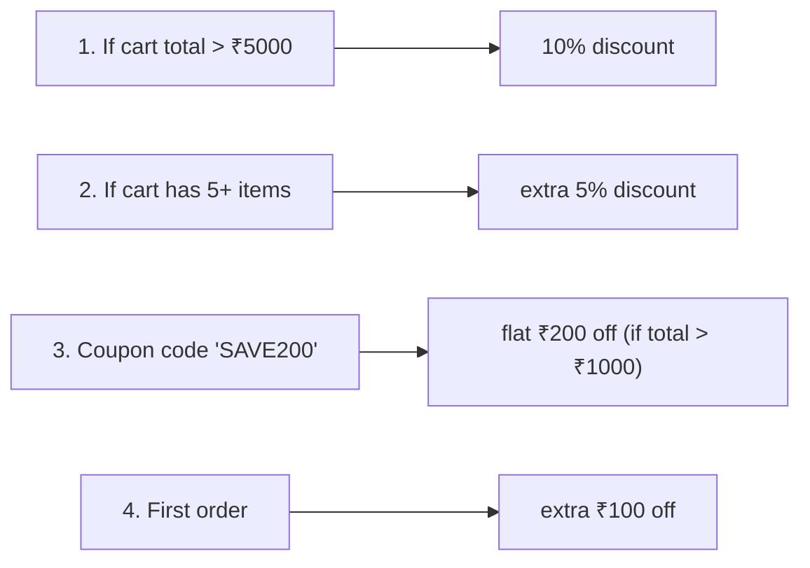

```java
/**
 * PROBLEM: Calculate Cart Total with Multiple Discounts
 *
 * INPUT:
 *   - List of items with prices
 *   - Coupon code (optional)
 *   - Is first order (boolean)
 *
 * OUTPUT: Final price after all discounts
 */

public class CartCalculator {

    private static final double MAX_DISCOUNT_PERCENT = 0.25; // 25% cap

    public CartResult calculateFinalPrice(
            List<CartItem> items,
            String couponCode,
            boolean isFirstOrder) {

        // Step 1: Calculate subtotal
        double subtotal = 0;
        for (CartItem item : items) {
            subtotal += item.price * item.quantity;
        }

        // Step 2: Calculate all applicable discounts
        double totalDiscount = 0;
        List<String> appliedDiscounts = new ArrayList<>();

        // Rule 1: Cart value discount
        if (subtotal > 5000) {
            double discount = subtotal * 0.10;
            totalDiscount += discount;
            appliedDiscounts.add("10% on orders above ₹5000: -₹" + discount);
        }

        // Rule 2: Item count discount
        int totalItems = items.stream().mapToInt(i -> i.quantity).sum();
        if (totalItems >= 5) {
            double discount = subtotal * 0.05;
            totalDiscount += discount;
            appliedDiscounts.add("5% for 5+ items: -₹" + discount);
        }

        // Rule 3: Coupon discount
        if ("SAVE200".equals(couponCode) && subtotal > 1000) {
            totalDiscount += 200;
            appliedDiscounts.add("Coupon SAVE200: -₹200");
        }

        // Rule 4: First order discount
        if (isFirstOrder) {
            totalDiscount += 100;
            appliedDiscounts.add("First order bonus: -₹100");
        }

        // Rule 5: Cap discount at 25%
        double maxDiscount = subtotal * MAX_DISCOUNT_PERCENT;
        if (totalDiscount > maxDiscount) {
            totalDiscount = maxDiscount;
            appliedDiscounts.add("(Discount capped at 25%)");
        }

        double finalPrice = subtotal - totalDiscount;

        return new CartResult(subtotal, totalDiscount, finalPrice, appliedDiscounts);
    }

    // Test
    public static void main(String[] args) {
        CartCalculator calc = new CartCalculator();

        List<CartItem> items = Arrays.asList(
            new CartItem("Laptop", 45000, 1),
            new CartItem("Mouse", 500, 2),
            new CartItem("Keyboard", 1500, 1),
            new CartItem("Monitor", 12000, 1),
            new CartItem("USB Hub", 800, 1)
        );

        CartResult result = calc.calculateFinalPrice(items, "SAVE200", true);

        System.out.println("Subtotal: ₹" + result.subtotal);
        System.out.println("Discounts applied:");
        for (String d : result.appliedDiscounts) {
            System.out.println("  " + d);
        }
        System.out.println("Final Price: ₹" + result.finalPrice);
    }
}
```

---

## Problem 3: Product Search Autocomplete (Trie)

```
╔══════════════════════════════════════════════════════════════════════════════╗
║ COMPANY: Amazon / Flipkart                                                   ║
║ SYSTEM: Search                                                               ║
║ FEATURE: Show suggestions as user types                                      ║
╚══════════════════════════════════════════════════════════════════════════════╝

THE REAL PROBLEM:
─────────────────
User types "sam" → Show: "samsung phone", "samsung tv", "samsonite bag"
Must be FAST (< 50ms) even with millions of products
Must show most popular suggestions first

YOUR TASK:
Build autocomplete that returns top 5 suggestions for a prefix
```

> **Flow**: User types 'sam' → Show: 'samsung phone', 'samsung tv', 'samsonite ba

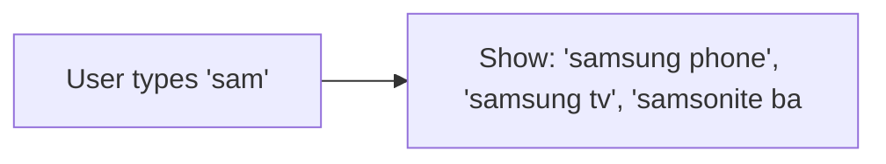

```java
/**
 * PROBLEM: Autocomplete with Popularity Ranking
 *
 * INPUT: User types prefix "sam"
 * OUTPUT: Top 5 products starting with "sam", sorted by popularity
 */

public class ProductAutocomplete {

    private TrieNode root = new TrieNode();

    class TrieNode {
        Map<Character, TrieNode> children = new HashMap<>();
        List<Product> products = new ArrayList<>(); // Top products at this prefix
    }

    // Add product to trie
    public void addProduct(Product product) {
        String name = product.name.toLowerCase();
        TrieNode node = root;

        for (char c : name.toCharArray()) {
            node.children.putIfAbsent(c, new TrieNode());
            node = node.children.get(c);

            // Keep top 5 products at each prefix
            updateTopProducts(node.products, product);
        }
    }

    private void updateTopProducts(List<Product> products, Product newProduct) {
        products.add(newProduct);
        // Sort by popularity (descending)
        products.sort((a, b) -> b.popularity - a.popularity);
        // Keep only top 5
        if (products.size() > 5) {
            products.remove(5);
        }
    }

    // Search for prefix
    public List<String> getSuggestions(String prefix) {
        TrieNode node = root;
        prefix = prefix.toLowerCase();

        // Navigate to prefix node
        for (char c : prefix.toCharArray()) {
            if (!node.children.containsKey(c)) {
                return Collections.emptyList(); // No suggestions
            }
            node = node.children.get(c);
        }

        // Return product names
        return node.products.stream()
            .map(p -> p.name)
            .collect(Collectors.toList());
    }

    // TEST
    public static void main(String[] args) {
        ProductAutocomplete auto = new ProductAutocomplete();

        auto.addProduct(new Product("Samsung Galaxy S21", 9500));
        auto.addProduct(new Product("Samsung TV 55 inch", 8200));
        auto.addProduct(new Product("Samsonite Luggage", 4300));
        auto.addProduct(new Product("Samsung Earbuds", 7100));
        auto.addProduct(new Product("Sample Product", 100));

        System.out.println(auto.getSuggestions("sam"));
        // Output: [Samsung Galaxy S21, Samsung TV 55 inch, Samsung Earbuds,
        //          Samsonite Luggage, Sample Product]
    }
}

// TIME COMPLEXITY:
//   - Add: O(L) where L = product name length
//   - Search: O(L)
// SPACE COMPLEXITY: O(N * L) where N = number of products
```

---

# 🧩 Part 2: Banking & Finance Problems

## Problem 4: Transaction Fraud Detection (Sliding Window)

```
╔══════════════════════════════════════════════════════════════════════════════╗
║ COMPANY: Any Bank / Payment Gateway                                          ║
║ SYSTEM: Fraud Detection                                                      ║
║ INCIDENT: Card stolen, thief made 10 transactions in 5 minutes               ║
╚══════════════════════════════════════════════════════════════════════════════╝

FRAUD RULES:
────────────
1. More than 3 transactions in 5 minutes → SUSPICIOUS
2. Total amount > ₹50,000 in 10 minutes → SUSPICIOUS
3. Transactions from 2+ cities in 30 minutes → SUSPICIOUS

YOUR TASK:
Given transaction stream, flag suspicious activity in real-time
```

> **Flow**: 1. More than 3 transactions in 5 minutes → SUSPICIOUS | 2. Total amount &gt; ₹50,000 in 10 minutes → SUSPICIOUS | 3. Transactions from 2+ cities in 30 minutes → SUSPICIOUS

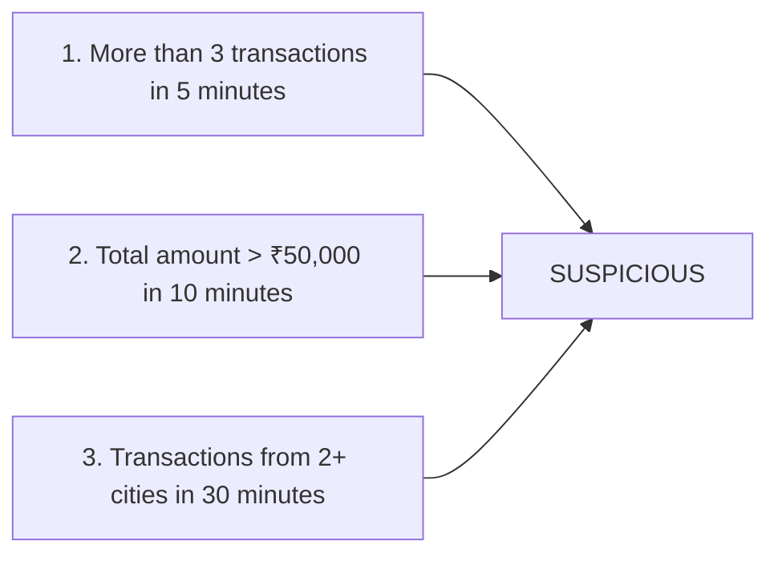

```java
/**
 * PROBLEM: Detect Fraudulent Transaction Patterns
 *
 * INPUT: Stream of transactions (cardId, amount, timestamp, city)
 * OUTPUT: Boolean - is this transaction suspicious?
 */

public class FraudDetector {

    // Store recent transactions per card
    private Map<String, Deque<Transaction>> recentTransactions = new HashMap<>();

    public FraudResult checkTransaction(Transaction txn) {
        String cardId = txn.cardId;

        // Get or create transaction history for this card
        recentTransactions.putIfAbsent(cardId, new LinkedList<>());
        Deque<Transaction> history = recentTransactions.get(cardId);

        // Remove transactions older than 30 minutes
        long thirtyMinAgo = txn.timestamp - 30 * 60 * 1000;
        while (!history.isEmpty() && history.peekFirst().timestamp < thirtyMinAgo) {
            history.pollFirst();
        }

        // Check Rule 1: More than 3 transactions in 5 minutes
        long fiveMinAgo = txn.timestamp - 5 * 60 * 1000;
        int countIn5Min = 0;
        for (Transaction t : history) {
            if (t.timestamp >= fiveMinAgo) countIn5Min++;
        }
        if (countIn5Min >= 3) {
            return new FraudResult(true, "More than 3 transactions in 5 minutes");
        }

        // Check Rule 2: Total > ₹50,000 in 10 minutes
        long tenMinAgo = txn.timestamp - 10 * 60 * 1000;
        double totalIn10Min = txn.amount;
        for (Transaction t : history) {
            if (t.timestamp >= tenMinAgo) totalIn10Min += t.amount;
        }
        if (totalIn10Min > 50000) {
            return new FraudResult(true, "Total > ₹50,000 in 10 minutes");
        }

        // Check Rule 3: Multiple cities in 30 minutes
        Set<String> cities = new HashSet<>();
        cities.add(txn.city);
        for (Transaction t : history) {
            cities.add(t.city);
        }
        if (cities.size() >= 2) {
            return new FraudResult(true, "Transactions from multiple cities");
        }

        // Add current transaction to history
        history.addLast(txn);

        return new FraudResult(false, "OK");
    }
}

// DATA STRUCTURE CHOICE:
// - Deque: Efficient add/remove from both ends
// - HashMap: O(1) lookup by card ID
// - Sliding window: Only keep relevant time period

// TIME COMPLEXITY: O(W) where W = max window size (30 min of transactions)
// SPACE COMPLEXITY: O(N * W) where N = number of cards
```

---

## Problem 5: Loan EMI Calculator (Math + Loops)

```
╔══════════════════════════════════════════════════════════════════════════════╗
║ COMPANY: HDFC / ICICI / Any Bank                                             ║
║ SYSTEM: Loan Management                                                      ║
║ FEATURE: Calculate EMI and generate amortization schedule                    ║
╚══════════════════════════════════════════════════════════════════════════════╝

REQUIREMENTS:
─────────────
1. Calculate monthly EMI
2. Generate month-by-month breakdown (principal, interest, balance)
3. Handle prepayment scenarios
```

> **Flow**: COMPANY: HDFC / ICICI / Any Bank → SYSTEM: Loan Management | SYSTEM: Loan Management → FEATURE: Calculate EMI and generate amortization schedu | FEATURE: Calculate EMI and generate amortization schedu → REQUIREMENTS: | REQUIREMENTS: → 1. Calculate monthly EMI | 1. Calculate monthly EMI → 3. Handle prepayment scenarios

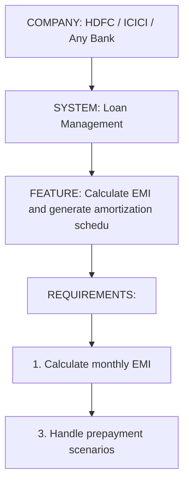

```java
/**
 * PROBLEM: EMI Calculator with Amortization Schedule
 *
 * INPUT: Principal, annual interest rate, tenure in months
 * OUTPUT: Monthly EMI, complete payment schedule
 *
 * FORMULA: EMI = P × r × (1 + r)^n / ((1 + r)^n - 1)
 * Where: P = Principal, r = monthly rate, n = months
 */

public class EMICalculator {

    public LoanSchedule calculateLoan(double principal, double annualRate, int months) {
        double monthlyRate = annualRate / 12 / 100;

        // Calculate EMI using formula
        double emi = principal * monthlyRate *
            Math.pow(1 + monthlyRate, months) /
            (Math.pow(1 + monthlyRate, months) - 1);

        emi = roundToTwo(emi);

        // Generate amortization schedule
        List<MonthlyPayment> schedule = new ArrayList<>();
        double balance = principal;
        double totalInterest = 0;

        for (int month = 1; month <= months; month++) {
            double interestComponent = roundToTwo(balance * monthlyRate);
            double principalComponent = roundToTwo(emi - interestComponent);

            // Last month adjustment for rounding
            if (month == months) {
                principalComponent = balance;
                emi = principalComponent + interestComponent;
            }

            balance = roundToTwo(balance - principalComponent);
            totalInterest += interestComponent;

            schedule.add(new MonthlyPayment(
                month, emi, principalComponent, interestComponent, balance
            ));
        }

        return new LoanSchedule(principal, emi, totalInterest, schedule);
    }

    private double roundToTwo(double value) {
        return Math.round(value * 100.0) / 100.0;
    }

    // TEST
    public static void main(String[] args) {
        EMICalculator calc = new EMICalculator();

        // ₹10 lakh loan, 8.5% interest, 20 years
        LoanSchedule loan = calc.calculateLoan(1000000, 8.5, 240);

        System.out.println("Principal: ₹" + loan.principal);
        System.out.println("Monthly EMI: ₹" + loan.emi);
        System.out.println("Total Interest: ₹" + roundToTwo(loan.totalInterest));
        System.out.println("Total Payment: ₹" + roundToTwo(loan.principal + loan.totalInterest));

        System.out.println("\nFirst 3 months:");
        for (int i = 0; i < 3; i++) {
            MonthlyPayment p = loan.schedule.get(i);
            System.out.printf("Month %d: EMI=₹%.2f, Principal=₹%.2f, Interest=₹%.2f, Balance=₹%.2f%n",
                p.month, p.emi, p.principal, p.interest, p.balance);
        }
    }
}

// OUTPUT:
// Principal: ₹1000000
// Monthly EMI: ₹8678.23
// Total Interest: ₹1082775.20
// Total Payment: ₹2082775.20
//
// First 3 months:
// Month 1: EMI=₹8678.23, Principal=₹1594.90, Interest=₹7083.33, Balance=₹998405.10
// Month 2: EMI=₹8678.23, Principal=₹1606.19, Interest=₹7072.04, Balance=₹996798.91
// Month 3: EMI=₹8678.23, Principal=₹1617.57, Interest=₹7060.66, Balance=₹995181.34
```

---

## Problem 6: Account Balance with Concurrent Transfers (Thread Safety)

```
╔══════════════════════════════════════════════════════════════════════════════╗
║ COMPANY: Any Bank                                                            ║
║ SYSTEM: Core Banking                                                         ║
║ BUG: Two transfers happening simultaneously caused wrong balance             ║
╚══════════════════════════════════════════════════════════════════════════════╝

THE BUG:
────────
Account has ₹10,000
Transfer 1: Send ₹6,000 to Account B
Transfer 2: Send ₹6,000 to Account C

Both read balance as ₹10,000 → Both think transfer is valid → ₹12,000 sent!
Account goes negative by ₹2,000

YOUR TASK:
Make transfer operation thread-safe
```

> **Flow**: Both read balance as ₹10,000 → Both think transfer is valid | Both think transfer is valid → ₹12,000 sent!

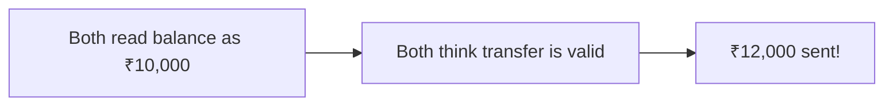

```java
/**
 * PROBLEM: Thread-Safe Money Transfer
 *
 * Challenge: Multiple threads accessing same account simultaneously
 * Solution: Proper locking with deadlock prevention
 */

public class BankAccount {
    private final String accountId;
    private double balance;
    private final Object lock = new Object();

    public BankAccount(String accountId, double balance) {
        this.accountId = accountId;
        this.balance = balance;
    }

    public String getAccountId() { return accountId; }

    // WRONG WAY (causes issues)
    public void transferUnsafe(BankAccount to, double amount) {
        if (this.balance >= amount) {
            this.balance -= amount;
            to.balance += amount;
        }
    }

    // RIGHT WAY 1: Synchronized method (simple but limited)
    public synchronized boolean transferSimple(BankAccount to, double amount) {
        synchronized (to) {
            if (this.balance >= amount) {
                this.balance -= amount;
                to.balance += amount;
                return true;
            }
            return false;
        }
    }

    // RIGHT WAY 2: Lock ordering (prevents deadlock)
    public boolean transferSafe(BankAccount to, double amount) {
        // Always lock accounts in consistent order (by account ID)
        // This prevents deadlock when A→B and B→A happen simultaneously

        BankAccount first = this.accountId.compareTo(to.accountId) < 0 ? this : to;
        BankAccount second = this.accountId.compareTo(to.accountId) < 0 ? to : this;

        synchronized (first.lock) {
            synchronized (second.lock) {
                if (this.balance >= amount) {
                    this.balance -= amount;
                    to.balance += amount;
                    return true;
                }
                return false;
            }
        }
    }

    public double getBalance() {
        synchronized (lock) {
            return balance;
        }
    }
}

// TEST with multiple threads
public class BankTest {
    public static void main(String[] args) throws InterruptedException {
        BankAccount accountA = new BankAccount("A", 10000);
        BankAccount accountB = new BankAccount("B", 5000);

        // Two threads trying to transfer simultaneously
        Thread t1 = new Thread(() -> {
            boolean success = accountA.transferSafe(accountB, 6000);
            System.out.println("T1 transfer: " + (success ? "SUCCESS" : "FAILED"));
        });

        Thread t2 = new Thread(() -> {
            boolean success = accountA.transferSafe(accountB, 6000);
            System.out.println("T2 transfer: " + (success ? "SUCCESS" : "FAILED"));
        });

        t1.start();
        t2.start();
        t1.join();
        t2.join();

        System.out.println("Account A: ₹" + accountA.getBalance());
        System.out.println("Account B: ₹" + accountB.getBalance());

        // One will succeed (₹6000 transferred), one will fail
        // Final: A = ₹4000, B = ₹11000
    }
}

// KEY CONCEPTS:
// 1. Race condition: Multiple threads read/write same data
// 2. Deadlock: A waits for B, B waits for A
// 3. Lock ordering: Always acquire locks in same order
```

---

# 🧩 Part 3: Food Delivery Problems

## Problem 7: Find Nearest Delivery Partners (Min Heap / Priority Queue)

```
╔══════════════════════════════════════════════════════════════════════════════╗
║ COMPANY: Swiggy / Zomato                                                     ║
║ SYSTEM: Partner Assignment                                                   ║
║ FEATURE: Find 3 nearest available delivery partners                          ║
╚══════════════════════════════════════════════════════════════════════════════╝

REQUIREMENTS:
─────────────
- Customer places order at location (lat, lng)
- Find 3 nearest available delivery partners
- Must be available (not on another delivery)
- Calculate estimated time based on distance
```

> **Flow**: COMPANY: Swiggy / Zomato → SYSTEM: Partner Assignment | SYSTEM: Partner Assignment → FEATURE: Find 3 nearest available delivery partners | FEATURE: Find 3 nearest available delivery partners → REQUIREMENTS: | REQUIREMENTS: → - Customer places order at location (lat, lng) | - Customer places order at location (lat, lng) → - Find 3 nearest available delivery partners | - Find 3 nearest available delivery partners → - Must be available (not on another delivery) | ...+1 more

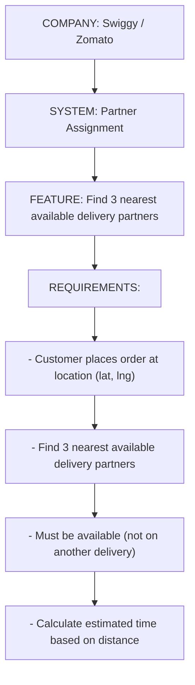

```java
/**
 * PROBLEM: Find K Nearest Delivery Partners
 *
 * INPUT: Customer location, list of all partners
 * OUTPUT: K nearest available partners with ETA
 *
 * DSA: Min Heap (Priority Queue)
 */

public class DeliveryPartnerFinder {

    public List<PartnerWithETA> findNearestPartners(
            double custLat, double custLng,
            List<DeliveryPartner> allPartners,
            int k) {

        // Max heap to keep k smallest distances
        // We use max heap so we can remove largest when size > k
        PriorityQueue<PartnerWithDistance> maxHeap = new PriorityQueue<>(
            (a, b) -> Double.compare(b.distance, a.distance)
        );

        for (DeliveryPartner partner : allPartners) {
            // Skip unavailable partners
            if (!partner.isAvailable) continue;

            double distance = calculateDistance(
                custLat, custLng,
                partner.latitude, partner.longitude
            );

            maxHeap.offer(new PartnerWithDistance(partner, distance));

            // Keep only k nearest
            if (maxHeap.size() > k) {
                maxHeap.poll(); // Remove farthest
            }
        }

        // Convert to result with ETA
        List<PartnerWithETA> result = new ArrayList<>();
        while (!maxHeap.isEmpty()) {
            PartnerWithDistance pd = maxHeap.poll();
            int etaMinutes = calculateETA(pd.distance);
            result.add(new PartnerWithETA(pd.partner, pd.distance, etaMinutes));
        }

        // Reverse to get nearest first
        Collections.reverse(result);
        return result;
    }

    // Haversine formula for distance between two coordinates
    private double calculateDistance(double lat1, double lng1, double lat2, double lng2) {
        final double R = 6371; // Earth's radius in km

        double dLat = Math.toRadians(lat2 - lat1);
        double dLng = Math.toRadians(lng2 - lng1);

        double a = Math.sin(dLat/2) * Math.sin(dLat/2) +
                   Math.cos(Math.toRadians(lat1)) * Math.cos(Math.toRadians(lat2)) *
                   Math.sin(dLng/2) * Math.sin(dLng/2);

        double c = 2 * Math.atan2(Math.sqrt(a), Math.sqrt(1-a));

        return R * c; // Distance in km
    }

    private int calculateETA(double distanceKm) {
        // Assume average speed 25 km/h in city traffic
        double hours = distanceKm / 25.0;
        return (int) Math.ceil(hours * 60); // Convert to minutes
    }

    // TEST
    public static void main(String[] args) {
        DeliveryPartnerFinder finder = new DeliveryPartnerFinder();

        // Customer in Koramangala, Bangalore
        double custLat = 12.9352;
        double custLng = 77.6245;

        List<DeliveryPartner> partners = Arrays.asList(
            new DeliveryPartner("P1", "Raju", 12.9400, 77.6300, true),
            new DeliveryPartner("P2", "Kumar", 12.9200, 77.6100, true),
            new DeliveryPartner("P3", "Venkat", 12.9500, 77.6400, false), // Unavailable
            new DeliveryPartner("P4", "Suresh", 12.9320, 77.6220, true),
            new DeliveryPartner("P5", "Ganesh", 12.9600, 77.6500, true)
        );

        List<PartnerWithETA> nearest = finder.findNearestPartners(
            custLat, custLng, partners, 3
        );

        System.out.println("Nearest available partners:");
        for (PartnerWithETA p : nearest) {
            System.out.printf("%s - %.2f km - ETA: %d min%n",
                p.partner.name, p.distance, p.etaMinutes);
        }
    }
}

// TIME COMPLEXITY: O(n log k) where n = total partners, k = required count
// SPACE COMPLEXITY: O(k)
```

---

## Problem 8: Restaurant Rating Calculation (Weighted Average)

```
╔══════════════════════════════════════════════════════════════════════════════╗
║ COMPANY: Zomato / Google Maps                                                ║
║ SYSTEM: Rating & Reviews                                                     ║
║ CHALLENGE: New restaurant with 2 five-star reviews shows higher than         ║
║            established restaurant with 4.8 from 500 reviews                  ║
╚══════════════════════════════════════════════════════════════════════════════╝

REQUIREMENTS:
─────────────
- Can't just use simple average (unfair to established places)
- Need weighted score considering number of reviews
- Recent reviews should matter more
```

> **Flow**: COMPANY: Zomato / Google Maps → SYSTEM: Rating & Reviews | SYSTEM: Rating & Reviews → established restaurant with 4.8 from 500 reviews | established restaurant with 4.8 from 500 reviews → REQUIREMENTS: | REQUIREMENTS: → - Need weighted score considering number of reviews | - Need weighted score considering number of reviews → - Recent reviews should matter more

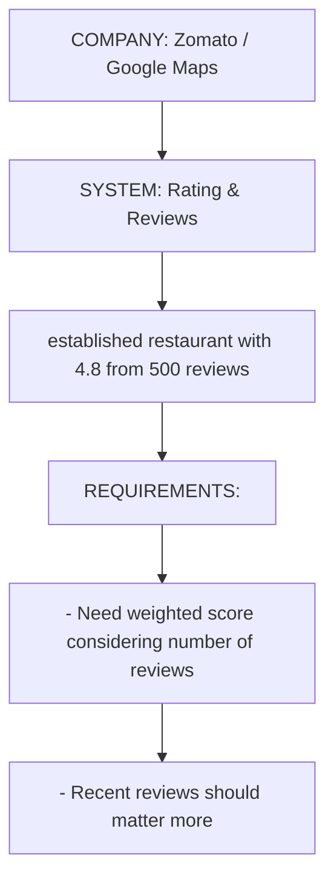

```java
/**
 * PROBLEM: Calculate Fair Restaurant Rating
 *
 * Simple average problem:
 *   New place: 2 reviews, both 5-star = 5.0 average
 *   Old place: 500 reviews, 4.8 average
 *   Unfairly, new place shows higher!
 *
 * Solution: Bayesian Average / Wilson Score
 */

public class RatingCalculator {

    // Method 1: Bayesian Average
    // Formula: (C × m + sum_of_ratings) / (C + n)
    // C = minimum reviews before we trust the rating
    // m = global mean rating (e.g., 3.5)

    public double calculateBayesianRating(
            double sumOfRatings,
            int numberOfRatings,
            double globalMean,      // Average across all restaurants (~3.5)
            int confidenceNumber) { // Minimum reviews to trust (e.g., 10)

        return (confidenceNumber * globalMean + sumOfRatings) /
               (confidenceNumber + numberOfRatings);
    }

    // Method 2: Time-Weighted Rating (recent reviews matter more)
    public double calculateTimeWeightedRating(List<Review> reviews) {
        if (reviews.isEmpty()) return 0;

        double weightedSum = 0;
        double totalWeight = 0;
        long now = System.currentTimeMillis();

        for (Review review : reviews) {
            // Reviews decay over time
            // Recent review (today) = weight 1.0
            // 30 days old = weight 0.7
            // 90 days old = weight 0.5
            // 1 year old = weight 0.3

            long daysOld = (now - review.timestamp) / (24 * 60 * 60 * 1000);
            double weight = Math.max(0.3, 1.0 - (daysOld / 365.0) * 0.7);

            weightedSum += review.rating * weight;
            totalWeight += weight;
        }

        return weightedSum / totalWeight;
    }

    // TEST
    public static void main(String[] args) {
        RatingCalculator calc = new RatingCalculator();

        // Restaurant A: New, 2 reviews both 5-star
        double ratingA_simple = 5.0;
        double ratingA_bayesian = calc.calculateBayesianRating(10, 2, 3.5, 10);

        // Restaurant B: Established, 500 reviews, avg 4.8
        double ratingB_simple = 4.8;
        double ratingB_bayesian = calc.calculateBayesianRating(2400, 500, 3.5, 10);

        System.out.println("Simple Average:");
        System.out.println("  Restaurant A (2 reviews): " + ratingA_simple);
        System.out.println("  Restaurant B (500 reviews): " + ratingB_simple);
        System.out.println("  Winner: A (unfair!)");

        System.out.println("\nBayesian Average:");
        System.out.printf("  Restaurant A (2 reviews): %.2f%n", ratingA_bayesian);
        System.out.printf("  Restaurant B (500 reviews): %.2f%n", ratingB_bayesian);
        System.out.println("  Winner: B (fair!)");
    }
}

// OUTPUT:
// Simple Average:
//   Restaurant A (2 reviews): 5.0
//   Restaurant B (500 reviews): 4.8
//   Winner: A (unfair!)
//
// Bayesian Average:
//   Restaurant A (2 reviews): 3.75
//   Restaurant B (500 reviews): 4.77
//   Winner: B (fair!)
```

---

# 🧩 Part 4: Social Media Problems

## Problem 9: Mutual Friends (Set Intersection)

```
╔══════════════════════════════════════════════════════════════════════════════╗
║ COMPANY: Facebook / LinkedIn                                                 ║
║ SYSTEM: Friend Suggestions                                                   ║
║ FEATURE: "You have 15 mutual friends with John"                              ║
╚══════════════════════════════════════════════════════════════════════════════╝
```

> **Flow**: COMPANY: Facebook / LinkedIn → SYSTEM: Friend Suggestions | SYSTEM: Friend Suggestions → FEATURE: 'You have 15 mutual friends with John'

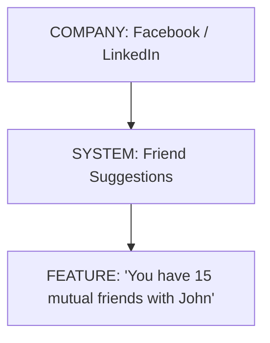

```java
/**
 * PROBLEM: Find Mutual Friends
 *
 * INPUT: User A's friends, User B's friends
 * OUTPUT: List of mutual friends, count
 */

public class MutualFriendsFinder {

    // Method 1: Using HashSet (optimal for large lists)
    public List<String> findMutualFriends(List<String> friendsA, List<String> friendsB) {
        Set<String> setA = new HashSet<>(friendsA);
        List<String> mutual = new ArrayList<>();

        for (String friend : friendsB) {
            if (setA.contains(friend)) {
                mutual.add(friend);
            }
        }

        return mutual;
    }

    // Method 2: Using sorted lists with two pointers (memory efficient)
    public List<String> findMutualFriendsTwoPointers(
            List<String> friendsA, List<String> friendsB) {

        // Sort both lists
        Collections.sort(friendsA);
        Collections.sort(friendsB);

        List<String> mutual = new ArrayList<>();
        int i = 0, j = 0;

        while (i < friendsA.size() && j < friendsB.size()) {
            int cmp = friendsA.get(i).compareTo(friendsB.get(j));

            if (cmp == 0) {
                mutual.add(friendsA.get(i));
                i++;
                j++;
            } else if (cmp < 0) {
                i++;
            } else {
                j++;
            }
        }

        return mutual;
    }

    // Method 3: Friend suggestion based on mutual friends count
    public List<FriendSuggestion> suggestFriends(
            String userId,
            Map<String, Set<String>> friendGraph) {

        Set<String> myFriends = friendGraph.getOrDefault(userId, new HashSet<>());
        Map<String, Integer> mutualCount = new HashMap<>();

        // For each of my friends
        for (String friend : myFriends) {
            // Look at their friends
            Set<String> friendsOfFriend = friendGraph.getOrDefault(friend, new HashSet<>());

            for (String potential : friendsOfFriend) {
                // Skip if already my friend or myself
                if (potential.equals(userId) || myFriends.contains(potential)) {
                    continue;
                }

                // Count mutual friends
                mutualCount.merge(potential, 1, Integer::sum);
            }
        }

        // Sort by mutual friend count
        return mutualCount.entrySet().stream()
            .map(e -> new FriendSuggestion(e.getKey(), e.getValue()))
            .sorted((a, b) -> b.mutualCount - a.mutualCount)
            .limit(10)
            .collect(Collectors.toList());
    }
}

// TIME COMPLEXITY:
// Method 1: O(n + m) where n, m = sizes of friend lists
// Method 2: O(n log n + m log m) for sorting + O(n + m) for merge
// Method 3: O(F * F') where F = my friends, F' = avg friends per person
```

---

## Problem 10: News Feed Generation (Merge K Sorted Lists)

```
╔══════════════════════════════════════════════════════════════════════════════╗
║ COMPANY: Twitter / Instagram / Facebook                                      ║
║ SYSTEM: Feed Generation                                                      ║
║ CHALLENGE: Merge posts from 500 friends, show most recent first              ║
╚══════════════════════════════════════════════════════════════════════════════╝
```

> **Flow**: COMPANY: Twitter / Instagram / Facebook → SYSTEM: Feed Generation

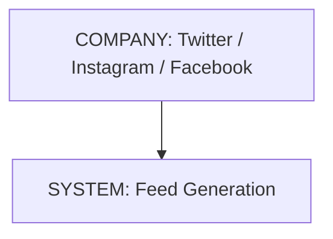

```java
/**
 * PROBLEM: Generate News Feed
 *
 * INPUT: User follows 500 people, each has posts sorted by time
 * OUTPUT: Merged feed with most recent posts first
 *
 * DSA: Merge K Sorted Lists using Min Heap
 */

public class NewsFeedGenerator {

    public List<Post> generateFeed(String userId, int limit) {
        // Get list of people this user follows
        List<String> following = getFollowing(userId);

        // Min heap to merge posts (most recent first, so max timestamp)
        PriorityQueue<PostIterator> heap = new PriorityQueue<>(
            (a, b) -> Long.compare(b.currentPost().timestamp, a.currentPost().timestamp)
        );

        // Initialize heap with first post from each followed user
        for (String followedUser : following) {
            List<Post> posts = getRecentPosts(followedUser, 10); // Get 10 recent posts
            if (!posts.isEmpty()) {
                heap.offer(new PostIterator(posts));
            }
        }

        // Merge
        List<Post> feed = new ArrayList<>();
        while (!heap.isEmpty() && feed.size() < limit) {
            PostIterator iterator = heap.poll();
            feed.add(iterator.currentPost());

            if (iterator.hasNext()) {
                iterator.moveNext();
                heap.offer(iterator);
            }
        }

        return feed;
    }

    // Helper class to iterate through a user's posts
    static class PostIterator {
        private List<Post> posts;
        private int index = 0;

        PostIterator(List<Post> posts) {
            this.posts = posts;
        }

        Post currentPost() {
            return posts.get(index);
        }

        boolean hasNext() {
            return index < posts.size() - 1;
        }

        void moveNext() {
            index++;
        }
    }
}

// TIME COMPLEXITY: O(n log k) where n = total posts needed, k = number of friends
// SPACE COMPLEXITY: O(k) for the heap
```

---

# 🧩 Part 5: Ride — Sharing Problems

## Problem 11: Surge Pricing Calculator (Demand/Supply Ratio)

```
╔══════════════════════════════════════════════════════════════════════════════╗
║ COMPANY: Uber / Ola                                                          ║
║ SYSTEM: Dynamic Pricing                                                      ║
║ FEATURE: Increase price when demand > supply                                 ║
╚══════════════════════════════════════════════════════════════════════════════╝
```

> **Flow**: COMPANY: Uber / Ola → SYSTEM: Dynamic Pricing | SYSTEM: Dynamic Pricing → FEATURE: Increase price when demand &gt; supply

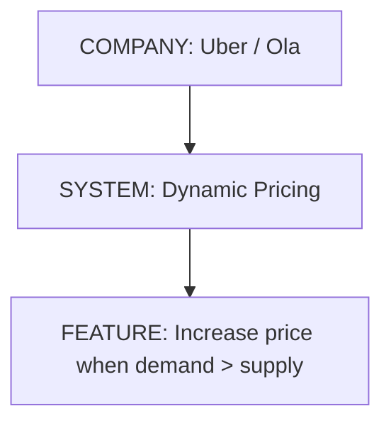

```java
/**
 * PROBLEM: Calculate Surge Multiplier
 *
 * INPUT: Number of ride requests, number of available drivers, in an area
 * OUTPUT: Price multiplier (1.0x to 3.0x)
 */

public class SurgePricingCalculator {

    public double calculateSurgeMultiplier(int rideRequests, int availableDrivers) {
        if (availableDrivers == 0) {
            return 3.0; // Maximum surge when no drivers
        }

        double demandSupplyRatio = (double) rideRequests / availableDrivers;

        // Surge pricing tiers
        if (demandSupplyRatio <= 1.0) {
            return 1.0; // No surge - supply meets demand
        } else if (demandSupplyRatio <= 1.5) {
            return 1.2; // Light surge
        } else if (demandSupplyRatio <= 2.0) {
            return 1.5; // Moderate surge
        } else if (demandSupplyRatio <= 3.0) {
            return 2.0; // High surge
        } else if (demandSupplyRatio <= 4.0) {
            return 2.5; // Very high surge
        } else {
            return 3.0; // Maximum surge
        }
    }

    // More sophisticated: Continuous surge calculation
    public double calculateContinuousSurge(int requests, int drivers) {
        if (drivers == 0) return 3.0;

        double ratio = (double) requests / drivers;

        if (ratio <= 1.0) return 1.0;

        // Logarithmic surge: smoother increase
        // surge = 1 + 0.5 * log2(ratio)
        double surge = 1.0 + 0.5 * (Math.log(ratio) / Math.log(2));

        // Cap at 3.0x
        return Math.min(3.0, Math.round(surge * 10) / 10.0);
    }

    // Calculate fare with surge
    public FareBreakdown calculateFare(
            double distanceKm,
            int rideRequests,
            int availableDrivers) {

        double baseFare = 50; // ₹50 base
        double perKmRate = 12; // ₹12 per km
        double surgeMultiplier = calculateSurgeMultiplier(rideRequests, availableDrivers);

        double normalFare = baseFare + (distanceKm * perKmRate);
        double surgedFare = normalFare * surgeMultiplier;

        return new FareBreakdown(
            normalFare,
            surgeMultiplier,
            surgedFare,
            surgedFare - normalFare // Surge amount
        );
    }

    // TEST
    public static void main(String[] args) {
        SurgePricingCalculator calc = new SurgePricingCalculator();

        System.out.println("Surge multipliers:");
        System.out.println("10 requests, 20 drivers: " +
            calc.calculateSurgeMultiplier(10, 20) + "x"); // 1.0x
        System.out.println("30 requests, 20 drivers: " +
            calc.calculateSurgeMultiplier(30, 20) + "x"); // 1.5x
        System.out.println("80 requests, 20 drivers: " +
            calc.calculateSurgeMultiplier(80, 20) + "x"); // 3.0x

        System.out.println("\nFare for 10km ride:");
        FareBreakdown fare = calc.calculateFare(10, 50, 20);
        System.out.println("Normal fare: ₹" + fare.normalFare);
        System.out.println("Surge: " + fare.surgeMultiplier + "x");
        System.out.println("Final fare: ₹" + fare.surgedFare);
    }
}
```

---

## Problem 12: Ride Matching - Driver Assignment (Bipartite Matching)

```
╔══════════════════════════════════════════════════════════════════════════════╗
║ COMPANY: Uber / Ola                                                          ║
║ SYSTEM: Dispatch                                                             ║
║ CHALLENGE: Match N riders with M drivers optimally                           ║
╚══════════════════════════════════════════════════════════════════════════════╝
```

> **Flow**: COMPANY: Uber / Ola → SYSTEM: Dispatch | SYSTEM: Dispatch → CHALLENGE: Match N riders with M drivers optimally

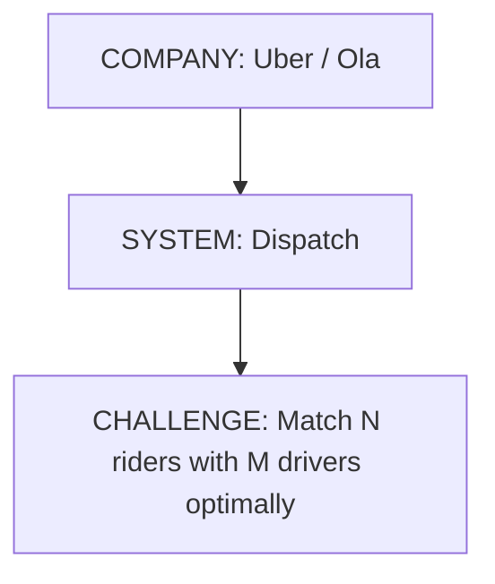

```java
/**
 * PROBLEM: Optimal Rider-Driver Matching
 *
 * INPUT: List of riders (with pickup locations), List of drivers (with locations)
 * OUTPUT: Optimal matching that minimizes total pickup distance
 *
 * Simplified version using Greedy approach
 */

public class RideMatchingService {

    // Greedy approach: Assign nearest driver to each rider
    public List<RideMatch> matchRidersToDrivers(
            List<Rider> riders,
            List<Driver> drivers) {

        List<RideMatch> matches = new ArrayList<>();
        Set<String> assignedDrivers = new HashSet<>();

        // Create all possible (rider, driver, distance) combinations
        List<PotentialMatch> allMatches = new ArrayList<>();

        for (Rider rider : riders) {
            for (Driver driver : drivers) {
                double distance = calculateDistance(
                    rider.pickupLat, rider.pickupLng,
                    driver.currentLat, driver.currentLng
                );
                allMatches.add(new PotentialMatch(rider, driver, distance));
            }
        }

        // Sort by distance (shortest first)
        Collections.sort(allMatches, (a, b) -> Double.compare(a.distance, b.distance));

        Set<String> matchedRiders = new HashSet<>();

        // Greedy assignment
        for (PotentialMatch pm : allMatches) {
            // Skip if rider or driver already matched
            if (matchedRiders.contains(pm.rider.id) ||
                assignedDrivers.contains(pm.driver.id)) {
                continue;
            }

            matches.add(new RideMatch(pm.rider, pm.driver, pm.distance));
            matchedRiders.add(pm.rider.id);
            assignedDrivers.add(pm.driver.id);

            // All riders matched?
            if (matchedRiders.size() == riders.size()) break;
        }

        return matches;
    }

    private double calculateDistance(double lat1, double lng1, double lat2, double lng2) {
        // Simplified distance calculation
        double dLat = lat2 - lat1;
        double dLng = lng2 - lng1;
        return Math.sqrt(dLat * dLat + dLng * dLng) * 111; // Approx km
    }
}

// TIME COMPLEXITY: O(R * D * log(R * D)) for sorting
// where R = riders, D = drivers
```

---

_More problems in next part..._

**Continue to Part 2 for:**

- Streaming Platform (Netflix)
- Healthcare Systems
- Travel Booking (MakeMyTrip)
- Logistics (Delhivery)
- Chat Systems (WhatsApp)


---

> **Navigation**: [< Previous](04_ERP_Finance_RealWorld.md) | [Back to Index](../00_MASTER_INDEX.md) | [Next >](04_RealWorld_Problems_Part2.md)