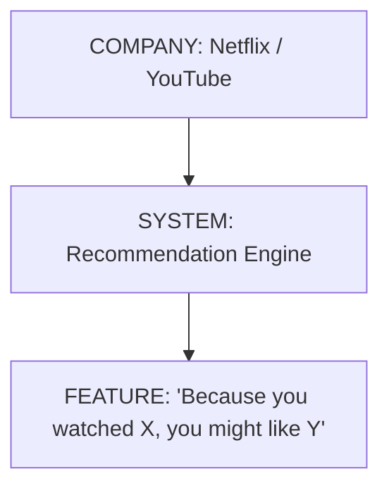
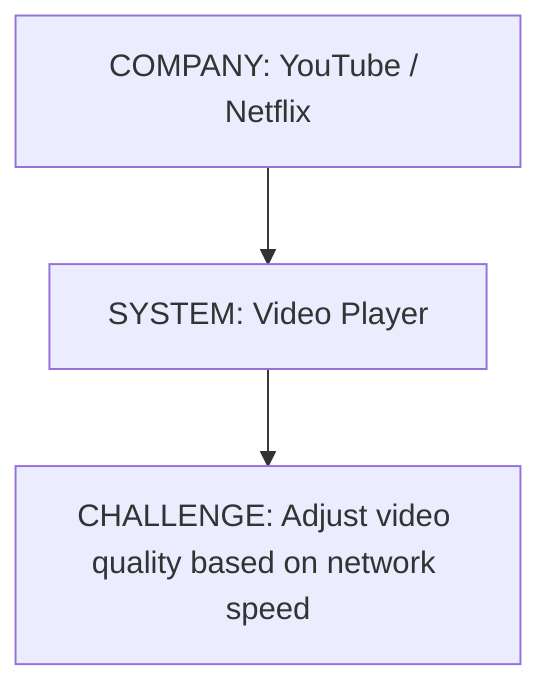
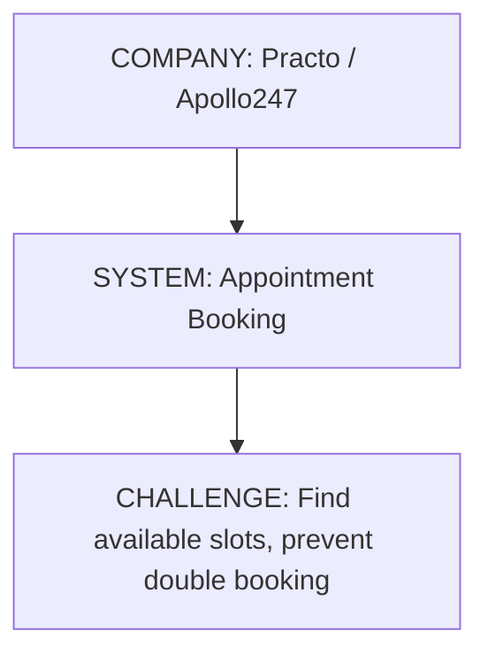
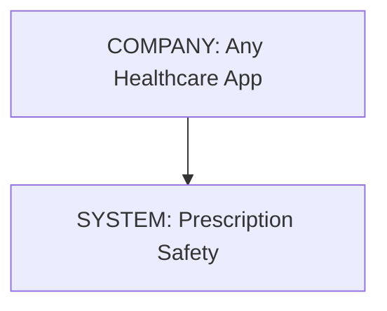
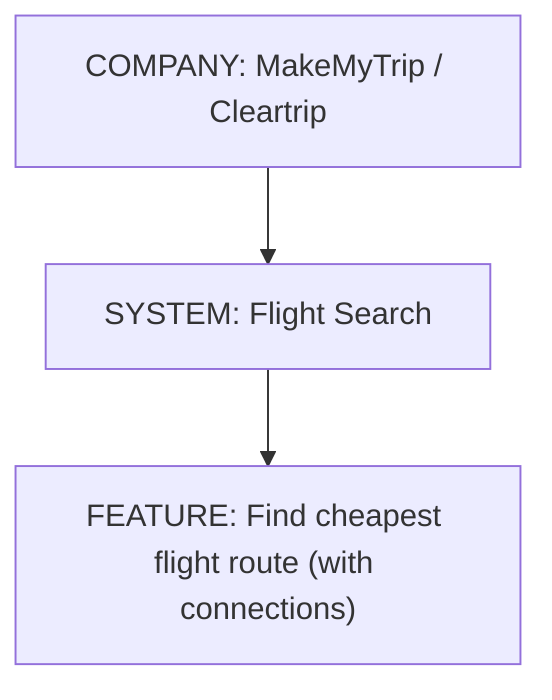
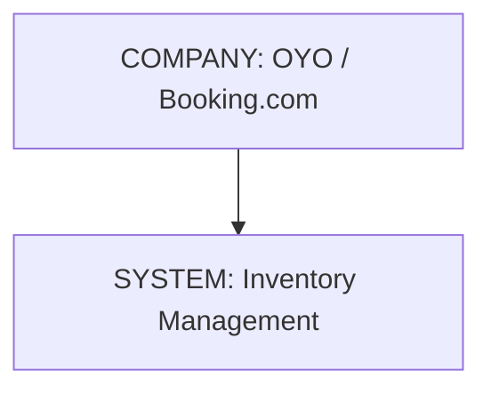
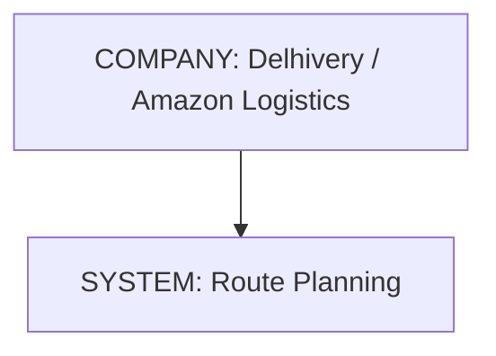
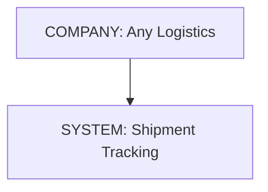
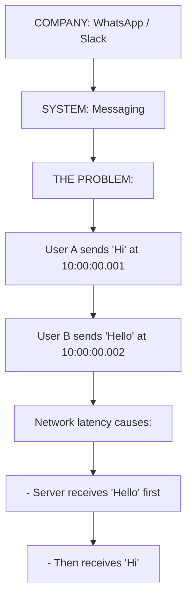

**Navigation**: [< Previous](05_RealWorld_Problems_DSA.md) | [Back to Index](../00_MASTER_INDEX.md) | [Next >](07_RealWorld_Problems_Part3.md)

# 🌍 Real-World Problems Solved with DSA - Part 2

## Streaming, Healthcare, Travel & More

---


🔬 **Section Challenge — Streaming, Healthcare, Travel & More**

**Challenge 1 (Reasoning):** `list.stream().filter().map().collect()` — at which point does data actually start flowing through the pipeline?
<details><summary>Answer</summary>

Not until `collect()` (or any terminal operation). `filter()` and `map()` are LAZY — they build a pipeline description but process nothing. When the terminal operation is called, the pipeline pulls elements through lazily: one element passes through the entire pipeline before the next is processed. This means: early termination with `findFirst()` is O(1) if the first element matches, not O(N).
</details>

**Challenge 2 (Bug Hunt):** You call `stream.filter(...).collect(...)` twice on the same stream. What happens?
<details><summary>Answer</summary>

`IllegalStateException: stream has already been operated upon or closed`. Streams are single-use. Once a terminal operation is called, the stream is consumed. Fix: create a new stream from the source each time, or collect to a `List` first and stream the list repeatedly.
</details>


# PART 6: STREAMING PLATFORMS (Netflix/Hotstar)

## Problem 13: Video Watch History - Recently Watched (LRU Cache)


COMPANY: Netflix / Hotstar / YouTube
SYSTEM: User Experience
FEATURE: "Continue Watching" shows last 20 videos you watched


THE REQUIREMENT:
────────────────
- Show last 20 videos user watched
- Most recent first
- If user watches same video again, move it to front
- Limited memory (can't store unlimited)

THIS IS EXACTLY: LRU (Least Recently Used) Cache!

```java
/**
 * PROBLEM: Implement Continue Watching Feature
 *
 * Operations:
 *   - addToHistory(videoId): User watched this video
 *   - getHistory(): Get last 20 videos, most recent first
 *
 * DSA: LRU Cache using LinkedHashMap
 */

public class WatchHistoryService {

    private final int MAX_SIZE = 20;
    private LinkedHashMap<String, Video> watchHistory;

    public WatchHistoryService() {
        // LinkedHashMap with access-order = true for LRU behavior
        // removeEldestEntry removes oldest when size exceeds MAX_SIZE
        watchHistory = new LinkedHashMap<String, Video>(MAX_SIZE, 0.75f, true) {
            @Override
            protected boolean removeEldestEntry(Map.Entry<String, Video> eldest) {
                return size() > MAX_SIZE;
            }
        };
    }

    public void addToHistory(Video video) {
        // If already exists, this will move it to end (most recent)
        // If new and size > 20, oldest will be auto-removed
        watchHistory.put(video.id, video);
    }

    public List<Video> getHistory() {
        // Return in reverse order (most recent first)
        List<Video> result = new ArrayList<>(watchHistory.values());
        Collections.reverse(result);
        return result;
    }

    // Manual LRU implementation (interview favorite!)
    static class ManualLRUCache {
        private int capacity;
        private Map<String, Node> cache;
        private Node head, tail; // Doubly linked list

        class Node {
            String key;
            Video video;
            Node prev, next;

            Node(String key, Video video) {
                this.key = key;
                this.video = video;
            }
        }

        public ManualLRUCache(int capacity) {
            this.capacity = capacity;
            this.cache = new HashMap<>();

            // Dummy head and tail
            head = new Node(null, null);
            tail = new Node(null, null);
            head.next = tail;
            tail.prev = head;
        }

        public void addToHistory(Video video) {
            if (cache.containsKey(video.id)) {
                // Move to front
                Node node = cache.get(video.id);
                removeNode(node);
                addToFront(node);
            } else {
                // Add new
                Node node = new Node(video.id, video);
                cache.put(video.id, node);
                addToFront(node);

                // Remove oldest if over capacity
                if (cache.size() > capacity) {
                    Node oldest = tail.prev;
                    removeNode(oldest);
                    cache.remove(oldest.key);
                }
            }
        }

        private void addToFront(Node node) {
            node.next = head.next;
            node.prev = head;
            head.next.prev = node;
            head.next = node;
        }

        private void removeNode(Node node) {
            node.prev.next = node.next;
            node.next.prev = node.prev;
        }

        public List<Video> getHistory() {
            List<Video> result = new ArrayList<>();
            Node current = head.next;
            while (current != tail) {
                result.add(current.video);
                current = current.next;
            }
            return result;
        }
    }
}

// TIME COMPLEXITY: O(1) for both add and get
// SPACE COMPLEXITY: O(capacity)
```

---

## Problem 14: Video Recommendation (Collaborative Filtering)

```
╔══════════════════════════════════════════════════════════════════════════════╗
║ COMPANY: Netflix / YouTube                                                   ║
║ SYSTEM: Recommendation Engine                                                ║
║ FEATURE: "Because you watched X, you might like Y"                           ║
╚══════════════════════════════════════════════════════════════════════════════╝
```

**Flow:**
1. COMPANY: Netflix / YouTube
2. SYSTEM: Recommendation Engine
3. FEATURE: 'Because you watched X, you might like Y'



```java
/**
 * PROBLEM: Recommend Videos Based on Viewing Patterns
 *
 * Logic: Users who watched video A also watched video B
 *        If you watched A, we recommend B
 *
 * DSA: HashMap + Frequency Counting
 */

public class VideoRecommender {

    // Map: videoId -> Map of (coWatchedVideoId -> count)
    private Map<String, Map<String, Integer>> coWatchMatrix;

    public VideoRecommender() {
        coWatchMatrix = new HashMap<>();
    }

    // Update matrix when user watches videos in a session
    public void recordSession(List<String> watchedVideos) {
        // Every pair of videos in this session are "co-watched"
        for (int i = 0; i < watchedVideos.size(); i++) {
            for (int j = i + 1; j < watchedVideos.size(); j++) {
                String videoA = watchedVideos.get(i);
                String videoB = watchedVideos.get(j);

                // Update both directions
                incrementCoWatch(videoA, videoB);
                incrementCoWatch(videoB, videoA);
            }
        }
    }

    private void incrementCoWatch(String video1, String video2) {
        coWatchMatrix
            .computeIfAbsent(video1, k -> new HashMap<>())
            .merge(video2, 1, Integer::sum);
    }

    // Get recommendations for a user based on their watch history
    public List<String> getRecommendations(List<String> userWatchHistory, int limit) {
        Map<String, Integer> scores = new HashMap<>();
        Set<String> alreadyWatched = new HashSet<>(userWatchHistory);

        // For each video user watched
        for (String watchedVideo : userWatchHistory) {
            Map<String, Integer> coWatched = coWatchMatrix.get(watchedVideo);
            if (coWatched == null) continue;

            // Add scores for co-watched videos
            for (Map.Entry<String, Integer> entry : coWatched.entrySet()) {
                String candidateVideo = entry.getKey();

                // Skip if already watched
                if (alreadyWatched.contains(candidateVideo)) continue;

                scores.merge(candidateVideo, entry.getValue(), Integer::sum);
            }
        }

        // Return top scoring videos
        return scores.entrySet().stream()
            .sorted((a, b) -> b.getValue() - a.getValue())
            .limit(limit)
            .map(Map.Entry::getKey)
            .collect(Collectors.toList());
    }

    // TEST
    public static void main(String[] args) {
        VideoRecommender rec = new VideoRecommender();

        // Record some user sessions
        rec.recordSession(Arrays.asList("Avengers", "Thor", "IronMan"));
        rec.recordSession(Arrays.asList("Avengers", "IronMan", "CaptainAmerica"));
        rec.recordSession(Arrays.asList("Thor", "IronMan", "Hulk"));
        rec.recordSession(Arrays.asList("Avengers", "Thor"));
        rec.recordSession(Arrays.asList("Titanic", "Notebook", "DDLJ"));

        // User who watched Avengers and Thor
        List<String> userHistory = Arrays.asList("Avengers", "Thor");
        List<String> recommendations = rec.getRecommendations(userHistory, 3);

        System.out.println("Watched: " + userHistory);
        System.out.println("Recommendations: " + recommendations);
        // Expected: [IronMan, CaptainAmerica, Hulk] (not Titanic/Notebook/DDLJ)
    }
}
```

---


## Problem 15: Video Buffering - Predict Network Speed (Moving Average)

```
╔══════════════════════════════════════════════════════════════════════════════╗
║ COMPANY: YouTube / Netflix                                                   ║
║ SYSTEM: Video Player                                                         ║
║ CHALLENGE: Adjust video quality based on network speed                       ║
╚══════════════════════════════════════════════════════════════════════════════╝
```

**Flow:**
1. COMPANY: YouTube / Netflix
2. SYSTEM: Video Player
3. CHALLENGE: Adjust video quality based on network speed



```java
/**
 * PROBLEM: Adaptive Bitrate Streaming
 *
 * Based on recent download speeds, choose appropriate video quality
 *
 * DSA: Sliding Window for Moving Average
 */

public class AdaptiveBitrateController {

    private static final int WINDOW_SIZE = 5; // Last 5 chunks
    private Deque<Double> recentSpeeds = new LinkedList<>();
    private double windowSum = 0;

    // Video quality levels (bitrate in Kbps)
    private static final int[] QUALITY_LEVELS = {
        360,   // 240p
        720,   // 360p
        1500,  // 480p
        3000,  // 720p
        6000,  // 1080p
        12000  // 4K
    };

    // Called after each chunk download
    public VideoQuality reportDownloadSpeed(double speedKbps) {
        // Add to window
        recentSpeeds.addLast(speedKbps);
        windowSum += speedKbps;

        // Remove oldest if window full
        if (recentSpeeds.size() > WINDOW_SIZE) {
            windowSum -= recentSpeeds.removeFirst();
        }

        // Calculate average
        double avgSpeed = windowSum / recentSpeeds.size();

        // Choose quality (use 80% of bandwidth for safety margin)
        double targetBitrate = avgSpeed * 0.8;

        // Find highest quality that fits
        int chosenQuality = QUALITY_LEVELS[0];
        String qualityName = "240p";

        for (int i = QUALITY_LEVELS.length - 1; i >= 0; i--) {
            if (QUALITY_LEVELS[i] <= targetBitrate) {
                chosenQuality = QUALITY_LEVELS[i];
                qualityName = getQualityName(i);
                break;
            }
        }

        return new VideoQuality(chosenQuality, qualityName, avgSpeed);
    }

    private String getQualityName(int index) {
        String[] names = {"240p", "360p", "480p", "720p", "1080p", "4K"};
        return names[index];
    }

    // TEST
    public static void main(String[] args) {
        AdaptiveBitrateController controller = new AdaptiveBitrateController();

        // Simulate varying network speeds
        double[] speeds = {4000, 3500, 4500, 2000, 1500, 1800, 5000, 6000, 7000, 8000};

        for (double speed : speeds) {
            VideoQuality quality = controller.reportDownloadSpeed(speed);
            System.out.printf("Speed: %.0f Kbps, Avg: %.0f Kbps, Quality: %s%n",
                speed, quality.avgSpeed, quality.name);
        }
    }
}

// OUTPUT:
// Speed: 4000 Kbps, Avg: 4000 Kbps, Quality: 720p
// Speed: 3500 Kbps, Avg: 3750 Kbps, Quality: 720p
// Speed: 4500 Kbps, Avg: 4000 Kbps, Quality: 720p
// Speed: 2000 Kbps, Avg: 3500 Kbps, Quality: 720p
// Speed: 1500 Kbps, Avg: 3100 Kbps, Quality: 720p
// Speed: 1800 Kbps, Avg: 2660 Kbps, Quality: 480p  ← Quality dropped!
// Speed: 5000 Kbps, Avg: 2960 Kbps, Quality: 720p
// ...
```

---


# ⚙️ Part 7: Healthcare Systems

## Problem 16: Doctor Appointment Scheduling (Interval Scheduling)

```
╔══════════════════════════════════════════════════════════════════════════════╗
║ COMPANY: Practo / Apollo247                                                  ║
║ SYSTEM: Appointment Booking                                                  ║
║ CHALLENGE: Find available slots, prevent double booking                      ║
╚══════════════════════════════════════════════════════════════════════════════╝
```

**Flow:**
1. COMPANY: Practo / Apollo247
2. SYSTEM: Appointment Booking
3. CHALLENGE: Find available slots, prevent double booking



```java
/**
 * PROBLEM: Find Available Appointment Slots
 *
 * INPUT: Doctor's existing appointments, desired date
 * OUTPUT: Available 30-minute slots
 *
 * DSA: Interval merging + Gap finding
 */

public class AppointmentScheduler {

    // Doctor's working hours
    private static final int WORK_START = 9 * 60;  // 9:00 AM in minutes
    private static final int WORK_END = 18 * 60;   // 6:00 PM in minutes
    private static final int SLOT_DURATION = 30;    // 30 minute slots

    public List<TimeSlot> findAvailableSlots(
            List<Appointment> existingAppointments,
            LocalDate date) {

        // Convert appointments to minute intervals
        List<int[]> bookedIntervals = existingAppointments.stream()
            .filter(a -> a.date.equals(date))
            .map(a -> new int[]{a.startMinutes, a.endMinutes})
            .collect(Collectors.toList());

        // Sort by start time
        bookedIntervals.sort((a, b) -> a[0] - b[0]);

        // Merge overlapping intervals
        List<int[]> mergedBooked = mergeIntervals(bookedIntervals);

        // Find gaps (available slots)
        List<TimeSlot> availableSlots = new ArrayList<>();
        int currentTime = WORK_START;

        for (int[] booked : mergedBooked) {
            // Gap before this appointment
            while (currentTime + SLOT_DURATION <= booked[0]) {
                availableSlots.add(new TimeSlot(currentTime, currentTime + SLOT_DURATION));
                currentTime += SLOT_DURATION;
            }
            // Skip past this appointment
            currentTime = Math.max(currentTime, booked[1]);
        }

        // Remaining slots after last appointment
        while (currentTime + SLOT_DURATION <= WORK_END) {
            availableSlots.add(new TimeSlot(currentTime, currentTime + SLOT_DURATION));
            currentTime += SLOT_DURATION;
        }

        return availableSlots;
    }

    private List<int[]> mergeIntervals(List<int[]> intervals) {
        if (intervals.isEmpty()) return new ArrayList<>();

        List<int[]> merged = new ArrayList<>();
        int[] current = intervals.get(0);

        for (int i = 1; i < intervals.size(); i++) {
            int[] next = intervals.get(i);
            if (next[0] <= current[1]) {
                // Overlapping, merge
                current[1] = Math.max(current[1], next[1]);
            } else {
                // Not overlapping, add current and move on
                merged.add(current);
                current = next;
            }
        }
        merged.add(current);

        return merged;
    }

    // Book an appointment (with conflict check)
    public boolean bookAppointment(
            List<Appointment> existing,
            Appointment newAppointment) {

        for (Appointment apt : existing) {
            if (!apt.date.equals(newAppointment.date)) continue;

            // Check overlap
            if (newAppointment.startMinutes < apt.endMinutes &&
                newAppointment.endMinutes > apt.startMinutes) {
                return false; // Conflict!
            }
        }

        existing.add(newAppointment);
        return true;
    }

    // TEST
    public static void main(String[] args) {
        AppointmentScheduler scheduler = new AppointmentScheduler();
        LocalDate today = LocalDate.now();

        List<Appointment> existing = new ArrayList<>();
        existing.add(new Appointment(today, 9 * 60, 9 * 60 + 30));   // 9:00-9:30
        existing.add(new Appointment(today, 10 * 60, 11 * 60));      // 10:00-11:00
        existing.add(new Appointment(today, 14 * 60, 14 * 60 + 30)); // 2:00-2:30 PM

        List<TimeSlot> available = scheduler.findAvailableSlots(existing, today);

        System.out.println("Booked slots:");
        for (Appointment a : existing) {
            System.out.printf("  %s - %s%n", minutesToTime(a.startMinutes), minutesToTime(a.endMinutes));
        }

        System.out.println("\nAvailable slots:");
        for (TimeSlot slot : available) {
            System.out.printf("  %s - %s%n", minutesToTime(slot.start), minutesToTime(slot.end));
        }
    }

    static String minutesToTime(int minutes) {
        return String.format("%02d:%02d", minutes / 60, minutes % 60);
    }
}
```

---


## Problem 17: Medicine Interaction Checker (Graph - Cycle Detection)

```
╔══════════════════════════════════════════════════════════════════════════════╗
║ COMPANY: Any Healthcare App                                                  ║
║ SYSTEM: Prescription Safety                                                  ║
║ CHALLENGE: Check if prescribed medicines have dangerous interactions         ║
╚══════════════════════════════════════════════════════════════════════════════╝
```

**Flow:**
1. COMPANY: Any Healthcare App
2. SYSTEM: Prescription Safety



```java
/**
 * PROBLEM: Check Medicine Interactions
 *
 * Some medicines should NOT be taken together
 * Given a prescription, check for dangerous combinations
 *
 * DSA: Graph with adjacency list
 */

public class MedicineInteractionChecker {

    // Graph: medicine -> list of medicines it interacts with
    private Map<String, Set<String>> interactionGraph;
    private Map<String, String> interactionReasons;

    public MedicineInteractionChecker() {
        interactionGraph = new HashMap<>();
        interactionReasons = new HashMap<>();
        loadInteractions();
    }

    private void loadInteractions() {
        // Sample dangerous interactions
        addInteraction("Warfarin", "Aspirin", "Increases bleeding risk");
        addInteraction("Warfarin", "Ibuprofen", "Increases bleeding risk");
        addInteraction("Metformin", "Alcohol", "Risk of lactic acidosis");
        addInteraction("Lisinopril", "Potassium", "Risk of hyperkalemia");
        addInteraction("Sildenafil", "Nitroglycerin", "Severe blood pressure drop");
        addInteraction("Fluoxetine", "Tramadol", "Serotonin syndrome risk");
    }

    private void addInteraction(String med1, String med2, String reason) {
        interactionGraph.computeIfAbsent(med1, k -> new HashSet<>()).add(med2);
        interactionGraph.computeIfAbsent(med2, k -> new HashSet<>()).add(med1);

        String key = med1.compareTo(med2) < 0 ? med1 + ":" + med2 : med2 + ":" + med1;
        interactionReasons.put(key, reason);
    }

    public List<InteractionWarning> checkPrescription(List<String> medicines) {
        List<InteractionWarning> warnings = new ArrayList<>();

        // Check every pair of medicines
        for (int i = 0; i < medicines.size(); i++) {
            for (int j = i + 1; j < medicines.size(); j++) {
                String med1 = medicines.get(i);
                String med2 = medicines.get(j);

                Set<String> interactions = interactionGraph.get(med1);
                if (interactions != null && interactions.contains(med2)) {
                    String key = med1.compareTo(med2) < 0 ?
                        med1 + ":" + med2 : med2 + ":" + med1;
                    String reason = interactionReasons.get(key);

                    warnings.add(new InteractionWarning(med1, med2, reason));
                }
            }
        }

        return warnings;
    }

    // TEST
    public static void main(String[] args) {
        MedicineInteractionChecker checker = new MedicineInteractionChecker();

        // Prescription with dangerous combination
        List<String> prescription = Arrays.asList(
            "Warfarin", "Aspirin", "Metformin", "Omeprazole"
        );

        List<InteractionWarning> warnings = checker.checkPrescription(prescription);

        System.out.println("Prescription: " + prescription);
        if (warnings.isEmpty()) {
            System.out.println("✅ No dangerous interactions found");
        } else {
            System.out.println("⚠️ WARNINGS:");
            for (InteractionWarning w : warnings) {
                System.out.printf("  %s + %s: %s%n", w.med1, w.med2, w.reason);
            }
        }
    }
}

// TIME COMPLEXITY: O(n²) where n = number of medicines in prescription
// In practice, prescriptions have <20 medicines, so this is fine
```

---


🔬 **Section Challenge — Problem 17: Medicine Interaction Checker (Graph - Cycle Detection)**
>>

# PART 8: TRAVEL BOOKING (MakeMyTrip/Goibibo)

## Problem 18: Flight Search - Find Cheapest Route (Dijkstra/BFS)

```
╔══════════════════════════════════════════════════════════════════════════════╗
║ COMPANY: MakeMyTrip / Cleartrip                                              ║
║ SYSTEM: Flight Search                                                        ║
║ FEATURE: Find cheapest flight route (with connections)                       ║
╚══════════════════════════════════════════════════════════════════════════════╝
```

**Flow:**
1. COMPANY: MakeMyTrip / Cleartrip
2. SYSTEM: Flight Search
3. FEATURE: Find cheapest flight route (with connections)



```java
/**
 * PROBLEM: Find Cheapest Flight Route
 *
 * INPUT: Source city, destination city, list of flights
 * OUTPUT: Cheapest route (may include connections)
 *
 * DSA: Dijkstra's Algorithm / Modified BFS
 */

public class FlightSearchEngine {

    public FlightRoute findCheapestRoute(
            String source,
            String destination,
            List<Flight> allFlights,
            int maxStops) {

        // Build graph: city -> list of (destination, flight)
        Map<String, List<Flight>> flightGraph = new HashMap<>();
        for (Flight flight : allFlights) {
            flightGraph.computeIfAbsent(flight.from, k -> new ArrayList<>())
                .add(flight);
        }

        // Priority queue: (totalCost, currentCity, stops, route)
        PriorityQueue<SearchState> pq = new PriorityQueue<>(
            (a, b) -> Double.compare(a.totalCost, b.totalCost)
        );

        pq.offer(new SearchState(0, source, 0, new ArrayList<>()));

        // Track minimum cost to reach each city with certain stops
        Map<String, Double> minCost = new HashMap<>();

        while (!pq.isEmpty()) {
            SearchState current = pq.poll();

            // Found destination!
            if (current.city.equals(destination)) {
                return new FlightRoute(current.route, current.totalCost);
            }

            // Skip if too many stops
            if (current.stops > maxStops) continue;

            // Skip if we've found a cheaper way to this city
            String stateKey = current.city + ":" + current.stops;
            if (minCost.containsKey(stateKey) &&
                minCost.get(stateKey) <= current.totalCost) {
                continue;
            }
            minCost.put(stateKey, current.totalCost);

            // Explore outgoing flights
            List<Flight> outgoing = flightGraph.getOrDefault(current.city, new ArrayList<>());
            for (Flight flight : outgoing) {
                List<Flight> newRoute = new ArrayList<>(current.route);
                newRoute.add(flight);

                pq.offer(new SearchState(
                    current.totalCost + flight.price,
                    flight.to,
                    current.stops + 1,
                    newRoute
                ));
            }
        }

        return null; // No route found
    }

    static class SearchState {
        double totalCost;
        String city;
        int stops;
        List<Flight> route;

        SearchState(double cost, String city, int stops, List<Flight> route) {
            this.totalCost = cost;
            this.city = city;
            this.stops = stops;
            this.route = route;
        }
    }

    // TEST
    public static void main(String[] args) {
        FlightSearchEngine engine = new FlightSearchEngine();

        List<Flight> flights = Arrays.asList(
            new Flight("DEL", "BLR", 5000, "6E-101"),
            new Flight("DEL", "HYD", 3500, "AI-201"),
            new Flight("HYD", "BLR", 2000, "6E-301"),
            new Flight("DEL", "BOM", 4000, "AI-401"),
            new Flight("BOM", "BLR", 3000, "6E-501")
        );

        FlightRoute cheapest = engine.findCheapestRoute("DEL", "BLR", flights, 2);

        if (cheapest != null) {
            System.out.println("Cheapest route: DEL → BLR");
            System.out.println("Total cost: ₹" + cheapest.totalCost);
            System.out.println("Route:");
            for (Flight f : cheapest.flights) {
                System.out.printf("  %s: %s → %s (₹%d)%n",
                    f.flightNumber, f.from, f.to, (int)f.price);
            }
        }
    }
}

// OUTPUT:
// Cheapest route: DEL → BLR
// Total cost: ₹5500
// Route:
//   AI-201: DEL → HYD (₹3500)
//   6E-301: HYD → BLR (₹2000)
```

---


## Problem 19: Hotel Room Inventory (Segment Tree for Range Queries)

```
╔══════════════════════════════════════════════════════════════════════════════╗
║ COMPANY: OYO / Booking.com                                                   ║
║ SYSTEM: Inventory Management                                                 ║
║ CHALLENGE: Check room availability for date ranges efficiently               ║
╚══════════════════════════════════════════════════════════════════════════════╝
```

**Flow:**
1. COMPANY: OYO / Booking.com
2. SYSTEM: Inventory Management



```java
/**
 * PROBLEM: Hotel Room Availability
 *
 * Operations:
 *   - Check if room available for date range
 *   - Book room for date range
 *   - Get number of bookings in a month
 *
 * Simple approach: Array of days
 */

public class HotelRoomInventory {

    // For each room type, track bookings per day
    // Day 0 = Jan 1st, Day 364 = Dec 31st
    private Map<String, int[]> roomBookings; // roomType -> daily count
    private Map<String, Integer> totalRooms;  // roomType -> total rooms

    public HotelRoomInventory() {
        roomBookings = new HashMap<>();
        totalRooms = new HashMap<>();
    }

    public void addRoomType(String roomType, int count) {
        totalRooms.put(roomType, count);
        roomBookings.put(roomType, new int[365]); // One year
    }

    // Check availability for date range
    public int checkAvailability(String roomType, int checkIn, int checkOut) {
        if (!totalRooms.containsKey(roomType)) return 0;

        int[] bookings = roomBookings.get(roomType);
        int total = totalRooms.get(roomType);

        // Find minimum availability in the range
        int minAvailable = total;
        for (int day = checkIn; day < checkOut; day++) {
            int available = total - bookings[day];
            minAvailable = Math.min(minAvailable, available);
        }

        return minAvailable;
    }

    // Book a room
    public boolean bookRoom(String roomType, int checkIn, int checkOut) {
        if (checkAvailability(roomType, checkIn, checkOut) <= 0) {
            return false; // No rooms available
        }

        int[] bookings = roomBookings.get(roomType);
        for (int day = checkIn; day < checkOut; day++) {
            bookings[day]++;
        }

        return true;
    }

    // Cancel booking
    public void cancelBooking(String roomType, int checkIn, int checkOut) {
        int[] bookings = roomBookings.get(roomType);
        for (int day = checkIn; day < checkOut; day++) {
            bookings[day] = Math.max(0, bookings[day] - 1);
        }
    }

    // Get occupancy rate for a month
    public double getMonthlyOccupancy(String roomType, int month) {
        int startDay = getMonthStartDay(month);
        int endDay = getMonthStartDay(month + 1);
        int daysInMonth = endDay - startDay;

        int[] bookings = roomBookings.get(roomType);
        int total = totalRooms.get(roomType);

        long totalBookedNights = 0;
        for (int day = startDay; day < endDay; day++) {
            totalBookedNights += bookings[day];
        }

        long totalCapacity = (long) total * daysInMonth;
        return (double) totalBookedNights / totalCapacity * 100;
    }

    private int getMonthStartDay(int month) {
        int[] daysInMonth = {0, 31, 28, 31, 30, 31, 30, 31, 31, 30, 31, 30, 31};
        int day = 0;
        for (int m = 1; m < month && m <= 12; m++) {
            day += daysInMonth[m];
        }
        return day;
    }

    // TEST
    public static void main(String[] args) {
        HotelRoomInventory inventory = new HotelRoomInventory();

        inventory.addRoomType("DELUXE", 10);
        inventory.addRoomType("SUITE", 5);

        // Check availability for Feb 10-15 (days 40-45)
        System.out.println("Available DELUXE rooms (Feb 10-15): " +
            inventory.checkAvailability("DELUXE", 40, 45));

        // Book 3 rooms
        inventory.bookRoom("DELUXE", 40, 45);
        inventory.bookRoom("DELUXE", 40, 45);
        inventory.bookRoom("DELUXE", 42, 48);

        System.out.println("After bookings, available (Feb 10-15): " +
            inventory.checkAvailability("DELUXE", 40, 45));

        System.out.println("Monthly occupancy Feb: " +
            String.format("%.1f%%", inventory.getMonthlyOccupancy("DELUXE", 2)));
    }
}
```

---


# PART 9: LOGISTICS (Delhivery/Dunzo)

## Problem 20: Delivery Route Optimization (TSP Approximation)

```
╔══════════════════════════════════════════════════════════════════════════════╗
║ COMPANY: Delhivery / Amazon Logistics                                        ║
║ SYSTEM: Route Planning                                                       ║
║ CHALLENGE: Delivery person has 10 stops - find optimal route                 ║
╚══════════════════════════════════════════════════════════════════════════════╝
```

**Flow:**
1. COMPANY: Delhivery / Amazon Logistics
2. SYSTEM: Route Planning



```java
/**
 * PROBLEM: Optimize Delivery Route
 *
 * INPUT: Starting point (warehouse), list of delivery locations
 * OUTPUT: Order of deliveries that minimizes total distance
 *
 * This is the Traveling Salesman Problem (TSP) - NP-hard!
 * For small inputs (<15 stops), we can use exact algorithms
 * For larger inputs, use heuristics (Nearest Neighbor, 2-Opt)
 */

public class DeliveryRouteOptimizer {

    // Nearest Neighbor Heuristic - O(n²)
    public List<Location> optimizeRouteGreedy(
            Location warehouse,
            List<Location> deliveries) {

        List<Location> route = new ArrayList<>();
        Set<Integer> visited = new HashSet<>();
        Location current = warehouse;

        while (visited.size() < deliveries.size()) {
            double minDistance = Double.MAX_VALUE;
            int nearestIndex = -1;

            for (int i = 0; i < deliveries.size(); i++) {
                if (visited.contains(i)) continue;

                double dist = distance(current, deliveries.get(i));
                if (dist < minDistance) {
                    minDistance = dist;
                    nearestIndex = i;
                }
            }

            route.add(deliveries.get(nearestIndex));
            current = deliveries.get(nearestIndex);
            visited.add(nearestIndex);
        }

        return route;
    }

    // 2-Opt Improvement - improves existing route
    public List<Location> improveRoute2Opt(List<Location> route) {
        boolean improved = true;

        while (improved) {
            improved = false;

            for (int i = 0; i < route.size() - 1; i++) {
                for (int j = i + 2; j < route.size(); j++) {
                    double currentDist = distance(route.get(i), route.get(i + 1)) +
                                        distance(route.get(j), route.get((j + 1) % route.size()));
                    double newDist = distance(route.get(i), route.get(j)) +
                                    distance(route.get(i + 1), route.get((j + 1) % route.size()));

                    if (newDist < currentDist - 0.001) {
                        // Reverse the segment between i+1 and j
                        reverse(route, i + 1, j);
                        improved = true;
                    }
                }
            }
        }

        return route;
    }

    private void reverse(List<Location> route, int start, int end) {
        while (start < end) {
            Location temp = route.get(start);
            route.set(start, route.get(end));
            route.set(end, temp);
            start++;
            end--;
        }
    }

    private double distance(Location a, Location b) {
        double dx = a.lat - b.lat;
        double dy = a.lng - b.lng;
        return Math.sqrt(dx * dx + dy * dy) * 111; // Approx km
    }

    public double calculateTotalDistance(Location start, List<Location> route) {
        double total = distance(start, route.get(0));
        for (int i = 0; i < route.size() - 1; i++) {
            total += distance(route.get(i), route.get(i + 1));
        }
        return total;
    }

    // TEST
    public static void main(String[] args) {
        DeliveryRouteOptimizer optimizer = new DeliveryRouteOptimizer();

        Location warehouse = new Location("Warehouse", 12.9716, 77.5946);

        List<Location> deliveries = Arrays.asList(
            new Location("Stop A", 12.9800, 77.6000),
            new Location("Stop B", 12.9500, 77.6200),
            new Location("Stop C", 12.9900, 77.5800),
            new Location("Stop D", 12.9600, 77.5700),
            new Location("Stop E", 12.9700, 77.6100)
        );

        // Greedy solution
        List<Location> greedyRoute = optimizer.optimizeRouteGreedy(warehouse, deliveries);
        double greedyDist = optimizer.calculateTotalDistance(warehouse, greedyRoute);

        // Improve with 2-opt
        List<Location> improvedRoute = optimizer.improveRoute2Opt(new ArrayList<>(greedyRoute));
        double improvedDist = optimizer.calculateTotalDistance(warehouse, improvedRoute);

        System.out.println("Greedy route: " + greedyRoute.stream()
            .map(l -> l.name).collect(Collectors.toList()));
        System.out.printf("Greedy distance: %.2f km%n", greedyDist);

        System.out.println("\n2-Opt improved route: " + improvedRoute.stream()
            .map(l -> l.name).collect(Collectors.toList()));
        System.out.printf("Improved distance: %.2f km%n", improvedDist);
    }
}
```

---

## Problem 21: Package Tracking - State Machine

```
╔══════════════════════════════════════════════════════════════════════════════╗
║ COMPANY: Any Logistics                                                       ║
║ SYSTEM: Shipment Tracking                                                    ║
║ FEATURE: Track package through states with valid transitions only            ║
╚══════════════════════════════════════════════════════════════════════════════╝
```

**Flow:**
1. COMPANY: Any Logistics
2. SYSTEM: Shipment Tracking



```java
/**
 * PROBLEM: Package State Machine
 *
 * States: CREATED → PICKED_UP → IN_TRANSIT → OUT_FOR_DELIVERY → DELIVERED
 * Also: CANCELLED, RETURNED, FAILED_DELIVERY
 *
 * Ensure only valid transitions happen
 */

public class PackageTracker {

    public enum PackageState {
        CREATED,
        PICKED_UP,
        IN_TRANSIT,
        OUT_FOR_DELIVERY,
        DELIVERED,
        CANCELLED,
        FAILED_DELIVERY,
        RETURNED
    }

    // Valid transitions
    private static final Map<PackageState, Set<PackageState>> VALID_TRANSITIONS;

    static {
        VALID_TRANSITIONS = new EnumMap<>(PackageState.class);

        VALID_TRANSITIONS.put(PackageState.CREATED,
            EnumSet.of(PackageState.PICKED_UP, PackageState.CANCELLED));

        VALID_TRANSITIONS.put(PackageState.PICKED_UP,
            EnumSet.of(PackageState.IN_TRANSIT, PackageState.CANCELLED));

        VALID_TRANSITIONS.put(PackageState.IN_TRANSIT,
            EnumSet.of(PackageState.OUT_FOR_DELIVERY, PackageState.IN_TRANSIT)); // Can stay in transit

        VALID_TRANSITIONS.put(PackageState.OUT_FOR_DELIVERY,
            EnumSet.of(PackageState.DELIVERED, PackageState.FAILED_DELIVERY));

        VALID_TRANSITIONS.put(PackageState.FAILED_DELIVERY,
            EnumSet.of(PackageState.OUT_FOR_DELIVERY, PackageState.RETURNED)); // Retry or return

        VALID_TRANSITIONS.put(PackageState.DELIVERED, EnumSet.of(PackageState.RETURNED));

        VALID_TRANSITIONS.put(PackageState.CANCELLED, EnumSet.noneOf(PackageState.class));
        VALID_TRANSITIONS.put(PackageState.RETURNED, EnumSet.noneOf(PackageState.class));
    }

    private String packageId;
    private PackageState currentState;
    private List<StateTransition> history;

    public PackageTracker(String packageId) {
        this.packageId = packageId;
        this.currentState = PackageState.CREATED;
        this.history = new ArrayList<>();

        history.add(new StateTransition(null, PackageState.CREATED,
            LocalDateTime.now(), "Package created"));
    }

    public boolean updateState(PackageState newState, String note) {
        Set<PackageState> validNext = VALID_TRANSITIONS.get(currentState);

        if (validNext == null || !validNext.contains(newState)) {
            System.out.printf("Invalid transition: %s → %s%n", currentState, newState);
            return false;
        }

        history.add(new StateTransition(currentState, newState,
            LocalDateTime.now(), note));

        PackageState oldState = currentState;
        currentState = newState;

        System.out.printf("Package %s: %s → %s%n", packageId, oldState, newState);
        return true;
    }

    public PackageState getCurrentState() {
        return currentState;
    }

    public List<StateTransition> getHistory() {
        return new ArrayList<>(history);
    }

    // TEST
    public static void main(String[] args) {
        PackageTracker tracker = new PackageTracker("PKG-12345");

        // Valid sequence
        tracker.updateState(PackageState.PICKED_UP, "Picked up from seller");
        tracker.updateState(PackageState.IN_TRANSIT, "At Mumbai hub");
        tracker.updateState(PackageState.IN_TRANSIT, "At Bangalore hub");
        tracker.updateState(PackageState.OUT_FOR_DELIVERY, "With delivery agent");
        tracker.updateState(PackageState.DELIVERED, "Delivered to customer");

        System.out.println("\n--- Trying invalid transition ---");
        tracker.updateState(PackageState.IN_TRANSIT, "Back in transit"); // Invalid!

        System.out.println("\nFinal state: " + tracker.getCurrentState());
    }
}

// OUTPUT:
// Package PKG-12345: CREATED → PICKED_UP
// Package PKG-12345: PICKED_UP → IN_TRANSIT
// Package PKG-12345: IN_TRANSIT → IN_TRANSIT
// Package PKG-12345: IN_TRANSIT → OUT_FOR_DELIVERY
// Package PKG-12345: OUT_FOR_DELIVERY → DELIVERED
//
// --- Trying invalid transition ---
// Invalid transition: DELIVERED → IN_TRANSIT
//
// Final state: DELIVERED
```

---


# PART 10: CHAT SYSTEMS (WhatsApp/Telegram)

## Problem 22: Message Ordering with Eventual Consistency (Vector Clocks)

```
╔══════════════════════════════════════════════════════════════════════════════╗
║ COMPANY: WhatsApp / Slack                                                    ║
║ SYSTEM: Messaging                                                            ║
║ CHALLENGE: Messages sent at same time from different devices                 ║
╚══════════════════════════════════════════════════════════════════════════════╝

THE PROBLEM:
────────────
User A sends "Hi" at 10:00:00.001
User B sends "Hello" at 10:00:00.002

Network latency causes:
- Server receives "Hello" first
- Then receives "Hi"

Without proper ordering, conversation looks wrong!
```

**Flow:**
1. COMPANY: WhatsApp / Slack
2. SYSTEM: Messaging
3. THE PROBLEM:
4. User A sends 'Hi' at 10:00:00.001
5. User B sends 'Hello' at 10:00:00.002
6. Network latency causes:
7. - Server receives 'Hello' first



```java
/**
 * PROBLEM: Maintain Message Order in Group Chat
 *
 * Solution: Use Lamport Timestamps or Vector Clocks
 * Simpler for single chat: sequence numbers per sender
 */

public class ChatMessageOrderer {

    // Track last seen sequence per sender
    private Map<String, Long> lastSequence = new HashMap<>();

    // Priority queue to handle out-of-order messages
    private Map<String, PriorityQueue<Message>> pendingMessages = new HashMap<>();

    // Process incoming message
    public List<Message> processMessage(Message msg) {
        String chatId = msg.chatId;
        String senderId = msg.senderId;
        String key = chatId + ":" + senderId;

        long expectedSeq = lastSequence.getOrDefault(key, 0L) + 1;

        List<Message> deliverableMessages = new ArrayList<>();

        if (msg.sequence == expectedSeq) {
            // Message is in order
            deliverableMessages.add(msg);
            lastSequence.put(key, msg.sequence);

            // Check if any pending messages can now be delivered
            PriorityQueue<Message> pending = pendingMessages.get(key);
            if (pending != null) {
                while (!pending.isEmpty() &&
                       pending.peek().sequence == lastSequence.get(key) + 1) {
                    Message next = pending.poll();
                    deliverableMessages.add(next);
                    lastSequence.put(key, next.sequence);
                }
            }
        } else if (msg.sequence > expectedSeq) {
            // Message arrived early, buffer it
            pendingMessages.computeIfAbsent(key,
                k -> new PriorityQueue<>((a, b) -> Long.compare(a.sequence, b.sequence)))
                .offer(msg);

            System.out.printf("Buffering message %d (expected %d)%n",
                msg.sequence, expectedSeq);
        } else {
            // Duplicate or very old message, ignore
            System.out.printf("Ignoring old message %d%n", msg.sequence);
        }

        return deliverableMessages;
    }

    // For group chats: merge messages from multiple senders
    public List<Message> mergeGroupMessages(List<Message> messages) {
        // Sort by timestamp, then by sender for tie-breaking
        messages.sort((a, b) -> {
            int timeCompare = Long.compare(a.timestamp, b.timestamp);
            if (timeCompare != 0) return timeCompare;
            return a.senderId.compareTo(b.senderId);
        });

        return messages;
    }

    // TEST
    public static void main(String[] args) {
        ChatMessageOrderer orderer = new ChatMessageOrderer();

        // Messages arrive out of order
        List<Message> batch = Arrays.asList(
            new Message("chat1", "Alice", 3, "Third message", 1003),
            new Message("chat1", "Alice", 1, "First message", 1001),
            new Message("chat1", "Alice", 2, "Second message", 1002),
            new Message("chat1", "Alice", 5, "Fifth message", 1005),
            new Message("chat1", "Alice", 4, "Fourth message", 1004)
        );

        System.out.println("Processing messages in arrival order:");
        for (Message msg : batch) {
            List<Message> delivered = orderer.processMessage(msg);
            for (Message m : delivered) {
                System.out.println("  Delivered: " + m.content);
            }
        }
    }
}

// OUTPUT:
// Processing messages in arrival order:
// Buffering message 3 (expected 1)
//   Delivered: First message
//   Delivered: Second message
//   Delivered: Third message
// Buffering message 5 (expected 4)
//   Delivered: Fourth message
//   Delivered: Fifth message
```

---

_Continued in Part 3: Interview Practice Problems_


---

**Navigation**: [< Previous](05_RealWorld_Problems_DSA.md) | [Back to Index](../00_MASTER_INDEX.md) | [Next >](07_RealWorld_Problems_Part3.md)


