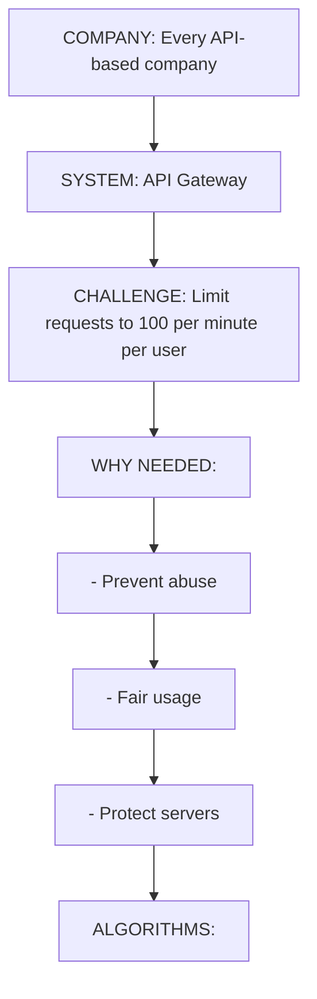
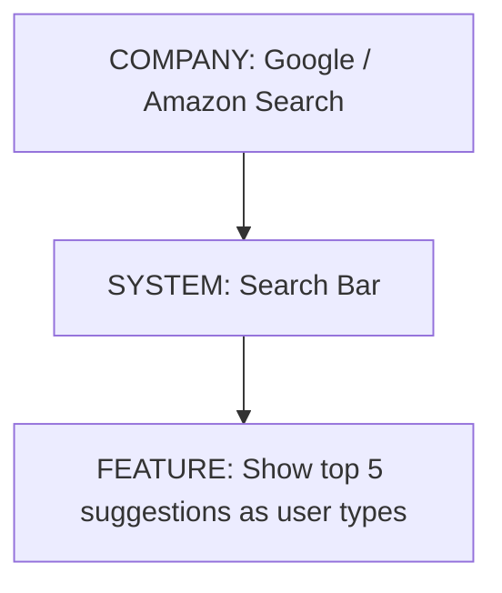
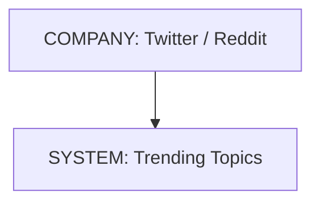
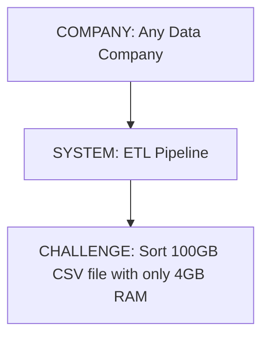
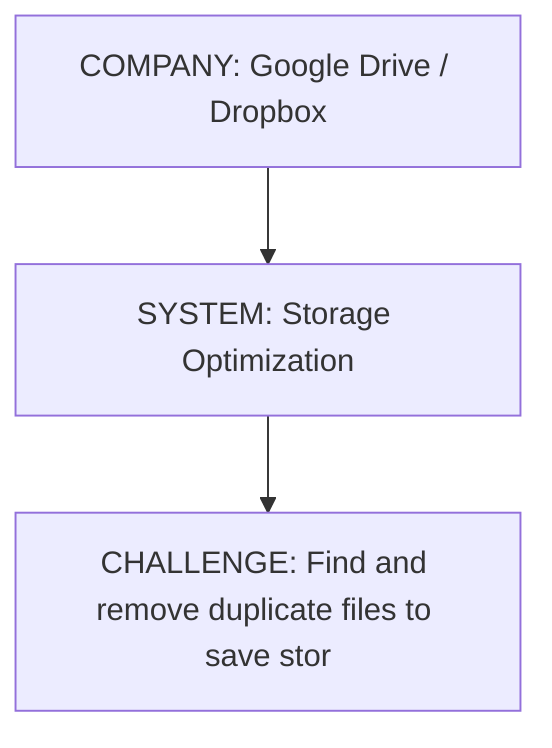
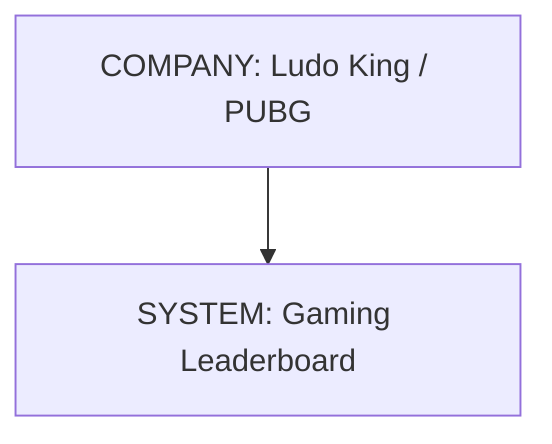
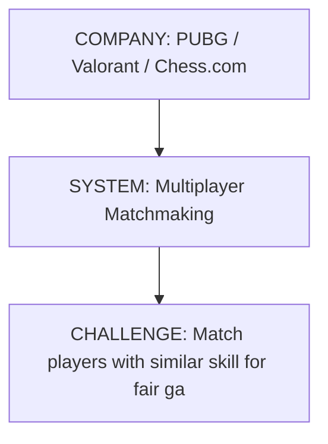

> **Navigation**: [< Previous](06_RealWorld_Problems_Part2.md) | [Back to Index](../00_MASTER_INDEX.md) | [Next >](08_RealWorld_Incidents_DSA.md)

# 🎯 Real-World Problems - Part 3: Interview Favorites

## Classic Problems from Top Company Interviews

---

# PART 11: PAYMENT SYSTEMS (Razorpay/PhonePe)

## Problem 23: Split Bill Among Friends (Simplify Debts)


> COMPANY: Splitwise / PhonePe
> SYSTEM: Bill Splitting
> CHALLENGE: Minimize number of transactions to settle debts


EXAMPLE:
────────
Trip expenses:
- Alice paid ₹3000 for hotel (for Alice, Bob, Charlie)
- Bob paid ₹1500 for dinner (for all 3)
- Charlie paid ₹600 for snacks (for all 3)

Total spent: ₹5100
Each should pay: ₹1700

Balance:
- Alice: Paid 3000, should pay 1700 → Owed ₹1300
- Bob: Paid 1500, should pay 1700 → Owes ₹200
- Charlie: Paid 600, should pay 1700 → Owes ₹1100

Naive: Bob pays Alice ₹200, Charlie pays Alice ₹1100 = 2 transactions
Optimal: Same in this case, but can be optimized for larger groups!

```java
/**
 * PROBLEM: Minimize Transactions to Settle Group Expenses
 *
 * DSA: Greedy with Two Pointers (after calculating balances)
 */

public class DebtSimplifier {

    public List<Transaction> simplifyDebts(Map<String, Double> balances) {
        List<Transaction> transactions = new ArrayList<>();

        // Separate into creditors (positive balance) and debtors (negative)
        List<PersonBalance> creditors = new ArrayList<>();
        List<PersonBalance> debtors = new ArrayList<>();

        for (Map.Entry<String, Double> entry : balances.entrySet()) {
            double balance = entry.getValue();
            if (balance > 0.01) {
                creditors.add(new PersonBalance(entry.getKey(), balance));
            } else if (balance < -0.01) {
                debtors.add(new PersonBalance(entry.getKey(), -balance)); // Make positive
            }
        }

        // Sort both lists (largest first for greedy approach)
        creditors.sort((a, b) -> Double.compare(b.amount, a.amount));
        debtors.sort((a, b) -> Double.compare(b.amount, a.amount));

        int c = 0, d = 0;

        while (c < creditors.size() && d < debtors.size()) {
            PersonBalance creditor = creditors.get(c);
            PersonBalance debtor = debtors.get(d);

            double amount = Math.min(creditor.amount, debtor.amount);

            transactions.add(new Transaction(debtor.name, creditor.name, amount));

            creditor.amount -= amount;
            debtor.amount -= amount;

            if (creditor.amount < 0.01) c++;
            if (debtor.amount < 0.01) d++;
        }

        return transactions;
    }

    // Calculate balances from expenses
    public Map<String, Double> calculateBalances(List<Expense> expenses) {
        Map<String, Double> balances = new HashMap<>();

        for (Expense expense : expenses) {
            // Person who paid gets credit
            balances.merge(expense.paidBy, expense.amount, Double::sum);

            // Each participant owes their share
            double perPerson = expense.amount / expense.participants.size();
            for (String person : expense.participants) {
                balances.merge(person, -perPerson, Double::sum);
            }
        }

        return balances;
    }

    // TEST
    public static void main(String[] args) {
        DebtSimplifier simplifier = new DebtSimplifier();

        List<Expense> expenses = Arrays.asList(
            new Expense("Alice", 3000, Arrays.asList("Alice", "Bob", "Charlie")),
            new Expense("Bob", 1500, Arrays.asList("Alice", "Bob", "Charlie")),
            new Expense("Charlie", 600, Arrays.asList("Alice", "Bob", "Charlie"))
        );

        Map<String, Double> balances = simplifier.calculateBalances(expenses);

        System.out.println("Balances:");
        for (Map.Entry<String, Double> e : balances.entrySet()) {
            String status = e.getValue() > 0 ? "is owed" : "owes";
            System.out.printf("  %s %s ₹%.0f%n", e.getKey(), status, Math.abs(e.getValue()));
        }

        List<Transaction> transactions = simplifier.simplifyDebts(balances);

        System.out.println("\nSettlement transactions:");
        for (Transaction t : transactions) {
            System.out.printf("  %s pays %s ₹%.0f%n", t.from, t.to, t.amount);
        }
    }
}

// OUTPUT:
// Balances:
//   Alice is owed ₹1300
//   Bob owes ₹200
//   Charlie owes ₹1100
//
// Settlement transactions:
//   Charlie pays Alice ₹1100
//   Bob pays Alice ₹200
```

---

## Problem 24: Rate Limiter (Sliding Window / Token Bucket)

```
╔══════════════════════════════════════════════════════════════════════════════╗
║ COMPANY: Every API-based company                                             ║
║ SYSTEM: API Gateway                                                          ║
║ CHALLENGE: Limit requests to 100 per minute per user                         ║
╚══════════════════════════════════════════════════════════════════════════════╝

WHY NEEDED:
- Prevent abuse
- Fair usage
- Protect servers

ALGORITHMS:
1. Fixed Window: Simple but allows burst at window boundary
2. Sliding Window Log: Accurate but memory intensive
3. Sliding Window Counter: Balanced approach
4. Token Bucket: Most flexible
```

**Flow:**
- COMPANY: Every API-based company
- ↓
- SYSTEM: API Gateway
- ↓
- CHALLENGE: Limit requests to 100 per minute per user
- ↓
- WHY NEEDED:
- ↓
- - Prevent abuse
- ↓
- - Fair usage
- ↓
- - Protect servers



```java
/**
 * PROBLEM: Implement API Rate Limiter
 *
 * DSA: Multiple approaches shown
 */

public class RateLimiterService {

    // ═══════════════════════════════════════════════════════════════
    // APPROACH 1: Sliding Window Log (Most Accurate)
    // ═══════════════════════════════════════════════════════════════

    static class SlidingWindowLog {
        private final int maxRequests;
        private final long windowSizeMs;
        private final Map<String, Deque<Long>> userRequests;

        public SlidingWindowLog(int maxRequests, long windowSizeMs) {
            this.maxRequests = maxRequests;
            this.windowSizeMs = windowSizeMs;
            this.userRequests = new ConcurrentHashMap<>();
        }

        public synchronized boolean allowRequest(String userId) {
            long now = System.currentTimeMillis();
            long windowStart = now - windowSizeMs;

            Deque<Long> requests = userRequests.computeIfAbsent(
                userId, k -> new LinkedList<>());

            // Remove old requests outside window
            while (!requests.isEmpty() && requests.peekFirst() < windowStart) {
                requests.pollFirst();
            }

            // Check limit
            if (requests.size() >= maxRequests) {
                return false; // Rate limited!
            }

            // Allow and record
            requests.addLast(now);
            return true;
        }
    }

    // ═══════════════════════════════════════════════════════════════
    // APPROACH 2: Token Bucket (Industry Favorite)
    // ═══════════════════════════════════════════════════════════════

    static class TokenBucket {
        private final int maxTokens;        // Bucket capacity
        private final double refillRate;    // Tokens per second
        private double currentTokens;
        private long lastRefillTime;

        public TokenBucket(int maxTokens, double refillRate) {
            this.maxTokens = maxTokens;
            this.refillRate = refillRate;
            this.currentTokens = maxTokens; // Start full
            this.lastRefillTime = System.currentTimeMillis();
        }

        public synchronized boolean allowRequest() {
            refillTokens();

            if (currentTokens >= 1) {
                currentTokens -= 1;
                return true;
            }

            return false; // No tokens available
        }

        private void refillTokens() {
            long now = System.currentTimeMillis();
            double secondsElapsed = (now - lastRefillTime) / 1000.0;

            double tokensToAdd = secondsElapsed * refillRate;
            currentTokens = Math.min(maxTokens, currentTokens + tokensToAdd);
            lastRefillTime = now;
        }
    }

    // ═══════════════════════════════════════════════════════════════
    // APPROACH 3: Fixed Window Counter (Simplest)
    // ═══════════════════════════════════════════════════════════════

    static class FixedWindowCounter {
        private final int maxRequests;
        private final long windowSizeMs;
        private final Map<String, int[]> userWindows; // [count, windowStart]

        public FixedWindowCounter(int maxRequests, long windowSizeMs) {
            this.maxRequests = maxRequests;
            this.windowSizeMs = windowSizeMs;
            this.userWindows = new ConcurrentHashMap<>();
        }

        public boolean allowRequest(String userId) {
            long now = System.currentTimeMillis();
            long currentWindow = now / windowSizeMs;

            int[] window = userWindows.computeIfAbsent(userId, k -> new int[]{0, 0});

            synchronized (window) {
                // New window?
                if (window[1] != currentWindow) {
                    window[0] = 0;
                    window[1] = (int) currentWindow;
                }

                if (window[0] >= maxRequests) {
                    return false;
                }

                window[0]++;
                return true;
            }
        }
    }

    // TEST
    public static void main(String[] args) throws InterruptedException {
        // 5 requests per second
        TokenBucket limiter = new TokenBucket(5, 5);

        System.out.println("Sending 10 requests quickly...");
        for (int i = 1; i <= 10; i++) {
            boolean allowed = limiter.allowRequest();
            System.out.printf("Request %d: %s%n", i, allowed ? "ALLOWED" : "RATE LIMITED");
        }

        System.out.println("\nWaiting 1 second...");
        Thread.sleep(1000);

        System.out.println("\nSending 3 more requests...");
        for (int i = 1; i <= 3; i++) {
            boolean allowed = limiter.allowRequest();
            System.out.printf("Request %d: %s%n", i, allowed ? "ALLOWED" : "RATE LIMITED");
        }
    }
}

// OUTPUT:
// Sending 10 requests quickly...
// Request 1: ALLOWED
// Request 2: ALLOWED
// Request 3: ALLOWED
// Request 4: ALLOWED
// Request 5: ALLOWED
// Request 6: RATE LIMITED
// Request 7: RATE LIMITED
// ...
//
// Waiting 1 second...
//
// Sending 3 more requests...
// Request 1: ALLOWED
// Request 2: ALLOWED
// Request 3: ALLOWED
```

---

# PART 12: SEARCH SYSTEMS (Google/Elasticsearch)

## Problem 25: Implement Autocomplete (Trie + Frequency)

```
╔══════════════════════════════════════════════════════════════════════════════╗
║ COMPANY: Google / Amazon Search                                              ║
║ SYSTEM: Search Bar                                                           ║
║ FEATURE: Show top 5 suggestions as user types                                ║
╚══════════════════════════════════════════════════════════════════════════════╝
```

**Flow:**
- COMPANY: Google / Amazon Search
- ↓
- SYSTEM: Search Bar
- ↓
- FEATURE: Show top 5 suggestions as user types



```java
/**
 * PROBLEM: Search Autocomplete System
 *
 * Requirements:
 *   - As user types, show top 5 suggestions
 *   - Ranked by frequency (most searched first)
 *   - Update frequencies when user searches
 *
 * DSA: Trie + Priority Queue
 */

public class SearchAutocomplete {

    static class TrieNode {
        Map<Character, TrieNode> children = new HashMap<>();
        Map<String, Integer> searchCounts = new HashMap<>(); // Top searches through this node
    }

    private TrieNode root;
    private final int TOP_K = 5;

    public SearchAutocomplete(String[] sentences, int[] frequencies) {
        root = new TrieNode();

        // Build trie with initial data
        for (int i = 0; i < sentences.length; i++) {
            addSentence(sentences[i], frequencies[i]);
        }
    }

    private void addSentence(String sentence, int count) {
        TrieNode node = root;

        for (char c : sentence.toLowerCase().toCharArray()) {
            node.children.putIfAbsent(c, new TrieNode());
            node = node.children.get(c);

            // Update search count at this node
            node.searchCounts.merge(sentence, count, Integer::sum);

            // Keep only top K at each node (optimization)
            if (node.searchCounts.size() > TOP_K * 2) {
                pruneToTopK(node);
            }
        }
    }

    private void pruneToTopK(TrieNode node) {
        Map<String, Integer> topK = node.searchCounts.entrySet().stream()
            .sorted((a, b) -> b.getValue() - a.getValue())
            .limit(TOP_K)
            .collect(Collectors.toMap(
                Map.Entry::getKey,
                Map.Entry::getValue,
                (a, b) -> a,
                HashMap::new
            ));
        node.searchCounts = topK;
    }

    // Get suggestions for prefix
    public List<String> getSuggestions(String prefix) {
        TrieNode node = root;

        for (char c : prefix.toLowerCase().toCharArray()) {
            if (!node.children.containsKey(c)) {
                return new ArrayList<>(); // No matches
            }
            node = node.children.get(c);
        }

        // Return top K from this node
        return node.searchCounts.entrySet().stream()
            .sorted((a, b) -> {
                int freqCompare = b.getValue() - a.getValue();
                if (freqCompare != 0) return freqCompare;
                return a.getKey().compareTo(b.getKey()); // Alphabetical for tie
            })
            .limit(TOP_K)
            .map(Map.Entry::getKey)
            .collect(Collectors.toList());
    }

    // User completes a search
    public void recordSearch(String sentence) {
        addSentence(sentence, 1);
    }

    // TEST
    public static void main(String[] args) {
        String[] sentences = {
            "iphone 15 pro",
            "iphone 15",
            "iphone 14",
            "ipad pro",
            "imac",
            "indian restaurants",
            "italian food"
        };
        int[] frequencies = {100, 80, 50, 30, 20, 40, 35};

        SearchAutocomplete search = new SearchAutocomplete(sentences, frequencies);

        System.out.println("Typing 'ip'...");
        List<String> suggestions = search.getSuggestions("ip");
        for (int i = 0; i < suggestions.size(); i++) {
            System.out.printf("  %d. %s%n", i + 1, suggestions.get(i));
        }

        System.out.println("\nTyping 'iphone'...");
        suggestions = search.getSuggestions("iphone");
        for (int i = 0; i < suggestions.size(); i++) {
            System.out.printf("  %d. %s%n", i + 1, suggestions.get(i));
        }

        // User searches for something new
        search.recordSearch("iphone 16 leak");
        search.recordSearch("iphone 16 leak");
        search.recordSearch("iphone 16 leak");

        System.out.println("\nAfter 3 searches for 'iphone 16 leak'...");
        System.out.println("Typing 'iphone 1'...");
        suggestions = search.getSuggestions("iphone 1");
        for (int i = 0; i < suggestions.size(); i++) {
            System.out.printf("  %d. %s%n", i + 1, suggestions.get(i));
        }
    }
}

// OUTPUT:
// Typing 'ip'...
//   1. iphone 15 pro
//   2. iphone 15
//   3. iphone 14
//   4. ipad pro
//
// Typing 'iphone'...
//   1. iphone 15 pro
//   2. iphone 15
//   3. iphone 14
//
// After 3 searches for 'iphone 16 leak'...
// Typing 'iphone 1'...
//   1. iphone 15 pro
//   2. iphone 15
//   3. iphone 14
//   4. iphone 16 leak
```

---

## Problem 26: Find Top K Trending Topics (Heap + Count-Min Sketch)

```
╔══════════════════════════════════════════════════════════════════════════════╗
║ COMPANY: Twitter / Reddit                                                    ║
║ SYSTEM: Trending Topics                                                      ║
║ CHALLENGE: Find top 10 trending hashtags from millions of tweets             ║
╚══════════════════════════════════════════════════════════════════════════════╝
```

**Flow:**
- COMPANY: Twitter / Reddit
- ↓
- SYSTEM: Trending Topics



```java
/**
 * PROBLEM: Real-time Top K Trending Topics
 *
 * Challenge: Millions of tweets, limited memory
 *
 * DSA:
 *   - Min Heap of size K (keeps top K)
 *   - Count-Min Sketch for approximate counting (optional, for scale)
 */

public class TrendingTopicsService {

    // ═══════════════════════════════════════════════════════════════
    // Simple Version: HashMap + Heap (works for moderate scale)
    // ═══════════════════════════════════════════════════════════════

    static class SimpleTrendingService {
        private Map<String, Integer> topicCounts = new ConcurrentHashMap<>();
        private final int K;

        public SimpleTrendingService(int k) {
            this.K = k;
        }

        public void recordTopic(String topic) {
            topicCounts.merge(topic.toLowerCase(), 1, Integer::sum);
        }

        public List<TopicCount> getTopK() {
            // Min heap of size K
            PriorityQueue<TopicCount> minHeap = new PriorityQueue<>(
                (a, b) -> a.count - b.count
            );

            for (Map.Entry<String, Integer> entry : topicCounts.entrySet()) {
                minHeap.offer(new TopicCount(entry.getKey(), entry.getValue()));

                if (minHeap.size() > K) {
                    minHeap.poll(); // Remove smallest
                }
            }

            // Convert to list (largest first)
            List<TopicCount> result = new ArrayList<>(minHeap);
            result.sort((a, b) -> b.count - a.count);
            return result;
        }
    }

    // ═══════════════════════════════════════════════════════════════
    // Time-Windowed Version: Topics trending in last hour
    // ═══════════════════════════════════════════════════════════════

    static class TimeWindowTrendingService {
        private final int K;
        private final long windowMs;
        private final Map<String, Deque<Long>> topicTimestamps;

        public TimeWindowTrendingService(int k, long windowMs) {
            this.K = k;
            this.windowMs = windowMs;
            this.topicTimestamps = new ConcurrentHashMap<>();
        }

        public void recordTopic(String topic) {
            long now = System.currentTimeMillis();
            topicTimestamps.computeIfAbsent(topic.toLowerCase(),
                t -> new ConcurrentLinkedDeque<>()).addLast(now);
        }

        public List<TopicCount> getTopK() {
            long now = System.currentTimeMillis();
            long windowStart = now - windowMs;

            PriorityQueue<TopicCount> minHeap = new PriorityQueue<>(
                (a, b) -> a.count - b.count
            );

            for (Map.Entry<String, Deque<Long>> entry : topicTimestamps.entrySet()) {
                Deque<Long> timestamps = entry.getValue();

                // Remove old timestamps
                while (!timestamps.isEmpty() && timestamps.peekFirst() < windowStart) {
                    timestamps.pollFirst();
                }

                if (timestamps.isEmpty()) continue;

                minHeap.offer(new TopicCount(entry.getKey(), timestamps.size()));

                if (minHeap.size() > K) {
                    minHeap.poll();
                }
            }

            List<TopicCount> result = new ArrayList<>(minHeap);
            result.sort((a, b) -> b.count - a.count);
            return result;
        }
    }

    // TEST
    public static void main(String[] args) {
        SimpleTrendingService trending = new SimpleTrendingService(5);

        // Simulate tweets
        String[] topics = {
            "#cricket", "#cricket", "#cricket", "#cricket", "#cricket",
            "#ipl", "#ipl", "#ipl", "#ipl",
            "#elections", "#elections", "#elections",
            "#movies", "#movies",
            "#weather",
            "#food", "#food", "#food", "#food", "#food", "#food"
        };

        for (String topic : topics) {
            trending.recordTopic(topic);
        }

        System.out.println("Top 5 Trending Topics:");
        List<TopicCount> topK = trending.getTopK();
        for (int i = 0; i < topK.size(); i++) {
            TopicCount tc = topK.get(i);
            System.out.printf("  %d. %s (%d mentions)%n", i + 1, tc.topic, tc.count);
        }
    }
}

// OUTPUT:
// Top 5 Trending Topics:
//   1. #food (6 mentions)
//   2. #cricket (5 mentions)
//   3. #ipl (4 mentions)
//   4. #elections (3 mentions)
//   5. #movies (2 mentions)
```

---

# PART 13: DATA PROCESSING (Batch Systems)

## Problem 27: Process Large CSV File (External Sort / Chunking)

```
╔══════════════════════════════════════════════════════════════════════════════╗
║ COMPANY: Any Data Company                                                    ║
║ SYSTEM: ETL Pipeline                                                         ║
║ CHALLENGE: Sort 100GB CSV file with only 4GB RAM                             ║
╚══════════════════════════════════════════════════════════════════════════════╝
```

**Flow:**
- COMPANY: Any Data Company
- ↓
- SYSTEM: ETL Pipeline
- ↓
- CHALLENGE: Sort 100GB CSV file with only 4GB RAM



```java
/**
 * PROBLEM: Sort Large File That Doesn't Fit in Memory
 *
 * Algorithm: External Merge Sort
 *   1. Read chunks that fit in memory
 *   2. Sort each chunk, write to temp file
 *   3. Merge sorted temp files
 */

public class ExternalSort {

    private static final int CHUNK_SIZE = 100_000; // Records per chunk

    public void sortLargeFile(String inputFile, String outputFile,
                              Comparator<String[]> comparator) throws IOException {

        List<String> tempFiles = new ArrayList<>();

        // PHASE 1: Create sorted chunks
        try (BufferedReader reader = new BufferedReader(new FileReader(inputFile))) {
            String header = reader.readLine();

            List<String[]> chunk = new ArrayList<>();
            String line;
            int chunkNum = 0;

            while ((line = reader.readLine()) != null) {
                chunk.add(line.split(","));

                if (chunk.size() >= CHUNK_SIZE) {
                    String tempFile = sortAndWriteChunk(chunk, comparator, chunkNum++);
                    tempFiles.add(tempFile);
                    chunk.clear();
                }
            }

            // Don't forget last chunk
            if (!chunk.isEmpty()) {
                String tempFile = sortAndWriteChunk(chunk, comparator, chunkNum);
                tempFiles.add(tempFile);
            }
        }

        // PHASE 2: Merge sorted files
        mergeFiles(tempFiles, outputFile, comparator);

        // Cleanup temp files
        for (String tempFile : tempFiles) {
            new File(tempFile).delete();
        }
    }

    private String sortAndWriteChunk(List<String[]> chunk,
                                     Comparator<String[]> comparator,
                                     int chunkNum) throws IOException {
        // Sort in memory
        chunk.sort(comparator);

        // Write to temp file
        String tempFile = "temp_chunk_" + chunkNum + ".csv";
        try (PrintWriter writer = new PrintWriter(new FileWriter(tempFile))) {
            for (String[] row : chunk) {
                writer.println(String.join(",", row));
            }
        }

        return tempFile;
    }

    private void mergeFiles(List<String> tempFiles, String outputFile,
                           Comparator<String[]> comparator) throws IOException {

        // Min heap for k-way merge
        PriorityQueue<FileEntry> minHeap = new PriorityQueue<>(
            (a, b) -> comparator.compare(a.currentRow, b.currentRow)
        );

        // Open all files
        List<BufferedReader> readers = new ArrayList<>();
        for (String tempFile : tempFiles) {
            BufferedReader reader = new BufferedReader(new FileReader(tempFile));
            readers.add(reader);

            String line = reader.readLine();
            if (line != null) {
                minHeap.offer(new FileEntry(line.split(","), reader));
            }
        }

        // Merge
        try (PrintWriter writer = new PrintWriter(new FileWriter(outputFile))) {
            while (!minHeap.isEmpty()) {
                FileEntry smallest = minHeap.poll();
                writer.println(String.join(",", smallest.currentRow));

                String nextLine = smallest.reader.readLine();
                if (nextLine != null) {
                    minHeap.offer(new FileEntry(nextLine.split(","), smallest.reader));
                }
            }
        }

        // Close readers
        for (BufferedReader reader : readers) {
            reader.close();
        }
    }

    static class FileEntry {
        String[] currentRow;
        BufferedReader reader;

        FileEntry(String[] row, BufferedReader reader) {
            this.currentRow = row;
            this.reader = reader;
        }
    }

    // TEST
    public static void main(String[] args) throws IOException {
        // Create sample large file
        System.out.println("Creating test file...");
        try (PrintWriter writer = new PrintWriter("large_data.csv")) {
            writer.println("name,salary,department");
            Random rand = new Random();
            String[] depts = {"Engineering", "Sales", "Marketing", "HR", "Finance"};

            for (int i = 0; i < 500_000; i++) {
                String name = "Employee_" + i;
                int salary = 30000 + rand.nextInt(70000);
                String dept = depts[rand.nextInt(depts.length)];
                writer.printf("%s,%d,%s%n", name, salary, dept);
            }
        }

        System.out.println("Sorting by salary (descending)...");
        ExternalSort sorter = new ExternalSort();
        sorter.sortLargeFile("large_data.csv", "sorted_data.csv",
            (a, b) -> Integer.compare(Integer.parseInt(b[1]), Integer.parseInt(a[1])));

        System.out.println("Done! Check sorted_data.csv");

        // Show top 5
        System.out.println("\nTop 5 salaries:");
        try (BufferedReader reader = new BufferedReader(new FileReader("sorted_data.csv"))) {
            for (int i = 0; i < 5; i++) {
                System.out.println("  " + reader.readLine());
            }
        }
    }
}
```

---

## Problem 28: Find Duplicate Files (Hash-based Deduplication)

```
╔══════════════════════════════════════════════════════════════════════════════╗
║ COMPANY: Google Drive / Dropbox                                              ║
║ SYSTEM: Storage Optimization                                                 ║
║ CHALLENGE: Find and remove duplicate files to save storage                   ║
╚══════════════════════════════════════════════════════════════════════════════╝
```

**Flow:**
- COMPANY: Google Drive / Dropbox
- ↓
- SYSTEM: Storage Optimization
- ↓
- CHALLENGE: Find and remove duplicate files to save stor



```java
/**
 * PROBLEM: Find Duplicate Files
 *
 * Approach:
 *   1. Group by file size (quick filter)
 *   2. For same-size files, compare hash of first 1KB
 *   3. For matching partial hash, compare full file hash
 */

public class DuplicateFileFinder {

    public List<List<String>> findDuplicates(String rootPath) throws IOException {
        Map<Long, List<Path>> sizeGroups = new HashMap<>();

        // Step 1: Group files by size
        Files.walk(Paths.get(rootPath))
            .filter(Files::isRegularFile)
            .forEach(path -> {
                try {
                    long size = Files.size(path);
                    sizeGroups.computeIfAbsent(size, k -> new ArrayList<>()).add(path);
                } catch (IOException e) {
                    // Ignore files we can't read
                }
            });

        List<List<String>> duplicateGroups = new ArrayList<>();

        // Step 2: For each size group with multiple files
        for (List<Path> group : sizeGroups.values()) {
            if (group.size() < 2) continue;

            // Group by partial hash (first 1KB)
            Map<String, List<Path>> partialHashGroups = new HashMap<>();
            for (Path path : group) {
                String partialHash = computePartialHash(path);
                partialHashGroups.computeIfAbsent(partialHash, k -> new ArrayList<>())
                    .add(path);
            }

            // Step 3: For matching partial hashes, compute full hash
            for (List<Path> partialGroup : partialHashGroups.values()) {
                if (partialGroup.size() < 2) continue;

                Map<String, List<Path>> fullHashGroups = new HashMap<>();
                for (Path path : partialGroup) {
                    String fullHash = computeFullHash(path);
                    fullHashGroups.computeIfAbsent(fullHash, k -> new ArrayList<>())
                        .add(path);
                }

                // Collect duplicates
                for (List<Path> duplicates : fullHashGroups.values()) {
                    if (duplicates.size() >= 2) {
                        duplicateGroups.add(duplicates.stream()
                            .map(Path::toString)
                            .collect(Collectors.toList()));
                    }
                }
            }
        }

        return duplicateGroups;
    }

    private String computePartialHash(Path path) throws IOException {
        try (InputStream is = Files.newInputStream(path)) {
            byte[] buffer = new byte[1024]; // First 1KB
            int bytesRead = is.read(buffer);
            if (bytesRead <= 0) return "EMPTY";

            MessageDigest md = MessageDigest.getInstance("MD5");
            md.update(buffer, 0, bytesRead);
            return bytesToHex(md.digest());
        } catch (NoSuchAlgorithmException e) {
            throw new RuntimeException(e);
        }
    }

    private String computeFullHash(Path path) throws IOException {
        try {
            MessageDigest md = MessageDigest.getInstance("MD5");
            try (InputStream is = Files.newInputStream(path)) {
                byte[] buffer = new byte[8192];
                int bytesRead;
                while ((bytesRead = is.read(buffer)) != -1) {
                    md.update(buffer, 0, bytesRead);
                }
            }
            return bytesToHex(md.digest());
        } catch (NoSuchAlgorithmException e) {
            throw new RuntimeException(e);
        }
    }

    private String bytesToHex(byte[] bytes) {
        StringBuilder sb = new StringBuilder();
        for (byte b : bytes) {
            sb.append(String.format("%02x", b));
        }
        return sb.toString();
    }

    // Calculate potential storage savings
    public long calculateSavings(List<List<String>> duplicateGroups) throws IOException {
        long savings = 0;

        for (List<String> group : duplicateGroups) {
            if (group.isEmpty()) continue;

            long fileSize = Files.size(Paths.get(group.get(0)));
            // Keep one copy, delete rest
            savings += fileSize * (group.size() - 1);
        }

        return savings;
    }

    // TEST
    public static void main(String[] args) throws IOException {
        DuplicateFileFinder finder = new DuplicateFileFinder();

        // Create test files
        Files.createDirectories(Paths.get("test_files"));
        Files.writeString(Paths.get("test_files/original.txt"), "Hello World");
        Files.writeString(Paths.get("test_files/copy1.txt"), "Hello World");
        Files.writeString(Paths.get("test_files/copy2.txt"), "Hello World");
        Files.writeString(Paths.get("test_files/different.txt"), "Different content");

        List<List<String>> duplicates = finder.findDuplicates("test_files");

        System.out.println("Duplicate file groups:");
        for (int i = 0; i < duplicates.size(); i++) {
            System.out.println("Group " + (i + 1) + ":");
            for (String file : duplicates.get(i)) {
                System.out.println("  " + file);
            }
        }

        long savings = finder.calculateSavings(duplicates);
        System.out.printf("\nPotential savings: %d bytes%n", savings);

        // Cleanup
        Files.walk(Paths.get("test_files")).sorted(Comparator.reverseOrder())
            .forEach(p -> p.toFile().delete());
    }
}
```

---

# ⚙️ Part 14: Gaming Systems

## Problem 29: Leaderboard System (Sorted Set / Skip List)

```
╔══════════════════════════════════════════════════════════════════════════════╗
║ COMPANY: Ludo King / PUBG                                                    ║
║ SYSTEM: Gaming Leaderboard                                                   ║
║ FEATURES: Update score, Get rank, Get top K, Get players around rank N       ║
╚══════════════════════════════════════════════════════════════════════════════╝
```

**Flow:**
- COMPANY: Ludo King / PUBG
- ↓
- SYSTEM: Gaming Leaderboard



```java
/**
 * PROBLEM: Real-time Gaming Leaderboard
 *
 * Operations:
 *   - updateScore(playerId, score): O(log n)
 *   - getRank(playerId): O(log n)
 *   - getTopK(k): O(k)
 *   - getPlayersAroundRank(rank, range): O(range)
 *
 * DSA: TreeMap + HashMap combo
 */

public class GameLeaderboard {

    // playerId -> score
    private Map<String, Integer> playerScores = new HashMap<>();

    // score -> set of playerIds (for handling ties)
    private TreeMap<Integer, Set<String>> scoreToPlayers = new TreeMap<>(Collections.reverseOrder());

    // For fast rank calculation
    private TreeMap<Integer, Integer> scoreCounts = new TreeMap<>(Collections.reverseOrder());

    public void updateScore(String playerId, int newScore) {
        // Remove old score
        if (playerScores.containsKey(playerId)) {
            int oldScore = playerScores.get(playerId);
            Set<String> players = scoreToPlayers.get(oldScore);
            players.remove(playerId);
            if (players.isEmpty()) {
                scoreToPlayers.remove(oldScore);
                scoreCounts.remove(oldScore);
            } else {
                scoreCounts.put(oldScore, players.size());
            }
        }

        // Add new score
        playerScores.put(playerId, newScore);
        scoreToPlayers.computeIfAbsent(newScore, k -> new LinkedHashSet<>()).add(playerId);
        scoreCounts.merge(newScore, 1, Integer::sum);
    }

    public int getRank(String playerId) {
        if (!playerScores.containsKey(playerId)) {
            return -1;
        }

        int playerScore = playerScores.get(playerId);
        int rank = 1;

        // Count players with higher scores
        for (Map.Entry<Integer, Integer> entry : scoreCounts.entrySet()) {
            if (entry.getKey() > playerScore) {
                rank += entry.getValue();
            } else {
                break;
            }
        }

        return rank;
    }

    public List<LeaderboardEntry> getTopK(int k) {
        List<LeaderboardEntry> result = new ArrayList<>();
        int rank = 1;

        for (Map.Entry<Integer, Set<String>> entry : scoreToPlayers.entrySet()) {
            int score = entry.getKey();
            for (String playerId : entry.getValue()) {
                if (result.size() >= k) return result;
                result.add(new LeaderboardEntry(rank, playerId, score));
            }
            rank += entry.getValue().size();
        }

        return result;
    }

    public List<LeaderboardEntry> getPlayersAroundRank(int targetRank, int range) {
        List<LeaderboardEntry> allPlayers = getTopK(targetRank + range);

        int startIdx = Math.max(0, targetRank - range - 1);
        int endIdx = Math.min(allPlayers.size(), targetRank + range);

        return allPlayers.subList(startIdx, endIdx);
    }

    static class LeaderboardEntry {
        int rank;
        String playerId;
        int score;

        LeaderboardEntry(int rank, String playerId, int score) {
            this.rank = rank;
            this.playerId = playerId;
            this.score = score;
        }

        @Override
        public String toString() {
            return String.format("#%d %s (%d pts)", rank, playerId, score);
        }
    }

    // TEST
    public static void main(String[] args) {
        GameLeaderboard leaderboard = new GameLeaderboard();

        // Add some players
        leaderboard.updateScore("Player1", 1500);
        leaderboard.updateScore("Player2", 2200);
        leaderboard.updateScore("Player3", 1800);
        leaderboard.updateScore("Player4", 2200); // Same score as Player2
        leaderboard.updateScore("Player5", 1000);
        leaderboard.updateScore("Player6", 2500);

        System.out.println("Top 5 Players:");
        for (LeaderboardEntry entry : leaderboard.getTopK(5)) {
            System.out.println("  " + entry);
        }

        System.out.println("\nPlayer3's rank: " + leaderboard.getRank("Player3"));

        // Update score
        leaderboard.updateScore("Player5", 3000);
        System.out.println("\nAfter Player5 scores 3000:");
        System.out.println("Top 3:");
        for (LeaderboardEntry entry : leaderboard.getTopK(3)) {
            System.out.println("  " + entry);
        }
    }
}

// OUTPUT:
// Top 5 Players:
//   #1 Player6 (2500 pts)
//   #2 Player2 (2200 pts)
//   #2 Player4 (2200 pts)
//   #4 Player3 (1800 pts)
//   #5 Player1 (1500 pts)
//
// Player3's rank: 4
//
// After Player5 scores 3000:
// Top 3:
//   #1 Player5 (3000 pts)
//   #2 Player6 (2500 pts)
//   #3 Player2 (2200 pts)
```

---

## Problem 30: Match Players by Skill Level (Matchmaking)

```
╔══════════════════════════════════════════════════════════════════════════════╗
║ COMPANY: PUBG / Valorant / Chess.com                                         ║
║ SYSTEM: Multiplayer Matchmaking                                              ║
║ CHALLENGE: Match players with similar skill for fair games                   ║
╚══════════════════════════════════════════════════════════════════════════════╝
```

**Flow:**
- COMPANY: PUBG / Valorant / Chess.com
- ↓
- SYSTEM: Multiplayer Matchmaking
- ↓
- CHALLENGE: Match players with similar skill for fair ga



```java
/**
 * PROBLEM: Fair Matchmaking System
 *
 * Requirements:
 *   - Match players within similar ELO/skill range
 *   - Minimize wait time
 *   - Team balance for team games
 *
 * DSA: TreeMap for range queries + Queue for waiting players
 */

public class MatchmakingService {

    // Skill buckets (every 100 ELO points)
    private TreeMap<Integer, Queue<WaitingPlayer>> skillBuckets = new TreeMap<>();

    private static final int BUCKET_SIZE = 100;
    private static final int INITIAL_SEARCH_RANGE = 100;
    private static final int MAX_SEARCH_RANGE = 500;
    private static final int RANGE_EXPANSION_INTERVAL_MS = 5000; // Expand every 5 sec

    public void addToQueue(Player player) {
        int bucket = player.elo / BUCKET_SIZE * BUCKET_SIZE;

        skillBuckets.computeIfAbsent(bucket, k -> new LinkedList<>())
            .offer(new WaitingPlayer(player, System.currentTimeMillis()));

        System.out.printf("Player %s (ELO: %d) added to queue%n", player.name, player.elo);
    }

    public Match findMatch(Player player, int playersNeeded) {
        long joinTime = System.currentTimeMillis();
        WaitingPlayer waiting = new WaitingPlayer(player, joinTime);

        // Start with narrow range, expand over time
        for (int attempt = 0; attempt < 10; attempt++) {
            long waitTime = System.currentTimeMillis() - joinTime;
            int searchRange = Math.min(
                INITIAL_SEARCH_RANGE + (int)(waitTime / RANGE_EXPANSION_INTERVAL_MS) * 50,
                MAX_SEARCH_RANGE
            );

            List<WaitingPlayer> candidates = findCandidates(player.elo, searchRange);

            if (candidates.size() >= playersNeeded - 1) {
                // Found enough players!
                List<Player> matched = new ArrayList<>();
                matched.add(player);

                int needed = playersNeeded - 1;
                for (WaitingPlayer candidate : candidates) {
                    if (needed <= 0) break;
                    if (!candidate.player.id.equals(player.id)) {
                        matched.add(candidate.player);
                        removeFromQueue(candidate);
                        needed--;
                    }
                }

                return new Match(matched);
            }

            // Wait and try again
            try {
                Thread.sleep(1000);
            } catch (InterruptedException e) {
                break;
            }
        }

        return null; // Couldn't find match
    }

    private List<WaitingPlayer> findCandidates(int targetElo, int range) {
        List<WaitingPlayer> candidates = new ArrayList<>();

        int minBucket = (targetElo - range) / BUCKET_SIZE * BUCKET_SIZE;
        int maxBucket = (targetElo + range) / BUCKET_SIZE * BUCKET_SIZE;

        NavigableMap<Integer, Queue<WaitingPlayer>> subMap =
            skillBuckets.subMap(minBucket, true, maxBucket, true);

        for (Queue<WaitingPlayer> queue : subMap.values()) {
            for (WaitingPlayer wp : queue) {
                if (Math.abs(wp.player.elo - targetElo) <= range) {
                    candidates.add(wp);
                }
            }
        }

        // Sort by closest ELO first
        candidates.sort((a, b) ->
            Math.abs(a.player.elo - targetElo) - Math.abs(b.player.elo - targetElo));

        return candidates;
    }

    private void removeFromQueue(WaitingPlayer wp) {
        int bucket = wp.player.elo / BUCKET_SIZE * BUCKET_SIZE;
        Queue<WaitingPlayer> queue = skillBuckets.get(bucket);
        if (queue != null) {
            queue.remove(wp);
        }
    }

    static class WaitingPlayer {
        Player player;
        long joinTime;

        WaitingPlayer(Player player, long joinTime) {
            this.player = player;
            this.joinTime = joinTime;
        }
    }

    static class Match {
        List<Player> players;
        long matchTime;

        Match(List<Player> players) {
            this.players = players;
            this.matchTime = System.currentTimeMillis();
        }

        int getAverageElo() {
            return (int) players.stream().mapToInt(p -> p.elo).average().orElse(0);
        }
    }

    // TEST
    public static void main(String[] args) {
        MatchmakingService mm = new MatchmakingService();

        // Add players to queue
        mm.addToQueue(new Player("P1", "Alice", 1500));
        mm.addToQueue(new Player("P2", "Bob", 1480));
        mm.addToQueue(new Player("P3", "Charlie", 1550));
        mm.addToQueue(new Player("P4", "David", 1200));
        mm.addToQueue(new Player("P5", "Eve", 1510));

        // Try to find 4-player match for Alice
        Player alice = new Player("P1", "Alice", 1500);
        Match match = mm.findMatch(alice, 4);

        if (match != null) {
            System.out.println("\n✅ Match found!");
            System.out.println("Players:");
            for (Player p : match.players) {
                System.out.printf("  %s (ELO: %d)%n", p.name, p.elo);
            }
            System.out.println("Average ELO: " + match.getAverageElo());
        } else {
            System.out.println("\n❌ Could not find match");
        }
    }
}
```

---

## 🎯 QUICK REFERENCE: Problem → DSA Mapping

| Problem Domain | Problem            | DSA Used             |
| -------------- | ------------------ | -------------------- |
| **Streaming**  | Watch History      | LRU Cache            |
| **Streaming**  | Recommendations    | HashMap + Frequency  |
| **Streaming**  | Adaptive Bitrate   | Moving Average       |
| **Healthcare** | Appointment Slots  | Interval Merging     |
| **Healthcare** | Drug Interactions  | Graph Adjacency      |
| **Travel**     | Cheapest Route     | Dijkstra's Algorithm |
| **Travel**     | Hotel Inventory    | Range Array          |
| **Logistics**  | Route Optimization | TSP Heuristics       |
| **Logistics**  | Package Tracking   | State Machine        |
| **Chat**       | Message Ordering   | Sequence Numbers     |
| **Payment**    | Split Bills        | Two Pointers         |
| **API**        | Rate Limiting      | Token Bucket         |
| **Search**     | Autocomplete       | Trie + Heap          |
| **Social**     | Trending Topics    | Min Heap             |
| **Data**       | Large File Sort    | External Merge Sort  |
| **Storage**    | Find Duplicates    | Hash + Comparison    |
| **Gaming**     | Leaderboard        | TreeMap              |
| **Gaming**     | Matchmaking        | TreeMap + Queue      |

---

## 📚 How to Use These Problems

### For Interview Prep:

1. Understand the **business context** first
2. Identify the **core DSA pattern**
3. Implement the **basic version**
4. Discuss **trade-offs** and **optimizations**

### For Learning:

1. Try to solve before looking at solution
2. Understand why that DSA was chosen
3. Think about what happens at scale (10x, 100x users)
4. Practice explaining your approach

---

_These are real problems from real systems. Master these patterns and you'll handle any interview!_


---

> **Navigation**: [< Previous](06_RealWorld_Problems_Part2.md) | [Back to Index](../00_MASTER_INDEX.md) | [Next >](08_RealWorld_Incidents_DSA.md)