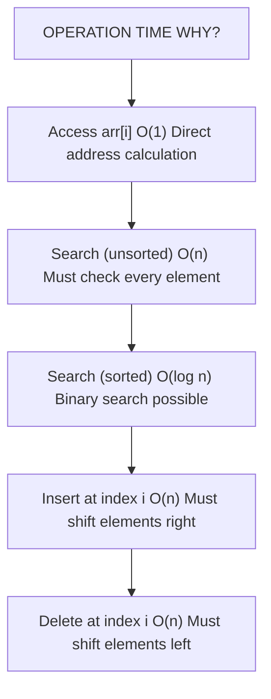
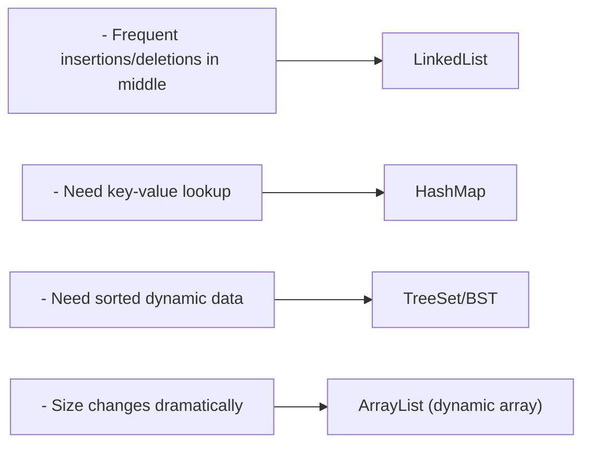
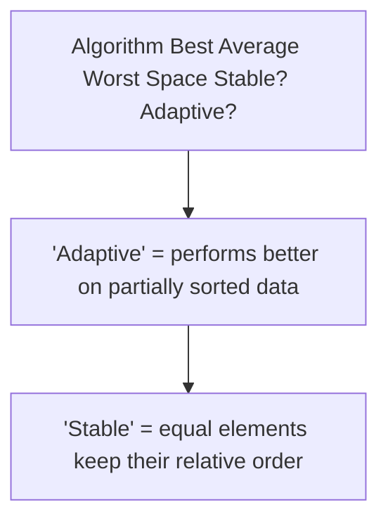
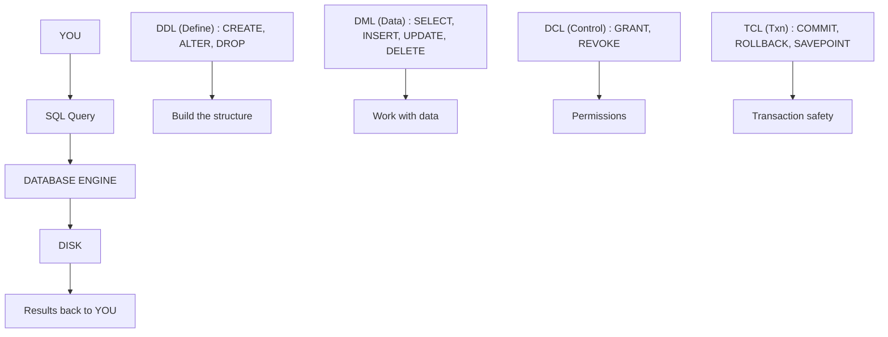
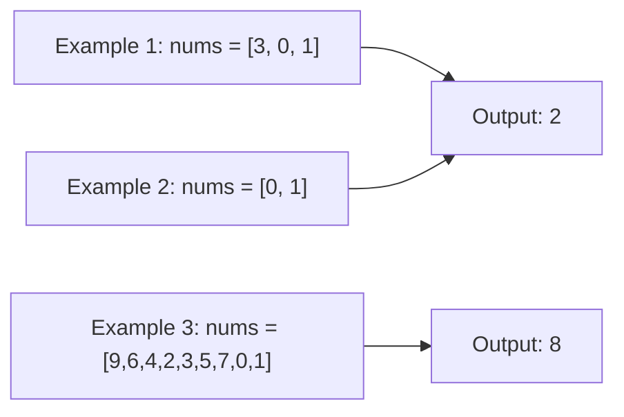
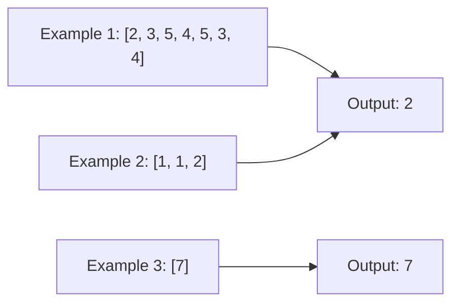
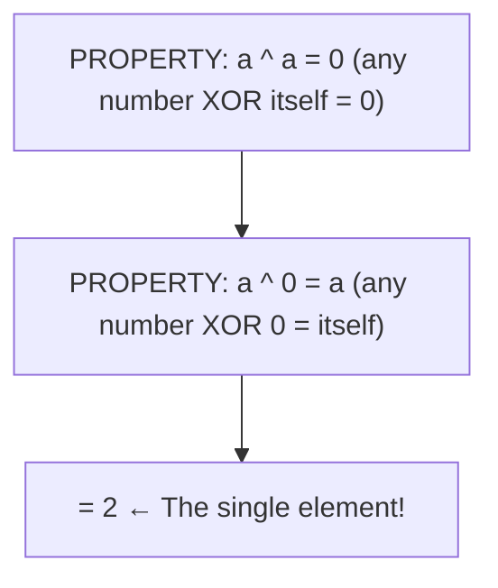

> **Navigation**: [Back to Index](../00_MASTER_INDEX.md) | [Next >](Day_002_Mar04_Tue.md)

# Day 001 - Monday, March 3, 2026

> **Week 01** | **Difficulty:** EASY | **Theme:** Arrays Fundamentals + SQL Start
> [Daily Index](../00_DAILY_PRACTICE_INDEX.md) | [Next Day](Day_002_Mar04_Tue.md)

---

## Completion Checklist

- [ ] DS: Array fundamentals (30 min)
- [ ] ALGO: Linear Search + Basic Sorting intro (30 min)
- [ ] COMBO: Search in sorted array (20 min)
- [ ] REAL: Real-time scenario problem (20 min)
- [ ] SQL: Database fundamentals + first queries (40 min)
- [ ] Q1: Coding problem 1 (20 min)
- [ ] Q2: Coding problem 2 (20 min)

---

## BLOCK 1: DATA STRUCTURE (30 min)

### Topic: Array — The Foundation of Everything

#### WHY does this exist?
Arrays are the most fundamental data structure. Every other data structure (Stack, Queue, HashMap, Heap) is built on top of arrays internally. If you don't understand arrays deeply, you'll never understand anything else.

**WHO invented it?** The concept comes from mathematics (ordered sequences). In computing, arrays were the first data structure implemented in assembly language — direct memory addressing.

**WHERE is it used?**
- Every programming language's standard library
- Database tables (rows are essentially arrays of columns)
- Image processing (2D array of pixels)
- Operating systems (process table, page table)
- Google Sheets / Excel (cells = 2D array)

#### WHAT is an Array?

```
DEFINITION: Contiguous block of memory storing elements of the same type.

MEMORY MODEL:
+--------+--------+--------+--------+--------+
| arr[0] | arr[1] | arr[2] | arr[3] | arr[4] |
+--------+--------+--------+--------+--------+
| 0x100  | 0x104  | 0x108  | 0x10C  | 0x110  |  <- Memory addresses (4 bytes each for int)
+--------+--------+--------+--------+--------+

KEY PROPERTY: arr[i] = baseAddress + (i * elementSize)
   This is WHY array access is O(1) — it's just arithmetic!
```

#### HOW does it work internally?

```
OPERATION           TIME      WHY?
─────────────────────────────────────────────────────
Access arr[i]       O(1)      Direct address calculation
Search (unsorted)   O(n)      Must check every element
Search (sorted)     O(log n)  Binary search possible
Insert at end       O(1)*     Just place at next index (*amortized for dynamic)
Insert at index i   O(n)      Must shift elements right
Delete at index i   O(n)      Must shift elements left
─────────────────────────────────────────────────────
```

> **Flow**: OPERATION TIME WHY? → Access arr[i] O(1) Direct address calculation | Access arr[i] O(1) Direct address calculation → Search (unsorted) O(n) Must check every element | Search (unsorted) O(n) Must check every element → Search (sorted) O(log n) Binary search possible | Search (sorted) O(log n) Binary search possible → Insert at index i O(n) Must shift elements right | Insert at index i O(n) Must shift elements right → Delete at index i O(n) Must shift elements left



#### WHEN to use Arrays vs alternatives?

```
USE ARRAY WHEN:
  - You need O(1) random access by index
  - Elements are same type
  - Size is known or doesn't change often
  - Cache performance matters (contiguous memory)

DON'T USE ARRAY WHEN:
  - Frequent insertions/deletions in middle → LinkedList
  - Need key-value lookup → HashMap
  - Need sorted dynamic data → TreeSet/BST
  - Size changes dramatically → ArrayList (dynamic array)
```

> **Flow**: - Frequent insertions/deletions in middle → LinkedList | - Need key-value lookup → HashMap | - Need sorted dynamic data → TreeSet/BST | - Size changes dramatically → ArrayList (dynamic array)



#### Code: Implement these by hand

```java
public class ArrayBasics {
    
    // 1. Find maximum element
    public static int findMax(int[] arr) {
        int max = arr[0];  // WHY arr[0] not Integer.MIN_VALUE? Think about empty arrays
        for (int i = 1; i < arr.length; i++) {
            if (arr[i] > max) max = arr[i];
        }
        return max;
    }
    
    // 2. Reverse array in-place (Two Pointer pattern - you know this!)
    public static void reverse(int[] arr) {
        int left = 0, right = arr.length - 1;
        while (left < right) {
            int temp = arr[left];
            arr[left] = arr[right];
            arr[right] = temp;
            left++;
            right--;
        }
    }
    
    // 3. Remove duplicates from sorted array (in-place)
    // Returns new length
    public static int removeDuplicates(int[] arr) {
        if (arr.length == 0) return 0;
        int writePointer = 1;  // Position to write next unique element
        for (int readPointer = 1; readPointer < arr.length; readPointer++) {
            if (arr[readPointer] != arr[readPointer - 1]) {
                arr[writePointer] = arr[readPointer];
                writePointer++;
            }
        }
        return writePointer;
    }
}
```

> **Read more:** [02_Data_Structures/01_DataStructures_Complete.md](../../02_Data_Structures/01_DataStructures_Complete.md)

---

## BLOCK 2: ALGORITHM (30 min)

### Topic: Linear Search + Introduction to Sorting

#### WHY learn Linear Search first?
Because EVERY search algorithm is an optimization of linear search. You must understand the brute-force baseline before you can appreciate why Binary Search, Hash-based search, or Tree-based search exist.

**WHO?** Linear search is as old as computing itself. Sorting algorithms have rich history:
- Bubble Sort: analyzed by Knuth (1968)
- Selection Sort: one of the simplest comparison sorts
- Insertion Sort: how humans naturally sort playing cards

#### WHAT is the core idea?

```
LINEAR SEARCH: Check every element one by one until found or exhausted.

  arr = [4, 2, 7, 1, 9, 3]
  target = 7

  Step 1: arr[0]=4, not 7  -> continue
  Step 2: arr[1]=2, not 7  -> continue
  Step 3: arr[2]=7, FOUND! -> return index 2

  Time: O(n) | Space: O(1)
  Best: O(1) when element is first | Worst: O(n) when last or absent

SELECTION SORT: Find minimum, swap to front. Repeat.

  [64, 25, 12, 22, 11]
   ^--- find min in [0..4] -> 11 at index 4
  [11, 25, 12, 22, 64]   <- swapped 64 and 11
       ^--- find min in [1..4] -> 12 at index 2
  [11, 12, 25, 22, 64]   <- swapped 25 and 12
            ^--- find min in [2..4] -> 22 at index 3
  [11, 12, 22, 25, 64]   <- swapped 25 and 22
                ^--- find min in [3..4] -> 25, already in place
  [11, 12, 22, 25, 64]   SORTED!

  Time: O(n^2) always | Space: O(1) | Stable: NO
```

#### Code: Implement both

```java
public class SearchAndSort {
    
    // Linear Search - the baseline
    public static int linearSearch(int[] arr, int target) {
        for (int i = 0; i < arr.length; i++) {
            if (arr[i] == target) return i;
        }
        return -1;  // Not found
    }
    
    // Selection Sort - visual, easy to understand
    public static void selectionSort(int[] arr) {
        int n = arr.length;
        for (int i = 0; i < n - 1; i++) {
            int minIdx = i;
            for (int j = i + 1; j < n; j++) {
                if (arr[j] < arr[minIdx]) {
                    minIdx = j;
                }
            }
            // Swap
            int temp = arr[i];
            arr[i] = arr[minIdx];
            arr[minIdx] = temp;
        }
    }
    
    // Insertion Sort - how you sort cards in your hand
    public static void insertionSort(int[] arr) {
        for (int i = 1; i < arr.length; i++) {
            int key = arr[i];
            int j = i - 1;
            // Shift elements greater than key to the right
            while (j >= 0 && arr[j] > key) {
                arr[j + 1] = arr[j];
                j--;
            }
            arr[j + 1] = key;
        }
    }
}
```

#### Complexity Comparison (memorize this table)

```
Algorithm        Best     Average   Worst    Space   Stable?   Adaptive?
──────────────────────────────────────────────────────────────────────────
Selection Sort   O(n^2)   O(n^2)    O(n^2)   O(1)   No        No
Insertion Sort   O(n)     O(n^2)    O(n^2)   O(1)   Yes       Yes
Bubble Sort      O(n)     O(n^2)    O(n^2)   O(1)   Yes       Yes
──────────────────────────────────────────────────────────────────────────
"Adaptive" = performs better on partially sorted data
"Stable"   = equal elements keep their relative order
```

> **Flow**: Algorithm Best Average Worst Space Stable? Adaptive? → 'Adaptive' = performs better on partially sorted data | 'Adaptive' = performs better on partially sorted data → 'Stable' = equal elements keep their relative order



> **Read more:** [03_Algorithms/02_Sorting_Algorithms.md](../../03_Algorithms/02_Sorting_Algorithms.md)

---

## BLOCK 3: COMBO — DS + Algorithm (20 min)

### Problem: Search in a Sorted Array and Count Occurrences

**Scenario:** You have a sorted array of student scores. Find how many students scored exactly 85.

```
INPUT:  scores = [70, 75, 80, 85, 85, 85, 90, 95]
OUTPUT: 3 (three students scored 85)

APPROACH 1: Linear Search — O(n)
  Count every 85. Simple but slow for large arrays.

APPROACH 2: Binary Search + Expand — O(log n + k) where k = count
  Binary search to find one 85, then expand left and right.

APPROACH 3: Two Binary Searches — O(log n)
  Find FIRST occurrence of 85 (leftmost)
  Find LAST occurrence of 85 (rightmost)
  Count = last - first + 1
```

```java
public class CountOccurrences {
    
    // Approach 3: Optimal — Two Binary Searches
    public static int countOccurrences(int[] arr, int target) {
        int first = findFirst(arr, target);
        if (first == -1) return 0;  // Not found
        int last = findLast(arr, target);
        return last - first + 1;
    }
    
    private static int findFirst(int[] arr, int target) {
        int lo = 0, hi = arr.length - 1, result = -1;
        while (lo <= hi) {
            int mid = lo + (hi - lo) / 2;
            if (arr[mid] == target) {
                result = mid;
                hi = mid - 1;  // Keep searching LEFT
            } else if (arr[mid] < target) {
                lo = mid + 1;
            } else {
                hi = mid - 1;
            }
        }
        return result;
    }
    
    private static int findLast(int[] arr, int target) {
        int lo = 0, hi = arr.length - 1, result = -1;
        while (lo <= hi) {
            int mid = lo + (hi - lo) / 2;
            if (arr[mid] == target) {
                result = mid;
                lo = mid + 1;  // Keep searching RIGHT
            } else if (arr[mid] < target) {
                lo = mid + 1;
            } else {
                hi = mid - 1;
            }
        }
        return result;
    }
}
```

**EDGE CASES to think about:**
- Empty array → return 0
- Target not in array → return 0
- All elements are the target → return arr.length
- Single element array → check if it's the target

---

## BLOCK 4: REAL-TIME SCENARIO (20 min)

### Scenario: You're building an inventory system for a grocery store

**Problem:** The store has 10,000 products. Each product has a barcode (integer ID) and a price. Design a data structure that supports:
1. Lookup price by barcode — O(1)
2. Find cheapest product — efficient
3. Add new product — O(1)

**Think through it:**

```
OPTION A: Sorted Array by barcode
  + Binary search for lookup: O(log n)
  - Insert: O(n) — must shift elements
  - Cheapest: O(n) unless separately tracked
  VERDICT: Good for READ-heavy, bad for WRITE-heavy

OPTION B: HashMap (barcode -> price)
  + Lookup: O(1) average
  + Insert: O(1) average
  - Cheapest: O(n) — must scan all
  VERDICT: Great for lookup/insert, bad for min query

OPTION C: HashMap + Variable tracking min
  + Lookup: O(1)
  + Insert: O(1) + update min if needed
  + Cheapest: O(1) — tracked separately
  - Delete cheapest: O(n) to find new min
  VERDICT: Best if deletes are rare
```

**Your task:** Implement Option C in Java. Think about what happens when the cheapest product gets deleted — how do you find the new cheapest?

```java
public class InventorySystem {
    private Map<Integer, Double> products = new HashMap<>();  // barcode -> price
    private int cheapestBarcode = -1;
    private double cheapestPrice = Double.MAX_VALUE;
    
    public void addProduct(int barcode, double price) {
        products.put(barcode, price);
        if (price < cheapestPrice) {
            cheapestPrice = price;
            cheapestBarcode = barcode;
        }
    }
    
    public double getPrice(int barcode) {
        return products.getOrDefault(barcode, -1.0);
    }
    
    public int getCheapestBarcode() {
        return cheapestBarcode;
    }
    
    // CHALLENGE: What's the time complexity of delete?
    // How would you improve it? (Hint: think Heaps — you'll learn them in Week 7)
}
```

**INTERVIEW INSIGHT:** This is essentially the "Min Stack" problem pattern applied to a real system. Amazon, Flipkart, and Walmart all face this exact design challenge for their product catalogs.

---

## BLOCK 5: SQL (40 min)

### Topic: Your First Steps in SQL — Database Fundamentals

#### WHY learn SQL?

Every application you've ever used stores data in a database. Instagram posts, Netflix watch history, Zomato orders, bank transactions — ALL stored in databases queried with SQL. SQL is the **#1 most in-demand skill** on job postings across ALL programming roles.

**Real incident:** In 2017, a junior developer at GitLab accidentally ran `DELETE FROM` on the production database without a WHERE clause. They lost 6 hours of user data. Understanding SQL prevents disasters like this.

#### WHAT is SQL?

```
SQL = Structured Query Language
Pronunciation: "S-Q-L" or "sequel" (both are correct)

SQL talks to databases the way Java talks to the JVM:

  YOU  →  SQL Query  →  DATABASE ENGINE  →  DISK  →  Results back to YOU

There are 4 types of SQL commands:
  DDL (Define)  : CREATE, ALTER, DROP        → Build the structure
  DML (Data)    : SELECT, INSERT, UPDATE, DELETE → Work with data
  DCL (Control) : GRANT, REVOKE              → Permissions
  TCL (Txn)     : COMMIT, ROLLBACK, SAVEPOINT → Transaction safety
```

> **Flow**: YOU → SQL Query | SQL Query → DATABASE ENGINE | DATABASE ENGINE → DISK | DISK → Results back to YOU | DDL (Define) : CREATE, ALTER, DROP → Build the structure | DML (Data) : SELECT, INSERT, UPDATE, DELETE → Work with data | ...+2 more



#### HOW — Your First Queries

```sql
-- ═══════════════════════════════════════════════════════════
-- STEP 1: Create a database (like creating a new folder)
-- ═══════════════════════════════════════════════════════════
CREATE DATABASE grocery_store;
USE grocery_store;

-- ═══════════════════════════════════════════════════════════
-- STEP 2: Create a table (like defining a spreadsheet)
-- ═══════════════════════════════════════════════════════════
CREATE TABLE products (
    product_id   INT PRIMARY KEY AUTO_INCREMENT,  -- Unique ID, auto-generated
    name         VARCHAR(100) NOT NULL,            -- Product name, required
    category     VARCHAR(50),                      -- Optional category
    price        DECIMAL(10, 2) NOT NULL,          -- Exact price (no float!)
    stock        INT DEFAULT 0,                    -- How many in stock
    created_at   TIMESTAMP DEFAULT CURRENT_TIMESTAMP
);

-- WHY DECIMAL not FLOAT for price?
-- FLOAT: 0.1 + 0.2 = 0.30000000000000004  (WRONG for money!)
-- DECIMAL: 0.1 + 0.2 = 0.3                 (EXACT)

-- ═══════════════════════════════════════════════════════════
-- STEP 3: Insert data (like filling rows in a spreadsheet)
-- ═══════════════════════════════════════════════════════════
INSERT INTO products (name, category, price, stock) VALUES
    ('Milk', 'Dairy', 65.00, 100),
    ('Bread', 'Bakery', 40.00, 50),
    ('Rice', 'Grains', 120.00, 200),
    ('Eggs', 'Dairy', 80.00, 75),
    ('Butter', 'Dairy', 55.00, 30),
    ('Apple', 'Fruits', 150.00, 60),
    ('Banana', 'Fruits', 40.00, 100),
    ('Chicken', 'Meat', 250.00, 25),
    ('Salt', 'Spices', 20.00, 500),
    ('Sugar', 'Baking', 45.00, 150);

-- ═══════════════════════════════════════════════════════════
-- STEP 4: Query data (the most important part!)
-- ═══════════════════════════════════════════════════════════

-- Get all products
SELECT * FROM products;

-- Get only names and prices (project specific columns)
SELECT name, price FROM products;

-- Filter: products under 50 rupees
SELECT name, price FROM products WHERE price < 50;

-- Filter: dairy products
SELECT name, price FROM products WHERE category = 'Dairy';

-- Sort: cheapest first
SELECT name, price FROM products ORDER BY price ASC;

-- Sort: most expensive first
SELECT name, price FROM products ORDER BY price DESC;

-- Combine filter + sort: Dairy products, cheapest first
SELECT name, price 
FROM products 
WHERE category = 'Dairy' 
ORDER BY price ASC;
```

#### SQL Practice Questions (do all 3)

**Q1 (Easy):** Write a query to find all products with stock less than 50.

<details>
<summary>Answer</summary>

```sql
SELECT name, stock FROM products WHERE stock < 50;
-- Returns: Butter(30), Chicken(25)
```
</details>

**Q2 (Easy):** Write a query to find the product with the highest price.

<details>
<summary>Answer</summary>

```sql
SELECT name, price FROM products ORDER BY price DESC LIMIT 1;
-- Returns: Chicken, 250.00
```
</details>

**Q3 (Easy-Medium):** Write a query to find all Fruits that cost more than 100 rupees, sorted by name.

<details>
<summary>Answer</summary>

```sql
SELECT name, price 
FROM products 
WHERE category = 'Fruits' AND price > 100 
ORDER BY name;
-- Returns: Apple, 150.00
```
</details>

> **Read more:** [08_SQL/01_Foundations_Database_Basics.md](../../08_SQL/01_Foundations_Database_Basics.md)

---

## BLOCK 6: CODING PROBLEMS (40 min)

### Q1: LC 268 — Missing Number (Easy)

**Platform:** LeetCode | **Difficulty:** Easy | **Topic:** Array + Math

Given an array `nums` containing `n` distinct numbers in the range `[0, n]`, return the only number in the range that is missing.

```
Example 1: nums = [3, 0, 1] → Output: 2
Example 2: nums = [0, 1]    → Output: 2
Example 3: nums = [9,6,4,2,3,5,7,0,1] → Output: 8
```

> **Flow**: Example 1: nums = [3, 0, 1] → Output: 2 | Example 2: nums = [0, 1] → Output: 2 | Example 3: nums = [9,6,4,2,3,5,7,0,1] → Output: 8



**Think before coding:** What approaches exist?
1. Sort + check gaps → O(n log n)
2. HashSet + check all numbers → O(n) time, O(n) space
3. Math: sum formula → O(n) time, O(1) space
4. XOR trick → O(n) time, O(1) space

<details>
<summary>Solution (Math approach)</summary>

```java
public int missingNumber(int[] nums) {
    int n = nums.length;
    int expectedSum = n * (n + 1) / 2;  // Sum of 0..n
    int actualSum = 0;
    for (int num : nums) {
        actualSum += num;
    }
    return expectedSum - actualSum;
}
// Time: O(n) | Space: O(1)
// WHY this works: if one number is missing, the difference between
// the expected sum and actual sum IS the missing number.
```
</details>

<details>
<summary>Solution (XOR approach — bonus)</summary>

```java
public int missingNumber(int[] nums) {
    int xor = nums.length;  // Start with n
    for (int i = 0; i < nums.length; i++) {
        xor ^= i ^ nums[i];  // XOR with index and value
    }
    return xor;
}
// WHY this works: a ^ a = 0, a ^ 0 = a
// Every number that appears in BOTH [0..n] and nums[] cancels out.
// The one remaining is the missing number.
```
</details>

---

### Q2: Find the Single Element (Not Famous but Great!)

**Platform:** HackerEarth-style | **Difficulty:** Easy | **Topic:** Array + XOR

Given an array where every element appears **twice** except for one element which appears only once, find that single element.

**Constraint:** Do it in O(n) time and O(1) space.

```
Example 1: [2, 3, 5, 4, 5, 3, 4] → Output: 2
Example 2: [1, 1, 2]             → Output: 2
Example 3: [7]                    → Output: 7
```

> **Flow**: Example 1: [2, 3, 5, 4, 5, 3, 4] → Output: 2 | Example 2: [1, 1, 2] → Output: 2 | Example 3: [7] → Output: 7



**The XOR pattern (memorize this — it appears in 10+ problems):**
```
PROPERTY: a ^ a = 0     (any number XOR itself = 0)
PROPERTY: a ^ 0 = a     (any number XOR 0 = itself)
PROPERTY: XOR is commutative and associative (order doesn't matter)

So: 2 ^ 3 ^ 5 ^ 4 ^ 5 ^ 3 ^ 4
  = 2 ^ (3 ^ 3) ^ (4 ^ 4) ^ (5 ^ 5)
  = 2 ^ 0 ^ 0 ^ 0
  = 2  ← The single element!
```

> **Flow**: PROPERTY: a ^ a = 0 (any number XOR itself = 0) → PROPERTY: a ^ 0 = a (any number XOR 0 = itself) | PROPERTY: a ^ 0 = a (any number XOR 0 = itself) → = 2 ← The single element!



<details>
<summary>Solution</summary>

```java
public int singleNumber(int[] nums) {
    int result = 0;
    for (int num : nums) {
        result ^= num;
    }
    return result;
}
// Time: O(n) | Space: O(1)
// This is also LC 136 — Single Number
```
</details>

**Follow-up challenge:** What if every element appears THREE times except one? (This is LC 137 — harder, uses bit counting)

---

## End of Day 1

### What you learned today:
1. **Array memory model** — why O(1) access works
2. **When to use arrays vs other DS** — decision framework
3. **Linear Search → Selection Sort → Insertion Sort** — the O(n^2) family
4. **Binary Search for counting** — two searches to find range
5. **Real system design** — inventory lookup with HashMap + min tracking
6. **SQL basics** — CREATE TABLE, INSERT, SELECT, WHERE, ORDER BY
7. **XOR pattern** — the single-number trick (appears everywhere)

### Tomorrow's Preview: Day 2 — Array Operations + Insertion Sort + SQL Data Types

---

> **Mentor Note:** Don't rush. If you didn't finish everything today, that's okay. 
> The most important thing is understanding WHY, not just typing code.
> If you understood the XOR pattern deeply, you've already won today.


---

> **Navigation**: [Back to Index](../00_MASTER_INDEX.md) | [Next >](Day_002_Mar04_Tue.md)