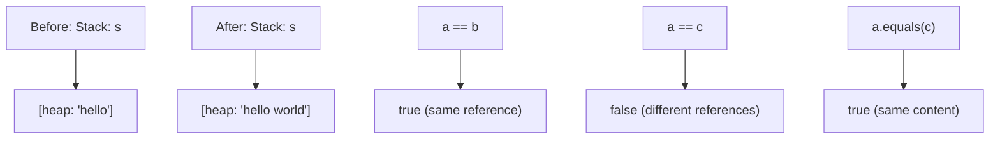
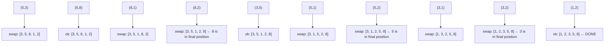
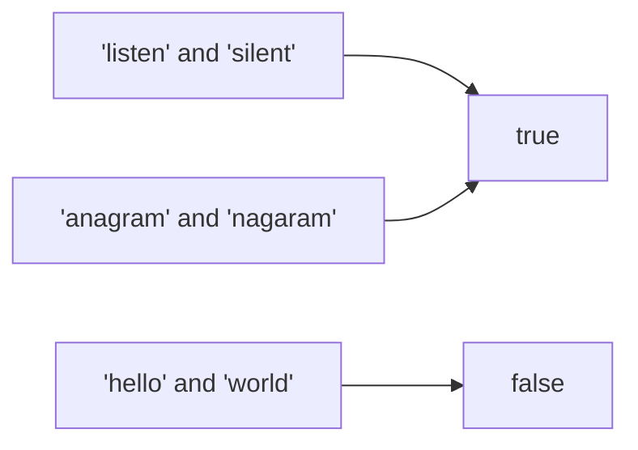

> **Navigation**: [< Previous](Day_002_Mar04_Tue.md) | [Back to Index](../../00_MASTER_INDEX.md) | [Next >](Day_004_Mar06_Thu.md)

# Day 003 - Wednesday, March 5, 2026

> **Week 01** | **Difficulty:** EASY | **Theme:** Strings + Bubble Sort + SQL DDL
> [Prev Day](Day_002_Mar04_Tue.md) | [Daily Index](../00_DAILY_PRACTICE_INDEX.md) | [Next Day](Day_004_Mar06_Thu.md)

---

## Completion Checklist

- [ ] DS: String internals — memory, immutability, common operations (30 min)
- [ ] ALGO: Bubble Sort + optimization + when to avoid (30 min)
- [ ] COMBO: Check if two strings are anagrams (20 min)
- [ ] REAL: Log file parser scenario (20 min)
- [ ] SQL: DDL deep dive — CREATE/ALTER/DROP + schema design decisions (40 min)
- [ ] Q1: Coding problem 1 (20 min)
- [ ] Q2: Coding problem 2 (20 min)

---

## BLOCK 1: DATA STRUCTURE (30 min)

### Topic: Strings — Internals, Immutability, Operations

#### WHY understand String internals?

In Java interviews, String questions appear in ~40% of coding rounds. Understanding **how** they work in memory prevents subtle bugs and performance traps.

#### WHAT happens in memory?

```
IMMUTABILITY: Once a String is created, it CANNOT change.

String s = "hello";
s = s + " world";  // Creates a NEW string, doesn't modify old one!

MEMORY:
  Before:  Stack: s → [heap: "hello"]
  After:   Stack: s → [heap: "hello world"]
                       [heap: "hello"]  ← STILL EXISTS (garbage collected later)

String Pool (special memory area):
  String a = "hello";  // Goes to pool
  String b = "hello";  // Reuses from pool (same object!)
  String c = new String("hello");  // NOT from pool (new object on heap)
  
  a == b     → true  (same reference)
  a == c     → false (different references)
  a.equals(c)→ true  (same content)
  
  RULE: ALWAYS use .equals() for String comparison, NEVER ==
```

**Flow:**
- Before: Stack: s
- ↓
- [heap: 'hello']
- ↓
- After: Stack: s
- ↓
- [heap: 'hello world']
- ↓
- a == b
- ↓
- true (same reference)
- ↓
- a == c
- ↓
- false (different references)
- ↓
- a.equals(c)
- ↓
- true (same content)



#### HOW: Essential String operations

```java
public class StringOperations {
    
    // 1. Reverse a string (without StringBuilder)
    public static String reverse(String s) {
        char[] chars = s.toCharArray();
        int left = 0, right = chars.length - 1;
        while (left < right) {
            char temp = chars[left];
            chars[left] = chars[right];
            chars[right] = temp;
            left++;
            right--;
        }
        return new String(chars);
    }
    
    // 2. Count character frequencies
    public static int[] countFrequencies(String s) {
        int[] freq = new int[26];  // Assuming lowercase a-z
        for (char c : s.toCharArray()) {
            freq[c - 'a']++;
        }
        return freq;
    }
    
    // 3. Check palindrome
    public static boolean isPalindrome(String s) {
        int left = 0, right = s.length() - 1;
        while (left < right) {
            if (s.charAt(left) != s.charAt(right)) return false;
            left++;
            right--;
        }
        return true;
    }
    
    // 4. Remove duplicates preserving order
    public static String removeDuplicates(String s) {
        boolean[] seen = new boolean[256];  // ASCII
        StringBuilder sb = new StringBuilder();
        for (char c : s.toCharArray()) {
            if (!seen[c]) {
                seen[c] = true;
                sb.append(c);
            }
        }
        return sb.toString();
    }
}
```

#### Performance trap: String concatenation in loops

```java
// BAD: O(n²) — creates n new strings
String result = "";
for (int i = 0; i < 10000; i++) {
    result += i;  // New String object every iteration!
}

// GOOD: O(n) — single mutable buffer
StringBuilder sb = new StringBuilder();
for (int i = 0; i < 10000; i++) {
    sb.append(i);
}
String result = sb.toString();
```

---

## BLOCK 2: ALGORITHM (30 min)

### Topic: Bubble Sort + Optimization + Sort Comparison

#### HOW Bubble Sort works

```
The INTUITION: Largest element "bubbles up" to the end each pass.

arr = [5, 3, 8, 1, 2]

Pass 1 (compare adjacent, swap if needed):
  (5,3) → swap: [3, 5, 8, 1, 2]
  (5,8) → ok:   [3, 5, 8, 1, 2]
  (8,1) → swap: [3, 5, 1, 8, 2]
  (8,2) → swap: [3, 5, 1, 2, 8]  ← 8 is in final position

Pass 2 (ignore last element):
  (3,5) → ok:   [3, 5, 1, 2, 8]
  (5,1) → swap: [3, 1, 5, 2, 8]
  (5,2) → swap: [3, 1, 2, 5, 8]  ← 5 is in final position

Pass 3:
  (3,1) → swap: [1, 3, 2, 5, 8]
  (3,2) → swap: [1, 2, 3, 5, 8]  ← 3 is in final position

Pass 4:
  (1,2) → ok:   [1, 2, 3, 5, 8]  ← DONE
```

**Flow:**
- (5,3)
- ↓
- swap: [3, 5, 8, 1, 2]
- ↓
- (5,8)
- ↓
- ok: [3, 5, 8, 1, 2]
- ↓
- (8,1)
- ↓
- swap: [3, 5, 1, 8, 2]
- ↓
- (8,2)
- ↓
- swap: [3, 5, 1, 2, 8] ← 8 is in final position
- ↓
- (3,5)
- ↓
- ok: [3, 5, 1, 2, 8]
- ↓
- (5,1)
- ↓
- swap: [3, 1, 5, 2, 8]



#### Optimized Bubble Sort (early termination)

```java
public static void bubbleSort(int[] arr) {
    int n = arr.length;
    for (int i = 0; i < n - 1; i++) {
        boolean swapped = false;  // OPTIMIZATION
        for (int j = 0; j < n - 1 - i; j++) {
            if (arr[j] > arr[j + 1]) {
                int temp = arr[j];
                arr[j] = arr[j + 1];
                arr[j + 1] = temp;
                swapped = true;
            }
        }
        if (!swapped) break;  // Already sorted — stop early!
    }
}
// Best case (already sorted): O(n) with optimization
// Worst/Average: O(n²)
```

#### Sort comparison table (reference from Day 1 + today)

```
Algorithm        | Best    | Average | Worst   | Space | Stable? | Use When
-----------------+---------+---------+---------+-------+---------+---------------------------
Selection Sort   | O(n²)   | O(n²)   | O(n²)   | O(1)  | No      | Minimum swaps needed
Insertion Sort   | O(n)    | O(n²)   | O(n²)   | O(1)  | Yes     | Small/nearly sorted
Bubble Sort      | O(n)*   | O(n²)   | O(n²)   | O(1)  | Yes     | Educational only
                 * with early termination optimization

REAL TALK: Bubble sort is rarely used in production.
  Java's Arrays.sort() never uses it.
  BUT: Understanding it helps you understand why better algorithms exist.
  Interview value: "I know Bubble Sort but I'd use X instead because..."
```

---

## BLOCK 3: COMBO (20 min)

### Problem: Check if Two Strings are Anagrams

Two strings are anagrams if they contain the same characters in different order.

```
"listen" and "silent" → true
"hello" and "world"   → false
"anagram" and "nagaram" → true
```

**Flow:**
- 'listen' and 'silent'
- ↓
- true
- ↓
- 'hello' and 'world'
- ↓
- false
- ↓
- 'anagram' and 'nagaram'
- ↓
- true



**Three approaches:**
1. Sort both, compare → O(n log n)
2. Frequency count array → O(n) time, O(1) space (26 letters)
3. Single frequency array, increment for s1, decrement for s2 → O(n)

<details>
<summary>Solution (optimal: single pass)</summary>

```java
public boolean isAnagram(String s, String t) {
    if (s.length() != t.length()) return false;  // Quick reject
    
    int[] freq = new int[26];
    for (int i = 0; i < s.length(); i++) {
        freq[s.charAt(i) - 'a']++;
        freq[t.charAt(i) - 'a']--;
    }
    
    for (int count : freq) {
        if (count != 0) return false;
    }
    return true;
}
// Time: O(n) | Space: O(1) — 26 letters is constant

// FOLLOW-UP: What if input has Unicode? Use HashMap<Character, Integer>.
```
</details>

---

## BLOCK 4: REAL-TIME SCENARIO (20 min)

### Scenario: Server Log Parser

**Problem:** You receive server logs as strings. Each log has format:
`"TIMESTAMP LEVEL MESSAGE"`
Example: `"2026-03-05T10:15:30 ERROR Database connection timeout"`

Write a function to:
1. Parse all logs into structured data
2. Count logs by level (INFO, WARN, ERROR)
3. Find all ERROR logs (for the on-call engineer)

```java
public class LogParser {
    
    public static Map<String, Integer> countByLevel(String[] logs) {
        Map<String, Integer> counts = new HashMap<>();
        
        for (String log : logs) {
            // Split: "2026-03-05T10:15:30 ERROR Database timeout"
            //         ↑ timestamp        ↑ level ↑ message
            String[] parts = log.split(" ", 3);  // Max 3 parts
            String level = parts[1];
            counts.put(level, counts.getOrDefault(level, 0) + 1);
        }
        return counts;
    }
    
    public static List<String> getErrorLogs(String[] logs) {
        List<String> errors = new ArrayList<>();
        for (String log : logs) {
            if (log.contains(" ERROR ")) {
                errors.add(log);
            }
        }
        return errors;
    }
}
```

**WHERE does this appear?** Every production system (Netflix, Google, Amazon) has log analysis. Tools like Splunk, ELK Stack, and Datadog all start with parsing text logs — exactly what we're doing here.

---

## BLOCK 5: SQL (40 min)

### Topic: DDL Deep Dive — Schema Design Decisions

#### WHAT is DDL? (Data Definition Language)

```
DDL = commands that define/modify the STRUCTURE of the database
  CREATE  — make new table/database
  ALTER   — modify existing table
  DROP    — permanently delete table/database
  TRUNCATE — delete all rows but keep structure

DML (Data Manipulation Language) — tomorrow's topic:
  INSERT, UPDATE, DELETE, SELECT
```

#### ALTER TABLE — the most common DDL in production

```sql
-- Add a new column
ALTER TABLE students ADD COLUMN phone VARCHAR(15);

-- Modify a column's type
ALTER TABLE students MODIFY COLUMN phone VARCHAR(20);

-- Rename a column
ALTER TABLE students RENAME COLUMN phone TO phone_number;

-- Add a constraint after creation
ALTER TABLE students ADD CONSTRAINT chk_age CHECK (age >= 16);

-- Drop a column (DANGEROUS in production!)
ALTER TABLE students DROP COLUMN phone_number;
```

#### Schema Design Exercise: E-commerce

```sql
-- Products table
CREATE TABLE products (
    product_id    INT PRIMARY KEY AUTO_INCREMENT,
    product_name  VARCHAR(200) NOT NULL,
    price         DECIMAL(10, 2) NOT NULL CHECK (price > 0),
    stock         INT DEFAULT 0 CHECK (stock >= 0),
    category      VARCHAR(50),
    created_at    TIMESTAMP DEFAULT CURRENT_TIMESTAMP
);

-- Orders table (references products via foreign key — preview of Week 2!)
CREATE TABLE orders (
    order_id      INT PRIMARY KEY AUTO_INCREMENT,
    customer_name VARCHAR(100) NOT NULL,
    product_id    INT,
    quantity      INT NOT NULL CHECK (quantity > 0),
    order_date    DATE NOT NULL,
    FOREIGN KEY (product_id) REFERENCES products(product_id)
);

-- Insert sample data
INSERT INTO products (product_name, price, stock, category) VALUES
    ('Laptop', 999.99, 50, 'Electronics'),
    ('Mouse', 29.99, 200, 'Electronics'),
    ('Notebook', 4.99, 500, 'Stationery'),
    ('Pen', 1.99, 1000, 'Stationery'),
    ('Headphones', 149.99, 75, 'Electronics');

INSERT INTO orders (customer_name, product_id, quantity, order_date) VALUES
    ('Harsha', 1, 1, '2026-03-01'),
    ('Alice', 2, 3, '2026-03-02'),
    ('Bob', 3, 10, '2026-03-03'),
    ('Harsha', 5, 1, '2026-03-04');
```

#### Practice Questions

**Q1:** Write a DDL statement to add a `discount_percent` column to `products` with a default of 0 and a constraint that it must be between 0 and 100.

<details>
<summary>Answer</summary>

```sql
ALTER TABLE products 
ADD COLUMN discount_percent DECIMAL(5,2) DEFAULT 0 
CHECK (discount_percent >= 0 AND discount_percent <= 100);
```
</details>

**Q2:** List all products in the Electronics category with stock less than 100.

<details>
<summary>Answer</summary>

```sql
SELECT product_name, price, stock 
FROM products 
WHERE category = 'Electronics' AND stock < 100;
-- Returns: Laptop (50), Headphones (75)
```
</details>

**Q3 (Challenge):** What happens if you try `DROP TABLE products;` while orders references it via FOREIGN KEY?

<details>
<summary>Answer</summary>

```sql
DROP TABLE products;
-- ERROR: Cannot drop table 'products' referenced by a foreign key 
-- constraint on table 'orders'

-- You must either:
-- 1. Drop orders first, then products
-- 2. Remove the foreign key constraint first
-- 3. Use: DROP TABLE orders, products;  (drops in dependency order)
```
</details>

> **Read more:** [08_SQL/03_DDL_Creating_Structure.md](../../08_SQL/03_DDL_Creating_Structure.md)

---

## BLOCK 6: CODING PROBLEMS (40 min)

### Q1: LC 125 — Valid Palindrome (Easy)

Given a string, determine if it is a palindrome considering only alphanumeric characters and ignoring cases.

```
Input: "A man, a plan, a canal: Panama"
Output: true ("amanaplanacanalpanama" is a palindrome)

Input: "race a car"
Output: false
```

<details>
<summary>Solution</summary>

```java
public boolean isPalindrome(String s) {
    int left = 0, right = s.length() - 1;
    
    while (left < right) {
        // Skip non-alphanumeric from left
        while (left < right && !Character.isLetterOrDigit(s.charAt(left))) {
            left++;
        }
        // Skip non-alphanumeric from right
        while (left < right && !Character.isLetterOrDigit(s.charAt(right))) {
            right--;
        }
        
        if (Character.toLowerCase(s.charAt(left)) != Character.toLowerCase(s.charAt(right))) {
            return false;
        }
        left++;
        right--;
    }
    return true;
}
// Time: O(n) | Space: O(1)
// Pattern: TWO POINTERS — converging from both ends
```
</details>

---

### Q2: First Non-Repeating Character (HackerRank popular — not on LeetCode Easy)

Given a string, find the first character that appears exactly once. Return its index, or -1 if no such character exists.

```
Input: "aabbcdd"
Output: 4 (character 'c')

Input: "aabb"
Output: -1
```

<details>
<summary>Solution</summary>

```java
public int firstUniqChar(String s) {
    int[] freq = new int[26];
    
    // Pass 1: count frequencies
    for (char c : s.toCharArray()) {
        freq[c - 'a']++;
    }
    
    // Pass 2: find first with count == 1
    for (int i = 0; i < s.length(); i++) {
        if (freq[s.charAt(i) - 'a'] == 1) {
            return i;
        }
    }
    return -1;
}
// Time: O(n) | Space: O(1) — 26 letters constant
// KEY INSIGHT: Two passes is fine! First count, then scan left-to-right.
// The left-to-right scan guarantees we find the FIRST unique one.
```
</details>

---

## End of Day 3

### What you learned today:
1. **String immutability** — why `==` fails, always use `.equals()`
2. **StringBuilder** — mandatory for concatenation in loops (O(n) vs O(n²))
3. **Frequency array technique** — appears in anagram, palindrome, unique char problems
4. **Bubble Sort** — optimized with `swapped` flag, understand why it's mostly educational
5. **SQL DDL** — ALTER TABLE is the most common production DDL
6. **Schema design** — choosing types, constraints, foreign keys

### Tomorrow's Preview: Day 4 — Subarrays + Kadane's Algorithm + SQL DML

---

> **Mentor Note:** The frequency array pattern (int[26] for lowercase) is one of 
> the most reusable tricks in string problems. Master it — it appears in 15+ 
> LeetCode problems.


---

> **Navigation**: [< Previous](Day_002_Mar04_Tue.md) | [Back to Index](../../00_MASTER_INDEX.md) | [Next >](Day_004_Mar06_Thu.md)